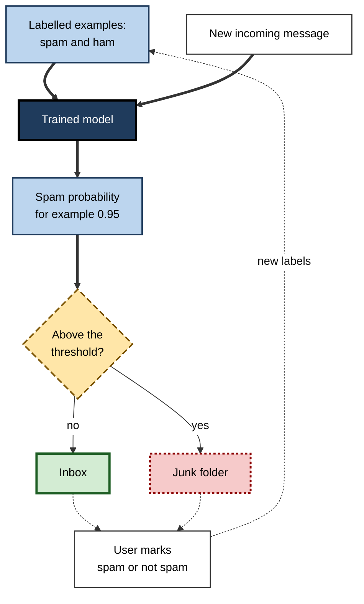
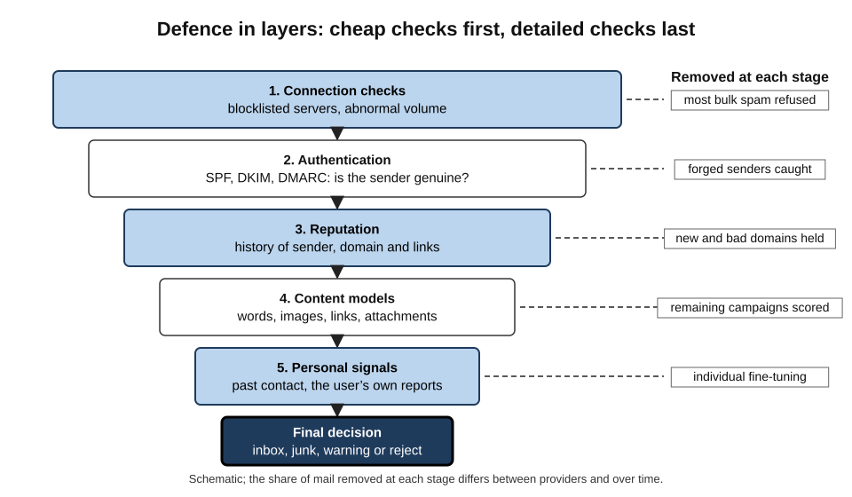
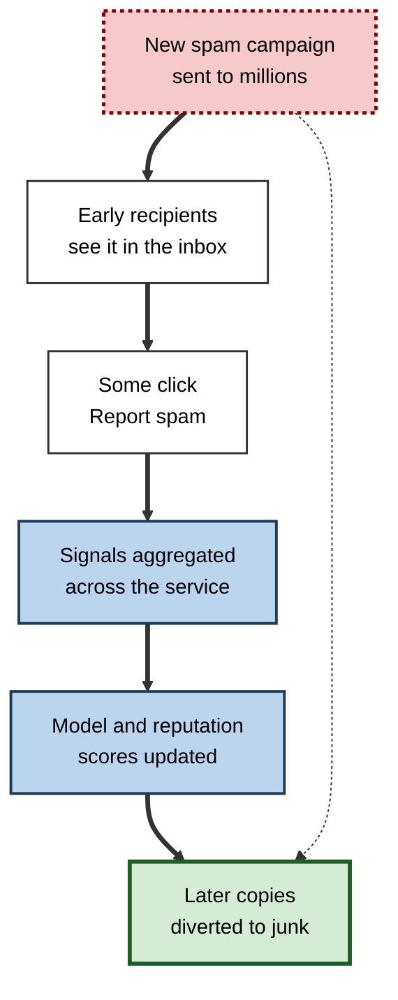
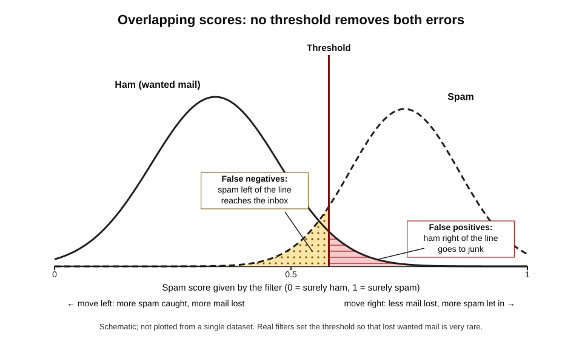
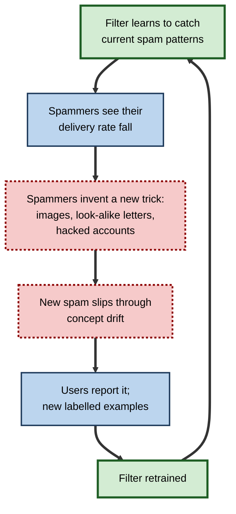
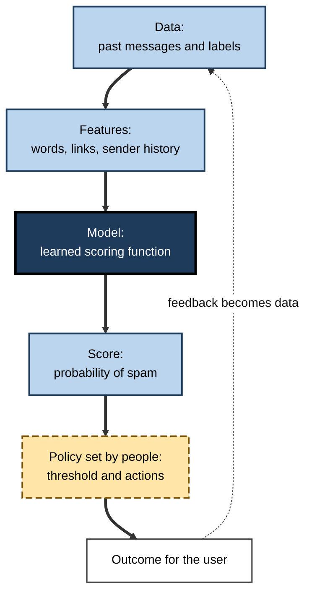

# E.1. Spam filters as your first AI experience

Every morning an inbox opens with a few dozen messages a person actually wants. Behind them, unseen, a larger pile has already been sorted away: fake lottery wins, counterfeit medicines, messages pretending to be from a bank. No one wrote a rule for each one; a system **learned** what junk looks like from millions of examples. For most people this was the first artificial intelligence they used every day.

> **Definition — Spam:** unsolicited messages sent in bulk, usually for advertising, fraud or the spread of malicious software.

> **Definition — Spam filter:** software that examines incoming messages and decides whether each one is wanted mail, junk or dangerous, so that it can be delivered, diverted to a junk folder or blocked.

**Why it matters**

- **It is the clearest everyday example of machine learning.** A spam filter learns from labelled examples, outputs a probability, makes a decision under uncertainty and improves from feedback — the core pattern of most modern AI.
- **It protects people and organisations.** Phishing messages are one of the commonest routes for fraud, stolen passwords and ransomware.
- **It shapes business communication.** Whether a company's invoices, newsletters and job offers reach their recipients depends on how filters judge them.
- **It shows AI working against an adversary.** Spammers change tactics as soon as filters improve, so the system can never be "finished".

---

## The Problem Spam Created

### Why junk mail exploded

- **Origins of the word**
  - Borrowed from a 1970 Monty Python sketch in which the word "Spam" drowns out all other conversation.
  - Applied in the 1980s and 1990s to repetitive, unwanted messages flooding online forums.
- **Early landmarks**
  - **1978** — a marketing message from a computer company was sent to several hundred users of ARPANET, the precursor of the internet; it is usually cited as the first spam e-mail and drew immediate complaints.
  - **1994** — two lawyers posted an advertisement for immigration services to thousands of Usenet discussion groups at once, an episode often described as the start of commercial spam.
- **The economics**
  - Sending one more e-mail costs the sender almost nothing.
  - Even if only a tiny fraction of recipients respond, the campaign can still be profitable.
  - The cost falls instead on recipients (time, attention), on mail providers (storage, bandwidth) and on victims of fraud.

> **Key point:** spam exists because of an **economic asymmetry** — sending is nearly free, while reading, storing and being defrauded are costly. Filters work by making unwanted mail fail to reach its audience, which removes its profit.

### What counts as unwanted

- **Commercial spam** — unrequested advertising for products, often dubious ones.
- **Scams** — advance-fee fraud ("I need help moving a large inheritance"), fake prizes, romance fraud.
- **Phishing** — messages imitating a trusted organisation to steal passwords or payment details.
  - **Spear-phishing** — phishing aimed at a specific person, using details about their job or contacts.
- **Malware delivery** — attachments or links that install malicious software.
- **Grey mail** — newsletters and promotions the person did sign up for but no longer reads.
  - Not spam in law, but many filters now sort it into separate tabs or folders.

> **Definition — Phishing:** a fraudulent message designed to look as if it comes from a trusted source, in order to trick the recipient into revealing credentials, paying money or opening malicious content.

> **Watch out:** "spam" and "phishing" are not the same. Most spam is merely annoying; phishing is a security attack. A filter may treat a harmless but unwanted newsletter very differently from a message that imitates the recipient's bank.

---

## From Rules to Learning

### Hand-written rules

The first filters were written by people, as lists of conditions.

- **Keyword rules** — block messages containing words such as "free money" or "act now".
- **Blocklists** — reject mail from internet addresses known to send spam.
  - Shared blocklists run by volunteer and commercial organisations spread from the late 1990s.
- **Header rules** — flag messages whose technical headers are forged or malformed.
- **Weighted rule sets** — open-source tools such as SpamAssassin (from 2001) gave each rule a score and added them up; a message above a set total was marked as spam.

**Why rules were not enough**

- **Spammers read the rules.** "Viagra" became "V1agra", "V-i-a-g-r-a" or a picture of the word.
- **Rules are blunt.** "Free" appears in legitimate messages ("free delivery on your order").
- **Maintenance never ends.** Every new trick required someone to write and test another rule.
- **One size fits nobody.** A pharmacist's legitimate mail looks like spam to a rule written for everyone else.

### The statistical turn

- **1998** — researchers at Microsoft Research (Mehran Sahami, Susan Dumais, David Heckerman and Eric Horvitz) showed that a **Bayesian classifier** trained on examples of junk and legitimate mail could filter junk e-mail effectively.
- **2002** — the programmer Paul Graham published an essay, "A Plan for Spam", describing a simple Bayesian filter trained on his own mail that caught almost all of his spam with very few mistakes. It triggered a wave of open-source learning filters.
- **The core idea:** do not tell the computer what spam looks like — **show it** thousands of examples of spam and of wanted mail, and let it work out which features separate them.

> **Definition — Ham:** legitimate, wanted e-mail — the opposite of spam in the vocabulary of filter designers.

> **Definition — Classifier:** a model that assigns an input to one of a set of categories, such as *spam* or *ham*.

**Study card — Sahami, Dumais, Heckerman and Horvitz (1998)**

- **Question:** could junk e-mail be filtered by learning from examples rather than by hand-written rules?
- **Design:**
  - collected a corpus of messages labelled as junk or legitimate;
  - trained a naive Bayes classifier on the words in each message;
  - added hand-chosen features such as phrases ("only $"), the proportion of non-letter characters and whether the sender's domain looked commercial.
- **Results:** the learned classifier filtered junk with high precision, and adding the domain-specific features improved it further.
- **Conclusion:** text classification by machine learning was practical for e-mail, and the cost of an error should shape where the decision threshold is set — a theme that still governs filters today.

### How a naive Bayes filter thinks

The naive Bayes method asks a single question about each message: *given the words in it, how likely is it to be spam?*

1. **Training**
   - Count how often each word appears in known spam and in known ham.
   - *e.g.* "unsubscribe" appears in many messages of both kinds; "lottery" mostly in spam; the name of the person's project mostly in ham.
2. **Scoring a new message**
   - For each word, look up how much more common it is in spam than in ham.
   - Combine the evidence from all the words into one probability.
3. **Deciding**
   - If the probability exceeds a threshold, the message goes to the junk folder.
4. **Learning from feedback**
   - When the user marks a message "spam" or "not spam", the counts are updated.

> **Definition — Naive Bayes classifier:** a probabilistic classifier that combines the evidence from each feature (such as each word) using Bayes' theorem, under the simplifying ("naive") assumption that features are independent of one another.

> **Formula — Spam odds from word evidence:** posterior odds = prior odds × likelihood ratio(word₁) × likelihood ratio(word₂) × … , where the likelihood ratio of a word is P(word | spam) ÷ P(word | ham). Probability of spam = odds ÷ (1 + odds).

**Worked example (illustrative) — scoring one message**

A filter has learned the word frequencies below from a training collection in which half the messages were spam (prior odds 1 : 1). A new message contains the words "winner", "claim" and "meeting".

| Word | Share of spam containing it | Share of ham containing it | Likelihood ratio |
|---|---|---|---|
| winner | 0.20 | 0.01 | 20 |
| claim | 0.10 | 0.02 | 5 |
| meeting | 0.02 | 0.10 | 0.2 |

*Illustrative figures.*

1. **Start** with prior odds of 1 (equal chance of spam or ham).
2. **Multiply** by each likelihood ratio: 1 × 20 × 5 × 0.2 = **20**.
3. **Convert** odds to probability: 20 ÷ 21 ≈ **0.95**.
4. **Decide:** with a threshold of 0.9 the message goes to the junk folder.

- **What the example shows:**
  - "winner" and "claim" push strongly towards spam; "meeting" pulls back towards ham.
  - No single word decides; the **combination** of evidence does.

> **Watch out:** the "naive" independence assumption is false — "claim" and "winner" tend to appear together, so their evidence is partly counted twice. Naive Bayes filters therefore produce over-confident probabilities, even though their **ranking** of messages is often good. This is why the method works better than its assumptions suggest.

**Figure 1.** How a learning spam filter is trained, makes a decision and improves from user feedback.

### Three generations of filtering

| | Hand-written rules | Statistical learning | Deep learning and reputation systems |
|---|---|---|---|
| Typical period | 1990s | 2000s | 2010s onwards |
| How it decides | Fixed conditions written by people | Word and feature probabilities learned from examples | Neural networks over text, images, links and sender behaviour, combined with reputation scores |
| Adapts to new tricks | Only when someone writes a new rule | When retrained on fresh examples | Continuously, from feedback across very many users |
| Main weakness | Easy to evade; constant upkeep | Fooled by deliberately inserted "innocent" words | Opaque decisions; needs large data and computing resources |
| Personalisation | None | Possible per user | Global model plus per-user adjustments |

> **Key point:** the shift from rules to learning was a shift from **describing** spam to **demonstrating** it. That same shift — from programming knowledge in to learning it from data — runs through the whole history of artificial intelligence.

---

## How a Modern Filter Decides

### Defence in layers

A large mail service does not run one filter but a **sequence** of checks, each cheap enough to run on enormous volumes and each removing a share of the junk before the next, more expensive check.

1. **Connection checks**
   - Is the sending server on a blocklist? Is it sending an unusual volume of mail?
   - Much bulk spam is refused at this stage, before its content is even read.
2. **Authentication**
   - Does the message really come from the domain it claims? (SPF, DKIM, DMARC — explained below.)
3. **Reputation**
   - How has mail from this sender, domain, internet address and link destination been received in the past?
   - New domains, registered days earlier, attract suspicion.
4. **Content analysis**
   - Words, phrases, formatting, hidden text, images, links and attachments are turned into features and scored by learned models.
   - Suspicious links and attachments may be opened in an isolated test environment (a **sandbox**) to see what they do.
5. **Personal signals**
   - Has this person corresponded with the sender before? Do they usually open such messages, or delete them unread?
6. **Final decision**
   - Deliver to the inbox, place in a promotions tab, divert to junk, quarantine, add a warning banner or reject.

**Figure 2.** A layered defence: each stage removes part of the unwanted mail before the next, more detailed check.

### Proving who sent a message

E-mail was designed in an era of trust: any server could claim to send mail from any address. Three standards, adopted over the 2000s and 2010s, let receiving servers check the claim.

| | SPF | DKIM | DMARC |
|---|---|---|---|
| Full name | Sender Policy Framework | DomainKeys Identified Mail | Domain-based Message Authentication, Reporting and Conformance |
| Question it answers | Is this server allowed to send mail for this domain? | Was the message signed by the domain, and is it unaltered? | Do the visible "From" domain and the checks agree, and what should happen if they fail? |
| How | The domain publishes a list of permitted servers | The sending server adds a cryptographic signature | The domain publishes a policy: do nothing, quarantine or reject — and receives reports |
| Stops | Mail from unlisted servers | Tampering and forged signatures | Direct impersonation of the domain in the "From" line |

> **Definition — E-mail authentication:** technical checks that let a receiving server verify that a message genuinely comes from the domain it claims and has not been altered on the way.

- **Why authentication matters to AI filtering**
  - It turns sender identity into a **reliable feature**: once a domain is authenticated, its history of good or bad behaviour can be trusted.
  - Without it, a spammer could borrow the reputation of a bank simply by typing the bank's address.
- **The 2024 bulk-sender rules**
  - From February 2024 Google and Yahoo required organisations sending large volumes of mail to their users to authenticate it, to offer one-click unsubscribing and to keep the rate at which recipients report their mail as spam low (Google set the ceiling at 0.3%).
  - The change forced many companies to fix e-mail settings that had been neglected for years.

> **Watch out:** authentication proves **who** sent a message, not that it is **safe**. A criminal can register a look-alike domain (for example, replacing the letter "m" with "rn"), authenticate it perfectly and send phishing from it. That is why reputation and content checks still matter.

### Learning at the scale of billions

- **Deep learning**
  - In 2019 Google reported that adding a deep-learning model built with its TensorFlow software let Gmail block around 100 million additional spam messages a day — types that were hard to catch, such as image-based messages and mail from newly created domains.
  - In 2023 Google described a new text-processing component designed to resist character-level tricks (look-alike letters, deliberate misspellings, inserted invisible characters), reporting improved detection and fewer false alarms.
- **Reported performance**
  - Google has long stated that Gmail blocks more than 99.9% of spam, phishing and malware.
  - Such figures come from the provider itself; they measure what reaches users across the whole service and say little about the hardest targeted attacks.
- **Collective feedback**
  - When many users mark the same new campaign as spam, the signal spreads quickly: everyone else's copies can be diverted within minutes.
  - Each user's report is a **label** that helps train the model for all.
- **Per-user personalisation**
  - One person's unwanted newsletter is another's favourite. Filters therefore adjust a global decision using each user's own behaviour.

> **Key point:** a modern filter's strength comes less from a clever algorithm than from **data at scale** — billions of messages and millions of user reports, refreshed continuously.

**Figure 3.** Collective feedback: reports from early recipients protect everyone else.

---

## Errors, Thresholds and Trade-offs

### Two kinds of mistake

No filter is perfect. It can make two different errors, and they do not cost the same.

| | False positive | False negative |
|---|---|---|
| What happens | A wanted message is sent to junk or blocked | A spam or phishing message reaches the inbox |
| Example | A job offer, a client's invoice or a hospital appointment letter goes unseen | A fake parcel-delivery message lands next to real mail |
| Who notices | Often nobody — the sender assumes it was read | The recipient, who must judge it themselves |
| Typical cost | Missed opportunities, broken business relationships, legal deadlines missed | Annoyance; for phishing, fraud or a security breach |
| Design response | Junk folder rather than deletion; "not spam" button | Warning banners; link checks; user education |

> **Definition — False positive:** a wanted message wrongly classified as spam.

> **Definition — False negative:** a spam message wrongly classified as wanted mail.

- **Why false positives are treated as worse**
  - They are **silent**: the recipient does not know what they missed.
  - A person can delete a spam message in a second; recovering a lost contract cannot be done at all.
  - Designers therefore usually accept letting some spam through in order to keep false positives very rare.

### The threshold and its consequences

- A learned filter outputs a **score** (often a probability), not a verdict.
- The **threshold** is the score above which a message is treated as spam.
  - **Raise it** → fewer wanted messages lost, more spam delivered.
  - **Lower it** → more spam caught, more wanted messages lost.
- Because spam and ham scores overlap, **no threshold eliminates both errors**.

> **Definition — Decision threshold:** the score at which a classifier switches from one decision to another; moving it trades one kind of error for the other.

**Figure 4.** Spam and ham scores overlap, so moving the threshold trades one error for the other.

- **Graded responses soften the dilemma**
  - **Very high score** → reject or quarantine outright.
  - **Middle score** → junk folder, where the user can still find it.
  - **Lower but suspicious** → deliver with a warning banner ("Be careful with this message").
  - **Low score** → inbox.
  - A folder is a way of **deferring** the final decision to the human for uncertain cases.

### Worked example (illustrative): why "99% accurate" can mislead

A small firm receives 10,000 messages a week: 7,000 spam and 3,000 ham. Its filter catches 98% of spam and wrongly flags 1% of ham.

1. **Spam caught:** 98% of 7,000 = **6,860**; spam missed = **140**.
2. **Ham wrongly flagged:** 1% of 3,000 = **30** wanted messages in the junk folder.
3. **Overall accuracy:** (6,860 + 2,970) ÷ 10,000 = **98.3%**.
4. **What the staff experience:**
   - about 140 spam messages a week still reach inboxes;
   - about 30 genuine messages a week — perhaps orders or complaints — are hidden.

*Illustrative figures.*

> **Formula — Precision of the spam folder:** spam correctly in junk ÷ everything in junk = 6,860 ÷ (6,860 + 30) ≈ **99.6%**. The folder is almost pure spam — which is exactly why people stop checking it, and why the 30 lost messages are rarely recovered.

> **Watch out:** a single accuracy figure hides the **balance** of errors. For a filter, the important questions are *how many wanted messages are lost* and *how dangerous is what gets through*.

---

## An Arms Race with an Adversary

### Spammers fight back

Unlike a weather forecast, a spam filter faces an opponent who studies it and changes behaviour to beat it.

- **Obfuscation** — misspellings, look-alike characters, words split by symbols or invisible characters.
- **Image spam** — the sales message placed inside a picture so that text analysis sees nothing.
  - Surged in the mid-2000s until filters added image analysis and optical character recognition.
- **Good-word attacks** — inserting paragraphs of innocent text (news, literature) to dilute the spam evidence.
- **Poisoning** — sending messages designed to corrupt the training data so the filter learns the wrong lessons.
- **Hash-busting** — randomising each copy slightly so that copies cannot be matched as one campaign.
- **Snowshoe spamming** — spreading sending across many addresses and domains so that no single one builds a bad reputation.
- **Compromised accounts** — sending from real, hacked accounts that already have a good reputation and existing contacts.
- **Abuse of trusted services** — links hosted on well-known file-sharing or form-building services that filters hesitate to block.

**Study card — Lowd and Meek (2005), "Good word attacks on statistical spam filters"**

- **Question:** how easily can a spammer slip past a learned filter by adding words typical of legitimate mail?
- **Design:** the researchers simulated attackers adding "good" words to spam messages and tested naive Bayes and other statistical filters, including attackers who could probe the filter to find the most effective words.
- **Results:** adding a modest number of well-chosen words let a large share of spam evade the filters; retraining the filters on examples containing such words restored much of their performance.
- **Conclusion:** learned filters can be attacked by anyone who can observe their decisions, and defences must include **regular retraining** — an early, influential demonstration of **adversarial machine learning**.

> **Definition — Adversarial machine learning:** the study of how machine-learning systems can be deceived or corrupted by deliberately crafted inputs, and how to defend them.

> **Definition — Concept drift:** a change over time in the patterns a model was trained to recognise, so that a once-accurate model becomes less accurate unless it is updated.

**Figure 5.** The arms race between filter designers and spammers never reaches an end point.

### Generative AI on both sides

- **Attackers**
  - Fluent, grammatical, personalised phishing text can now be produced in any language at almost no cost.
  - The classic warning sign — clumsy spelling and grammar — is becoming unreliable.
- **Defenders**
  - Language models can judge the **intent** of a message ("asks the reader to pay an unfamiliar account urgently") rather than its surface wording.
  - Behavioural signals — a first-time sender, a request that breaks the usual pattern — become relatively more important than words.

> **Watch out:** advice such as "phishing messages are full of spelling mistakes" is now out of date. Better habits look at **what a message asks the reader to do**: click, log in, pay, change bank details, keep it secret, act urgently.

---

## Filtering Beyond E-mail

The same principles — learned classification, reputation, user reports and an adversary — protect many other channels.

- **Text messages**
  - Phone networks and handset software filter scam texts; in the United Kingdom, mobile users can forward suspicious texts to the short code 7726 so that operators can block the sender.
- **Phone calls**
  - Call-screening features label likely scam calls or let an automated assistant answer unknown numbers first.
- **Website comments and reviews**
  - Blogging platforms and shops filter spam comments and fake reviews with learned classifiers.
- **Messaging apps and social networks**
  - Detect bot accounts, mass-messaging and malicious links.
- **Search results**
  - Search engines demote "spam" pages built only to manipulate rankings.

> **Example:** a message reading "Your parcel could not be delivered — pay £1.45 to rearrange" arrives by text. Network filters may score it on the sender's sending pattern, the age of the linked domain and its similarity to earlier reported scams — the same evidence a mail filter would use.

---

## What Spam Filters Teach About Artificial Intelligence

A spam filter is a small, familiar system that displays almost every important property of modern AI.

| Property of the spam filter | General lesson about AI |
|---|---|
| Learns from labelled examples of spam and ham | Much practical AI is **supervised learning** from human-labelled data |
| Outputs a probability, then applies a threshold | AI usually produces **scores**; humans choose how to act on them |
| Makes two kinds of error with unequal costs | Every AI decision involves **trade-offs** that must be set by people |
| Improves from "Report spam" clicks | User behaviour becomes **training data** |
| Is constantly attacked and must be retrained | Models **degrade** when the world changes or adversaries adapt |
| Works so well it goes unnoticed | Successful AI becomes **invisible infrastructure** |

**Figure 6.** The general pattern of everyday AI, as seen in a spam filter.

> **Remember:** data → features → model → score → **human-set policy** → outcome → feedback. The model computes; people decide what the score should **mean** in action.

---

## Spam Filtering in Professional Life

### For anyone who sends e-mail at work

- **Deliverability is a professional skill.**
  - Marketing, recruitment, finance and customer-service messages fail silently if they land in junk.
- **Habits that raise the spam score**
  - Sending to old or purchased address lists, so many messages bounce or are reported.
  - Using link shorteners or many links to unfamiliar domains.
  - Large images with little text; attachments of executable or macro-enabled files.
  - Subject lines in capitals with urgency and money cues.
  - Sending mail "from" the company's domain through a service not listed in the domain's authentication records.
- **Habits that build reputation**
  - Sending only to people who asked for the mail; making unsubscribing easy.
  - Keeping a consistent sending domain and volume; warming up new domains gradually.
  - Publishing SPF, DKIM and DMARC records and monitoring DMARC reports.

> **In practice:** before a large mailing, professionals send test messages to accounts at several major providers, check where they land and read the authentication results in the message headers.

### For organisations defending staff

- **Secure e-mail gateways** — commercial filtering services that sit in front of the company's mail.
- **Quarantine** — suspicious messages held centrally, released by staff or administrators after checking.
- **Warning banners** — "This message came from outside the organisation" or "You have not corresponded with this sender before".
- **A "Report phishing" button** — staff reports feed both the filter and the security team.
- **Training and simulated phishing** — exercises teach staff to spot and report suspicious messages.
  - Evidence on how much simulated phishing reduces real compromise is mixed; it works best when reporting is praised rather than failures being punished.
- **Process controls** — no change of supplier bank details on the strength of an e-mail alone; confirmation by phone on a known number.

> **Key point:** filters stop the bulk of attacks, but the most damaging — targeted, well-written, from a compromised real account — can pass any filter. **Business processes** are the last line of defence.

### Case study (illustrative): the newsletter that vanished

- **Situation:** a regional charity sent a monthly newsletter to 40,000 supporters through an online mailing service, "from" its own web domain.
- **Problem:** in early 2024 donations linked to the newsletter fell sharply; open rates for supporters with large webmail accounts dropped to almost nothing.
- **Diagnosis:**
  1. Test messages to several webmail accounts all landed in junk.
  2. Message headers showed that DKIM signing failed and the domain had no DMARC record; the mailing service was not listed in the domain's SPF record.
  3. The list included thousands of addresses collected years earlier; many bounced, and some supporters who no longer recognised the charity's name were pressing "Report spam".
- **Actions:**
  1. Added the mailing service to the SPF record, enabled DKIM signing and published a DMARC policy, initially in monitoring mode.
  2. Removed addresses that had not opened a message in two years and sent a "Do you still want to hear from us?" campaign to the rest.
  3. Added a one-click unsubscribe link and a clearer "From" name.
  4. Resumed sending at a lower volume and increased it over several weeks.
- **Result:** inbox placement recovered over about two months; the list was smaller, but more of it was read and complaint rates fell.
- **Lesson:** filters judge **sender behaviour and identity**, not good intentions. A legitimate organisation that behaves like a spammer is treated as one.

### Privacy and the reading of mail

- **Automated scanning is necessary** for filtering: the content must be analysed to judge it.
- **Scanning for filtering is not the same as scanning for advertising.**
  - Google, for example, announced in 2017 that it would stop personalising adverts from the content of consumer Gmail messages.
- **Human review** of messages is generally restricted to specific circumstances, such as security investigations or a user's request, under each provider's terms.
- **End-to-end encryption** limits what a provider can scan, which shifts filtering towards sender reputation and on-device analysis.

> **Watch out:** "the filter reads my mail" and "a person reads my mail" are different claims. The first is how filtering works; the second would require specific access and is restricted by provider policies and, in many countries, by law.

---

## Open Questions

- **Can filters keep pace with machine-written phishing?**
  - Generative models remove the language errors that once helped both filters and people; whether intent-based and behavioural detection fully compensates is not yet known.
- **How should filtering work when content is encrypted?**
  - Privacy-protecting encryption and content-based filtering pull in opposite directions; on-device and metadata-based approaches are still developing.
- **Who is accountable for a lost message?**
  - When a filter hides a legal notice or a job offer, responsibility between provider, sender and recipient is unclear.
- **How much should filters personalise?**
  - Personal models reduce false positives but require more data about each person's behaviour.
- **Is the "grey mail" boundary a filter's decision?**
  - Sorting wanted-but-unread marketing out of sight protects attention but also shapes which businesses reach customers.

---

## Summary

- **Spam** is unsolicited bulk messaging; it thrives because sending is nearly free while its costs fall on recipients. **Phishing** is the dangerous subset that imitates trusted senders.
- Filters moved from **hand-written rules** (easy to evade) to **statistical learning** — notably **naive Bayes** classifiers trained on examples of spam and **ham** — and then to **deep learning** combined with **reputation** systems.
- A naive Bayes filter combines the **likelihood ratios** of words into a spam probability; its independence assumption is false, yet its ranking of messages is often good.
- Modern services use **defence in layers**: connection checks, **authentication (SPF, DKIM, DMARC)**, reputation, content models and personal signals.
- Every filter trades **false positives** (lost wanted mail, silent and costly) against **false negatives** (spam delivered) by setting a **threshold**; junk folders and warning banners soften the choice.
- Spam is an **adversarial** problem: obfuscation, image spam, good-word attacks, poisoning and compromised accounts cause **concept drift** and demand continual retraining.
- Generative AI makes phishing fluent; judge messages by **what they ask the reader to do**.
- The spam filter displays the general pattern of everyday AI: **data → features → model → score → human-set policy → outcome → feedback**.
- In professional life, **deliverability** depends on authentication and good sending behaviour, and **business processes** remain the last defence against targeted fraud.

---

## Self-Check

1. Why does spam exist at all, in economic terms?
2. Distinguish spam, phishing and grey mail, with one example of each.
3. Why did hand-written rule filters fail to keep up with spammers?
4. Explain in plain words how a naive Bayes filter decides whether a message is spam.
5. Using prior odds of 1 and likelihood ratios of 10, 4 and 0.5, compute the spam probability of a message.
6. What do SPF, DKIM and DMARC each check, and why do they not make a message safe?
7. Why do designers usually regard false positives as worse than false negatives?
8. A provider lowers its spam threshold. What happens to each kind of error, and why?
9. A filter is "99% accurate". What further information would be needed to judge it?
10. Describe three tactics spammers use to evade learned filters and the defence against each.
11. What is concept drift, and why is it especially severe for spam filtering?
12. How has generative AI changed the advice given to people about recognising phishing?
13. A company's invoices are landing in clients' junk folders. List the likely causes and the steps to diagnose them.
14. Explain how the spam filter illustrates the general pattern data → model → score → policy → feedback.

### Answer Key

1. Sending an extra message costs almost nothing, so even minute response rates are profitable; the costs of reading, storing and being defrauded fall on recipients and providers. Filtering works by stopping spam from reaching its audience, removing the profit.
2. Spam: unrequested advertising for cheap watches. Phishing: a message imitating a bank asking the recipient to "verify" their login. Grey mail: a shop's newsletter the person subscribed to but never reads.
3. Spammers could see and evade fixed rules (misspellings, images); rules were blunt (legitimate uses of "free"); every new trick needed a new hand-written rule; one rule set could not suit everyone's mail.
4. From labelled examples it learns how much more often each word appears in spam than in ham. For a new message it multiplies together the evidence from all its words, converts the result to a probability and compares it with a threshold.
5. Odds = 1 × 10 × 4 × 0.5 = 20; probability = 20 ÷ 21 ≈ 0.95.
6. SPF: whether the sending server is permitted to send for the domain. DKIM: whether the message carries a valid signature from the domain and is unaltered. DMARC: whether the visible "From" domain aligns with those checks and what to do if not. They prove identity, not intent — a criminal can authenticate a look-alike domain.
7. False positives are silent and can be very costly (a lost contract, missed medical appointment); false negatives are visible and usually cost only seconds, except when they are phishing.
8. More messages are classed as spam: false negatives fall (more spam caught) but false positives rise (more wanted mail lost), because spam and ham scores overlap.
9. The balance of errors: how many wanted messages are lost (false-positive rate), how much spam gets through, and how dangerous the missed messages are; also the base rate of spam in the traffic and whether the figure is measured by the provider itself.
10. Obfuscated words → character-normalising models and look-alike detection. Image spam → image analysis and text recognition in images. Compromised accounts → behavioural signals (unusual sending patterns, first-time requests). Good-word attacks → retraining on such examples and non-word features.
11. A change over time in the patterns being detected, so a trained model loses accuracy. It is severe because spammers deliberately change their behaviour in response to the filter.
12. Fluent, error-free phishing is now cheap, so spelling mistakes are no longer a reliable clue; people should focus on what the message asks (urgent payment, login, secrecy, changed bank details) and verify through a separate channel.
13. Causes: missing or failing SPF, DKIM or DMARC; a sending service not authorised for the domain; a new or poorly reputed domain; links or attachments that look risky; recipients reporting the mail. Diagnose by sending tests to several providers, reading authentication results in the headers, checking DMARC reports and reviewing list quality and complaint rates.
14. Past labelled messages (data) are turned into features and used to train a model; it scores each new message; people decide the threshold and the actions (policy); outcomes and user reports become new labelled data that retrain the model.

---

## Glossary

| Term | Meaning |
|---|---|
| Adversarial machine learning | Study of how models are deceived by crafted inputs, and how to defend them. |
| Blocklist | A shared list of internet addresses or domains known to send spam. |
| Classifier | A model that assigns an input to one of a set of categories. |
| Concept drift | Change over time in the patterns a model detects, reducing its accuracy. |
| Decision threshold | The score at which a classifier switches decision. |
| Deliverability | The likelihood that a sender's messages reach recipients' inboxes. |
| DKIM | A cryptographic signature proving a message came from a domain unaltered. |
| DMARC | A domain policy stating how to treat mail failing authentication, with reporting. |
| E-mail authentication | Checks that verify a message comes from the domain it claims. |
| False negative | A spam message wrongly delivered as wanted mail. |
| False positive | A wanted message wrongly classified as spam. |
| Good-word attack | Adding innocent text to spam to dilute the evidence against it. |
| Grey mail | Bulk mail a person subscribed to but no longer wants to read. |
| Ham | Legitimate, wanted e-mail. |
| Likelihood ratio | How much more probable a feature is in one class than in another. |
| Naive Bayes classifier | A probabilistic classifier that assumes features are independent. |
| Phishing | A fraudulent message imitating a trusted source to steal credentials or money. |
| Quarantine | Holding suspicious messages centrally until checked. |
| Reputation | A score summarising the past behaviour of a sender, domain or link. |
| Sandbox | An isolated environment in which suspicious files or links are safely tested. |
| Spam | Unsolicited bulk messages, usually commercial, fraudulent or malicious. |
| Spam filter | Software that sorts incoming messages into wanted, junk or dangerous. |
| Spear-phishing | Phishing aimed at a specific person using personal details. |
| SPF | A published list of servers permitted to send mail for a domain. |
