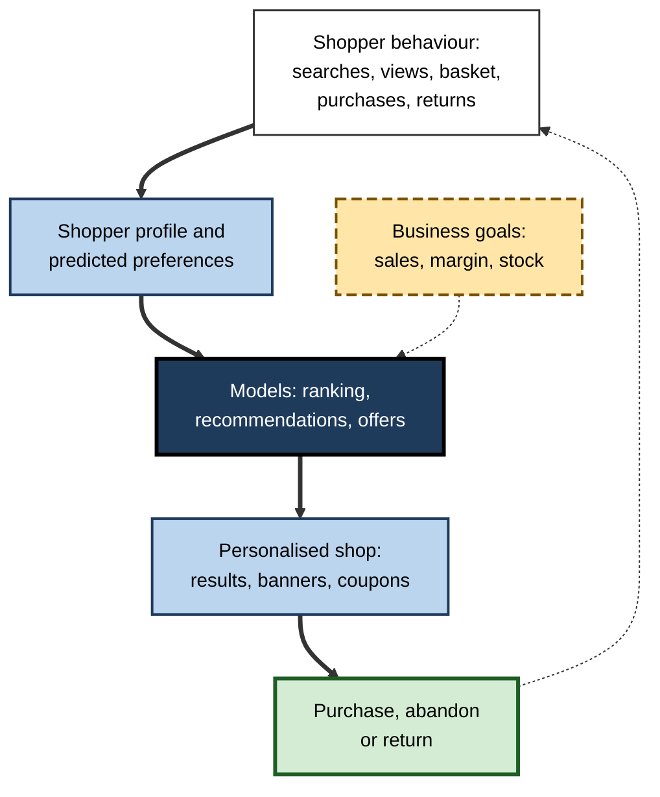
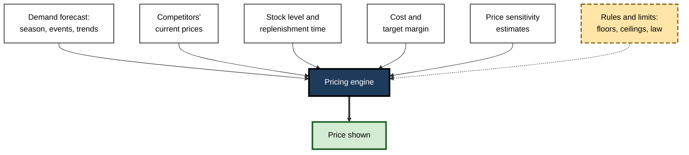
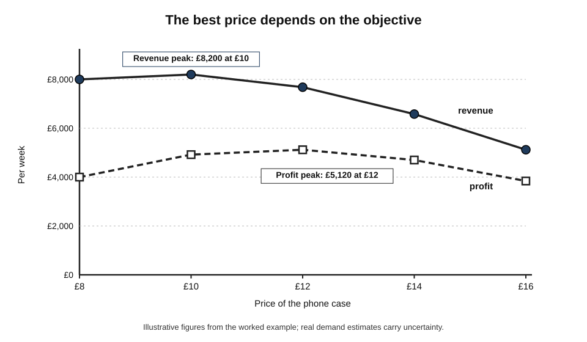
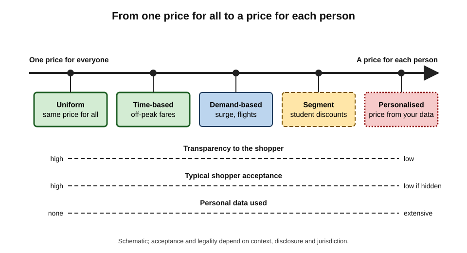
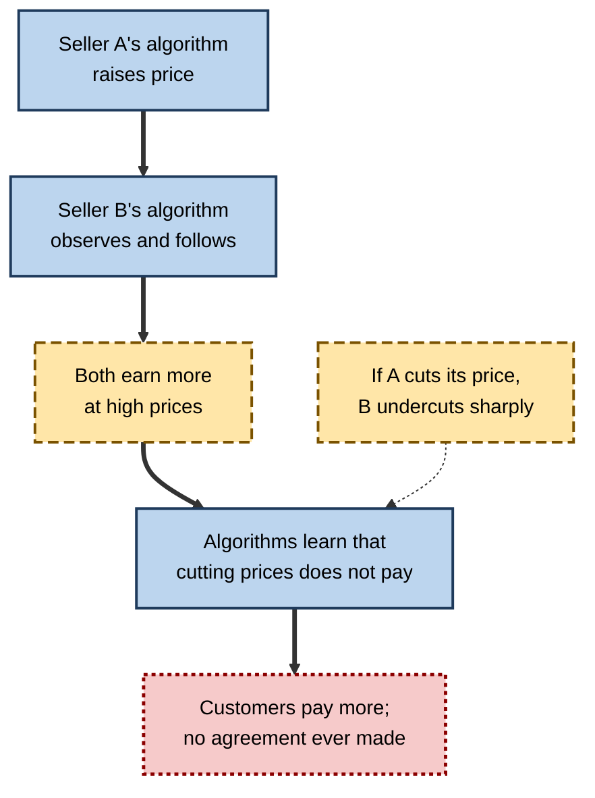
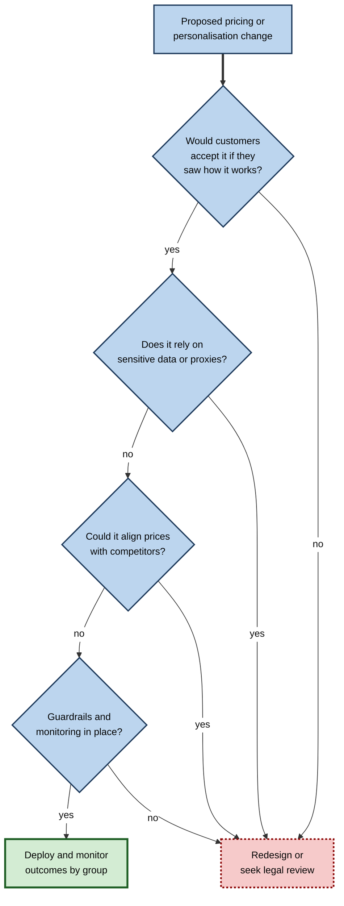

# E.10. AI in e-commerce: pricing and personalisation

Two colleagues look up the same pair of headphones on the same shopping site during a lunch break. One sees them first in the search results, with a "10% off for you" banner; the other has to scroll, and sees a bundle with a carrying case instead. By the evening, the price itself has changed twice. Behind each difference sits a model: one deciding what each shopper is shown, another deciding what the price should be at that moment.

> **Definition — Personalisation (in e-commerce):** tailoring what each shopper sees — products, rankings, offers, messages — to predictions about that individual.

> **Definition — Dynamic pricing:** changing prices frequently, often automatically, in response to demand, supply, competitors' prices, time or other conditions.

**Why it matters**

- **It decides what people buy and what they pay.** Online shopping is shaped at every step by ranking and pricing models.
- **It is big business.** For retailers on thin margins, small improvements in conversion, pricing and stock levels decide profitability.
- **It tests the line between service and exploitation.** Helpful suggestions and fair discounts sit next to manipulative design and prices tailored to what each person will tolerate.
- **It is now a regulatory priority**, from competition authorities worried about algorithmic collusion to consumer regulators examining "surveillance pricing".

---

## Personalising the Shop Window

### Where personalisation appears

- **Search results within the shop** — the order of products for "running shoes" depends on predicted purchase probability, margin, stock and the shopper's history.
- **Recommendations** — "frequently bought together", "customers also viewed", "inspired by your browsing".
- **Home page and category pages** — which banners, categories and deals appear first.
- **Offers and coupons** — targeted discounts for shoppers predicted to leave without buying, or to lapse as customers.
- **Messages** — e-mails and notifications ("the item in your basket is now cheaper") timed by models.
- **Fit and size** — predictions of which size will fit, learned from returns and from customers with similar purchases, reducing costly returns.
- **Visual and conversational search** — searching with a photograph, or asking for "a waterproof jacket for a wet walking holiday under £120".

> **Key point:** in physical shops everyone walks past the same shelves; in online shops each person effectively enters a **different shop**, arranged for them.

**Figure 1.** The personalisation loop in an online shop.

### What the models predict

- **Purchase probability** — will this shopper buy this item if shown it?
- **Basket value** — how much will they spend in total?
- **Price sensitivity** — how strongly does demand fall as price rises for this product or customer group?
- **Churn** — is the customer likely to stop shopping here?
- **Return probability** — will the item come back? (Fashion retailers face very high return rates.)
- **Lifetime value** — what is the customer worth over years, which justifies how much to spend keeping them?

> **Definition — Customer lifetime value (CLV):** the predicted total profit a business will earn from a customer over the whole relationship.

> **Watch out:** a shop's search results are **not neutral**. Ranking may weigh margin, promoted placements paid for by sellers and the retailer's own brands, not only relevance to the shopper. Regulators in several jurisdictions have investigated platforms for favouring their own products.

---

## How Prices Are Set by Algorithms

### From price tags to price engines

- **Fixed prices** — printed labels changed occasionally by staff.
- **Revenue management** — after US airline deregulation in 1978, airlines developed systems that varied fares by how far ahead a seat was booked and how full the flight was; American Airlines' "yield management" in the 1980s became the model for hotels, car hire and rail.
- **Online repricing** — sellers on marketplaces use software that adjusts prices automatically, sometimes many times a day, in response to competitors.
- **Machine-learning pricing** — models estimate demand at different prices and recommend or set the price that best meets a goal (revenue, profit, stock clearance).

**Figure 2.** What a dynamic-pricing engine takes into account.

### Price sensitivity and the revenue-maximising price

> **Definition — Price elasticity of demand:** the percentage change in quantity demanded divided by the percentage change in price; an elasticity of −2 means a 1% price rise reduces sales by about 2%.

> **Formula — Revenue:** revenue = price × quantity sold. Raising the price increases revenue only if sales fall proportionally less than the price rises (elasticity between 0 and −1).

**Worked example (illustrative): choosing a price for a phone case**

A retailer's model estimates weekly sales of a phone case at five prices. The case costs the retailer £4.

| Price | Predicted sales per week | Revenue | Profit (price − £4) × sales |
|---|---|---|---|
| £8 | 1,000 | £8,000 | £4,000 |
| £10 | 820 | £8,200 | £4,920 |
| £12 | 640 | £7,680 | £5,120 |
| £14 | 470 | £6,580 | £4,700 |
| £16 | 320 | £5,120 | £3,840 |

*Illustrative figures.*

1. **Revenue** is highest at **£10** (£8,200).
2. **Profit** is highest at **£12** (£5,120) — fewer cases sold, but each earns more.
3. **The objective decides the price:** a retailer seeking market share might choose £8–£10; one seeking profit, £12.
4. **Uncertainty:** the predicted sales are estimates; the engine typically **tests** nearby prices on a small share of traffic or over short periods to refine them.

**Figure 3.** Revenue and profit at different prices in the worked example.

> **Watch out:** predicted demand is learned from **past** prices. If a product has always been sold at £10, the model knows little about demand at £16. Pricing engines must experiment carefully — and their experiments are real prices paid by real customers.

### Kinds of variable pricing

| Practice | What varies | Example | Usually regarded as |
|---|---|---|---|
| Time-based pricing | Price by time of purchase or use | Off-peak train fares; happy hours | Accepted and transparent |
| Demand-based (dynamic) pricing | Price rises and falls with demand and supply | Flight and hotel prices; ride-hailing surge | Widely accepted, but controversial in emergencies |
| Competitor-based repricing | Price tracks rivals' prices | Marketplace sellers matching the lowest price | Accepted; raises collusion concerns at scale |
| Segment pricing | Different prices for groups | Student and senior discounts | Accepted when groups are clear and fair |
| Personalised pricing | Price set for an individual from their data | Different price or discount based on browsing, device or location | Contested; often seen as unfair if hidden |

### Surge pricing and its limits

Ride-hailing made demand-based pricing visible to millions: when many people request rides and few drivers are available, a multiplier raises fares.

- **The economic argument** — higher prices both ration scarce rides to those who value them most and draw more drivers onto the roads, shortening waits.
- **The public reaction** — surges during emergencies look like profiteering.
  - During a hostage siege in central Sydney in December 2014, fares in the area surged as people tried to leave; after criticism, the company offered free rides out of the area and refunds.
  - Ride-hailing companies later introduced caps on surges during declared emergencies in some places.
- **Spreading to physical shops** — electronic shelf labels make frequent in-store price changes possible. In 2024 a US fast-food chain faced a wave of criticism after its chief executive mentioned plans for "dynamic pricing"; the company clarified that it did not intend to raise prices at busy times, but might offer discounts at quiet ones.

| | Arguments for demand-based pricing | Arguments against |
|---|---|---|
| Efficiency | Matches scarce supply to those who value it most; draws in extra supply | Those who "value it most" may simply be those who can pay most |
| Availability | Shorter waits; seats and rooms remain available for late bookers | Essential services become unaffordable at critical moments |
| Fairness perception | Accepted when transparent and predictable (off-peak fares) | Resented when sudden, opaque or during emergencies |
| Market effect | Encourages off-peak use, spreading demand | Can mask a lack of capacity rather than fixing it |

> **Key point:** people judge price changes by **why** they happen. Rises explained by genuine cost or scarcity are tolerated; rises that appear to exploit urgency or distress are not — whatever the algorithm's economic logic.

### Forecasting, stock and waste

Much retail AI never touches the price label but shapes what is available at all.

- **Demand forecasting** — models predict sales for each product, in each store or warehouse, for each day, using history, seasons, weather, local events, promotions and trends.
- **Replenishment** — forecasts drive automatic orders to suppliers, so shelves are stocked without overstocking.
- **Markdowns** — for perishable and seasonal goods, models decide when and by how much to reduce prices to sell stock before it spoils or goes out of fashion.
- **Waste reduction** — grocers use such forecasts to cut food waste; better forecasts mean fewer empty shelves and less food thrown away.
- **Returns prediction** — fashion retailers predict which orders are likely to be returned (for example, the same item ordered in several sizes) and adjust size advice, or in some cases the visibility of free returns.

> **Example:** a supermarket's forecasting model raises its predicted demand for barbecue food and ice for a weekend when the weather forecast changes to hot and sunny, and orders more stock on Thursday — the same type of forecasting used for traffic or energy, applied to sausages.

### Price discrimination in economic terms

- **The economist Arthur Pigou (1920)** classified **price discrimination** — charging different prices for the same good, not justified by cost differences — into three degrees:
  - **First degree** — each customer pays the maximum they are willing to pay (perfect personalisation).
  - **Second degree** — prices vary with quantity or version, and customers choose (bulk discounts, "standard" and "premium" tiers).
  - **Third degree** — prices vary by observable group (students, regions).
- **Why AI matters** — data about each shopper move practice **towards the first degree**: estimating each person's willingness to pay.
- **Effects are ambiguous** — price discrimination can let more people buy (lower prices for price-sensitive customers) while capturing more of every customer's surplus for the seller.

> **Definition — Willingness to pay:** the maximum price a particular customer would pay for a product.

---

## Personalised Pricing and "Surveillance Pricing"

### What has been documented

- **Steering rather than pricing (2012)** — a travel site was reported to show users of Apple Mac computers more expensive hotel options higher in search results, because data suggested they spent more; the prices of individual hotels were the same for everyone.
- **Location-based prices (2012)** — newspaper analysis found that an office-supplies retailer's website showed different prices to visitors depending on their estimated location, apparently related to distance from rival shops; customers in some areas paid more.
- **"Surveillance pricing" (2025)** — the US Federal Trade Commission published initial findings from a study of companies that offer pricing tools to retailers. Staff found that such intermediaries could use detailed personal information — location, browsing and purchase history, even mouse movements and items left in baskets — to tailor prices, promotions and product offers to individuals.

> **Definition — Surveillance pricing:** a term used by some regulators for setting individualised prices using personal data gathered about the consumer.

> **Watch out:** claims that "websites charge you more if you browse on an iPhone" or "prices go up if you search twice" are widely shared but **rarely demonstrated** for specific retailers. Documented cases more often involve **steering** (what is shown first), **targeted discounts** and **location**. The practice is possible and regulators are investigating, but individual anecdotes are weak evidence.

### Why personalised pricing feels unfair

- **Hidden** — the customer cannot see that others pay less.
- **Uses information against the customer** — urgency, loyalty or lack of alternatives can be detected and exploited.
- **Weakens comparison** — if everyone sees a different price, comparing prices loses meaning.
- **Risk of discrimination** — prices correlated with location or device can track income, ethnicity or age.
- **Contrast with discounts** — most shoppers accept a *discount* offered to them but reject being charged *more* than others — even when the economics are identical.

**Figure 4.** A spectrum of pricing practices, from one price for all to individual prices.

---

## When Pricing Algorithms Meet Each Other

### Algorithmic collusion

Competition law forbids rivals from agreeing to fix prices. Algorithms raise a new question: can pricing software produce collusive outcomes **without any agreement**?

**Case study: The poster sellers (United States v. Topkins, 2015)**

- **Situation:** sellers of posters on Amazon Marketplace competed on price.
- **What happened:** a seller and his co-conspirators agreed to coordinate prices and wrote pricing algorithms to implement the agreement, so that their software would not undercut each other.
- **Outcome:** in 2015 the US Department of Justice announced the case as its first prosecution of a price-fixing conspiracy specifically involving e-commerce pricing algorithms; the seller pleaded guilty.
- **Lesson:** using software to carry out a price-fixing agreement is still price fixing. The legal difficulty arises when **no human agreement** exists.

**Study card — Calvano, Calzolari, Denicolò and Pastorello (2020), "Artificial intelligence, algorithmic pricing, and collusion"**

- **Question:** can self-learning pricing algorithms, with no instruction to collude and no communication, learn to keep prices high?
- **Design:** in a computer-simulated market, two or more **reinforcement-learning** pricing agents repeatedly set prices and learned from the profits they earned.
- **Results:** the agents typically learned to charge prices **above** the competitive level, and to respond to a rival's price cut with a temporary "punishment" price war before returning to high prices — a pattern resembling collusion.
- **Conclusion:** simple learning algorithms may sustain high prices without explicit agreement, posing a challenge for competition law, which traditionally requires evidence of an agreement.
- **Caveats:** learning took a very long simulated time and the market was stylised; how often this occurs in real markets is debated.

**Figure 5.** How two pricing algorithms can settle on high prices without communicating.

- **Shared pricing software** — a further concern arises when many competitors use the **same** pricing provider, which may pool their data.
  - In 2024 the US Department of Justice and several states sued a company providing rent-setting software to landlords, alleging that it enabled landlords to share non-public data and align rents; the company disputed the claims.
- **Regulators' position** — competition authorities in the US, UK and EU have said that firms remain responsible for the conduct of their pricing algorithms.

> **Key point:** algorithms can make markets **more** competitive (instant price matching, easier comparison) or **less** competitive (stable high prices, shared data). The outcome depends on how they are designed and what information they share.

---

## Manipulative Design and Consumer Protection

### Personalisation versus manipulation

| | Helpful personalisation | Manipulative design ("dark patterns") |
|---|---|---|
| Aim | Help the shopper find what suits them | Push the shopper into choices they would not otherwise make |
| Examples | Relevant recommendations; accurate size advice; reminders of a saved basket | Fake "only 2 left" or countdown timers; pre-ticked add-ons; hidden fees revealed at checkout; hard-to-cancel subscriptions |
| Information | Accurate | False, misleading or withheld |
| Shopper's control | Can ignore, adjust or switch off | Obstructed or confused |
| Legal status | Generally lawful, subject to data-protection rules | Increasingly prohibited by consumer law |

> **Definition — Dark pattern:** an interface design that steers users towards choices that benefit the business at the user's expense, often by deception, pressure or obstruction.

- **Drip pricing** — showing a low headline price and adding unavoidable fees step by step; regulators in the UK and elsewhere have moved to ban or restrict it.
- **Fake reviews** — UK law from 2025 explicitly prohibits commissioning or publishing fake reviews; platforms use machine-learning classifiers to detect review fraud.
- **Dynamic pricing at the point of sale** — in 2024 the UK Competition and Markets Authority examined the sale of tickets for a reunion concert tour after fans queued for hours and found prices had risen during the sale; it later secured commitments from the ticket seller to give clearer information.

### Rights and protections

- **Transparency of personalised prices** — EU consumer law (from 2022) requires traders to inform consumers when a price has been personalised on the basis of automated decision-making.
- **Data protection** — profiling for marketing requires a lawful basis; people can object to direct marketing and to certain profiling.
- **Non-discrimination** — prices must not discriminate unlawfully on protected characteristics.

> **In practice:** shoppers can compare prices in a private browsing window and on another device, use price-history tools, clear basket items they do not intend to buy, and treat "only 1 left" and countdown timers with suspicion — while recognising that genuine dynamic prices (flights, events) do change quickly.

---

## Professional Practice

### Designing pricing and personalisation responsibly

- **State the objective** — revenue, profit, clearance, customer lifetime value — and its limits.
- **Set guardrails** — price floors and ceilings, maximum change per day, no price rises during emergencies or for essential goods.
- **Avoid sensitive proxies** — do not use features that track protected characteristics, and test outcomes by group.
- **Prefer transparent levers** — open discounts, loyalty schemes and clear tiers over hidden individual prices.
- **Monitor competitors' behaviour and your own** — check that pricing software is not aligning prices in ways that could breach competition law.
- **Explain** — be ready to explain to customers and regulators why prices differ.

**Figure 6.** Checks before deploying an automated pricing or personalisation change.

### Case study (illustrative): the loyalty penalty

- **Situation:** an online insurer used a pricing model to set renewal premiums, trained to maximise profit per customer.
- **What the model learned:** long-standing customers who never shopped around were unlikely to leave even when their premiums rose, so it raised their renewal prices year after year, while new customers received low introductory prices.
- **Problem:** complaints rose; a journalist showed that loyal, often older customers paid far more than new customers for identical cover.
- **Diagnosis:**
  1. The model used "probability of switching" as a key input — effectively charging more to those least likely to leave.
  2. That probability correlated with age and with not using price-comparison sites.
  3. No guardrail limited the gap between renewal and new-customer prices.
- **Actions:**
  1. Capped renewal prices at the new-customer price for the same risk.
  2. Removed switching-propensity from pricing inputs; kept it only for service outreach.
  3. Audited prices by age group and channel.
- **Result:** short-term margin fell; complaints and regulatory risk fell; retention of loyal customers improved.
- **Context:** this pattern, known as the **"loyalty penalty"**, was the subject of real regulatory action — in the UK, rules banning insurers from charging renewing home and motor customers more than equivalent new customers took effect in 2022.
- **Lesson:** a model optimising profit will find and exploit customer **inertia**; deciding which differences in price are acceptable is a human responsibility.

---

## Open Questions

- **Where is the line between personalised offers and personalised exploitation?**
  - Discounts for price-sensitive customers and premiums for captive ones use the same technology.
- **Can competition law deal with algorithmic collusion without agreement?**
  - Laws built around human agreements may need new tests for software that learns to avoid competing.
- **Should personalised prices be disclosed — or banned?**
  - Disclosure rules exist in the EU; whether disclosure is enough is debated.
- **How should AI shopping agents change the picture?**
  - If consumers deploy their own AI agents to compare and negotiate, the balance of information between buyer and seller may shift.
- **How can regulators see what algorithms do?**
  - Prices and rankings differ for each person and change constantly, making monitoring difficult.

---

## Summary

- **Personalisation** gives each shopper a different shop: tailored search rankings, recommendations, banners, coupons, messages and size advice, driven by predictions of purchase, price sensitivity, churn, returns and **lifetime value**.
- Shop rankings may weigh margin, sponsorship and own brands, not only relevance.
- **Dynamic pricing** grew from airline **revenue management** to automated repricing and machine-learning engines using demand forecasts, competitor prices, stock, costs and **elasticity**; the **objective** (revenue or profit) changes the chosen price.
- **Surge pricing** rations scarce supply and draws in more of it, but is resented in emergencies; **demand forecasting** drives stock, markdowns and waste reduction.
- Pricing practices range from **time-based** and **demand-based** to **segment** and **personalised** pricing; Pigou's three degrees of **price discrimination** frame them, and data push towards the first degree.
- Documented cases often involve **steering**, targeted discounts and location; regulators study **surveillance pricing**; popular anecdotes are weak evidence.
- Pricing algorithms can implement explicit cartels (**Topkins**, 2015) and, in simulations, learn to sustain **high prices without agreement** (Calvano and colleagues, 2020); shared pricing software attracts legal action.
- **Dark patterns** — fake scarcity, drip pricing, fake reviews, obstruction — are increasingly prohibited; EU law requires disclosure of personalised prices.
- Responsible practice sets objectives and **guardrails**, avoids sensitive proxies, tests outcomes by group and guards against exploiting **inertia** (the **loyalty penalty**).

---

## Self-Check

1. List five ways an online shop personalises what a shopper sees.
2. Why might a shop's search results not be ordered purely by relevance?
3. What is price elasticity of demand? If a 10% price rise reduces sales by 5%, does revenue rise or fall?
4. In the worked example, why do the revenue-maximising and profit-maximising prices differ?
5. Why is predicting demand at prices never charged before difficult, and what do engines do about it?
6. Distinguish time-based, demand-based, segment and personalised pricing, with an example of each.
7. Explain Pigou's three degrees of price discrimination and how AI changes the picture.
8. What did the FTC's 2025 initial findings on surveillance pricing report?
9. Distinguish steering from personalised pricing using a documented example.
10. Summarise the Topkins case and why it was straightforward legally.
11. What did the 2020 simulation study find about learning pricing algorithms, and what are its caveats?
12. Give three examples of dark patterns and explain why they differ from helpful personalisation.
13. Explain the "loyalty penalty" and the regulatory response in the UK.
14. A retailer wants to give its pricing engine access to customers' browsing histories. What questions should be asked first?

### Answer Key

1. Search-result order, recommendations, home-page banners and categories, targeted coupons, timed e-mails and notifications (also size advice, visual search).
2. Ranking may include margin, sponsored placements paid by sellers, own-brand promotion and stock clearance alongside predicted relevance.
3. The percentage change in quantity divided by the percentage change in price. Here elasticity ≈ −0.5; revenue rises (price up 10%, quantity down 5%: 1.10 × 0.95 ≈ 1.045).
4. Revenue ignores cost; profit subtracts the £4 cost per unit, so a higher price with fewer units can earn more profit even though revenue is lower.
5. Models learn from past prices, so they have little evidence about untried prices; engines run small, controlled price tests to learn demand.
6. Time-based: off-peak fares. Demand-based: hotel prices rising for a festival. Segment: student discounts. Personalised: a discount or price set from an individual's data.
7. First degree: each pays their maximum; second: prices vary by quantity or version chosen; third: prices vary by group. Data about individuals allow estimates of willingness to pay, moving towards the first degree.
8. Pricing intermediaries could use granular personal data — location, browsing, purchase history, mouse movements, abandoned baskets — to tailor prices and offers; they served many retail clients.
9. Steering changes what is shown first (a travel site ranking pricier hotels higher for Mac users); personalised pricing changes the price itself for the same item (location-based prices on an office-supplies site).
10. Sellers agreed to fix poster prices and used algorithms to implement the agreement; there was a human agreement, so ordinary price-fixing law applied.
11. Reinforcement-learning agents learned to sustain above-competitive prices with punishment of price cuts, without communication. Caveats: stylised markets, very long learning times, uncertain real-world prevalence.
12. Fake scarcity timers, drip pricing, pre-ticked add-ons (also obstructive cancellation). They rely on false information or pressure and reduce the shopper's control, whereas helpful personalisation offers accurate, ignorable suggestions.
13. Charging loyal customers more at renewal than new customers because they are unlikely to switch. UK rules from 2022 ban charging renewing home and motor insurance customers more than equivalent new customers.
14. What is the objective and would customers accept it if they understood it? Is there a lawful basis and consent? Could features act as proxies for protected characteristics? Are there guardrails on price differences? How will outcomes be monitored and explained? Does disclosure law apply?

---

## Glossary

| Term | Meaning |
|---|---|
| Algorithmic collusion | High prices sustained by pricing algorithms, with or without human agreement. |
| Customer lifetime value (CLV) | Predicted total profit from a customer over the relationship. |
| Dark pattern | Interface design that steers users against their interests. |
| Demand forecast | A prediction of how much of a product will be bought. |
| Drip pricing | Revealing unavoidable fees progressively after a low headline price. |
| Dynamic pricing | Changing prices frequently in response to conditions. |
| Electronic shelf label | A digital price display in a shop that can be updated remotely. |
| Loyalty penalty | Charging existing customers more than new ones for the same product. |
| Markdown optimisation | Choosing when and how much to reduce prices to clear stock. |
| Personalisation | Tailoring products, rankings and offers to an individual. |
| Personalised pricing | Setting a price for an individual from data about them. |
| Price discrimination | Charging different prices for the same good not justified by cost. |
| Price elasticity of demand | Percentage change in quantity divided by percentage change in price. |
| Repricing software | Tools that automatically adjust prices, often to track competitors. |
| Revenue management | Varying prices by timing and capacity to maximise revenue, pioneered by airlines. |
| Steering | Changing which products are shown first, rather than their prices. |
| Surge pricing | Raising prices automatically when demand outstrips supply. |
| Surveillance pricing | Individualised pricing based on personal data gathered about consumers. |
| Willingness to pay | The maximum price a customer would pay. |
