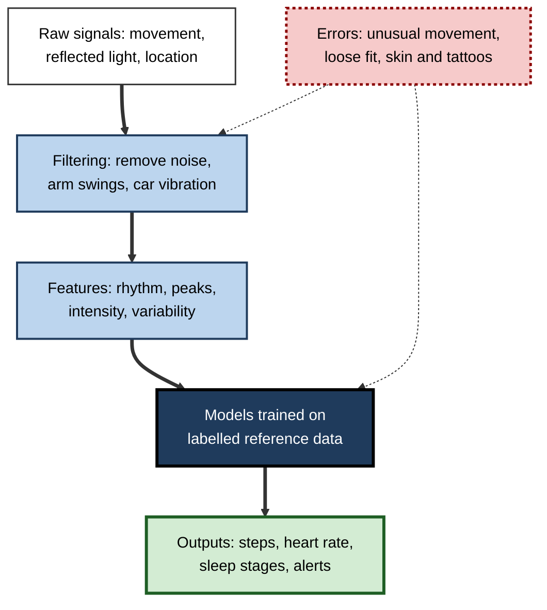
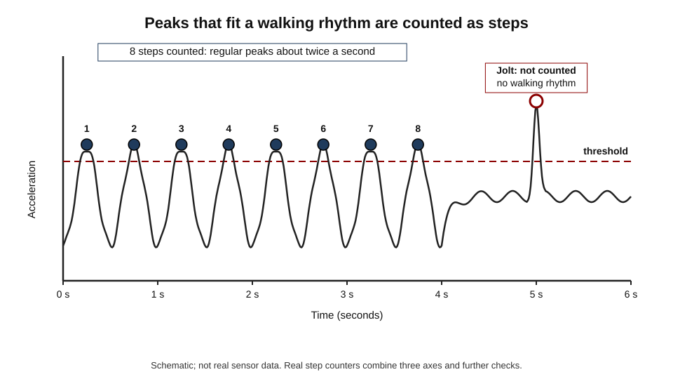
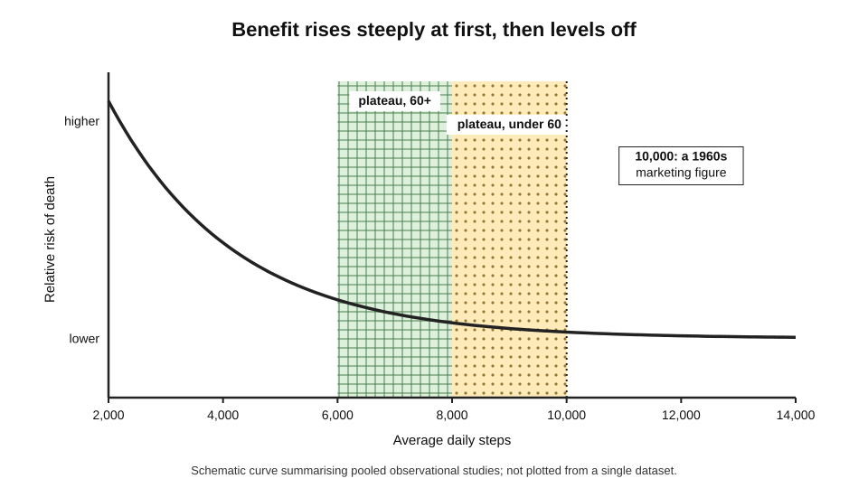
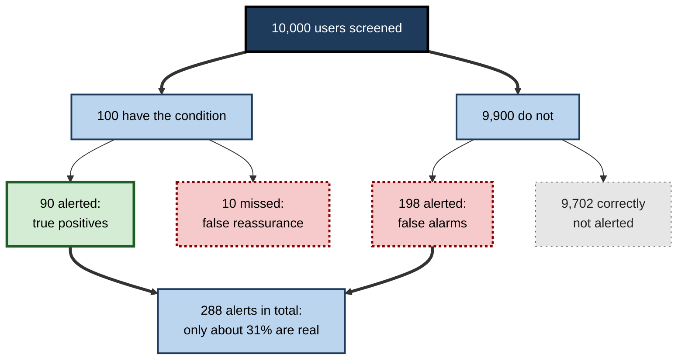
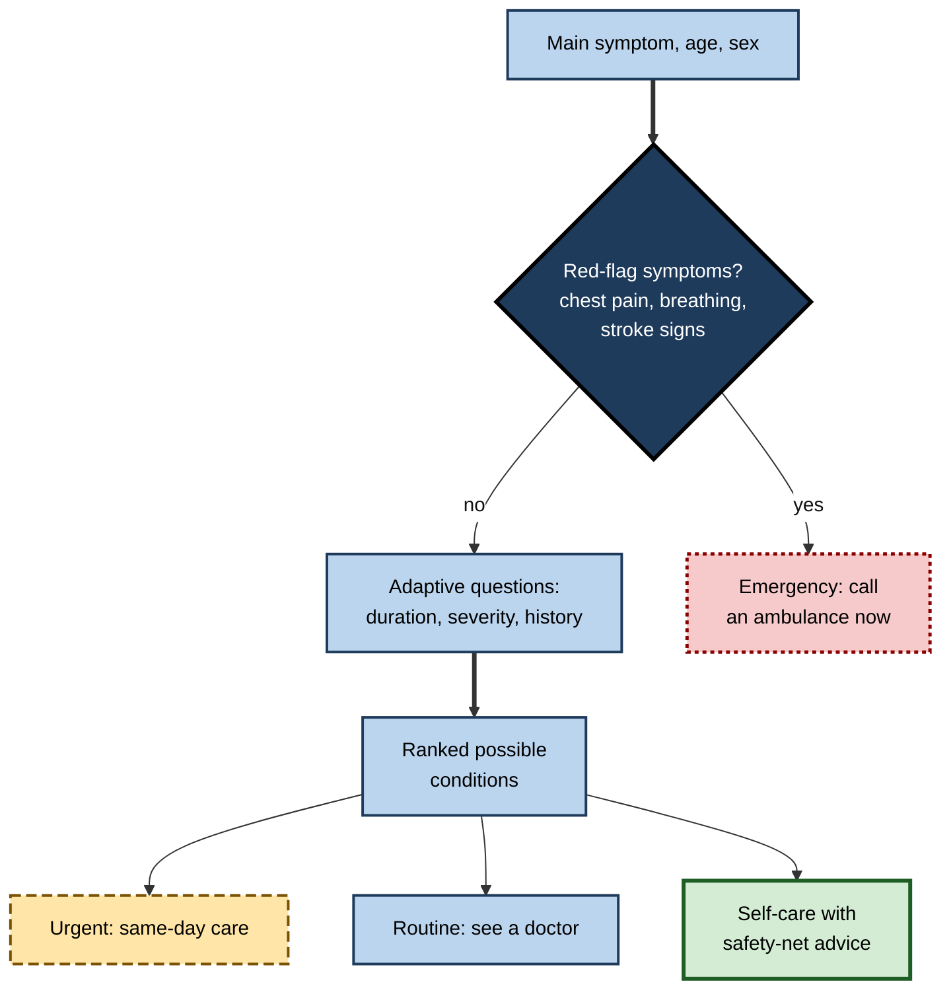
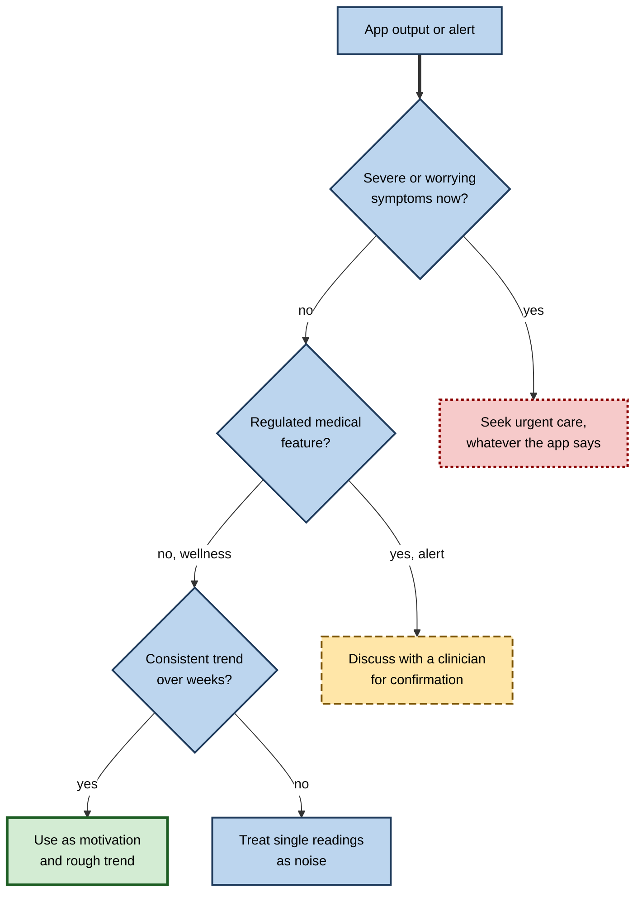

# E.11. Health apps: step counters to symptom checkers

A watch buzzes: "You've reached 8,000 steps." That night it records "6 h 40 min sleep, 1 h 10 min deep". A week later a phone app questions a worried parent about a child's fever and advises "Contact a doctor within 24 hours". None of these devices measured steps, sleep depth or illness directly. Each **inferred** them, using models trained on data from other people.

> **Definition — Health app:** software on a phone, watch or other device that measures, records, interprets or advises on aspects of a person's health or fitness.

> **Definition — Symptom checker:** a digital tool that asks a person about their symptoms and suggests possible causes and how urgently to seek care (triage).

**Why it matters**

- **Hundreds of millions of people use them** to count steps, track sleep, monitor heart rhythm, log periods and check symptoms.
- **They range from games to medical devices.** A step goal and a heart-rhythm alert look alike on a screen but carry very different evidence and regulation.
- **They raise the stakes of AI errors.** False reassurance can delay care; false alarms cause anxiety and unnecessary appointments.
- **They collect some of the most sensitive data there is** — bodies, moods, sexual and reproductive health.

---

## From Sensor to Number

### What the devices measure

| Sensor | What it detects | Used to estimate |
|---|---|---|
| Accelerometer | Changes in speed and direction of movement | Steps, activity type, falls, sleep movement |
| Gyroscope | Rotation | Activity type, swimming strokes, falls |
| Optical heart sensor (PPG) | Changes in light absorbed by blood under the skin | Heart rate, rhythm irregularity, blood oxygen, sleep stages |
| Electrical sensor (single-lead ECG) | Electrical activity of the heart via a fingertip on the watch | Heart-rhythm recordings for atrial fibrillation |
| GPS | Location | Distance, pace, routes |
| Barometer | Air pressure | Floors climbed, elevation |
| Microphone | Sound | Noise exposure, coughing or snoring in some apps |

> **Definition — Photoplethysmography (PPG):** a method of measuring blood-volume changes by shining light into the skin and recording how much is reflected; the green flashing lights on the back of many watches.

> **Key point:** almost nothing a wearable reports is measured directly. Steps, sleep stages, calories and fitness scores are **model outputs** inferred from indirect signals.

**Figure 1.** How a wearable turns raw sensor signals into health figures.

### Counting steps

1. **Measure acceleration** many times a second in three directions.
2. **Combine and smooth** the signal to remove jitter.
3. **Detect peaks** — each footfall produces a characteristic spike in acceleration.
4. **Apply rules and models** — a peak counts only if it falls within a plausible rhythm (roughly one to three steps a second) and the pattern continues for several steps, so that a single jolt is not counted.
5. **Classify the activity** — walking, running, cycling, driving — so that, for example, a bumpy bus ride is not counted as walking.

**Figure 2.** Step detection: peaks in the acceleration signal that fit a walking rhythm are counted.

- **Where counting fails**
  - **Wrist-worn devices** miss steps when the arm is still — pushing a pram or trolley, carrying shopping, using a walking frame.
  - **They add steps** for arm movements — clapping, gesturing, washing up — in some situations.
  - **Slow or irregular gait** — older people and people with some conditions may be undercounted.

### Heart rate, sleep and energy

- **Heart rate** — PPG detects the pulse wave; accuracy is usually good at rest and in steady exercise, poorer during vigorous or irregular arm movement.
- **Sleep stages** — wearables estimate light, deep and REM sleep from movement and heart-rate patterns; the reference standard, **polysomnography**, records brain waves in a laboratory.
- **Calories (energy expenditure)** — estimated from heart rate, movement, age, sex and weight; the estimates are the least reliable of common wearable outputs.
- **Blood oxygen** — some watches estimate oxygen saturation by PPG; they are generally marketed for wellness rather than diagnosis.

**Study card — Accuracy of wrist-worn devices (Stanford University, 2017)**

- **Design:** 60 volunteers wore seven popular wrist devices while sitting, walking, running and cycling in a laboratory; heart rate was compared with an electrocardiogram and energy expenditure with measurements of breathing gases.
- **Results:**
  - most devices measured **heart rate** with errors of only a few per cent in most conditions;
  - **energy expenditure** was poorly estimated by all devices — none achieved an error below about 20%, and some were far worse.
- **Conclusion:** the same device can be reasonably accurate on one measure and unreliable on another; calorie figures deserve particular caution.

| Output | Typical reliability of consumer wearables | Main reasons for error |
|---|---|---|
| Steps in ordinary walking | Generally good | Arm still or moving without walking; slow gait |
| Heart rate at rest | Generally good | Loose fit, cold skin, tattoos |
| Heart rate in vigorous exercise | Variable | Arm movement, sweat, sensor slippage |
| Sleep duration | Moderate; tends to overestimate sleep when lying still awake | Stillness mistaken for sleep |
| Sleep stages | Limited agreement with laboratory measurement | Inferred indirectly, without brain signals |
| Energy expenditure (calories) | Poor; large errors | Indirect estimation; individual differences |

> **Watch out:** figures for accuracy change with each device generation, and manufacturers' own validation studies are not independent. A device's reported sleep "score" or "readiness" is a **proprietary index**, not a medical measurement.

---

## How Many Steps Does Health Require?

### The origin of 10,000

- The target of 10,000 steps a day is often traced to marketing for a Japanese pedometer in 1965, whose name translates roughly as "10,000-step meter". It was a memorable round number, not a scientifically derived threshold.

**Study card — Steps and mortality in older women (Harvard Medical School, published in JAMA Internal Medicine, 2019)**

- **Design:** about 16,700 women with an average age of 72 wore an accelerometer for a week and were followed for over four years.
- **Results:** women averaging about 4,400 steps a day had markedly lower death rates than those averaging about 2,700; death rates continued to fall with more steps up to about 7,500 a day, then levelled off.
- **Conclusion:** substantial benefits occurred well below 10,000 steps for this group; the study was observational, so it shows association, not proof of cause.

**Study card — Meta-analysis of daily steps and mortality (an international consortium, published in The Lancet Public Health, 2022)**

- **Design:** combined data from 15 studies of nearly 50,000 adults in several countries.
- **Results:** risk of death fell progressively with more steps, levelling off at roughly **6,000–8,000 steps a day for adults aged 60 and over** and **8,000–10,000 for younger adults**.
- **Conclusion:** "more is better" up to a plateau that depends on age; walking pace added little once total steps were accounted for.

**Figure 3.** The association between daily steps and risk of death rises steeply at first and then levels off.

> **Key point:** the benefits of walking are real and well supported, but the specific "10,000" target is a marketing number. For many people, moving from very few steps to a moderate number brings the largest gains.

> **Watch out:** these are **observational** associations: people who walk more may also be healthier for other reasons. The studies adjust for many factors, but residual confounding cannot be ruled out.

---

## From Fitness to Medicine

### Heart-rhythm alerts

- **Atrial fibrillation (AF)** — an irregular heart rhythm that raises the risk of stroke; often has no symptoms.
- **What watches do**
  - Analyse PPG pulse timings during periods of rest for irregularity; if repeated irregular readings occur, notify the wearer.
  - Some watches can also record a **single-lead ECG** when the wearer touches the crown, which an algorithm classifies.
- **Regulation** — in 2018 the US Food and Drug Administration granted clearance to Apple's irregular-rhythm notification and ECG features through its process for novel low-to-moderate-risk devices.

**Study card — The Apple Heart Study (Stanford University, published in the New England Journal of Medicine, 2019)**

- **Design:** 419,297 people in the United States who owned an Apple Watch enrolled through an app between 2017 and 2019; the watch checked for irregular pulse; those notified were offered a telemedicine consultation and an ECG patch to wear for up to a week.
- **Results:**
  - 0.52% of participants received a notification;
  - among those who returned an ECG patch, about a third (34%) showed AF during the patch recording;
  - when an irregular-pulse notification and patch recording occurred together, the notification agreed with AF on the patch in most cases (a positive predictive value of about 0.84).
- **Limitations:** only a minority of those notified returned a patch; participants were self-selected and mostly young; AF is intermittent, so a patch worn later may miss it.
- **Conclusion:** a consumer watch can identify possible AF at very large scale, but notifications need medical confirmation, and benefits for outcomes such as stroke were not tested.

### Why rare conditions make alerts tricky

> **Definition — Sensitivity:** the proportion of people who have a condition whom a test correctly flags.

> **Definition — Specificity:** the proportion of people without the condition whom a test correctly clears.

> **Definition — Positive predictive value (PPV):** the proportion of positive results that are true positives — the chance that a flagged person actually has the condition.

**Worked example (illustrative): an alert for an uncommon condition**

A watch feature screens 10,000 users for a condition present in 1% of them. It has 90% sensitivity and 98% specificity.

| | Has the condition | Does not have it | Total |
|---|---|---|---|
| Alert | 90 | 198 | 288 |
| No alert | 10 | 9,702 | 9,712 |
| Total | 100 | 9,900 | 10,000 |

*Illustrative figures.*

1. **True positives:** 90% of 100 = **90**.
2. **False positives:** 2% of 9,900 = **198**.
3. **PPV** = 90 ÷ 288 ≈ **31%** — most alerts are false alarms, even though the test is "98% specific".
4. **Missed:** 10 people with the condition are not alerted and may feel falsely reassured.

> **Formula — Positive predictive value:** PPV = true positives ÷ (true positives + false positives). It falls sharply as the condition becomes rarer in the people tested.

**Figure 4.** Screening 10,000 people for an uncommon condition: most alerts are false alarms.

> **In practice:** clinicians treat a wearable alert as a **reason to investigate**, not a diagnosis. For users, the right response to an alert is to seek confirmation; the right response to *no* alert is not to assume all is well if symptoms are present.

### Other medical-grade features

- **Fall detection** — accelerometer patterns of a hard fall followed by stillness trigger an offer to call emergency services; valued by older people living alone.
- **Continuous glucose monitors** — sensors under the skin, paired with apps, show glucose levels and trends for people with diabetes; some systems adjust insulin pumps automatically.
- **Hearing features** — some earbuds have regulatory approval to function as hearing aids for mild to moderate hearing loss.

| | Wellness feature | Regulated medical device feature |
|---|---|---|
| Examples | Steps, sleep score, stress score, calories | Irregular-rhythm notification, ECG app, hearing-aid mode, insulin dosing |
| Claim | Supports a healthy lifestyle | Detects, diagnoses, monitors or treats a condition |
| Evidence required | Little or none by law | Clinical validation reviewed by a regulator |
| Regulator | Generally none beyond consumer and data law | Medicines and devices regulators (such as the FDA or the UK's MHRA) |
| How to tell | Phrases such as "for wellness, not medical use" | Regulatory clearance stated; instructions for use |

> **Watch out:** the same watch can carry **both** kinds of feature. A regulated ECG function does not make the device's sleep or stress scores clinically validated.

### When a prediction becomes a medical claim: cycle and fertility apps

- **What they do** — period-tracking apps record cycle dates, symptoms and sometimes body temperature, and predict the next period and the fertile window.
- **How they predict** — from the person's own cycle history (average length and variability), sometimes refined by temperature, which rises slightly after ovulation, and by population patterns.
- **Why accuracy varies** — cycles differ in length from month to month for many people; predictions are least reliable for irregular cycles, after stopping hormonal contraception and around menopause.
- **The regulatory line** — an app that merely predicts a period is a wellness tool; one that claims to work as **contraception** is a medical device.
  - In 2018 an app that combines daily temperature readings with an algorithm became the first app cleared in the United States for marketing as a method of contraception, after earlier approval in Europe; its claims are based on clinical studies of typical and perfect use.
  - The same year, reports of unintended pregnancies among users in Sweden led to an investigation by the Swedish medical-products regulator, which required clearer information about failure rates.

> **Key point:** identical-looking predictions carry very different weight depending on what is **claimed**. "Your period may start on the 14th" is a convenience; "you are not fertile today" is a medical claim that must be validated and honestly communicated.

### Evidence standards for digital health

- **Health systems have begun to grade apps.** In England, the National Institute for Health and Care Excellence published an evidence standards framework for digital health technologies in 2019 (updated in 2022), setting out what evidence is expected according to an app's function and risk — from simple information apps to tools that diagnose or treat.
- **The principle** — the more an app's output could affect a clinical decision, the stronger the evidence needed: from user-experience data for information apps, through observational studies, to comparative trials for tools that treat or diagnose.

| | Lower-risk app | Higher-risk app |
|---|---|---|
| Example | Step counter, symptom diary, general health information | Tool that triages, diagnoses, guides treatment or acts as contraception |
| Evidence expected | Usability, reliable content, user engagement | Clinical studies showing accuracy and benefit, often against current practice |
| Typical status | Wellness product | Regulated medical device |
| Consequence of error | Inconvenience or mild misinformation | Missed or delayed diagnosis, unintended pregnancy, harm from wrong treatment |

> **In practice:** clinicians recommending apps to patients increasingly use national libraries of assessed apps or evidence frameworks, rather than app-store ratings, which reflect popularity rather than clinical validity.

---

## Symptom Checkers

### How they work

1. **Collect information** — age, sex, main symptom, duration, severity, other symptoms, medical history.
2. **Ask adaptive questions** — each answer changes which question comes next, to narrow possibilities efficiently.
3. **Estimate likely conditions** — using medical knowledge encoded as rules or probabilistic networks, or models trained on clinical records.
4. **Advise on urgency (triage)** — emergency, urgent care, see a doctor soon, or self-care.

> **Definition — Triage:** deciding how urgently a person needs care, and from what service.

**Figure 5.** The structure of a symptom checker's consultation.

### How accurate are they?

**Study card — Evaluation of symptom checkers (Harvard Medical School, published in the BMJ, 2015)**

- **Design:** 23 online symptom checkers were tested with 45 standardised patient descriptions (vignettes) covering emergencies, conditions needing non-urgent care and conditions suitable for self-care.
- **Results:**
  - the correct diagnosis was listed **first** in 34% of evaluations and among the top 20 in 58%;
  - appropriate triage advice was given in 57% of evaluations — 80% for emergencies, but much lower for conditions where self-care was appropriate;
  - advice was generally **risk-averse**, often sending people to care they did not need.
- **Conclusion:** symptom checkers had deficits in both diagnosis and triage; their caution may increase demand on health services.

- **Later evidence** — systematic reviews in the 2020s found wide variation between tools, with some performing much better than in 2015 but most still below clinicians on diagnostic accuracy; evaluation methods themselves vary, making comparisons difficult.
- **A cautionary episode** — a UK digital-health company claimed in 2018 that its AI performed comparably to doctors on a medical examination; clinicians and researchers criticised the evaluation, and the company later collapsed in 2023 amid financial difficulties.

> **Watch out:** vignette studies test tools on **well-described textbook cases** typed by researchers. Real users describe symptoms vaguely, choose the wrong options and may omit crucial details — so real-world performance can be worse than test results.

| | Symptom checker | Human clinician (in person) |
|---|---|---|
| Availability | Instant, at any hour | Appointment or waiting time |
| Information gathered | Only what the user enters | History, examination, tests, observation |
| Typical bias | Risk-averse triage | Varies by experience and pressure |
| Consistency | Same answers to the same inputs | Varies between clinicians |
| Accountability | Depends on regulation and terms of use | Professional and legal duty of care |

---

## Privacy and Sensitive Health Data

- **Health data are special category data** under the EU and UK GDPR, requiring stronger justification for processing.
- **But many apps sit outside medical privacy law** — in the United States, the main health-privacy law covers health-care providers and insurers, not most consumer apps.
- **Case: a period-tracking app (2021)** — the US Federal Trade Commission alleged that a popular fertility-tracking app had shared users' health information with analytics and marketing companies despite promising not to; the company settled without admitting wrongdoing and agreed to obtain consent and to independent review.
- **Reproductive data after 2022** — following the US Supreme Court's decision ending the constitutional right to abortion, concern grew that period-tracking and location data could be sought in legal proceedings; some apps added anonymous modes.
- **Employers and insurers** — workplace wellness schemes and insurers sometimes offer rewards for sharing wearable data; participation should be voluntary, data aggregated, and individuals never penalised for health information.

> **In practice:** before using a health app, check whether data are stored on the device or in the cloud, who they are shared with, whether the app is a regulated medical device, and how to delete the data.

---

## Fairness and Who the Devices Work For

- **Skin tone and optical sensors** — light-based sensors can perform differently on darker skin; hospital pulse oximeters were shown in a 2020 study to miss dangerously low oxygen levels more often in Black patients than in white patients. Consumer devices using similar principles need testing across skin tones.
- **Body types and gaits** — step and activity models trained mainly on young, healthy volunteers may undercount for older adults, wheelchair users (some devices offer wheelchair modes) and people with unusual gait.
- **Who can afford them** — wearables are more common among wealthier, healthier people, so data-driven health insights may widen gaps.

---

## Professional Practice

### Case study (illustrative): the step challenge

- **Situation:** a company launched a workplace "step challenge" with prizes for teams with the highest average daily steps, using employees' own wearables.
- **Problems:**
  1. Employees with disabilities, caring duties or long commutes by car felt excluded.
  2. Some employees attached their devices to fans or pets to inflate counts.
  3. Several staff asked whether managers could see their data; some worried about being judged on health.
- **Diagnosis:** the scheme measured a single, gameable proxy (steps) rather than wellbeing; consent and data handling were unclear.
- **Actions:**
  1. Replaced the competition with an **opt-in** programme offering a range of activities (any form of movement, including wheelchair activity and swimming), self-reported or tracked.
  2. Reported only **aggregated** results; no individual data visible to managers.
  3. Published a plain-language privacy notice and an easy withdrawal option.
- **Result:** participation broadened; complaints stopped.
- **Lesson:** health data at work need **voluntariness, aggregation and inclusion**; a single device metric is easy to game and can exclude people.

**Figure 6.** Deciding how much weight to give a health app's output.

### For health and care professionals

- **Patient-generated data** — patients increasingly bring watch ECGs, sleep data and step counts to appointments; clinicians need to know which outputs are validated.
- **Remote monitoring** — validated devices allow monitoring of heart failure, diabetes and recovery after surgery at home, with alerts reviewed by clinical teams.
- **Workload** — false alarms from consumer devices can increase appointments; services need pathways for handling them.

---

## Open Questions

- **Do wearables improve health outcomes?**
  - They increase activity modestly in many trials, but long-term effects on disease and mortality are less clear.
- **Does screening by watch do more good than harm?**
  - Detecting AF early may prevent strokes, but false alarms and over-treatment have costs; large trials are under way.
- **How should consumer health AI be regulated?**
  - Many features fall between "wellness" and "medical"; generative-AI health advice adds a new category.
- **Can devices be made equally accurate for all users?**
  - Skin tone, body type, age and disability affect performance; standards for testing are developing.
- **Who owns and controls health data from consumer devices?**
  - Data rights, secondary use for research and access by insurers or law enforcement are unresolved.

---

## Summary

- **Health apps** measure, interpret or advise on health; outputs such as steps, sleep stages and calories are **inferred by models** from indirect sensor signals (accelerometers, **PPG**, GPS).
- **Step counting** detects acceleration peaks fitting a walking rhythm; wrist devices miss or add steps in some activities.
- Independent testing found **heart rate** generally accurate and **energy expenditure** poorly estimated; sleep **stages** agree only partly with laboratory measurement.
- **10,000 steps** is a 1960s marketing figure; studies show benefits levelling off around **6,000–8,000** steps for older adults and **8,000–10,000** for younger adults (observational evidence).
- Watches can detect possible **atrial fibrillation**; the **Apple Heart Study** (419,297 participants) showed feasibility but notifications need medical confirmation.
- For rare conditions, even specific tests produce mostly false alarms: **PPV** falls with prevalence.
- Predictions become **medical claims** when they guide decisions — a fertility app marketed as contraception must be validated; evidence frameworks scale requirements with risk.
- **Wellness** features carry little evidence requirement; **regulated** features require clinical validation.
- **Symptom checkers** collect symptoms, ask adaptive questions and **triage**; a 2015 study found the right diagnosis first in 34% and appropriate triage in 57%, with risk-averse advice.
- Health data need strong **privacy** protection, and devices must be tested for **fairness** across skin tones, ages and bodies; at work, schemes must be **voluntary, aggregated and inclusive**.

---

## Self-Check

1. Name four sensors in a typical smartwatch and what each is used to estimate.
2. Explain step counting in five steps and two situations in which it fails.
3. Summarise the 2017 Stanford findings on heart rate and energy expenditure.
4. Where did the 10,000-step target come from, and what do recent studies suggest instead?
5. Why are the step–mortality findings described as associations?
6. Summarise the design, main results and limitations of the Apple Heart Study.
7. Define sensitivity, specificity and positive predictive value.
8. A feature with 95% sensitivity and 99% specificity screens 20,000 people for a condition present in 0.5%. Compute the number of true positives, false positives and the PPV.
9. Distinguish a wellness feature from a regulated medical-device feature.
10. Describe how a symptom checker works and what the 2015 BMJ evaluation found.
11. Why may vignette studies overstate real-world accuracy?
12. Why can health-app data be less protected than hospital data in some countries?
13. Give two fairness concerns about wearable sensors.
14. A colleague's watch shows an irregular-rhythm alert, but they feel fine. What should they do, and why?

### Answer Key

1. Accelerometer (steps, activity, falls); optical PPG sensor (heart rate, rhythm, sleep); GPS (distance, pace); barometer (floors). Also gyroscope and electrical ECG sensor.
2. Measure acceleration; smooth; detect peaks; accept peaks fitting a walking rhythm over several steps; classify activity. Fails when pushing a pram (arm still) or when gesturing without walking.
3. Most devices measured heart rate within a few per cent; none estimated energy expenditure with error below about 20%.
4. From 1965 Japanese pedometer marketing. Studies show benefits levelling off around 6,000–8,000 steps for older adults and 8,000–10,000 for younger adults.
5. They observe people's steps and later deaths; people who walk more may differ in other ways (health, wealth), so cause cannot be proven despite adjustment.
6. 419,297 watch owners; 0.52% notified; about a third of those returning patches had AF on the patch; notifications agreed with AF when they coincided in most cases (PPV ≈ 0.84). Limitations: low patch return, self-selected young sample, intermittent AF, no outcome data.
7. Sensitivity: share of people with the condition who are flagged. Specificity: share without it who are cleared. PPV: share of flagged people who truly have it.
8. Condition: 100 people; true positives = 95. Without: 19,900; false positives = 1% = 199. PPV = 95 ÷ 294 ≈ 32%.
9. Wellness features support healthy habits with little evidence required; regulated features claim to detect or manage disease and need clinical validation reviewed by a regulator.
10. It collects basic details, asks adaptive questions, estimates likely conditions and gives triage advice. The 2015 study found the correct diagnosis first 34% of the time, top 20 in 58%, and appropriate triage in 57%, with risk-averse advice.
11. Vignettes are clear, complete textbook descriptions entered by researchers; real users give vague or incomplete answers and choose wrong options.
12. Medical privacy laws may cover only health-care providers and insurers, not consumer apps, which rely on their own terms and general consumer law.
13. Optical sensors may perform worse on darker skin; models trained on young healthy people may undercount older people, wheelchair users or people with unusual gait.
14. Seek medical confirmation (for example a GP appointment and an ECG), because the alert may indicate atrial fibrillation, which often has no symptoms and raises stroke risk — while recognising that it may be a false alarm. Seek urgent care if symptoms such as chest pain or breathlessness develop.

---

## Glossary

| Term | Meaning |
|---|---|
| Accelerometer | A sensor measuring changes in speed and direction of movement. |
| Atrial fibrillation (AF) | An irregular heart rhythm that raises stroke risk. |
| Electrocardiogram (ECG) | A recording of the heart's electrical activity. |
| Energy expenditure | Calories used by the body, estimated by wearables with large errors. |
| Evidence standards framework | Guidance setting the evidence a digital health tool needs according to its risk. |
| Fertile window | The days in a menstrual cycle when conception is possible. |
| Health app | Software that measures, interprets or advises on health or fitness. |
| Medical device software | Software intended to diagnose, monitor or treat, subject to regulation. |
| Photoplethysmography (PPG) | Measuring blood-volume changes with light reflected from the skin. |
| Polysomnography | Laboratory sleep measurement including brain-wave recording. |
| Positive predictive value (PPV) | The proportion of positive results that are true positives. |
| Prevalence | The proportion of a population that has a condition. |
| Sensitivity | The proportion of people with a condition correctly flagged. |
| Specificity | The proportion of people without a condition correctly cleared. |
| Symptom checker | A tool suggesting possible causes of symptoms and their urgency. |
| Triage | Deciding how urgently care is needed and from which service. |
| Vignette study | An evaluation using standardised written patient cases. |
| Wellness feature | A health-related feature not claimed to diagnose or treat disease. |
