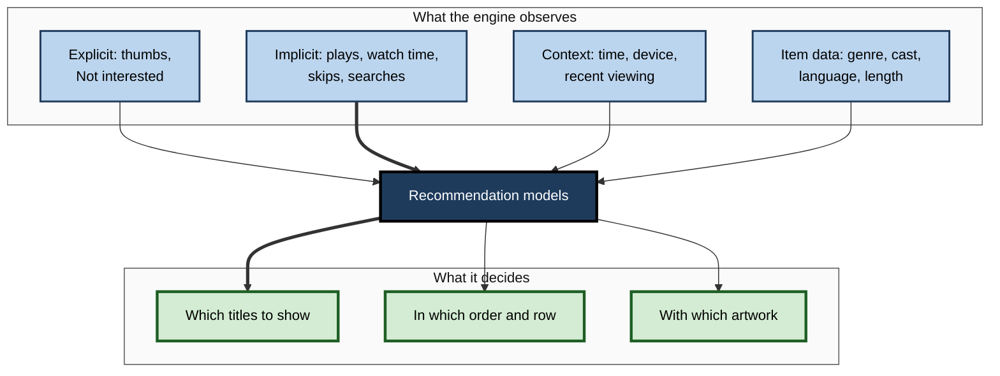
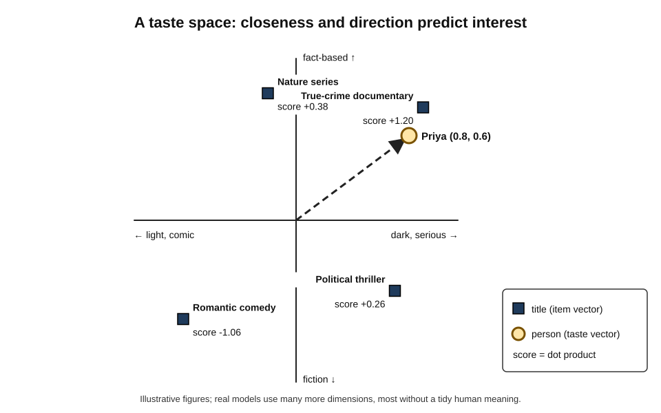
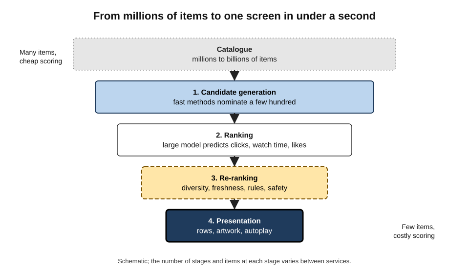
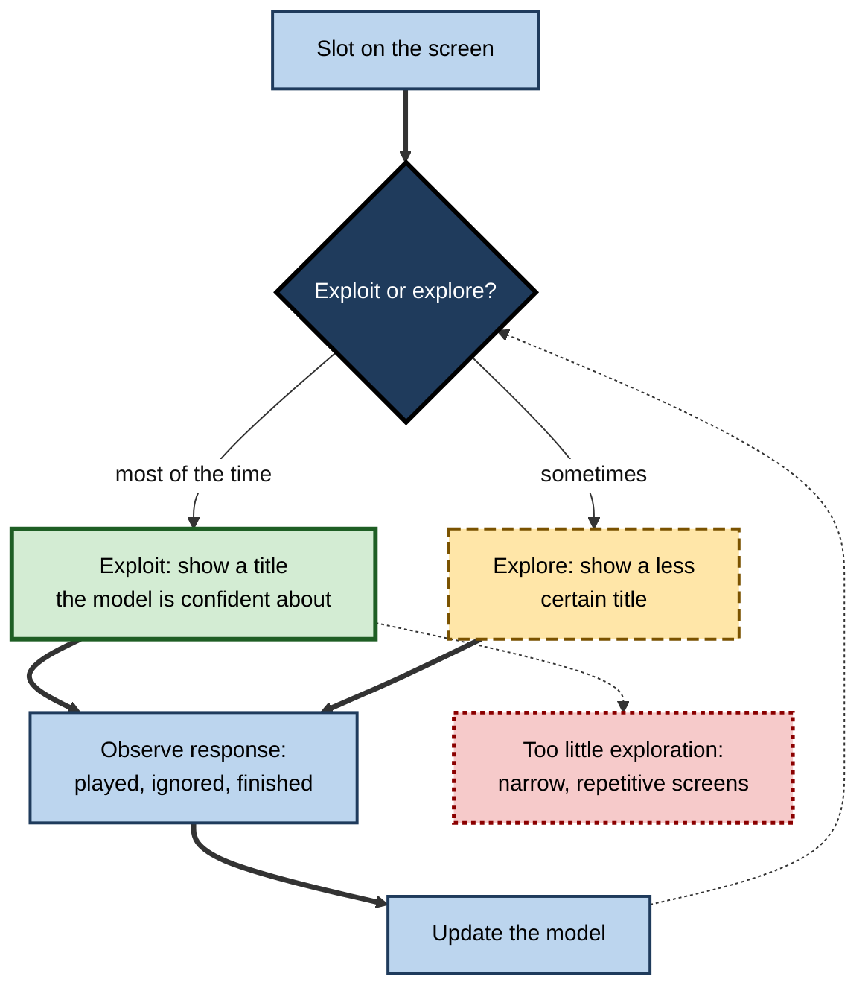
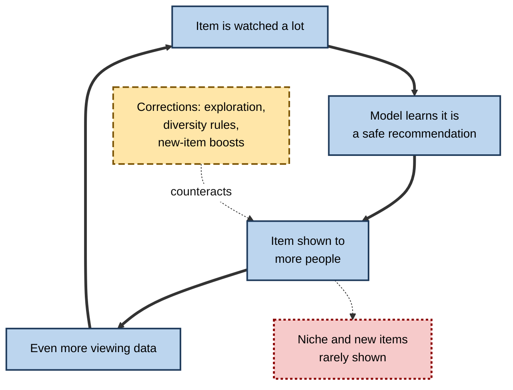
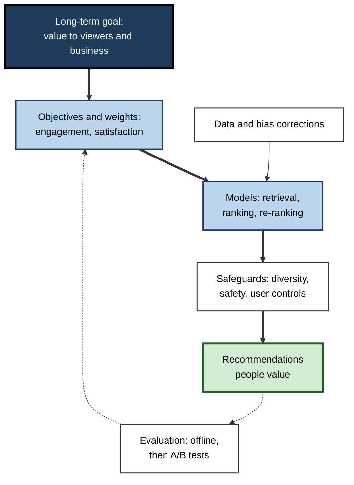

# E.2. Recommendation engines on Netflix and YouTube

Two people open the same streaming service on the same evening and see two different screens. One is shown crime documentaries, a Korean drama and a stand-up special; the other sees animated films and cookery shows. Even the picture used to advertise the same film may differ. Neither screen was designed by an editor. Each was assembled in under a second by a **recommendation engine** that predicted, from everything the person had watched, skipped and abandoned, what they were most likely to watch next.

> **Definition — Recommendation engine (recommender system):** software that predicts which items from a large catalogue a particular person is likely to want, and ranks and presents those items to them.

**Why it matters**

- **It decides what most people watch.** On the largest video services, most viewing begins with a recommendation rather than a search.
- **It turns abundance into choice.** Catalogues of tens of thousands of titles, or billions of videos, are unusable without filtering.
- **It shapes culture and careers.** Which films find an audience, and which video creators earn a living, depends heavily on what the engine promotes.
- **It is a model for all personalisation.** The same methods rank products, news, music, jobs and dating profiles.
- **It raises hard questions** about what the system is optimising for, about privacy and about effects on viewers.

---

## The Problem Recommendation Solves

### Too much to choose from

- **The paradox of abundance**
  - A streaming service may hold thousands of films and series; a video platform receives many hours of new video every minute.
  - A person can look at only a few dozen titles before giving up.
- **The cost of failing to choose**
  - Netflix researchers have described a typical member as losing interest after browsing for a minute or two without finding something to watch — after which the risk grows that they will do something else, or eventually cancel.
- **The long tail**
  - Most items in a large catalogue are rarely watched; a few are watched enormously.
  - Recommendation can connect niche items to the specific people who would enjoy them.

> **Definition — Long tail:** the large number of items in a catalogue that are each individually unpopular but that together account for a substantial share of potential demand.

> **Key point:** a recommendation engine solves a **matching problem** — linking each person to the few items, out of an enormous catalogue, that they are likely to value — under severe limits on the person's time and attention.

### Two services, two problems

| | Netflix | YouTube |
|---|---|---|
| Catalogue | Thousands of licensed and original titles, chosen by the company | Billions of videos uploaded by anyone, growing every minute |
| Typical session | An evening; one long choice (a film or series) | Many short choices in a row; "up next" after each video |
| Business model | Monthly subscription — the aim is to keep members subscribed | Advertising — revenue rises with viewing time |
| Main risk | Members cancel because they cannot find anything | Low-quality, misleading or harmful videos are amplified |
| Key screens | Home page of rows; artwork; "Because you watched…" | Home feed, "Up next" sidebar, autoplay, Shorts feed |

> **Watch out:** "the algorithm" is a misleading singular. Each service runs **many** models — one for each row, for search, for artwork, for notifications and for the order of the home page — which interact.

---

## What the Engine Learns From

### Explicit and implicit feedback

> **Definition — Explicit feedback:** a deliberate statement of preference, such as a star rating, a thumbs-up or a "Not interested" choice.

> **Definition — Implicit feedback:** preference inferred from behaviour, such as what a person plays, how long they watch, what they skip or abandon, and what they search for.

| | Explicit feedback | Implicit feedback |
|---|---|---|
| Examples | Thumbs up or down; star ratings; "Not interested" | Plays, watch time, completion, rewinds, searches, scrolling past |
| Volume | Low — few people rate | Enormous — every action is recorded |
| Clarity | Clear direction (liked or disliked) | Ambiguous — stopping a film may mean dislike, a phone call or bedtime |
| Bias | People rate what they feel strongly about; aspirational choices | Reflects actual behaviour, including habits people may not endorse |
| Main use today | Corrections and strong signals | The main training data for most services |

- **Netflix's change of scale**
  - Netflix replaced its five-star ratings with a simple thumbs up or down in 2017, and later added a "two thumbs up" option for strong approval.
  - The company explained that people rated documentaries highly but watched light comedies — what they *said* and what they *did* diverged, and behaviour predicted viewing better.
- **YouTube's signals**
  - Clicks, watch time, likes and dislikes, shares, subscriptions, comments, "Not interested" and "Don't recommend channel", plus short satisfaction surveys shown to a sample of viewers.

### Context

- **Time and device** — short videos on a phone at lunchtime; long films on a television at night.
- **Sequence** — what was watched just before matters more than what was watched a year ago.
- **Location and language** — regional catalogues and languages.
- **Household sharing** — several people on one account; profiles exist partly to separate their signals.

**Figure 1.** The signals a video recommendation engine learns from and the decisions it makes.

---

## How Preferences Become Numbers

### From "people like you" to taste vectors

Early recommenders compared people directly ("viewers who liked these films also liked…") or compared items by their features ("more crime dramas"). Modern engines go further: they place every person and every item in the same mathematical space of **hidden taste dimensions**.

> **Definition — Latent factor:** a hidden dimension of taste discovered by the model from viewing patterns — for example, something like "light versus dark tone" or "for children versus for adults" — that nobody labelled in advance.

> **Definition — Embedding:** a list of numbers (a vector) representing a person or an item in a shared space, placed so that similar items, and people with similar tastes, lie close together.

- **Matrix factorisation**
  - Imagine a vast table with one row per person, one column per title and a mark wherever the person watched or liked the title — almost all cells empty.
  - The method finds a small number of taste dimensions so that each person's vector, combined with each title's vector, reproduces the known marks.
  - The same vectors then **predict the empty cells**: titles the person has never seen.
  - The approach was popularised by entries to the Netflix Prize competition (2006–2009) and remains a foundation of the field.
- **Deep learning**
  - Neural networks learn embeddings from much richer inputs: sequences of viewing, text, images, audio and context.
  - **Two-tower models** learn one network for users and one for items, so that the closeness of their outputs predicts interest.

> **Formula — Predicted interest:** score = (person's taste vector) · (item's vector) = Σ (person value × item value) across the dimensions. A larger dot product means a better predicted match.

### Worked example (illustrative): matching with two taste dimensions

A model has learned two hidden dimensions. Dimension 1 is roughly "dark and serious (+) versus light and comic (−)"; dimension 2 roughly "fact-based (+) versus fiction (−)".

| | Dimension 1 | Dimension 2 | Score for Priya (0.8, 0.6) |
|---|---|---|---|
| True-crime documentary | 0.9 | 0.8 | 0.8 × 0.9 + 0.6 × 0.8 = **1.20** |
| Political thriller | 0.7 | −0.5 | 0.8 × 0.7 + 0.6 × (−0.5) = **0.26** |
| Nature series | −0.2 | 0.9 | 0.8 × (−0.2) + 0.6 × 0.9 = **0.38** |
| Romantic comedy | −0.8 | −0.7 | 0.8 × (−0.8) + 0.6 × (−0.7) = **−1.06** |

*Illustrative figures.*

1. **Priya's vector (0.8, 0.6)** was learned from her history: serious, fact-based viewing.
2. **Each title's vector** was learned from who watched it.
3. **Dot products** rank the titles: documentary first, nature series second, thriller third, romantic comedy last.
4. **No one told the model** that Priya likes true crime — the dimensions and her position emerged from patterns across millions of viewers.

> **Watch out:** real models use dozens to hundreds of dimensions, and most have **no tidy human meaning**. Naming them "dark versus light" is an aid to understanding, not a description of what the system actually contains.

**Figure 2.** A taste space: people and titles are placed so that closeness predicts interest.

### The cold-start problem

- **New members** have no history. Services ask them to pick a few titles they like at sign-up, then rely on popularity and context until behaviour accumulates.
- **New titles** have no viewers. Their **content features** (genre, cast, description, the video and audio themselves) place them in the taste space before anyone has watched them.
- **New creators** on open platforms face the hardest version: a small initial test audience decides whether a video is shown more widely.

> **Definition — Cold-start problem:** the difficulty of making good recommendations for a new person or a new item before behavioural data about them exist.

---

## From Prediction to a Page

### The recommendation funnel

A service cannot score every one of billions of videos for every viewer every time a page loads. It narrows the field in stages, each more precise and more expensive than the last.

1. **Candidate generation (retrieval)**
   - Several fast methods each nominate a few hundred items: nearest neighbours in the taste space, items related to the last thing watched, subscriptions, trending items.
2. **Ranking**
   - A larger model scores each candidate in detail, predicting several outcomes: will the person click, watch for long, like, share, finish, return tomorrow?
3. **Re-ranking and business rules**
   - Adjust the list for **diversity** (not ten near-identical items), freshness, removal of already-watched items, legal and policy limits, and promotion of new releases.
4. **Presentation**
   - Arrange into rows, a feed or an "up next" list; choose artwork, titles and whether to autoplay.

**Figure 3.** The recommendation funnel, from an enormous catalogue to a single screen.

### Netflix: a page built of rows

- **Rows as recommendations** — "Because you watched…", "Top 10 in your country today", "Critically acclaimed dramas"; each row is chosen and ordered for the member.
- **Page construction** — a separate decision chooses *which rows* appear and in *what order*, balancing relevance with variety.
- **Personalised artwork**
  - Netflix has described choosing, for each member, which image represents a title — for example a romantic still for a viewer who watches romances, or an image featuring a comedian for a viewer of comedy — using a form of learning that experiments and improves from members' responses.
- **The "match" score** — a percentage shown on titles, estimating how well the title fits the member.

> **Example:** the same drama may appear under "Award-winning series" for one member and under "Because you watched [a legal thriller]" for another — framed differently because the reasons each might watch it differ.

### YouTube: a chain of next choices

- **Home feed** — a mixture of subscriptions, related interests and new topics.
- **"Up next" and autoplay** — recommendations after each video, which can lead a viewer through a long chain of videos.
- **Shorts** — a full-screen vertical feed in which each swipe is a new recommendation and a new data point.
- **Choice of objective**
  - In 2012 YouTube said it was changing its recommendations to reward **watch time** rather than clicks, because clicks rewarded misleading titles and thumbnails.
  - Later the company added **satisfaction** signals — surveys, likes, "Not interested" — after watch time was criticised for rewarding compulsive viewing.

**Study card — "Recommending what video to watch next" (Google, 2019)**

- **Problem:** rank candidate videos for the "watch next" list when several goals conflict — engagement (clicks, watch time) and satisfaction (likes, survey ratings, not dismissing).
- **Design:**
  - a single ranking network predicting **many objectives at once** (multi-task learning), with shared and specialised components;
  - an extra component to correct **position bias** — the tendency to click the top item simply because it is at the top.
- **Results:** the paper reported improvements in both engagement and satisfaction measures in live experiments.
- **Conclusion:** a modern recommender is not optimising one number; it **blends predictions of several outcomes** using weights chosen by people — and those weights encode the service's values.

> **Definition — Position bias:** the tendency of people to choose items shown at the top of a list regardless of their quality, which can mislead a model into thinking top-placed items were preferred.

| | Optimising clicks | Optimising watch time | Optimising satisfaction |
|---|---|---|---|
| Rewards | Attractive titles and thumbnails | Videos people keep watching | Videos people say they valued |
| Typical failure | "Clickbait": misleading previews | Long, compulsive or sensational content | Harder to measure; surveys reach few people |
| Data available | Abundant, instant | Abundant, slightly delayed | Sparse, delayed |
| Typical use today | One input among many | A major input | Increasingly weighted alongside engagement |

> **Key point:** the most consequential decision in a recommender is not the algorithm but **what it is asked to predict and reward**. Optimising a measurable proxy — clicks, minutes — when the real goal is value to the viewer is a central source of harm.

---

## How the Engine Learns to Improve

### Exploration and exploitation

- **Exploitation** — showing what the model is already confident the person will like.
- **Exploration** — occasionally showing something less certain, to learn whether the person might like it.
- **Too little exploration** → recommendations narrow; new titles and new interests are never discovered.
- **Too much** → the screen fills with poor suggestions.
- **Bandit algorithms** balance the two automatically, trying options and shifting towards those that work.

> **Definition — Exploration–exploitation trade-off:** the tension between using what is already known to produce good results now and trying uncertain options to learn things that could produce better results later.

**Figure 4.** Exploration and exploitation: a recommender must keep learning while it serves.

### Testing changes on real viewers

- **Offline evaluation** — test a new model on historical data: would it have ranked highly the titles people actually went on to watch?
  - Cheap and fast, but history reflects what the **old** system chose to show.
- **Online A/B testing** — show the new model to a random share of members and compare long-term outcomes with the rest.
  - Netflix has described judging changes by effects on **retention** (whether members keep subscribing) and engagement over weeks, not by click rates.
- **Interleaving** — mixing results from two models in a single list and seeing which model's items are chosen; detects differences with fewer users.

| | Offline evaluation | Online A/B test |
|---|---|---|
| Data | Past logs | Live behaviour of randomly assigned users |
| Speed and cost | Fast, cheap, no risk to users | Slower; real users see the change |
| Main weakness | Biased by what the previous system showed | Measures only what is tracked, over the test period |
| What it can show | Whether the model predicts past choices | Whether the change improves real outcomes such as retention |
| Typical role | Screening many ideas | Final decision on a few |

> **Definition — A/B test:** an experiment in which users are randomly divided into groups that see different versions of a product, so that differences in their behaviour can be attributed to the change.

---

## The Value and the Evidence

### How much recommendations matter

- **Netflix (2015)** — two company researchers, Carlos Gomez-Uribe and Neil Hunt, wrote that recommendations drove about 80% of hours streamed and estimated that personalisation and recommendation together saved the company more than a billion dollars a year by reducing cancellations.
- **YouTube (2018)** — a senior YouTube executive said that more than 70% of viewing time came from recommendations.

> **Watch out:** both figures are **company statements**, not independently audited measurements; the dollar estimate in particular rests on the company's own modelling of what members would have done without recommendations. They indicate the scale of influence, not a precise quantity.

### Concerns and what the research shows

- **Filter bubbles**
  - The worry: personalisation narrows exposure until people see only what confirms their existing tastes and views.
  - For entertainment, narrowing is partly what people want; diversity rules in re-ranking exist because uniform screens also reduce viewing.
- **The "rabbit hole" debate on YouTube**
  - **The claim:** recommendations lead viewers step by step towards more extreme political content.
  - **Evidence for concern:** a 2020 audit of user comments found audiences migrating over time from milder to more extreme channels within certain communities.
  - **Evidence against a strong version:** studies of real browsing histories (published in 2021) found that consumption of extreme content was concentrated among a small group of users who sought it out, often arriving from other websites; a 2024 study using automated "counterfactual" accounts found that, on average, following the recommendations led to *less* partisan content than the users' own choices.
  - **Context:** YouTube changed its systems in 2019 to reduce recommendations of "borderline" content, so findings from different years describe different systems.
- **Popularity bias** — popular items get recommended, so they become more popular; niche titles and new creators struggle.
- **Children** — autoplay and endless feeds raise particular concerns about time spent and unsuitable content.

> **Watch out:** the "rabbit hole" is **contested**. Current evidence suggests recommendations are not the main driver of extreme viewing for most people, but the research is limited by restricted access to platform data and by systems that change over time. Neither "the algorithm radicalises viewers" nor "the algorithm has no effect" is established.

**Figure 5.** The popularity loop: recommendations can make the popular more popular unless the system corrects for it.

### Rules and rights

- **European Union — Digital Services Act**
  - From 2023 the largest online platforms must explain the main parameters of their recommender systems and offer at least one option that is **not based on profiling** of the user.
- **Data-protection law**
  - Viewing histories are personal data; people can request access to them and, in many jurisdictions, their deletion.
- **User controls**
  - Removing items from viewing history, "Not interested", pausing watch history, separate profiles and turning off autoplay all change what is recommended.

> **In practice:** a person who wants different recommendations can **delete misleading history** (a child's cartoons on an adult profile), use **separate profiles**, give **explicit feedback** and turn off **autoplay** — the engine responds to the signals it receives.

---

## Recommendation in Professional Practice

### Design decisions that matter

- **Choose the objective deliberately** — define long-term value (retention, satisfaction) and use short-term signals only as proxies.
- **Measure what users would endorse** — surveys and "not interested" signals counterbalance raw engagement.
- **Build in diversity and exploration** — protect discovery and new items.
- **Correct for bias in the data** — position bias and the previous system's choices distort what logs show.
- **Give users control and explanation** — "Because you watched…" labels build trust and let users correct errors.
- **Plan for safety** — reduce amplification of harmful or misleading content, with extra care for children.

**Figure 6.** Decisions that shape a recommender, from goals to safeguards.

### Case study (illustrative): the learning platform that optimised the wrong thing

- **Situation:** an online training company added a recommendation row, "Recommended for you", to its course library of 3,000 short videos for professionals.
- **First version:** ranked videos by predicted **click-through**.
- **Early result:** clicks on recommendations rose sharply; the product team celebrated.
- **Problem:** after three months, course completions and renewals of corporate subscriptions had not improved; customer success managers reported complaints about "shallow" suggestions.
- **Diagnosis:**
  1. The model favoured short videos with dramatic titles ("The one Excel trick nobody teaches"); people clicked, then left within a minute.
  2. Long, highly rated courses were rarely shown, so they received few clicks — and the model learned to show them even less (popularity and position bias).
  3. Corporate clients cared about **skills completed**, not clicks.
- **Actions:**
  1. Changed the ranking to predict **completion** and post-course ratings, with clicks as a minor input.
  2. Added a diversity rule: no more than two very short videos in the top six.
  3. Reserved a small share of slots for exploration of new and long courses.
  4. Judged the change by a two-month A/B test on renewals and completions.
- **Result:** clicks fell slightly; completions and client renewals rose in the test group.
- **Lesson:** a recommender becomes very good at whatever it is told to maximise. **Choosing the objective is a business and ethical decision**, not a technical detail.

### Recommendations at work

- **Retail and media** — product, article and music recommendations follow the same funnel.
- **Human resources** — job and course recommendations; errors here affect careers, and fairness requirements are stricter.
- **Business-to-business software** — "next best action" suggestions to salespeople and service agents.
- **Common pitfall** — copying consumer engagement metrics into settings where the real goal is quality, learning or safety.

---

## Open Questions

- **What should a recommender optimise?**
  - Engagement is measurable but imperfect; satisfaction and long-term wellbeing are harder to measure and to agree on.
- **How large are the social effects?**
  - Effects on polarisation, taste diversity and mental health remain debated; independent researchers have limited access to platform data.
- **Can recommendations be both personal and diverse?**
  - Methods to broaden exposure without frustrating users are still developing.
- **How should generative AI change recommendation?**
  - Conversational requests ("something like this, but shorter and funnier") and AI-generated content may change both how preferences are expressed and what is recommended.
- **What does meaningful transparency look like?**
  - Explaining a model with hundreds of hidden dimensions in terms a viewer understands is unsolved.

---

## Summary

- A **recommendation engine** predicts which items a person will want and ranks them; it solves a **matching problem** in catalogues far too large to browse.
- Netflix (subscription, curated catalogue) and YouTube (advertising, open uploads) face different versions of the problem.
- Engines learn mainly from **implicit feedback** (plays, watch time, skips) supplemented by **explicit feedback** (thumbs, "Not interested") and **context**.
- Modern systems represent people and items as **embeddings** along **latent factors**; the **dot product** of vectors predicts interest. New users and items cause the **cold-start problem**.
- Recommendations are produced by a **funnel**: candidate generation → ranking → re-ranking → presentation, including personalised rows and artwork.
- The **objective** — clicks, watch time or satisfaction — shapes behaviour more than the algorithm; modern rankers **blend several predictions** with human-chosen weights and correct for **position bias**.
- Systems improve through **exploration**, **offline evaluation** and **A/B tests** on long-term outcomes such as retention.
- Company figures (most viewing comes from recommendations) indicate scale but are not independently audited. The YouTube **"rabbit hole"** is **contested**; **popularity bias** is real and must be corrected.
- The EU's Digital Services Act requires the largest platforms to explain recommenders and offer a **non-profiled** option; users can shape recommendations by editing history and giving feedback.

---

## Self-Check

1. What problem does a recommendation engine solve, and why is it more pressing for YouTube than for a small online shop?
2. Distinguish explicit from implicit feedback, giving two examples of each and one weakness of each.
3. Why did Netflix replace five-star ratings with thumbs?
4. Explain in plain words what an embedding and a latent factor are.
5. A person's vector is (0.5, −0.4); a title's vector is (0.6, −0.5). Compute the predicted score and say whether it suggests a good match.
6. Describe the cold-start problem for new members and for new titles, and one remedy for each.
7. Name the four stages of the recommendation funnel and explain why the work is split into stages.
8. Why did YouTube move from optimising clicks to watch time, and what problems did watch time create?
9. What is position bias, and how could it mislead a model trained on viewing logs?
10. Explain the exploration–exploitation trade-off with an example from a streaming service.
11. Why is offline evaluation on historical data not sufficient to decide whether to launch a new model?
12. Summarise the evidence for and against the claim that YouTube recommendations lead viewers into extreme content.
13. How can an individual viewer change what a service recommends to them?
14. A news app's recommendations raise clicks but subscribers complain the app has become "trashy". Diagnose the likely cause and propose changes.

### Answer Key

1. Matching each person with the few items they would value from a catalogue too large to browse, within limited attention. YouTube has billions of videos and constant new uploads, so without filtering almost nothing could be found; a small shop's catalogue can be browsed.
2. Explicit: thumbs up, "Not interested" — clear but sparse and sometimes aspirational. Implicit: watch time, skips — abundant but ambiguous (stopping may not mean dislike).
3. Few members rated, and ratings reflected what people felt they *should* like rather than what they watched; a simpler signal was used more and behaviour predicted viewing better.
4. An embedding is a list of numbers placing a person or item in a shared space so that closeness means similarity. A latent factor is one hidden dimension of that space, discovered from patterns rather than labelled by people.
5. 0.5 × 0.6 + (−0.4) × (−0.5) = 0.30 + 0.20 = 0.50 — positive, suggesting a reasonable match (the two vectors point in a similar direction).
6. New members have no history → ask for a few liked titles at sign-up and use popularity and context. New titles have no viewers → place them using content features (genre, cast, description, the video itself) and give them some exploratory exposure.
7. Candidate generation, ranking, re-ranking, presentation. Scoring billions of items in detail for every person is too slow and expensive, so cheap methods narrow the field and expensive models refine a short list.
8. Clicks rewarded misleading titles and thumbnails; watch time rewarded videos people actually watched. Watch time in turn could reward long, sensational or compulsive content, leading to satisfaction signals being added.
9. People choose top-placed items because of their position. A model trained on logs may conclude that those items were preferred, reinforcing its own earlier choices.
10. Showing the crime dramas a member reliably watches (exploitation) versus occasionally showing a well-reviewed documentary to learn whether the member likes it (exploration). Without exploration the screen narrows and new interests are never found.
11. Historical data reflect what the old system chose to show, so the new model is judged on a biased sample; offline accuracy may not translate into better long-term outcomes such as retention, which only a live A/B test measures.
12. For: a 2020 audit showed audiences migrating from milder to more extreme channels. Against: studies of real browsing (2021) found extreme viewing concentrated among a small group who sought it, often from outside sites; a 2024 study with counterfactual bots found recommendations on average moderated content. The system changed in 2019 and data access is limited, so the question is contested.
13. Remove misleading items from viewing history, use separate profiles, give thumbs or "Not interested" feedback, pause history, turn off autoplay and, where offered, choose a non-personalised feed.
14. The ranking is probably optimised for clicks, rewarding sensational headlines. Change the objective to time spent on articles, return visits and subscriber satisfaction surveys; add diversity and quality constraints; test the change on retention with an A/B test.

---

## Glossary

| Term | Meaning |
|---|---|
| A/B test | An experiment comparing randomly assigned groups who see different versions of a product. |
| Autoplay | Automatically starting the next recommended video. |
| Bandit algorithm | A method that balances trying options with using the best-known one. |
| Candidate generation | The first, fast stage that nominates a few hundred items from the catalogue. |
| Cold-start problem | Difficulty recommending for new people or new items without behavioural data. |
| Dot product | The sum of products of matching vector values; used as a match score. |
| Embedding | A vector representing a person or item in a shared space. |
| Explicit feedback | A deliberate statement of preference, such as a thumbs-up. |
| Exploration–exploitation trade-off | Tension between using known good options and trying uncertain ones. |
| Filter bubble | Narrowed exposure resulting from personalisation. |
| Implicit feedback | Preference inferred from behaviour, such as watch time. |
| Interleaving | Mixing two models' results in one list to compare them. |
| Latent factor | A hidden taste dimension learned from patterns of behaviour. |
| Long tail | The many individually unpopular items in a large catalogue. |
| Matrix factorisation | Finding person and item vectors that reproduce a sparse table of interactions. |
| Multi-task learning | Training one model to predict several outcomes at once. |
| Popularity bias | The tendency of recommenders to favour already popular items. |
| Position bias | The tendency to choose top-placed items regardless of quality. |
| Ranking | The stage that scores candidates in detail and orders them. |
| Recommendation engine | Software that predicts and ranks the items a person is likely to want. |
| Re-ranking | Adjusting a ranked list for diversity, freshness, rules and safety. |
| Retention | Whether subscribers or users keep using a service over time. |
| Two-tower model | A neural design with separate networks for users and items whose outputs are compared. |
