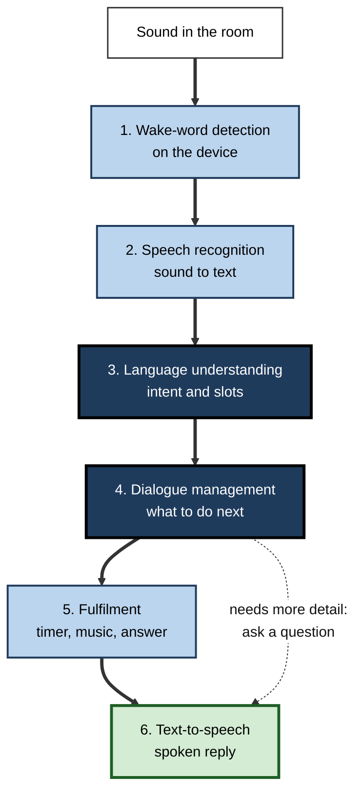
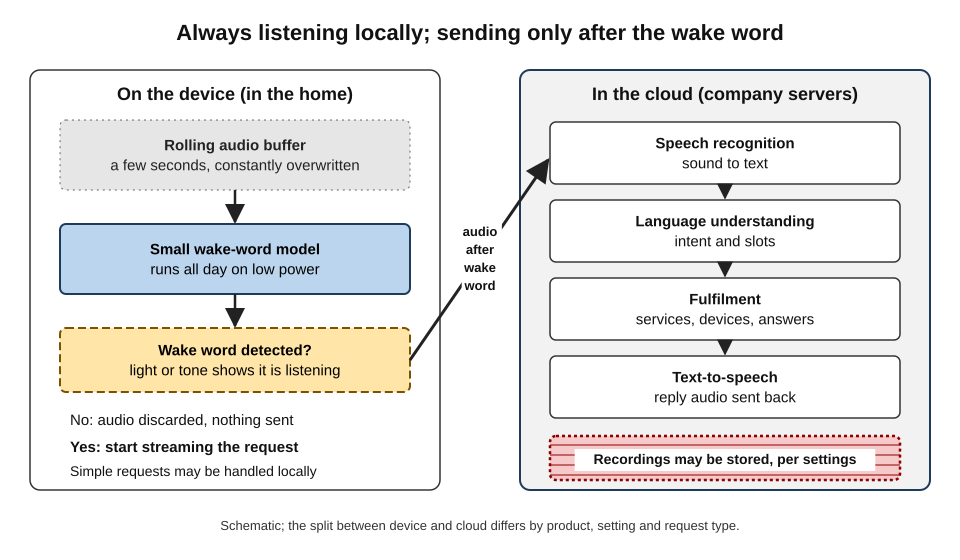
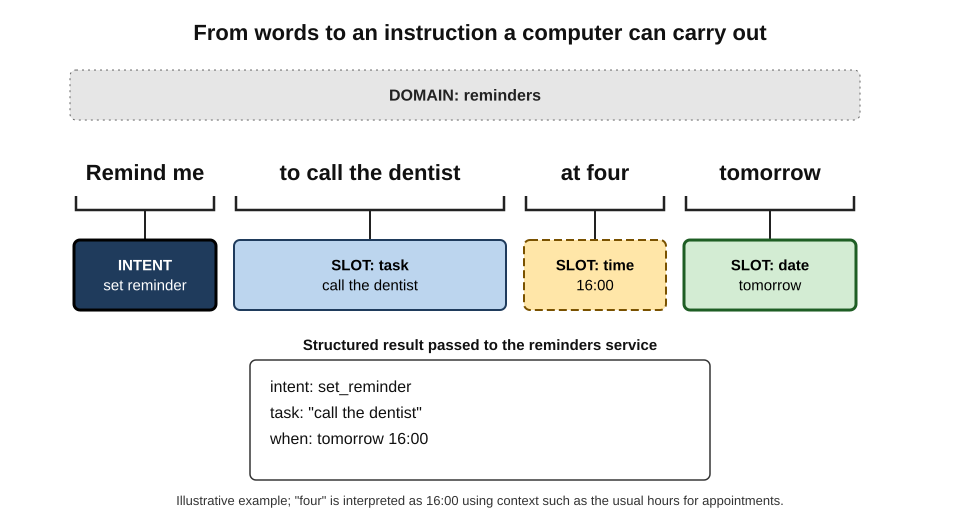
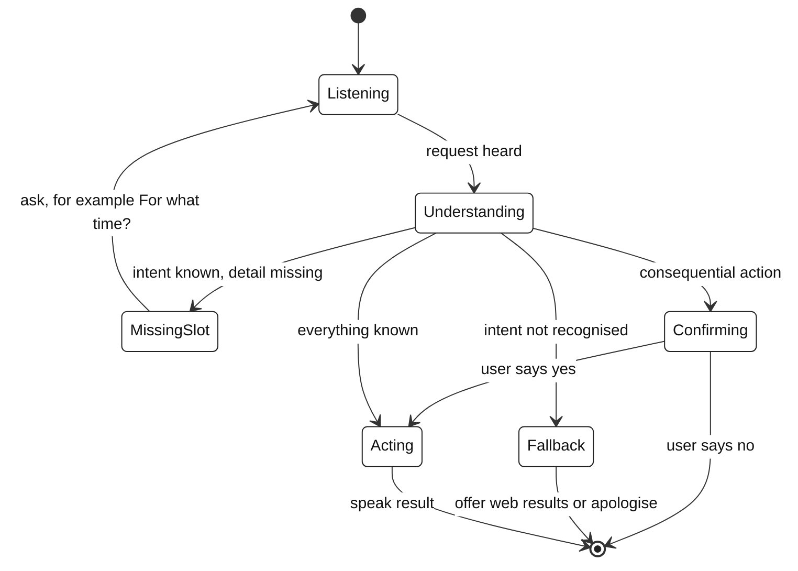
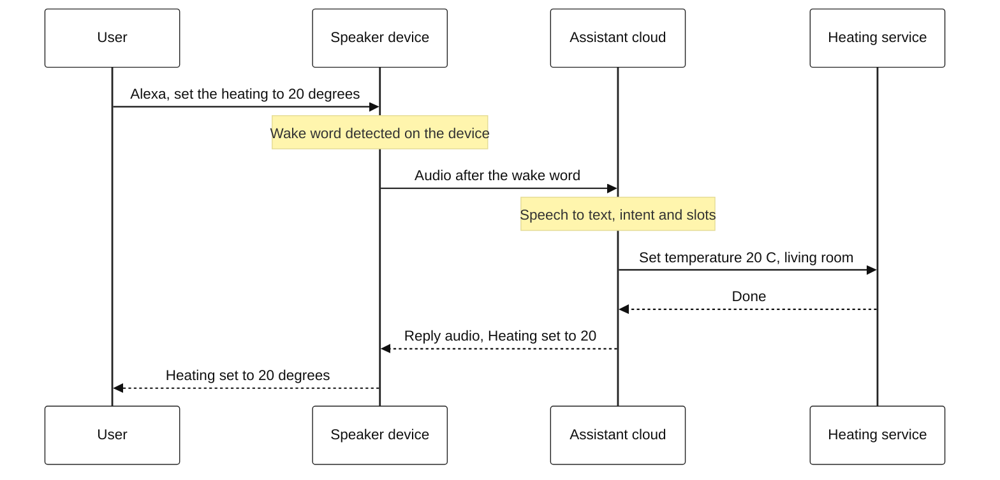
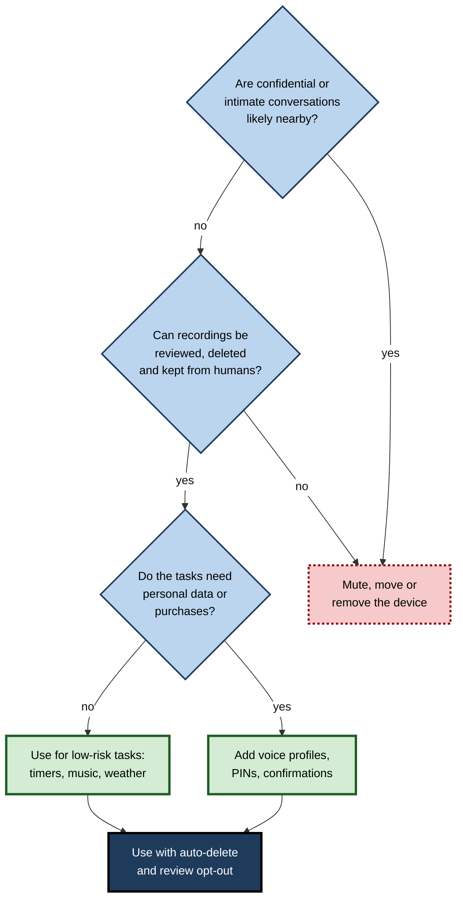

# E.3. Voice assistants: Siri, Alexa, Google Assistant

A cook with flour on her hands says, "Set a timer for twelve minutes," and a small speaker on the shelf answers, "Twelve minutes, starting now." In about a second the device has noticed its name among the kitchen noise, turned sound into words, worked out what was wanted, started a timer and replied in a synthetic voice. Each of those steps is a separate piece of artificial intelligence, and each can fail in its own way.

> **Definition — Voice assistant:** software that accepts spoken requests, interprets them and responds with speech or actions, such as answering a question, playing music or controlling a device.

**Why it matters**

- **Speech is the most natural interface.** It needs no keyboard, no screen and no reading — valuable while driving or cooking, and for many disabled and older people.
- **It is a complete AI pipeline in one product.** Detection, recognition, understanding, decision and generation all happen in sequence.
- **It brings microphones into private spaces.** Kitchens, bedrooms and cars become places where data are captured, raising questions of privacy and consent.
- **Its limits teach realism about AI.** After a decade, most people use voice assistants for a handful of simple tasks — a gap between promise and practice that explains much about narrow AI.

---

## What People Actually Use Them For

### The everyday core

- **Timers, alarms and reminders** — the single most reliable use.
- **Music, radio and podcasts** — "Play some jazz", "Skip this song".
- **Quick facts** — weather, time zones, unit conversions, sports results, spelling.
- **Calls and messages** — hands-free, especially in cars.
- **Smart-home control** — lights, heating, plugs, locks, doorbells.
- **Navigation** — "Take me home", "Find a petrol station" in the car.
- **Accessibility** — controlling a phone by voice for people with limited movement or sight; reading messages aloud.

> **Key point:** tasks that succeed share three features: the request is **short**, the set of possible meanings is **small**, and the result is **easy to check** (the timer starts, the light turns on).

### The three major assistants

| | Siri | Alexa | Google Assistant |
|---|---|---|---|
| Company | Apple | Amazon | Google |
| Main home | iPhone, Apple Watch, HomePod, cars via CarPlay | Echo smart speakers and screens | Android phones, Nest speakers and displays, cars via Android Auto |
| Particular strength | Integration with the user's own Apple devices and apps; emphasis on on-device processing | Smart-home control and third-party "skills"; shopping | Web search knowledge; the user's Google services (calendar, mail, maps) |
| Ecosystem logic | Sells hardware | Sells goods and subscriptions | Sells advertising and services |
| Recent direction | Generative-AI upgrades announced from 2024, some delayed | Generative "Alexa+" introduced from 2025 | Being replaced by the Gemini assistant on many devices from 2024–2025 |

> **Watch out:** the names stay the same while the technology underneath changes. An assistant in 2016, one in 2022 and one in 2026 may share a name but rely on very different models. Statements such as "Siri can't do X" go out of date quickly.

---

## The Classic Voice Pipeline

Behind a one-second exchange sit six stages. Until the arrival of large language models, almost every assistant was built this way, and much of the structure survives.

1. **Wake-word detection** — is someone addressing the device?
2. **Automatic speech recognition (ASR)** — what words were said?
3. **Natural-language understanding (NLU)** — what does the person want?
4. **Dialogue management** — what should happen next, given the conversation so far?
5. **Fulfilment** — carry out the action or fetch the answer.
6. **Text-to-speech (TTS)** — say the response aloud.

**Figure 1.** The classic voice-assistant pipeline, from sound to spoken reply.

### 1. Listening for the wake word

- **Always listening, locally**
  - The device continuously analyses a few seconds of sound in a short rolling memory (a **buffer**) that is constantly overwritten.
  - A small neural network on the device itself checks whether the sound matches "Alexa", "Hey Siri", "Hey Google" or similar.
  - Only after detecting the wake word does the device begin sending audio to the company's servers, usually signalled by a light or a tone.
- **Why it must be tiny**
  - It runs all day on low power, often on a dedicated chip; it cannot afford a large model.
- **Two kinds of error**
  - **False accept** — waking when nobody said the word ("a lexer", a television advert, a similar name).
  - **False reject** — ignoring the user who did say it.
  - A second, larger check (on the device or in the cloud) often confirms the wake word before acting.

> **Definition — Wake word (hotword):** a short phrase that a device listens for continuously and that triggers it to start processing a request.

| | False accept | False reject |
|---|---|---|
| What happens | Device wakes without being addressed | Device ignores a genuine request |
| Typical cause | Similar-sounding words, television audio, background speech | Noise, distance, accent, speaking too quickly |
| User experience | Surprise, interruption, sense of being overheard | Frustration; repeating louder |
| Privacy consequence | Unintended audio may be sent and stored | None |
| Design response | Second verification stage; showing users their recordings | More training data; voice-matched models |

> **Watch out:** "the speaker records everything I say" is not how wake-word systems are designed — but **false accepts** mean that snippets of private conversation are sometimes sent unintentionally. Both the reassuring and the alarming version need this qualification.

**Figure 2.** What stays on the device and what is sent to the cloud.

### 2. Turning sound into words

- **The task**
  - A microphone captures air-pressure changes; the system must output the most likely sequence of words.
  - It works on short slices of sound converted into patterns of frequencies over time (a **spectrogram**).
- **How it was done**
  - **Before about 2012** — statistical models of speech sounds combined with a model of likely word sequences.
  - **From the early 2010s** — deep neural networks cut error rates sharply.
  - **Today** — **end-to-end** neural models map sound directly to text, trained on very large amounts of transcribed speech.
- **Why context helps**
  - "Play *Yesterday*" versus "What was the weather *yesterday*?" — a language model of likely phrases resolves sounds that are acoustically identical.
  - Assistants also use personal context: names in the user's contacts, song titles in their library.
- **Hard conditions**
  - Distance from the microphone, echo in a room, several people talking, music playing, children's voices, strong regional accents, mixing two languages in one sentence.
  - Devices use several microphones to **beamform** — focusing on sound from the speaker's direction.

> **Definition — Automatic speech recognition (ASR):** the conversion of spoken language into text by a computer.

> **Formula — Word error rate (WER):** WER = (substitutions + deletions + insertions) ÷ number of words actually spoken. Lower is better; 0 means a perfect transcript.

**Worked example (illustrative) — measuring a transcript**

The user says (8 words): "remind me to call the dentist at four".
The system hears: "remind me to call a dentist for".

| Spoken word | Recognised word | Error type |
|---|---|---|
| remind, me, to, call | remind, me, to, call | none |
| the | a | substitution |
| dentist | dentist | none |
| at | — | deletion |
| four | for | substitution |

1. **Count errors:** 2 substitutions + 1 deletion + 0 insertions = **3**.
2. **Divide by spoken words:** 3 ÷ 8 = **0.375**, a WER of **37.5%**.
3. **Consequence:** the time has been lost — "for" is not a time — so the reminder will either fail or prompt a follow-up question.

*Illustrative example.*

> **Watch out:** WER treats every word equally. Mishearing "the" as "a" is harmless; mishearing "four" as "for" destroys the request. Two systems with the same WER can be very different in usefulness.

**Study card — Racial disparities in speech recognition (Stanford University, published in PNAS, 2020)**

- **Question:** do commercial speech-recognition systems perform equally well for different groups of speakers in the United States?
- **Design:** recorded interviews with Black speakers and with white speakers were transcribed by five leading commercial speech-recognition services, and the transcripts were compared with human transcriptions.
- **Results:** all five systems made substantially more errors for Black speakers — the average word error rate was roughly 0.35 for Black speakers against roughly 0.19 for white speakers.
- **Explanation offered:** differences in pronunciation and speech patterns that were under-represented in the systems' training data, rather than in vocabulary.
- **Conclusion:** speech systems that work well "on average" can fail some groups systematically; diverse training data and evaluation by group are needed.

### 3. Understanding what is wanted

The text "set an alarm for seven tomorrow" must become an instruction a computer can execute.

- **Intent** — the goal of the request: *set alarm*.
- **Slots (entities)** — the details needed to carry it out: *time = 07:00*, *date = tomorrow*.
- **Domain** — the general area: *clock*, *music*, *weather*, *smart home*.

> **Definition — Intent:** the goal a user expresses in a request, such as setting a timer or playing music.

> **Definition — Slot:** a piece of information required to fulfil an intent, such as a time, a place, a song title or a device name.

**Figure 3.** One spoken request decomposed into a domain, an intent and slots.

- **Classic method**
  - Classifiers trained on many example phrasings of each intent ("wake me at…", "set an alarm for…", "I need to be up by…").
  - Developers of third-party apps (Alexa "skills", for example) supplied sample sentences for each intent.
- **Why it is hard**
  - **Ambiguity** — "Play *Frozen*": the film, the soundtrack or a song called "Frozen"?
  - **Reference** — "Turn it off": which device is "it"?
  - **Implicit information** — "I'm cold" may mean "turn up the heating".
  - **Out-of-scope requests** — anything not covered by a defined intent tends to fall back to "Here's what I found on the web".

### 4. Keeping track of the conversation

- **Dialogue state** — what has been said so far and which slots are still empty.
- **Clarifying questions** — "For what time?" when the time is missing.
- **Follow-ups** — "And what about Saturday?" after a weather question requires remembering the topic.
- **Confirmations** — for consequential actions ("Order washing-up liquid for £4.50 — shall I go ahead?").

**Figure 4.** Dialogue management for an incomplete request.

### 5 and 6. Acting and replying

- **Fulfilment**
  - Calls the right service: the clock, a music catalogue, a weather service, a smart-home hub, a knowledge database, a third-party skill.
  - Needs the user's **account links** and **permissions** (to their calendar, music subscription or heating system).
- **Text-to-speech**
  - Older systems stitched together recorded fragments of a voice actor's speech (**concatenative synthesis**), sounding choppy.
  - Neural TTS, introduced widely from the late 2010s, generates the sound wave itself and sounds far more natural, with intonation that fits the sentence.

**Figure 5.** One request, step by step, across the device and the cloud.

### Recognising who is speaking

- **Speaker identification** — matching a voice to an enrolled household member so that "What's on my calendar?" returns the right person's calendar.
  - Built from a short enrolment in which the person repeats phrases; the system stores a numerical **voiceprint**.
- **Uses** — personal results, separate music preferences, restricting purchases to adults.
- **Limits**
  - Voices change with illness, age and mood; family members can sound alike.
  - Recordings and synthetic voices can imitate a person, so voice matching is a **convenience feature**, not strong security.

> **Definition — Voiceprint:** a numerical representation of the characteristics of a person's voice, used to recognise who is speaking; in many jurisdictions it counts as biometric data.

> **Watch out:** "voice ID" on a smart speaker is not equivalent to a bank's security check. It is designed to choose whose playlist to play, and can be fooled; sensitive actions need a PIN or confirmation on a phone.

### How assistants improve over time

- **More and more varied training data** — transcribed speech from many accents, ages, rooms and microphones.
- **Learning from failures** — requests that end in "Sorry, I didn't get that", a rephrased repeat or a cancelled action are signs of error and are prioritised for improvement.
- **Human annotation** — people transcribe or label samples so that models can learn from corrected examples (the source of the privacy controversy described below).
- **Personal adaptation** — the assistant learns names in contacts, the user's music and the names of their devices ("the big lamp").
- **Synthetic data** — computer-generated speech and phrasings fill gaps for rare requests and new languages.
- **Language coverage** — assistants support dozens of languages, but quality is uneven; widely spoken languages with plentiful recorded speech receive the most accurate models, and **code-switching** (moving between two languages in one sentence, common in India and many other places) remains difficult.

> **Key point:** an assistant's quality in a given language, accent or environment reflects **how much matching data it was trained on**. Its weaknesses are a map of whose speech was under-represented.

---

## From Command Systems to Language Models

### What large language models change

From 2023 onwards the companies began rebuilding their assistants around **large language models** (LLMs) — models trained on vast amounts of text that can interpret and generate open-ended language.

- **Understanding** — no fixed list of intents; the model can interpret unusual phrasing, several requests in one sentence and vague goals ("make the living room cosy").
- **Conversation** — longer, more natural exchanges with memory of context.
- **Action** — the language model decides which device functions or services to call, in what order (**tool use**).
- **Costs and risks**
  - Slower responses and higher computing costs per request.
  - **Fabricated answers** delivered in a confident voice, without the visual cues a screen provides.
  - More ways for an action to go wrong when the system chooses its own steps.

| | Classic command assistant | Language-model assistant |
|---|---|---|
| Understanding | Fixed intents and slots trained from examples | Open-ended interpretation of any phrasing |
| Typical failure | "Sorry, I don't know that one" | A fluent but wrong answer or action |
| Predictability | High within its narrow scope | Lower; same request may be handled differently |
| Speed and cost | Fast and cheap per request | Slower and more expensive per request |
| Best at | Timers, music, lights, simple facts | Multi-step requests, explanation, conversation |

> **Key point:** the classic assistant fails by **refusing**; the language-model assistant fails by **inventing**. The second failure is harder for a listener to detect.

> **Watch out:** a confident synthetic voice gives no signal of uncertainty. When an assistant gives factual, medical, legal or financial information, the answer should be checked — the voice sounds equally sure whether it is right or wrong.

### On the device or in the cloud?

| | Processing on the device | Processing in the cloud |
|---|---|---|
| Speed | Fast; no network round trip | Depends on connection |
| Privacy | Audio and text can stay on the device | Audio or transcripts leave the home |
| Capability | Limited by the device's chip and battery | Very large models available |
| Works offline | Yes, for supported tasks | No |
| Updates | Need device updates | Can be improved centrally every day |

- **Direction of travel**
  - Phone makers have added dedicated neural chips so that more speech recognition and simple requests run locally.
  - Large generative features have pulled processing back towards the cloud. In 2025, for example, Amazon withdrew an option on some Echo devices that had let users keep their voice requests from being sent to the cloud, saying its new generative features required cloud processing.
- **Hybrid designs** — simple requests handled locally; complex ones sent to servers, sometimes with privacy protections around the data.

---

## Privacy, Trust and the Microphone at Home

### Case study: Human review of voice recordings (2019)

- **Situation:** to improve speech recognition, assistant makers had human workers — often contractors — listen to a small sample of recorded requests and check the transcriptions.
- **Disclosure:**
  - In April 2019 a news investigation reported that Amazon employed teams to listen to Alexa recordings.
  - In July 2019 a Belgian broadcaster obtained Google Assistant recordings leaked by a contractor, and a British newspaper reported that contractors grading Siri recordings sometimes heard confidential medical information, business dealings and intimate moments, often from accidental activations.
- **Problem:** many users had not understood from privacy policies that people, not only machines, might hear their recordings.
- **Actions by the companies:**
  - Apple suspended the programme, then made human review **opt-in** and stopped retaining audio by default.
  - Google paused human review in Europe and later asked users to opt in.
  - Amazon added settings to opt out of human review and to delete recordings automatically.
- **Aftermath:** legal disputes continued for years; in early 2025 Apple agreed to pay $95 million to settle a US class action over unintended Siri recordings, without admitting wrongdoing. In 2023 Amazon paid $25 million to settle US government allegations that it had kept children's Alexa recordings in breach of children's privacy law.
- **Lesson:** improving AI needs data, and checking data often needs people. Users' trust depends on being **told clearly** who can hear what, and on **meaningful choices** — not on technical fine print.

### Privacy controls worth knowing

- **Review and delete history** — all three assistants let users see and delete stored requests.
- **Automatic deletion** — options to delete recordings after a set period.
- **Opt out of human review** — where available.
- **Microphone mute button** — a physical switch on smart speakers that disconnects the microphones.
- **Voice profiles** — let the assistant recognise household members; they are also biometric data.
- **Guest and child settings** — restrict purchases, explicit content and personal results.

> **In practice:** in a home office, mute or remove smart speakers during confidential calls; many employers' information-security policies require it, and client contracts may forbid recording devices near sensitive discussions.

### Security risks

- **Unwanted commands** — television adverts that say a wake word; researchers have demonstrated commands hidden in audio inaudible or unintelligible to people.
- **Voice spoofing** — synthetic voices imitating a household member; voice alone is weak proof of identity.
- **Purchases by children** — widely reported cases of children ordering toys by voice led to default purchase confirmations and PIN codes.

**Figure 6.** Weighing convenience against privacy when deciding where to use a voice assistant.

---

## Voice Assistants in Professional Settings

### Where they help

- **Healthcare** — hands-free dictation and "ambient" documentation that drafts clinical notes from a consultation (with the patient's consent); hands-free information in sterile settings.
- **Warehouses and field work** — voice-directed picking and checklists when hands and eyes are busy.
- **Cars and fleets** — navigation, messages and calls without touching a screen.
- **Hospitality and care homes** — room controls, reminders and companionship features for residents.
- **Accessibility at work** — voice control of computers for employees with motor impairments.

### Where they struggle

- **Noisy, multi-speaker environments** — open-plan offices, factory floors.
- **Specialist vocabulary** — drug names, legal terms, product codes, unless adapted.
- **Accountability** — spoken instructions leave weaker records than typed ones unless logged.
- **Confidentiality** — recordings of client or patient information create data-protection obligations.

### Case study (illustrative): voice-directed picking in a warehouse

- **Situation:** a distribution centre gave pickers headsets that spoke instructions ("Aisle 14, slot 3, pick 6") and listened for spoken confirmations, replacing handheld scanners.
- **Expected benefit:** hands and eyes free; fewer errors; faster picking.
- **Problem in the first month:** recognition failed for some workers — especially those with strong regional accents or speaking English as a second language — in the noisiest aisles; they repeated confirmations, slowed down and grew frustrated.
- **Diagnosis:**
  1. The system used a generic speech model and a fixed confirmation vocabulary.
  2. Noise near conveyor belts exceeded what the headsets were designed for.
- **Actions:**
  1. Each worker completed a short enrolment, reading the confirmation words so the system could adapt to their voice.
  2. Confirmations were redesigned around **check digits** (two numbers printed on each slot) instead of free words, which are acoustically distinct and also prove the worker is at the right slot.
  3. Noise-cancelling headsets were issued for the conveyor zone.
- **Result:** recognition errors fell to a level the supervisors considered acceptable; picking errors fell compared with the scanner system.
- **Lesson:** voice systems succeed when the **vocabulary is small and distinct**, the system is **adapted to its users**, and the **acoustic environment** is engineered — the same conditions that make home assistants reliable for timers and music.

---

## Open Questions

- **Will language models make voice assistants genuinely capable — or merely more talkative?**
  - Open-ended understanding is better, but reliability of actions and factual accuracy remain uncertain.
- **Can assistants be powerful and private at once?**
  - The largest models run in the cloud; how much can move onto devices is an open engineering question.
- **How should a voice convey uncertainty?**
  - Screens can show sources and hedges; designing spoken equivalents that people notice is unsolved.
- **How can recognition be made fair across accents, dialects and speech differences?**
  - Including people with speech impairments and speakers of under-represented languages.
- **What business model sustains voice assistants?**
  - Several companies have reported that their assistants made little money; generative upgrades are partly an attempt to change that.

---

## Summary

- A **voice assistant** accepts spoken requests and responds with speech or actions; most real use is **timers, music, quick facts, calls and smart-home control** — short requests with few meanings and easily checked results.
- **Siri, Alexa and Google Assistant** differ mainly in their ecosystems and business models; their underlying technology changes under constant names.
- The classic pipeline: **wake-word detection** (on the device) → **speech recognition** → **language understanding** (**intent** and **slots**) → **dialogue management** → **fulfilment** → **text-to-speech**.
- Wake-word systems trade **false accepts** (privacy risk) against **false rejects** (frustration).
- Recognition is measured by **word error rate**; it struggles with noise, distance and accents, and a 2020 study found much higher error rates for Black than for white American speakers.
- **Language-model assistants** understand open-ended requests but fail by **inventing** rather than refusing, and are slower and costlier; processing is split between **device** and **cloud**.
- The 2019 revelations of **human review** of recordings led to opt-in review, deletion controls and later legal settlements; trust depends on clear disclosure and real choices.
- At work, voice succeeds with **small, distinct vocabularies**, **adaptation to users** and a controlled **acoustic environment**, and creates confidentiality obligations.

---

## Self-Check

1. Name the six stages of the classic voice-assistant pipeline and say what each does.
2. Why does wake-word detection run on the device, and why must it be small?
3. Distinguish a false accept from a false reject and give the privacy consequence of each.
4. A user says "turn on the kitchen lights" (5 words); the system hears "turn on the chicken lights". Compute the WER and comment on its usefulness as a measure here.
5. Identify the intent and slots in "Play the latest episode of the history podcast in the bedroom".
6. Why are requests such as "Play *Frozen*" or "Turn it off" hard for an assistant?
7. Summarise the 2020 speech-recognition disparity study and its implications.
8. Contrast how a classic command assistant and a language-model assistant typically fail.
9. Give two advantages of on-device processing and two of cloud processing.
10. What happened in 2019 concerning human review of recordings, and what changed as a result?
11. Which tasks do voice assistants perform most reliably, and what do those tasks have in common?
12. List four privacy controls a household can use with a smart speaker.
13. A hospital wants nurses to request drug information by voice on the ward. Identify the main risks and design safeguards.

### Answer Key

1. Wake-word detection (notices it is being addressed); speech recognition (sound to text); language understanding (intent and slots); dialogue management (decides next step, asks questions); fulfilment (carries out the action); text-to-speech (speaks the reply).
2. It must listen continuously, so running locally avoids sending all audio to servers (privacy) and works without a network; it must be small to run all day on little power, often on a dedicated chip.
3. False accept: wakes without being addressed — private audio may be sent and stored. False reject: ignores a real request — frustration, but no privacy cost.
4. One substitution ("chicken" for "kitchen") out of 5 words = 0.2 (20%). The measure understates the damage: the one wrong word is the location, so the command fails completely.
5. Intent: play podcast episode. Slots: podcast = "the history podcast", episode = latest, device or room = bedroom.
6. "Frozen" is ambiguous (film, soundtrack, song); "it" requires knowing which device was referred to earlier or is in context — reference resolution.
7. Five commercial systems transcribed interviews; error rates averaged roughly 0.35 for Black speakers and 0.19 for white speakers, attributed to under-represented speech patterns in training data. Systems must be trained and evaluated across groups.
8. Classic: refuses or falls back ("Sorry, I don't know that"). Language-model: produces a fluent but incorrect answer or action, which is harder to detect.
9. On-device: faster, more private, works offline. Cloud: much larger models, central improvements every day, more capability.
10. Reports revealed that contractors listened to samples of Alexa, Google Assistant and Siri recordings, including accidental activations with sensitive content. Companies paused or changed programmes, made human review opt-in or opt-out, and added deletion settings; legal settlements followed later.
11. Timers, alarms, music, weather, simple facts, calls, smart-home control — short requests, few possible meanings and immediately checkable outcomes.
12. Review and delete history; automatic deletion; opting out of human review; the physical microphone mute; voice profiles; restrictions on purchases and children's use.
13. Risks: mis-recognised drug names or doses, confident wrong answers, noise, confidentiality of patient information, weak audit trail. Safeguards: restricted, verified drug database rather than open generation; read-back confirmation of drug and dose; adapted vocabulary; logging; local or contractually protected processing; voice used for lookup only, never as the sole check before administering.

---

## Glossary

| Term | Meaning |
|---|---|
| Automatic speech recognition (ASR) | Conversion of spoken language into text. |
| Beamforming | Using several microphones to focus on sound from one direction. |
| Buffer | A short rolling memory of recent audio that is constantly overwritten. |
| Code-switching | Moving between two languages within one sentence or conversation. |
| Concatenative synthesis | Speech produced by joining recorded fragments of a human voice. |
| Dialogue management | Deciding the next step in a conversation from its current state. |
| End-to-end model | A neural model mapping input (sound) directly to output (text). |
| False accept | A device waking when it was not addressed. |
| False reject | A device ignoring a genuine wake word. |
| Fulfilment | Carrying out the action or retrieving the answer a request requires. |
| Intent | The goal expressed in a request. |
| Large language model (LLM) | A model trained on vast text that interprets and generates open-ended language. |
| Natural-language understanding (NLU) | Extracting meaning — intent and slots — from text. |
| Neural text-to-speech | Speech synthesis in which a neural network generates the sound wave. |
| Skill | A third-party capability added to an assistant. |
| Slot | A detail needed to fulfil an intent, such as a time or a device. |
| Speaker identification | Recognising which enrolled person is speaking. |
| Spectrogram | A representation of sound as frequencies changing over time. |
| Text-to-speech (TTS) | Conversion of text into spoken audio. |
| Tool use | A language model choosing and calling external functions or services. |
| Voice assistant | Software that interprets spoken requests and responds by speech or action. |
| Voiceprint | A numerical representation of a voice used to recognise the speaker. |
| Wake word | A phrase a device listens for to begin processing a request. |
| Word error rate (WER) | (Substitutions + deletions + insertions) ÷ words spoken. |
