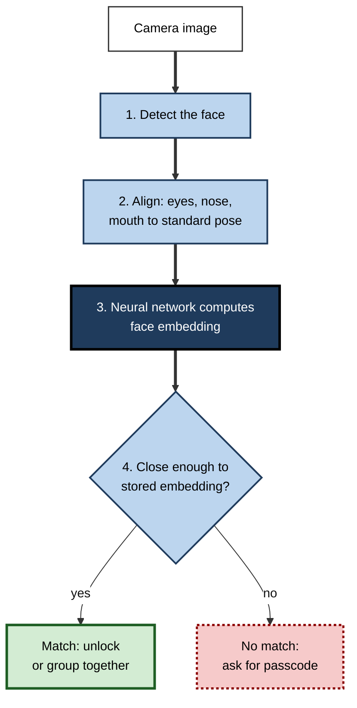
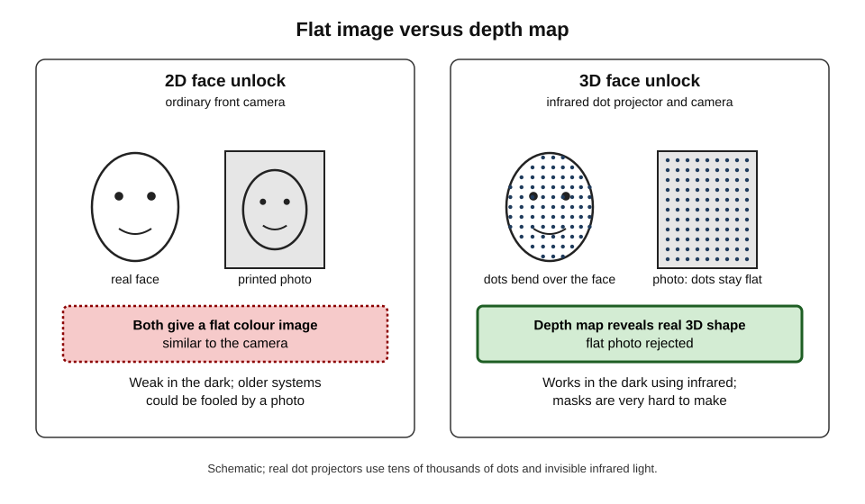
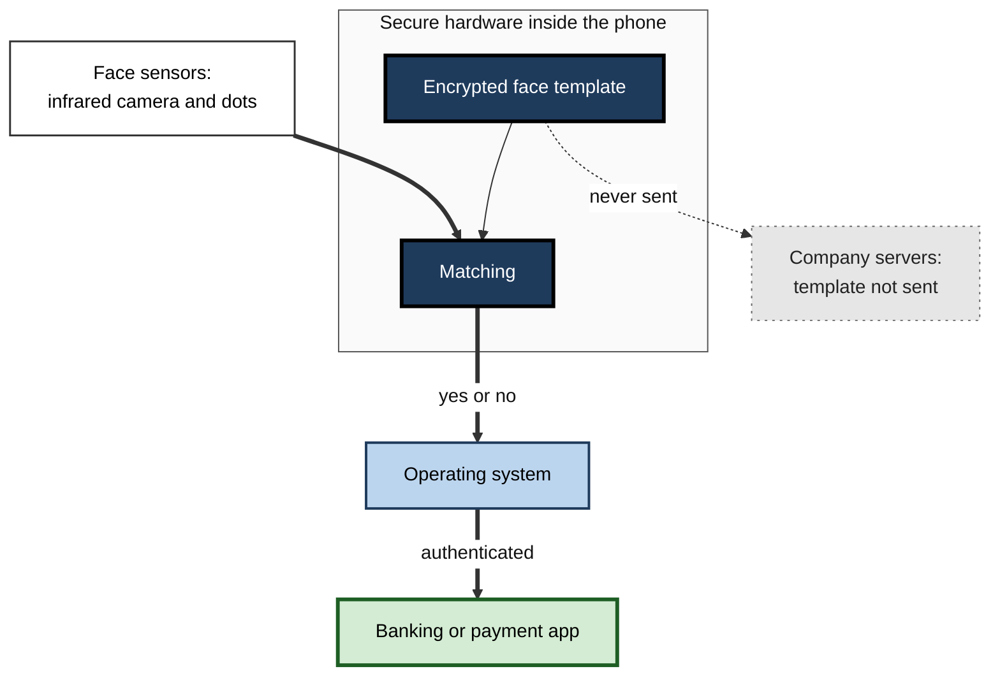
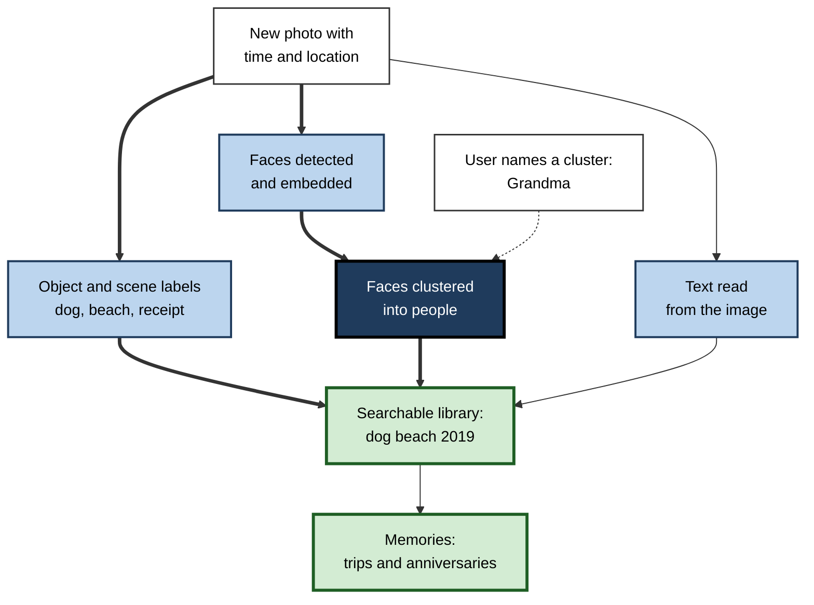
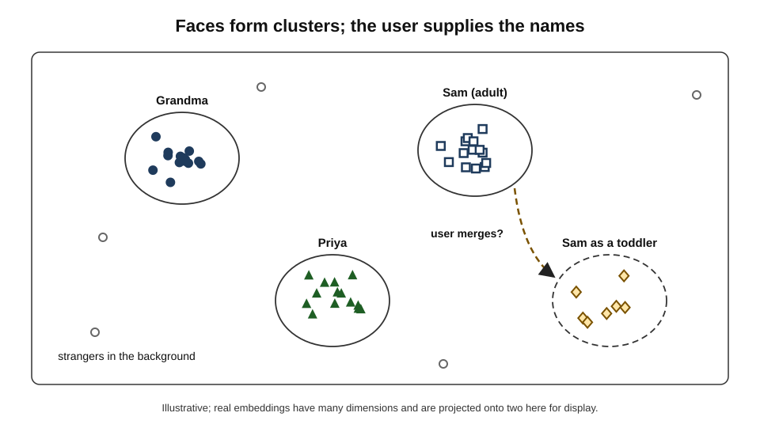
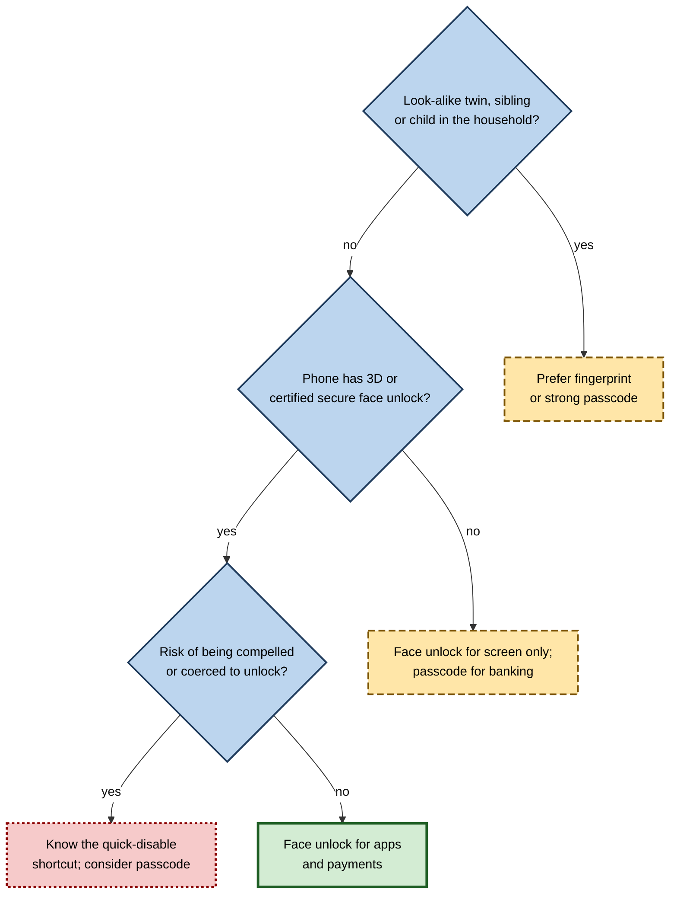

# E.4. Face unlock and photo organisation on phones

A person glances at their phone and it opens. Later they type "dog beach" into the gallery and, out of twenty thousand pictures, the phone shows every photograph of their dog on a beach — though no one labelled any of them. It has also gathered every picture of their grandmother into one album. All of this is **computer vision**: software that has learned to find, describe and compare faces and objects in images.

> **Definition — Computer vision:** the field of AI concerned with enabling computers to interpret images and video — detecting, recognising, describing and measuring what they show.

> **Definition — Face recognition:** the automatic comparison of a face in an image with one or more stored faces in order to verify or establish a person's identity.

**Why it matters**

- **It secures the most personal device people own.** Billions of phones are unlocked, and payments approved, by a face.
- **It makes vast personal archives usable.** Without automatic organisation, most photographs would never be seen again.
- **It is biometric technology in everyone's pocket.** Faces cannot be changed like passwords, so how face data are stored and used matters greatly.
- **It shows the difference between identical-sounding uses.** Unlocking one's own phone and identifying strangers in a crowd use related technology but carry utterly different risks.

---

## How a Machine Recognises a Face

### Four steps

1. **Detection** — find where faces are in the image.
   - The phone draws an invisible box around each face, even small, tilted or partly hidden ones.
2. **Alignment** — rotate and scale the face to a standard position, using landmarks such as the eyes, nose and mouth.
3. **Representation** — a neural network converts the aligned face into a list of numbers, a **face embedding**.
   - The network was trained on very many faces so that two images of the same person produce **similar** numbers, while images of different people produce **different** ones — regardless of lighting, expression or hairstyle.
4. **Comparison** — measure how close the new embedding is to a stored one; if it is closer than a **threshold**, declare a match.

> **Definition — Face embedding (face template):** a compact list of numbers computed from a face image, designed so that images of the same person produce nearby values; it is what is stored and compared, rather than the photograph itself.

**Figure 1.** From an image to a decision: the four steps of face recognition.

### Verification and identification

The same steps serve two very different purposes.

| | Verification (one-to-one) | Identification (one-to-many) |
|---|---|---|
| Question | Is this the person they claim to be? | Who, out of everyone in a database, is this? |
| Compared against | One stored template — the owner's | Thousands or millions of templates |
| Everyday example | Unlocking one's own phone; airport e-gates checking a passport photo | Searching a database for an unknown person in a photograph |
| Consent | The person enrols and chooses to use it | The person may not know it is happening |
| Error risk | A false match lets one wrong person in | False matches grow with database size; an innocent person may be misidentified |

> **Definition — Verification (one-to-one matching):** checking whether a face matches a single claimed identity.

> **Definition — Identification (one-to-many matching):** searching a database of many faces to find who a face belongs to.

> **Key point:** phone face unlock is **verification** against a template the owner created. Most public controversy about face recognition concerns **identification** of people who did not consent. Treating the two as one technology confuses the debate.

### Errors and thresholds

- **False match (false accept)** — a different person is accepted as the owner.
- **False non-match (false reject)** — the owner is refused, for example in poor light or at an unusual angle.
- **The threshold** sets the balance: a stricter threshold means fewer false matches but more false rejections.
- **Phones choose security** — a false reject costs a few seconds (the passcode); a false match could expose everything on the device.

> **Formula — Chance of at least one false match in a search:** P = 1 − (1 − FMR)ᴺ, where FMR is the false-match rate per comparison and N the number of templates compared.

**Worked example (illustrative) — why identification is riskier than verification**

A face system has a false-match rate of 1 in 1,000,000 per comparison.

| Use | Comparisons (N) | Chance of at least one false match |
|---|---|---|
| Unlocking one's own phone, one attempt | 1 | 1 − (1 − 0.000001)¹ ≈ **0.0001%** |
| Five attempts by a stranger | 5 | ≈ **0.0005%** |
| Searching a database of 100,000 people | 100,000 | 1 − (0.999999)¹⁰⁰⁰⁰⁰ ≈ **9.5%** |
| Searching a database of 1,000,000 people | 1,000,000 | ≈ **63%** |

*Illustrative figures.*

- **Conclusion:** an error rate that is negligible for **one** comparison becomes substantial across **millions**. A search "hit" in a large database is a lead to investigate, never proof of identity.

> **Watch out:** the same accuracy figure means very different things for verification and identification. A system described as "99.9999% accurate" can still produce a likely false hit in a large search.

---

## Face Unlock in Practice

### Two-dimensional and three-dimensional sensing

- **2D face unlock**
  - Uses the ordinary front camera.
  - Cheap and available on many phones, but historically easier to fool with a photograph or video, and poor in the dark.
  - On many Android phones, 2D face unlock has not been permitted to approve payments or banking apps.
- **3D face unlock**
  - Apple's **Face ID**, introduced with the iPhone X in 2017, projects a pattern of more than 30,000 invisible infrared dots onto the face and reads their distortion with an infrared camera to build a depth map.
  - An infrared "flood" light lets it work in darkness.
  - Depth makes a flat photograph useless as a spoof.
- **Other approaches** — some phones combined infrared cameras with radar for detecting an approaching hand; recent phones have improved 2D systems with better neural models and secure processing.

**Figure 2.** Two-dimensional and three-dimensional face sensing compared.

| | PIN or passcode | Fingerprint sensor | 2D face unlock | 3D face unlock |
|---|---|---|---|---|
| What is checked | A secret the person knows | Ridge pattern of a finger | Appearance in a normal camera image | Depth map and infrared image of the face |
| Resistance to a photo or mould | Not applicable | Moderate; moulds have fooled some sensors | Weaker on older systems | Strong against photos; masks are very hard |
| Works in the dark | Yes | Yes | Poorly | Yes |
| Can be observed by others | Yes — shoulder-surfing | No | No | No |
| Can be changed if compromised | Yes | No (but ten fingers) | No | No |

### Apple's published figures

- **Face ID** — Apple states that the probability that a random person could unlock a given iPhone with Face ID is less than 1 in 1,000,000 (with one enrolled appearance).
- **Touch ID** (the earlier fingerprint sensor) — Apple's figure was 1 in 50,000.
- **Important exceptions stated by Apple**
  - The chance is higher for **identical twins**, siblings who look alike and **children under 13**, whose facial features are still developing.
- **Attention awareness** — by default Face ID requires the eyes to be open and looking at the phone, so it cannot normally be used on a sleeping person.

> **Watch out:** "1 in a million" refers to a **random stranger**, not to a twin, a sibling or a determined attacker with a custom mask. In 2017 a Vietnamese security firm claimed to have fooled Face ID with an elaborate mask; the demonstration was disputed and impractical, but it shows that the figure is about chance matches, not targeted attacks.

### Where the face template lives

- **On the device**
  - Face ID and comparable systems convert the face into a mathematical template, encrypted and kept in a protected hardware area of the phone's chip (a **secure enclave** or similar secure element).
  - The template is not sent to the company's servers or included in ordinary backups, according to the manufacturers' security documentation.
- **What apps receive**
  - A banking app does not see the face; it receives only a "yes, authenticated" signal from the operating system.
- **Adapting over time**
  - The system updates the template gradually as the owner's appearance changes — beards, glasses, ageing — when a successful unlock (or passcode entry immediately after a near-match) confirms identity.
  - From 2022 iPhones could recognise the owner while wearing a face mask, by relying more on the area around the eyes.

**Figure 3.** The face template stays inside the phone's secure hardware; apps receive only a yes or no.

### Legal and practical risks of face unlock

- **Compelled unlocking** — in some jurisdictions, police may be able to compel a person to look at their phone more easily than to reveal a passcode; legal positions differ by country and are unsettled.
- **Quick disable** — phones offer a shortcut (for example holding certain buttons) that temporarily requires the passcode.
- **Twins and children** — families with look-alike members may prefer a passcode or fingerprint.
- **Accessibility** — face unlock helps people who cannot use fingerprint sensors; attention-awareness can be turned off for people who cannot look directly at the screen.

> **In practice:** for work phones holding client data, organisations usually allow biometric unlock for convenience but require a strong passcode as the fallback and enforce it after restarts and long periods of inactivity.

---

## Organising Photographs Automatically

### What the gallery does without being asked

- **Scene and object recognition** — labels such as *dog*, *beach*, *receipt*, *mountain*, *birthday cake* attached to each picture, enabling search.
- **Face grouping** — clusters pictures of the same person into a "People" album; the user can name them.
- **Text in images** — reads text in photographs of signs, documents and whiteboards so it can be searched or copied.
- **Memories and highlights** — automatically assembled collections ("Summer in Lisbon", "Two years ago today") with chosen music.
- **Quality and duplicates** — selects the best of a burst of shots; suggests deleting blurry or duplicate images and screenshots.
- **Location and time** — groups by trip using the time and place stored in the photo's metadata.

**Figure 4.** How a photo library is organised automatically after pictures are taken.

### Grouping faces without names

- **Clustering** — the gallery does not know who anyone is. It computes embeddings for every face and groups those that lie close together.
- **Naming is human** — only when the user names a cluster does it become "Grandma"; the name stays in the user's library.
- **Hard cases**
  - **Ageing** — a child's face changes greatly; systems may form separate clusters for the same person at different ages until the user merges them.
  - **Look-alikes** — siblings and twins may be merged wrongly.
  - **Unusual images** — profiles, sunglasses, low light, old scanned prints.
- **Corrections improve it** — "This is not Grandma" and "Merge these people" feed back into the grouping for that library.

> **Definition — Clustering:** grouping items so that similar ones fall together, without being told the categories in advance.

**Figure 5.** Faces in a photo library grouped by closeness of their embeddings.

### On the phone or in the cloud?

| | Analysis on the phone | Analysis in the cloud |
|---|---|---|
| Where pictures are examined | On the device, often overnight while charging | On the company's servers after upload |
| Privacy | Images and face groups need not leave the device | Company systems process the images, under its policies |
| Capability | Limited by the phone's chip | Larger models; consistent across devices |
| Typical example | Apple's approach for its Photos app | Many cloud photo services |
| Sharing across devices | Must be synchronised securely | Natural, since the library is online |

> **Watch out:** "on-device" does not mean "no data ever leave the phone" — backups, sharing and optional cloud features may still send images or derived data. Settings and documentation need to be read for each service.

### Three kinds of learning behind one gallery

The features of a photo app look alike to the user, but they rest on different kinds of machine learning.

| | Scene and object labels | Face grouping | Text in images |
|---|---|---|---|
| Learning type | Supervised: trained on millions of images labelled with categories | Unsupervised clustering of embeddings, then named by the user | Supervised recognition of characters and words |
| Knows names? | Knows categories ("dog"), never individuals | No — only "same person as" | Reads whatever text is present |
| Typical error | Wrong or missing category; offensive mislabels | Two people merged, or one person split | Misread characters in handwriting or poor light |
| Privacy sensitivity | Moderate — reveals places, activities, documents | High — biometric data about everyone pictured | High when documents, cards or addresses are photographed |
| User correction | Rarely possible directly | "Not this person", "Merge" | Edit after copying |

> **Key point:** a single gallery combines **classification** (what is in the picture), **clustering** (which faces belong together) and **recognition of text**. Each has its own errors, and the most privacy-sensitive is the one that seems most magical — grouping faces.

### The camera itself is a model

Much of the AI in a phone's camera works before a photograph is even saved.

- **Multi-frame merging** — the phone takes several frames in quick succession and combines them, reducing noise and recovering detail in bright skies and dark shadows (**high dynamic range**).
- **Night modes** — longer sequences of frames are aligned, despite hand shake, and merged so that dim scenes look bright and sharp.
- **Portrait effects** — a model separates the person from the background (**segmentation**) and blurs the background artificially, imitating an expensive lens.
- **Scene detection** — the camera recognises food, sunsets, documents or snow and adjusts colour and exposure.
- **Visual search** — pointing the camera at a plant, a landmark or a product returns identifications and shopping results.

> **Definition — Computational photography:** the use of computing — including machine-learning models — to capture, combine and enhance images, rather than relying only on the lens and sensor.

> **Watch out:** a phone photograph is therefore not a simple record of light. It is a **reconstruction** chosen by models — smoothing skin, brightening faces, sharpening text. For evidence, insurance claims or journalism, the processing applied may matter, and settings that minimise it may be needed.

### When labelling goes wrong

- **Offensive mislabelling** — in 2015 a major photo service automatically labelled photographs of two Black people with the name of an animal. The company apologised and removed that label category altogether; years later reporting found the category still blocked, showing how hard such failures are to fix fully.
- **Private moments surfaced** — "memories" have shown users pictures of former partners, deceased relatives or difficult times. Services added options to hide people, dates and topics from memories.
- **Sensitive detection** — the ability to search for "passport" or "bank card" helps users but also means an intruder with access to an unlocked phone can find such documents quickly.

---

## Fairness and the Evidence

### Do face systems work equally well for everyone?

**Study card — Gender Shades (Joy Buolamwini and Timnit Gebru, 2018)**

- **Question:** how accurately do commercial systems classify the gender of faces across skin types and genders?
- **Design:** a balanced set of photographs of parliamentarians from African and European countries, labelled by skin type and gender, was submitted to three commercial face-analysis services.
- **Results:** error rates were lowest for lighter-skinned men (under 1% for all three systems) and highest for darker-skinned women (up to about 35% for one system).
- **Conclusion:** systems trained and tested on unbalanced data can hide large differences behind a good average; the companies subsequently reported improvements.

**Study card — Demographic effects in face recognition (US National Institute of Standards and Technology, 2019)**

- **Design:** evaluated about 190 face-recognition algorithms from many developers on millions of government photographs, measuring errors by age, sex and region of birth.
- **Results:**
  - many algorithms showed **higher false-match rates** for some groups — notably people of West African, East African and East Asian origin, and older adults and children — often by factors of ten or more;
  - the **most accurate** algorithms showed much smaller differences;
  - some algorithms developed in East Asia did not show the elevated false matches for East Asian faces.
- **Conclusion:** demographic differences are real but **vary enormously between algorithms**; "face recognition is biased" and "face recognition is fair" are both too general.

> **Key point:** fairness is a property of a **particular system, threshold and use**, not of face recognition as a whole. It must be tested group by group.

> **Watch out:** Gender Shades measured gender **classification**, not identity matching; the NIST study measured identity matching. Both are often cited together as if they found the same thing. They are related but distinct results.

### The law on face data

- **Biometric data are specially protected** in many jurisdictions — under the EU General Data Protection Regulation, biometric data used to identify a person are a "special category" requiring an explicit legal basis.
- **Illinois Biometric Information Privacy Act (2008)** — requires informed written consent before collecting biometric identifiers.
  - Facebook agreed to pay $650 million (approved in 2021) to settle a class action over its automatic face-tagging suggestions; Google settled a similar case over its photo service in 2022.
- **Facebook shut down its face-recognition tagging system in 2021**, saying it would delete more than a billion face templates.
- **Identification of strangers** — companies that scraped online photos to build search databases for police have been fined or ordered to stop by regulators in several countries.

---

## Professional Perspectives

### Using face technology at work

- **Device security** — biometrics for convenience; strong passcodes as the fallback; remote wipe for lost phones.
- **Building access and time clocks** — face terminals in workplaces involve employees' biometric data; in many jurisdictions consent must be genuinely free, and alternatives (cards) should be offered.
- **Customer identity checks** — banks and online services compare a selfie with an identity document during account opening, with "liveness" checks to detect photos, screens and masks.
- **Photo-heavy work** — estate agents, insurers, journalists and field engineers rely on automatic labelling and text search; client and third-party images in personal galleries create confidentiality questions.

> **Definition — Liveness detection:** checks that determine whether a face presented to a camera belongs to a live person present at that moment, rather than a photo, screen, mask or deepfake.

**Figure 6.** Choosing an appropriate unlock and identity method by risk.

### Case study (illustrative): face clock-in at a retail chain

- **Situation:** a retail chain replaced swipe cards with face-recognition terminals for staff to clock in and out, aiming to stop "buddy punching" (colleagues clocking in for each other).
- **Problem:** within weeks staff complained; some were repeatedly rejected at dawn shifts, and a union raised concerns about biometric data.
- **Diagnosis:**
  1. The terminals faced bright windows; backlit faces in early morning light produced frequent false rejections.
  2. Rejection rates were higher for some darker-skinned employees under those lighting conditions.
  3. Staff had been told to enrol but not offered an alternative; the privacy notice did not explain where templates were stored or for how long.
- **Actions:**
  1. Moved terminals away from windows and added front lighting; re-enrolled staff in the same conditions.
  2. Offered a card-plus-PIN alternative to anyone who preferred it.
  3. Published a plain-language notice: templates stored only on the terminal, deleted when employment ends, never used for any other purpose.
  4. Monitored rejection rates by site and shift.
- **Result:** rejection complaints fell; a significant minority chose the card alternative; the union withdrew its objection.
- **Lesson:** biometric systems fail on **physical conditions** as well as algorithms, can fail **unequally**, and need **consent, alternatives and transparency** to be legitimate at work.

---

## Open Questions

- **Can liveness detection keep up with deepfakes?**
  - Synthetic video and realistic masks challenge remote identity checks, especially those using ordinary 2D cameras.
- **Where should identification of strangers be allowed?**
  - Laws differ widely on police and commercial use; the EU AI Act restricts real-time remote biometric identification in public spaces, while other jurisdictions permit more.
- **How can fairness be guaranteed across all faces?**
  - The best algorithms show small differences; ensuring that deployed systems, in real lighting, meet that standard is harder.
- **What happens to biometric data over decades?**
  - Templates stored today may be decoded or matched by more powerful systems later.
- **Should galleries recognise people by default?**
  - Grouping faces is useful but processes biometric data of people — friends, strangers in the background — who never consented.

---

## Summary

- **Computer vision** lets phones recognise faces and objects; **face recognition** works by **detection → alignment → embedding → comparison** against a **threshold**.
- **Verification** (one-to-one, unlocking one's own phone) differs fundamentally from **identification** (one-to-many, searching a database); false matches grow with database size: P = 1 − (1 − FMR)ᴺ.
- **3D face unlock** (Face ID, from 2017) uses infrared dot patterns and depth, resisting photographs and working in the dark; **2D** systems are cheaper and historically weaker.
- Apple states a **1 in 1,000,000** random false-match probability for Face ID (1 in 50,000 for Touch ID), higher for **twins, siblings and children**.
- Templates are stored encrypted in **secure hardware** on the device; apps receive only a yes or no.
- The camera itself applies **computational photography** — merging frames, night modes, segmentation — so photographs are reconstructions.
- Photo galleries use **scene recognition**, **face clustering**, **text recognition** and **memories**, on the device or in the cloud; naming of people is done by the user.
- **Gender Shades (2018)** and **NIST (2019)** showed demographic differences in face systems that vary greatly between algorithms; fairness must be tested per system and use.
- Biometric data enjoy special legal protection (GDPR, Illinois BIPA); large settlements and Facebook's 2021 shutdown of face tagging followed.
- At work, face systems need good **physical conditions**, **liveness checks**, **consent, alternatives and transparency**.

---

## Self-Check

1. List the four steps of face recognition and explain what a face embedding is.
2. Distinguish verification from identification and give an example of each.
3. With a false-match rate of 1 in 100,000, estimate the chance of at least one false match when searching a database of 100,000 faces.
4. Why does 3D face unlock resist being fooled by a photograph?
5. What does Apple's "1 in 1,000,000" figure mean, and for whom does it not hold?
6. Where is a Face ID template stored, and what does a banking app learn when the user authenticates?
7. How does a photo gallery group pictures of the same person without knowing who they are?
8. Why might the same child appear as several "people" in a gallery?
9. Summarise Gender Shades and the 2019 NIST study, and explain why they should not be treated as the same finding.
10. Give two reasons why biometric data are treated differently from passwords in law.
11. Contrast on-device and cloud analysis of photographs.
12. A company wants staff to clock in by face. List the conditions it should meet to make this fair and lawful.
13. A friend says, "Face unlock and police face recognition are the same, so if one is fine the other is." Respond.
14. An insurer receives a phone photograph of storm damage as evidence. Why might the phone's processing matter, and what could the insurer ask for?

### Answer Key

1. Detection, alignment, representation (embedding), comparison against a threshold. An embedding is a list of numbers computed from the face so that the same person's images give nearby values.
2. Verification: one-to-one check of a claimed identity — unlocking one's phone. Identification: one-to-many search — finding an unknown person in a police database.
3. P = 1 − (1 − 0.00001)¹⁰⁰⁰⁰⁰ ≈ 1 − e⁻¹ ≈ 63%.
4. It measures depth from thousands of projected infrared dots; a flat photograph lacks the three-dimensional shape and infrared characteristics of a real face.
5. The probability that a random stranger could unlock the phone is below one in a million. It does not hold for identical twins, look-alike siblings or children under 13, nor does it describe targeted attacks.
6. Encrypted in secure hardware on the phone, not on company servers or in ordinary backups. The app learns only that authentication succeeded.
7. It computes embeddings for every face and clusters those close together; names are added only when the user labels a cluster.
8. Faces change greatly with age, so embeddings from early and later childhood may be far apart and form separate clusters until merged.
9. Gender Shades: three commercial gender-classification systems had under 1% error for lighter-skinned men but up to about 35% for darker-skinned women. NIST: across about 190 identity-matching algorithms, false-match rates were higher for some demographic groups, but differences varied greatly and were small for the best. One concerns classification of gender, the other identity matching.
10. Faces cannot be changed if compromised, and they can identify people without their knowledge or cooperation — so misuse is lasting and can enable surveillance.
11. On-device: images stay on the phone, processed by its chip; more private, less powerful. Cloud: processed on servers after upload; more capable and consistent across devices, but the provider handles the images.
12. Genuine consent and an alternative (card or PIN); clear notice of storage, retention and purpose; secure storage and deletion on leaving; good lighting and placement; monitoring of rejection rates by group; compliance with biometric-data law.
13. They share technology but differ in use: face unlock verifies the owner against their own enrolled template, with consent, one comparison and local storage. Police identification compares an unknown face against large databases of people who did not consent, where false matches multiply and consequences are serious.
14. Phone cameras merge frames, brighten, sharpen and smooth images with learned models, so the picture is a reconstruction rather than a raw record. The insurer could ask for the original file with its metadata, several photos from different angles, or images taken with minimal processing, and look for signs of later editing.

---

## Glossary

| Term | Meaning |
|---|---|
| Alignment | Rotating and scaling a detected face to a standard position. |
| Attention awareness | Requiring open eyes looking at the screen before unlocking. |
| Biometric data | Data about physical or behavioural characteristics used to identify a person. |
| Clustering | Grouping similar items without predefined categories. |
| Computational photography | Using computing and learned models to capture, combine and enhance images. |
| Computer vision | The field of AI that enables computers to interpret images and video. |
| Face detection | Locating faces in an image. |
| Face embedding | A list of numbers representing a face, compared to test for a match. |
| Face recognition | Comparing faces to verify or establish identity. |
| False match | Accepting a different person as a match. |
| False non-match | Failing to match the genuine person. |
| False-match rate (FMR) | The proportion of comparisons between different people wrongly declared a match. |
| Identification | One-to-many search of a face against a database. |
| Liveness detection | Checking that a face belongs to a live person present at the camera. |
| Segmentation | Separating the pixels of a subject from the background. |
| Secure enclave | A protected hardware area of a phone's chip that stores and processes secrets. |
| Structured light | Projecting a known pattern of light and measuring its distortion to obtain depth. |
| Template | The stored representation of an enrolled face. |
| Threshold | The closeness required for two embeddings to be declared a match. |
| Verification | One-to-one check of a face against a claimed identity. |
