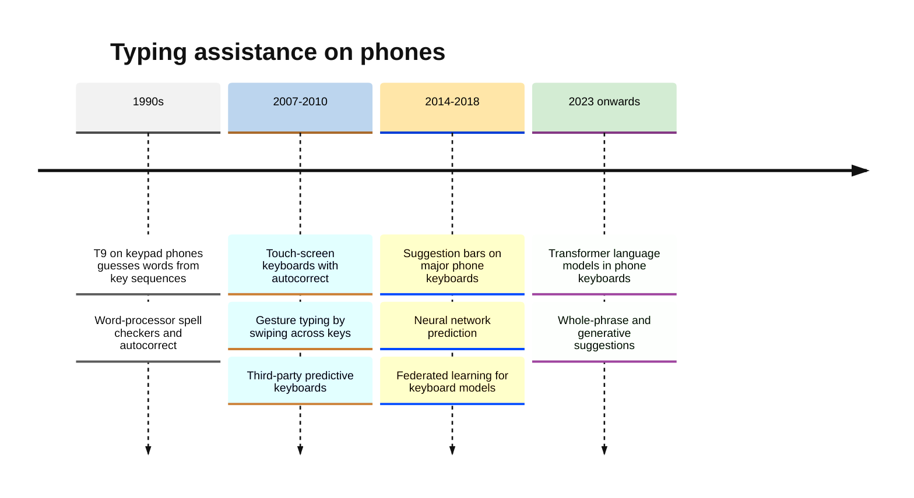
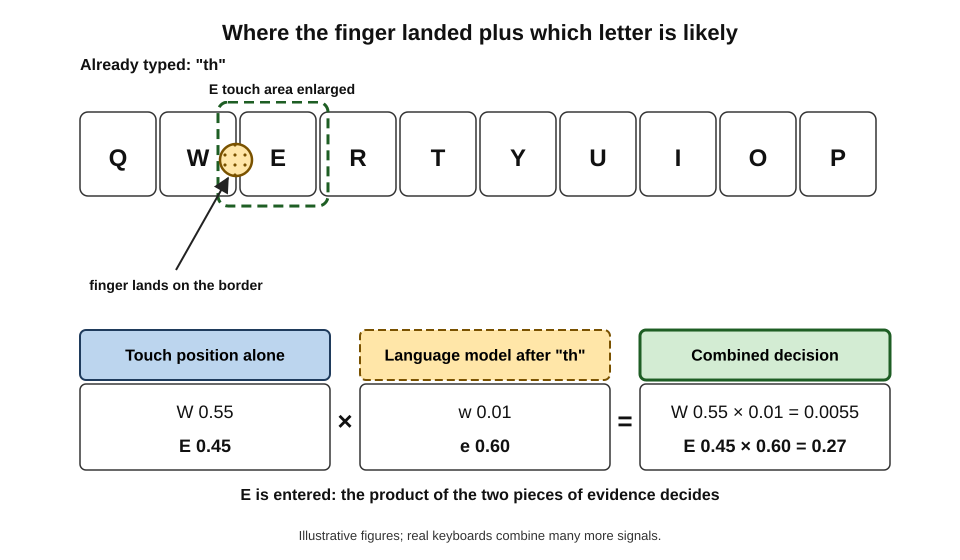
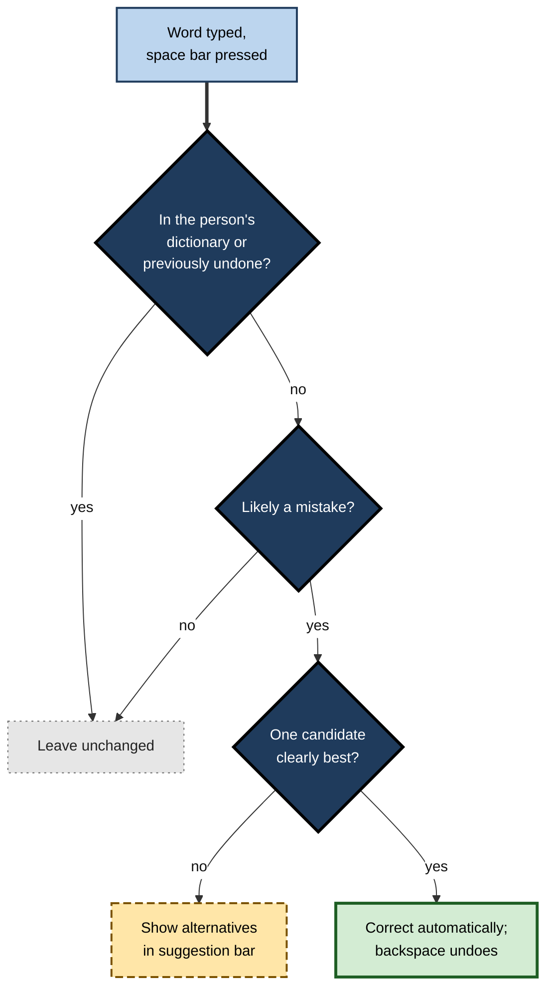
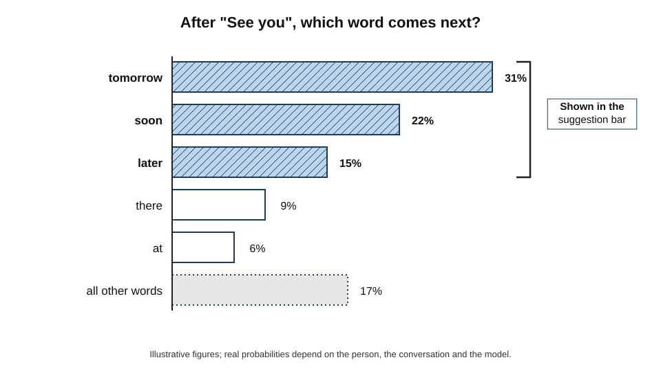
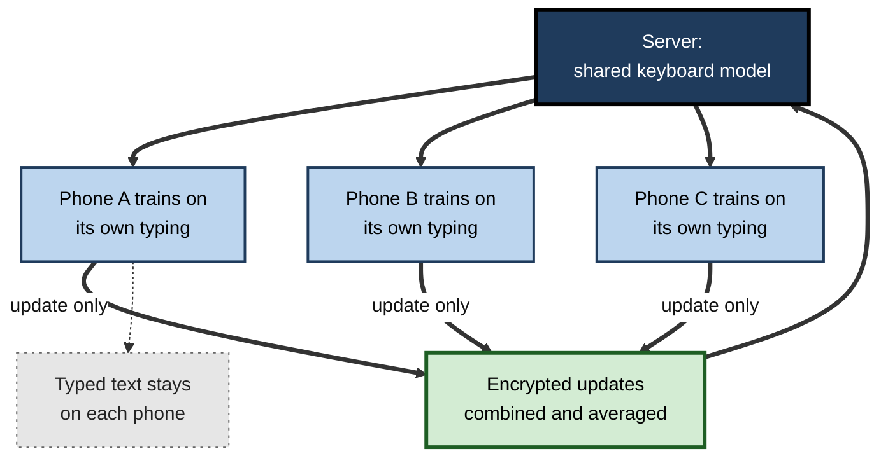
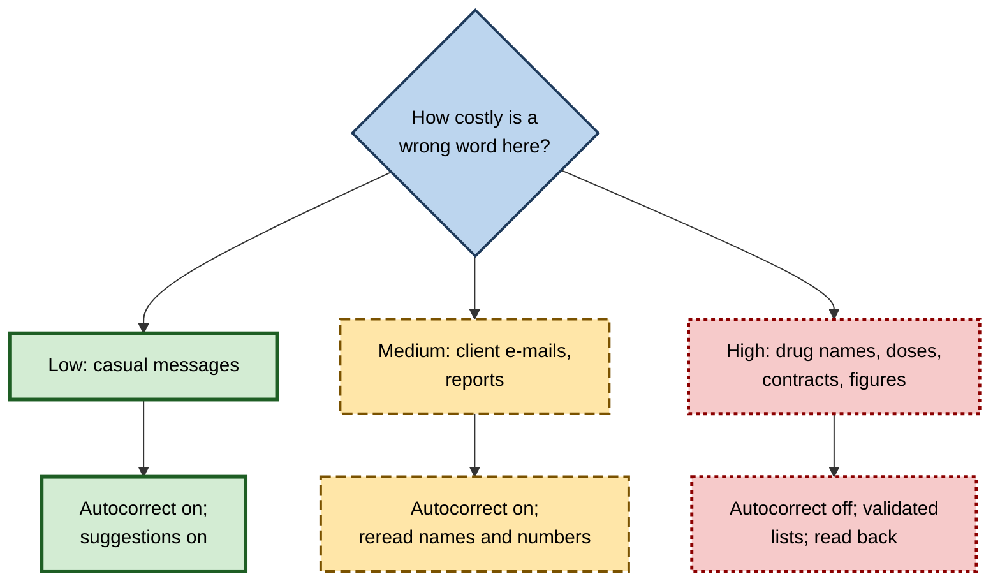

# E.5. Predictive text and autocorrect

A person types "Running lste, see you in 10" with one thumb on a crowded train. The phone silently changes "lste" to "late", and before they have finished the next word it offers "minutes" above the keyboard. Neither the phone nor its maker knew this sentence in advance. A small **language model** on the device estimated which words were most likely meant, and most likely to come next, from patterns learned in billions of sentences and from the person's own typing.

> **Definition — Predictive text:** a keyboard feature that suggests the next word, or the rest of the current word, based on what has been typed so far.

> **Definition — Autocorrect:** a keyboard feature that automatically replaces a typed word with the word the system judges the person most probably intended.

**Why it matters**

- **It is the most frequently used AI in the world.** Every tap on a phone keyboard passes through a model that interprets it.
- **It makes small touch keyboards usable.** Fingers are larger than the keys; without correction, typing on glass would be slow and error-prone.
- **It is the everyday ancestor of chatbots.** Predicting the next word is exactly the task that, scaled up enormously, produced large language models.
- **It quietly shapes what people write** — and sometimes changes what they meant, with consequences from embarrassment to clinical or legal error.

---

## Three Related Features

| | Autocorrect | Word completion | Next-word prediction |
|---|---|---|---|
| What it does | Replaces a word the system thinks is mistyped | Offers the rest of a partly typed word | Suggests the word likely to come next |
| Example | "teh" → "the" | "tomo" → "tomorrow" | "See you" → "tomorrow", "soon", "later" |
| Acts automatically? | Yes, usually when the space bar is pressed | No — the person taps the suggestion | No — the person taps the suggestion |
| Main risk | Silently changing a correct but unusual word | Little; ignored if unwanted | Nudging the writer towards common phrasing |
| Undo | Backspace often restores the original | Not needed | Not needed |

> **Key point:** autocorrect **acts** on the person's behalf; suggestions only **offer**. The more a system acts without asking, the more its errors matter — a general principle in the design of AI features.

**Figure 1.** From a smartphone keyboard's beginnings to neural language models.

### T9: prediction before touch screens

- **The problem** — keypad phones had three or four letters on each number key; typing "hello" by repeated presses took 13 presses (4-4, 3-3, 5-5-5, 5-5-5, 6-6-6).
- **The idea** — press each key **once** (4-3-5-5-6) and let a dictionary pick the word that matches that key sequence.
- **Ambiguity** — "4663" can be "good", "home" or "gone"; the system chose the most common and let the person cycle through the others.
- **Lesson** — even the simplest predictive system combines **ambiguous input** with **knowledge of which words are likely** — the same two ingredients used today.

---

## How Autocorrect Decides

### The noisy-channel idea

Autocorrect treats typing as a message sent through a **noisy channel**: the person intends a word; clumsy thumbs and small keys add noise; the system sees the noisy version and must infer the original.

> **Definition — Noisy-channel model:** a way of correcting errors by choosing the intended word that best explains what was observed, combining how likely each intended word is with how likely it is to have been mistyped as what was observed.

> **Formula — Choosing the correction:** best word = the candidate *w* that maximises P(typed | *w*) × P(*w* | context). The first term is the **error model** (how likely that typing error is); the second is the **language model** (how likely that word is here).

- **The error model** — how likely is this mistake?
  - Keys **next to each other** are often confused ("s" and "d").
  - Letters are often **swapped** ("teh"), **doubled** ("tommorrow"), **omitted** ("tomorow") or **added**.
  - A touch keyboard knows **exactly where** the finger landed, not just which key was registered — a tap on the edge between "s" and "d" is genuinely ambiguous.
- **The language model** — how likely is this word, here?
  - Common words are more likely than rare ones.
  - Context matters: after "see you", "late" is much less likely than "later".

> **Definition — Edit distance:** the number of single-character insertions, deletions, substitutions (and, in some versions, swaps of adjacent letters) needed to turn one word into another; used to find plausible corrections.

### Worked example (illustrative): correcting "lste"

The person typed "Running lste". The "s" key sits next to "a" on a QWERTY keyboard.

| Candidate | Edit needed | Error model P(typed "lste" given candidate) | Language model P(candidate after "Running") | Product |
|---|---|---|---|---|
| late | substitute s for a (adjacent keys) | 0.020 | 0.050 | **0.00100** |
| lose | substitute s→o, t→s (two edits) | 0.0004 | 0.004 | 0.0000016 |
| list | insert i, delete e (two edits) | 0.00002 | 0.002 | 0.00000004 |
| lste (leave as typed) | none | 0.5 | 0.000001 | 0.0000005 |

*Illustrative figures.*

1. **Generate candidates** within a small edit distance, plus the word as typed.
2. **Score each** by error model × language model.
3. **Pick** "late" — by far the largest product.
4. **Act** — since "late" wins by a wide margin, autocorrect replaces the word when the space bar is pressed.

- **Why "leave as typed" lost** — its error-model score is high (no error needed) but "lste" is almost never a real word, so its language-model score is tiny.
- **When it should win** — for a genuine but rare word, such as a surname or technical term, the language model may be wrong, which is exactly how autocorrect mangles names.

> **Watch out:** autocorrect fails most on words that are **correct but rare** in its training data: names from many cultures, specialist vocabulary, slang, place names and words from another language. Its errors therefore fall **unevenly** on different people.

### Invisible keyboards

- **Dynamic touch targets**
  - Many keyboards quietly enlarge the touch area of the letters most likely to come next, and shrink unlikely ones — without changing what is drawn on the screen.
  - After "th", a tap between "e" and "w" is more likely to register as "e".
- **Gesture typing**
  - Swiping a finger across the letters produces a path; the system matches its shape against the shapes of likely words — the same combination of noisy input and language model.
- **Personal touch patterns**
  - Keyboards can learn that a particular person tends to hit slightly below and to the right of each key.

**Figure 2.** A touch between two keys is interpreted using both where the finger landed and which letter is likely next.

### Act, suggest or leave alone

- **High confidence that a word is a mistake and one clear winner** → correct automatically.
- **Several close candidates** → show them in the suggestion bar without changing the word.
- **Uncertain whether it is a mistake at all** → leave it, perhaps underline it.
- **Learned exceptions** → once a person has undone a correction or typed a word several times, it is added to their personal dictionary and left alone.

**Figure 3.** How a keyboard decides whether to correct a word, suggest alternatives or leave it unchanged.

---

## How Prediction Works

### Language models: guessing the next word

> **Definition — Language model:** a model that assigns probabilities to sequences of words — in particular, to which word is likely to come next given the words before it.

- **N-gram models (classic approach)**
  - Count how often each short sequence of words appears in a large body of text.
  - "see you" is followed by "tomorrow" in some share of cases, by "soon" in another share, and so on.
  - Simple and fast, but they see only the last one or two words and cannot handle sequences they have never counted.
- **Neural language models**
  - From the mid-2010s keyboards adopted small neural networks — first recurrent networks, later **transformers** — that represent words as embeddings and consider much longer context.
  - Apple announced in 2023 that its iPhone keyboard would use a transformer language model for autocorrect and inline predictions.
- **Why the models are small**
  - They run on the phone, for every keystroke, within a few milliseconds and with little battery.
  - A keyboard model is therefore a tiny fraction of the size of a chatbot's model.

**Figure 4.** Next-word prediction ranks candidate words by probability given the text so far.

| | N-gram model | Neural language model |
|---|---|---|
| What it uses | Counts of short word sequences | Learned embeddings and longer context |
| Context considered | The last one to three words | Many previous words, sometimes the whole message |
| Handles unseen phrases | Poorly — needs "back-off" to shorter sequences | Well — generalises from similar phrases |
| Size and speed | Large tables, very fast lookup | Compact models, more computation per word |
| Typical era in keyboards | Up to the mid-2010s | Mid-2010s onwards |

> **Key point:** a phone keyboard and a large chatbot perform the **same basic task** — predict the next word. The difference is scale: the size of the model, the amount of training text and the length of context considered.

### Measuring benefit

> **Formula — Keystroke savings:** keystroke savings = (characters in the final text − keystrokes actually made) ÷ characters in the final text.

**Worked example (illustrative):** the message "See you tomorrow morning" has 24 characters including spaces. Using suggestions, the person typed "See you " (8 keystrokes), tapped "tomorrow" (1) and tapped "morning" (1) — 10 keystrokes in total.

1. **Savings** = (24 − 10) ÷ 24 ≈ **58%**.
2. **But** — the person also spent time **reading** the suggestion bar; if they glanced at it for every word, the time saved may be much smaller than 58%.

*Illustrative figures.*

> **Watch out:** keystroke savings overstate real benefit. Studies of predictive keyboards have found that checking suggestions costs attention, so experienced typists may gain little speed, while people who type slowly or with difficulty gain much more.

---

## Typing Across Languages and Abilities

### Many languages, many scripts

- **Scripts with many characters**
  - Chinese and Japanese input has always depended on prediction: the person types a phonetic spelling (such as pinyin) and chooses the intended characters from a ranked list. Here prediction is not a convenience but the **core** of typing.
- **Transliteration**
  - Many people in India type Hindi, Bengali, Tamil or other languages using Latin letters ("kal milte hain") and expect the keyboard either to keep it in Latin script or to convert it to the native script.
  - Spelling in Latin letters is not standardised, so the error model must accept many valid spellings of the same word.
- **Code-mixing**
  - Sentences that move between languages ("Meeting kal 3 baje hai, please confirm") are normal in many multilingual societies; a keyboard limited to one language "corrects" half the sentence.
  - Modern keyboards can run models for two or three languages at once and decide word by word which applies.
- **Languages with little digital text**
  - Prediction quality depends on training text. Languages with few websites, books or digitised documents get weaker models — or none.
  - Community projects and federated learning on speakers' own phones are among the approaches used to close the gap.

> **Definition — Transliteration:** writing the words of one language in the script of another, such as Hindi written in Latin letters.

> **Watch out:** "the keyboard supports my language" can mean anything from a full predictive model to little more than the right letters on the keys. Quality varies enormously between languages, and speakers of under-resourced languages bear more correction errors.

### Prediction as accessibility

- **Augmentative and alternative communication (AAC)**
  - People who cannot speak or type easily — because of motor neurone disease, cerebral palsy or stroke — may select letters by eye movement, a single switch or a head movement, at only a few selections per minute.
  - For them, good prediction can multiply communication speed several times over, because each correct prediction saves many slow selections.
  - The physicist Stephen Hawking, who communicated by moving a cheek muscle, used a system that from 2014 incorporated a commercial predictive-keyboard engine trained on his own writings, which reduced the number of selections he needed.
- **Dyslexia and spelling difficulties**
  - Autocorrect and word completion help people whose spelling does not reflect their knowledge, though over-correction can introduce new errors they may not spot.
- **Motor impairments and tremor**
  - Touch models that learn a person's typical touch positions, and keyboards that ignore accidental repeated taps, make typing possible for people with tremor.

> **Definition — Augmentative and alternative communication (AAC):** methods and devices that supplement or replace speech or writing for people with communication impairments.

> **Key point:** for most people prediction saves seconds; for people who type one selection at a time, it can be the difference between **having a conversation and not having one**. Evaluations that measure only average users miss its largest benefits.

---

## Learning from Each Person — Privately

### Personalisation

- **Personal dictionary** — names of friends, colleagues and places; project names; preferred spellings.
- **Personal phrasing** — "On my way!" becomes a top suggestion for someone who sends it daily.
- **Languages** — many keyboards support typing in two or more languages at once, including mixed languages such as Hindi and English written in Latin letters.

### Federated learning on keyboards

Improving a shared model normally means collecting data centrally. Typing is among the most private data a person produces — passwords, health worries, love letters. **Federated learning** was developed partly to solve this problem.

1. **The server sends** the current shared model to many phones.
2. **Each phone improves** the model slightly, using its owner's own recent typing, while charging, on Wi-Fi and idle.
3. **Only the model update** — numerical changes, not the text — is sent back, often encrypted and combined with updates from many other phones (**secure aggregation**).
4. **The server averages** thousands of updates into an improved shared model.
5. **The cycle repeats.**

- Google researchers described using this approach to improve next-word prediction in the Gboard keyboard (published in 2018), reporting better prediction than a model trained on centrally collected data from other sources.
- **Differential privacy** — adding carefully calibrated noise so that no individual's contribution can be reconstructed — can be layered on top.

> **Definition — Federated learning:** training a shared model across many devices in which each device learns from its own data and sends only model updates, not the raw data, to a central server.

> **Definition — Differential privacy:** a mathematical guarantee that the output of an analysis changes very little whether or not any one person's data are included, achieved by adding calibrated random noise.

**Figure 5.** Federated learning improves the keyboard model without collecting what people type.

> **Watch out:** federated learning reduces what is collected but is not a perfect privacy guarantee on its own — researchers have shown that model updates can sometimes leak information about training data, which is why secure aggregation and differential privacy are added.

### Privacy and security habits

- **Password fields** — keyboards normally disable learning and suggestions in fields marked as passwords.
- **Third-party keyboards** — installing one may ask for "full access", which can allow it to send what is typed over the internet; trusted, well-reviewed keyboards only.
- **Clearing learned words** — keyboards let users reset their personal dictionary, useful on shared or second-hand devices.
- **Incognito modes** — some keyboards pause learning in private browsing or on request.

---

## When Prediction Shapes Writing

### Errors with consequences

- **Embarrassment** — the famous replacement of a common expletive with "ducking" became a running joke; Apple said in 2023 that its new keyboard model would learn when a user genuinely meant to swear.
- **Names erased** — autocorrect and spell-checkers have routinely "corrected" names such as Siobhan, Dhruv or Nikhil into other words; campaigns in the United Kingdom have asked technology companies to add more names from diverse backgrounds to their dictionaries.
- **Meaning reversed** — "can" corrected to "can't", or "now" to "not", flips a message; drug names corrected into other drug names are a hazard in clinical notes.

| | False correction | Missed correction |
|---|---|---|
| What happens | A correct word is replaced with another | A real typo is left in place |
| Example | "Dhruv" → "Drive"; "dosage of Zyrtec" → "dosage of Zantac" | "Meeting at 3 in teh boardroom" |
| Who notices | Often only the reader — the writer may not look back | The reader, who usually understands anyway |
| Typical cost | Lost meaning, offence, clinical or legal error | Minor loss of polish |
| Design response | Act only when confident; learn from undo | Suggest rather than act |

### Predictable writing

**Study card — Arnold, Chauncey and Gajos (Harvard University, 2020), "Predictive text encourages predictable writing"**

- **Question:** do word suggestions change what people write, not just how fast they write it?
- **Design:** participants wrote short captions for photographs, either with or without next-word suggestions on the keyboard.
- **Results:** captions written with suggestions were **shorter** and used **more predictable** words — the kinds of words the suggestion system tended to offer — than captions written without them.
- **Conclusion:** suggestion systems do not merely save effort; they **nudge content** towards what is common in their training data.

- **Stereotypes in suggestions**
  - In 2018 Google said its Gmail Smart Compose feature would not suggest gendered pronouns ("him", "her") after testing showed it could assume, for example, that an investor was male.
- **Opinions** — later experiments with more powerful writing assistants found that suggestions leaning towards one side of an argument shifted not only what people wrote but, modestly, what they said they believed.

> **Key point:** each accepted suggestion is small; across billions of messages, prediction pulls language **towards the average** of its training data — which is efficient but can flatten individual voice and reproduce the biases of that data.

---

## Professional Practice

### Where typing assistance helps

- **Accessibility** — people with motor impairments, dyslexia or who use communication aids can produce text much faster with prediction; for some it is essential.
- **Field work** — engineers, nurses and sales staff entering notes on phones.
- **Multilingual teams** — keyboards that switch languages smoothly reduce friction.

### Where it is a risk

- **Clinical documentation** — similar-looking drug names; abbreviations expanded wrongly.
- **Legal and contractual text** — a changed number or negation can alter obligations.
- **Customer communication** — a client's name autocorrected into something else is an avoidable discourtesy.
- **Security** — keyboards that learn confidential client names or project codes on personal phones.

> **In practice:** professionals who write on phones add client, colleague and product names to the personal dictionary, turn off autocorrect for specialist work, and **reread before sending** anything with numbers, names, negatives or drug and product names.

### Case study (illustrative): autocorrect on a hospital ward

- **Situation:** a community nursing team began recording visit notes on smartphones using the standard keyboard, synchronised to the patient record.
- **Problem:** an audit found several notes in which medication names had been changed into other, similar-looking medication names, and "no" into "now" in phrases such as "no pain reported".
- **Diagnosis:**
  1. The keyboard's general dictionary did not contain many drug names, so it "corrected" them to the nearest common word or to more frequent drug names.
  2. Nurses typed quickly between visits and rarely reread the notes.
  3. The record system did not flag implausible combinations.
- **Actions:**
  1. Notes were entered through the record system's own app, with a medical vocabulary and drug names selected from a validated list rather than typed freely.
  2. Autocorrect was turned off in that app; spell-checking showed underlines but never replaced words.
  3. A short "read back before saving" step was added for medication entries.
  4. Staff were briefed using real (anonymised) examples from the audit.
- **Result:** in the following audit, no medication-name substitutions were found; nurses reported that selecting from lists was faster than typing.
- **Lesson:** where an error is dangerous, AI should **suggest, not act**, and free text should give way to **structured, validated choices**.

**Figure 6.** Matching the level of automatic action to the cost of an error.

---

## Open Questions

- **How much should keyboards write for people?**
  - Generative models can now suggest whole replies; the line between assistance and authorship is blurring.
- **Does constant prediction change language over time?**
  - Effects on vocabulary, style and spelling across a population are plausible but little studied at scale.
- **Can prediction be made fair across names, dialects and languages?**
  - Training data over-represent some languages and communities, and errors fall unevenly.
- **How private is on-device learning in practice?**
  - The strength of protections such as federated learning and differential privacy depends on settings that users cannot see.
- **Should autocorrect explain itself?**
  - Showing *why* a word was changed might reduce dangerous errors but would slow typing.

---

## Summary

- **Autocorrect** replaces probable typos automatically; **word completion** and **next-word prediction** only offer suggestions. Systems that **act** need more confidence than systems that **suggest**.
- Autocorrect follows the **noisy-channel** idea: choose the candidate maximising **error model × language model**; candidates come from small **edit distances**, and touch keyboards also use exact finger positions and **dynamic touch targets**.
- Autocorrect fails on words that are **correct but rare** — names, specialist and foreign words — so its errors fall unevenly.
- **Language models** predict the next word; keyboards moved from **n-gram** counts to small **neural** and **transformer** models running on the phone — the same task as large chatbots, at tiny scale.
- **Keystroke savings** overstate benefit because reading suggestions costs attention; gains are largest for slow or impaired typists.
- Quality varies greatly across **languages, scripts and transliteration**; for people using **AAC**, prediction can multiply communication speed.
- **Federated learning**, **secure aggregation** and **differential privacy** let keyboards improve without collecting typed text.
- Prediction **shapes content**: suggestions make writing shorter and more predictable and can carry **stereotypes**.
- In high-stakes writing, switch from automatic correction to **suggestion, validated lists and read-back**.

---

## Self-Check

1. Distinguish autocorrect, word completion and next-word prediction, with an example of each.
2. Explain the noisy-channel model of autocorrect in plain words.
3. Why does autocorrect tend to "correct" names and technical terms?
4. A person typed "hwllo". Which candidate would a keyboard choose, and why? Mention both models.
5. What are dynamic touch targets, and why are they invisible?
6. Contrast n-gram and neural language models.
7. In what sense do a phone keyboard and a large chatbot do the same job?
8. A 30-character message is produced with 12 keystrokes. Compute the keystroke savings and explain why real time saved may be smaller.
9. Describe how federated learning improves a keyboard model and its main privacy limitation.
10. Summarise the 2020 Harvard study on predictive text and its implication.
11. Why did Google stop Smart Compose suggesting gendered pronouns?
12. List four precautions a professional should take when writing important text on a phone.
13. A law firm's trainees draft client messages on phones. Propose keyboard settings and habits, and justify them.

### Answer Key

1. Autocorrect replaces "teh" with "the" automatically; completion offers "tomorrow" after "tomo"; prediction offers "soon" after "see you".
2. Typing is a noisy version of what the person meant. The keyboard considers likely intended words and picks the one that best combines how likely the typing error is with how likely the word is in context.
3. Its language model gives rare words — names, technical terms — low probability, so a common word one or two edits away can outscore the correct but rare word.
4. "hello": the error model rates "w" for "e" as likely (adjacent keys, one substitution); the language model rates "hello" as very common, especially at the start of a message. The product beats alternatives.
5. The keyboard enlarges the touch area of letters likely to come next and shrinks unlikely ones, without changing the drawn keys, so ambiguous taps resolve towards likely words.
6. N-grams count short word sequences and see only the last few words; neural models learn embeddings and use longer context, generalising to unseen phrases.
7. Both predict the next word from preceding text; chatbots use vastly larger models, more data and longer context.
8. (30 − 12) ÷ 30 = 60%. Reading and choosing suggestions takes attention and time, so actual speed gains are often smaller, especially for fast typists.
9. Phones train the shared model locally on their own typing and send only updates, which are combined and averaged; text stays on the phone. Updates can leak some information, so secure aggregation and differential privacy are added.
10. Captions written with suggestions were shorter and more predictable. Suggestions shape content, not only speed, pulling writing towards common phrasing.
11. Testing showed it could assume gender stereotypically (for example, that an investor was "him"), so pronoun suggestions were removed.
12. Add key names to the personal dictionary; reread names, numbers and negatives before sending; disable autocorrect for specialist text; use validated lists or templates for high-risk terms; avoid untrusted keyboards with full access.
13. Use the firm's managed keyboard (no third-party "full access"); add client names and legal terms to the dictionary; keep suggestions but consider disabling autocorrect for contract text; reread figures, dates, names and negations before sending; draft important documents on managed computers rather than phones.

---

## Glossary

| Term | Meaning |
|---|---|
| Augmentative and alternative communication (AAC) | Methods and devices that supplement or replace speech or writing. |
| Autocorrect | Automatic replacement of a word judged to be mistyped. |
| Code-mixing | Using two or more languages within one sentence or message. |
| Differential privacy | A guarantee that results barely change whether any one person's data are included. |
| Dynamic touch target | An invisible resizing of key touch areas according to likely next letters. |
| Edit distance | The number of single-character changes needed to turn one word into another. |
| Error model | The part of autocorrect estimating how likely a given typing error is. |
| Federated learning | Training a shared model on devices, sending only updates to a server. |
| Gesture typing | Entering words by swiping across letters, decoded by shape and language model. |
| Keystroke savings | The share of characters the person did not have to type. |
| Language model | A model that assigns probabilities to word sequences, especially the next word. |
| N-gram | A sequence of N words whose frequency is counted in a language model. |
| Next-word prediction | Suggesting the word likely to come next. |
| Noisy-channel model | Inferring the intended word that best explains a corrupted observation. |
| Personal dictionary | Words a keyboard has learned to accept for a particular user. |
| Predictive text | Keyboard suggestions of next words or word completions. |
| Secure aggregation | Combining device updates so that no individual update can be read. |
| T9 | A keypad-phone system that guessed words from one press per letter key. |
| Transliteration | Writing one language's words in another language's script. |
| Transformer | A neural-network design that weighs the relevance of all previous words in context. |
| Word completion | Offering the rest of a partly typed word. |
