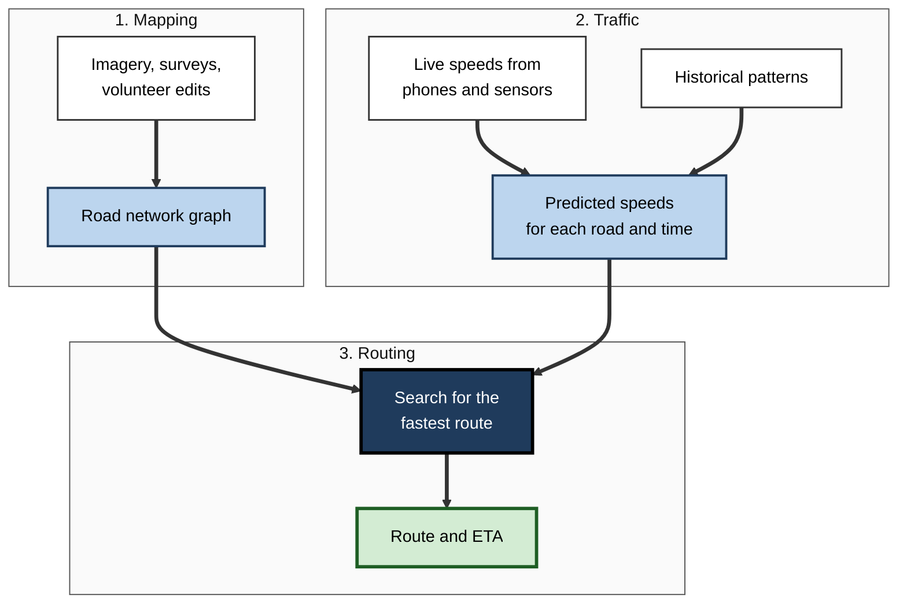
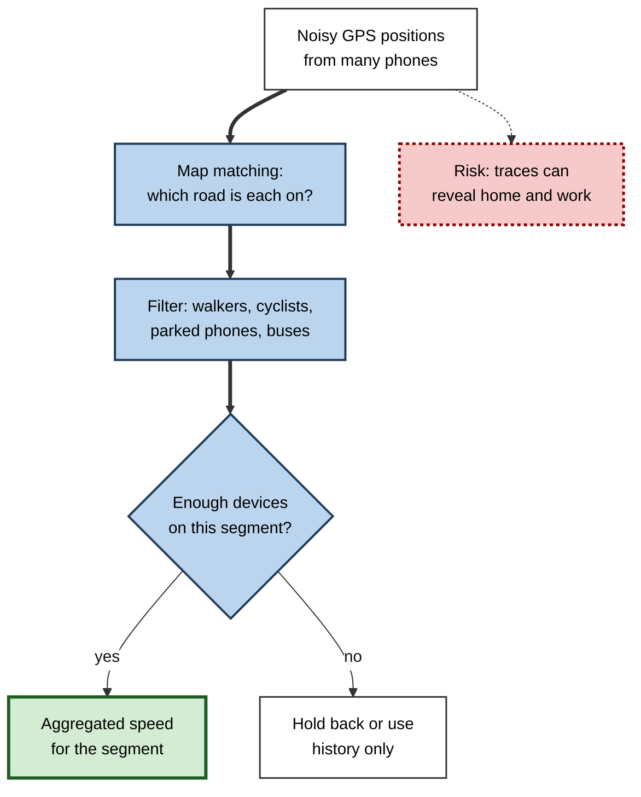
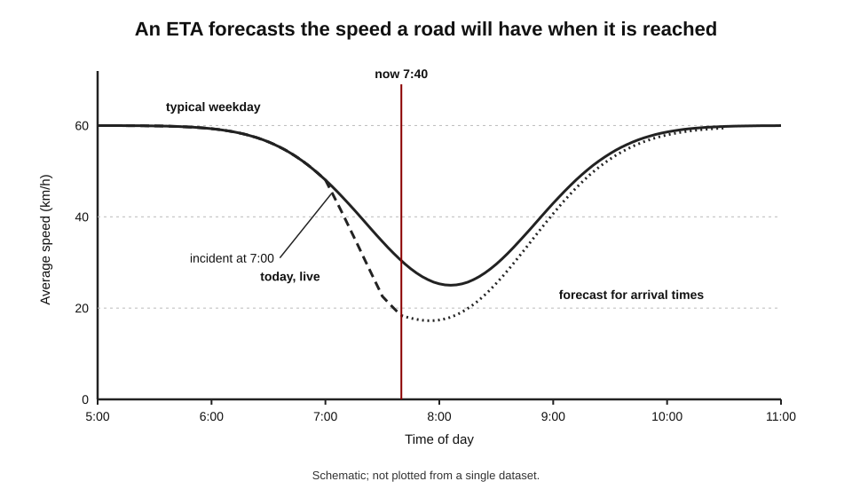
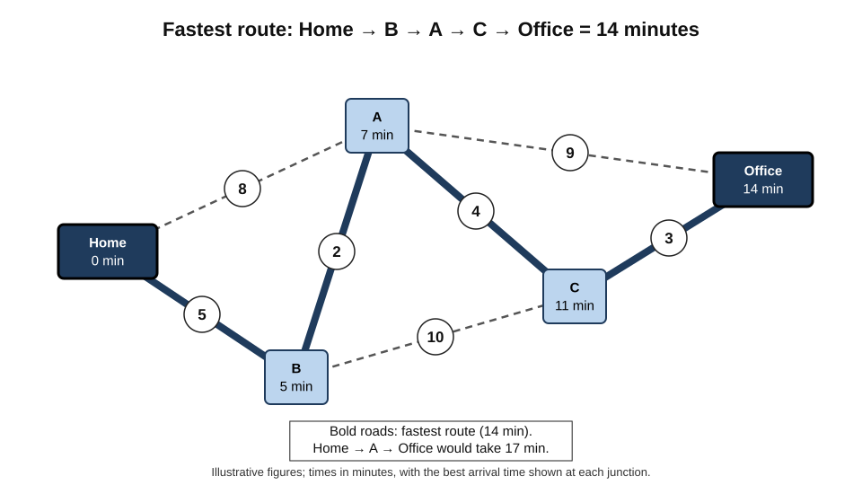
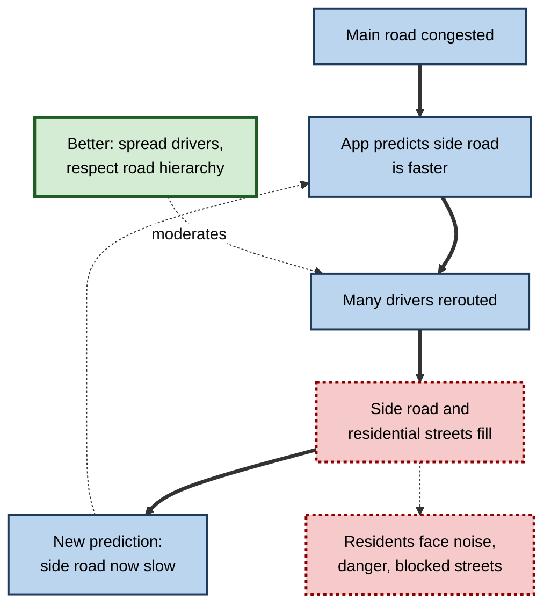
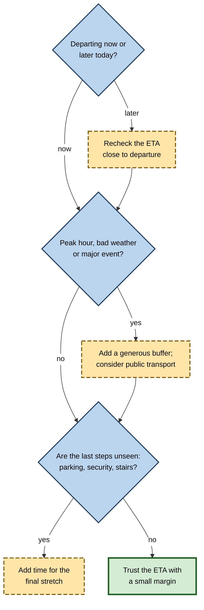

# E.6. Maps and real-time traffic prediction

At 8:05 a driver asks a phone for directions to a client's office. The app answers "34 minutes, arriving 8:39" and suggests a route that avoids the motorway. Twelve minutes later it announces "a faster route is available" because a lorry has broken down ahead. The prediction concerned roads the driver had not yet reached, at times that had not yet arrived — a forecast of traffic built from the movements of thousands of other phones and from years of history.

> **Definition — Estimated time of arrival (ETA):** a prediction of when a journey will end, based on the route and on forecasts of how fast traffic will move on each part of it at the time the traveller reaches it.

> **Definition — Traffic prediction:** estimating current and future speeds and delays on a road network from live and historical data.

**Why it matters**

- **It guides billions of journeys.** Navigation apps decide which roads people use, often without the drivers comparing alternatives.
- **It runs logistics.** Delivery, ride-hailing, field-service and emergency-response planning depend on travel-time predictions.
- **It shows AI forecasting a moving system** — one in which the forecast itself changes what happens, because drivers follow it.
- **It depends on personal location data**, raising questions about anonymity, surveillance and manipulation.

---

## Three Problems in One App

A navigation app solves three distinct problems, each with its own methods.

1. **Mapping** — what roads exist, how they connect and what rules apply (one-way streets, speed limits, turn restrictions).
2. **Traffic estimation and prediction** — how fast vehicles are moving now on each road, and how fast they will move in 10, 20 or 50 minutes.
3. **Routing** — given the map and the predicted speeds, which sequence of roads gets there fastest (or most cheaply, or with least fuel).

**Figure 1.** From raw data to a recommended route and arrival time.

---

## Building the Map

### The road network as a graph

> **Definition — Graph (in computing):** a structure of **nodes** (points) connected by **edges** (links). In a road map, nodes are junctions and edges are stretches of road between them.

- **Each edge carries attributes**
  - length, speed limit, number of lanes, direction, road type, tolls, height and weight limits, turn restrictions at its ends.
- **Each edge has a travel time** — the attribute that changes minute by minute with traffic.
- **Scale** — a national road network contains many millions of edges.

### Where map data come from

- **Official and commercial surveys** — government mapping agencies, commercial mapping companies with survey vehicles.
- **Imagery and computer vision**
  - Satellite and aerial images reveal new roads and buildings.
  - Street-level photographs are analysed by computer-vision models that read **street signs, speed limits, house numbers and business names**; Google researchers reported in 2013–2014 that a deep neural network could read house numbers in street-level images about as accurately as human operators.
- **Volunteers** — OpenStreetMap, founded in 2004, is a map of the world edited by volunteers and used by many apps and organisations.
- **Movement traces** — where many phones consistently travel, there is a road, even if it is missing from the map.
- **User reports** — closed roads, wrong turns, new businesses.

> **Key point:** even the "static" map is increasingly produced by **machine learning** — reading images and inferring roads from movement — with humans checking and correcting.

---

## Knowing Traffic Now

### Phones as traffic sensors

- **The principle** — if a phone with location sharing turned on moves along a road at 12 km/h where the usual speed is 50 km/h, the road is congested.
- **Map matching**
  - GPS positions are noisy (often several metres off, worse among tall buildings).
  - **Map matching** works out which road the phone is actually on, using the sequence of positions and the road graph.
- **Aggregation**
  - Speeds from many phones on the same stretch are combined into one estimate.
  - Providers state that the data are anonymised and aggregated; for example, a road segment's speed may only be shown when enough distinct devices have contributed.
- **Other sources**
  - **Road sensors** — detectors embedded in roads and cameras run by highway authorities.
  - **Fleets** — taxis, delivery vans and lorries sharing positions.
  - **User reports** — accidents, police, hazards, closures reported by drivers in apps such as Waze.
  - **Planned events** — road works, concerts, sports fixtures, school holidays.

> **Definition — Map matching:** the process of assigning a sequence of noisy location readings to the most likely path on a road network.

| | Phone location data | Fixed road sensors | Driver reports | Fleet data |
|---|---|---|---|---|
| Coverage | Wide — wherever people travel with phones | Mainly major roads | Patchy; depends on active users | Routes the fleet uses |
| Freshness | Seconds to minutes | Seconds | Immediate when made | Seconds to minutes |
| Accuracy problems | GPS noise; pedestrians and buses mixed with cars | Fixed locations; equipment failures | False or malicious reports | Fleet vehicles behave differently from cars |
| Privacy issues | Personal movement data | Minimal | Account data | Driver monitoring |

**Figure 2.** How individual phone positions become road speeds while protecting identity.

---

## Predicting Traffic Ahead

### Why live data are not enough

A journey of 40 minutes reaches its last road 40 minutes from now. The speed on that road **now** is not the speed it will have **then**: rush hour may be building, a match may be ending, an accident may be clearing.

- **Historical patterns** — each road has a typical speed profile by time of day and day of week; Monday mornings differ from Saturday mornings, school terms from holidays.
- **Live conditions** — how today differs from the typical pattern.
- **Propagation** — congestion spreads backwards along a road and into connected roads; a jam on one segment predicts slowdowns upstream soon after.
- **External factors** — weather, events, road works, public holidays.

> **Key point:** an ETA is a **forecast**: it combines the typical pattern, today's deviation from it, and how congestion is likely to spread, for the time the traveller will reach each road.

**Figure 3.** A road's typical speed by time of day compared with today's live speeds.

> **Formula — Route ETA:** ETA = departure time + Σ (predicted travel time on segment *i*, evaluated at the moment the traveller is expected to reach segment *i*). Each segment's time depends on when the previous segments will be finished.

### Learning to predict travel times

- **Statistical models** — early systems blended historical averages with live speeds.
- **Machine-learning models** — trained on vast numbers of past journeys to predict how long a road segment, or a whole route, will take under given conditions.
- **Graph neural networks** — models that pass information along the connections of the road graph itself, so that congestion on one road informs predictions for its neighbours.

> **Definition — Graph neural network (GNN):** a type of neural network that operates on graph-structured data, updating each node's representation using information from its neighbours.

**Study card — DeepMind and Google Maps, traffic prediction with graph neural networks (2020)**

- **Problem:** Google Maps' ETAs were already accurate for the large majority of journeys (the company said over 97% of trips), but the remaining errors were frustrating and costly, especially where traffic was about to change.
- **Design:**
  - the road network was divided into **"supersegments"** — groups of adjacent road segments that share significant traffic volume;
  - a graph neural network predicted travel time through each supersegment, using live and historical data and the traffic on connected roads;
  - special training techniques were needed to make the model learn reliably across very different cities.
- **Results:** DeepMind reported that, compared with the previous system, the approach reduced the share of inaccurate ETAs substantially in cities around the world — by more than 50% in places such as Taichung, and significantly in Berlin, Jakarta, São Paulo, Sydney, Tokyo and Washington DC.
- **Conclusion:** modelling the **network structure** — how roads influence one another — improved forecasts of traffic minutes ahead, particularly where conditions were changing.

> **Watch out:** "97% accurate" depends on what counts as accurate (within how many minutes or what percentage) and on which journeys are counted; such figures come from the company and are not directly comparable between providers.

### Measuring ETA quality

> **Formula — Absolute percentage error:** |actual time − predicted time| ÷ actual time × 100. A 30-minute prediction for a 36-minute journey has an error of |36 − 30| ÷ 36 ≈ **17%**.

- **Averages hide tails** — a model can be accurate on average yet badly wrong on the journeys that matter (to an airport, an interview, a hospital).
- **Bias matters** — consistently optimistic ETAs make people late; consistently pessimistic ones make them leave too early or choose worse routes.
- **Uncertainty** — some apps show a range or a "usually takes 35–50 minutes" message for future departures, acknowledging uncertainty.

---

## Finding the Best Route

### Shortest-path search

Once each road has a travel time, routing becomes a classic computing problem: find the path through the graph with the smallest total time.

- **Dijkstra's algorithm** — devised by the Dutch computer scientist Edsger Dijkstra in 1956 and published in 1959.
  - Starts at the origin and repeatedly extends the closest unexplored junction, recording the best-known time to each, until the destination is reached.
  - Guaranteed to find the fastest route if all travel times are positive.
- **A\* search** — published in 1968 by Peter Hart, Nils Nilsson and Bertram Raphael.
  - Adds an estimate of the remaining distance to the destination (for example, the straight-line distance at maximum speed), so the search heads towards the goal instead of spreading in all directions.
- **Speed-up techniques** — on continental networks even A\* is too slow for millions of requests per second.
  - Methods such as **contraction hierarchies** (introduced by researchers at the Karlsruhe Institute of Technology in 2008) pre-compute shortcuts through the network, so that queries consider mostly major roads and finish in milliseconds.

> **Definition — Shortest-path algorithm:** a procedure that finds the route between two points in a graph with the smallest total cost, such as time or distance.

### Worked example (illustrative): Dijkstra on a small network

A driver at **Home (H)** wants to reach the **Office (O)**. Predicted travel times in minutes:

- H→A 8, H→B 5, B→A 2, A→O 9, B→C 10, C→O 3, A→C 4.

**Figure 4.** A small road network with predicted travel times; the fastest route is highlighted.

| Step | Junction settled | Best known times after this step | Reason |
|---|---|---|---|
| 1 | H (0) | A 8, B 5 | Start; direct roads from H |
| 2 | B (5) | A 7 (via B), C 15 | B is closest; B→A 2 improves A |
| 3 | A (7) | C 11 (via A), O 16 | A→C 4 improves C; A→O 9 gives O 16 |
| 4 | C (11) | O 14 (via C) | C→O 3 improves O |
| 5 | O (14) | — | Destination settled |

*Illustrative figures.*

1. **Result:** fastest route H → B → A → C → O, **14 minutes**.
2. **Note** — the "obvious" direct-looking route H → A → O takes 17 minutes; the best route uses four short roads.
3. **If an incident adds 6 minutes to A→C**, the same search finds H → B → A → O at 16 minutes instead — this is what rerouting does, continuously, as predictions change.

> **Watch out:** "fastest" is only as good as the **predicted times** on each road. A perfect algorithm with poor traffic predictions gives a confidently wrong route.

### More than speed

| | Fastest route | Shortest route | Fuel-efficient route | Preference-based route |
|---|---|---|---|---|
| Minimises | Predicted travel time | Distance | Estimated fuel or energy | A blend: avoid tolls, motorways, ferries, hills |
| Typical use | Default for drivers | Walking, cycling, some deliveries | Introduced by Google in 2021 as an option in some regions; electric-vehicle range planning | Learner drivers, cyclists, wheelchair users |
| Trade-off | May use minor roads heavily | May be slow in traffic | May take slightly longer | May be much slower |

- **Electric vehicles** — routing must include charging stops, charger availability and how speed, temperature and hills affect range.
- **Accessibility** — walking routes that avoid steps and steep slopes depend on detailed data that is often missing.

### Beyond the car: public transport, walking and cycling

Journey planners for buses, trains, walking and cycling face different prediction problems from car navigation.

- **Timetables and live positions**
  - Transport operators publish timetables in a shared data format, first developed in 2005 through a partnership between Google and the public-transport agency of Portland, Oregon, and later extended to carry **real-time** vehicle positions and delays.
  - Apps combine the timetable with live positions to predict when the next bus will actually arrive.
- **Predicting delay propagation** — a late train makes connections fail; planners must estimate whether a five-minute connection is still realistic.
- **Crowding** — some apps predict how full a bus or train will be, learned from past passenger reports and ticketing data.
- **Walking and cycling** — speed depends on gradient, surface, crossings and personal fitness rather than traffic; data on pavements, steps and cycle lanes are often incomplete.

| | Car navigation | Public transport | Walking and cycling |
|---|---|---|---|
| Main uncertainty | Traffic speeds minutes ahead | Vehicle delays and missed connections | Personal pace, gradients, crossings |
| Main live data | Phone speeds, sensors, reports | Vehicle positions from operators | Little; mostly the user's own position |
| Typical failure | Optimistic ETA in building congestion | Connection that no longer works | Route through steps, closed paths or unsafe roads |
| Key data gap | Unseen final steps (parking) | Operators without live feeds | Accessibility details: kerbs, lifts, surfaces |

> **Key point:** the quality of any journey prediction is limited by its **weakest data**. In public transport that is often the operator's live feed; for walking and wheelchair routes it is detailed pavement data that maps rarely contain.

---

## When Predictions Change the Traffic

### The forecast that moves the crowd

Unlike a weather forecast, a traffic forecast **changes the thing it predicts**. If an app sends thousands of drivers onto a quiet side road, that road soon becomes congested.

- **Self-defeating predictions** — "the side road is clear" stops being true once enough drivers are told.
- **Oscillation** — if everyone is rerouted at once, the jam simply moves.
- **Load balancing** — large providers can, in principle, spread drivers across alternatives rather than sending all of them to the same one.
- **Individual versus system optimum** — each driver taking their own fastest route does not produce the fastest network overall.
  - **Braess's paradox** (Dietrich Braess, 1968): in some networks, adding a new road can make everyone's journey slower, because selfish route choices crowd onto it.

> **Definition — User equilibrium:** the traffic pattern in which no driver can reduce their own journey time by changing route; it is generally not the pattern that minimises total journey time for everyone.

**Figure 5.** Route guidance changes the traffic it predicts.

### Case study: Leonia, New Jersey (2017–2018)

- **Situation:** Leonia, a small town near the George Washington Bridge into New York City, lies beside some of the most congested approach roads in the United States.
- **Problem:** navigation apps routed commuters through Leonia's residential streets to save minutes on the way to the bridge. Residents reported queues outside their homes, difficulty leaving driveways and concerns about emergency-vehicle access.
- **Action:** in late 2017 the town introduced rules closing many local streets to non-residents during rush hours, with fines, and asked app providers to reflect the closures.
- **Response and controversy:** the rules drew legal challenge on the grounds that public roads must remain open to all; a state court ruled against the closures in 2019, and they were ended.
- **Wider pattern:** neighbourhoods in many cities reported similar effects; some installed traffic calming or turn restrictions so that routing algorithms would no longer favour their streets.
- **Lesson:** optimising each individual's journey can impose **costs on people who are not users** of the app. Routing at scale is a public-policy question as well as a technical one.

### Manipulation and false data

**Case study: The 99-phone traffic jam (Berlin, 2020)**

- **What happened:** the artist Simon Weckert pulled a small handcart containing 99 second-hand smartphones, all running a navigation app, slowly along streets in Berlin.
- **Result:** the app marked the streets as congested — red on the map — and began routing drivers away from roads that were in fact empty.
- **Lesson:** crowd-sourced data can be **gamed**. Systems that infer reality from devices must detect implausible patterns (many phones moving together at walking pace, no corresponding vehicles), and the episode illustrated how much the "real" picture of a city depends on data that can be manipulated.

> **Watch out:** a red road on a map is an **inference** from data, not an observation of cars. Usually the inference is excellent; it can be wrong when the data are unusual — few devices late at night, an event, or deliberate manipulation.

---

## Location Data and Privacy

- **Movement data are revealing** — a few location points over time can identify a person: where they sleep, where they work, which clinic or place of worship they visit.
- **Anonymisation is hard** — researchers have repeatedly shown that "anonymous" location traces can be re-identified by matching them with other information.
- **Aggregation is the main defence** — combining many devices, discarding the start and end of journeys, and publishing only segment speeds.
- **Real exposure: the fitness heat map (2018)** — a fitness-tracking company published a global "heat map" of its users' exercise routes. Analysts noticed that it revealed the layout of military bases in conflict zones, where foreign soldiers jogged with fitness trackers. The company changed its privacy settings; armed forces revised rules on personal devices.
- **User controls** — location history settings, the option to pause or delete history, and per-app location permissions ("while using", "approximate location").

> **In practice:** organisations that track their own vehicles or staff for scheduling must tell employees what is collected, limit use to the stated purpose, avoid tracking outside working hours and keep data only as long as needed — requirements of data-protection law in many countries.

---

## Professional Uses of Travel-Time Prediction

### Logistics and services

- **Delivery route optimisation** — choosing the order of dozens of stops is the **travelling salesman problem** (or the more realistic vehicle routing problem), computationally hard in general; companies combine heuristics, optimisation and predicted travel times.
  - UPS's route-optimisation system, ORION, deployed from the early 2010s, is reported by the company to save many millions of miles a year.
- **Ride-hailing** — ETAs for pick-ups and trips drive driver matching and pricing; Uber described in 2022 a deep-learning model that corrects the output of its routing engine to improve ETA accuracy.
- **Field service** — scheduling engineers, nurses and care workers between appointments.
- **Emergency services** — dispatch decisions depend on predicted response times; ambulances follow special rules not captured by consumer apps.
- **Urban planning** — anonymised travel-time data inform road works scheduling and transport investment.

> **Definition — Vehicle routing problem:** finding the best set of routes for a fleet of vehicles to serve a set of locations, subject to constraints such as time windows and vehicle capacity.

### Case study (illustrative): the delivery promise that kept breaking

- **Situation:** a grocery delivery company promised customers one-hour delivery windows, scheduled by software using a commercial routing service.
- **Problem:** about one delivery in five arrived late in the evening peak, causing complaints and refunds.
- **Diagnosis:**
  1. The scheduling software used **current** travel times when planning the evening's routes at 3 p.m., not predicted times for 6–8 p.m.
  2. It assumed parking and walking to the door took two minutes; drivers' logs showed six to eight minutes in flats and city centres.
  3. Errors were worst for the **last stops** of each route, where delays had accumulated.
- **Actions:**
  1. Switched to **time-dependent** travel-time predictions for the hour each stop would be reached.
  2. Learned stop-service times from drivers' logs by building type and area.
  3. Added a buffer that grew with the stop's position in the route.
  4. Sent customers updated ETAs as the van progressed.
- **Result:** late deliveries fell sharply in the evening peak; fewer stops fitted into each route, but refunds and complaints dropped by more than the extra cost.
- **Lesson:** good routing needs predictions for **when** each road will be used — and the parts of the journey the map never sees (parking, stairs, waiting) often matter as much as the roads.

**Figure 6.** Deciding how far to trust an ETA for an important journey.

---

## Open Questions

- **Should navigation apps optimise for individuals or for the network?**
  - Spreading drivers or protecting residential streets may cost some users time; who should decide, and on what authority?
- **How should apps share data with cities?**
  - Authorities want travel data for planning; providers and users have commercial and privacy concerns.
- **How will automated vehicles change routing?**
  - Fleets of centrally routed vehicles could coordinate in ways individual drivers cannot.
- **Can location data ever be truly anonymous?**
  - Re-identification research suggests strong protections such as differential privacy may be required, at some cost to accuracy.
- **How should uncertainty be shown?**
  - A single ETA is easy to read but hides the risk of large delays; ranges are more honest but less used.

---

## Summary

- A navigation app solves three problems: **mapping** (the road **graph**), **traffic estimation and prediction**, and **routing**.
- Maps are increasingly built with **computer vision** on imagery and from movement traces, alongside surveys and volunteers.
- Live traffic comes mainly from **phones**, processed by **map matching** and **aggregation**, plus road sensors, fleets and driver reports.
- An **ETA** is a **forecast**: typical patterns + today's deviation + how congestion spreads, evaluated for when the traveller reaches each road. **Graph neural networks** model how roads influence one another; DeepMind reported large reductions in inaccurate ETAs in 2020.
- Routing uses **shortest-path algorithms** — **Dijkstra** (1956/1959), **A\*** (1968) and pre-computed **contraction hierarchies** — and can minimise time, distance, fuel or preferences.
- Public-transport planners combine **timetables with live vehicle positions**; walking and accessibility routes are limited by missing pavement data.
- Traffic forecasts **change the traffic**: mass rerouting can congest side roads and harm residents (**Leonia**), and individual optima differ from the system optimum (**Braess's paradox**).
- Crowd data can be **manipulated** (the **99-phone** jam) and location traces are highly **identifying** (the **fitness heat map**).
- Professionally, **time-dependent** predictions, realistic **stop times** and **buffers** make delivery and service schedules reliable.

---

## Self-Check

1. Name the three problems a navigation app solves and the main data used for each.
2. Explain how a phone's movement becomes a traffic speed on a road, including map matching and aggregation.
3. Why is the current speed on a road not enough to predict a 40-minute journey?
4. What did DeepMind and Google report about graph neural networks for traffic in 2020, and why does network structure help?
5. A journey predicted at 25 minutes takes 30. Compute the absolute percentage error.
6. Explain in plain words how Dijkstra's algorithm finds the fastest route.
7. In the worked example, why is H → A → O not the fastest route, and what happens if A→C becomes 10 minutes?
8. How does A\* improve on Dijkstra's algorithm for road routing?
9. What is meant by saying a traffic forecast "changes the thing it predicts"?
10. Summarise the Leonia case and what it shows about routing at scale.
11. What did the 99-phone experiment show about crowd-sourced data?
12. Why are location traces difficult to anonymise? Give a real example of exposure.
13. A home-care provider's carers are regularly late for visits scheduled by software. Suggest causes and remedies.
14. When should a professional add a buffer to an app's ETA, and why?

### Answer Key

1. Mapping (surveys, imagery read by computer vision, volunteers, movement traces); traffic estimation and prediction (phone locations, road sensors, fleets, reports, history, events); routing (the road graph plus predicted travel times).
2. Noisy GPS positions are matched to the most likely road (map matching); non-car traces are filtered; speeds from enough devices on the same segment are combined into one anonymised estimate (aggregation).
3. The last roads will be reached in 40 minutes, when conditions may differ — rush hour building, events ending, incidents clearing — so the ETA must forecast speeds for the time of arrival on each road.
4. A GNN predicting travel times on "supersegments" using connected roads' traffic reduced inaccurate ETAs substantially (over 50% in some cities). Congestion propagates through connected roads, so modelling the graph captures how traffic will spread.
5. |30 − 25| ÷ 30 ≈ 16.7%.
6. It starts at the origin and repeatedly takes the closest junction not yet settled, updating the best-known times of its neighbours, until the destination is settled; the recorded path is the fastest.
7. H→A→O takes 17 minutes; H→B→A→C→O takes 14 because B→A is quick and A→C→O (7) beats A→O (9). With A→C at 10, the route via C costs 7 + 10 + 3 = 20, so H→B→A→O at 16 becomes best.
8. It adds an estimate of the remaining distance to the goal, steering the search towards the destination so far fewer junctions are explored.
9. Drivers follow the forecast; if many are sent to the same alternative, it becomes congested, making the forecast wrong and possibly creating new problems.
10. Apps routed commuters through a small town's residential streets near a major bridge; the town closed streets to non-residents at peak times, but a court ruled against the ordinance. Optimising individuals' trips can impose costs on non-users; routing is a public-policy issue.
11. Ninety-nine phones moving slowly in a cart made empty streets appear jammed, rerouting real drivers. Inferences from devices can be gamed and need plausibility checks.
12. A few points (home, work, regular visits) are unique to individuals and can be matched with other data. Example: a 2018 fitness heat map revealed the layout of military bases through soldiers' running routes.
13. Causes: schedules built on current rather than time-dependent travel times; unrealistic time for parking, entry and handover; delays accumulating along the day; no buffer. Remedies: time-dependent predictions, visit and access times learned from records, growing buffers, live ETA updates to clients.
14. When departing later, at peak times, in bad weather or around events, and when final steps (parking, security, stairs) are invisible to the app — because ETAs are forecasts with uncertainty and do not see those steps.

---

## Glossary

| Term | Meaning |
|---|---|
| A\* search | A shortest-path method that uses an estimate of remaining distance to guide the search. |
| Aggregation | Combining data from many devices so that no individual is exposed. |
| Braess's paradox | The finding that adding a road can slow traffic for everyone. |
| Contraction hierarchies | A pre-computation technique that adds shortcuts to make route queries fast. |
| Dijkstra's algorithm | A method that finds the fastest path by repeatedly settling the closest junction. |
| Edge | A link in a graph; in a road map, a stretch of road. |
| Estimated time of arrival (ETA) | A forecast of when a journey will end. |
| Graph | A structure of nodes connected by edges. |
| Graph neural network (GNN) | A neural network operating on graph-structured data. |
| Map matching | Assigning noisy location readings to the most likely path on the road network. |
| Node | A point in a graph; in a road map, a junction. |
| Shortest-path algorithm | A procedure finding the minimum-cost route in a graph. |
| Supersegment | A group of adjacent road segments modelled together for traffic prediction. |
| Time-dependent routing | Routing that uses travel times for the time each road will be reached. |
| Traffic prediction | Estimating current and future speeds on a road network. |
| Travelling salesman problem | Finding the shortest tour visiting a set of locations once each. |
| User equilibrium | A traffic pattern in which no driver can gain by changing route alone. |
| Vehicle routing problem | Planning a fleet's routes to serve locations under constraints. |
