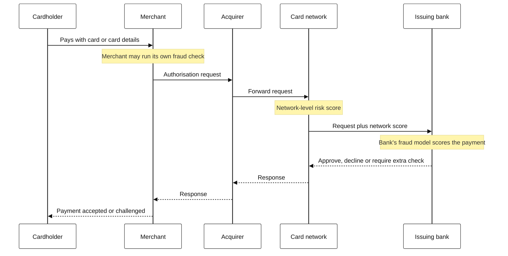
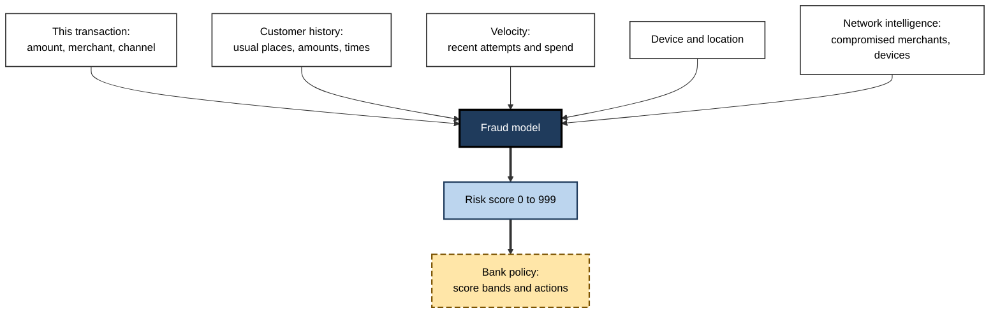
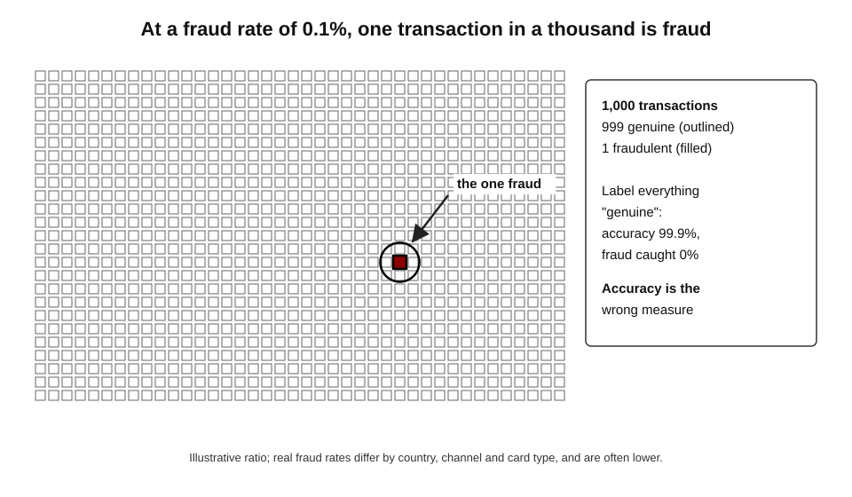
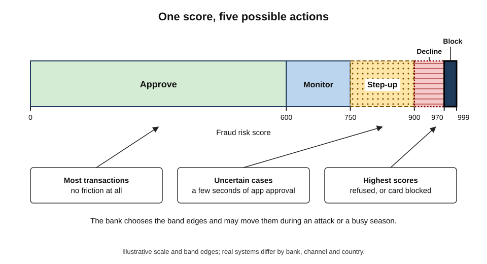
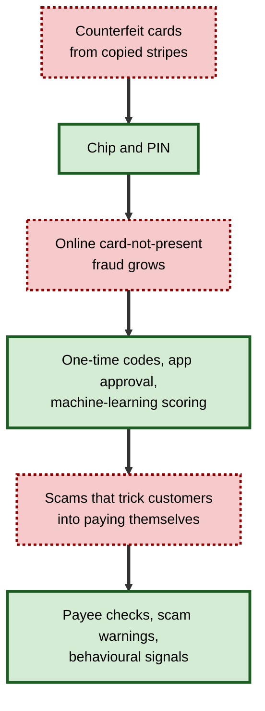
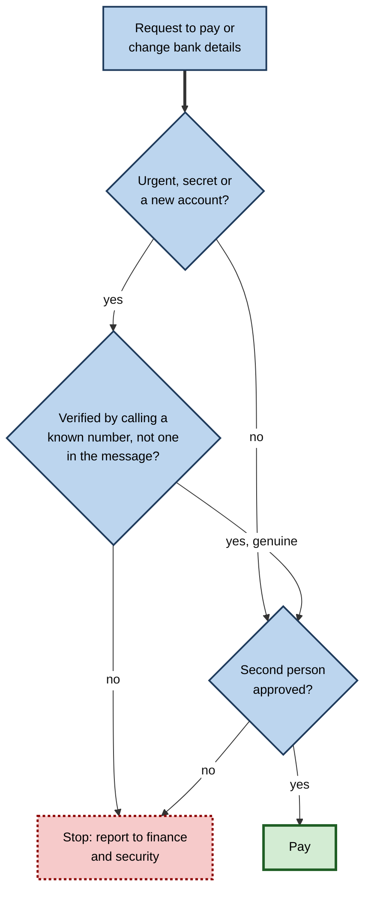

# E.7. Fraud detection on your bank card

A person buys coffee in Leeds at 8:10. At 8:14 their card number is used to buy £900 of electronics from a website registered abroad. Before the website's checkout page has finished loading, a message arrives on the person's phone: "Did you just try to spend £900 at …? Reply YES or NO." The bank's system has scored the transaction, judged it suspicious and paused it — all within the second or two that a card payment takes.

> **Definition — Card fraud:** the use of a payment card, or its details, to make purchases or withdraw money without the genuine cardholder's authority.

> **Definition — Fraud detection:** the automated scoring of transactions, accounts or applications to identify those likely to be fraudulent, so that they can be blocked, challenged or investigated.

**Why it matters**

- **It protects money at enormous scale.** Card networks process many billions of transactions a year; even a tiny fraud rate represents large sums.
- **It is real-time AI with high stakes.** A decision must be made in a fraction of a second, with incomplete information, for every single payment.
- **Both errors hurt.** Missing fraud costs money; blocking a genuine payment strands a traveller, loses a sale and erodes trust.
- **It is a contest with organised crime.** Fraudsters test systems, adapt and increasingly target people rather than cards.

---

## How Card Fraud Happens

### The main types

| Type | How it works | Typical example | What reduced or displaced it |
|---|---|---|---|
| Counterfeit card | Card data copied (skimmed) and written onto a fake card | Skimming device on a cash machine | Chip cards, which are very hard to copy |
| Lost or stolen card | Physical card used by someone else | Wallet stolen, card tapped in shops | PIN requirements; limits on contactless spending |
| Card-not-present (remote purchase) | Card number, expiry and security code used online or by phone | Details stolen in a data breach or by phishing, used on shopping sites | Online authentication (one-time codes, app approval) |
| Account takeover | Criminal gains control of the account itself | Changes the phone number, orders a new card | Strong login security; checks on account changes |
| Application fraud | New account opened with stolen or invented identity | Credit card obtained in a victim's name | Identity verification at sign-up |
| Authorised push payment scam | The genuine customer is tricked into sending money | "Your account is at risk — move your savings to this safe account" | Payee checks, warnings, reimbursement rules |

> **Definition — Card-not-present (CNP) fraud:** fraud using card details where the physical card is not presented, typically online or by telephone; it is the largest category of card fraud in many countries.

> **Definition — Authorised push payment (APP) scam:** fraud in which the genuine account holder is deceived into authorising a payment to a criminal.

- **Where card data come from**
  - Data breaches at retailers and service providers.
  - Phishing websites and messages imitating banks or delivery firms.
  - Malicious code inserted into shop checkout pages.
  - Skimmers and hidden cameras at cash machines and fuel pumps.
  - Guessing — automated tools try combinations of numbers, expiry dates and codes.
- **Card testing** — criminals make many tiny purchases (often on charity or small online sites) to find which stolen numbers still work, before using them for large purchases.

> **Key point:** fraud **moves to the weakest point**. As chip cards made counterfeiting hard, fraud shifted online; as online authentication tightened, fraud shifted towards deceiving the customer directly.

---

## A Payment in Two Seconds

### Who is involved

- **Cardholder** — the customer.
- **Merchant** — the shop or website.
- **Acquirer** — the merchant's bank or payment provider.
- **Card network** — such as Visa or Mastercard, routing the request.
- **Issuer** — the cardholder's bank, which approves or declines.

> **Definition — Authorisation:** the real-time request, sent from the merchant through the card network to the issuing bank, asking whether a payment may go ahead.

**Figure 1.** A card authorisation and the points at which fraud is scored.

- **Several layers of scoring**
  - **Merchants** and their payment providers check orders (especially online) before sending them.
  - **Card networks** see patterns across many banks and countries — for example, a merchant suddenly receiving cards from a recent breach.
  - **Issuing banks** know the customer's own history and make the final decision.
- **Time limit** — the bank's decision must be returned within a small fraction of the time the whole payment takes; the model typically has milliseconds to tens of milliseconds.

---

## What the Model Looks At

### Features of a transaction

A fraud model receives a transaction and computes many **features** — measurable properties that help separate fraud from genuine use.

- **About the transaction**
  - Amount, currency, merchant type (electronics, gift cards, travel are higher risk), online or in person, chip or contactless or keyed-in.
- **Compared with the customer's habits**
  - Is the amount unusual for this customer? Is this a new merchant, country or device?
  - Time of day compared with their normal pattern.
- **Velocity**
  - How many transactions in the last minute, hour or day; how many declined attempts.
- **Geography**
  - Distance from the last transaction; "impossible travel" (a card used in Leeds and, ten minutes later, in a shop in another continent).
- **Device and session (online)**
  - Device identity, browser settings, IP address, whether the delivery address differs from the billing address, how the person typed and moved through the page.
- **Network signals**
  - Has this merchant, device or delivery address been linked to fraud on other cards?

> **Definition — Feature (in machine learning):** a measurable property of an input that a model uses to make its prediction.

> **Definition — Velocity check:** a feature or rule based on how many transactions, or how much spending, occurred within a recent time window.

**Figure 2.** How transaction details, customer history and network intelligence combine into a fraud score and a decision.

### Rules and models together

| | Hand-written rules | Machine-learning models |
|---|---|---|
| Example | "Decline if more than 5 attempts in 10 minutes" | Score combining hundreds of features and their interactions |
| Strength | Transparent; quick to add for a new attack | Catches subtle combinations no one thought to write down |
| Weakness | Blunt; many false alarms; easily learned by criminals | Harder to explain; needs large labelled data; drifts |
| Typical role | Hard limits, regulatory requirements, emergency responses | Main scoring engine |
| Maintenance | Analysts edit rules | Regular retraining and monitoring |

- **History** — banks adopted neural-network fraud scoring in the early 1990s (notably the Falcon system from the company HNC Software, later part of FICO); today models typically combine **gradient-boosted decision trees**, neural networks and graph-based techniques.
- **Customer profiles** — many systems maintain a continuously updated summary of each card's behaviour, so each new transaction is compared with "what this customer normally does".

> **Watch out:** "the AI blocked my card" usually means a **model score and a bank policy** together. The bank chooses the score at which it declines, challenges or approves — and it may change those choices during a fraud attack or a holiday season.

---

## Rare Events and Hard Trade-offs

### Fraud is a needle in a haystack

- **Class imbalance** — fraudulent transactions are a tiny share of all transactions, typically well under 1 in 100 and often closer to 1 in 1,000 or fewer.
  - A widely used public research dataset of European card transactions from 2013 contains 492 frauds among 284,807 transactions — about 0.17%.
- **Consequence 1** — a model that labels **everything** genuine is "over 99.8% accurate" and useless. Accuracy is the wrong measure.
- **Consequence 2** — even a very good model produces **many false alarms** relative to real fraud, because genuine transactions are so numerous.

> **Definition — Class imbalance:** a situation in which one category (here, fraud) is far rarer than the other, making accuracy misleading and learning harder.

**Figure 3.** The scale of the problem: genuine and fraudulent transactions at a realistic ratio.

### Worked example (illustrative): what the alerts look like

A bank processes 1,000,000 card transactions in a day; 1,000 (0.1%) are fraudulent. Its model flags 2% of genuine transactions and catches 90% of fraud.

| | Actually fraud | Actually genuine | Total |
|---|---|---|---|
| Flagged by the model | 900 (caught) | 19,980 (false alarms) | 20,880 |
| Not flagged | 100 (missed) | 979,020 | 979,120 |
| Total | 1,000 | 999,000 | 1,000,000 |

*Illustrative figures.*

1. **Recall (detection rate)** = 900 ÷ 1,000 = **90%** — most fraud is caught.
2. **Precision** = 900 ÷ 20,880 ≈ **4.3%** — fewer than one in twenty flagged transactions is fraud.
3. **Customer impact** — nearly 20,000 genuine customers are challenged or declined in one day.
4. **Response** — the bank sends most flags to a quick **step-up check** (a confirmation in the banking app) rather than declining, so that genuine customers can continue in seconds.

> **Formula — Precision of fraud alerts:** frauds flagged ÷ all transactions flagged. With rare fraud, precision is low even for strong models, which is why the **action** taken on a flag matters so much.

> **Watch out:** industry reports often claim that **false declines** cost merchants more in lost sales than fraud itself. Such estimates come mainly from vendors selling fraud tools and vary widely; the direction — that wrongly declining good customers is very costly — is widely accepted, but the size is uncertain.

### From score to action

| Action | When used | Cost to a genuine customer | Effect on a fraudster |
|---|---|---|---|
| Approve | Low score | None | Fraud succeeds if missed |
| Approve and monitor | Slightly raised score | None | Later transactions watched more closely |
| Step-up authentication | Middle score | A few seconds: app approval or one-time code | Usually stopped, unless they control the phone |
| Decline | High score | Embarrassment; purchase fails; may need to call the bank | Stopped |
| Block card | Very high score or confirmed fraud | New card needed; days without the card | Stopped on this card |

**Figure 4.** Score bands and actions: most of the decision is about what to do with uncertain cases.

- **Step-up authentication** — strong customer authentication rules in the European Union (from 2019, phased in to 2021) and the United Kingdom (fully from 2022) require two independent factors for many online payments; risk scores decide when **exemptions** apply, so low-risk payments flow without a challenge.

> **Definition — Strong customer authentication (SCA):** a requirement that a payment be confirmed using at least two independent elements: something the customer knows (a PIN), has (a phone) or is (a fingerprint).

### Measuring a fraud system

Banks and merchants track several measures together, because each captures a different cost.

- **Fraud loss rate** — fraud losses as a share of total spending, often expressed in **basis points** (hundredths of a per cent); a loss of £5 per £10,000 spent is 5 basis points.
- **Detection rate by value** — the share of fraudulent **money** stopped, which matters more than the share of fraudulent transactions, since one large fraud outweighs many small ones.
- **False-positive ratio** — genuine transactions flagged for every fraud caught.
- **Customer friction** — the share of genuine customers challenged or declined, and how many abandon the purchase.
- **Time to detect** — how quickly a new attack pattern is noticed and stopped.

> **Formula — False-positive ratio:** genuine transactions flagged ÷ frauds caught. In the worked example above, 19,980 ÷ 900 ≈ **22 : 1** — about twenty-two genuine customers inconvenienced for every fraud stopped. Reducing this ratio without missing more fraud is a central aim of better models.

> **In practice:** fraud teams monitor these measures **daily** and by segment (country, channel, merchant type). A sudden rise in the false-positive ratio usually signals a model or rule problem; a sudden rise in losses signals a new attack.

---

## Learning in a Shifting, Adversarial World

### Labels arrive late and imperfectly

- **Where labels come from**
  - **Customer disputes** ("I didn't make this payment") — often weeks after the transaction.
  - **Chargebacks** processed through the card network.
  - **Investigator decisions** on alerts.
  - **Customer confirmations** ("YES, that was me").
- **Problems**
  - **Delay** — the most recent fraud patterns are the least labelled.
  - **Missing labels** — some fraud is never reported (the customer does not notice); some genuine transactions are disputed falsely (**first-party** or "friendly" fraud).
  - **Selection bias** — declined transactions never complete, so the bank never learns whether they were really fraud.

**Study card — "Credit card fraud detection: a realistic modelling" (Université libre de Bruxelles with a European payment processor, published 2018)**

- **Question:** how should fraud models be trained when, in practice, only a few transactions are checked by investigators quickly, while most labels arrive much later through disputes?
- **Design:** used streams of real card transactions over time from a European processor; compared ways of training on the two kinds of label — quick, sparse **investigator feedback** and large, **delayed** labels.
- **Results:** treating the two sources separately and combining the resulting models improved the precision of the alerts sent to investigators, compared with mixing all labels together.
- **Conclusion:** fraud detection is not a standard "train once" problem; it is a **stream** with delayed, biased labels and **concept drift**, and models must be designed and evaluated as such.

> **Definition — Concept drift:** a change over time in the patterns relating inputs to outcomes — here, new fraud methods and new customer habits — that makes a trained model less accurate.

### Adversaries adapt

- **Probing** — criminals make small test payments to learn which cards and merchants are not challenged.
- **Mimicry** — spending patterns designed to look normal (small amounts, familiar merchant types).
- **Bots** — automated attacks that try thousands of cards or account logins.
- **Mules** — accounts of real people (sometimes recruited knowingly, sometimes deceived) used to receive and move stolen money.
- **Social engineering** — persuading the genuine customer to approve a payment or share a one-time code, which defeats authentication designed to stop outsiders.

> **Key point:** fraud models face **two** sources of change: customers' habits shift (holidays, pandemics, new ways of paying) and criminals deliberately adapt. Both demand continuous monitoring and retraining.

### Case study: Chip and PIN and the migration of fraud (United Kingdom)

- **Situation:** in the early 2000s counterfeit cards made by copying magnetic stripes were a major source of card fraud in the UK.
- **Action:** the UK moved to chip cards verified by PIN, with the switch completed in 2006 for most in-person payments.
- **Result:** counterfeit and lost-and-stolen fraud in UK shops fell substantially over the following years.
- **Side effect:** fraud **migrated** — to card-not-present purchases online and by phone, which grew to become by far the largest category of card fraud; and to countries that still accepted magnetic-stripe cards, where copied UK card data could still be used.
- **Further response:** online authentication (one-time codes, later app-based approval) and machine-learning scoring of online payments; as these improved, criminals turned increasingly to **deceiving customers** into making payments themselves.
- **Lesson:** a successful control at one point **displaces** fraud rather than ending it; detection systems must watch the whole system, including channels that were previously quiet.

**Figure 5.** Fraud moves to wherever defences are weakest.

---

## When the Customer Is Tricked

### Authorised fraud defeats authentication

When a criminal persuades a customer to make a payment — pretending to be the bank's fraud team, the police, a builder, an online romance or an investment adviser — every technical check is passed: it is the right customer, on the right phone, with the right password.

| | Unauthorised fraud | Authorised push payment scam |
|---|---|---|
| Who makes the payment | The criminal, using stolen details | The genuine customer, deceived |
| Authentication | Fails if the criminal lacks the second factor | Passes — the customer authenticates themselves |
| Detection clues | Unusual device, location, merchant, velocity | Unusual payee, amount, timing, behaviour during the session |
| Typical intervention | Decline or step-up check | Warning, delay, a conversation with the customer |
| Reimbursement (UK) | Generally refunded unless the customer was grossly negligent | Mandatory reimbursement rules from October 2024, up to a set limit, with exceptions |

- **Detection signals for scams**
  - A **new payee** receiving a large amount, especially an account recently opened or linked to other complaints.
  - **Behavioural signs** — hesitation, unusually slow typing, switching between apps, an active phone call during a banking session (suggesting someone is coaching the customer).
  - **Mule-account detection** at the receiving bank — accounts receiving many payments and quickly moving them on.
- **Interventions**
  - **Confirmation of Payee** — introduced by major UK banks from 2020, it checks whether the name entered matches the account holder's name before money is sent.
  - **Targeted warnings** — specific to the likely scam ("Banks never ask you to move money to a safe account").
  - **Friction** — delaying a payment, or asking the customer to call or visit, when the risk is high.

> **Remember:** a genuine bank will **never** ask a customer to move money to a "safe account", share a one-time passcode, or install remote-access software. Any message or call that does is a scam, however convincing.

> **In practice:** when a payment prompts a warning, professionals in finance teams follow a fixed rule: **stop and verify through a separate, known channel** — never through a number or link supplied in the suspicious message.

---

## Fairness, Explanation and the Customer

- **Who gets declined?**
  - People whose spending is irregular — shift workers, frequent travellers, migrants sending money abroad, people paying for medical treatment — trigger more alerts.
  - New customers and people with "thin" histories have less data to establish normal behaviour.
- **Explanations**
  - Banks rarely explain declines in detail, partly so criminals cannot learn the rules.
  - Data-protection law in the EU and UK gives people rights concerning decisions based solely on automated processing that significantly affect them, including the right to human involvement; how this applies to individual card declines is debated.
- **Customer tools**
  - Real-time notifications for every payment.
  - Freezing and unfreezing a card in the banking app.
  - **Virtual card numbers** and **tokens** — mobile wallets give each phone a different token instead of the real card number, so a breach at a merchant does not expose the card.
  - Spending controls (block gambling, online, overseas).

> **Definition — Tokenisation:** replacing a card number with a substitute value (a token) that is useless if stolen outside its permitted device or merchant.

---

## Professional Practice

### For anyone handling payments at work

- **Business e-mail compromise** — criminals impersonate suppliers or executives ("Please pay this invoice to our new account today"); controls are **process** controls: call-back to a known number, two-person approval, no changes to bank details by e-mail alone.
- **Corporate cards** — expense systems use similar anomaly detection to flag unusual merchants, split transactions and weekend spending.
- **Merchants** — online sellers balance fraud losses against lost sales; they tune their own fraud tools, use authentication, and watch for card-testing attacks.

### Case study (illustrative): the online shop that declined its best customers

- **Situation:** a growing online retailer of outdoor equipment installed a fraud-screening service on its checkout and set it to decline any order scoring above a fixed threshold.
- **Problem:** fraud chargebacks fell, but sales to overseas customers dropped by a quarter and customer-service staff received angry calls from regular customers whose orders had been refused.
- **Diagnosis:**
  1. Overseas orders, orders with different billing and delivery addresses, and large first orders all scored high — but these were also typical of the shop's best customers (expedition teams, gifts, clubs).
  2. The threshold had been set to minimise fraud, with no measure of **declined good orders**.
  3. Declined orders were never reviewed, so the shop did not know how many were genuine.
- **Actions:**
  1. Introduced a **middle band** sent to authentication or brief manual review instead of automatic decline.
  2. Whitelisted returning customers with a good history.
  3. Sampled declined orders to estimate how many were genuine.
  4. Tracked a combined measure: fraud losses **plus** estimated lost good sales.
- **Result:** overseas sales recovered; fraud losses rose slightly but stayed within budget; total cost fell.
- **Lesson:** a fraud system must be judged on **both** errors. Optimising only fraud losses quietly turns away good customers.

**Figure 6.** Responding to a suspicious payment request at work.

---

## Open Questions

- **Can banks detect scams without intrusive monitoring?**
  - Behavioural signals work, but analysing how customers type, move and call raises privacy concerns.
- **Who should bear the cost of authorised fraud?**
  - Reimbursement rules shift costs to banks, raising questions about incentives for customers, banks and the platforms where scams begin.
- **How will generative AI change fraud?**
  - Cloned voices, fake videos and fluent scam messages make impersonation easier; detection of synthetic media is immature.
- **How can models be fair to people with irregular lives?**
  - Measuring and reducing unequal decline rates without weakening protection is unresolved.
- **Should banks share more data?**
  - Fraud moves between institutions faster than information does; sharing helps detection but must respect privacy and competition law.

---

## Summary

- **Card fraud** takes several forms — counterfeit, lost or stolen, **card-not-present**, account takeover, application fraud — and increasingly **authorised push payment scams** in which customers are deceived.
- A card **authorisation** passes from merchant to acquirer, card network and **issuing bank** within about a second; merchants, networks and banks all score it.
- Models use **features** such as amount, merchant type, deviation from the customer's habits, **velocity**, geography, device and network intelligence; **rules and machine learning** work together.
- Fraud is **rare** (**class imbalance**), so accuracy is meaningless and even strong models have low **precision**; the **action** taken on a flag — approve, monitor, **step-up**, decline, block — determines the cost to genuine customers.
- **Strong customer authentication** requires two factors for many online payments, with risk-based exemptions.
- Labels are **delayed and biased**, and fraud shows **concept drift**; criminals probe, mimic and use mules. Controls **displace** fraud, as **Chip and PIN** displaced it online.
- Authorised scams pass authentication; banks use payee checks, behavioural signals, warnings and friction, and UK reimbursement rules changed in 2024.
- Fraud systems must be judged on **both** errors; at work, **process controls** — call-back to known numbers, dual approval — defeat impersonation.

---

## Self-Check

1. Distinguish card-not-present fraud from an authorised push payment scam.
2. Name the five parties in a card payment and say where fraud scoring happens.
3. List five kinds of feature a fraud model uses, with an example of each.
4. Why is accuracy a poor measure for fraud detection?
5. A bank sees 500,000 transactions with 0.2% fraud. Its model catches 80% of fraud and flags 1% of genuine transactions. Compute recall and precision.
6. Why do banks often use step-up authentication rather than declining?
7. What is strong customer authentication, and how does a risk score interact with it?
8. Explain why fraud labels arrive late and why some never arrive.
9. What did the 2018 study of realistic fraud modelling recommend, and why?
10. Describe how Chip and PIN changed the pattern of fraud in the UK.
11. Why does an authorised push payment scam defeat ordinary authentication, and what signals can detect it?
12. Who is more likely to suffer false declines, and why does this raise fairness questions?
13. A finance assistant receives an e-mail from a "supplier" with new bank details and a request for urgent payment. What should they do?
14. A merchant's fraud tool reduced chargebacks but sales fell. Diagnose and propose improvements.

### Answer Key

1. Card-not-present fraud: a criminal uses stolen card details online or by phone without the cardholder. APP scam: the genuine customer is tricked into authorising the payment themselves.
2. Cardholder, merchant, acquirer, card network, issuing bank. Scoring occurs at the merchant (or its payment provider), the network and the issuing bank.
3. Transaction (amount, merchant type), customer deviation (new country), velocity (attempts in last hour), geography (impossible travel), device/session (new device, mismatched addresses), network intelligence (merchant linked to breaches).
4. Fraud is so rare that labelling everything genuine scores above 99% accuracy while catching nothing; the balance of caught fraud and false alarms matters.
5. Fraud = 1,000; caught = 800 → recall 80%. Genuine = 499,000; flagged = 4,990. Precision = 800 ÷ (800 + 4,990) ≈ 13.8%.
6. Most flagged transactions are genuine; a quick confirmation lets real customers continue while stopping most fraudsters, reducing the cost of false alarms.
7. A requirement to confirm many payments with two independent factors; risk scores allow low-risk payments to be exempt, so only riskier ones are challenged.
8. Disputes and chargebacks come weeks later; some fraud is never noticed or reported; declined transactions never reveal whether they were fraud; some disputes are false.
9. Train separately on quick investigator feedback and on delayed dispute labels, then combine — because the two label streams differ in timing and bias, and fraud is a drifting stream.
10. Counterfeit and lost/stolen fraud in shops fell; fraud migrated to card-not-present channels and to countries still accepting magnetic stripes, later shifting to scams.
11. The genuine customer authenticates on their own device. Signals: new payee, unusual amount, recipient account linked to mules, hesitation, active phone call during the session, coached behaviour.
12. People with irregular patterns — travellers, shift workers, migrants, new customers. They face more inconvenience and exclusion for reasons unrelated to fraud, and explanations are limited.
13. Do not pay or change details; verify by calling the supplier on a number from existing records; require a second approver; report the e-mail to finance and security.
14. The threshold probably minimised fraud without measuring declined good orders, which share features with good customers. Add a review or authentication band, recognise returning customers, sample declines, and track fraud losses plus lost sales together.

---

## Glossary

| Term | Meaning |
|---|---|
| Acquirer | The merchant's bank or payment provider. |
| Basis point | One hundredth of a per cent (0.01%). |
| Account takeover | A criminal gaining control of a customer's account. |
| Authorisation | The real-time request asking the issuing bank to approve a payment. |
| Authorised push payment (APP) scam | Fraud in which the genuine customer is deceived into making a payment. |
| Card network | The system, such as Visa or Mastercard, that routes card payments between banks. |
| Card-not-present (CNP) fraud | Fraud using card details without the physical card. |
| Card testing | Small trial purchases to find which stolen card numbers work. |
| Chargeback | Reversal of a card payment after a dispute. |
| Class imbalance | One category being far rarer than another. |
| Concept drift | Change over time in the patterns a model learned. |
| Confirmation of Payee | A check that the payee name matches the account before money is sent. |
| False decline | A genuine transaction wrongly refused. |
| False-positive ratio | Genuine transactions flagged for each fraud caught. |
| Feature | A measurable property of an input used by a model. |
| First-party fraud | A customer falsely disputing a genuine transaction or misusing their own account. |
| Issuer | The bank that issued the card and approves or declines payments. |
| Money mule | A person whose account is used to receive and move stolen money. |
| Step-up authentication | An extra verification requested when risk is raised. |
| Strong customer authentication (SCA) | Confirmation of a payment with two independent factors. |
| Tokenisation | Replacing a card number with a substitute value useless elsewhere. |
| Velocity check | A test based on the number or value of recent transactions. |
