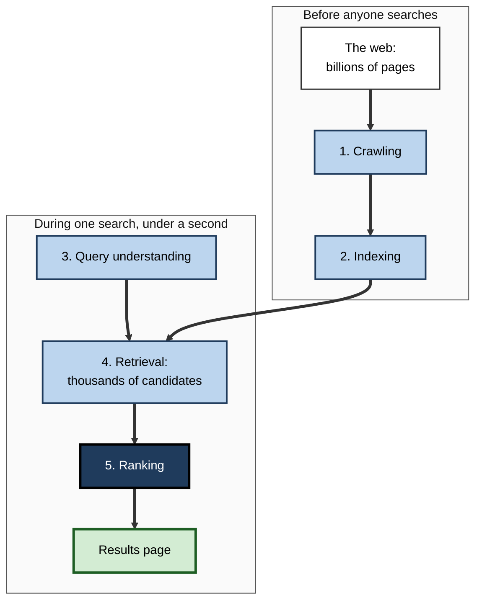
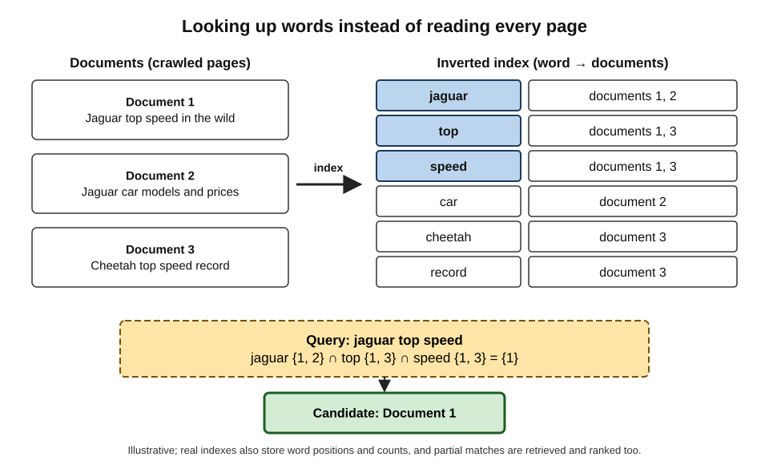
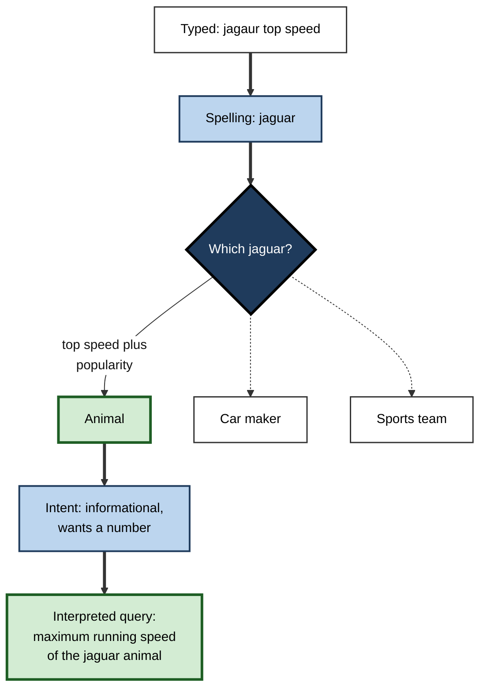
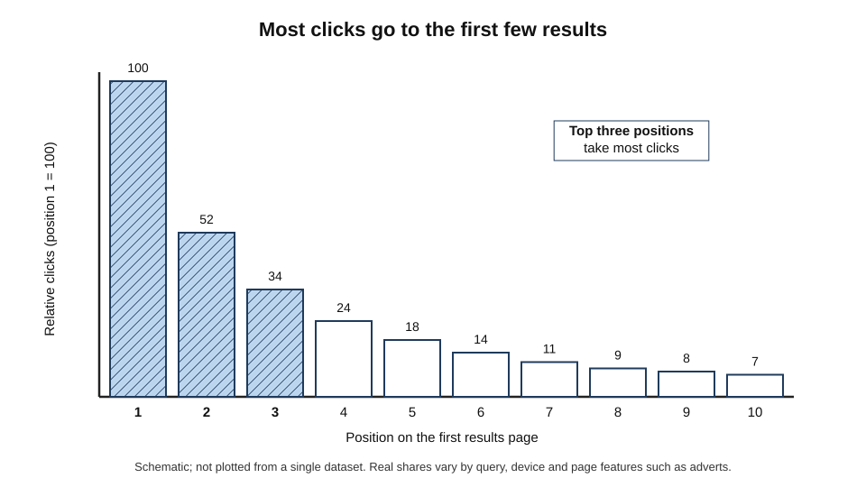
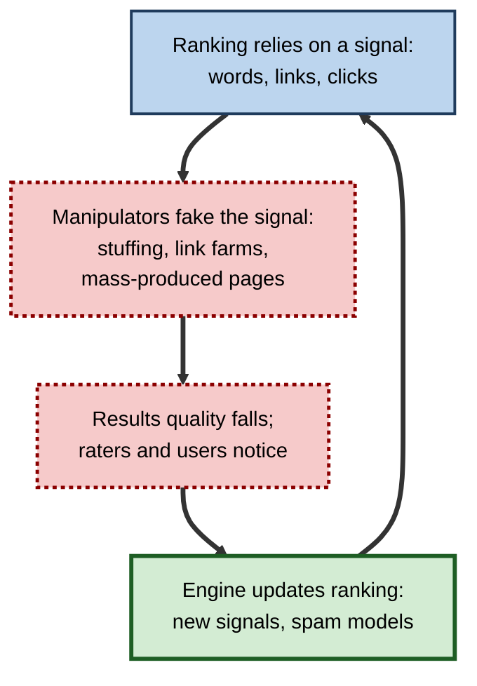
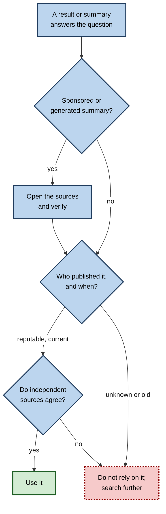

# E.8. Search engines and AI-ranked results

Someone types "jaguar top speed" into a search box. In about a quarter of a second the engine has decided that they mean the animal rather than the car, corrected nothing because nothing was misspelt, considered billions of stored pages, selected a few thousand candidates, ranked them and placed ten on the screen with a highlighted answer at the top. The person sees a list. Behind it is one of the largest and longest-running applications of artificial intelligence in the world.

> **Definition — Search engine:** a system that collects and indexes information (such as web pages) and, in response to a query, retrieves and ranks the items most likely to satisfy the person's need.

> **Definition — Ranking:** ordering retrieved results by their estimated usefulness for a particular query and person.

**Why it matters**

- **It is the gateway to information.** For most people, what search shows first *is* what exists.
- **Rank is power.** People rarely look beyond the first few results, so position decides which businesses, ideas and sources are seen.
- **It runs on learned models.** Understanding queries, judging page quality and ordering results all depend on machine learning trained on human behaviour and human judgements.
- **It is contested territory** — between engines and those trying to game them, between businesses competing for visibility, and between regulators and dominant firms.

---

## From the Web to a Results Page

### Five stages

1. **Crawling** — automated programs (**crawlers**) follow links and fetch pages, revisiting important or fast-changing pages often.
2. **Indexing** — pages are analysed and stored in a structure that allows instant lookup by word and meaning.
3. **Query understanding** — the engine works out what the person means.
4. **Retrieval** — from billions of pages, a few thousand plausible candidates are pulled out.
5. **Ranking and presentation** — candidates are scored in detail, ordered and shown with snippets, images, maps or direct answers.

**Figure 1.** The stages of web search, from crawling to the results page.

> **Key point:** almost all the heavy work — crawling and indexing — happens **before** anyone searches. The query itself triggers only lookup, scoring and assembly, which is why results arrive in a fraction of a second.

---

## Finding Candidates

### The inverted index

A book's index lists, for each important word, the pages on which it appears. A search engine does the same for the whole web.

> **Definition — Inverted index:** a data structure that maps each word (or term) to the list of documents that contain it, often with positions and counts, so that documents containing given words can be found instantly.

- **Lookup** — for "jaguar top speed", the engine reads the lists for "jaguar", "top" and "speed" and finds documents appearing in all of them, or in most.
- **Scale** — the index is split across many thousands of machines; each searches its share in parallel and returns its best candidates.

**Figure 2.** An inverted index maps each word to the documents that contain it.

### Weighing words

- **Term frequency** — a page that mentions "jaguar" many times is more likely to be about jaguars.
- **Inverse document frequency** — rare words carry more information than common ones; "jaguar" says more than "top".
- **Classic scoring** — formulas such as **TF–IDF** and **BM25** (developed in information-retrieval research in the 1970s to 1990s) combine these ideas and remain in use as one component of modern ranking.

> **Formula — Inverse document frequency (one common form):** IDF = log(N ÷ n), where N is the number of documents and n the number containing the word. In 1,000,000 pages, a word found in 1,000 has IDF = log₁₀(1,000) = **3**; a word found in 500,000 has IDF ≈ **0.3** — ten times less informative.

### Matching meaning, not just words

- **The limitation of words** — "how to fix a dripping tap" and "repair leaking faucet" share no important words but mean the same thing.
- **Semantic (dense) retrieval**
  - Neural networks convert queries and documents into **embeddings** — lists of numbers placed so that texts with similar meanings are close together.
  - The engine finds documents whose embeddings are near the query's embedding, even with different wording.
- **Hybrid retrieval** — modern engines combine word-based and meaning-based retrieval, because each catches what the other misses (exact product codes and names favour words; paraphrases favour meaning).

| | Lexical (word-based) retrieval | Semantic (embedding-based) retrieval |
|---|---|---|
| Matches | The same words, weighted by frequency and rarity | Similar meanings, even with different words |
| Strong for | Names, codes, quotations, rare terms | Natural-language questions, paraphrases, other languages |
| Weak for | Synonyms and paraphrases | Exact identifiers; can retrieve plausible but off-topic text |
| Explainability | Easy — the words matched | Harder — closeness in a learned space |
| Typical role today | One component of hybrid retrieval | Another component, increasingly important |

---

## Understanding the Query

Queries are short, ambiguous and often misspelt. A large share of the AI in search goes into working out what the person wants.

- **Spelling correction** — "recieve" → "receive", using models learned from how millions of people corrected their own searches.
- **Synonyms and reformulation** — expanding "cheap" to include "low cost" and "budget".
- **Entity recognition** — recognising "Jaguar" as an animal, a car maker or a sports team, and choosing using context and popularity.
- **Intent classification**
  - **Navigational** — going to a known site ("bbc news").
  - **Informational** — learning something ("why is the sky blue").
  - **Transactional** — doing something ("buy running shoes size 9").
  - **Local** — finding something nearby ("dentist open now").
- **Context** — location, language, time and, where enabled, previous searches.
- **Language models** — in 2019 Google said it had begun applying the BERT language model to understand queries, particularly the role of small words such as "for" and "to" that change meaning ("brazil traveller to usa need a visa").

> **Definition — Search intent:** the underlying goal behind a query — to navigate, learn, buy or find something locally — which determines what kind of result is most useful.

**Figure 3.** How an engine interprets a short, ambiguous query before retrieving anything.

---

## Ranking: Deciding What Comes First

### Families of signals

| Signal family | What it estimates | Examples |
|---|---|---|
| Relevance | How well the page matches the interpreted query | Words and meanings matched; where they appear (title, headings) |
| Quality and authority | How trustworthy and useful the page and site are | Links from other reputable sites; expertise of the source; signs of spam |
| Freshness | Whether recent information matters for this query | Publication and update dates for news, prices, events |
| User experience | Whether the page is usable | Loads quickly; works on phones; not covered in intrusive adverts |
| Context | What suits this person now | Location ("near me"), language, device |
| Behaviour | How people responded to results for similar queries | Clicks, quick returns to the results page, longer visits |

- **Links as votes** — the original insight of PageRank (1998): a page linked to by many important pages is probably important. It remains one signal among very many.
- **Behavioural signals** — evidence in a 2023 US antitrust trial described Google systems that learn from how users interact with results, such as which results are clicked and whether people come back to search again.

> **Definition — PageRank:** an algorithm that scores web pages by the number and importance of the pages linking to them, treating links as votes of confidence.

### Learning to rank

- **Hand-tuned formulas could not cope** with hundreds of signals and their interactions.
- **Learning to rank** — machine-learning models are trained to order results so that those judged most useful appear first.
  - **Training data** comes from **human judgements** (people rating how well results meet a query) and from **behaviour** (clicks and what followed).
- **Multi-stage ranking** — a cheap model orders thousands of candidates; increasingly expensive models re-rank the top hundreds and then the top tens — the same funnel principle used by recommender systems.

> **Definition — Learning to rank:** the use of machine learning to train a model that orders search results, from examples of results judged better or worse for given queries.

### Human quality raters

- **Who they are** — Google, for example, employs many thousands of contracted **search quality raters** worldwide.
- **What they do** — rate results for sample queries against published guidelines: does the page meet the need? Is it trustworthy?
- **E-E-A-T** — the guidelines ask raters to consider **Experience, Expertise, Authoritativeness and Trustworthiness**, with extra scrutiny for "Your Money or Your Life" topics such as health, finance and safety.
- **Their role** — ratings do not directly change any page's position; they are used to **evaluate** proposed changes to the ranking systems and to train models.

> **Watch out:** E-E-A-T is often described as a "ranking factor". It is a concept in the **raters' guidelines** used to judge quality; engines use many signals to approximate it, but there is no single E-E-A-T score applied to each page.

### Measuring ranking quality

> **Formula — Discounted cumulative gain (DCG):** DCG = Σ relevanceᵢ ÷ log₂(i + 1), summing over positions i = 1, 2, 3, … Relevant results count for less the further down they appear; dividing by the best possible DCG gives **normalised DCG (NDCG)**, between 0 and 1.

**Worked example (illustrative): two rankings of the same five results**

Relevance grades: 3 = perfect, 2 = good, 1 = fair, 0 = useless.

| Position i | Discount 1 ÷ log₂(i + 1) | Ranking A grade | A contribution | Ranking B grade | B contribution |
|---|---|---|---|---|---|
| 1 | 1.00 | 3 | 3.00 | 1 | 1.00 |
| 2 | 0.63 | 2 | 1.26 | 0 | 0.00 |
| 3 | 0.50 | 1 | 0.50 | 3 | 1.50 |
| 4 | 0.43 | 0 | 0.00 | 2 | 0.86 |
| 5 | 0.39 | 0 | 0.00 | 0 | 0.00 |
| **Total DCG** | | | **4.76** | | **3.36** |

*Illustrative figures.*

1. Both rankings contain the **same** results.
2. Ranking A puts the best result first; B buries it at position 3.
3. **A is the ideal order**, so its NDCG = 4.76 ÷ 4.76 = **1.00**; B's NDCG = 3.36 ÷ 4.76 ≈ **0.71**.

> **Key point:** in search, **order is everything**. Measures such as NDCG reward putting the best results at the top because that is where people look.

---

## Why Position Matters So Much

**Study card — "In Google we trust" (Cornell University and partners, 2007)**

- **Question:** do people choose search results because they are relevant, or because they are ranked first?
- **Design:** students searched while eye-tracking equipment recorded what they looked at. For some participants, the researchers secretly **reversed** the order of the results.
- **Results:** participants looked at and clicked the top results most often **even when the order had been reversed** and those results were less relevant.
- **Conclusion:** people place strong trust in the engine's ranking; position itself drives attention and clicks.

**Figure 4.** Clicks fall steeply with position on a results page.

- **Consequences**
  - Businesses compete intensely for the first page — and the first few positions.
  - Click data are **biased by position**: a result clicked at position 1 may simply have been seen more. Ranking models must correct for this.
- **Influence on opinions**
  - Laboratory experiments published in 2015 reported that biased orderings of search results could shift undecided participants' voting preferences — an effect the authors called the "search engine manipulation effect".

> **Watch out:** the "search engine manipulation effect" comes mainly from **experiments by one research group**, using mock search pages; its size in real elections and real search engines is **contested**. The narrower finding — that people trust and click higher-ranked results — is well established.

---

## Does Everyone See the Same Results?

### Personalisation in web search

- **What varies**
  - **Location** — "plumber" or "weather" results depend on where the person is.
  - **Language and country** — different regional versions of the engine and different local sources.
  - **Signed-in history** — where enabled, past searches and visits can adjust results slightly.
  - **Device** — mobile layouts favour different result types.
- **How much it varies**
  - Researchers at Northeastern University measured personalisation of Google web search in 2013 by comparing results for real accounts with those for fresh, identical control accounts. On average, around a tenth of results differed because of personalisation, mostly attributable to being signed in and to location; personalisation was strongest for topics such as politics, news and local businesses.
- **The "filter bubble" in search**
  - The worry that personalised search hides opposing views has been widely voiced since about 2011.
  - Measurement studies have generally found that **query choice** — the words people choose to search with — shapes results far more than personalisation does. People who search "is climate change a hoax" and "climate change evidence" receive very different pages, whoever they are.

> **Watch out:** "everyone's Google is different" overstates the case for most queries. **Location** and the **wording of the query** usually matter much more than an individual profile — which means a person can steer their own results simply by choosing neutral search terms.

### Search inside organisations and shops

The same techniques power many other search boxes, each with its own difficulties.

| | Web search | Shop (e-commerce) search | Enterprise search |
|---|---|---|---|
| What is searched | Public web pages | A product catalogue | Internal documents, e-mails, wikis, tickets |
| Main ranking aims | Relevance, quality, authority | Relevance plus likelihood of purchase, stock and margin | Relevance plus the user's permission to see each item |
| Typical difficulty | Spam and manipulation at enormous scale | Short queries ("blue dress"), synonyms, sizes | Few links or clicks to learn from; scattered, duplicated documents |
| Signals available | Links, clicks across billions of users | Clicks, add-to-basket, purchases, returns | Authorship, recency, team membership |
| Who controls ranking | The engine operator | The retailer | The organisation's IT and knowledge teams |

- **Permissions matter in enterprise search** — a search tool, or an AI assistant built on it, must never show a person documents they are not allowed to see; misconfigured permissions are a common cause of internal data leaks.
- **Shop search is commercial ranking** — results blend relevance with what the retailer wants to sell.

> **Key point:** whenever a search box returns results, an **objective** sits behind the ranking. On the web it approximates usefulness; in a shop it includes sales; inside a company it must respect access rights.

---

## Beyond Ten Blue Links

- **Featured snippets** — a passage extracted from a page and shown at the top as a direct answer.
- **Knowledge panels** — facts about people, places and organisations drawn from a structured database of entities (Google introduced its **Knowledge Graph** in 2012).
- **Vertical results** — maps, shopping, images, video, news, flights, each with its own ranking.
- **Autocomplete** — predictions of the query as it is typed, learned from what others search.
  - Courts in some countries have held search companies responsible for defamatory autocomplete suggestions about individuals; engines filter predictions about people, violence and sensitive topics.
- **AI-generated overviews** — since 2023–2024, major engines have shown summaries written by language models above or alongside the links.
  - Early versions produced publicised errors — in 2024 one advised adding glue to pizza sauce, apparently drawing on a joke post — after which the company said it had restricted the feature for some queries.
  - Publishers worry that answers on the page reduce visits to their sites.

| | Ranked links | Paid results | AI-generated overview |
|---|---|---|---|
| What it is | Pages chosen and ordered by ranking systems | Adverts placed through an auction, labelled "Sponsored" | A written summary generated by a language model from retrieved pages |
| Who decides position | Ranking algorithms | Bid amount combined with ad quality | The model, guided by retrieved sources |
| Main risk to the user | Spam or low-quality pages ranking well | Mistaking an advert for an independent result | Fluent but wrong or unsupported statements |
| How to check | Look at the source site and date | Look for the "Sponsored" label | Open the cited sources; compare with other results |

> **In practice:** for anything consequential — health, money, legal or safety questions — professionals **open the original source**, check who wrote it and when, and compare at least two independent sources, rather than relying on a snippet or summary.

---

## The Contest for Rank

### Search engine optimisation and spam

> **Definition — Search engine optimisation (SEO):** the practice of improving a website so that it ranks higher in search results, ranging from legitimate improvements in content and structure to manipulation.

- **Legitimate SEO** — clear titles, useful content, fast pages, sensible structure, descriptions that match what people search for.
- **Manipulation ("black hat")**
  - **Keyword stuffing** — repeating words to fool term-frequency scoring.
  - **Link schemes** — buying links or creating networks of fake sites to inflate link-based authority.
  - **Content farms** — mass-producing shallow articles targeted at popular queries.
  - **Cloaking** — showing the engine different content from what users see.
  - **Scaled AI-generated content** — large volumes of machine-written pages made only to rank.
- **Engine responses** — major ranking updates targeted these: Google's "Panda" update (2011) demoted low-quality content farms; "Penguin" (2012) targeted manipulative links; later spam policies addressed scaled and AI-generated content made primarily for ranking.

**Figure 5.** The cycle of manipulation and response that shapes ranking systems.

> **Key point:** every visible ranking signal becomes a **target** once people know about it. This is why engines keep their exact methods confidential — and why critics find them hard to hold to account.

### Competition and regulation

- **Market concentration** — one engine handles the large majority of web searches in most countries.
- **United States** — in August 2024 a federal court ruled that Google had unlawfully maintained a monopoly in general search, partly through payments to be the default engine on phones and browsers; remedies ordered in 2025 stopped short of breaking up the company.
- **European Union** — in 2017 the European Commission fined Google €2.42 billion for favouring its own shopping-comparison service in search results; the Digital Markets Act (applying from 2024) restricts self-preferencing by designated "gatekeepers".
- **Transparency** — the EU Digital Services Act requires very large search engines to explain their main ranking parameters and assess systemic risks.

---

## Professional Practice

### Searching well

- **Choose words the answer would contain** — "symptoms of iron deficiency in adults" rather than "why am I so tired".
- **Use exact-phrase quotation marks** for names, error messages and quotations.
- **Restrict by site or type** — searching within a government or regulator's site, or for PDF reports.
- **Check date and source** — especially for law, prices, software and medicine.
- **Read laterally** — open other tabs to find out who is behind an unfamiliar site before trusting it.

### Being found

- **For organisations** — visibility in search shapes recruitment, sales and reputation; good structure, accurate business listings and genuinely useful content matter more than tricks.
- **For individuals** — searching one's own name shows what clients and employers will see.

### Case study (illustrative): the clinic that disappeared from search

- **Situation:** a private physiotherapy clinic relied on search for most new patients; its site ranked on the first page for "physiotherapy" plus its town's name.
- **Problem:** after a website redesign, enquiries fell by half within a month.
- **Diagnosis:**
  1. The new site had changed every page address without redirecting the old addresses, so the links pointing to the old pages — built up over years — now led nowhere.
  2. Treatment pages had been merged into one long page, so specific searches ("sports injury physiotherapy") no longer matched any page well.
  3. The business listing on maps still showed an old phone number.
- **Actions:**
  1. Redirected every old address to its new equivalent.
  2. Restored separate pages for each treatment, written by the clinicians, with clear titles and practical information.
  3. Corrected the map listing and asked satisfied patients to leave reviews.
- **Result:** rankings and enquiries recovered over about three months.
- **Lesson:** ranking systems reward **accumulated signals** (links, matching content, accurate listings); careless changes can erase them overnight, while honest improvements to usefulness are what engines are designed to reward.

**Figure 6.** Judging a search result before relying on it.

---

## Open Questions

- **Will generated answers replace ranked links?**
  - Summaries are convenient but can be wrong and may undermine the websites that supply their information.
- **How can ranking be audited?**
  - Methods are secret to prevent manipulation, which also prevents independent scrutiny.
- **What does fair competition in search look like?**
  - Remedies for dominance — choice screens, data sharing, bans on default payments — are being tested.
- **How should engines handle contested and harmful topics?**
  - Demoting misinformation protects users but raises questions about who decides.
- **Can search resist floods of machine-written content?**
  - Generative AI makes plausible pages almost free to produce; distinguishing genuine expertise is getting harder.

---

## Summary

- A **search engine** crawls and **indexes** the web in advance, then for each query performs **query understanding**, **retrieval** and **ranking** in under a second.
- The **inverted index** maps words to documents; **TF–IDF** and **BM25** weigh words by frequency and rarity; **semantic retrieval** with embeddings matches meaning; modern engines are **hybrid**.
- Query understanding covers **spelling**, **synonyms**, **entities**, **intent** (navigational, informational, transactional, local) and context, increasingly with language models.
- Ranking combines signal families — **relevance, quality and authority (including links/PageRank), freshness, user experience, context and behaviour** — through **learning to rank** in multi-stage funnels, evaluated with **human raters** and measures such as **NDCG**.
- **Position drives clicks and trust** (the 2007 reversed-results study); claims of large effects on voting are **contested**.
- Personalisation of web search is mainly by **location** and sign-in and is modest for most queries; the **wording of the query** shapes results more. Shop and enterprise search add sales objectives and access permissions.
- Results pages include **snippets, knowledge panels, verticals, autocomplete, adverts** and **AI-generated overviews**, each with different risks.
- **SEO** ranges from legitimate improvement to manipulation; engines respond with updates — a continuing contest. Regulators in the US and EU have acted against dominance and self-preferencing.
- Good practice: precise queries, checking sources and dates, lateral reading, and opening originals for consequential questions.

---

## Self-Check

1. Name the five stages of web search and say which happen before a query is typed.
2. What is an inverted index, and why does it make search fast?
3. Using IDF = log₁₀(N ÷ n) with N = 10,000,000, compute the IDF of a word appearing in 10,000 documents and of one appearing in 5,000,000.
4. Contrast lexical and semantic retrieval and explain why engines combine them.
5. Give an example query for each of the four intent types.
6. List four families of ranking signals with an example of each.
7. What is learning to rank, and where do its training labels come from?
8. What do search quality raters do, and what is E-E-A-T?
9. Two rankings have relevance grades (2, 3, 0) and (3, 2, 0) in positions 1–3. Compute the DCG of each.
10. Summarise the 2007 reversed-results study and its implication for click data.
11. Why is the "search engine manipulation effect" described as contested?
12. Contrast ranked links, paid results and AI-generated overviews in terms of risks to the user.
13. Why does every widely known ranking signal tend to be manipulated, and how do engines respond?
14. A firm's new website caused its search traffic to collapse. List likely causes and remedies.
15. A colleague claims that two people searching the same words always see completely different results because of personalisation. Assess the claim.

### Answer Key

1. Crawling, indexing, query understanding, retrieval, ranking and presentation. Crawling and indexing happen beforehand.
2. A map from each word to the documents containing it; the engine reads short lists for the query's words instead of scanning every document.
3. 10,000,000 ÷ 10,000 = 1,000 → IDF = 3. 10,000,000 ÷ 5,000,000 = 2 → IDF ≈ 0.30.
4. Lexical matches exact words weighted by frequency and rarity — good for names and codes, weak for paraphrases. Semantic matches meaning via embeddings — good for natural questions, weaker for exact identifiers. Combining catches both.
5. Navigational: "hmrc login". Informational: "how does compound interest work". Transactional: "buy printer ink hp 305". Local: "pharmacy open now".
6. Relevance (words in title), quality and authority (links from reputable sites), freshness (recent update for news), user experience (fast mobile page), context (location), behaviour (clicks and returns).
7. Training a model to order results from examples of better and worse results; labels come from human relevance ratings and from user behaviour.
8. They rate sample results against guidelines to evaluate and train ranking systems; E-E-A-T is Experience, Expertise, Authoritativeness and Trustworthiness, a quality concept in those guidelines, not a single score.
9. First: 2 × 1 + 3 × 0.63 + 0 = 3.89. Second: 3 × 1 + 2 × 0.63 + 0 = 4.26.
10. Participants clicked top results even when the order was secretly reversed, showing that position itself drives clicks; click data must be corrected for position bias.
11. Evidence comes mainly from one group's laboratory experiments with mock pages; its size in real elections is debated.
12. Ranked links: spam or low-quality pages. Paid results: confusion with independent results. Overviews: fluent but incorrect statements. Check sources, labels and originals respectively.
13. Visible signals are cheap to fake (stuffing words, buying links); engines add new signals, train spam classifiers and release updates, and keep details confidential.
14. Changed addresses without redirects; merged or removed pages so queries no longer match; slower pages; wrong business listings. Add redirects, restore specific useful pages, fix listings, monitor search-console data.
15. Overstated. Measurement studies found that, on average, around a tenth of web results differed through personalisation, mostly because of location and being signed in, and more for politics, news and local queries. Different wording of the query changes results far more than profiles do.

---

## Glossary

| Term | Meaning |
|---|---|
| Autocomplete | Predictions of a query offered as it is typed. |
| BM25 | A classic formula for scoring documents by word frequency, rarity and length. |
| Crawler | A program that fetches web pages by following links. |
| Discounted cumulative gain (DCG) | A ranking measure that sums relevance discounted by position. |
| E-E-A-T | Experience, Expertise, Authoritativeness, Trustworthiness: quality concepts in rater guidelines. |
| Embedding | A list of numbers representing text so that similar meanings are close together. |
| Enterprise search | Search across an organisation's internal documents, respecting access rights. |
| Featured snippet | An extracted passage shown at the top of results as a direct answer. |
| Hybrid retrieval | Combining word-based and meaning-based retrieval. |
| Index | The stored, searchable representation of crawled pages. |
| Inverse document frequency (IDF) | A weight that rises as a word becomes rarer across documents. |
| Inverted index | A map from each word to the documents containing it. |
| Knowledge Graph | A structured database of entities and facts used in search results. |
| Learning to rank | Machine learning that trains models to order results. |
| NDCG | DCG divided by the best possible DCG, from 0 to 1. |
| PageRank | Scoring pages by the number and importance of pages linking to them. |
| Position bias | The tendency to click higher-ranked results regardless of quality. |
| Query understanding | Interpreting spelling, meaning, entities and intent of a query. |
| Ranking | Ordering results by estimated usefulness. |
| Search engine | A system that indexes information and retrieves and ranks it for queries. |
| Search engine optimisation (SEO) | Improving or manipulating a site to rank higher. |
| Search intent | The goal behind a query: navigate, learn, transact or find locally. |
| Search quality rater | A person who rates results against guidelines to evaluate ranking. |
| Semantic retrieval | Finding documents by closeness of meaning using embeddings. |
| TF–IDF | Term frequency multiplied by inverse document frequency. |
