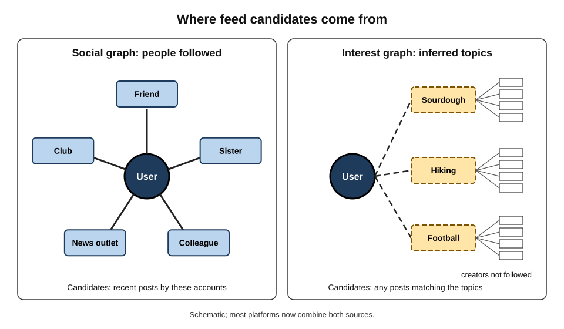
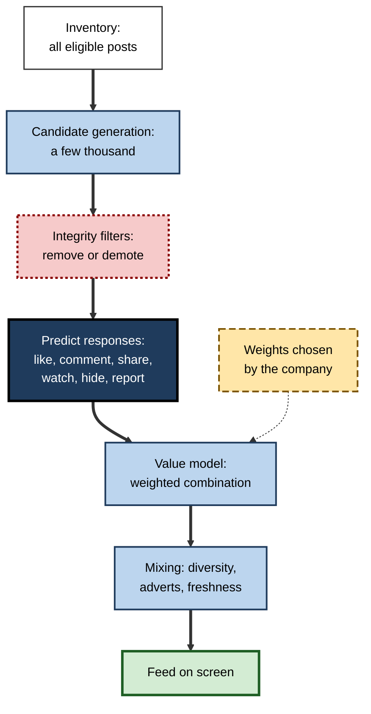
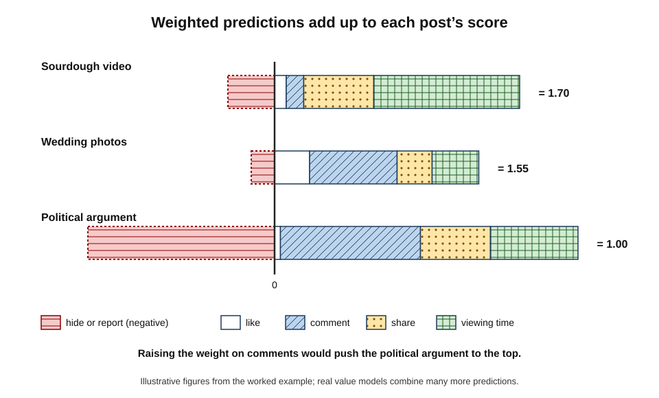
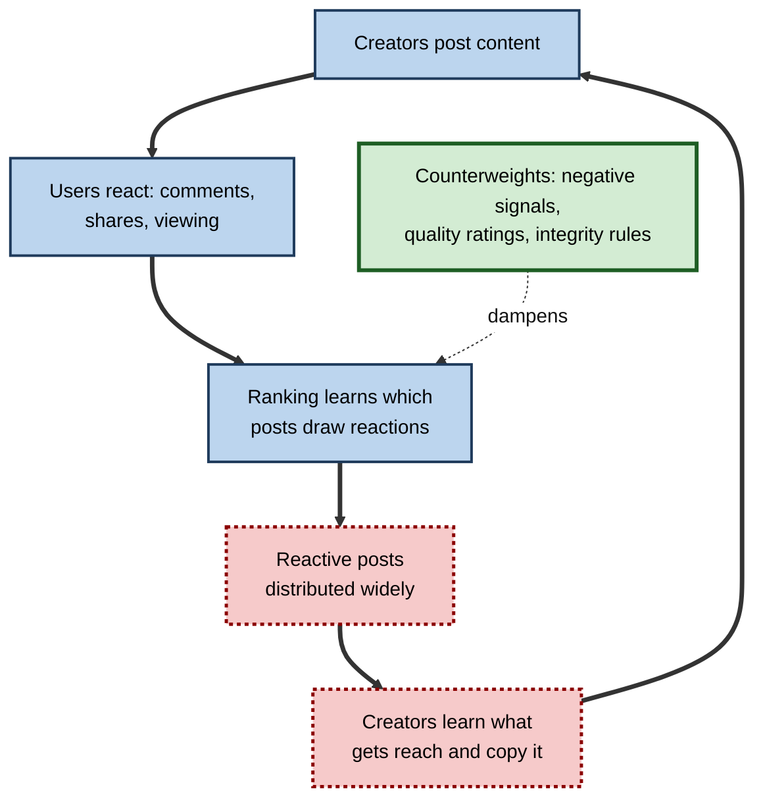
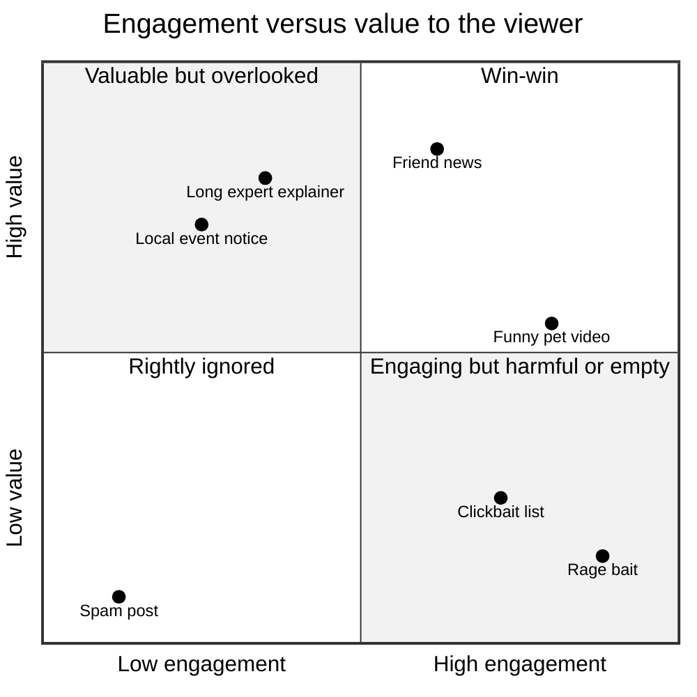
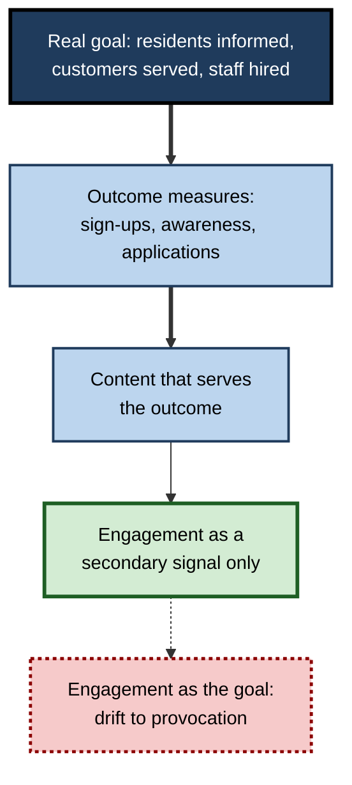

# E.9. Social media feed curation algorithms

A person opens a social app for "just a minute" on the bus. The first post is from a close friend's wedding, the second a video from a stranger about sourdough, the third a heated argument about politics with thousands of comments. None of these was the newest post available — hundreds of more recent ones were passed over. A **feed-ranking system** chose these three, in this order, from thousands of candidates, predicting what this person would stop for, react to and share.

> **Definition — Feed curation (feed ranking):** the automated selection and ordering of posts shown to each user of a social platform, based on predictions of how they will respond.

> **Definition — Engagement:** measurable user responses to content — viewing time, likes, comments, shares, follows, replies — used by platforms as signals of interest.

**Why it matters**

- **It shapes what billions of people see** about friends, news, politics, health and themselves.
- **It decides who gets heard.** Creators, small businesses, campaigners and news organisations live or die by distribution.
- **Its objectives have social effects.** What a feed rewards — outrage, novelty, connection, quality — spreads.
- **It is the most debated AI in public life**, linked in public argument to polarisation, misinformation and young people's wellbeing — with evidence that is mixed and often misunderstood.

---

## From Timelines to Ranked Feeds

### Why platforms stopped showing everything in order

- **The original timeline** — posts in reverse chronological order (newest first), from accounts the person chose to follow.
- **The overload problem** — as people followed more accounts, there were far more posts than anyone could read; important posts (a friend's news) were buried under frequent posters.
- **The shift**
  - Facebook's News Feed (launched 2006) moved to algorithmic ranking within a few years.
  - Twitter introduced algorithmic ordering of its timeline in 2016; Instagram did so the same year.
  - TikTok's "For You" feed, reaching global audiences from 2018, was ranked from the start and drew mainly from accounts the person did **not** follow.

| | Chronological feed | Ranked feed |
|---|---|---|
| Order | Newest first | Predicted interest first |
| Source of posts | Only accounts the person follows | Followed accounts plus recommended content |
| Strengths | Predictable, transparent, complete | Surfaces the most relevant posts from huge volumes |
| Weaknesses | Frequent posters dominate; important posts missed | Opaque; can amplify sensational content; less user control |
| Who controls what is seen | Mainly the user's choice of accounts | The platform's models and objectives |

> **Key point:** a ranked feed changes the question from "what did the people I follow post?" to "what will this person respond to?" — and the second question can be answered with content from **anyone**.

### Social graph and interest graph

> **Definition — Social graph:** the network of connections between users — friends, followers, follows — used to decide whose posts a person might see.

> **Definition — Interest graph:** a model of which topics and kinds of content a person engages with, regardless of who created them.

**Figure 1.** Two ways of choosing candidates for a feed: through people a user follows, or through interests inferred from behaviour.

| | Social-graph feed | Interest-graph feed |
|---|---|---|
| Main source of posts | Friends and followed accounts | Any creator whose content matches inferred interests |
| Typical example | Early Facebook, early Twitter | TikTok "For You"; increasingly most large platforms |
| How a new creator is discovered | Slowly, through follows and shares | Quickly, if early viewers respond well |
| Experience | Personal news from known people | Entertaining stream from strangers |
| Main risk | Echo chambers among friends | Rapid pull towards whatever holds attention |

- **Convergence** — during the early 2020s most large platforms moved towards interest-based recommendation, filling feeds with "suggested" posts from accounts the user did not follow.

---

## Inside a Feed-Ranking System

### The pipeline

1. **Inventory** — all posts the user could be shown: from followed accounts, groups, pages and the wider platform.
2. **Candidate generation** — a few thousand candidates selected by fast methods (recent posts from close connections, posts similar to past engagement, trending posts).
3. **Integrity filtering** — removal of content that breaks rules; **demotion** of borderline or low-quality content.
4. **Ranking** — models predict the user's likely responses to each candidate.
5. **Value model** — predictions are combined into a single score using weights chosen by the company.
6. **Final mixing** — diversity rules (not five posts from one account), adverts inserted, freshness ensured.

**Figure 2.** The feed-ranking pipeline from all available posts to the screen.

### Predicting many responses

- Modern feed rankers predict **many outcomes** for each user–post pair, for example:
  - probability of a like, a comment, a share or a reshare;
  - expected viewing time or the chance of watching a video to the end;
  - probability of following the creator;
  - probability of **negative** responses — hiding the post, "not interested", unfollowing, reporting.
- **Inputs** — the user's history, the post's content (text, image, video, audio), the creator, the relationship between user and creator, early responses from other users, and context (time, device).
- **Early responses matter** — a new post is shown to a small audience first; if their engagement is strong, it is shown more widely.

| | Positive signals | Negative signals |
|---|---|---|
| Explicit | Like, follow, save, positive survey answer | Hide, "not interested", unfollow, block, report |
| Implicit | Long viewing, rewatching, opening comments, sharing | Scrolling past quickly, closing the app soon after |
| Strength | Abundant, immediate | Rarer but very informative |
| Problem | Anger and fascination also produce engagement | Users rarely take explicit negative actions |

### The value model

> **Definition — Value model:** the formula that combines a ranker's predictions of different responses into one score, using weights that express how much the platform values each response.

> **Formula — Feed score (simplified):** score = w₁ × P(like) + w₂ × P(comment) + w₃ × P(share) + w₄ × expected viewing seconds − w₅ × P(hide or report).

**Worked example (illustrative): ranking three posts for one user**

Weights: like 1, comment 15, share 30, each second of viewing 0.05, hide or report −200.

| Post | P(like) | P(comment) | P(share) | Viewing (s) | P(hide or report) | Score |
|---|---|---|---|---|---|---|
| Friend's wedding photos | 0.30 | 0.05 | 0.01 | 8 | 0.001 | 0.30 + 0.75 + 0.30 + 0.40 − 0.20 = **1.55** |
| Sourdough video | 0.10 | 0.01 | 0.02 | 25 | 0.002 | 0.10 + 0.15 + 0.60 + 1.25 − 0.40 = **1.70** |
| Heated political argument | 0.05 | 0.08 | 0.02 | 15 | 0.008 | 0.05 + 1.20 + 0.60 + 0.75 − 1.60 = **1.00** |

*Illustrative figures.*

1. **Ranked order:** sourdough video, wedding photos, political argument.
2. **Change one weight** — if the weight on comments rises from 15 to 40, the political post scores 0.05 + 3.20 + 0.60 + 0.75 − 1.60 = **3.00** and jumps to first place, because arguments generate comments.
3. **Lesson:** the **weights**, not only the predictions, decide what rises — and weights are a business and ethical choice.

**Figure 3.** How a value model's weights turn predicted responses into a ranking score.

> **Watch out:** "the algorithm wants outrage" personifies a system that has no wants. More precisely: if comments and shares are weighted heavily, and outrage reliably produces comments and shares, the system **will learn to distribute outrage** unless negative signals or integrity rules counteract it.

### How short-video feeds learn so quickly

Full-screen short-video feeds learn a new user's tastes within minutes, which is part of their appeal and of the concern about them.

- **Every swipe is a label** — each video is either watched, rewatched, finished, liked, shared or skipped within a second; a single session yields dozens of clear signals.
- **No need to follow anyone** — candidates come from the interest graph, so the feed can start working before the user has any connections.
- **Systematic exploration** — new users and returning users are shown a spread of topics; whichever holds attention is explored further.
- **Staged distribution for creators** — a new video is shown to a small test audience; strong completion and engagement earn larger audiences in successive waves, so an unknown creator can reach millions.
- **Manual intervention** — reporting in 2023 indicated that staff at one major platform could manually boost selected videos into recommendations ("heating"); the company said this was used to diversify content and help creators. Such practices show that "the algorithm" can include human editorial choices.

> **Watch out:** "the For You feed reads your mind" exaggerates. The feed learns from **behaviour** — chiefly how long a person watches — which can reflect curiosity, boredom or discomfort as much as genuine preference. Lingering on a distressing video teaches the system to show more like it.

### News, politics and the feed

- **Platforms have dialled news up and down** — in the late 2010s and early 2020s Meta reduced the prominence of news and political content in its feeds after research and user surveys suggested many people wanted less of it.
- **News publishers depend on distribution they do not control** — when a platform changes ranking weights, traffic to news sites can rise or collapse within weeks.
- **Law and news** — after Canada passed a law in 2023 requiring large platforms to pay news organisations, Meta blocked news links for Canadian users of Facebook and Instagram rather than pay, demonstrating how a platform's distribution choices interact with public policy.

### Alternatives to pure engagement ranking

- **Survey-based signals** — asking samples of users whether a post was "worth your time" and training models to predict the answer.
- **Bridging-based ranking** — favouring content that is rated positively by people who usually disagree.
  - The Community Notes system on X, which adds crowd-sourced context to posts, shows a note only when raters with differing past rating patterns both judge it helpful — a working example of bridging at scale.
- **Chronological or user-chosen feeds** — giving users the choice of order, or third-party ranking tools.

| | Engagement-based ranking | Bridging-based ranking |
|---|---|---|
| Rewards | Content that many people react to strongly | Content appreciated across groups that usually disagree |
| Typical winners | Emotional, novel, divisive posts | Informative, fair-minded, broadly useful posts |
| Data needed | Abundant engagement signals | Ratings from diverse users, and a model of their differences |
| Main weakness | Amplifies outrage and sensationalism | Fewer signals; may under-reward legitimate minority views |
| Current use | The dominant approach on large platforms | Crowd-sourced fact-check notes; research proposals for feeds |

> **Definition — Bridging-based ranking:** ranking that rewards content receiving positive responses from people across groups that usually disagree, rather than content with the most total engagement.

---

## What Engagement Rewards

### Emotion spreads

**Study card — Moral-emotional language and diffusion (New York University, published in PNAS, 2017)**

- **Question:** does the emotional language of a message affect how widely it spreads on social media?
- **Design:** analysed hundreds of thousands of messages on Twitter about contested political issues (gun control, same-sex marriage, climate change), counting words that were both moral and emotional (such as "hate", "shame", "evil").
- **Results:** each additional moral-emotional word was associated with a substantial increase in sharing — on the order of a fifth — mostly within like-minded networks rather than across political divides.
- **Conclusion:** content that expresses moral outrage tends to travel further, so systems that reward sharing will tend to amplify it.

**Study card — Out-group animosity drives engagement (University of Cambridge and New York University, published in PNAS, 2021)**

- **Design:** analysed millions of posts from news media and politicians on Facebook and Twitter, measuring language about the political **out-group** (the other side) and the **in-group**.
- **Results:** posts about the opposing group were shared far more than posts about one's own side; out-group language was among the strongest predictors of engagement measured.
- **Conclusion:** criticism and mockery of opponents are especially engaging, giving creators an incentive to produce them.

> **Watch out:** these studies show **associations** between language and sharing, much of it driven by **users' own choices**. They do not on their own show how much any particular ranking algorithm amplifies such content — that requires experiments that change the algorithm.

**Figure 4.** The engagement feedback loop between creators, users and ranking.

### Case study: "Meaningful social interactions" at Facebook (2018–2021)

- **Situation:** in January 2018 Facebook announced that its News Feed would prioritise "meaningful social interactions" — posts that spark conversations between friends and family — over passive consumption of videos and news from publishers.
- **Mechanism:** the ranking gave large weights to comments, reshares and reactions, which were taken as signs of meaningful interaction.
- **Unintended effects:** internal documents later disclosed by a former employee and reported in 2021 indicated that the company's own researchers had found the change rewarded divisive and sensational content, because such content attracted many comments and reshares; political parties and publishers in several countries reportedly said they had shifted towards more negative content to keep their reach. Reports also said that emoji reactions, including "angry", had for a period been weighted more heavily than likes.
- **Responses:** the company later reduced the weight of some signals (including the "angry" reaction and certain reshares) for civic and health content, and argued that the internal research was being presented selectively.
- **Lesson:** a goal that sounds wholesome ("conversation") becomes a **measurable proxy** (comments, reshares), and optimising the proxy can reward exactly what the goal was meant to avoid.

> **Remember:** **Goodhart's law** — "when a measure becomes a target, it ceases to be a good measure." Feeds optimise measures of engagement; engagement is not the same as value.

---

## What the Evidence Says About Feeds and Society

### Experiments with real platforms

**Study card — The 2020 US election studies (academic researchers in partnership with Meta, published in *Science* and *Nature*, 2023)**

- **Design:** with consent, tens of thousands of US Facebook and Instagram users were randomly assigned for about three months around the 2020 election to altered feeds:
  - a **chronological** feed instead of the ranked feed;
  - feeds with **reshared posts removed**;
  - feeds with **less content from like-minded sources**.
- **Results:**
  - the chronological feed **reduced time spent** on the platforms and increased the share of political content and content from untrustworthy sources users saw;
  - removing reshares reduced exposure to political news and lowered users' **knowledge** of news;
  - none of the interventions produced detectable changes in **political polarisation** or attitudes over the study period.
- **Conclusion:** the ranked feed strongly shapes **what** people see and how long they stay, but changing it for three months did not measurably change their political attitudes.
- **Limitations:** a short period during a highly polarised election; changes applied to individuals, not whole networks; conducted with the platform's cooperation, a point of debate.

**Study card — Algorithmic amplification of politics on Twitter (Twitter researchers, published in PNAS, 2022)**

- **Design:** compared a randomly selected group of users who had been kept on the chronological timeline since 2016 with users on the ranked timeline.
- **Results:** in six of the seven countries studied, the ranked timeline amplified tweets from the **mainstream political right** more than the mainstream left; news sources rated as right-leaning were also amplified more in the United States.
- **Conclusion:** ranking can amplify some political content more than others without anyone designing it to; the reasons were not established.

> **Key point:** strong evidence shows that ranking shapes **exposure**; evidence that it causes large changes in **beliefs or polarisation** is weaker and mixed. Both "algorithms are destroying democracy" and "algorithms are harmless" outrun the evidence.

### Young people and wellbeing

- **The debate** — some researchers argue that social media, particularly image- and feed-based platforms, have contributed to rising anxiety and depression among adolescents since the early 2010s; others find the average associations in large datasets to be small and argue that causation is not established.
- **What is clearer**
  - Effects likely **vary** greatly by person, platform, type of use and age.
  - Particular features — endless scrolling, autoplay, appearance-focused content, night-time notifications — receive the most concern.
- **Policy** — laws such as the UK Online Safety Act (2023) and the EU Digital Services Act impose duties on platforms regarding risks to children, including from recommender systems.

> **Watch out:** the wellbeing debate is **contested among experts**. Single statistics ("teen depression doubled because of social media") compress a complex and disputed body of evidence into a claim it does not support.

---

## Integrity, Control and Regulation

### Integrity systems

- **Removal** — content that breaks rules (violence, harassment, illegal content), detected by classifiers and human moderators.
- **Demotion** — reducing distribution of borderline content, clickbait, engagement bait ("Like if you agree!"), misinformation labelled by fact-checkers, and repeat offenders.
- **Quality signals** — user surveys ("Is this post worth your time?"), original reporting, and signals of authenticity.

> **Definition — Demotion:** reducing how widely a post is distributed without removing it.

### Transparency

- **Explanations** — "Why am I seeing this post?" features show some reasons (following the account, similar posts engaged with).
- **Open-sourcing** — in 2023 Twitter (later X) published much of its recommendation code, showing a pipeline that mixed posts from followed and non-followed accounts and a large neural ranker predicting many forms of engagement.
- **Regulation** — the EU Digital Services Act requires very large platforms to explain the main parameters of their recommender systems, to offer at least one feed option **not based on profiling**, to assess systemic risks and to give vetted researchers access to data.

### User controls

- **Choose the feed** — "Following" or chronological tabs, where offered.
- **Train it** — "Not interested", "Show fewer", hide, mute, unfollow; long viewing teaches the system as much as likes.
- **Limit it** — turn off autoplay and notifications; set time limits; use "quiet mode" at night.
- **Reset it** — some platforms offer a refresh of recommendations.

**Figure 5.** Where content falls when judged by engagement and by value to the viewer.

---

## Professional Perspectives

### For organisations communicating on social media

- **Reach is rented** — distribution depends on ranking changes the organisation cannot control; owned channels (e-mail lists, websites) provide stability.
- **What tends to distribute well** — native content (video uploaded directly rather than links), early engagement, posts that prompt genuine replies, consistency.
- **What is demoted** — engagement bait, misleading headlines, reposted content without originality, links to low-quality sites.
- **Measurement** — judge social channels by business outcomes (enquiries, applications, sign-ups), not by likes.

### Case study (illustrative): the council that chased engagement

- **Situation:** a city council's communications team was set a target of doubling engagement on its social media accounts within a year.
- **What happened:** the team found that posts criticising other bodies, polls on divisive local issues and dramatic photographs of incidents earned far more comments and shares than service information.
- **Problem:** after six months engagement had doubled, but complaints rose; residents said the account had become "a wind-up"; important notices (bin collection changes, flood warnings) received little reach because the feed now associated the account with argument and entertainment.
- **Diagnosis:**
  1. The target measured **engagement**, not whether residents received the information they needed.
  2. Comment-heavy arguments trained followers — and the ranking systems — to expect contentious posts.
- **Actions:**
  1. Replaced the engagement target with measures of **service outcomes**: correct bin-day awareness in surveys, flood-alert sign-ups, fewer avoidable calls.
  2. Built an e-mail and text-alert list for critical notices.
  3. Kept a consistent, plain, useful tone; responded to genuine questions.
- **Result:** engagement fell back somewhat; alert sign-ups and survey awareness rose.
- **Lesson:** organisations reproduce the platforms' problem when they adopt engagement as their goal. **Choose the outcome first, then the metric.**

**Figure 6.** Choosing a goal before choosing a metric for social media work.

---

## Open Questions

- **What should feeds optimise?**
  - Proposals include "bridging" ranking that rewards content appreciated across divides, surveys of reflective preference, and long-term wellbeing — each hard to measure.
- **How large are the social effects of ranking?**
  - Short experiments found small attitude effects; long-term, network-wide effects are hard to study.
- **Who gets to study platforms?**
  - Independent access to data is improving under the Digital Services Act but remains limited elsewhere.
- **Should users choose their algorithm?**
  - "Middleware" — third-party ranking that users could select — has been proposed; business models and privacy are obstacles.
- **How will generative content change feeds?**
  - Feeds may fill with machine-made posts optimised for engagement, testing integrity systems.

---

## Summary

- **Feed curation** selects and orders posts for each user by predicting **engagement**; platforms moved from **chronological** to **ranked** feeds as volumes grew, and from **social-graph** to **interest-graph** sources.
- A feed pipeline runs **inventory → candidates → integrity filters → prediction of many responses → value model → mixing**.
- The **value model** weights predicted likes, comments, shares, viewing and negative signals; **the weights**, chosen by the company, decide what rises.
- Short-video feeds learn fast from **viewing behaviour** and distribute creators' posts in **staged waves**; alternatives to engagement include survey signals and **bridging-based ranking**.
- Moral-emotional and **out-group** language are associated with more sharing; heavy weights on comments and reshares can amplify divisive content, as Facebook's **2018 "meaningful social interactions"** change illustrated — an example of **Goodhart's law**.
- The **2020 election experiments** showed that ranking shapes **exposure and time spent** but found no detectable short-term change in **polarisation**; a 2022 study found ranked timelines amplified the mainstream right in most countries studied.
- The youth **wellbeing** debate is **contested**; effects likely vary by person and use.
- Platforms use **removal, demotion** and quality signals; the **DSA** requires transparency, risk assessment and a **non-profiled** option; users can choose, train, limit and reset feeds.
- Organisations should set **outcome goals** and treat engagement as secondary.

---

## Self-Check

1. Contrast chronological and ranked feeds, with one advantage of each.
2. Distinguish a social graph from an interest graph and name a platform built mainly on each.
3. List the stages of a feed-ranking pipeline.
4. Name three positive and three negative signals a ranker might predict.
5. Using the worked example's weights, score a post with P(like) 0.2, P(comment) 0.02, P(share) 0.01, 10 seconds viewing and P(hide) 0.002.
6. Why does increasing the weight on comments tend to promote divisive posts?
7. Summarise the 2017 and 2021 PNAS studies on language and sharing, and their limitation.
8. Describe the "meaningful social interactions" case and explain how it illustrates Goodhart's law.
9. What did the 2020 US election experiments find about chronological feeds and polarisation?
10. What did the 2022 Twitter amplification study find?
11. Why is the evidence on social media and adolescent wellbeing described as contested?
12. What does the Digital Services Act require of very large platforms' recommender systems?
13. List four actions a user can take to change their feed.
14. A charity's board wants to "go viral". Advise on goals and measures.
15. Explain how bridging-based ranking differs from engagement-based ranking, and give one weakness of each.

### Answer Key

1. Chronological: newest first from followed accounts — transparent and complete. Ranked: ordered by predicted interest, possibly from anyone — surfaces relevant posts amid overload.
2. Social graph: connections between users decide sources (early Facebook). Interest graph: inferred topics decide, from any creator (TikTok For You).
3. Inventory, candidate generation, integrity filtering, prediction of responses, value model, final mixing.
4. Positive: like, share, long viewing. Negative: hide, "not interested", report (also unfollow, quick scroll-past).
5. 0.20 + 0.30 + 0.30 + 0.50 − 0.40 = 0.90.
6. Divisive posts generate many comments (arguments), so a higher comment weight raises their scores relative to calmer posts.
7. 2017: each moral-emotional word was associated with roughly a fifth more sharing on political topics, mainly within like-minded networks. 2021: posts about the political out-group were shared much more. Both are associations, largely reflecting user behaviour, not experiments on algorithms.
8. Facebook prioritised posts sparking interaction, weighting comments and reshares; internal research reportedly found this rewarded divisive content. The proxy (interactions) became the target and stopped measuring the goal (meaningful connection).
9. Chronological feeds reduced time spent and changed what users saw (more political and untrustworthy content), but none of the interventions detectably changed polarisation over three months.
10. In six of seven countries the ranked timeline amplified the mainstream political right more than the left; causes were not established.
11. Some researchers see a causal link to rising anxiety and depression; others find small average associations and question causality; effects vary by person, platform and use.
12. Explain the main parameters, offer at least one option not based on profiling, assess systemic risks and give vetted researchers data access.
13. Switch to a following or chronological tab; use "not interested", mute or unfollow; turn off autoplay and notifications; reset recommendations or set time limits.
14. Define outcomes (donations, volunteers, sign-ups, awareness among target groups); measure those; create useful, honest content; build owned channels; treat reach and engagement as secondary and avoid engagement bait.
15. Engagement ranking rewards content with the most reactions, which tends to amplify emotional and divisive posts. Bridging ranking rewards content rated positively by people who usually disagree, favouring broadly useful content, but it has fewer signals and may under-reward legitimate minority views.

---

## Glossary

| Term | Meaning |
|---|---|
| Bridging-based ranking | Ranking that rewards content appreciated across groups that usually disagree. |
| Chronological feed | Posts shown newest first from followed accounts. |
| Demotion | Reducing a post's distribution without removing it. |
| Engagement | Measurable responses to content, such as likes, comments, shares and viewing time. |
| Engagement bait | Posts that explicitly solicit reactions to gain reach. |
| Feed curation | Automated selection and ordering of posts for each user. |
| Goodhart's law | When a measure becomes a target, it ceases to be a good measure. |
| Integrity systems | Systems that remove or demote rule-breaking and low-quality content. |
| Interest graph | A model of the topics and content types a person engages with. |
| Inventory | All posts eligible to be shown to a user. |
| Middleware | Third-party ranking that users could choose to apply to a platform's content. |
| Non-profiled feed | A feed option not based on personal profiling, required under the DSA for large platforms. |
| Out-group | The social or political group a person sees as "the other side". |
| Ranked feed | Posts ordered by predicted interest. |
| Social graph | The network of connections between users. |
| Value model | The weighted formula combining predicted responses into a feed score. |
