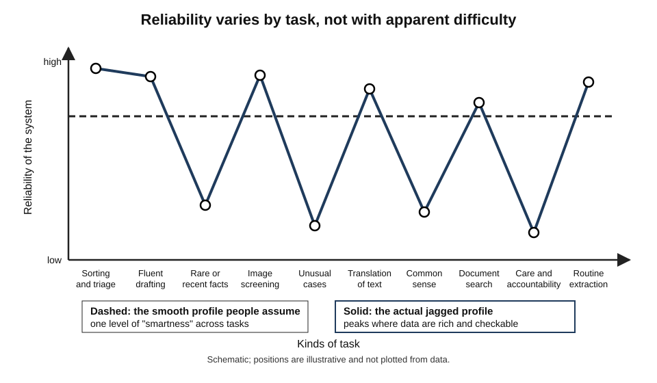
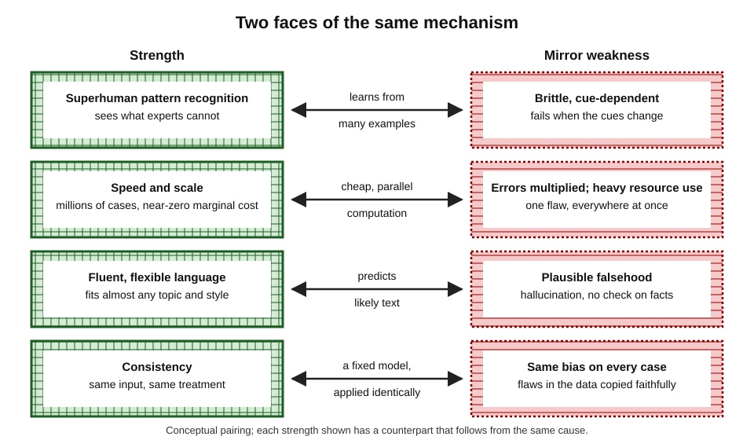
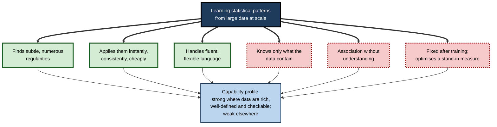
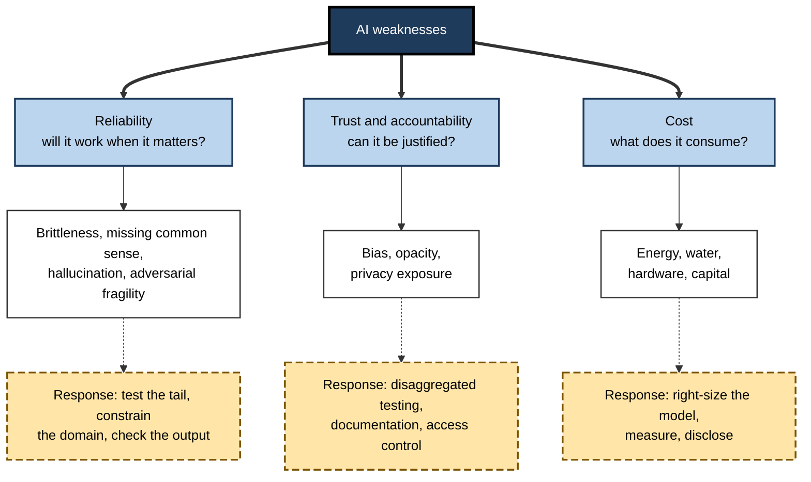
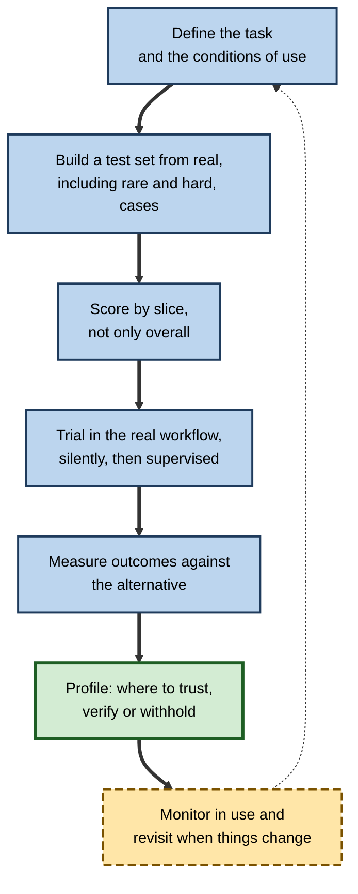
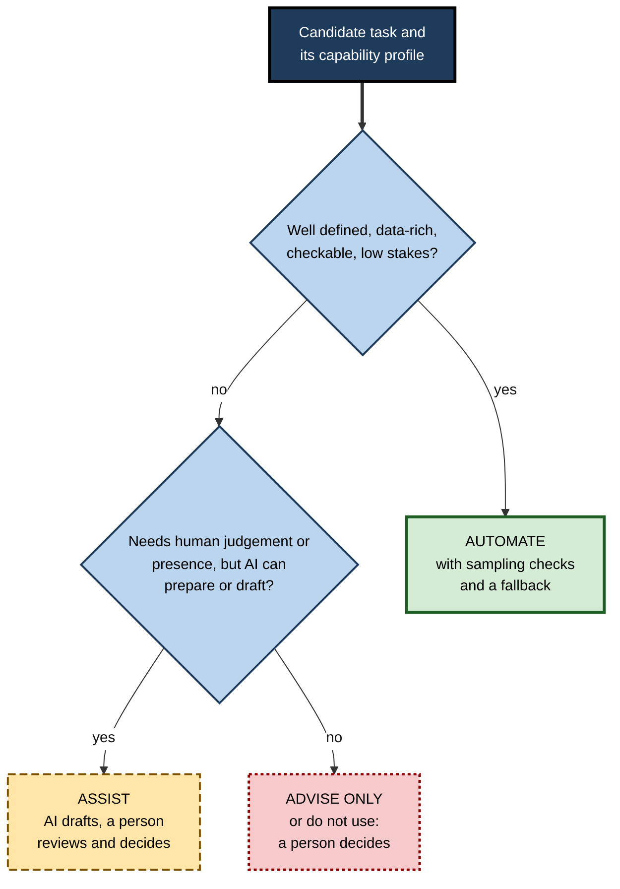

# F. AI Strengths and Weaknesses

A language model drafts a competent legal memo in under a minute, then states that a case which does not exist was decided in 1987. A vision system reads thousands of scans an hour without tiring, then fails on a scanner it has never met. A recommendation engine knows what millions of people will watch tonight, and cannot say why. None of this is contradictory. **Capability in AI is uneven by nature**: the same property that makes a system powerful in one place makes it fragile in another.

> **Definition — Capability profile:** the pattern of what an AI system does reliably, what it does unreliably and what it cannot do at all, described for specific tasks, data and conditions rather than for "intelligence" in general.

> **Definition — Jagged frontier:** the uneven boundary of AI capability, where a system may excel at a hard task and fail at a seemingly easy one, so that difficulty as people judge it is a poor guide to what the system can do.

**Why it matters**

- Almost every sensible decision about AI — whether to adopt it, where, with what oversight — is a decision about its **profile**, not about "AI" in the abstract.
- Both blanket enthusiasm and blanket suspicion rest on misreading the profile: the first ignores the weaknesses, the second ignores the strengths.
- A professional who can read a profile can place a system where it adds value, fence it where it does harm and explain the choice to colleagues, customers and regulators.

---

## Why There Is a Profile at All

### No single scale of intelligence

- **People are used to a general scale** — someone who plays chess well is assumed to be clever at other things; someone who cannot read is assumed to struggle with much else.
- **Machines break the assumption** — a program may play at a superhuman level and be unable to do anything else; another may converse fluently and miscount letters in a word.
- **Capabilities come from the specific combination of data, task and method**, not from a general faculty that raises everything at once.

### The paradox of difficulty

- **Hans Moravec and others observed in the 1980s** that reasoning which people find hard — logic, arithmetic, formal games — was easier to automate than skills people find effortless — perceiving a scene, handling an object, understanding a joke.
- **The reason is evolutionary and statistical**: perception and movement rest on enormous unconscious machinery built over millions of years and on vast unstated experience, while formal reasoning is a thin, recent layer with explicit rules.
- **Consequence for profiles** — difficulty as people judge it is unreliable; the useful question is whether the task is **well defined, well represented in data and checkable**.

### Narrow systems, general surfaces

- **Current systems are narrow in training but wide in appearance** — a language model can address almost any topic in fluent prose, which gives an impression of general competence.
- **Competence varies by topic, form and framing** in ways that are hard to predict from the surface.
- **The result is a jagged profile**, not a smooth one.

**Figure 1.** A jagged capability profile compared with the smooth profile people tend to assume.

> **Key point:** the right mental model is not "how smart is this AI?" but "**for which tasks, on which data, under which conditions, is it reliable — and how do I know?**"

---

## Strengths and Weaknesses Share a Root

### One mechanism, two faces

- **Most current AI learns statistical patterns from large amounts of data** and applies them to new inputs.
- **That mechanism explains the strengths**: it finds regularities too subtle, too numerous or too fast for people.
- **The same mechanism explains the weaknesses**: it knows only what the data contain, takes frequency for truth, has no model of why and cannot step outside its training.

> **Key point:** strengths and weaknesses are **not independent lists**. Each strength has a mirror-image weakness that follows from the same cause.

| Strength | Why it arises | The mirror weakness |
|---|---|---|
| Superhuman pattern recognition | Learning from millions of examples | Relies on cues people cannot see; fails when the cues change |
| Speed and scale | Cheap, parallel computation | Errors repeated instantly and at volume; large energy and hardware bills |
| Fluent, flexible language | Predicting likely text across a vast corpus | Plausible output that is not true; no internal check on facts |
| Consistency | A fixed model applied identically | The same flaw applied to every case, including a bias in the data |
| Breadth of recall | Absorbing enormous text collections | Memorisation of private material; unreliable on rare or recent facts |
| Few hand-written rules needed | Learning rules from data | Opaque reasoning that cannot easily be inspected or corrected |

**Figure 2.** Each strength has a mirror-image weakness from the same cause.

### The root causes

- **Dependence on data** — what is absent from the data is invisible to the model, and what is skewed in the data is skewed in the model.
- **Association without understanding** — the model captures what goes with what, not why.
- **Fixed after training** — a model does not learn from experience during use unless it is deliberately retrained.
- **Optimisation for a measure** — the system does what its objective rewards, which may differ from what its users want.
- **Scale of use** — a flaw that is rare per case becomes frequent across millions.

**Figure 3.** From statistical learning to a capability profile.

---

## What AI Does Better Than People

### Speed, scale and consistency

- **Machines do well-defined work faster, in greater volume and more uniformly than people**, at a very small cost for each extra case — screening every payment, sorting every message, searching enormous spaces of candidates.
- **The advantage is conditional**: it holds for tasks that are well defined, repeated and similar to what the system was built on, and it does not make the system intelligent — a fast wrong answer is still wrong.
- **Scale cuts both ways**: a tiny error rate across millions of cases is a large number of errors, often concentrated on one group; and speeding up one step rarely speeds up a whole process.

### Recognising patterns beyond human ability

- **On defined perception tasks — images, sound, signals — systems have matched or exceeded specialist humans**, and have found patterns that experts did not know were there.
- **"Superhuman" is always qualified**: on which task, compared with whom, under what conditions, on which data; and retrospective accuracy is far from demonstrated benefit.
- **Value appears when the system is embedded in a workflow designed around it** and tested in the setting where it will be used — as in randomised trials of screening that found more cancers with less reading effort.

---

## What People Still Do Better

### Creativity and care

- **Generative systems are prolific and, on narrow tests, as inventive as average people**, yet transformation of a field's rules, judgement of what is valuable and fit to context remain mainly human.
- **Machines can write the language of empathy convincingly**, but they feel nothing, bear no cost and cannot be held to account; people often value a message less on learning that a machine wrote it.
- **The practical division follows from this**: let AI widen the options and prepare the ground, and let people select, decide and be present where it matters.

### Context, common sense and responsibility

- **People bring a vast, unspoken understanding of how the world and other people work**, which systems lack because most of it was never written down; this is why simple instructions are followed absurdly and why plausibility checks must be supplied from outside.
- **Responsibility cannot be delegated to a model**: a signature, a diagnosis or a dismissal needs a person who can explain and answer for it.

---

## The Weaknesses, Grouped by What They Threaten

### Reliability: will it work when it matters?

- **Brittleness** — good performance on typical cases and abrupt, confident failure on unusual ones, because rare situations are collectively common but individually absent from the data.
- **Lack of common sense** — answers that no sensible person would give, from unstated knowledge about physics, people and plausibility.
- **Hallucination** — fluent, confident statements with no reliable link to truth, a consequence of building systems to produce likely text and of rewarding guessing over honest uncertainty.
- **Fragility under attack** — inputs crafted to make a system fail, which can be invisible to people and can transfer between models.

### Trust and accountability: can it be justified?

- **Bias** — a model reflects the unrepresentative samples, historical inequalities and flawed measures in its data, and an average score can hide poor performance for some groups.
- **Opacity** — the reasons for a decision are often unavailable, and explanations produced afterwards may be plausible without being faithful.
- **Privacy exposure** — systems collect, infer, memorise and leak personal information, and a trained model offers no easy way to forget.

### Cost: what does it consume?

- **Energy, water, hardware and capital** — large models require large amounts of computation, and efficiency gains are often outpaced by growing use.

**Figure 4.** The weaknesses grouped by what they threaten, with the response each calls for.

### How the weaknesses interact

- **Hallucination is worse where data are thin**, and thin data are where bias and brittleness live.
- **Opacity makes every other weakness harder to find**: if reasons cannot be inspected, a shortcut or a bias is detected only by testing.
- **Scale turns each into a systemic risk**: the same flaw at the same moment in every use.
- **Attackers exploit them**: brittleness and opacity are the soil in which adversarial manipulation grows.

| Weakness | Typically worsened by | Typically eased by |
|---|---|---|
| Brittleness | Narrow data, novel situations | Defined operating domain, abstention, slice testing |
| Hallucination | Rare facts, false premises, pressure to answer | Grounding in sources, permission to say "unknown", checking |
| Bias | Unrepresentative data, proxy targets | Representative data, group-level testing, human review |
| Opacity | Model complexity, secrecy | Readable models where adequate, logging, tested explanations |
| Adversarial fragility | Untrusted inputs, broad powers | Least privilege, input checks, human approval |
| Privacy exposure | Over-collection, over-fitting, broad retrieval | Minimisation, permission-aware access, leakage tests |
| Resource cost | Oversized models, wasteful use | Right-sizing, caching, shorter outputs |

---

## Measuring a Capability Profile

### Why scores mislead

- **A benchmark measures one narrow thing** under controlled conditions, yet is often reported as if it measured general ability.
- **Models can learn the benchmark** — through exposure to its items, tuning to its format or shortcuts in its design — so scores rise faster than real competence.
- **Averages hide structure**: the profile lives in the slices (rare cases, subgroups, unusual inputs) that averages smooth over.
- **Human comparisons are often unfair**: experts are denied the context and tools they would normally have.

**Study card — Raji and colleagues (2021), "AI and the everything in the whole wide world benchmark" (researchers from Mozilla, the University of Washington, Google and elsewhere; NeurIPS datasets and benchmarks track)**

- **Question:** do the major benchmarks used to track "general" progress in AI measure what they are said to?
- **Argument:**
  - widely used benchmarks in vision and language were built for particular tasks yet are treated as indicators of **general** capability;
  - a benchmark's construction — who selected the data, how labels were assigned, what was left out — limits what a high score can mean;
  - claims of generality require evidence beyond a single, narrow test.
- **Conclusion:** a score is evidence about performance on that test; reading it as evidence about a whole field is an inference that has to be earned.

### Profiling in practice

- **Define the task** precisely, as it will actually occur, including inputs and conditions.
- **Build a test set from real cases**, deliberately including rare, hard and borderline ones.
- **Report by slice** — group, source, difficulty, input type — not only overall.
- **Test the whole system**, including checks and people around the model, not just the model.
- **Measure what happens next** — time saved, errors caught, harm avoided — and compare with the alternative.
- **Repeat after deployment**, because inputs and models change.

> **Watch out:** a profile drawn in the laboratory describes the system **then and there**. It drifts as data, users and models change, so measurement has to continue.

**Figure 5.** A cycle for building and maintaining a capability profile.

---

## Matching Tasks to the Profile

### The questions that decide fit

- **Is the task well defined and repeated?** — volume and clarity favour machines.
- **Is the data rich and representative of where the system will be used?** — thin or shifted data predict failure.
- **Can an error be detected and corrected cheaply?** — checkability favours reliance.
- **How bad is an undetected error?** — high stakes demand more verification or a person.
- **Does the task need context, empathy, accountability or judgement of value?** — these point to people.
- **Is there an opponent?** — adversaries turn weaknesses into attack surfaces.
- **Are the resource and privacy costs acceptable?** — a task may be possible without being worthwhile.

### Worked example (illustrative): scoring three tasks against the profile

- **Situation:** a regional insurer considers three uses of AI. Each criterion is scored 1 (poor fit) to 5 (strong fit); *illustrative figures*.

| Criterion | A: sort incoming claims by type | B: draft replies to complaints | C: decide whether a claim is fraudulent |
|---|---|---|---|
| Well defined and repeated | 5 | 4 | 3 |
| Data rich and representative | 5 | 4 | 3 |
| Errors cheap to detect and fix | 4 | 4 | 2 |
| Cost of an undetected error | 4 | 3 | 1 |
| Little need for empathy or judgement | 5 | 2 | 2 |
| Low adversarial exposure | 4 | 4 | 1 |
| **Total (out of 30)** | **27** | **21** | **12** |

1. **Task A (27)** is a strong candidate: automate with sampling checks.
2. **Task B (21)** suits an assistive model: the AI drafts, a person reads and sends, because empathy and accountability matter.
3. **Task C (12)** is a poor candidate for automatic decisions: a scoring model may **prioritise** claims for investigation, but a person must decide, because errors are costly, fraudsters adapt and the stakes for honest customers are high.

- **Conclusion:** one organisation, one technology, three different postures — **automate**, **assist**, **advise only** — each following from the profile.

> **Watch out:** a total score can hide a single disqualifying criterion. If the cost of an undetected error is catastrophic and cannot be reduced, a high total elsewhere does not rescue the task.

---

## Designing Human–AI Systems Around the Profile

### Division of labour

- **Machine for breadth, person for depth** — the system screens everything; people examine what matters.
- **Route by confidence and stakes** — confident, low-stakes cases may be automated; uncertain or consequential ones go to people.
- **Keep the person able to judge** — enough time, information and skill to disagree with the machine.
- **Make errors reversible** — appeal routes, undo functions, delays before irreversible steps.
- **Prepare for failure** — manual fallbacks that are practised, not merely documented.

### Oversight that is real

- **A reviewer who must approve hundreds of items an hour is not overseeing** — rubber-stamping follows.
- **Evidence shows that adding AI to professional judgement can help, do nothing or harm**, depending on design: showing confidence, choosing triage over concurrent display and training people on when the system is reliable all matter.
- **Accountability must remain with named people** — a model cannot answer for its decisions.

### Governance at organisational level

- **Classify uses by risk** and attach controls to each tier.
- **Document each system**: purpose, data, tested performance by group, known limits, owner.
- **Test before deployment and monitor after.**
- **Require explanations and records** where decisions affect people.
- **Control access and data flows**, so assistants reach only what users may see.
- **Plan for incidents**: who can switch a system off, and how quickly.

**Figure 6.** Posture follows from the profile: automate, assist or advise only.

---

## A Moving Frontier

### Weaknesses do not stay put

- **Some once-celebrated weaknesses have largely closed** — machine translation, speech transcription and image recognition moved from clearly inferior to competitive within a few years of new methods and more data.
- **Others have narrowed but persist** — fluency improved far faster than factual reliability; common-sense benchmarks were saturated while odd failures remained.
- **Some may be structural** — dependence on data, lack of grounding in the physical world and the difficulty of verifying output are tied to how the systems are built.
- **New capabilities bring new weaknesses** — systems that act, browse and write code raise attack and error surfaces that passive classifiers never had.

### How to think about progress

- **Treat claims of "solved" with a test of fresh, varied and adversarial cases.**
- **Expect profiles to change faster than policies** — review risk classifications regularly.
- **Do not extrapolate from one dimension** — gains in fluency do not imply gains in reliability, fairness or efficiency.
- **Separate the demonstration from the deployment** — a result in a controlled study is not yet a benefit at scale.

> **Remember:** a capability profile is a **dated measurement of a specific system**. Both the strengths and the weaknesses are moving targets.

---

### Case study (illustrative): reading the profile of a document assistant

- **Situation:** a mid-sized engineering consultancy bought a document assistant that could summarise reports, extract figures from tables and answer questions about its project archive.
- **Initial expectation:** the vendor demonstration was excellent; managers assumed the assistant would be "right about our documents" generally.
- **Profiling exercise:** a small team built a test set of 300 real questions, deliberately including old scanned reports, unusual table layouts, questions with no answer in the archive and questions involving confidential client files.
- **Findings:**
  1. **strengths** — summaries of well-formatted recent reports were accurate and fast; searching the archive saved hours;
  2. **brittleness** — accuracy on scanned pre-2005 reports and unusual tables was far lower;
  3. **hallucination** — on questions with no answer in the archive, the assistant often produced a plausible answer instead of saying so;
  4. **privacy exposure** — it surfaced material from folders whose permissions were too broad;
  5. **cost** — long documents sent in full with every question made usage far more expensive than the vendor's estimate.
- **Actions:**
  1. the assistant was approved for **summarising and searching** recent reports, with citations to the passage used;
  2. a "not found in the archive" response was required, and tested;
  3. figures extracted from tables were to be checked against the source before entering a client deliverable;
  4. permissions were audited before wider rollout;
  5. long documents were pre-processed to send only relevant extracts;
  6. a quarterly retest was scheduled.
- **Result:** the assistant saved substantial search time with few incidents; the "figures" rule caught several extraction errors in its first months.
- **Lesson:** the same product was **excellent, unreliable and risky** depending on the task; the profile, not the demonstration, determined the safe use.

---

## What Distinguishes Expert Judgement

- **Experts specify the task before judging the tool**, and ask "for what, on whose data, compared with what?"
- **They look for the mirror weakness behind each advertised strength**, and ask what it costs.
- **They measure by slice**, and ask who bears the errors.
- **They design for failure**: fallbacks, reversibility, named accountability.
- **They distinguish demonstration from deployment** and capability from benefit.
- **They hold two thoughts at once** — that these systems are remarkably useful, and that they are unreliable in ways that are hard to predict.
- **They keep learning**, because the profile changes with every model and every new use.

---

## Open Questions

- **Will scale and better training dissolve the weaknesses, or only move them?**
  - Some weaknesses have yielded to scale; others, such as reliable uncertainty and robustness to adversaries, have not.
- **Can we ever predict the jagged frontier in advance?**
  - Profiles are mostly discovered by testing; a theory predicting where a model will fail is lacking.
- **How should general-purpose systems be evaluated?**
  - A system used for thousands of tasks has no single test; agreed methods for profiling breadth are immature.
- **How will human skill hold up?**
  - If people rely on systems for routine work, the ability to catch their errors may weaken.
- **Who bears the cost of the weaknesses?**
  - Errors, bias, privacy loss and environmental costs fall unevenly; how responsibility and compensation should be allocated is unsettled.

---

## Summary

- A **capability profile** describes what a system does reliably, unreliably or not at all, for specific tasks, data and conditions; AI capability is **jagged**, not smooth.
- **Strengths and weaknesses share a root**: statistical learning from large data gives power at pattern-finding and speed, and also dependence on data, association without understanding and fixed behaviour.
- Machines excel at **speed, scale, consistency and pattern recognition** on well-defined tasks; "superhuman" claims need the questions: which task, whom compared, which conditions, which data, which measure.
- People retain advantages in **creative transformation, judgement of value, empathy, common sense and accountability**.
- Weaknesses fall into three families: **reliability** (brittleness, missing common sense, hallucination, adversarial fragility), **trust and accountability** (bias, opacity, privacy exposure) and **cost** (energy, water, hardware, capital); they interact and are amplified by scale.
- **Benchmarks** measure narrow things; profiling needs real cases, slice-level scores, trials in the workflow and continued monitoring.
- **Task fit** depends on definition, data, checkability, stakes, need for human qualities, adversaries and cost; posture follows: **automate, assist or advise only**.
- Good design divides labour by **confidence and stakes**, keeps people able to judge, makes errors reversible and keeps **accountability with named people**.
- The frontier **moves**: some weaknesses close, others persist, new ones appear; profiles are **dated measurements**.

---

## Self-Check

1. Define capability profile and jagged frontier, and explain why "how smart is this AI?" is a poor question.
2. State Moravec's observation and explain its consequence for judging what AI can do.
3. Explain why strengths and weaknesses share a root, with two mirror pairs.
4. Why is "superhuman" always a qualified claim? List the questions to ask.
5. Which human advantages remain most secure, and why?
6. Name the three families of weakness and give two examples in each.
7. Explain how weaknesses interact, with one example.
8. Why do benchmark scores mislead, and what does the Raji study argue?
9. Describe the steps in building a capability profile for a deployment.
10. In the insurer example, why does the fraud-decision task score so low, and what posture follows?
11. What is rubber-stamping, and how can oversight be designed to avoid it?
12. Give one weakness that has closed, one that has narrowed and one that may be structural.
13. A vendor demonstration shows a model answering questions about your documents perfectly. List the tests you would run before a decision.
14. A colleague says: "AI will never be creative or caring, so we need not worry about those jobs." Evaluate the claim using the profile.
15. Draft a posture (automate, assist or advise only) for each: sorting invoices, drafting condolence letters, shortlisting job applicants. Justify.

### Answer Key

1. A capability profile is the pattern of what a system does reliably, unreliably or not at all for given tasks, data and conditions. The frontier is jagged: a system may excel at hard tasks and fail at easy ones. "How smart is it?" assumes one smooth scale; the useful question is for which tasks and under which conditions it is reliable.
2. Tasks people find hard (formal reasoning) are often easier to automate than those people find effortless (perception, movement, common sense). Human difficulty is therefore a poor guide; ask whether the task is well defined, data-rich and checkable.
3. The mechanism that finds patterns in large data gives power but also dependence on data, no grasp of why and fixed behaviour. Pairs: pattern recognition versus reliance on cues that can change; speed and scale versus errors multiplied instantly; fluency versus plausible falsehood.
4. Because performance depends on the task, the comparison group, conditions, data and measure. Ask: what task, whom compared, under what conditions, on which data, measured how.
5. Transformational creativity, judgement of value and fit, genuine empathy and presence, common sense from lived experience, and accountability: they depend on stakes, embodiment and unstated knowledge machines lack.
6. Reliability: brittleness, hallucination. Trust and accountability: bias, opacity. Cost: energy, hardware. (Also missing common sense, adversarial fragility, privacy exposure.)
7. Thin data make hallucination more likely and also increase bias and brittleness; opacity makes every other weakness harder to detect.
8. Benchmarks measure narrow tasks yet are reported as general ability; models can learn them, and averages hide slices. Raji and colleagues argued that benchmark construction limits what a score means and generality claims need broader evidence.
9. Define the task and conditions; build a test set from real cases including rare and hard ones; score by slice; trial in the real workflow; measure outcomes against the alternative; monitor and revisit.
10. Fraud decisions have poor definition, data and checkability, high cost of undetected errors, adversaries and stakes for honest customers. The posture is advise only: scores may prioritise investigation but a person decides.
11. Approving machine output without real examination because of volume or time pressure. Avoid it with realistic volumes, time and authority for reviewers, routing of uncertain or high-stakes cases, sampling audits and training on when the system is reliable.
12. Closed: speech transcription or image recognition on standard tasks. Narrowed: fluency far ahead of factual reliability, with some gains. Possibly structural: dependence on data, difficulty of verification and lack of grounding.
13. Test on real, varied, old and badly formatted documents; include questions with no answer to see whether it declines; check citations; test permissions and confidentiality; check cost at realistic volumes; score by slice; trial silently before relying.
14. Too strong. Generative systems already match average people on narrow creativity tests and write convincing empathic language; what remains human is transformation, judgement of fit, genuine presence and accountability. Jobs combining these are safer but will change as AI takes over drafting and exploration.
15. Sorting invoices: automate with sampling checks (well defined, checkable). Condolence letters: a person writes; AI at most for background (human presence essential). Shortlisting applicants: advise only or human-led — stakes about people, hard to verify, bias risks.

---

## Glossary

| Term | Meaning |
|---|---|
| Brittleness | Good performance on familiar inputs with abrupt failure on unfamiliar ones. |
| Capability profile | The pattern of what a system does reliably, unreliably or not at all for specific tasks and conditions. |
| Hallucination | Fluent, confident output unsupported by facts or the supplied source. |
| Jagged frontier | The uneven boundary of AI capability, where hard tasks may succeed and easy ones fail. |
| Moravec's paradox | The observation that skills easy for people are often hard for machines and the reverse. |
| Opacity | Difficulty or impossibility of understanding how a system reaches its outputs. |
| Overseeing (real oversight) | Review in which the person has the time, information and authority to disagree. |
| Rubber-stamping | Approving machine output without genuine examination. |
| Slice | A subset of cases, such as a group or input type, scored separately. |
| Superhuman performance | Exceeding skilled experts on a defined task under defined conditions. |
| Task fit | The match between a task's requirements and a system's capability profile. |
