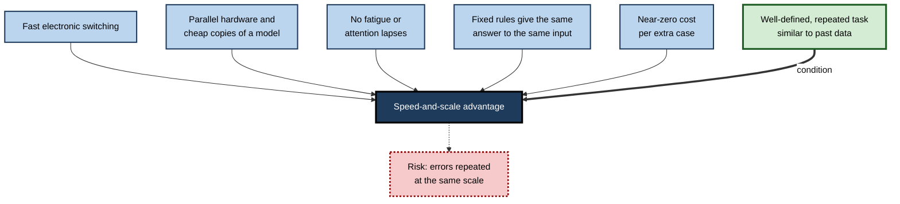
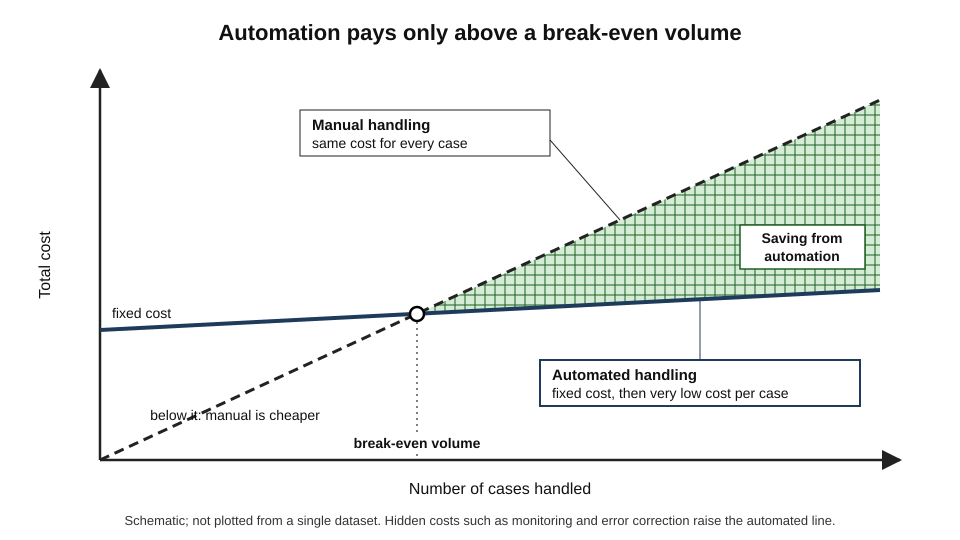
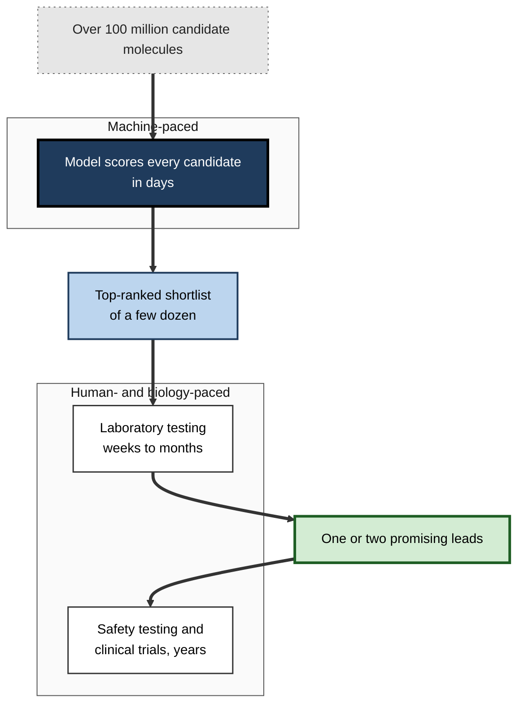
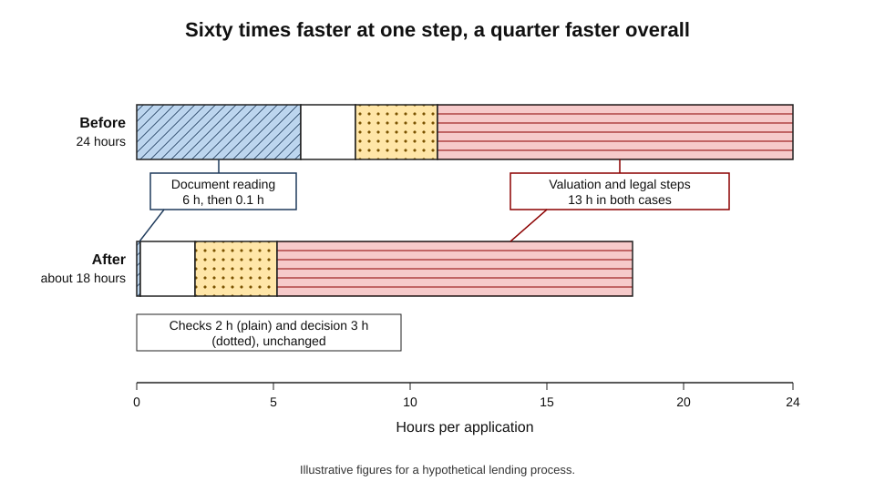
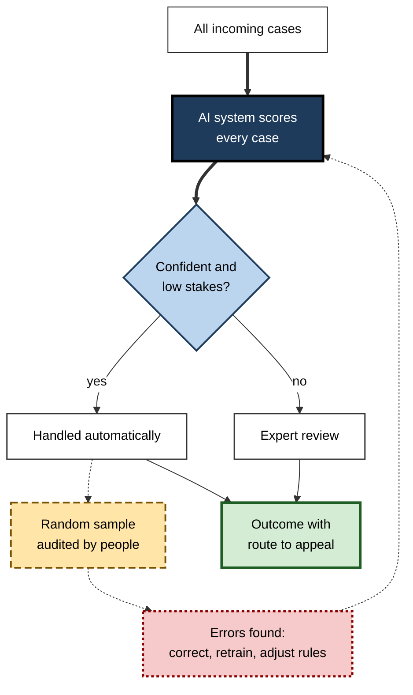
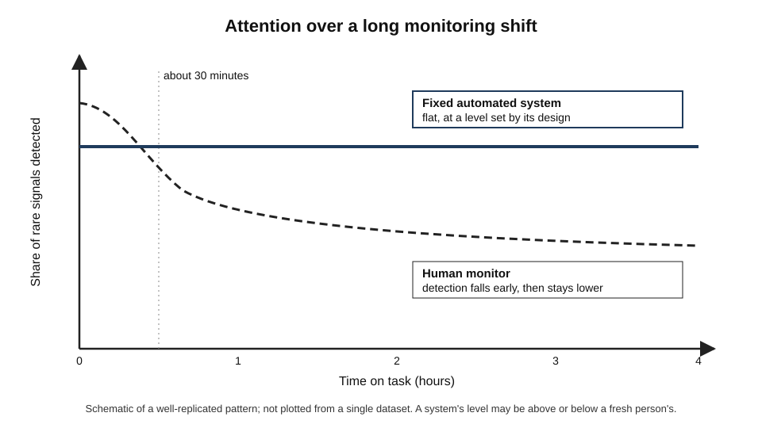

# F.1. Tasks AI does better than humans: speed and scale

A card payment is checked for fraud in the fraction of a second between tapping the card and the terminal beeping. An email service sorts billions of messages a day without anyone reading them. A model scores over a hundred million molecules for antibacterial promise within days. None of these systems is wiser than a person — but each does one well-defined job **faster, in greater volume and more consistently** than any human team could.

> **Definition — Speed-and-scale advantage:** the capacity of an AI system to perform a well-defined task far faster, in far larger volumes and more consistently than people, at a very low cost for each additional case.

**Why it matters**

- It explains where AI earns its keep in most organisations: not in rare flashes of brilliance but in **millions of routine decisions**.
- It determines how work should be divided between people and machines — machines for breadth, people for depth and exceptions.
- It is also the source of a distinctive risk: a small error rate multiplied by enormous volume becomes a **large number of errors**, delivered instantly.
- Misjudging it in either direction is costly — over-crediting speed as intelligence, or under-using a capability that could free people for harder work.

---

## The Machine Advantage in Plain Terms

### Seven dimensions of advantage

- **Speed (latency)** — how long one case takes.
  - *e.g.* a fraud model scores a transaction in milliseconds; a human analyst needs minutes.
- **Throughput** — how many cases are completed per unit of time.
  - *e.g.* an invoice-reading system processes tens of thousands of documents an hour.
- **Scale** — the total volume that can be handled at all.
  - *e.g.* screening every message sent on a platform, not a sample.
- **Consistency** — the same input receives the same treatment.
  - *e.g.* two identical loan applications get identical scores, whatever the time of day.
- **Endurance** — no fatigue, boredom or lapses in attention.
  - *e.g.* a monitoring system watches sensor streams at 3 a.m. as closely as at 10 a.m.
- **Breadth of recall** — access to far more stored material than a person can hold.
  - *e.g.* searching every past contract a firm has signed for a particular clause.
- **Low marginal cost** — each extra case costs very little once the system exists.
  - *e.g.* translating the ten-thousandth product description costs almost the same as the first.

> **Definition — Latency:** the time between a request and its answer for a single case.

> **Definition — Throughput:** the number of cases a system completes in a given period.

> **Definition — Marginal cost:** the extra cost of handling one more case, once fixed costs such as development have been paid.

> **Mnemonic — "Swift Teams Scale Consistently, Enduring, Broad and Low-cost":** Speed, Throughput, Scale, Consistency, Endurance, Breadth, Low marginal cost.

### People and machines side by side

| Dimension | A capable person | A well-built AI system on a well-defined task |
|---|---|---|
| Time per routine case | Seconds to hours | Milliseconds to seconds |
| Daily volume | Hundreds of cases at most | Millions of cases |
| Variation between identical cases | Noticeable — mood, fatigue, order effects | Little or none for a fixed system |
| Performance at hour ten | Declines | Unchanged |
| Cost of one extra case | Roughly constant (time is paid for) | Close to zero |
| Handling a genuinely novel case | Often good | Often poor |
| Explaining the reasoning | Usually possible | Often difficult |

> **Key point:** the advantage is real but **conditional** — it holds for tasks that are well defined, repeated many times and similar to what the system was built on. The last two rows of the table are where the advantage reverses.

---

## Where the Advantage Comes From

### Physical speed

- **Electronic switching** — modern processor transistors switch billions of times per second.
- **Neural signalling** — a biological neuron fires at most a few hundred times per second; nerve signals travel at up to roughly 100 metres per second.
- **Reading and writing** — silent reading of non-fiction runs at roughly 200–300 words per minute for most adults (a 2019 review of reading studies put the average near 240); a model can read and summarise a long report in seconds.
- **Consequence:** for any task that can be reduced to calculation over symbols, the machine's raw clock speed gives it an advantage of many orders of magnitude.

> **Watch out:** raw speed does not make a machine "smarter" per step. The human brain performs vast amounts of parallel processing very efficiently; its advantage lies in flexible understanding, not in serial speed.

### Parallelism and copying

- **Parallel hardware** — graphics processors and specialised accelerators perform thousands of simple calculations at once.
- **Copying** — once a model is trained, it can be copied to thousands of servers at almost no cost.
  - A human expert takes years to train and cannot be duplicated.
  - A trained model can be run in a thousand places simultaneously.
- **Elastic capacity** — cloud computing lets an organisation add capacity for a seasonal peak and release it afterwards.

> **Definition — Inference:** running an already trained model on new inputs to produce outputs; distinct from training, which builds the model.

> **Key point:** training is **expensive and done once**; inference is **cheap and done millions of times**. This asymmetry is the economic engine of the speed-and-scale advantage.

### Endurance and attention

- **Vigilance decrement** — wartime research on radar observers found that people monitoring for rare signals begin missing them within about half an hour.
- **Machines do not tire** — a fixed model is as attentive to the millionth case as to the first.
- **Order and context effects** — human judges are influenced by what they saw just before, the time of day and how many decisions they have already made; a fixed model is not.

**Figure 1.** Why machines win on speed and scale for well-defined tasks.

### Consistency: the hidden cost of human noise

> **Definition — Noise (in judgement):** unwanted variability in decisions that should be identical — the same case receiving different answers from different people, or from the same person at different times.

> **Definition — Bias (in judgement):** a systematic error that pushes decisions in one direction on average.

**Study card — the insurance noise audit (reported by Daniel Kahneman and colleagues, 2016; expanded in *Noise*, 2021)**

- **Design:** an insurance company gave the same realistic case files to many of its own underwriters and asked each to set a premium independently.
- **Prediction:** executives expected that two randomly chosen underwriters would differ by about 10%.
- **Result:** the median difference between two underwriters' premiums was around **55%** — more than five times what the executives expected.
- **Conclusion:** organisations routinely underestimate how inconsistent their own professionals are. Much of the case for automated scoring rests not on machines being cleverer but on their being **less noisy**.

> **Key point:** a simple, consistent rule can outperform variable expert judgement even when the experts know more — because noise is a form of error, and machines can remove it.

### Error profiles compared

| | Human judgement at volume | A fixed AI system at volume |
|---|---|---|
| Main error type | **Noise** — scattered, case-by-case inconsistency | **Bias** — the same systematic mistake every time |
| How errors look | Random; hard to spot in any one case | Patterned; affect whole groups of similar cases |
| Detection | Requires audits comparing decision-makers | Requires testing on representative cases |
| Correction | Training, guidelines, structured decision aids | Retraining, rule changes — fixes everything at once |
| Worst case | Many small inconsistencies | One flaw copied into every decision |

> **Watch out:** consistency is a virtue only if the system is **consistently right**. A consistently wrong system makes the same error identically, millions of times, until someone notices.

### The economics of near-zero marginal cost

> **Formula — Total cost of handling N cases:** total cost = fixed cost + (marginal cost × N). With a fixed development cost of 200,000 and a marginal cost of 0.02 per case, 1,000,000 cases cost 200,000 + 20,000 = **220,000**; manual handling at 1.50 per case costs **1,500,000** (illustrative figures).

> **Formula — Break-even volume:** N = fixed cost ÷ (human cost per case − machine cost per case). Here 200,000 ÷ (1.50 − 0.02) ≈ **135,000 cases** (illustrative figures). Below that volume, manual work is cheaper.

**Figure 2.** Cost of manual and automated handling as volume grows.

- **Low volume** — automation rarely pays; development, testing and monitoring dominate.
- **High volume** — automation becomes overwhelmingly cheaper per case.
- **Hidden costs** — monitoring, retraining, handling exceptions and correcting errors must be added to the marginal cost; they are often underestimated.

---

## Kinds of Task Where Speed and Scale Win

### Screening and triage at volume

- **Fraud detection** — every card payment scored in real time; only a small fraction is held for review.
- **Spam and malware filtering** — every message or file checked before delivery.
- **Content moderation** — automated classifiers flag the great majority of policy-breaking material that large platforms remove, with people reviewing borderline and appealed cases.
- **Clinical and administrative triage** — sorting incoming referrals, claims or tickets by urgency.

> **Definition — Triage:** sorting a large flow of cases by priority so that scarce expert attention goes where it matters most.

### Searching very large spaces

- **Exhaustive search** — trying far more candidates than a person could ever consider.
- **Domains:** drug candidates, materials, chip layouts, logistics routes, legal documents in discovery.

**Study card — Stokes and colleagues (2020), deep learning for antibiotic discovery (MIT and partners, *Cell*)**

- **Design:**
  - a neural network was trained on roughly 2,300 molecules labelled by whether they inhibited the growth of *E. coli*;
  - it then scored about 6,000 molecules in a drug-repurposing collection;
  - finally it scored **more than 100 million** molecules in a large virtual chemical library within days.
- **Results:**
  - it identified a molecule, later named **halicin**, that was structurally unlike existing antibiotics and killed many drug-resistant bacteria in laboratory tests and in mice;
  - from the 100-million-molecule screen, a small set of top candidates was tested and several showed antibacterial activity.
- **Conclusion:** the model did not "understand" biology. Its advantage was the ability to **rank an enormous space cheaply**, so that expensive laboratory work could focus on a handful of promising molecules.

> **Watch out:** a striking discovery in the laboratory is not a medicine. Halicin had not become an approved drug years later; the bottlenecks of toxicity testing and clinical trials remain human-paced.

**Study card — GNoME, graph networks for materials exploration (Google DeepMind, *Nature*, 2023)**

- **Design:** a model predicted the stability of candidate inorganic crystal structures, generating and filtering candidates in repeated rounds.
- **Claim:** about **2.2 million** new crystal structures, of which roughly **380,000** were predicted to be the most stable; several hundred matched materials independently made by other laboratories.
- **Response:** materials chemists questioned how many of the predictions were genuinely new, useful or synthesisable; a companion claim of robot-synthesised novel compounds was also disputed.
- **Conclusion:** the speed of generating candidates is beyond dispute; how many are **valuable** is a separate, slower question.

> **Watch out:** the scale of the GNoME claim is **contested**. "Millions of predictions" measures the machine's throughput, not the number of discoveries.

**Figure 3.** Machine screening narrows a vast space so that slow human work can focus.

### Real-time decisions

- **Online advertising** — an auction decides which advert to show in roughly a tenth of a second.
- **Recommendation** — feeds and product lists ranked for each user at the moment of loading.
- **Network and grid control** — routing traffic or balancing load faster than an operator could react.
- **Algorithmic trading** — orders placed and cancelled in microseconds.

> **Watch out:** speed in automated trading has caused rapid market disruptions, such as the "flash crash" of 6 May 2010 in US markets, when prices fell and recovered within minutes. Speed removes the pause in which a person might have asked "does this make sense?".

### Continuous monitoring

- **Predictive maintenance** — vibration and temperature data from machinery watched continuously for early signs of failure.
- **Security monitoring** — network logs scanned for unusual patterns at every hour of the day.
- **Patient monitoring** — vital signs tracked and flagged on hospital wards.
- **Common feature:** the task is long, repetitive and dominated by "nothing happening" — precisely the conditions in which human attention fails.

### Document and language processing at volume

- **Extraction** — reading invoices, forms and contracts and pulling out named fields.
- **Translation and transcription** — whole libraries or call archives processed overnight.
- **Summarisation and search** — thousands of pages reduced to indexed, searchable summaries.
- **Generation** — first drafts of product descriptions, code or letters produced in seconds.

> **In practice:** the most reliable gains come where the output is **easy to check** and the cost of an occasional error is low — first drafts, ranked shortlists and flagged items for review — rather than final decisions.

### Case study: COIN at JPMorgan (reported 2017)

- **Situation:** the bank's commercial-lending business generated thousands of commercial credit agreements each year, each requiring careful reading to extract and interpret terms.
- **Problem:** the review was reported to consume about **360,000 hours** of lawyers' and loan officers' time annually, with occasional human errors in a repetitive task.
- **Action:**
  1. the bank built an internal system, named COIN (Contract Intelligence), to read the agreements and extract key data points and clauses;
  2. the system ran on the bank's own computing infrastructure;
  3. staff were redeployed towards higher-value work, according to the bank.
- **Result (as reported):** the review work was said to be completed **in seconds**, with fewer errors attributed to the repetitive nature of manual review.
- **Caveats:**
  - the figures come from the company and press reports, not independent evaluation;
  - the task was narrow, highly standardised and repeated thousands of times — ideal ground for speed and scale.
- **Lesson:** the strongest business cases combine **high volume, standard formats and a well-defined output**. Novel, bespoke or contested contracts still needed lawyers.

---

## Speed and Scale Are Not Intelligence

### Fast is not the same as right

- **Speed measures time, not quality** — a wrong answer delivered in a millisecond is still wrong.
- **Scale multiplies everything** — benefits and errors alike.
- **Automation removes friction** — and friction is sometimes where checking happened.

### Worked example (illustrative): errors at scale

- **Situation:** an insurer automates the first assessment of 2,000,000 claims a year with a model that is 99.5% accurate on a test set.

| Measure | Value |
|---|---|
| Claims per year | 2,000,000 |
| Accuracy | 99.5% |
| Error rate | 0.5% |
| Wrong first assessments per year | 2,000,000 × 0.005 = **10,000** |
| Wrong assessments per working day (250 days) | **40** |

*Illustrative figures.*

1. Each error is a real customer whose claim is delayed, wrongly paid or wrongly refused.
2. If errors cluster in one kind of claim — say, flood damage in a region the training data under-represented — the 10,000 are not scattered but **concentrated** on one group.
3. A human team might have made more errors in total, but the machine's errors are **systematic** and arrive at once.

- **Conclusion:** the right question is not "how accurate is it?" but "**how many errors, of what kind, for whom, and how will they be caught and corrected?**"

> **Watch out:** a headline accuracy figure measured on a test set says nothing about what happens when the incoming cases change. Speed and scale assume the future looks like the data.

### The review bottleneck

- **Volume overwhelms oversight** — if a system flags 50,000 cases a day for review, a team of ten cannot meaningfully review them.
- **Rubber-stamping** — reviewers under time pressure approve what the machine suggests.
- **Design response:** send only the uncertain or high-stakes cases to people; audit a random sample of the rest.

> **Remember:** human oversight is only as real as the **time and authority** the reviewer has. A person who must approve 400 decisions an hour is not overseeing anything.

### Where speed and scale do not help

- **Novel situations** — no amount of throughput substitutes for understanding a case unlike any seen before.
- **Judgements of value** — whether to settle a dispute, how to break bad news, what is fair.
- **Tasks with no clear right answer** — strategy, design, negotiation.
- **Very low volume** — a task done twice a year rarely justifies automation.
- **Tasks where the bottleneck lies elsewhere** — approvals, physical processes, regulation, trust.

---

## Measuring the Advantage Honestly

### Five measures that matter

- **Latency** — typical and worst-case time per request.
  - Report a high percentile, such as the 95th, not just the average.
- **Throughput** — cases per hour under realistic load.
- **Cost per case** — including monitoring, error correction and human review.
- **Quality at volume** — error rates measured on live cases, not only the original test set.
- **End-to-end cycle time** — how long the whole process takes from request to outcome.

> **Definition — 95th-percentile latency:** the time within which 95% of requests are answered; it exposes slow cases that an average hides.

### Speeding up one step does not speed up the whole

- **Amdahl's law**, from computer architecture, states that speeding up part of a process yields limited overall gains if the rest stays slow.

> **Formula — Amdahl's law:** overall speed-up = 1 ÷ ((1 − p) + p ÷ s), where *p* is the share of total time that is accelerated and *s* is the speed-up of that share. If AI makes 60% of a process ten times faster: 1 ÷ (0.4 + 0.06) ≈ **2.2 times** overall — not ten.

### Worked example (illustrative): a mortgage-application process

- **Situation:** a lender adds AI document reading to its application process.

| Stage | Before (hours) | After (hours) |
|---|---|---|
| Reading and extracting documents | 6.0 | 0.1 |
| Credit and affordability checks | 2.0 | 2.0 |
| Underwriter decision | 3.0 | 3.0 |
| Valuation and legal steps | 13.0 | 13.0 |
| **Total** | **24.0** | **18.1** |

*Illustrative figures.*

1. Document reading became **sixty times** faster.
2. The whole process became only about **25%** faster, because the valuation and legal stages dominate.
3. The next improvement must come from the slowest stage, not from further speeding up the fastest.

- **Conclusion:** report end-to-end gains, not the speed-up of the automated step.

**Figure 4.** Speeding up one stage leaves the process limited by its slowest stage.

> **Watch out:** vendors often quote the speed-up of the automated step alone. "Sixty times faster" and "a quarter faster" can describe the same project.

### Scale changes demand

- **Cheaper output invites more output** — when drafting becomes nearly free, organisations produce more drafts, reports and messages.
- **The total effort may not fall** — reading, checking and responding to the extra volume consumes the time saved.
- **Economists call the general pattern a rebound effect**: efficiency gains are partly or wholly offset by increased use.

> **Key point:** speed and scale shift **where** the work is, not always **how much** work there is.

---

## Designing Work Around Machine Speed

### Principles of a sound division of labour

- **Machine for breadth, person for depth** — the system screens everything; people examine the cases that matter.
- **Route by confidence and stakes** — confident, low-stakes cases may be automated; uncertain or high-stakes cases go to a person.
- **Audit a random sample** — even "confident" cases are checked at a known rate, so silent failures are found.
- **Make errors reversible** — design so that a wrong automated decision can be appealed and undone quickly.
- **Keep a manual fallback** — people and procedures that can take over if the system fails.
- **Throttle when needed** — limits on how many actions the system can take in a period, and a way to stop it.

**Figure 5.** A common design for routing high-volume cases between machine and people.

### Choosing tasks for automation

- **High volume** — enough repetitions to repay fixed costs.
- **Clear definition** — success can be stated and measured.
- **Stable inputs** — today's cases resemble the data the system was built on.
- **Cheap or checkable errors** — mistakes are caught easily or cost little.
- **Available feedback** — the true outcome becomes known, so errors can be learned from.

> **Mnemonic — "VISCA":** Volume, an Intelligible definition, Stable inputs, Checkable errors, Available feedback — the five marks of a task where speed and scale pay.

### Comparing candidate tasks

| Task | Volume | Definition | Inputs stable? | Errors checkable? | Verdict |
|---|---|---|---|---|---|
| Extracting supplier and amount from invoices | Very high | Clear | Mostly | Yes — against purchase orders | Strong candidate |
| First-draft replies to routine customer emails | High | Fairly clear | Mostly | Yes — agent reviews | Good candidate with review |
| Deciding redundancy selections | Low | Contested | No | No — harms are serious | Poor candidate |
| Ranking job applications | High | Contested | Changes with roles | Hard — rejected candidates unseen | Risky; needs strong safeguards |

*Illustrative assessments.*

### Case study (illustrative): an overnight translation service

- **Situation:** an online retailer needed product descriptions in eight languages for 40,000 items, refreshed whenever a supplier changed a description.
- **Before:** a team of freelance translators handled about 600 items a week; most items were never translated.
- **Action:**
  1. machine translation was applied to every item overnight;
  2. items with high sales or regulated content (food allergens, electrical safety) were routed to human translators for review;
  3. a random 2% of the remaining items were reviewed weekly by native speakers;
  4. customers could report a confusing description with one click.
- **Result:** every item was available in every language within a day; translators spent their time on the high-value and high-risk items.
- **Side effect:** the weekly audit found a recurring error — sizes for children's clothing were mistranslated in one language — which had affected thousands of items before it was caught and corrected in one rule change.
- **Lesson:** scale delivered coverage that people could never have achieved, while the audit caught the **systematic** error that scale had multiplied.

### Professional judgement about speed and scale

- **Ask what the speed is for** — faster decisions help only if speed creates value for someone.
- **Count errors in absolute terms** — rates hide the number of people affected.
- **Check who bears the errors** — a small error rate concentrated on one group is a serious problem.
- **Watch the bottleneck move** — after automation, the slowest step is somewhere else.
- **Preserve the ability to pause** — fast systems need a human-controlled brake.

> **In practice:** experienced teams present an automation proposal with four numbers: expected volume, expected error count, cost per error, and time to detect and correct a systematic error.

**Figure 6.** Human attention declines over long monitoring while a fixed system's does not.

---

## The Advantage in the Era of Generative AI

- **Generation at scale** — large language models produce text, code and images at a speed no writer can match.
  - *e.g.* hundreds of personalised product descriptions in a minute.
- **Breadth of recall** — models trained on enormous text collections can answer questions across many fields instantly.
  - But recall is reconstructive, not a reliable lookup — a fluent answer can still be wrong.
- **Agents** — systems that take sequences of actions (searching, filling forms, sending messages) bring speed and scale to multi-step processes.
  - The danger of errors at scale grows when the system acts, not just suggests.
- **Cost falls quickly** — the price of a given level of model capability has fallen steeply year on year, widening the range of tasks where automation pays.

> **Key point:** generative AI has extended the speed-and-scale advantage from **classifying** things to **producing** things. The question "who checks the output?" becomes more pressing as the volume rises.

---

## Open Questions

- **Will verification keep pace with generation?**
  - Producing content is now far cheaper than checking it; how organisations and societies close that gap is unresolved.
- **How much of machine-speed discovery becomes real-world value?**
  - Millions of candidate molecules and materials have been proposed; the share that become medicines or products is not yet known and may be small.
- **Does cheap output improve or degrade information environments?**
  - Floods of generated text, images and messages may swamp human-made content; effects on trust and quality are debated.
- **What volume of oversight is meaningful?**
  - There is little evidence on how many machine decisions a person can genuinely review per hour.
- **Will energy and hardware limits cap the advantage?**
  - Inference at enormous scale consumes significant electricity; whether efficiency gains outrun rising demand is unclear.

---

## Summary

- The **speed-and-scale advantage** is AI's capacity to do well-defined tasks faster, in larger volumes and more consistently than people, at a low **marginal cost**.
- It rests on **fast electronic switching**, **parallel hardware**, **cheap copying** of trained models, **endurance** without fatigue, **consistency** and low cost per case.
- Human judgement is surprisingly **noisy** — the insurance noise audit found underwriters' premiums differed by around 55% against an expected 10%; machines can remove noise but can introduce **systematic bias**.
- Automation pays above a **break-even volume**: fixed costs ÷ (human cost − machine cost) per case.
- Speed and scale shine in **screening and triage**, **searching vast spaces** (halicin, GNoME — the latter contested), **real-time decisions**, **continuous monitoring** and **document processing**.
- **Fast is not right**: a small error rate times large volume means many errors, often concentrated on one group.
- **Amdahl's law**: speeding up one stage gives limited overall gains; report end-to-end improvement.
- Good design routes by **confidence and stakes**, audits a **random sample**, keeps errors **reversible** and preserves a **manual fallback**.
- Choose tasks with **VISCA**: Volume, Intelligible definition, Stable inputs, Checkable errors, Available feedback.
- Generative AI extends the advantage from **classifying** to **producing**, which makes checking the main bottleneck.

---

## Self-Check

1. Define latency, throughput and marginal cost, with one example of each.
2. Name four sources of the machine's speed-and-scale advantage.
3. Why is the asymmetry between training and inference economically important?
4. What did the insurance noise audit find, and why does it matter for automation?
5. Distinguish noise from bias, and explain how the typical errors of people and fixed systems differ.
6. A system costs 300,000 to build and 0.05 per case to run; manual handling costs 2.05 per case. What is the break-even volume?
7. What did the 2020 antibiotic-discovery study demonstrate about machine speed, and what did it not demonstrate?
8. Why is the GNoME claim treated with caution?
9. A model is 99% accurate on 500,000 decisions a year. How many errors is that, and what further questions should be asked?
10. Use Amdahl's law: AI makes 30% of a process twenty times faster. What is the overall speed-up?
11. Explain the review bottleneck and two design responses to it.
12. Apply VISCA to deciding whether to automate the screening of expense claims.
13. A vendor claims its tool makes contract review "fifty times faster". What would an experienced professional ask before believing the project will save much time?
14. Why does generative AI make the question "who checks the output?" more pressing?

### Answer Key

1. Latency: time for one case (a payment scored in 20 milliseconds). Throughput: cases per period (10,000 invoices an hour). Marginal cost: cost of one more case once the system exists (a fraction of a penny per translation).
2. Fast electronic switching; parallel hardware and cheap copying of trained models; no fatigue or attention lapses; consistency of fixed rules; near-zero marginal cost.
3. Training is costly and done once; inference is cheap and repeated millions of times, so the fixed cost is spread across huge volumes and cost per case becomes very low.
4. Underwriters given identical cases set premiums differing by a median of around 55%, against an expected 10%. Human judgement contains large hidden noise; a consistent system can remove it, which is often the main benefit of automation.
5. Noise is scattered inconsistency between decisions that should match; bias is a systematic error in one direction. People at volume tend to be noisy; a fixed system tends to repeat the same systematic error identically across every similar case.
6. 300,000 ÷ (2.05 − 0.05) = 150,000 cases.
7. That a trained model could rank over 100 million molecules in days and point laboratory work at promising candidates such as halicin. It did not show understanding of biology, nor produce an approved medicine; later stages remain slow.
8. Chemists questioned how many of the 2.2 million predicted structures were genuinely new, useful or synthesisable, and a related claim about automated synthesis was disputed. The throughput is real; the number of valuable discoveries is uncertain.
9. 5,000 errors. Ask what kind of errors, whether they cluster on particular groups, how quickly they are detected, whether they can be reversed and what each costs.
10. 1 ÷ (0.7 + 0.3 ÷ 20) = 1 ÷ 0.715 ≈ 1.4 times.
11. When a system generates more items for review than people can genuinely examine, review becomes rubber-stamping. Responses: route only uncertain or high-stakes cases to people; audit a random sample of the rest; give reviewers time and authority to overrule.
12. Volume: high in a large firm. Definition: fairly clear (policy rules). Stable inputs: mostly, though receipts vary. Checkable errors: yes, by sampling and against policy. Feedback: yes, audit outcomes. A good candidate, with uncertain or high-value claims routed to people.
13. What share of total review time does the automated step represent? What happens at the other stages (negotiation, approval, sign-off)? How were accuracy and speed measured, on what contracts? What error rate and kinds of error remain, and who checks? What is the end-to-end cycle time before and after?
14. Generation is now far cheaper and faster than checking, so volumes rise while verification capacity does not; errors in fluent, plausible output can pass unnoticed unless review is designed in.

---

## Glossary

| Term | Meaning |
|---|---|
| 95th-percentile latency | The time within which 95% of requests are answered. |
| Amdahl's law | Overall speed-up is limited by the share of a process that is not accelerated. |
| Bias (in judgement) | A systematic error pushing decisions in one direction. |
| Break-even volume | The number of cases at which automation and manual handling cost the same. |
| Consistency | Giving the same treatment to the same input. |
| Elastic capacity | Computing capacity that can be added or released as demand changes. |
| End-to-end cycle time | Time for a whole process from request to outcome. |
| Fixed cost | A cost incurred regardless of volume, such as development. |
| Inference | Running a trained model on new inputs. |
| Latency | Time taken to answer one request. |
| Marginal cost | The extra cost of one more case. |
| Noise (in judgement) | Unwanted variability in decisions that should be identical. |
| Rebound effect | Efficiency gains offset by increased use. |
| Speed-and-scale advantage | AI's capacity to do well-defined tasks faster, in greater volume and more consistently than people. |
| Throughput | Cases completed per unit of time. |
| Triage | Sorting cases by priority so that scarce attention goes where it matters most. |
| Vigilance decrement | The decline in human detection of rare signals during long monitoring. |
| VISCA | Volume, Intelligible definition, Stable inputs, Checkable errors, Available feedback. |
