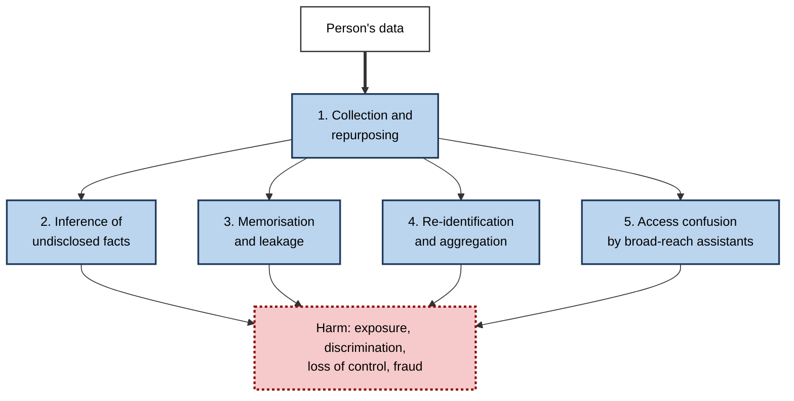
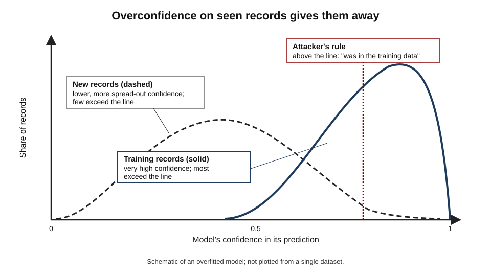
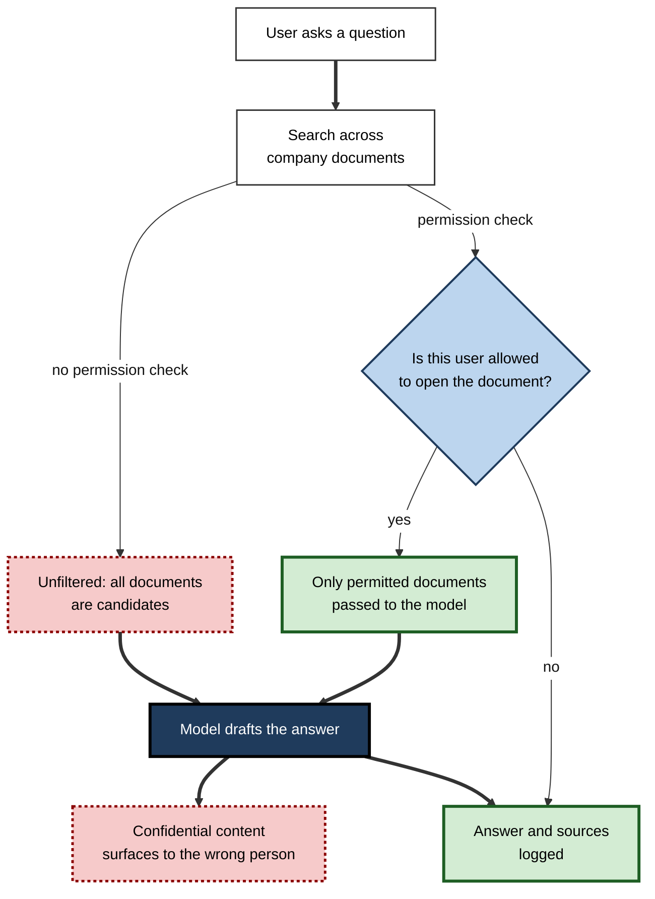
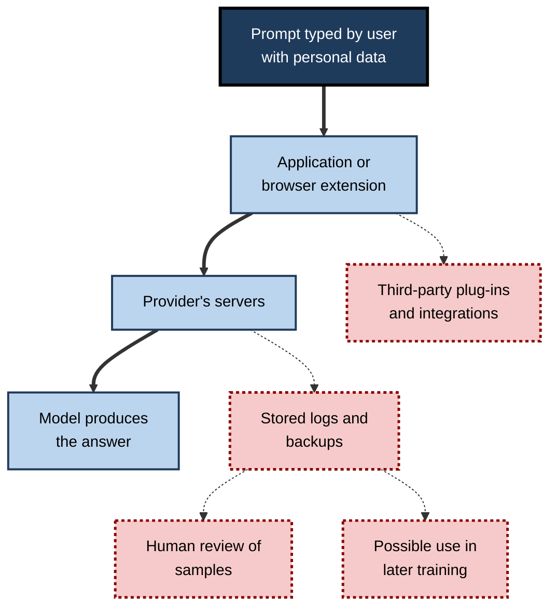
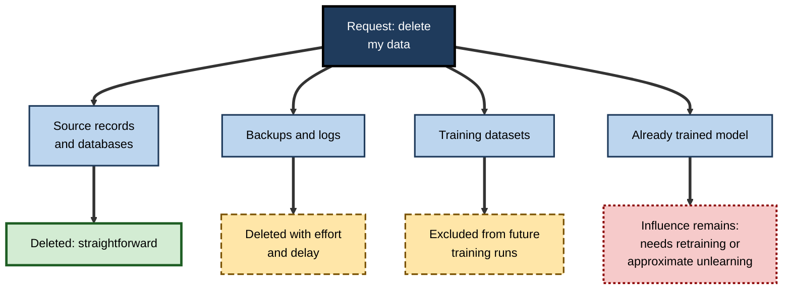
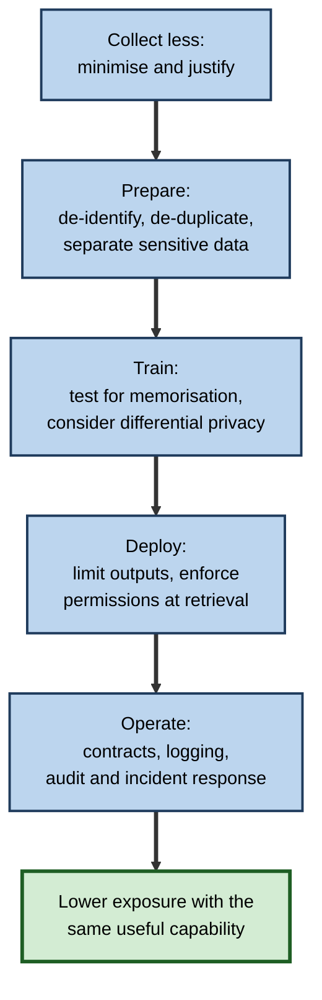

# F.11. Data privacy risks in AI systems

A company launches a friendly chatbot trained on billions of real messages between couples, and soon it is blurting out strangers' names and addresses. A hospital shares patient records with a technology partner to build an alert, and the regulator rules that patients were never properly told. In each case the AI system worked as built; the **privacy failure came from what it was fed, what it remembered and what it was allowed to reach**.

> **Definition — Personal data:** any information relating to an identified or identifiable living person — names and contact details, but also identifiers, locations, health records, images, voice and online behaviour.

> **Definition — Privacy (informational):** a person's ability to control how information about them is collected, used and shared, so that it flows only in ways that fit the context in which it was given.

**Why it matters**

- Modern AI is **data-hungry**: more and richer data generally mean better performance, which creates a standing pull towards collecting and keeping more.
- The systems create **new kinds of exposure** — they can infer what was never disclosed, memorise what they were shown and mix information across sources.
- A trained model **cannot easily be audited or edited** for what it holds, so mistakes are hard to undo.
- The most common privacy failures are not exotic attacks but **ordinary design choices**: collecting too much, reaching too far, keeping too long.

---

## Why AI Changes the Privacy Picture

### The data appetite

- **Performance follows data** — more examples, more features and more diversity usually improve a model.
- **Scale incentives** — organisations gather logs, images, recordings, messages and sensor readings "in case they are useful".
- **Data as an asset** — user interactions are valuable for improving products, creating a motive to retain and reuse them.
- **Hidden collection** — voice assistants, cameras, apps and web scraping gather data the person may never have thought of as being given.

> **Definition — Data minimisation:** collecting and keeping only the personal data needed for a stated purpose, and no more.

> **Watch out:** the instinct of machine learning — keep everything, discover use later — runs directly against the principle of data minimisation. Reconciling them is a design decision, not a technical accident.

### Five ways AI creates privacy risk

- **Collection and repurposing** — data gathered for one purpose are used to train systems for another.
- **Inference** — models deduce sensitive facts that were never stated.
- **Memorisation and leakage** — models reproduce or reveal parts of their training data or inputs.
- **Re-identification and aggregation** — combining sources identifies people in supposedly anonymous data.
- **Access confusion** — an assistant with broad reach exposes information to people who should not see it.

**Figure 1.** Five channels through which AI systems expose personal data.

---

## Collection and Repurposing

### Context matters

- **Contextual integrity (Helen Nissenbaum)** — information flows carry norms tied to the context in which they occur.
  - *e.g.* medical details shared with a doctor are expected to stay within care, not to reach an insurer or a marketing model.
- **Repurposing breaks the norm** — data given for one reason are used for another, even if nothing is "disclosed".

> **Definition — Contextual integrity:** the idea that a privacy violation occurs when information moves in a way that breaks the norms of the context in which it was shared.

### Scraped and incidental data

- **Web scraping** — images, posts and text collected from public pages are "public" but were not shared for model training.
- **Incidental capture** — photographs or recordings include bystanders; support calls include third parties' details.
- **Children's data** — collected with weaker consent and greater harm potential.
- **Metadata** — timestamps, locations and device identifiers reveal patterns even where content is protected.

### Case study: the Lee Luda chatbot (South Korea, 2020–2021)

- **Situation:** in December 2020 the Korean start-up Scatter Lab launched Lee Luda ("Iruda"), a chatbot persona of a young woman, on Facebook Messenger.
- **How it was built:** the company had trained the system on a huge corpus of real conversations — around **9.4 billion messages from about 600,000 users** — taken from its earlier apps that analysed couples' chats from KakaoTalk, a popular Korean messaging service.
- **What went wrong:**
  1. users had not been clearly told that their private conversations could be used to train a public chatbot;
  2. names, phone numbers and addresses had not been adequately removed from the data;
  3. the chatbot produced offensive remarks about minorities and, in some cases, repeated personal information drawn from its training data;
  4. data of roughly **200,000 children under fourteen** had been gathered without parental consent.
- **Outcome:** the service was suspended in January 2021; in April 2021 South Korea's Personal Information Protection Commission fined the company about **103 million won** (roughly 93,000 US dollars) and ordered it to delete improperly collected data — reported as the first sanction of an AI company under the country's data-protection law.
- **Lessons:**
  - the legitimacy of training data depends on **the purpose and the consent under which it was collected**, not on its technical availability;
  - de-identification must be **tested**, not assumed;
  - a model built on improperly collected data is itself a **liability**, because the data behind it may have to be deleted.

> **Watch out:** the fine seems small against the scale of the breach. Penalties vary by jurisdiction; the reputational and operational cost — suspension of the service and deletion of data — was far larger.

---

## Inference: What the Model Can Work Out

### Sensitive facts from ordinary data

- **Models predict what was never provided** — personality traits, sexual orientation, political views, health conditions, pregnancy, financial distress — from patterns in clicks, purchases, photographs, typing or location.
- **The accuracy is imperfect, but useful at scale** — an inference right only a little more often than chance, applied to millions, is commercially and politically valuable.
- **The person never disclosed it** — there is nothing to consent to, withdraw or correct.

> **Definition — Inference (privacy sense):** deducing information about a person that they did not provide, by finding patterns in other data.

- **Examples:**
  - retail systems predicting life events from purchase patterns;
  - health predictions from wearable data or voice;
  - **photographs of faces** used by researchers to predict traits — a contested area in which claims of high accuracy have been criticised on methodological and ethical grounds.
- **Derived data are personal data** under many laws — a prediction about a person is data about that person.

### The problem of the sensitive proxy

- **Removing a sensitive field does not remove the sensitivity** — location, language, purchases and contacts can reconstruct it.
- **Inferred attributes can then be used** for targeting, pricing, screening and surveillance, without any record that sensitive information was used.

> **Key point:** privacy can be lost **without any data being leaked**. Inference creates sensitive knowledge from non-sensitive inputs.

---

## Memorisation, Leakage and Inversion

### Models carry traces of their data

- **Memorisation** — a model stores specific training examples, not only general patterns, especially when they are rare, repeated or distinctive.
- **Why it happens** — models are trained to fit their data; very large models have capacity to store details; duplicated examples are more strongly retained.
- **Why it matters** — a model released or queried by others may reveal what it was trained on.

> **Definition — Memorisation:** the retention by a model of specific training examples in a form that can be reproduced or detected.

> **Definition — Overfitting:** fitting training examples so closely that performance on them is much better than on new cases.

### Membership inference

**Study card — Shokri, Stronati, Song and Shmatikov (2017), Cornell Tech and collaborators, "Membership inference attacks against machine learning models"**

- **Question:** can an attacker with only query access tell whether a particular person's record was in a model's training data?
- **Method:** the attackers trained "shadow" models on similar data to learn how a model's outputs differ for records it was trained on and those it was not, then used that difference to classify records.
- **Results:** against models offered by commercial machine-learning services, the attacks succeeded **better than chance** — particularly on models that were **overfitted** or trained on small datasets.
- **Why it matters:** knowing that someone's record was used to train a model can itself be sensitive — for example, a model trained only on patients with a particular disease.
- **Conclusion:** a model's behaviour on its own training data differs measurably from its behaviour on new data, and that difference leaks.

**Figure 2.** A model that is more confident on its training records than on new ones reveals which records it saw.

### Worked example (illustrative): why overfitting leaks

- **Situation:** a hospital trains a model on records of 2,000 patients with a rare condition; any record in the training set is, by construction, someone with the condition.

| Measure | On training records | On new records |
|---|---|---|
| Average confidence of the model's prediction | 0.97 | 0.78 |
| Share of records where confidence exceeds 0.90 | 88% | 21% |

*Illustrative figures.*

1. An attacker with a person's record queries the model: **confidence above 0.90** suggests the record was a member.
2. Using that rule on an even mix of members and non-members: members flagged correctly 88% of the time; non-members wrongly flagged 21% of the time.
3. Accuracy of the guess = (0.88 + (1 − 0.21)) ÷ 2 = (0.88 + 0.79) ÷ 2 = **83.5%**, far above the 50% expected by chance.
4. Because the training group are all patients with the condition, a "member" verdict **reveals a diagnosis**.

- **Conclusion:** the model never published a record, yet its behaviour reveals who was in the data. Reducing overfitting and limiting detailed confidence outputs reduce the leak.

### Model inversion

**Study card — Fredrikson, Jha and Ristenpart (2015), University of Wisconsin–Madison and Cornell University, "Model inversion attacks that exploit confidence information"**

- **Design:** the researchers considered a face-recognition model that returns a confidence score for each person's name given an image.
- **Method:** starting from a blank image, they repeatedly adjusted it to raise the model's confidence for a chosen person's name.
- **Results:** the process produced images recognisable, to human judges, as the person's face — reconstructed from nothing but a name and the model's outputs.
- **Conclusion:** detailed outputs, such as confidence scores, can allow an attacker to **run the model backwards** and recover features of its training data.

### Extraction from language models

- **Verbatim recall** — large language models can reproduce passages from their training data, including names, contact details and code, particularly when text was repeated many times.
- **Triggering recall** — prompts designed to induce the model to continue memorised text, or odd repeated-token prompts, have extracted large amounts of training text in research.
- **Hallucinated personal details** — models can also generate **plausible but false** information about real people, including invented accusations; a privacy and reputational harm of a different kind.

> **Watch out:** most routine chatbot use will not expose an individual's private data from training. The risk rises for **rare, repeated or distinctive** information, for **open models** that anyone can probe heavily and for models **fine-tuned on sensitive data**.

---

## Re-identification and Aggregation

### "Anonymous" data seldom are

- **Removing names is not anonymisation** — a combination of postcode, birth date, gender or other attributes can single out a person.
- **Rich datasets are unique** — location traces, purchase histories and browsing patterns are distinctive; a few points can identify most individuals.
- **Linking with other sources** — an attacker joins the "anonymous" data with a public register or social media profile.
- **AI makes matching easier** — models can link writing style, faces, voices and behaviour across sources.

> **Definition — Re-identification:** discovering whose record a supposedly anonymised data record is, by linking it with other information.

### Case study: a clinical alert and a regulator (United Kingdom, 2015–2017)

- **Situation:** in 2015 a London NHS hospital trust, the Royal Free, agreed with Google's DeepMind to develop an app, "Streams", to alert clinicians to patients at risk of acute kidney injury.
- **What was shared:** the trust gave DeepMind identifiable records of about **1.6 million patients**, including information about people who had never had kidney problems and some historic data.
- **Ruling:** in July 2017 the UK Information Commissioner's Office found that the trust **had not complied with data-protection law**: patients had not been adequately informed that their data would be used for the testing of the app, and the processing was not proportionate to the need.
- **Outcome:** the trust was required to commit to changes; the app itself was not found to be unsafe, and clinicians reported benefits.
- **Lessons:**
  1. **good intent and a useful product** do not remove the duty to tell people and to limit data to what is needed;
  2. **testing** an AI system on real patient data is a use that needs its own justification;
  3. the failure was in **governance**, not in the algorithm.

---

## Access Confusion: When the Assistant Reaches Too Far

### The model has no sense of who may see what

- **A language model does not enforce permissions** — it responds to whoever asks, using whatever it has been given.
- **Retrieval assistants** search company documents and give the results to the model; if the search ignores access rights, the assistant becomes a path round them.
- **Over-sharing in the source** — documents that were technically open but practically hidden ("security through obscurity") become instantly findable.
- **Context mixing** — information from one user's session appearing in another's because of bugs, shared caches or poorly isolated memory features.

> **Definition — Confused deputy:** a program with broad authority that is tricked, or simply used carelessly, into using that authority on behalf of someone who lacks it.

### Where the control must sit

- **At retrieval** — the system fetches only documents the asking user is entitled to see.
- **Not in the prompt** — an instruction to the model such as "do not reveal confidential files" is a **request**, not a lock.
- **In the sources** — files are labelled, permissions are reviewed, stale shares are cleaned.
- **In the logs** — who asked what, and what was returned.

**Figure 3.** Permission-aware retrieval keeps an assistant from becoming a route round access controls.

### Inputs, logs and retention

- **User inputs may be retained** — prompts, uploaded files and conversations can be stored for abuse monitoring, product improvement or training, depending on the service and account type.
- **Human review** — some providers allow staff or contractors to read samples of conversations.
- **Logs are a second copy** — they persist, are backed up and can be breached.
- **Third parties** — plug-ins, browser extensions and integrations pass data on.
- **Differences in terms** — consumer, business and enterprise tiers often treat data differently; the same tool can be safe or unsafe depending on the contract.

> **Remember:** privacy risk depends on the **deployment**, not just the **model**. Ask what is stored, for how long, who can read it and whether it may be used for training.

**Figure 4.** Where a typed prompt can travel after it is sent.

---

## The Limits of Deletion

### Data inside a model

- **A model has no rows to delete** — a person's data, once learned, are spread across parameters.
- **Removing the source data does not remove its influence** — the model must be retrained or edited.
- **Machine unlearning** — research aiming to remove specific examples' influence without full retraining.
  - Methods exist but are **approximate**, costly or hard to verify.
- **Law versus engineering** — rights to erasure meet a technical reality in which removal from a large model may be impractical.

| Request | Easy? | Why |
|---|---|---|
| Delete a person's record from a customer database | Yes | The record is a discrete row |
| Stop using their data in future training | Yes, if tracked | Excluding it from new datasets |
| Remove its influence from an already trained model | Hard | Spread across parameters; needs retraining or approximate unlearning |
| Prove that a model no longer reflects it | Very hard | Verification is itself an open research problem |
| Delete it from backups and logs | Possible, laborious | Many copies and systems |

> **Key point:** the cheapest moment to protect privacy is **before training**. After training, the options narrow sharply.

**Figure 5.** What a request to delete personal data can and cannot reach.

---

## Reducing the Risk

### Choices at the capability level

- **Collect less** — only data needed for the purpose; discard what is not used.
- **Keep it separate** — sensitive data in controlled environments; no mixing with general training sets.
- **Reduce memorisation** — de-duplicate data, avoid overfitting, test for leakage before release.
- **Limit outputs** — avoid exposing detailed confidence scores; rate-limit queries to cut probing.
- **Add formal protection where justified** — techniques such as differential privacy, which limit how much any one person's data can influence the model.
- **Keep data local** — on-device or federated approaches that train without centralising raw data.
- **Enforce access at retrieval** — not in the prompt.
- **Choose the contract** — settings and terms that prevent provider retention and training on inputs.
- **Test and monitor** — probe your own systems for leakage and over-sharing before others do.

> **Definition — Differential privacy:** a mathematical guarantee that the output of an analysis changes only slightly whether or not any one individual's data are included.

> **Definition — Federated learning:** training a shared model by sending the model to where the data are and aggregating only the updates, so that raw data stay on users' devices or sites.

**Figure 6.** Layers of control from data collection to deployment.

### Matching the risk to the use

| Use | Main privacy risk | Sensible controls |
|---|---|---|
| Public chatbot used for drafting generic text | Inputs retained; third-party exposure | Do not enter personal or confidential data; use a business tier |
| Enterprise search assistant | Access confusion | Permission-aware retrieval; audit and clean file sharing |
| Model fine-tuned on customer records | Memorisation; membership inference | Minimise and de-identify; test leakage; restrict who can query |
| Camera-based analytics | Collection of bystanders' images; re-identification | Limit retention; blur; local processing; notice |
| Health or finance prediction | Inference of sensitive status; harm on error | Strict purpose limits; human review; strong governance |

### Case study (illustrative): the internal assistant and the pay review

- **Situation:** a mid-sized firm rolled out an assistant that could search its shared drive and answer staff questions.
- **Incident:** within a week an employee asked "what is the bonus pool this year?" and received a summary from a spreadsheet saved in a shared folder with "anyone in the company" access — by accident, years earlier — which listed bonuses by name.
- **Diagnosis:**
  1. the assistant respected permissions; the permissions were wrong;
  2. the sharing mistake had been harmless while nobody could find the file;
  3. the assistant had made every over-shared file instantly discoverable.
- **Actions:**
  1. the assistant was paused for a week;
  2. a permission audit started with the most sensitive folders (HR, finance, legal);
  3. "anyone with the link" sharing was disabled by default;
  4. sensitive files were labelled so the assistant excluded them;
  5. logging showed what each user had retrieved.
- **Result:** the assistant was re-launched with narrower scope; the firm discovered several hundred over-shared files.
- **Lesson:** an AI assistant is a **stress test of existing information hygiene** — it exposes weaknesses that previously went unnoticed.

---

## Open Questions

- **Can models be made to forget?**
  - Practical, verifiable unlearning for very large models does not yet exist.
- **Is inference a privacy violation even when no data are leaked?**
  - Law mostly regulates data; the harm from deduced facts is an open issue.
- **How much training on public data is acceptable?**
  - Courts and regulators are deciding how scraped personal data may be used.
- **Can privacy-enhancing techniques keep pace with model size?**
  - Differential privacy and federated learning cost accuracy and compute; scaling them is hard.
- **Who is responsible for leakage through open models?**
  - Once weights are released, developers cannot recall or control them.

---

## Summary

- AI changes the privacy picture because it is **data-hungry**, **infers** undisclosed facts, **memorises**, enables **re-identification** and can reach across systems.
- Five channels: **collection and repurposing**, **inference**, **memorisation and leakage**, **re-identification and aggregation**, **access confusion**.
- **Contextual integrity**: data flows should match the norms of the context where data were given.
- **Membership inference** and **model inversion** show that models' outputs reveal their training data, especially when **overfitted** or when exposing detailed confidence scores.
- **Lee Luda** (2021): a chatbot trained on private messages led to a fine, suspension and an order to delete data; the **Royal Free–DeepMind** ruling (2017) showed that useful AI projects still need transparency and proportionality.
- An assistant with broad reach can become a **confused deputy**: enforce permissions at **retrieval**, not in the prompt.
- **Deletion is hard once data have shaped a model**; the cheapest protection is before training.
- Practical controls: **minimise**, **separate**, **test for leakage**, **limit outputs**, choose **contracts and settings**, consider **differential privacy** or **federated learning**, and **audit permissions**.

---

## Self-Check

1. Define personal data and data minimisation, and explain why machine learning pulls against minimisation.
2. List the five channels of AI privacy risk with one example of each.
3. Explain contextual integrity with an AI example.
4. How can a model reveal sensitive facts that were never disclosed?
5. Explain membership inference and why overfitting makes it easier.
6. Using the worked example, calculate the attacker's accuracy if members are flagged 90% of the time and non-members wrongly flagged 30%.
7. What did the model inversion study show?
8. What went wrong at Scatter Lab, and what were the consequences?
9. What did the UK regulator find in the Royal Free case, and what was the lesson?
10. What is a confused deputy? Why is "do not reveal confidential files" in the prompt inadequate?
11. Why is deleting a person's data from a trained model hard?
12. List five controls that reduce privacy risk in AI deployments.
13. A firm wants to fine-tune a language model on its customer-support transcripts. Identify risks and propose safeguards.
14. A manager says "our data are anonymised, so privacy law does not apply". Evaluate.

### Answer Key

1. Personal data: information relating to an identifiable person. Data minimisation: collecting and keeping only what the stated purpose requires. Machine learning improves with more data, so organisations are drawn to collect and keep as much as possible.
2. Collection and repurposing (scraped messages used to train a chatbot); inference (predicting health status from purchases); memorisation and leakage (a model repeating a stranger's address); re-identification (linking "anonymous" records to a register); access confusion (an assistant summarising confidential HR files).
3. Privacy depends on whether a flow of information fits the norms of its original context. Messages shared between partners are expected to stay private, so using them to train a public chatbot breaks those norms even if the data are technically accessible.
4. By inferring them from patterns in other data, such as purchases, location, images or writing, so nothing sensitive had to be provided.
5. An attacker with query access tests whether a record was in the training data by exploiting differences between the model's behaviour on seen and unseen records. Overfitted models behave much differently on training data, so the signal is stronger.
6. (0.90 + (1 − 0.30)) ÷ 2 = (0.90 + 0.70) ÷ 2 = 80%.
7. Starting from a blank image and raising the model's confidence for a person's name, researchers reconstructed recognisable faces, showing that detailed outputs can be run backwards to recover training features.
8. It trained a public chatbot on billions of private couples' messages without clear consent or adequate removal of personal data, including data of children under 14. The service was suspended, and the regulator fined the company and ordered deletion of improperly collected data.
9. The ICO found the trust had not complied with data-protection law: patients were not properly informed and the processing was not proportionate. The lesson: a worthy aim and useful product do not remove duties of transparency and minimisation; the failure was governance.
10. A program with broad authority used, deliberately or carelessly, on behalf of someone who lacks it. A prompt instruction is a request the model may follow imperfectly or be tricked out of, not an enforced restriction; permissions must be enforced at retrieval.
11. Information learned from a person is spread across parameters; there is no row to remove, so removal needs retraining or approximate unlearning, which is costly and hard to verify.
12. Collect less; separate sensitive data; test for memorisation; limit detailed outputs; enforce permissions at retrieval; choose contracts preventing provider training on inputs; differential privacy or federated learning where justified.
13. Risks: memorisation of names, account numbers and complaints; leakage through queries; membership inference; legal basis and purpose. Safeguards: remove or mask identifiers, de-duplicate, evaluate leakage before release, restrict access to the model, keep it in a controlled environment, document purpose and retention.
14. Names alone do not make data anonymous; combinations of attributes can re-identify people, and anonymisation must be tested against linkage. If individuals remain identifiable, data-protection law applies, and inferences about people may also be personal data.

---

## Glossary

| Term | Meaning |
|---|---|
| Confused deputy | A program with broad authority used on behalf of someone who lacks it. |
| Contextual integrity | The view that privacy is violated when information moves against the norms of its original context. |
| Data minimisation | Collecting and keeping only the personal data needed for a purpose. |
| Differential privacy | A guarantee that any one person's data change an analysis's output only slightly. |
| Federated learning | Training a shared model without centralising raw data. |
| Inference (privacy) | Deducing facts a person did not provide. |
| Membership inference | Determining whether a particular record was in a model's training data. |
| Memorisation | Retention of specific training examples in a reproducible form. |
| Model inversion | Recovering features of training data from a model's outputs. |
| Overfitting | Fitting training data so closely that performance on new data is much worse. |
| Personal data | Information relating to an identifiable person. |
| Re-identification | Discovering whose record an anonymised record is by linking sources. |
