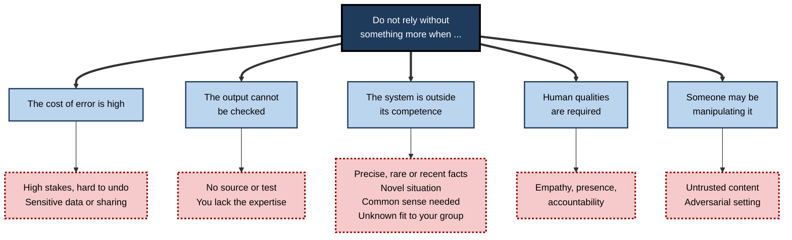
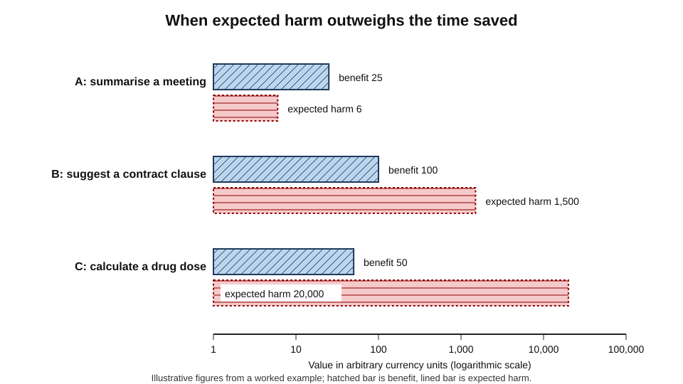
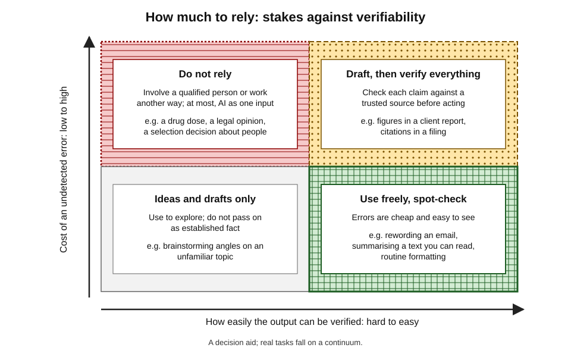
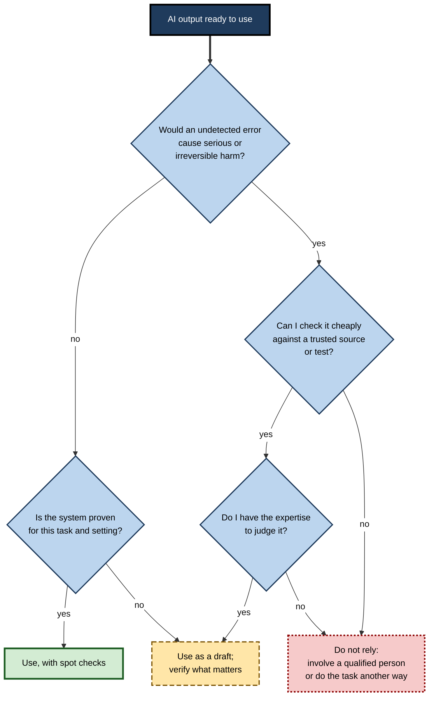
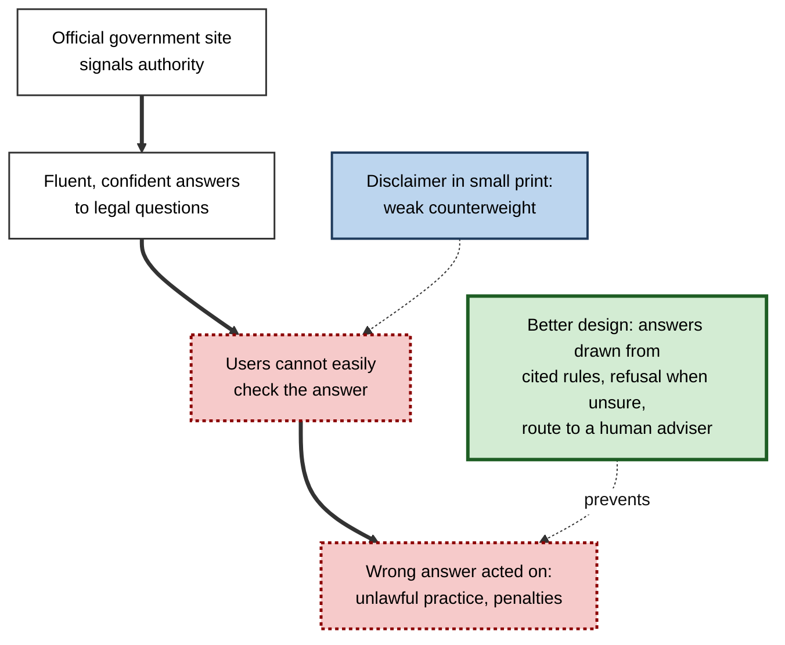
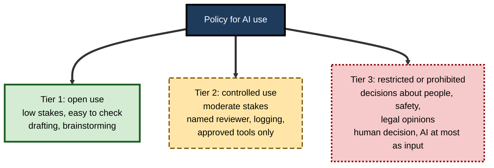

# F.12. When NOT to rely on AI output

A city launches an official chatbot for small businesses, and journalists find it telling employers they may take a share of workers' tips and landlords that they may refuse tenants who pay with housing vouchers — both unlawful. Every weakness described so far becomes, at the moment someone is about to act on an output, a **practical decision**: should this be used as it stands? The answer is neither "never" nor "always", but a judgement that can be made systematically.

> **Definition — Reliance (on AI output):** acting on, passing on or building upon an AI system's output without independently establishing that it is correct.

> **Definition — Calibrated reliance:** reliance that matches the system's actual reliability for the specific task, context and stakes — neither more nor less.

**Why it matters**

- Every strength and weakness described in the preceding notes becomes a **practical decision** at the moment someone is about to use an output.
- Over-reliance causes harm that is unseen until it surfaces; under-reliance wastes real benefits and can itself cost lives and money.
- A reasoned rule of thumb is more useful than a blanket policy of trust or distrust.
- The same output can be fine to use in one situation and unacceptable in another; **context decides**.

---

## Two Ways to Get It Wrong

### Over-reliance and under-reliance

- **Over-reliance (misuse)** — accepting output more than its reliability justifies.
  - *e.g.* sending an AI-drafted legal citation without checking that the case exists.
- **Under-reliance (disuse)** — rejecting or ignoring output that would improve the result.
  - *e.g.* a clinician overriding a well-validated alert from habit or distrust.
- **Both are costly** — the aim is the middle: reliance proportionate to demonstrated reliability.

> **Watch out:** "never trust AI" is as unprofessional as "always trust AI". Where mechanical methods demonstrably outperform unaided judgement, **not** using them is the error.

### Evidence that statistical methods often beat judgement

**Study card — Meehl (1954) and Grove and colleagues (2000), clinical versus statistical prediction**

- **Background:** in 1954 the psychologist Paul Meehl reviewed studies comparing the predictions of clinicians with those of simple statistical formulas, for outcomes such as academic success or recovery.
- **Update:** in 2000 William Grove and colleagues combined **136 studies** across psychology and medicine in a meta-analysis.
- **Result:** mechanical, formula-based prediction was **as accurate as or more accurate than** clinical judgement in the large majority of studies; clinicians were clearly better in very few.
- **Interpretation:** human judgement adds noise and inconsistent weighting even when it is informed.
- **Conclusion:** there are tasks where trusting a well-validated model over expert intuition is the better policy — but notice the conditions: **validated, narrow, structured prediction with clear outcomes**.

> **Key point:** the question is never "AI or human?" in general, but "**for this task, with this evidence, which is more reliable — and how would I know?**"

### The human–AI pair is not automatically better

**Study card — Agarwal, Moehring, Rajpurkar and Salz (2023), MIT, Harvard, Stanford and collaborators, "Combining human expertise with artificial intelligence: experimental evidence from radiology"**

- **Design:** professional radiologists read chest X-rays for signs of disease, with and without the output of an AI system, in an experiment.
- **Results:**
  - on average, AI assistance **did not improve** radiologists' diagnostic accuracy, even though the AI was more accurate than about three-quarters of the radiologists;
  - radiologists did **move** towards the AI's predictions, so they were not ignoring it;
  - accuracy improved when the AI was **confident** and fell when it was **uncertain**;
  - the radiologists failed to combine the two sources well: they under-weighted the AI and treated it as independent of their own reading.
- **Conclusion:** human judgement plus AI is not automatically better than either; **how** the output is presented and combined decides the result.

---

## Conditions Under Which Not to Rely

### Ten warning conditions

1. **The stakes are high and the error is hard to undo.**
   - *e.g.* a medicine dose, a legal filing, a safety instruction, a termination decision.
2. **You cannot check the output.**
   - No source, no test, no independent way to judge; the answer must be taken on faith.
3. **You lack the expertise to judge it.**
   - Fluent answers on unfamiliar topics are the hardest to evaluate — and the most persuasive.
4. **The task depends on precise, rare or recent facts.**
   - Hallucination risk is greatest for obscure details, exact figures and quotations.
5. **The situation is novel or unusual.**
   - Brittleness: the further from typical cases, the less reliable the system.
6. **Common-sense or contextual judgement is essential.**
   - The system lacks the unspoken background that a person brings.
7. **Genuine human presence, empathy or accountability is required.**
   - Delivering bad news, caring for the distressed, taking responsibility for a decision.
8. **An adversary may be manipulating the input.**
   - Content from untrusted sources, hostile users, fraud contexts.
9. **The data are sensitive or the output will be shared.**
   - Privacy and confidentiality risks of the inputs; downstream use of the outputs.
10. **The system's performance for your group, setting or use is unknown.**
    - Bias and shift: no evidence that it works for the people or conditions in front of you.

**Figure 1.** The ten warning conditions grouped by the weakness behind each.

### The same weakness in different jobs

| Weakness | Where it bites | Professional example |
|---|---|---|
| Hallucination | Facts, figures, citations | A consultant's report with a fabricated market statistic |
| Brittleness | Unusual cases | An invoice reader failing on a new supplier format |
| No common sense | Unstated constraints | An agent ordering a ludicrous quantity |
| Bias | Under-represented groups | A transcription tool failing for some accents |
| Opacity | Contested or regulated decisions | A refusal that cannot be explained to the customer |
| Adversarial weakness | Hostile inputs | A hidden instruction in an email the assistant reads |
| Privacy exposure | Sensitive inputs and outputs | Pasting client data into an unapproved tool |
| Missing humanity | Care and judgement | An AI-written condolence message |

---

## A Framework for Deciding

### Three questions

1. **What is the cost of an undetected error?** — to people, money, safety, reputation, law.
2. **How well can I detect an error?** — can I check the output cheaply and reliably?
3. **How reliable is the system for this exact task?** — based on evidence, not marketing.

> **Formula — Expected harm from relying on an output:** expected harm = chance the output is wrong × cost of an error × chance the error goes undetected. Use AI when the **value of the benefit exceeds the expected harm plus the cost of checking**.

### Worked example (illustrative): three tasks, three decisions

- **Situation:** an analyst considers using a general AI tool for three tasks. Values are in arbitrary currency units.

| | A: Summarise a team meeting | B: Suggest a clause for a client contract | C: Calculate a drug dose for a patient |
|---|---|---|---|
| Chance output is wrong | 10% | 15% | 5% |
| Cost of an error | 200 | 20,000 | 500,000 |
| Chance error is detected before harm | 70% | 50% | 20% |
| Expected harm | 0.10 × 200 × 0.30 = **6** | 0.15 × 20,000 × 0.50 = **1,500** | 0.05 × 500,000 × 0.80 = **20,000** |
| Value of time saved | 25 | 100 | 50 |
| Net expected value | 25 − 6 = **+19** | 100 − 1,500 = **−1,400** | 50 − 20,000 = **−19,950** |

*Illustrative figures.*

1. **Task A** is worth using: low stakes, an error is likely to be noticed by attendees.
2. **Task B** is not worth using as it stands: an error would be expensive and half would pass unnoticed.
3. **Task C** is not acceptable: even a 5% error rate is disastrous when stakes are high and detection is poor.

- **Making B viable:** a lawyer's careful review raises detection to 95% and costs 80 in time.
  - Expected harm = 0.15 × 20,000 × 0.05 = **150**.
  - Net = 100 − 150 − 80 = **−130** — still negative, because **checking costs almost as much as drafting**.
- **Conclusion:** for task B the benefit lies elsewhere — for instance in using AI to *find* alternative wordings to compare, with the lawyer drafting — or not at all.

> **Watch out:** the estimates themselves are uncertain. The method's value lies less in the numbers than in forcing the three questions: how bad, how detectable, how reliable.

**Figure 2.** Expected harm and benefit for three tasks, illustrating why high stakes can outweigh time saved.

### The reliance matrix

- **Two axes:** how bad an undetected error would be, and how easily output can be verified.
- **Four policies:**
  - **Low stakes, easy to verify** — use freely; spot-check.
  - **Low stakes, hard to verify** — use for ideas and drafts; do not pass on as fact.
  - **High stakes, easy to verify** — use as a first draft, then verify every claim before acting.
  - **High stakes, hard to verify** — do not rely; use only as a supplement to qualified human work, or not at all.

**Figure 3.** Choosing a reliance policy by stakes and verifiability.

> **Remember:** **stakes** and **verifiability** together set the policy. A check that costs as much as doing the task yourself removes the benefit.

### Decision flow

**Figure 4.** A decision flow for relying on a specific AI output.

---

## Case Study: A City's Chatbot Gives Illegal Advice (New York, 2023–2024)

- **Situation:** in October 2023 New York City launched "MyCity", a chatbot on its official website, built on a large language model, to answer questions from business owners about permits, regulations and obligations.
- **What was found:** in March 2024 reporters at *The Markup*, with the news site *THE CITY*, tested the chatbot and reported that it confidently gave advice that was **wrong and, if followed, unlawful**. Examples reported included:
  1. that employers could take a portion of workers' tips;
  2. that landlords did not have to accept tenants with housing vouchers;
  3. that businesses could refuse to accept cash.
- **City response:** the city said the tool was a pilot, added warnings that it might provide incorrect or incomplete answers and should not be taken as legal advice, and committed to improving it; it kept the service running.
- **What the case shows:**
  1. the tool was used in an area where **errors are costly** — legal compliance — and where users **often cannot tell** that the answer is wrong;
  2. the output had the **authority of an official city website**, raising the reliance users placed on it;
  3. a general disclaimer at the bottom of a page does **not** counteract that apparent authority;
  4. nothing in the design forced answers to be **grounded in the actual text of the rules** or sent uncertain questions to a person.
- **Contrast with a better design:** limiting answers to retrieved passages of the official guidance, showing the passage used, declining questions it could not support and pointing to a human adviser.
- **Lesson:** where the user **cannot verify** and the **stakes are legal or financial**, the right design either **grounds and constrains** the answer or **does not offer it**.

> **Watch out:** the episode involved a pilot tool whose flaws were publicised and addressed in part. Later versions and policies may differ; the value of the case lies in its pattern.

**Figure 5.** Why an authoritative-looking answer outran its reliability.

---

## Situations in Professional Life

### Where reliance is normally sound

- **Drafting and rewording** text whose content you supply and can read.
- **Brainstorming and generating options** for later selection.
- **Summarising** material you can compare against the source.
- **Searching and sorting** large collections, with human spot checks.
- **Boilerplate code and routine formulas** that you can test.
- **Format conversion and transcription** with a quick scan for errors.
- **Mature, validated narrow systems** — spam filters, fraud scores, standard image classifiers — within their tested range.

### Where reliance needs verification

- **Quantitative analysis and spreadsheet formulas** — recompute key figures independently.
- **Legal, regulatory and policy research** — confirm each authority in a primary source.
- **Technical specifications and safety information** — check against standards.
- **Medical or health information** — treat as pointers for discussion with a qualified person.
- **Customer-facing statements** — confirm against policy before sending.

### Where reliance is not appropriate

- **Final decisions about people's livelihoods, liberty or health** — selection, discipline, sentencing, diagnosis, benefits — without meaningful human review.
- **Anything requiring professional accountability** — a signature, certification or opinion that you must be able to defend personally.
- **Deeply personal communication** — condolence, apology, difficult feedback — as a replacement for your own voice.
- **Security decisions on untrusted content** — letting an agent act on instructions found in emails or web pages.
- **Work in which you must build skill** — where the aim is your own learning, not the output.

> **Key point:** the more a decision is **about a person**, **irreversible** or **yours to answer for**, the less AI output should stand alone.

---

## Signs That the Output Itself Should Not Be Trusted

### Warning signs in the output

- **Too specific** — exact figures, dates, names and citations that you did not supply and cannot verify.
- **Too smooth** — confident prose on a subject known to be disputed or unsettled.
- **Too agreeable** — mirrors your assumptions and never pushes back.
- **Inconsistent** — answers change when the question is reworded.
- **Unsourced** — no pointers to where a claim comes from.
- **Odd detail** — small mistakes on facts you do know, which suggest similar ones on those you do not.
- **Evasive about limits** — claims abilities such as having browsed or calculated when it may not have.

### Quick tests

- **Ask for sources, then find them yourself.**
- **Re-ask in different words**, or ask a different system, and compare.
- **Check three claims at random** — if one fails, treat the whole output as unreliable.
- **Ask for the counter-argument** — a weak answer suggests a weak original.
- **Test it on something you know** — before trusting it on something you do not.

> **Remember:** a reliable output **survives checking**. An unreliable one often looks better the less you check.

---

## Why People Rely Too Much or Too Little

### Pulls towards over-reliance

- **Fluency** — well-written output feels reliable.
- **Authority of the interface** — a product from a respected organisation or an official site borrows its credibility.
- **Past success** — the better a system usually is, the less carefully its rare failures are checked.
- **Workload and time pressure** — checking is the first task dropped when busy.
- **Diffusion of responsibility** — "the system approved it" feels like shared blame.
- **Skill erosion** — people who stop doing a task lose the ability to judge its output.

**Study card — automation bias in clinical decision support (Goddard, Roudsari and Wyatt, University College London and City University London, *Journal of the American Medical Informatics Association*, 2012)**

- **Design:** a systematic review of studies in which clinicians or other professionals received advice from computerised decision-support systems, and the effects of **incorrect** advice were examined.
- **Findings:**
  - incorrect advice led some users to **change correct decisions into incorrect ones**;
  - errors of **omission** (failing to act because the system did not flag something) and of **commission** (following wrong advice) both appeared;
  - the effect was influenced by the user's experience, workload and confidence, and by how the advice was presented.
- **Conclusion:** automation bias is a **documented, general** effect in professional settings, not a feature of inexperienced users.

### Pulls towards under-reliance

- **Algorithm aversion** — people lose trust in an algorithm faster than in a human after seeing it err.
- **Pride and identity** — professionals who see judgement as their core skill resist advice.
- **Previous bad experience** — a visible failure colours later use.
- **Fear of blame** — following a machine against one's instincts feels riskier than following one's instincts.

> **Key point:** the two pulls act at once, in different people and at different times. Good practice makes calibration **a habit**, using feedback on how often the system was right for this kind of task.

### Building calibration

- **Keep a record of hits and misses** — track how often the output survived checking, by task type.
- **Use the system on cases where you know the answer** — to learn its profile.
- **Show confidence and evidence in the interface** — not only a conclusion.
- **Rotate tasks** — so that people retain the skill to check.
- **Reward catching errors** — not only speed.

---

## When AI Acts, Not Only Advises

- **Advice** passes through a person before anything happens; **action** may not.
- **Agents** — systems that browse, fill forms, send messages, move money or change files — convert errors into **events**.
- **Chains of steps** — small errors compound: a wrong search result, a misread field, a mistaken confirmation.
- **Speed** — the system may complete dozens of actions before anyone looks.

### Extra safeguards for action

- **Least privilege** — give the agent only the permissions the task needs.
- **Approval for irreversible steps** — payments, deletions, external messages, public posts.
- **Dry runs and previews** — show what would happen before it does.
- **Limits** — caps on amounts, numbers of actions and time.
- **Audit trail** — a log of every action and the reason given.
- **A reliable stop** — a way for a person to halt the process at once.

> **Remember:** the question changes from "is this output right?" to "**what is the worst thing this system could do with the access it has, and who would notice?**"

---

## Organisational Practice

### Policies that work

- **Classify uses by risk** — a short list of approved, restricted and prohibited uses.
- **Tie reliance to verification duties** — who checks what, before what goes out.
- **Keep a named accountable person** for every AI-assisted decision.
- **Record when AI was used** — so errors can be traced and corrected.
- **Test before deployment** on the organisation's own cases, including unusual ones.
- **Monitor after deployment** — performance, complaints and near misses.
- **Plan for failure** — a manual process that can take over.
- **Train people in both directions** — to spot over-reliance and under-reliance.

**Figure 6.** Three tiers of use, each with its own level of control.

### Worked example (illustrative): classifying uses in a small consultancy

| Use | Stakes | Verifiable? | Policy |
|---|---|---|---|
| Reword internal emails | Low | Yes | Tier 1 |
| Summarise a client interview from the transcript | Moderate | Yes, against transcript | Tier 2: consultant reads transcript for key points |
| Draft market-size estimate for a client deck | High | Hard | Tier 2 with source requirement: each figure traced to a named source |
| Select candidates to shortlist | High; about people | Hard | Tier 3: humans decide; AI cannot rank |
| Write a client's legal terms | High | Needs lawyer | Tier 3: lawyer drafts; AI may find alternative wordings |

*Illustrative assessments.*

1. Policy follows from **stakes** and **verifiability**, not from the technology.
2. The same tool appears in all three tiers.
3. Staff are told which tier a task belongs to before they begin.

### Case study (illustrative): the quarterly report that nobody could trace

- **Situation:** a retail analytics team began using an AI assistant to prepare its quarterly market commentary.
- **Problem:** two weeks after publication a client questioned a statistic about regional growth; nobody could find its source, and the assistant could not reproduce it. A further check found two more unsupported figures.
- **Diagnosis:**
  1. the assistant had been asked to "add supporting statistics";
  2. staff had checked grammar and flow but not figures;
  3. no log recorded which parts were AI-drafted.
- **Actions:**
  1. figures in client documents must each cite a named source and date, recorded in a table;
  2. assistants may draft narrative but not supply numbers;
  3. a second person checks all figures;
  4. AI-assisted sections are marked in the working file;
  5. a correction note was sent to the client.
- **Result:** no further unsourced figures in the next four quarters; slower preparation, but fewer corrections; the client relationship recovered.
- **Lesson:** reliance rules must attach to **specific content types** — here, numbers — not to the tool as a whole.

---

## Open Questions

- **How can people learn when to trust?**
  - Training alone has not removed automation bias; interface design and feedback appear to matter more.
- **Can systems signal their own unreliability?**
  - Reliable, honest uncertainty from a model remains an unsolved problem.
- **How should accountability be shared?**
  - When an AI-assisted decision fails, responsibility among developer, deployer and user is still being worked out.
- **Will reliability become good enough to relax these rules?**
  - For some tasks yes; for open-ended knowledge tasks, the rules may need to persist for a long time.
- **How do we avoid skill loss?**
  - If people rely on machines for tasks, they may become less able to verify them.

---

## Summary

- **Calibrated reliance** matches trust to the system's real reliability for this task; both **over-** and **under-reliance** are errors.
- Mechanical methods often beat unaided judgement on narrow, validated prediction (Meehl; Grove et al.), but human–AI pairs are **not automatically better** (radiology study).
- Ten warning conditions: high stakes, unverifiable, expertise gap, rare or recent specifics, novelty, need for context, need for human presence, adversaries, sensitive data, unknown fit.
- **Expected harm** = chance wrong × cost of error × chance undetected; weigh it against benefit **and** the cost of checking.
- The **reliance matrix** — stakes against verifiability — gives four policies from free use to no reliance.
- The **MyCity chatbot** shows how authority plus fluency plus unverifiable legal advice produces harm; design should ground, constrain or withhold.
- Reliance is usually sound for **drafting, brainstorming, summarising checkable material and mature narrow systems**; it requires verification for **numbers, law, safety and medical information**; it is inappropriate for **final decisions about people** and **accountable judgements**.
- Organisations should **classify uses by tier**, assign **named accountability**, **log**, **test** and **monitor**.

---

## Self-Check

1. Distinguish over-reliance from under-reliance, with one example each.
2. What did Meehl and Grove and colleagues find, and what conditions limit the lesson?
3. What did the radiology experiment show about adding AI to human judgement?
4. List five of the ten warning conditions for not relying on AI output.
5. State the expected-harm formula and use it: 8% chance wrong, cost 10,000, 60% of errors undetected.
6. In the worked example, why did task B stay unattractive even after review?
7. Describe the four policies in the reliance matrix.
8. Summarise the MyCity chatbot case and what design would have been safer.
9. Why is a general disclaimer a weak safeguard?
10. Give three signs in an output that suggest it should not be trusted.
11. Why should rules for AI use attach to content types rather than tools?
12. Classify: (a) rewording a newsletter; (b) shortlisting job applicants; (c) summarising a transcript; (d) checking a drug interaction. Justify.
13. A colleague says "I verify everything the AI writes, so I rely on it safely". Is that always sensible?
14. Draft a short reliance policy for a legal team using an AI drafting assistant.

### Answer Key

1. Over-reliance: sending an AI-drafted citation without checking it exists. Under-reliance: overriding a validated clinical alert from habit.
2. Statistical formulas matched or beat clinical judgement in most of 136 studies. The lesson is limited to narrow, well-defined prediction tasks with validated models and clear outcomes, not open-ended judgement.
3. AI assistance did not improve radiologists' average accuracy even though the AI outperformed most of them; accuracy rose when the AI was confident and fell when it was uncertain, and radiologists combined the sources poorly.
4. Any five of: high stakes and hard to undo; cannot check; lack expertise; precise, rare or recent facts; novel situation; need for common sense or context; need for human presence or accountability; adversarial setting; sensitive data; unknown performance for your group.
5. Expected harm = 0.08 × 10,000 × 0.60 = 480.
6. Even with review (95% detection), expected harm of 150 plus the cost of review of 80 exceeded the 100 benefit; checking cost almost as much as drafting.
7. Low stakes and easy to verify: use freely with spot checks. Low stakes, hard to verify: ideas and drafts only. High stakes, easy to verify: draft, then verify everything. High stakes, hard to verify: do not rely.
8. A city chatbot gave confident, incorrect legal advice that could lead to unlawful practices; users could not easily check; the site's authority raised trust. A safer design grounds answers in cited rules, declines when unsure and routes to humans.
9. It does not change the authority and fluency users perceive; people rarely read it or adjust their behaviour.
10. Excess specificity, smooth confidence on disputed topics, agreement with your assumptions, inconsistency on rewording, no sources, small errors on facts you know.
11. Risk differs by content: the same assistant is safe for wording but unsafe for figures, so controls must target numbers, citations or decisions about people.
12. (a) Low stakes, easy to verify: Tier 1. (b) High stakes, about people, hard to verify: do not rely; humans decide. (c) Moderate, verifiable against the transcript: Tier 2. (d) High stakes: verify against an authoritative source and involve a pharmacist.
13. Not always: verification takes time and may cost as much as doing the task, removing the benefit; checking can also be superficial. Verify what matters, and sometimes it is better not to use AI.
14. AI may reword and find alternative clauses; every citation and authority must be checked in a primary source; client-confidential data only in approved tools; a named lawyer signs off all outputs; AI use recorded in the file; no AI-generated advice sent to clients without review.

---

## Glossary

| Term | Meaning |
|---|---|
| Calibrated reliance | Reliance that matches a system's actual reliability for the task. |
| Disuse | Rejecting or ignoring automation that would improve results. |
| Expected harm | Chance of error × cost of error × chance it goes undetected. |
| Grounding | Basing answers on trusted sources supplied at the time. |
| Misuse | Relying on automation more than its reliability justifies. |
| Over-reliance | Accepting output more than its reliability warrants. |
| Reliance | Acting on output without independently establishing that it is correct. |
| Reliance matrix | A grid combining stakes and verifiability to set a policy. |
| Tier (of use) | A level of control assigned to a class of AI use. |
| Under-reliance | Rejecting output that would improve results. |
| Verifiability | How easily an output can be checked against a trusted source or test. |
