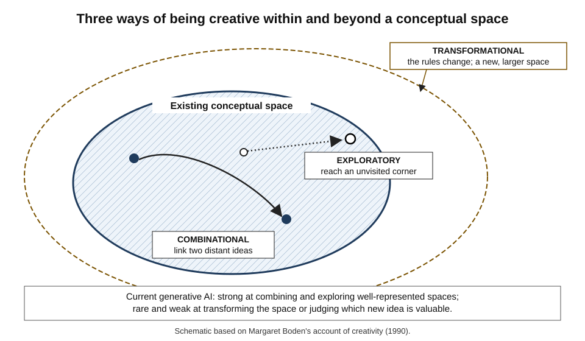
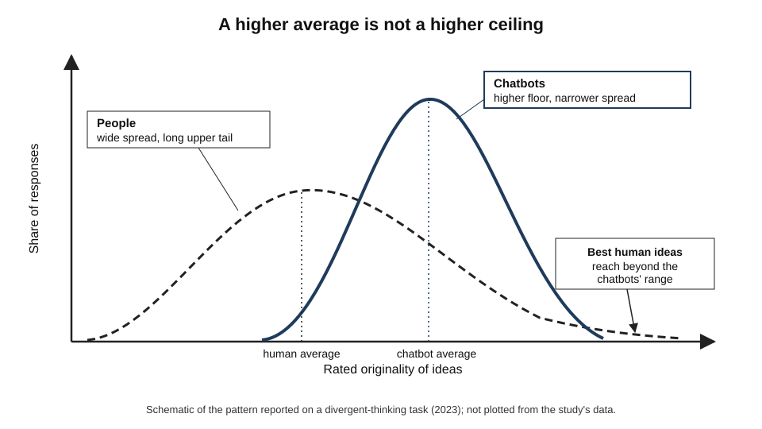
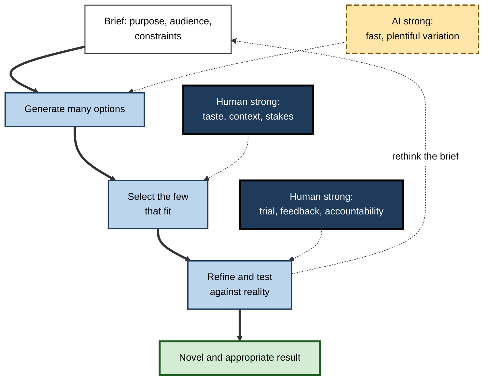
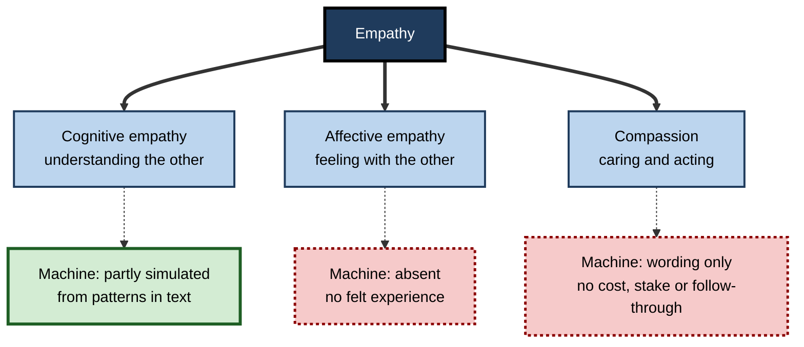
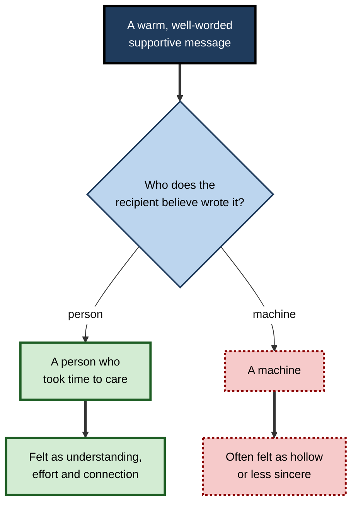
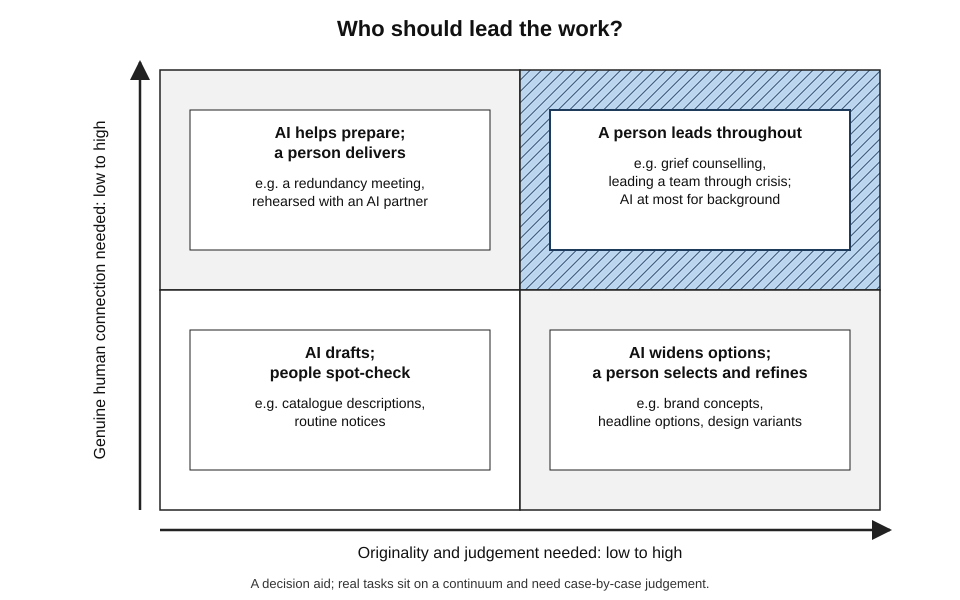

# F.2. Tasks humans still do better: creativity and empathy

A chatbot can produce fifty slogans for a new café in under a minute, several of them clever. A hospice nurse sits silently with a frightened family, knowing that saying nothing is the right thing to say. A designer looks at those fifty slogans, rejects forty-nine and changes two words of the fiftieth so that it suddenly *fits*. The machine is prolific; the people supply something it lacks — **judgement about what matters, and genuine care about the person in front of them**.

> **Definition — Creativity:** the production of ideas, solutions or artefacts that are both **novel** and **appropriate** — new, and also useful, valuable or fitting for their purpose.

> **Definition — Empathy:** the capacity to understand another person's thoughts and feelings, to share something of those feelings, and to be moved by them to care.

**Why it matters**

- These are the capacities most often named as the lasting human advantage at work — and the claims are frequently **too strong or too weak**.
- Generative AI now scores well on some standard creativity tests and writes messages that readers rate as warm and caring; a careless observer may conclude the human advantage has vanished.
- A careful look shows a more precise picture: machines are strong at **generating variation** and **imitating the language of care**, and weak at **choosing what is valuable**, **breaking a frame** and **actually caring**.
- That picture tells professionals how to divide creative and caring work with AI rather than surrender or refuse it.

---

## What Creativity Is

### Novel and appropriate

- **Novelty alone is not creativity** — a random string of words is novel but worthless.
- **Appropriateness alone is not creativity** — a correct but conventional answer is useful but not creative.
- **Both together** — the standard definition used in creativity research for decades.
  - *e.g.* the first flat-pack furniture: new, and it solved real problems of transport and cost.

### Kinds and scales of creativity

- **Divergent thinking** — generating many different possible answers to an open question.
  - Measured classically by the **Alternative Uses Task**: list as many uses as possible for a brick, a paperclip or a rope.
- **Convergent thinking** — narrowing to the single best answer.
  - *e.g.* finding the word that links "cottage", "swiss" and "cake" (cheese).
- **The four scales (James Kaufman and Ronald Beghetto, 2009):**
  - **mini-c** — personally new insight while learning;
  - **little-c** — everyday creativity, such as a clever fix at home;
  - **Pro-c** — professional-level creative work;
  - **Big-C** — work that changes a field, such as a new art form or scientific theory.

> **Definition — Divergent thinking:** producing many varied responses to an open-ended problem.

> **Definition — Alternative Uses Task:** a test asking people to list unusual uses for an everyday object, scored for number, variety and originality of ideas.

### Three kinds of creativity: Margaret Boden

**Margaret Boden, *The Creative Mind* (1990)** — creativity happens within a **conceptual space**: the set of possibilities a style, genre or discipline allows.

- **Combinational creativity** — making unfamiliar connections between familiar ideas.
  - *e.g.* a poetic metaphor; a product that joins a phone and a camera.
- **Exploratory creativity** — exploring the possibilities inside an existing conceptual space.
  - *e.g.* a new jazz improvisation within the rules of bebop; a new variation of an established chess opening.
- **Transformational creativity** — changing the rules of the space itself, so that previously impossible ideas become possible.
  - *e.g.* Cubism abandoning single-point perspective; the move from geocentric to heliocentric astronomy.

> **Definition — Conceptual space:** the structured set of possibilities defined by a style, genre or way of thinking.

- **Boden also distinguished:**
  - **P-creativity** (psychological) — new to the person who had the idea;
  - **H-creativity** (historical) — new to the whole of human history.

> **Mnemonic — "CET":** Combine, Explore, Transform — three ways of being creative, in rising order of rarity.

**Figure 1.** Boden's three kinds of creativity as moves within and beyond a conceptual space.

### Where current AI sits on Boden's map

| Kind of creativity | What it requires | How current generative AI performs |
|---|---|---|
| Combinational | Linking distant ideas | Strong — vast exposure to ideas makes unusual pairings easy to produce |
| Exploratory | Searching a known space | Strong within well-represented styles; can produce many competent variations quickly |
| Transformational | Seeing and breaking the rules of the space | Weak and rare — models are trained to reproduce the patterns of existing work |
| Selection | Judging which new ideas are valuable | Limited — no stake in the outcome and little sense of context beyond what is described |

> **Key point:** most everyday professional creativity is **combinational and exploratory**, which is exactly where AI is strongest. The human advantage is concentrated in **transformation, selection and fit to context**.

---

## What the Evidence Says About Machine Creativity

### AI on standard creativity tests

**Study card — Koivisto and Grassini (2023), University of Turku and University of Bergen, *Scientific Reports***

- **Design:**
  - 256 human participants and three chatbots completed the Alternative Uses Task for four objects (rope, box, pencil, candle);
  - responses were scored for semantic distance from the object and rated for originality by human judges who did not know the source.
- **Results:**
  - on **average**, the chatbots scored higher than the humans;
  - but the **best human responses** matched or exceeded the best chatbot responses on most items;
  - the chatbots produced fewer very poor answers.
- **Conclusion:** AI raises the floor of divergent thinking more than it raises the ceiling. The top of the human distribution remained competitive.

> **Watch out:** the Alternative Uses Task measures **fluency and originality of short ideas**. It does not measure whether an idea would work, whether it suits a client, or whether anyone would want it. High scores on it do not show that AI is creative in the full sense of novel *and* appropriate.

**Figure 2.** Average AI scores can exceed average human scores while the best humans remain competitive.

### AI and research ideas

**Study card — Si, Yang and Hashimoto (2024), Stanford University, "Can LLMs Generate Novel Research Ideas?"**

- **Design:**
  - more than 100 researchers in natural-language processing wrote research ideas or reviewed ideas without knowing their source;
  - ideas came from human experts, from a language-model system, or from the system with human reranking.
- **Results:**
  - AI-generated ideas were judged **more novel** than human experts' ideas, by a statistically significant margin;
  - they were judged **slightly weaker on feasibility**;
  - the system produced many near-duplicate ideas when asked for large numbers, showing limited diversity.
- **Follow-up:** a later study by the same group had researchers carry out ideas from each source; after execution, the AI ideas' advantage in ratings shrank or disappeared.
- **Conclusion:** generating ideas that *sound* novel is easier than generating ideas that turn out to be good once someone tries them.

> **Key point:** the gap between an idea that sounds interesting and one that works is where much professional creativity lives — testing, refining and judging fit. That stage is still mostly human.

### Individual gains, collective sameness

- **Writers with AI suggestions** in controlled experiments have produced stories that independent readers rated as more creative on average — especially among less naturally creative writers.
- **But the stories became more similar to each other** — the AI pulled many writers towards the same ideas.
- **Implication:** AI can lift the quality of one person's output while **reducing the variety** across a whole group, a team or a market.

> **Definition — Homogenisation:** the narrowing of variety when many people draw on the same AI system, so that their outputs converge on similar ideas, styles and phrasing.

### Why the pull towards the typical

- **Prediction of the likely** — generative models are trained to produce continuations that are probable given their training data.
  - Probable outputs are, almost by definition, **typical** rather than surprising.
- **Sampling settings** — raising the randomness ("temperature") produces more surprising outputs, but also more incoherent ones.
  - Novelty and coherence trade off.
- **No goal of its own** — the system has no wish to say something new about the world; it responds to the prompt.
- **No taste formed by experience** — human creative judgement draws on years of seeing, failing, being moved and being bored.
- **No stake in the result** — the system does not care whether the campaign wins or the building stands.

> **Watch out:** "AI cannot be creative" is too strong. On narrow tests and in combinational tasks, AI output is often rated as creative as average human output, or more so. The defensible claim is narrower: **transformation, selection and contextual fit** remain human strengths.

### Creativity as variation and selection

- **Donald Campbell (1960)** described creative thought as **blind variation and selective retention** — many ideas are produced, and a few are kept.
- **AI changes the economics of variation** — producing a hundred options is now nearly free.
- **Selection becomes the scarce skill** — knowing which of the hundred is right for *this* client, *this* moment, *this* brand.

**Figure 3.** Creative work as generation, selection and refinement, with AI strongest at generation.

---

## What Empathy Is

### Three components

- **Cognitive empathy** — understanding what another person thinks and feels.
  - Closely related to **theory of mind**: attributing beliefs, desires and intentions to others.
  - *e.g.* a negotiator realising that the other side's real worry is losing face, not price.
- **Affective (emotional) empathy** — feeling something of what the other person feels.
  - *e.g.* a pang of distress on hearing a colleague's bad news.
- **Compassion (empathic concern)** — being moved to care for and help the other person.
  - *e.g.* a manager rearranging deadlines for a team member whose parent is seriously ill.

> **Definition — Theory of mind:** the ability to attribute mental states — beliefs, desires, intentions, knowledge — to others and to recognise that they may differ from one's own.

> **Definition — Perceived empathy:** how caring and understanding a response *seems* to the person receiving it, regardless of whether anyone actually felt anything.

**Figure 4.** The components of empathy and what a machine can and cannot supply.

### What machines can and cannot supply

- **They can produce the language of empathy** — acknowledging feelings, reflecting back, offering support.
  - In a 2023 comparison of answers to public medical questions, evaluators rated chatbot replies as more empathic than doctors' replies, which were often brief.
- **They can model some cognitive empathy** — predicting how a person in a described situation is likely to feel.
- **They cannot feel** — there is no evidence that current systems have emotional experience.
- **They bear no cost** — human empathy is valued partly because it costs time, attention and emotional effort.
- **They have no continuing relationship** — no memory of shared history unless supplied, and no future obligations.
- **They cannot be physically present** — touch, silence, shared space and body language matter in care.
- **They cannot be accountable** — a person who promises support can be held to it.

> **Key point:** perceived empathy and genuine empathy come apart. Machines can score highly on the first while having none of the second — and people's reactions often change when they learn the source.

### Theory of mind in language models: a contested question

**Study card — the theory-of-mind debate in large language models (2023–2024)**

- **Claim (Michal Kosinski, Stanford University, 2023):** recent language models solved classic false-belief tasks — stories in which a character holds a belief the reader knows to be false — at levels comparable to young children, suggesting theory of mind had "emerged".
- **Challenge (Tomer Ullman, Harvard University, 2023):** small, logically irrelevant changes to the stories — such as making a container transparent — caused the same models to fail, suggesting they relied on surface patterns of familiar tests.
- **Broader comparison (Strachan and colleagues, *Nature Human Behaviour*, 2024):** a battery of theory-of-mind tests found the strongest model matched or exceeded human performance on several tasks but was weaker on detecting social faux pas, partly because it refused to commit to an answer.
- **Conclusion:** models can reproduce much of the **behaviour** that theory-of-mind tests measure; whether they have anything like the underlying capacity — and whether the tests were in their training data — is **unresolved**.

> **Watch out:** passing a psychological test designed for humans does not show that a machine has the capacity the test was built to detect. Tests assume a test-taker who has not seen thousands of similar test items.

---

## Why People Respond Differently to Machine Empathy

### The source matters

- **Disclosure changes perception** — several experiments have found that the same supportive message is rated as less caring when recipients are told it came from AI.
- **Effort signals care** — people value a message partly because someone chose to spend time on it.
- **Authenticity** — people want the feeling behind the words to be real, not generated.
- **Trust** — in grief, illness or conflict, people want to know a human has understood.

### Case study: Koko and machine-assisted peer support (2023)

- **Situation:** Koko, a free online peer-support service, connected people seeking emotional support with volunteer peers who wrote replies.
- **Action:** in late 2022 the service let volunteers use a large language model to help draft replies, which the volunteers could edit before sending.
- **Reported results (by the co-founder, Rob Morris, January 2023):**
  1. around **4,000 people** received replies written with AI assistance;
  2. those replies were rated **more highly** than human-only replies, and response times fell sharply;
  3. but once recipients learned that a machine had helped write the messages, the approach "didn't work" — simulated empathy, he wrote, felt hollow;
  4. the feature was withdrawn.
- **Reaction:** the disclosure prompted public criticism about whether recipients — people in emotional distress — had understood and consented to the involvement of AI.
- **Lesson:** the **perceived quality** of empathic language and its **value to the recipient** are different things. Knowing the source changes the meaning of the message, and in sensitive care the ethics of disclosure are part of the service itself.

> **Watch out:** the Koko figures were reported by the company, not an independent study. The episode is evidence of a real phenomenon, not a precise measurement of its size.

**Figure 5.** How the believed source of a supportive message changes its value to the recipient.

### Tacit knowledge and lived experience

- **Michael Polanyi (1966):** "we can know more than we can tell" — much human skill is **tacit**, learned through experience and hard to put into words.
- **Empathy and taste are largely tacit** — a senior nurse "reads" a family; a creative director "feels" that a layout is wrong.
- **Machines learn from what has been written down** — tacit knowledge that has never been recorded is invisible to them.
- **Embodiment** — humans share bodies, vulnerability and mortality, which ground understanding of pain, fear and joy.

> **Definition — Tacit knowledge:** knowledge gained through experience that a person can use but cannot fully articulate.

---

## The Human Advantage at Work

### Where creativity and empathy carry the most value

- **Care and support** — nursing, social work, counselling, end-of-life care.
- **Leadership** — inspiring, reassuring and holding a team through uncertainty.
- **Negotiation and conflict resolution** — reading what the other side really needs.
- **Strategy and design direction** — deciding what to make and why, not only how.
- **Teaching and mentoring** — sensing when a learner is confused, discouraged or ready for more.
- **Sales and client relationships** — trust built over time.
- **Performance and comedy** — timing, surprise and connection with a live audience.

- **Labour-market evidence** — economists have found that, in the United States, jobs requiring high social skills grew faster in employment and pay than other jobs from the 1980s to the 2010s, consistent with machines complementing rather than replacing these abilities.

### Machine and human contributions compared

| Aspect | Generative AI | A skilled professional |
|---|---|---|
| Speed of producing options | Seconds | Hours |
| Volume and variety of first ideas | Very high, but converging | Lower, but more distinctive across people |
| Breaking the rules of a style | Rare | Possible — and the source of the most valued work |
| Judging fit to client, culture and moment | Limited to what is described | Rich, using unstated context |
| Language of care | Fluent and consistent | Variable; can be rushed or tired |
| Felt concern and follow-through | None | Present — and costly |
| Accountability for the outcome | None | Personal and professional |

### Comparing tasks: who should lead?

| Task | Originality needed | Human connection needed | Sensible division |
|---|---|---|---|
| Fifty headline options for a blog post | Moderate | Low | AI generates; person selects |
| Product descriptions for a catalogue | Low | Low | AI drafts; spot checks |
| A new brand identity | High | Moderate | Person leads; AI for variations and mock-ups |
| Telling an employee their role is redundant | Low | Very high | Person only; AI at most for preparation |
| Grief counselling | Moderate | Very high | Person only |
| Rehearsing a hard conversation | Low | Moderate | AI as a practice partner; person conducts the real one |

*Illustrative assessments.*

**Figure 6.** A matrix for dividing creative and caring work between people and AI.

---

## Working With AI on Creative and Caring Work

### Using AI to widen, then narrowing by judgement

1. **Write a sharp brief** — purpose, audience, constraints, what to avoid.
2. **Generate widely** — ask for many options, deliberately varied in tone and approach.
3. **Push past the obvious** — ask for options unlike the first batch; reject the typical.
4. **Select by human judgement** — test options against the brief and against unstated context.
5. **Refine by hand** — the final changes that make an idea fit are usually human.
6. **Test with real people** — audiences, users or clients decide what is appropriate.

> **Remember:** let AI **widen** the field of options; let people **narrow** it. The value lies in the narrowing.

### Worked example (illustrative): naming a community health programme

- **Situation:** a local health service needs a name for a programme supporting older people living alone.

| Approach | Options produced | Time | What happened |
|---|---|---|---|
| Team brainstorm only | 18 | 1 hour | Two strong candidates; several repeated ideas |
| AI only | 120 | 2 minutes | Many fluent names; most generic ("CareConnect", "Together Health"); one used by another organisation |
| AI options, then team selection and editing | 120 → 8 → 1 | 1 hour | Team noticed that "Kettle On" captured a local habit of visiting for tea; tested with residents, who liked it |

*Illustrative figures.*

1. AI supplied volume, including the seed of the final idea.
2. The team recognised which option carried **local meaning** — knowledge no prompt contained.
3. Testing with residents confirmed **appropriateness**, the half of creativity that AI cannot judge alone.

- **Conclusion:** the combined approach beat both alternatives because it used each party for what it does best.

> **Watch out:** the AI-only list included a name already used by another organisation. Fluent generation does not check originality in the world.

### Using AI to support empathy, not replace it

- **Preparation** — rehearsing a difficult conversation with an AI playing the other party.
- **Wording help** — making a letter clearer and kinder, then personalising it.
- **Reminders and structure** — prompts to acknowledge feelings before giving information.
- **Scale with care** — AI drafts for routine messages, freeing people for the conversations that need presence.

> **In practice:** many organisations draw a line at **disclosure and presence**: AI may help prepare, but a person delivers news that changes someone's life, and recipients are not misled about who they are talking to.

### Case study (illustrative): an agency's pitch with AI concepts

- **Situation:** a small advertising agency had three days to pitch for a regional rail operator's campaign.
- **Action:**
  1. the team used an image and text generator to produce 200 rough concepts on day one;
  2. the creative director discarded almost all — they were polished but resembled campaigns for every other transport brand;
  3. one rough concept showed a commuter asleep against a window; a copywriter who commuted on the line remembered a well-known local joke about a station announcer;
  4. the team built the campaign around passengers' own stories and the announcer's catchphrase.
- **Result:** the client chose the agency, citing a campaign that "felt like our line".
- **Side effects:** the team noticed that, on another pitch, they had leaned on AI concepts and produced work the client called "competent but generic".
- **Lesson:** AI accelerated exploration, but the winning idea came from **lived, local knowledge** and a director's willingness to reject the typical.

---

## How the Boundary Is Shifting

- **Better tools for exploration** — image, music and video generators let non-specialists produce professional-looking work, raising the floor of creative output.
- **Agents that test ideas** — systems that run experiments or simulations narrow the gap between "sounds novel" and "works".
- **Emotionally responsive interfaces** — voice assistants that adjust tone to a user's apparent mood make perceived empathy more convincing.
- **Companion chatbots** — many people now talk regularly with AI companions; evidence on benefits, dependence and loneliness is early and mixed.
- **Authorship and credit** — courts in the United States have held that works without a human author are not eligible for copyright, keeping human creative contribution legally central for now.

> **Key point:** each improvement in machine output moves the human advantage towards **taste, judgement, accountability and genuine relationship** — the parts of creative and caring work that depend on being a person with stakes in the world.

---

## Open Questions

- **Can AI achieve transformational creativity?**
  - Game-playing systems have found moves experts called beautiful and new; whether anything comparable can happen in open-ended domains such as art, science or law is unresolved.
- **Is perceived empathy enough for some purposes?**
  - For low-stakes reassurance or practising skills, it may be; for grief, illness or crisis, evidence on outcomes and harms is limited.
- **Will AI homogenise culture?**
  - If many people draw on the same systems, variety may narrow; how strongly, and whether people resist, is not yet known.
- **Do machine theory-of-mind results reflect capacity or contamination?**
  - Separating genuine generalisation from memorised test patterns remains difficult.
- **How should creative credit be shared?**
  - Law, professional norms and pay structures are still adjusting to work made jointly by people and machines.

---

## Summary

- **Creativity** = novel **and** appropriate output; **empathy** = understanding, sharing and caring about another's feelings.
- **Boden's three kinds**: **combinational**, **exploratory** and **transformational**; AI is strong at the first two and weak at the third.
- On the **Alternative Uses Task**, chatbots beat average humans but the **best humans remained competitive** (Koivisto and Grassini, 2023).
- AI research ideas were judged **more novel but slightly less feasible**; their advantage shrank once ideas were carried out.
- AI can raise individual output while **homogenising** collective output.
- Creativity is **variation and selection**: AI makes variation cheap; **selection and contextual fit** become the scarce human skill.
- Empathy has **cognitive, affective and compassionate** components; machines can partly simulate the first and produce the language of the third, but do not feel and bear no cost.
- **Perceived empathy** differs from genuine empathy; people often value a message less when they learn a machine wrote it (Koko, 2023).
- **Theory-of-mind** results in language models are **contested**.
- **Tacit knowledge**, lived experience and accountability underpin the human advantage.
- Use AI to **widen** options and **prepare**; let people **narrow**, decide and be **present** where it matters.

---

## Self-Check

1. Why is the definition of creativity two-part, and what does each part exclude?
2. Explain Boden's three kinds of creativity with one professional example of each.
3. Summarise Koivisto and Grassini's findings and explain why they do not show AI is "more creative than humans".
4. What did the Stanford research-ideas studies find before and after ideas were carried out?
5. What is homogenisation, and why might it matter to a marketing department?
6. Give three reasons why generative models are pulled towards typical outputs.
7. Explain Campbell's variation-and-selection view and how AI changes it.
8. Distinguish cognitive empathy, affective empathy and compassion.
9. What is perceived empathy, and why can a machine score highly on it?
10. Summarise the theory-of-mind debate in language models.
11. What happened at Koko, and what does it teach?
12. What is tacit knowledge, and why is it hard for AI systems to acquire?
13. A hospital proposes AI-written letters informing patients of serious diagnoses, to save clinicians' time. Assess the proposal.
14. A design lead says "AI will make our creative team redundant within two years". Give a balanced professional response.

### Answer Key

1. Creativity must be novel and appropriate. Novelty excludes merely conventional answers; appropriateness excludes random or useless novelty. Only output that is both new and fitting counts.
2. Combinational: a fintech app borrowing the streak mechanic of fitness apps. Exploratory: a new layout within an established design system. Transformational: a firm abandoning the assumption that software must be bought, inventing subscription services.
3. Chatbots scored higher on average on the Alternative Uses Task, but the best humans matched or beat them on most items. The task measures short-idea fluency and originality, not appropriateness, feasibility or value in context.
4. Before execution, AI ideas were rated more novel and slightly less feasible than experts' ideas, with limited diversity at scale. After researchers carried out ideas, the AI advantage shrank or disappeared — sounding novel is not the same as working.
5. The convergence of many people's outputs when they use the same AI. A marketing department relying on common tools may produce campaigns that resemble competitors', losing distinctiveness.
6. They are trained to produce probable continuations; raising randomness costs coherence; they have no goals, taste or stake in the result.
7. Creative thought produces many variations and retains the few that work. AI makes variation nearly free, so selection — judging fit and value — becomes the scarce and valuable human contribution.
8. Cognitive: understanding what someone thinks and feels. Affective: feeling something of their emotion. Compassion: being moved to care and help.
9. How caring a response seems to its recipient. Machines have learned the language of empathy from vast text and produce it consistently and without fatigue, so their responses can seem very caring.
10. Kosinski reported models solving false-belief tasks; Ullman showed trivial changes broke them; a broader 2024 test battery found strong performance on several tasks but weaknesses such as faux pas detection. Whether models have the capacity or reproduce test patterns is unresolved.
11. Volunteers used AI to help draft replies to about 4,000 people; replies were rated higher, but once people learned of machine involvement the replies lost value, and consent concerns followed. Perceived quality and value to the recipient differ; disclosure and ethics matter in care.
12. Knowledge used but not fully articulated, learned through experience. AI learns from recorded data, so knowledge never written down — and grounded in bodily experience — is largely invisible to it.
13. Serious news needs presence, compassion, the chance to ask questions and accountability. AI-drafted letters may be clear and seem caring but risk feeling hollow, may be misleading about authorship, and remove human support at a critical moment. AI might help clinicians prepare or draft follow-up information, but a clinician should deliver the news.
14. AI will change the work: it is strong at generating variations, mock-ups and drafts, which may reduce some production tasks. But transformational ideas, selection, fit to client context, testing with audiences and accountability remain human strengths, and over-reliance risks generic work. The team's role shifts towards direction, judgement and distinctiveness.

---

## Glossary

| Term | Meaning |
|---|---|
| Affective empathy | Feeling something of another person's emotion. |
| Alternative Uses Task | A divergent-thinking test asking for unusual uses of everyday objects. |
| Big-C creativity | Creative work that changes a field. |
| Cognitive empathy | Understanding another person's thoughts and feelings. |
| Combinational creativity | Making unfamiliar connections between familiar ideas. |
| Compassion (empathic concern) | Being moved to care for and help another person. |
| Conceptual space | The structured set of possibilities defined by a style or discipline. |
| Convergent thinking | Narrowing to the single best answer. |
| Creativity | Producing something both novel and appropriate. |
| Divergent thinking | Producing many varied responses to an open problem. |
| Empathy | Understanding, sharing and caring about another's feelings. |
| Exploratory creativity | Exploring the possibilities within an existing conceptual space. |
| H-creativity | An idea new to the whole of history. |
| Homogenisation | Convergence of outputs when many people use the same AI. |
| P-creativity | An idea new to the person who had it. |
| Perceived empathy | How caring a response seems to its recipient. |
| Tacit knowledge | Knowledge used but not fully articulated. |
| Theory of mind | The ability to attribute mental states to others. |
| Transformational creativity | Changing the rules of a conceptual space. |
| Variation and selection | A view of creativity as producing many ideas and keeping the few that work. |
