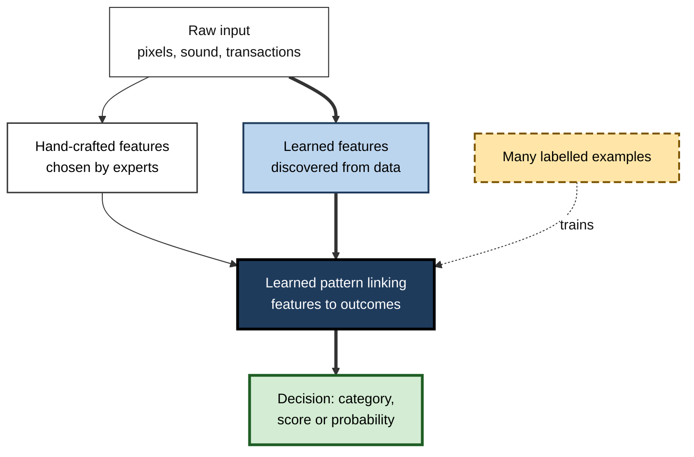
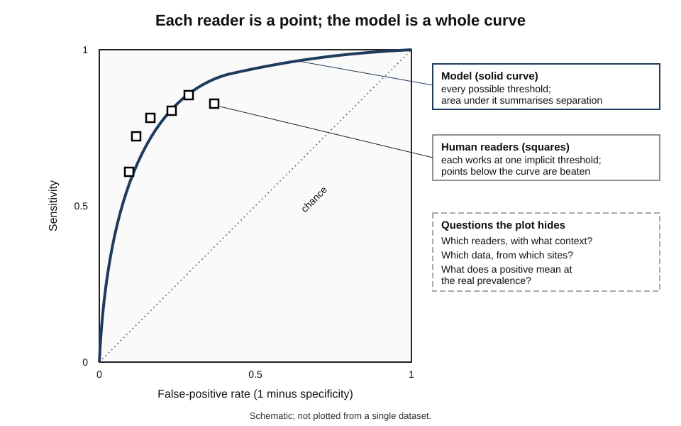
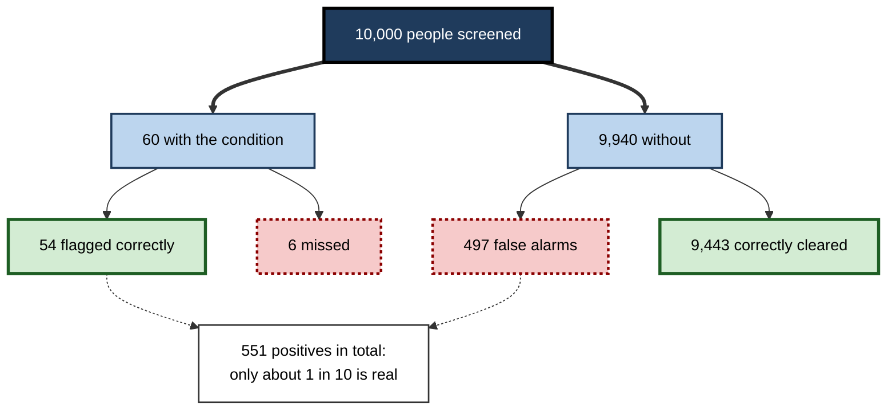
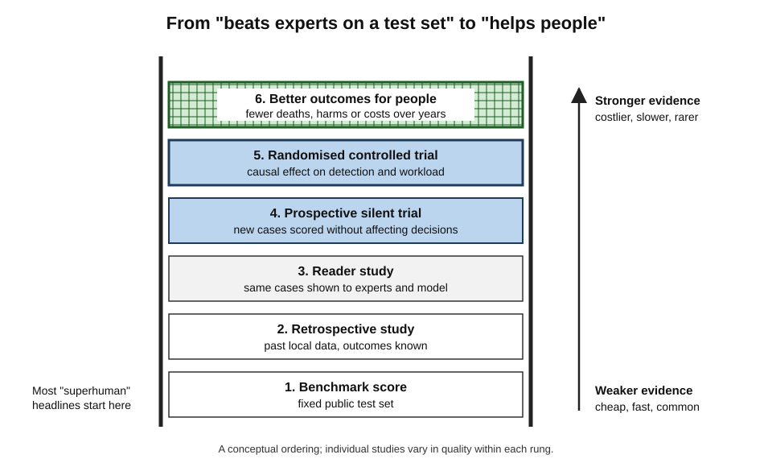
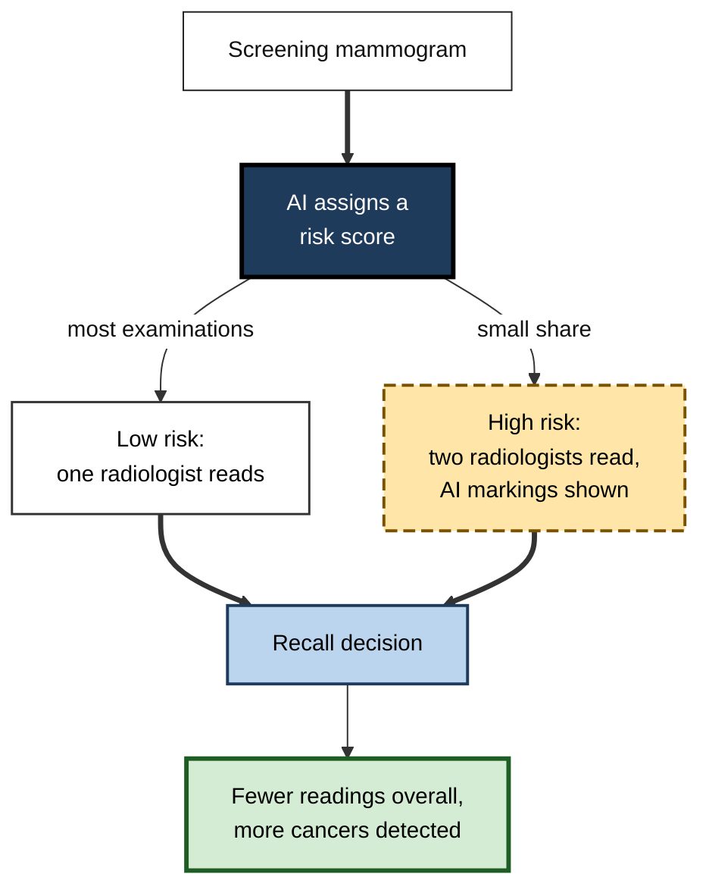
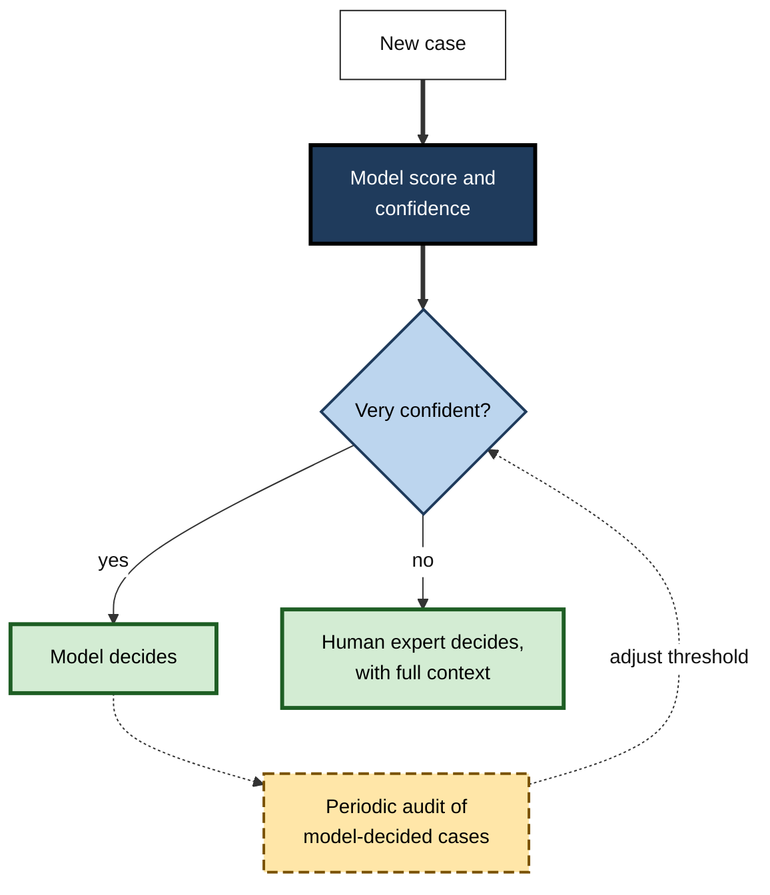

# F.3. AI and pattern recognition at superhuman levels

An eye specialist cannot tell from a photograph of the back of the eye whether it belongs to a man or a woman; a neural network trained on such photographs can, almost every time. A breast-screening programme in Sweden lets software sort mammograms by risk and finds more cancers while radiologists read far fewer images. In each case a machine detects a **pattern** that is real, useful and, for people, hard to see.

> **Definition — Pattern recognition:** identifying regularities in data and using them to assign new inputs to categories or to predict values.

> **Definition — Superhuman performance:** measured performance that exceeds that of skilled human experts on a specific, defined task under specified test conditions.

**Why it matters**

- Pattern recognition is the capability behind most of AI's celebrated successes — medical imaging, speech recognition, fraud detection, protein-structure prediction.
- "Superhuman" claims drive investment, regulation and adoption decisions; professionals must be able to judge them.
- The phrase hides crucial qualifications: **which task, which humans, which data, which conditions**.
- Used well, superhuman pattern recognition can make experts faster and more accurate; misread, it leads to misplaced trust.

---

## How Pattern Recognition Works

### From signal to decision

- **Input** — raw data: pixels, sound waves, transactions, sensor readings, text.
- **Features** — measurable properties that help distinguish one category from another.
  - *e.g.* edges and textures in an image; frequencies in a sound; amount and location in a payment.
- **Pattern** — a relationship between features and an outcome, learned from labelled examples.
- **Decision** — a category, score or probability for a new input.

> **Definition — Feature:** a measurable property of an input used to recognise patterns.

> **Definition — Label:** the known correct answer attached to a training example, such as "cancer" or "no cancer".

### Hand-crafted and learned features

- **Hand-crafted features** — chosen by human experts.
  - *e.g.* "count the number of dark, irregular regions in the image".
  - Limited by what experts can articulate.
- **Learned features** — discovered by the model from data, as in deep learning.
  - Layers of a neural network build features of rising complexity: edges → textures → shapes → objects.
  - Not limited to what experts can describe — which is why models can find patterns people have never named.

**Figure 1.** The path from raw data to a recognised pattern.

### What humans bring to pattern recognition

- **Remarkable perception** — people recognise faces, voices and objects effortlessly, in poor light, from odd angles, after one glimpse.
- **Learning from few examples** — a child learns "giraffe" from one picture book.
- **Context** — a doctor combines the image with the patient's history, symptoms and how the patient looks in the room.
- **Common-sense checks** — an expert notices when a reading is impossible.
- **Limits:**
  - attention and fatigue;
  - a career-limited number of examples;
  - difficulty perceiving very subtle, high-dimensional or non-visual patterns.

### Why machines can exceed humans on defined tasks

- **More examples than a career** — a model can be trained on hundreds of thousands or millions of labelled cases; a specialist may see tens of thousands in a working lifetime.
- **High-dimensional data** — models process thousands of variables at once; people can attend to a handful.
- **Subtle signals** — tiny differences in pixel intensity, texture or timing that the eye or ear cannot resolve.
- **Many weak signals combined** — individually useless cues that together predict well.
- **Non-human senses** — spectra, radio signals, vibration, genomic sequences.
- **Consistency** — the same image gets the same score at the end of the day as at the start.

### Human and machine pattern recognition compared

| | Skilled human expert | Deep-learning model |
|---|---|---|
| Examples needed to learn | Few, combined with explanation | Very many labelled cases |
| Patterns it can perceive | Those visible to human senses and nameable | Any pattern present in the data, including invisible ones |
| Use of context | Rich — history, conversation, common sense | Only what is in the input |
| Behaviour on unusual cases | Often adapts | Often fails without warning |
| Consistency | Varies with fatigue and workload | High for a fixed model |
| Ability to explain | Can usually give reasons | Usually cannot |

> **Key point:** machines are superhuman at **detecting statistical regularities in large, well-labelled datasets**; humans remain stronger at **learning from little, using context and coping with the unfamiliar**.

---

## Landmark Examples

### Seeing what experts cannot: the retina

**Study card — Poplin and colleagues (2018), Google and collaborators, *Nature Biomedical Engineering***

- **Design:** deep-learning models were trained on retinal photographs from around 280,000 patients and tested on separate datasets.
- **Results:**
  - the models predicted **age** within a few years on average, **smoking status**, **blood pressure** and **sex** — the last with very high accuracy;
  - eye specialists cannot tell sex from retinal photographs at better than chance.
- **Follow-up analysis:** highlighting which image regions drove each prediction suggested, for example, that blood vessels mattered for blood-pressure predictions.
- **Conclusion:** the images contained information that human experts did not know was there. Learned features had found a **genuinely new pattern**.

> **Watch out:** detecting a pattern is not explaining it. The models showed *that* retinal images carry this information; they did not show *why*, and prediction of risk factors is not the same as better patient outcomes.

- **A related, troubling finding:** researchers have also shown that models can predict patients' self-reported race from chest X-rays and other medical images, which radiologists cannot do — raising concern that models may use such hidden signals in ways nobody intended.

### Breast-cancer screening

**Study card — McKinney and colleagues (2020), Google Health and partners, *Nature***

- **Design:** an AI system was trained and tested on screening mammograms from the United Kingdom and the United States, with outcomes known from follow-up.
- **Results:**
  - compared with the original radiologists' decisions, the system reduced both **false positives** and **false negatives** in both countries;
  - in a separate reader study, it outperformed each of six US radiologists, measured by the area under the curve;
  - in a simulation of the UK double-reading process, it could have replaced the second reader while maintaining performance and reducing workload substantially.
- **Criticism:** a group of independent scientists argued in *Nature* that the study did not share enough code and detail for others to reproduce it.
- **Conclusion:** strong **retrospective** evidence of superhuman performance on a defined task — but retrospective results are not the same as real-world benefit.

> **Definition — Retrospective study:** an evaluation using data collected in the past, where outcomes are already known.

> **Definition — Prospective study:** an evaluation in which the system is used on new cases as they arrive, with outcomes followed forward in time.

### Hearing and lip-reading

- **Speech recognition** — on some standard benchmarks of transcribing clear conversational speech, systems reached error rates comparable to professional transcribers around 2016–2017.
- **Lip-reading** — a 2017 system from the University of Oxford and DeepMind, trained on thousands of hours of television broadcasts, read sentences from silent video far more accurately than a professional lip-reader on the same test material.

### Finding faint signals in science

- **Exoplanets** — in 2017–2018, a neural network trained on labelled signals from NASA's Kepler space telescope identified previously missed planets, including an eighth planet around the star Kepler-90.
- **Particle physics** — pattern-recognition models sift collision data at rates and subtleties beyond human inspection.
- **Protein structure** — learned models now predict three-dimensional protein structures with accuracy approaching laboratory methods for many proteins.

> **Key point:** the common thread is **abundant, well-labelled data about a fixed question**. Where such data exist, machine pattern recognition can exceed expert humans.

---

## Superhuman, but Not Human-Like

### Machines use different cues

**Study card — Geirhos and colleagues (2019), University of Tübingen, presented at ICLR**

- **Design:** standard image-recognition networks and human observers classified "cue-conflict" images — for example, the shape of a cat filled with the texture of elephant skin.
- **Results:**
  - humans overwhelmingly classified by **shape** ("cat");
  - networks trained on a standard large image dataset mostly classified by **texture** ("elephant").
- **Follow-up:** training networks on images with randomised textures made them rely more on shape and become more robust to some image distortions.
- **Conclusion:** a model can match or exceed human accuracy on ordinary images while using **quite different evidence** — which helps explain its surprising failures on unusual images.

> **Definition — Shortcut learning:** a model's reliance on cues that predict the label in its training data but are not the features that genuinely define the category.

> **Watch out:** equal accuracy does not mean equal understanding. Two classifiers — or a classifier and a person — can reach the same score for completely different reasons, and will fail in different situations.

### What "superhuman" leaves out

- **Superhuman on what?** — one task (detecting cancer on a mammogram), not the job (caring for a patient).
- **Compared with whom?** — average clinicians, specialists, or a panel of experts?
- **Under what conditions?** — humans in reader studies often lack the prior images, history and clinical context they would normally use.
- **On which data?** — data from the same hospitals and machines as training, or genuinely new sites?
- **Measured how?** — one summary number can hide poor performance in some groups or settings.

> **Mnemonic — "WWCDM":** What task, Whom compared, Conditions, Data, Measure — the five questions behind any superhuman claim.

---

## Reading Performance Claims

### The measures that matter

> **Definition — Sensitivity:** the share of true positive cases that a test correctly identifies.

> **Definition — Specificity:** the share of true negative cases that a test correctly clears.

> **Definition — Positive predictive value (PPV):** the share of positive results that are truly positive.

> **Definition — Area under the curve (AUC):** a summary of how well a score separates positives from negatives across all thresholds; 0.5 is chance and 1.0 is perfect.

- **Trade-off:** raising sensitivity (catching more cases) usually lowers specificity (more false alarms), and the reverse.
- **The curve:** plotting sensitivity against the false-positive rate at every threshold gives a **receiver operating characteristic (ROC) curve**.
- **Human readers** appear as single points — each person works at one implicit threshold.

**Figure 2.** A model's trade-off curve compared with individual human readers.

### Worked example (illustrative): what a positive result means

- **Situation:** a screening model with **90% sensitivity** and **95% specificity** is used on 10,000 people, of whom **0.6%** have the condition.

| | Condition present (60) | Condition absent (9,940) |
|---|---|---|
| Model positive | 54 true positives | 497 false positives |
| Model negative | 6 false negatives | 9,443 true negatives |

*Illustrative figures.*

1. Sensitivity: 54 ÷ 60 = 90% — most cases are caught.
2. Specificity: 9,443 ÷ 9,940 = 95% — most healthy people are cleared.
3. But of 551 positive results, only 54 are real.

> **Formula — Positive predictive value:** PPV = true positives ÷ (true positives + false positives) = 54 ÷ (54 + 497) ≈ **9.8%**.

- **Conclusion:** at low prevalence even an excellent model produces mostly false alarms. Whether that is acceptable depends on the cost of follow-up and the harm of a missed case.

> **Watch out:** a model can be "superhuman" on AUC and still produce a flood of false positives in a low-prevalence population. Always ask what the results mean **at the real prevalence**.

**Figure 3.** Natural frequencies for a screening test at low prevalence.

### Levels of evidence

| Evidence | What it shows | What it cannot show |
|---|---|---|
| Benchmark score | Performance on a fixed public test set | Performance on real, messy cases |
| Retrospective study | Accuracy on past local data | Effect on decisions and workflow |
| Reader study | Comparison with clinicians on the same images | Clinicians' real performance with full context |
| Prospective study | Performance on new cases as they arrive | Whether outcomes improve compared with no AI |
| Randomised controlled trial | Causal effect on detection, workload, outcomes | Long-term effects; other settings |

**Figure 4.** A ladder of evidence for pattern-recognition claims.

> **Remember:** superhuman on a benchmark is the **bottom rung**. Benefit to people is established only near the top.

---

## From Superhuman Detection to Real-World Benefit

### Case study: AI-supported mammography screening in Sweden (MASAI, 2021 onwards)

- **Situation:** European breast-screening programmes usually have every mammogram read independently by **two** radiologists — accurate but labour-intensive, and radiologists are scarce.
- **Design:** a randomised controlled trial within the Swedish national screening programme enrolled more than 100,000 women, assigned either to standard double reading or to an AI-supported pathway.
- **The AI-supported pathway:**
  1. software gave each examination a **risk score**;
  2. low-risk examinations were read by **one** radiologist;
  3. high-risk examinations were read by **two**, with the AI's markings available;
  4. the very highest-risk examinations were flagged for particular attention.
- **Screening results (published 2025):**
  - cancer detection rose from about **5.0 to 6.4 per 1,000** women screened — roughly 29% more cancers found;
  - false positives did not rise;
  - radiologists' screen-reading workload fell by about **44%**.
- **Interval-cancer results (published afterwards):** cancers diagnosed between screening rounds — the key safety measure — were about **12% lower** in the AI arm (roughly 1.55 against 1.76 per 1,000), meeting the trial's test that AI-supported screening was not worse.
- **Caveats:**
  - one country, one commercial system, one screening protocol;
  - detecting more cancers can include some slow-growing cancers that would never have caused harm — **overdiagnosis** — which the trial's later analyses must address;
  - long-term effects on deaths from breast cancer are not yet known.
- **Lesson:** superhuman pattern recognition created value when it was embedded in a **workflow designed around it** and tested in a **randomised trial** — not when it simply replaced a person.

> **Definition — Interval cancer:** a cancer diagnosed between scheduled screening rounds, after a screen judged normal; a key measure of what screening missed.

> **Definition — Overdiagnosis:** detection of a condition that would never have caused symptoms or harm in the person's lifetime.

**Figure 5.** Risk-based routing of mammograms in an AI-supported screening pathway.

### Combining people and machines

- **Second reader** — the AI reads independently; disagreements are reviewed.
- **Triage** — the AI sorts cases by risk so that people focus on the difficult ones, as in MASAI.
- **Decision referral** — the AI decides only the cases on which it is very confident and refers the rest to people.
  - A 2022 German study of mammography reported that such a split could improve both sensitivity and specificity compared with radiologists alone.
- **Concurrent assistance** — the AI's output is shown to the person while they decide.
  - Risk: the person defers to the machine even when it is wrong.

| Design | Who decides | Main benefit | Main risk |
|---|---|---|---|
| Second reader | Person, with AI as a check | Catches some human misses | Extra workload from disagreements |
| Triage | Person, on AI-ordered work | Workload saved on easy cases | Low-risk errors get less scrutiny |
| Decision referral | AI on confident cases, person on others | Uses each where strongest | Confident AI errors go unseen |
| Concurrent assistance | Person, seeing AI output | Fast, familiar | Over-reliance on wrong outputs |

> **Watch out:** experiments with radiologists have found that giving them AI predictions did **not** improve their average accuracy, even when the AI alone was more accurate than most of them — they helped when the AI was confident and were misled when it was uncertain. Superhuman components do not automatically make superhuman teams.

**Figure 6.** Decision referral: the machine decides only where it is most reliable.

### From laboratory to clinic: why superhuman results shrink

- **Different machines and settings** — images from another manufacturer or hospital can lower accuracy.
- **Different populations** — prevalence, age and ethnicity differ from the training data.
- **Workflow friction** — poor integration, slow software or extra clicks reduce use.
- **Missing context** — the model sees the image; the clinician sees the patient.
- **Changing practice** — new equipment and protocols shift the data over time.

> **In practice:** organisations that succeed with pattern-recognition AI run a **local silent trial** first — the model scores real cases without influencing decisions — then compare its results with outcomes before letting it affect care or customers.

### Case study (illustrative): fraud detection at a payments firm

- **Situation:** a payments company's analysts reviewed transactions flagged by simple rules; they caught obvious fraud but missed coordinated schemes spread across many small payments.
- **Action:**
  1. a model was trained on two years of labelled transactions, using hundreds of features — timing, device, merchant, network of linked accounts;
  2. in a silent trial, it ran alongside the rules for two months;
  3. it detected clusters of linked accounts making small payments that no analyst had connected.
- **Result:** fraud losses fell and analysts spent their time on networks of suspicious accounts rather than single transactions.
- **Side effect:** the model's false positives fell disproportionately on customers making unusual but legitimate payments — such as travellers — so a fast route to unblock cards was added.
- **Lesson:** superhuman detection of **combinations of weak signals** is where machines most clearly outdo people; the human role shifts to investigating, deciding and handling the errors.

---

## Expert Judgement About Superhuman Claims

- **Ask what the pattern is** — and whether it is the one intended, or a shortcut.
- **Ask for performance at the real prevalence** — not only AUC.
- **Ask who the humans were and what they were allowed to see** — reader studies often handicap clinicians.
- **Ask for external validation** — new sites, new equipment, new populations.
- **Ask about subgroups** — a good average can hide poor performance for some groups.
- **Ask what changes in the workflow** — and whether outcomes, not just accuracy, improve.
- **Ask what happens on failure** — how errors will be caught and who is accountable.

> **Key point:** the most important professional skill is not admiring the machine's accuracy but knowing **what the accuracy figure is evidence of** — and what it is not.

---

## Open Questions

- **Do superhuman detection results improve long-term outcomes?**
  - Screening trials have shown more cancers found and less workload; whether deaths fall, and how much overdiagnosis rises, is not yet settled.
- **What are models actually seeing?**
  - When a model detects patterns invisible to experts, it is hard to know whether the signal is biological, technical or an artefact of how data were collected.
- **Will human expertise erode?**
  - If machines handle most routine cases, it is unclear how future experts will gain the experience needed to catch machine errors.
- **How should human–AI teams be designed?**
  - Evidence shows that adding AI to human decisions can help, harm or do nothing depending on design; general principles are still emerging.
- **How far does superhuman performance travel?**
  - Results often weaken at new sites; how to build models that hold up across settings remains an active research question.

---

## Summary

- **Pattern recognition** = learning regularities from data to categorise or predict; **superhuman** = beating skilled experts on a **specific task under specific conditions**.
- Machines excel because of **more examples than a career**, **high-dimensional data**, **subtle and non-human signals**, combining **many weak cues**, and **consistency**.
- Humans remain stronger at **learning from few examples**, using **context** and coping with the **unfamiliar**.
- Landmarks: retinal images revealing **sex, age and blood pressure** (Poplin, 2018); **mammography** outperforming radiologists retrospectively (McKinney, 2020); lip-reading, speech, exoplanets, protein structures.
- Machines may use **different cues** — texture rather than shape (Geirhos, 2019) — so equal accuracy does not mean equal understanding.
- Read claims with **WWCDM**: What task, Whom compared, Conditions, Data, Measure.
- **Sensitivity, specificity, PPV and AUC**; at low prevalence even excellent models produce many **false positives**.
- Evidence climbs from **benchmarks** to **retrospective**, **reader**, **prospective** studies and **randomised trials**.
- **MASAI**: AI triage found about 29% more cancers with 44% less reading workload and fewer interval cancers.
- Human–AI designs (second reader, triage, decision referral, concurrent assistance) have distinct benefits and risks; superhuman parts do not guarantee superhuman teams.

---

## Self-Check

1. Define pattern recognition and superhuman performance, and explain why the second always needs qualifying.
2. Distinguish hand-crafted from learned features and explain why learned features can find new patterns.
3. Give four reasons machines can exceed human experts at pattern recognition.
4. What did Poplin and colleagues find, and what did they not show?
5. What did McKinney and colleagues report, and what criticism followed?
6. Explain the texture-versus-shape finding and why it matters.
7. What is shortcut learning?
8. A model has 95% sensitivity and 90% specificity; prevalence is 1% in 20,000 people. Calculate the PPV.
9. Why can a model with a high AUC still be unsuitable for a screening programme?
10. Describe the MASAI design and its main results.
11. Why is detecting more cancers not automatically a benefit?
12. Compare triage and decision referral as ways of combining people and AI.
13. A vendor says its dermatology app is "more accurate than dermatologists". Apply WWCDM.
14. A hospital's radiologists were given AI predictions, but their accuracy did not improve. Suggest explanations and design changes.

### Answer Key

1. Pattern recognition: learning regularities in data to categorise or predict. Superhuman: exceeding skilled experts on a defined task under defined conditions. It needs qualifying because a result depends on the task, the comparison humans, the data and the measure; superiority on one does not transfer to others.
2. Hand-crafted features are chosen by experts and limited to what they can describe; learned features are discovered by the model from data and can capture regularities no one has named.
3. Far more training examples than a career; processing thousands of variables at once; detecting subtle or non-human signals; combining many weak cues; consistency without fatigue.
4. Models predicted age, smoking, blood pressure and sex from retinal photographs — sex with high accuracy, which experts cannot do. They did not explain the biology or show improved patient outcomes.
5. The system reduced false positives and false negatives versus original radiologists in UK and US data, beat six radiologists in a reader study and could have replaced the second UK reader. Independent scientists criticised the lack of shared code and detail for reproduction.
6. Humans classify cue-conflict images by shape; standard networks largely by texture. Models can reach human-level accuracy using different evidence, so they fail differently, especially on unusual images.
7. Reliance on cues that predict the label in training data but are not the genuine defining features of the category.
8. 200 have the condition: 190 true positives. 19,800 do not: 10% false positives = 1,980. PPV = 190 ÷ 2,170 ≈ 8.8%.
9. AUC summarises separation across all thresholds; at low prevalence the chosen threshold may still produce many false positives, overwhelming follow-up services and harming people with unnecessary tests.
10. A randomised trial of over 100,000 women in Sweden: AI risk-scored examinations; low-risk ones had one reader, high-risk two. Detection rose from about 5.0 to 6.4 per 1,000 without more false positives; reading workload fell about 44%; interval cancers were about 12% lower.
11. Some extra cancers may be slow-growing and never harmful (overdiagnosis), leading to unnecessary treatment; benefit requires fewer deaths or serious illness, which takes years to show.
12. Triage: AI orders or routes cases and people still decide all of them, saving effort on easy ones but risking less scrutiny of low-risk errors. Decision referral: AI decides confident cases outright and refers the rest, using each where strongest but leaving confident AI errors unseen unless audited.
13. What task — classifying photographs of lesions, or diagnosing patients? Whom compared — general practitioners, dermatologists, a panel? Conditions — did dermatologists see only photos, without history or touch? Data — from the same clinics and skin types as training, or new ones? Measure — AUC, sensitivity at what specificity, performance across skin tones?
14. Radiologists may underweight the AI or treat it as independent of their own view; they may be misled when the AI is uncertain; the display may be poorly designed. Changes: show confidence; use AI for triage or referral rather than concurrent display; train readers on when the AI is reliable; audit and feed back results.

---

## Glossary

| Term | Meaning |
|---|---|
| Area under the curve (AUC) | A summary of how well a score separates positives from negatives; 0.5 is chance, 1.0 perfect. |
| Decision referral | A design in which AI decides confident cases and refers the rest to people. |
| Feature | A measurable property of an input used to recognise patterns. |
| Interval cancer | A cancer diagnosed between screening rounds after a normal screen. |
| Label | The known correct answer attached to a training example. |
| Learned features | Features discovered by a model from data rather than chosen by people. |
| Overdiagnosis | Detection of a condition that would never have caused harm. |
| Pattern recognition | Learning regularities in data to categorise or predict. |
| Positive predictive value (PPV) | The share of positive results that are truly positive. |
| Prospective study | An evaluation on new cases as they arrive. |
| Reader study | A comparison of AI and human experts on the same set of cases. |
| Retrospective study | An evaluation using past data with known outcomes. |
| ROC curve | A plot of sensitivity against false-positive rate across thresholds. |
| Sensitivity | The share of true positive cases correctly identified. |
| Shortcut learning | Reliance on cues that predict the label in training data but do not define the category. |
| Specificity | The share of true negative cases correctly cleared. |
| Superhuman performance | Exceeding skilled experts on a defined task under defined conditions. |
| Triage | Sorting cases by priority or risk. |
