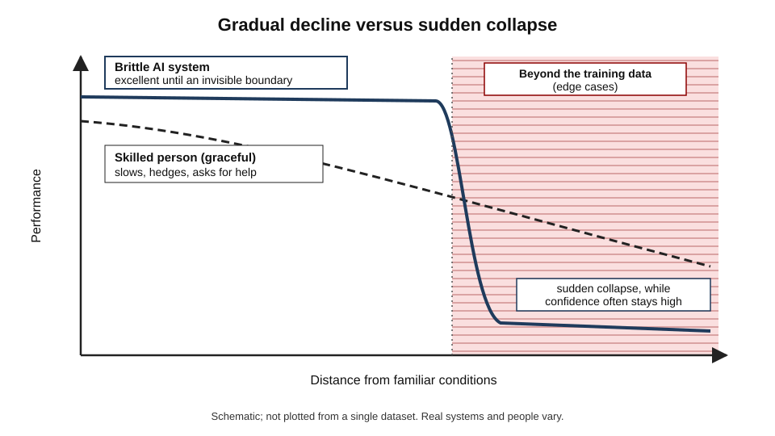
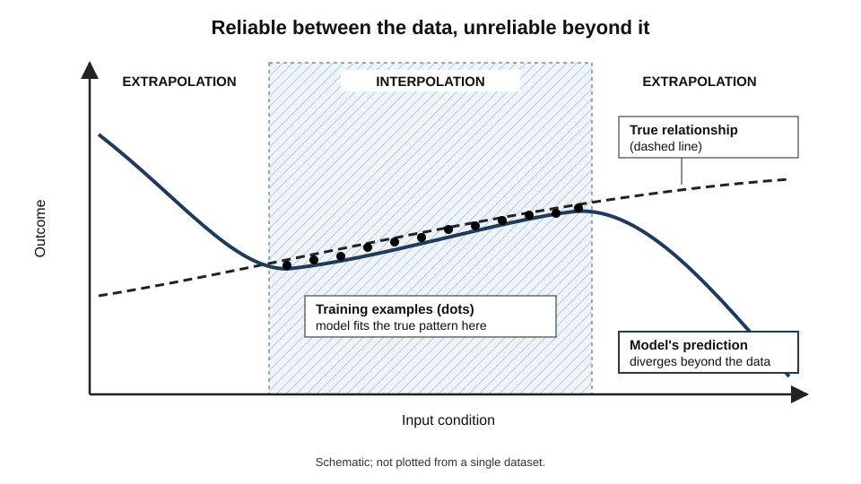
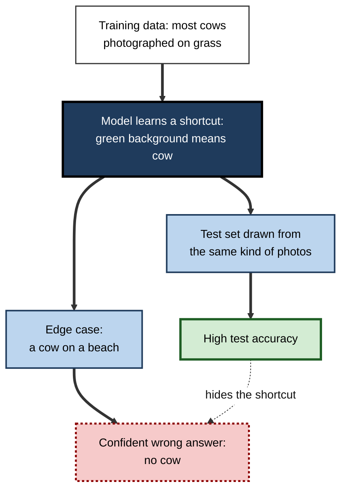
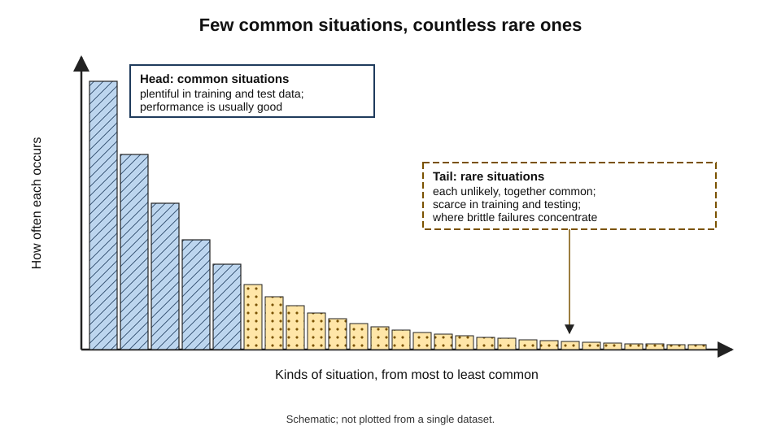
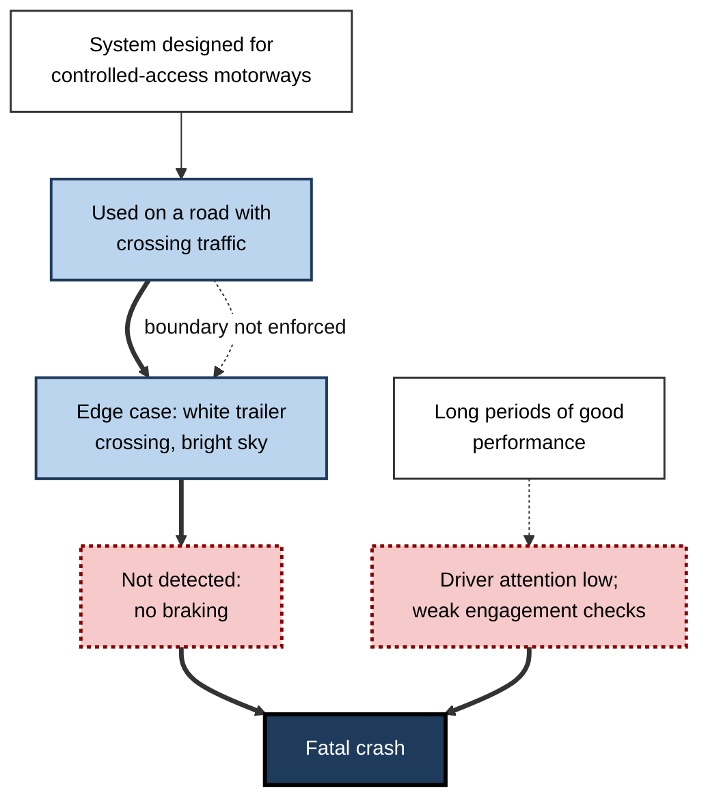
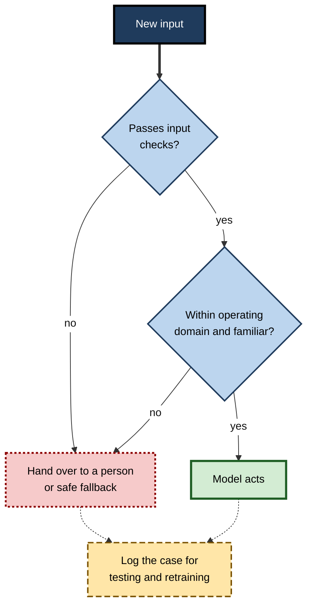

# F.4. AI brittleness: failing on edge cases

An image classifier that labels cows with near-perfect accuracy sees no cow in a photograph of one on a beach, because nearly every cow it learned from stood on grass. A language model solves a school word problem, then fails when one irrelevant sentence is added. Each system worked on the **common case** and failed suddenly on an **uncommon one**.

> **Definition — Brittleness:** the tendency of an AI system to perform well on inputs like those it was built on but to fail abruptly — often confidently and without warning — on inputs that differ, sometimes only slightly, from them.

> **Definition — Edge case:** an unusual input or situation at or beyond the boundary of the conditions a system normally meets.

**Why it matters**

- Brittleness is the main reason impressive demonstrations fail to become reliable products.
- Failures concentrate in the **rare, unusual, high-stakes** moments — exactly where reliability matters most.
- Brittle systems fail **without signalling** that they are out of their depth, so people do not know when to step in.
- Understanding brittleness tells a professional where to test, where to keep human judgement and how to design safe fallbacks.

---

## What Brittleness Looks Like

### Graceful and brittle failure

- **Graceful degradation** — performance falls gradually as conditions get harder, and the system (or person) recognises the difficulty.
  - *e.g.* an experienced driver in fog slows down, uses more caution and pulls over if needed.
- **Brittle failure** — performance holds until conditions cross some invisible boundary, then collapses.
  - *e.g.* a lane-keeping system follows faded road markings perfectly, then steers towards a tar seam that looks like a line.

> **Definition — Graceful degradation:** a gradual, recognisable decline in performance as conditions worsen, rather than a sudden collapse.

| | Graceful (typical of skilled people) | Brittle (typical of many AI systems) |
|---|---|---|
| Response to unfamiliar input | Slows, hedges, asks for help | Answers as if the input were familiar |
| Confidence on failure | Usually drops | Often stays high |
| Size of change that causes failure | Usually large | Can be tiny or irrelevant |
| Predictability of failure | Often foreseeable | Often surprising |
| Warning to others | Visible hesitation | None |

**Figure 1.** Graceful and brittle decline as conditions move away from the familiar.

### Everyday examples

- **Image recognition** — a sign partly covered by snow or stickers; an object seen from an unusual angle; a photograph taken in poor light.
- **Speech recognition** — a strong accent, a noisy room, an unusual name, a child's voice.
- **Document processing** — a new invoice layout, a handwritten note, a scanned page upside down.
- **Language models** — a familiar question phrased in an unfamiliar way; an irrelevant detail added; a request slightly outside the common pattern.
- **Recommendation and forecasting** — a sudden change in behaviour, such as panic-buying at the start of a pandemic.
- **Robots and vehicles** — unusual road users, temporary road layouts, reflective surfaces.

> **Key point:** brittleness is not about difficulty as people judge it. A system can fail on something a child finds trivial and succeed on something an expert finds hard.

---

## Why Brittleness Happens

### Learning the training distribution

- **Models learn from examples** — they capture the patterns in the data they were trained on.
- **The training distribution** — the range and frequency of situations represented in those examples.
- **Interpolation** — answering for new inputs that fall *between* training examples; usually reliable.
- **Extrapolation** — answering for inputs *outside* the range of training examples; often unreliable.

> **Definition — Training distribution:** the range and frequency of inputs and situations represented in the data a model learned from.

> **Definition — Out-of-distribution (OOD) input:** an input that differs meaningfully from anything in the training distribution.

**Figure 2.** A model fits well where it has data and can go badly wrong beyond it.

### Shortcuts instead of concepts

- **The model finds whatever pattern predicts the label** — not necessarily the one people intend.
  - *e.g.* "green background" predicts "cow" in most farm photographs.
- **Spurious correlation** — a feature that predicts the label in the training data but is not causally connected to it.
- **When the shortcut breaks** — a cow on a beach — the model fails, because it never learned what a cow *is*.

> **Definition — Spurious correlation:** a statistical association in the data that does not reflect a genuine or stable relationship.

### No model of how the world works

- **People reason with causes** — a person knows a cow is still a cow on sand, because cows are animals that can walk anywhere.
- **Most AI systems learn associations** — what tends to go with what, not why.
- **Without causal knowledge**, there is no principled way to handle a combination never seen before.

### Confidence without competence

- **Many models output a confidence score** — but it reflects similarity to training patterns, not genuine reliability.
- **On out-of-distribution inputs, confidence often remains high** — the model has no concept of "I have never seen anything like this".
- **Calibration** — the match between stated confidence and actual accuracy — usually worsens away from the training distribution.

> **Definition — Calibration:** the degree to which a model's stated confidence matches how often it is actually right; a well-calibrated model that says "80% sure" is right about 80% of the time.

**Figure 3.** How a shortcut learned from typical data produces a confident error on an edge case.

### The causes compared

| Cause | What goes wrong | Typical example |
|---|---|---|
| Narrow training distribution | Situations never seen are handled by guesswork | A pedestrian-detection system trained mostly in daylight |
| Spurious correlation | The model relies on a cue that breaks | Background predicting animal type |
| No causal understanding | Novel combinations cannot be reasoned about | A familiar object in an unusual place |
| Poor calibration | High confidence on failure | A classifier "99% sure" of a wrong label |
| Closed-world assumption | Every input forced into a known category | A new product type labelled as the nearest old one |

> **Definition — Closed-world assumption:** building a classifier as if every input must belong to one of the categories it knows, with no option of "none of these".

> **Mnemonic — "NSNPC" — "Narrow Shortcuts, No Proper Confidence":** Narrow data, Shortcuts, No causal model, Poor calibration, Closed world — the five roots of brittleness.

---

## The Long Tail

### Why edge cases are unavoidable

- **The world has a long tail** — a few situations are very common; a vast number are individually rare.
- **Together, rare cases are common** — any single odd situation is unlikely, but *some* odd situation happens all the time.
- **Training data under-represent the tail** — rare situations appear rarely, or never, in collected data.
- **Testing under-represents the tail too** — a test set drawn from the same data contains the same few rare cases.

> **Definition — Long tail:** a distribution in which a small number of situations are very common and a very large number are each rare, so that rare situations collectively make up a substantial share of all cases.

**Figure 4.** The long tail of situations a deployed system must handle.

### Rare per case, certain at scale

> **Formula — Chance of meeting at least one rare event:** P = 1 − (1 − p)ⁿ, where *p* is the chance per case and *n* the number of cases. If a dangerous situation occurs once in 1,000,000 journeys (p = 0.000001) and a fleet makes 10,000,000 journeys, P = 1 − (0.999999)^10,000,000 ≈ **0.99995** — practically certain (illustrative figures).

- **Implication:** at scale, "very rare" means "will happen". A fleet of vehicles, a national benefits system or a global chatbot will meet its edge cases daily.

> **Watch out:** "it worked in all our tests" says little about rare cases. A test set of 10,000 examples may contain none of the one-in-a-million situations the system will meet in its first week of real use.

---

## Evidence of Brittleness

### Recognition in unfamiliar places

**Study card — Beery, Van Horn and Perona (2018), California Institute of Technology, "Recognition in Terra Incognita"**

- **Design:** image classifiers were trained to identify animals in photographs from motion-triggered camera traps at some locations, then tested at the same locations and at **new** locations.
- **Results:**
  - accuracy was far lower at new locations than at familiar ones;
  - models had learned features of the **backgrounds** — particular trees, rocks and lighting — as well as of the animals.
- **Conclusion:** strong performance on test images from familiar locations overstated how the models would perform when moved. The paper's opening example — a cow on a beach that a model failed to recognise — became a standard illustration of brittleness.

### Familiar objects, unusual views

**Study card — ObjectNet (Barbu and colleagues, MIT and IBM, presented at NeurIPS 2019)**

- **Design:**
  - workers photographed household objects in their homes while being told to vary **rotation, background and viewpoint** in controlled ways;
  - leading object-recognition models, trained on a standard large dataset, were tested on the new images.
- **Results:** accuracy fell by roughly **40 to 45 percentage points** compared with the standard benchmark.
- **Conclusion:** benchmark images are biased towards typical views — upright objects, clear backgrounds, centred framing. Real-world variation that people barely notice can halve a model's accuracy.

- **Related findings:**
  - adding ordinary corruptions such as fog, blur or digital noise to images causes large accuracy drops in many models;
  - rendering a familiar object such as a school bus in an unusual 3-D pose led classifiers to label it as a punching bag or a snowplough.

### Brittleness in language models

**Study card — GSM-Symbolic (Mirzadeh and colleagues, Apple, 2024)**

- **Design:**
  - researchers took a widely used set of grade-school mathematics word problems and generated variants by changing **names and numbers** while keeping the logic identical;
  - a further variant added a single sentence that seemed relevant but did not affect the answer.
- **Results:**
  - accuracy varied noticeably across versions that differed only in names or numbers;
  - adding the irrelevant sentence caused **large drops** — in some models, dramatic ones — as models tried to use the extra information in the calculation.
- **Conclusion:** strong benchmark scores partly reflect familiarity with the **surface form** of problems. The authors argued that such behaviour fits pattern matching better than robust reasoning.

> **Watch out:** the interpretation is **debated**. Some researchers argue that newer reasoning-oriented models are much less affected, and that some drops reflect ambiguity in the added sentences. The finding that small, irrelevant changes can shift answers is well supported; how deep the limitation runs is contested.

> **Example:** a model correctly answers "Oliver picks 44 kiwis on Friday and 58 on Saturday; on Sunday he picks twice Friday's number. How many kiwis does he have?" — but when told "five of Sunday's kiwis were a bit smaller than average", subtracts five, although size does not change the count.

---

## Case Study: The Florida Autopilot Crash (May 2016)

- **Situation:** a driver was using a driver-assistance system — which kept a car in its lane and controlled its speed — on a divided highway in Florida.
- **Event:**
  1. a lorry towing a white trailer turned left across the car's path;
  2. according to the manufacturer, neither the system nor the driver recognised the white side of the trailer against a brightly lit sky;
  3. the car did not brake and passed under the trailer; the driver was killed.
- **Investigation (US National Transportation Safety Board, 2017):**
  - the system was designed for motorways with controlled access, not roads with crossing traffic — it was operating **outside the conditions it was designed for**;
  - the system's detection was not designed to recognise a vehicle crossing in front at that angle;
  - the driver had relied on the system for long periods with little attention, and the system's way of monitoring driver engagement was judged inadequate;
  - the system allowed use on roads for which it was not designed.
- **Lessons:**
  - an **edge case** — an unusual crossing angle, colour and lighting — met a system with no means of recognising it was out of its depth;
  - long stretches of good performance encouraged **over-reliance**, so the human fallback was not ready;
  - the boundaries of safe operation must be **enforced**, not just documented.

**Figure 5.** How an edge case and over-reliance combined in the 2016 crash.

- **A later edge case (San Francisco, October 2023):** a driverless taxi stopped after a pedestrian, struck by another car, was thrown into its path — then, misjudging the situation, attempted to pull over and dragged her several metres. California's motor-vehicle regulator suspended the operator's permit to run driverless vehicles. The system had not been designed for a person lying beneath the vehicle.

> **Key point:** both incidents involved situations that were **individually rare but foreseeable in aggregate** — the long tail in action.

---

## Managing Brittleness

### Define where the system may operate

> **Definition — Operational design domain (ODD):** the specific conditions — locations, road types, weather, lighting, speeds, input formats — under which a system is designed to operate safely.

- **State the domain** — exactly which inputs and conditions the system is built for.
- **Enforce the domain** — prevent use outside it (geofencing, input validation, refusal).
- **Monitor the domain** — detect when live inputs drift away from it.

### Detect the unfamiliar

- **Out-of-distribution detection** — methods that flag inputs unlike the training data.
- **Uncertainty estimation** — techniques such as **ensembles** (several models whose disagreement signals doubt).
- **Abstention** — allowing the system to say "I don't know" and pass the case on.
- **Input validation** — simple rule-based checks before the model runs (wrong format, missing fields, impossible values).

> **Definition — Ensemble:** a group of models whose combined or compared predictions are used; disagreement between members is a useful sign of uncertainty.

**Figure 6.** Keeping a system within its operating domain and handing over when it leaves it.

### Test the tail deliberately

- **Stress testing** — deliberately feeding unusual, degraded and combined inputs.
- **Scenario libraries** — collections of known edge cases, grown from incidents and near misses.
- **Slicing** — measuring performance separately for subsets (night-time images, handwritten forms, rare product types).
- **Red teaming** — people actively trying to make the system fail.
- **Simulation** — generating rare situations that cannot safely be staged, such as near-collisions.

### Worked example (illustrative): stress-testing an invoice reader

- **Situation:** a finance team's AI extracts supplier, date and amount from invoices. Its vendor reports 98% accuracy.

| Test slice | Share of real invoices | Accuracy |
|---|---|---|
| Standard PDF from major suppliers | 70% | 99% |
| Scanned paper invoice | 15% | 93% |
| New supplier layout never seen | 8% | 81% |
| Handwritten amendment on invoice | 2% | 40% |
| Multi-currency invoice | 5% | 72% |

*Illustrative figures.*

1. **Overall weighted accuracy:** (0.70 × 99) + (0.15 × 93) + (0.08 × 81) + (0.02 × 40) + (0.05 × 72) ≈ **94.1%** — below the vendor's 98%, because the vendor's test set was mostly standard PDFs.
2. **The edge slices** — handwritten amendments and multi-currency invoices — are the ones most likely to involve disputes or large sums.
3. **Decision:** automate standard PDFs; route new layouts, handwritten amendments and multi-currency invoices to a person.

- **Conclusion:** a single accuracy figure hides where the system is brittle. Slicing shows where to trust it.

> **Watch out:** the slices that are rare are often the ones that matter most. A 40% accuracy on 2% of invoices may account for most of the money at risk.

### Design for failure

- **Human fallback that is ready** — people trained and available, not distracted and deskilled.
- **Safe default actions** — stop, slow down, hold the case, ask a question.
- **Visible uncertainty** — show users when the system is unsure.
- **Feedback loops** — every edge case found becomes a test case.
- **Reversibility** — automated decisions that can be quickly undone.

> **In practice:** safety-critical industries (aviation, rail, medical devices) require a documented argument — a **safety case** — that a system is acceptably safe within its operating domain, including how it behaves at and beyond the edges.

### Case study (illustrative): the parcel-sorting robot

- **Situation:** a logistics company deployed robotic arms to pick parcels from a conveyor, using a vision model trained on millions of images of boxes and padded envelopes.
- **Problem:** in the run-up to a festival season, unusual items arrived — tubes for posters, gift-wrapped boxes with shiny paper, parcels with loose straps.
- **Failures:**
  - shiny paper confused the depth camera, so the arm misjudged distance;
  - loose straps were grasped as if they were the parcel, dropping items;
  - the system reported high confidence throughout.
- **Actions:**
  1. a simple rule rejected items whose depth readings were inconsistent, sending them to a manual station;
  2. engineers collected images of every failure and added them to training;
  3. a "festival test set" of unusual items became part of every software update.
- **Result:** error rates fell; manual handling rose briefly at peak but caught the edge cases safely.
- **Lesson:** brittleness cannot be designed out in advance; it is **managed** by recognising the unfamiliar, handing it over and learning from it.

---

## Why Brittleness Persists

- **The open world** — real environments contain endless novelty; no dataset can cover them.
- **Scale helps but does not cure** — larger models trained on more varied data are generally more robust, yet still fail on unusual combinations.
- **Benchmarks reward the typical** — standard tests over-represent common cases, so progress on them can mask little progress on the tail.
- **Unknown unknowns** — the most dangerous edge cases are those no one thought to test.
- **Human over-reliance grows with reliability** — the better a system usually is, the less ready people are when it fails.

> **Remember:** a system's reliability on **ordinary days** says little about its behaviour on **unusual ones**. Ask what it does when it meets something new.

---

## Open Questions

- **Will scale eventually remove brittleness?**
  - Larger, more general models handle more variation, but whether they will ever extrapolate as robustly as people is debated.
- **Can systems know when they do not know?**
  - Reliable out-of-distribution detection remains an unsolved research problem, especially for language models.
- **How much testing is enough?**
  - For rare-event risks, the miles or cases needed to show safety statistically can be enormous; simulation and argument must fill the gap.
- **Do causal models offer a cure?**
  - Learning causal structure might improve robustness, but methods that scale to real-world complexity are immature.
- **How should responsibility be shared when edge cases cause harm?**
  - Law and regulation are still settling who is accountable — designer, operator or supervising person.

---

## Summary

- **Brittleness** = good performance on familiar inputs, abrupt and often confident failure on unfamiliar ones; **edge cases** sit at or beyond the boundary of normal conditions.
- Skilled people usually degrade **gracefully**; many AI systems fail **brittlely**, without warning.
- Causes: **narrow training distributions**, **spurious correlations** and shortcuts, **no causal model**, **poor calibration** and the **closed-world assumption**.
- **Interpolation** within training data is usually reliable; **extrapolation** beyond it is not.
- The **long tail** guarantees edge cases at scale: P(at least one) = 1 − (1 − p)ⁿ.
- Evidence: **camera-trap models** failing at new sites; **ObjectNet** cutting accuracy by about 40–45 points; **GSM-Symbolic** showing language models swayed by irrelevant sentences (interpretation debated).
- The **2016 Florida crash** combined an unrecognised edge case, operation outside the design domain and human over-reliance.
- Manage brittleness with an **operational design domain**, **input checks**, **out-of-distribution detection**, **abstention**, **stress testing** by slice, **ready human fallback** and **learning from every failure**.

---

## Self-Check

1. Define brittleness and edge case, and distinguish brittle from graceful failure.
2. Explain interpolation and extrapolation and why the second is risky.
3. What is a spurious correlation? Give an example from image recognition.
4. Why does a model's confidence often stay high on out-of-distribution inputs?
5. Explain the closed-world assumption and one way to avoid it.
6. What is the long tail, and why does scale make edge cases near-certain?
7. A rare failure occurs once in 500,000 transactions. What is the chance of at least one in 2,000,000 transactions?
8. Summarise the camera-trap study and its lesson.
9. What did ObjectNet show about benchmark performance?
10. Describe GSM-Symbolic, its finding and why its interpretation is debated.
11. Identify the main contributing factors in the 2016 Florida crash.
12. What is an operational design domain, and what three things should be done with it?
13. Explain slicing and why a single accuracy figure can mislead.
14. A hospital plans to use a skin-lesion classifier trained in one country on patients in another. What brittleness risks should be examined, and what safeguards proposed?

### Answer Key

1. Brittleness: strong performance on familiar inputs with abrupt, often confident failure on unfamiliar ones. Edge case: an unusual input at or beyond normal conditions. Graceful failure declines gradually and visibly; brittle failure holds then collapses without warning.
2. Interpolation answers for inputs between training examples; extrapolation answers for inputs outside their range. Beyond the data, the model's learned pattern is unconstrained and may diverge sharply from reality.
3. An association in the data that is not a genuine relationship — such as green backgrounds predicting "cow" because most cow photographs were taken on grass.
4. Confidence reflects similarity to learned patterns; the model has no representation of "never seen this", so it maps the strange input to the nearest familiar pattern and reports high confidence.
5. Treating every input as belonging to a known category. Avoid it by adding an "unknown" option, out-of-distribution detection or abstention.
6. A distribution where common cases are few and rare cases numerous, so rare cases together are frequent. With many cases, even a tiny per-case probability makes at least one occurrence nearly certain.
7. P = 1 − (1 − 1/500,000)^2,000,000 ≈ 1 − e^−4 ≈ 98%.
8. Animal classifiers trained on camera-trap images did much worse at new locations because they had learned backgrounds. Test sets from familiar locations overstated real-world performance.
9. When objects were photographed with varied rotation, background and viewpoint, leading models lost roughly 40–45 percentage points of accuracy; benchmarks over-represent typical views.
10. Grade-school maths problems were varied in names and numbers or given an irrelevant sentence; accuracy shifted and fell sharply with irrelevant information. Debated because newer reasoning models are less affected and some added sentences may be ambiguous.
11. The system was used outside its design domain (a road with crossing traffic); it did not recognise a white trailer crossing against bright sky; the driver was not attending; driver-engagement monitoring was weak; and use outside the domain was not prevented.
12. The conditions under which a system is designed to operate safely. State it, enforce it, and monitor live use for drift outside it.
13. Measuring performance separately for subsets of inputs. An overall figure averages over slices, hiding poor accuracy on rare but important ones.
14. Risks: different skin tones, camera types, lighting, lesion types and prevalence; spurious cues such as rulers or ink markings. Safeguards: local silent trial with sliced results by skin tone and lesion type; out-of-distribution flags; clinician review of uncertain and unusual cases; clear operating domain; monitoring and feedback of errors.

---

## Glossary

| Term | Meaning |
|---|---|
| Abstention | A system declining to answer and passing the case on. |
| Brittleness | Strong performance on familiar inputs with abrupt failure on unfamiliar ones. |
| Calibration | How well stated confidence matches actual accuracy. |
| Closed-world assumption | Treating every input as belonging to a known category. |
| Edge case | An unusual input at or beyond the boundary of normal conditions. |
| Ensemble | Several models whose combined or compared outputs are used. |
| Extrapolation | Answering for inputs outside the range of the training data. |
| Graceful degradation | A gradual, recognisable decline in performance as conditions worsen. |
| Interpolation | Answering for inputs within the range of the training data. |
| Long tail | A distribution with many individually rare situations that together are common. |
| Operational design domain (ODD) | The conditions under which a system is designed to operate safely. |
| Out-of-distribution (OOD) input | An input meaningfully unlike the training data. |
| Red teaming | Deliberately trying to make a system fail. |
| Safety case | A documented argument that a system is acceptably safe in its operating domain. |
| Slicing | Measuring performance separately for subsets of inputs. |
| Spurious correlation | An association in data that is not a genuine relationship. |
| Stress testing | Feeding a system unusual, degraded or combined inputs. |
| Training distribution | The range and frequency of situations in the training data. |
