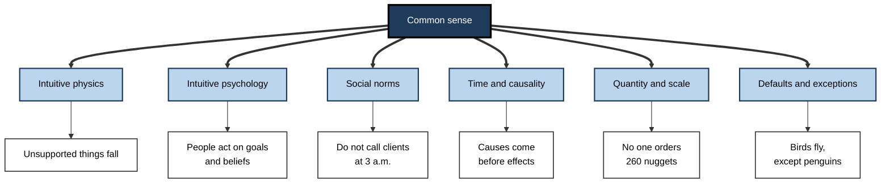
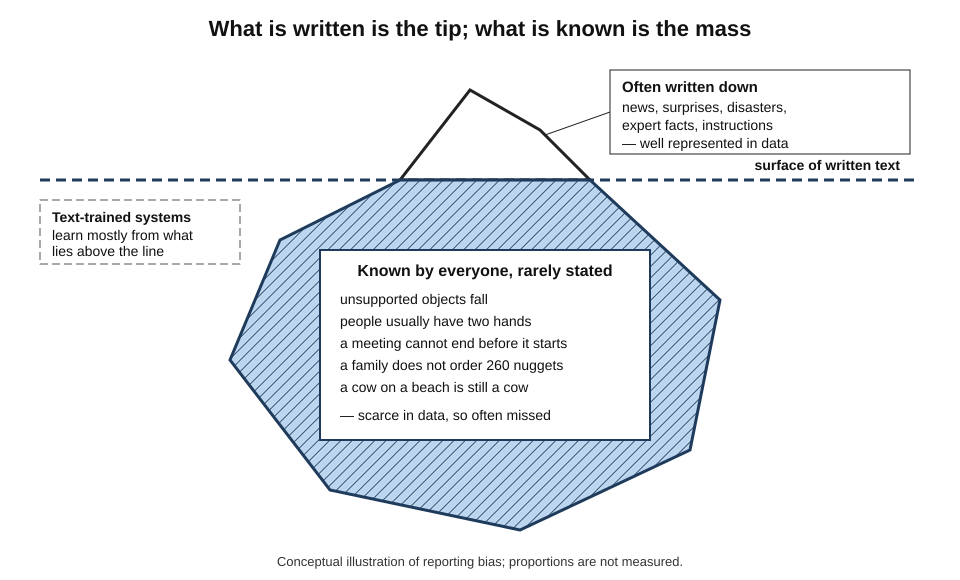
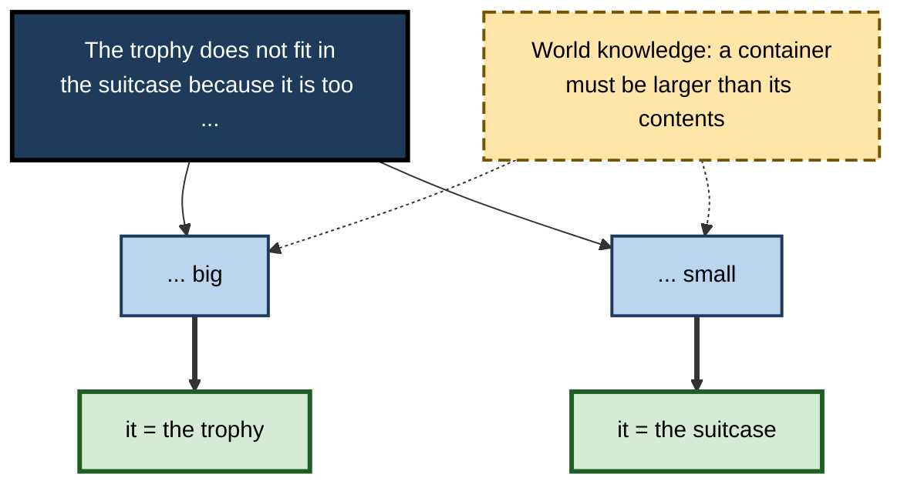
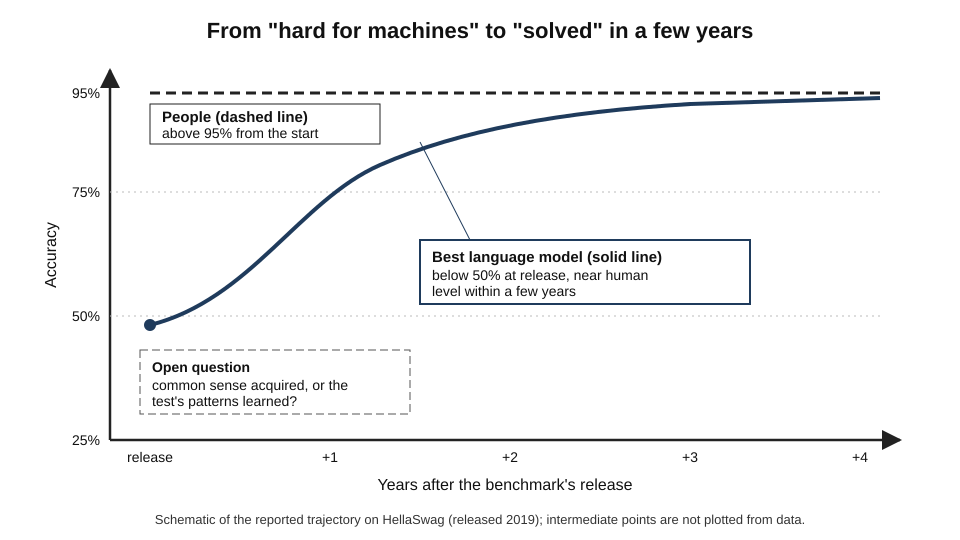
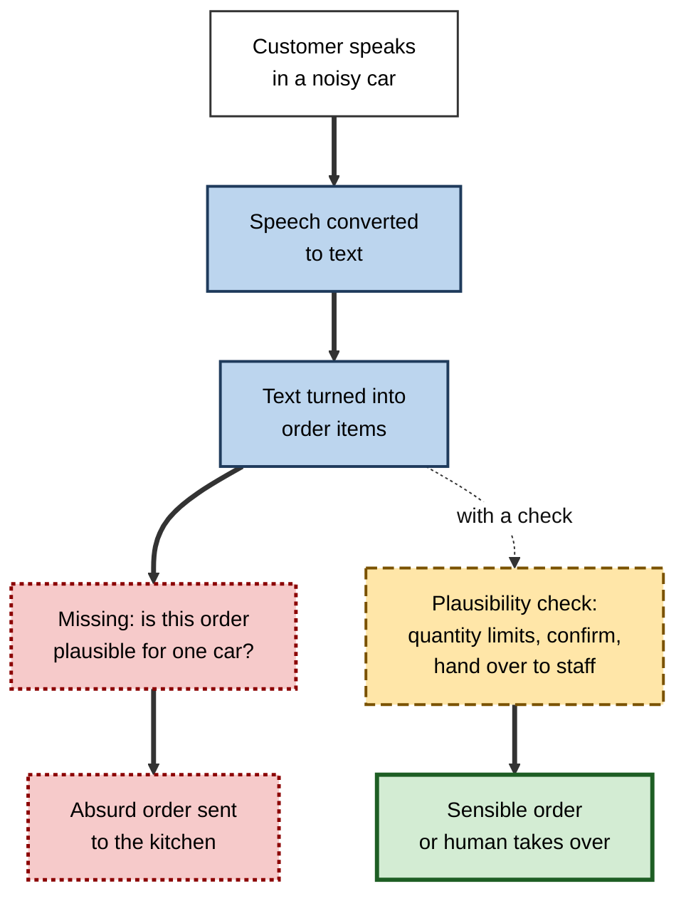
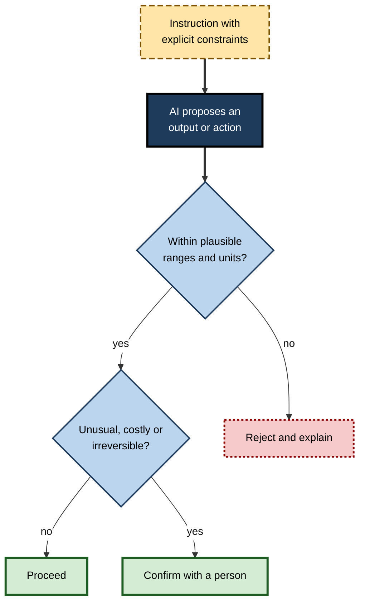

# F.5. Lack of common sense in current AI systems

"Alice has four brothers and one sister. How many sisters does Alice's brother have?" A child answers *two*; in 2024 many advanced language models answered *one*, with confident reasoning. A drive-through ordering system keeps adding nuggets until an order reaches hundreds. What is missing is not information but **common sense** — the unspoken background people use without noticing.

> **Definition — Common sense:** the large body of everyday knowledge about the physical and social world — how objects behave, what people want, what is normal and what is absurd — together with the ability to apply it quickly to new situations.

> **Definition — Common-sense reasoning:** drawing sensible conclusions from incomplete information by using everyday background knowledge that is rarely stated.

**Why it matters**

- Common sense is what lets people interpret instructions sensibly, spot absurd results and cope with situations no rule anticipated.
- Its absence explains many of AI's strangest errors — mistakes no human beginner would make.
- Modern language models show much more apparent common sense than earlier systems, which makes the remaining gaps **harder to predict**.
- Professionals who know where common sense fails can add the checks and constraints that machines cannot supply for themselves.

---

## What Common Sense Contains

### Six domains of everyday knowledge

- **Intuitive physics** — how objects behave.
  - *e.g.* unsupported things fall; liquids take the shape of their container; a glass dropped on stone breaks.
- **Intuitive psychology** — how people think and act.
  - *e.g.* people have goals and beliefs; someone searching their pockets has probably lost something.
- **Social norms** — what is acceptable.
  - *e.g.* one does not ring a client at 3 a.m. about a routine invoice.
- **Time and causality** — what follows from what.
  - *e.g.* a person cannot attend a meeting before being born; cause precedes effect.
- **Quantity and scale** — what sizes and amounts are plausible.
  - *e.g.* a family meal does not need 40 kilograms of rice; a person is not 3 metres tall.
- **Defaults and exceptions** — what is usually true, and when it is not.
  - *e.g.* birds fly — except penguins, ostriches, birds with broken wings and birds in cages.

> **Mnemonic — "PPSTQD" — "Practical People See Trouble Quite Directly":** Physics, Psychology, Social norms, Time and causality, Quantity, Defaults.

**Figure 1.** The main domains of common-sense knowledge.

### Reasoning with defaults

- **Everyday reasoning jumps to sensible conclusions** — and withdraws them when new facts arrive.
  - "Tweety is a bird" → Tweety can fly. "Tweety is a penguin" → withdraw the conclusion.
- **Classical logic does not work this way** — once something is proved, adding facts cannot unprove it.
- **AI researchers called the human style non-monotonic reasoning** and spent decades trying to formalise it.

> **Definition — Non-monotonic reasoning:** reasoning in which conclusions drawn from defaults can be withdrawn when new information arrives.

### The problem of everything left unsaid

- **The frame problem (John McCarthy and Patrick Hayes, 1969)** — when an action happens, how does a system know which of countless facts stay the same?
  - Moving a cup does not change the colour of the walls, the day of the week or the owner's name — but a formal system must somehow be told.
- **The qualification problem** — no rule can list every condition under which it fails.
  - "A car starts when the key is turned" — unless the battery is flat, the fuel tank empty, a potato is stuck in the exhaust…
- **People handle both effortlessly** — they assume nothing relevant has changed unless there is reason to think otherwise.

> **Definition — Frame problem:** the difficulty of representing, for any action, everything that does *not* change, without listing it explicitly.

> **Key point:** common sense is mostly about what is **never said** — and that is exactly why machines that learn from what *is* said find it hard.

---

## Why Common Sense Is Hard for Machines

### It is rarely written down

- **Reporting bias** — people write about what is surprising, not what is obvious.
  - Text mentions dramatic events far more often than their real frequency; ordinary facts such as "people have two hands" or "grass is green" are seldom stated.
- **Consequence** — a system that learns from text sees a distorted picture of the world: plenty of murders and lottery wins, few mentions of blinking or breathing.

> **Definition — Reporting bias:** the tendency of written and recorded data to over-represent unusual events and under-represent obvious ones, because people rarely state what everyone knows.

**Figure 2.** Most common-sense knowledge lies below the surface of what people write.

### It is learned through bodies and lives

- **Human common sense grows from experience** — infants learn about gravity by dropping things, about people by watching faces.
- **Symbol grounding** — words gain meaning by connection to perception and action.
  - A system that has only ever seen the word "heavy" has never lifted anything.
- **Moravec's paradox** — skills people find effortless (walking, seeing, picking up a cup) have proved far harder to automate than skills people find hard (chess, algebra).

> **Definition — Symbol grounding problem:** the question of how words or symbols acquire meaning through connection to the things they refer to, rather than only to other symbols.

### Hand-coding it proved impossible to finish

- **The early hope** — John McCarthy's 1959 proposal for a program "with common sense" imagined writing everyday knowledge as logical statements.
- **The largest attempt** — a project begun in the 1980s spent decades entering millions of hand-written assertions about everyday life, and found the task never ended.
- **The lesson** — common sense is too vast, too context-dependent and too full of exceptions to write down completely.

### Pattern-matching can imitate it

- **Large language models absorb enormous amounts of text** — and with it, much common-sense knowledge that *is* written down.
- **They answer many everyday questions sensibly** — far better than any earlier AI.
- **But their knowledge is statistical** — associations between words, not a model of the world that guarantees consistency.
- **Failures are therefore uneven** — sensible on familiar phrasings, absurd on unfamiliar combinations.

| | Human common sense | Language-model "common sense" |
|---|---|---|
| Source | Bodily experience, social life, teaching | Patterns in written text and images |
| Coverage of the obvious | Complete — it is the background of life | Patchy — the obvious is rarely written |
| Consistency | Integrated into one picture of the world | Can contradict itself across phrasings |
| Handling novel combinations | Usually sensible | Unpredictable |
| Awareness of absurdity | Immediate | Often absent |
| Flexibility of defaults | Withdraws assumptions when facts change | May cling to the typical pattern |

---

## Evidence: Testing Machine Common Sense

### Pronouns that need world knowledge

**Study card — the Winograd Schema Challenge (Hector Levesque, Ernest Davis and Leora Morgenstern, 2012)**

- **Design:** pairs of sentences differing in one word, where resolving a pronoun requires everyday knowledge.
  - "The trophy doesn't fit in the brown suitcase because **it** is too **big**." — *it* = the trophy.
  - "The trophy doesn't fit in the brown suitcase because **it** is too **small**." — *it* = the suitcase.
- **Aim:** a test that could not be passed by word statistics alone, proposed as an alternative to the Turing test.
- **Results:**
  - systems of the early 2010s performed little better than chance;
  - language models of the late 2010s reached high scores;
  - a much larger, harder version built in 2019–2020 (WinoGrande) showed that some of that success came from exploiting **statistical quirks** of the original items; later, larger models scored highly on it too.
- **Conclusion:** the test was valuable, but high scores proved harder to interpret than its designers hoped — a model can pass without any guarantee of the underlying understanding.

**Figure 3.** One changed word reverses the meaning in a Winograd schema.

### Predicting what happens next

**Study card — HellaSwag (Zellers and colleagues, University of Washington and the Allen Institute for AI, 2019)**

- **Design:** multiple-choice questions asking which ending of an everyday scene is most plausible — for example, what a person does next after placing a ladder against a wall.
  - Wrong endings were **generated by machines and filtered** to fool the models of the day while remaining obviously wrong to people.
- **Results at release:** people scored above **95%**; the best models scored below **50%**.
- **Afterwards:** within a few years, much larger language models scored close to human level.
- **Conclusion:** two lessons — such tests can be **saturated** quickly as models grow, and saturation does not settle whether the models have common sense or have learned the patterns of the test.

> **Definition — Benchmark saturation:** the point at which models score so close to the maximum that a test no longer distinguishes better from worse systems.

**Figure 4.** Rapid saturation of a common-sense benchmark.

### Knowledge that runs only one way

**Study card — the "reversal curse" (Berglund and colleagues, 2023)**

- **Design:**
  - language models were trained on made-up facts in the form "A is B" — for example, a fictitious person described as the composer of a particular work;
  - they were then asked the reverse question, "who composed that work?".
- **Results:**
  - models answered the forward question well but the reverse question at roughly **chance level**;
  - with real facts, a leading model could name the mother of a famous actor far more often than it could name the son of that same woman when asked about her.
- **Conclusion:** a person who knows "A is B" knows "B is A". Models that learn by predicting text in order can store knowledge in **one direction only** — a failure of the logical common sense that people take for granted.

### Simple puzzles, confident nonsense

**Study card — the "Alice in Wonderland" problem (Nezhurina and colleagues, LAION and Jülich Supercomputing Centre, 2024)**

- **Design:** a family puzzle of the form "Alice has N brothers and M sisters. How many sisters does Alice's brother have?", asked with many values of N and M.
- **Results:**
  - many leading models answered wrongly much of the time, often forgetting to count Alice herself;
  - performance swung sharply when only the numbers changed;
  - models frequently gave **confident, plausible-sounding explanations** for wrong answers.
- **Conclusion:** strong scores on standard reasoning tests can coexist with failure on a problem most children solve — evidence that machine competence is unevenly distributed.

> **Watch out:** many such failures are fixed in later model versions, sometimes because the puzzles themselves enter training data. A model's success on a famous puzzle is weak evidence; success on **fresh variants** is stronger.

### Physical and spatial common sense

- **Physical-reasoning tests** — such as choosing the sensible way to separate egg whites or to keep a door open — remained harder for text-trained models than for people for some time.
- **Spatial reasoning** — tasks involving left and right, rotation, or which object is behind which still trip models that perform well on language tasks.
- **Counting and arithmetic in context** — counting objects in an image or letters in a word has been a recurring weakness.
- **Robotics** — robots still struggle with tasks a toddler manages, such as clearing a cluttered table without knocking things over.

> **Key point:** text-trained systems are strongest on **common sense that people write about**, and weakest on **physical, spatial and quantitative** common sense learned through the body.

---

## Common Sense at Work

### Instructions read too literally

- **Specification gap** — instructions never state every obvious condition.
- **People fill the gap** with common sense; machines may not.

### Worked example (illustrative): "book the cheapest flight to Frankfurt for Tuesday"

| Option the system could choose | Literal match? | Common-sense verdict |
|---|---|---|
| 06:00 direct flight, 180 | Yes | Sensible |
| 02:10 departure, three changes, arrives Wednesday, 95 | Yes — cheapest | Absurd for a Tuesday meeting |
| Flight to Frankfurt (Oder) rather than Frankfurt am Main, 70 | Yes — "Frankfurt" | Wrong city |
| Non-refundable basic fare without luggage for a five-day trip, 120 | Yes | Probably wrong |

*Illustrative figures.*

1. A literal reading selects the 70 option — a different Frankfurt.
2. A human assistant knows the traveller needs to arrive in time for a meeting, in the city where the company's client is, with luggage.
3. Each of those is **common sense**, not stated in the instruction.

- **Conclusion:** automated agents need the unstated constraints made explicit — arrival time, destination airport, baggage — or a step where they **ask** before acting.

> **Watch out:** the better a system is at fluent conversation, the more people assume it shares their background understanding. Fluency is not common sense.

### Case study: AI ordering at drive-through restaurants (2021–2024)

- **Situation:** a large fast-food chain tested an automated voice-ordering system, developed with a technology partner, at more than 100 US drive-through restaurants from 2021.
- **Aim:** take orders by voice faster and more consistently, freeing staff for food preparation.
- **What went wrong (as widely reported and shared in customer videos):**
  1. the system misheard orders amid engine noise, accents and conversations in the car;
  2. it added items customers had not asked for and failed to remove them when corrected;
  3. in one widely shared video, it kept adding chicken nuggets until the order reached **260**;
  4. other customers received bizarre combinations, such as toppings added to items that never carry them.
- **What was missing:** not speech recognition alone, but **common-sense checks** — that 260 nuggets is not a plausible order for one car, that an angry repeated "no" means "remove it", that an ice-cream topping does not belong on a drink.
- **Outcome:** in June 2024 the chain ended the test, while saying it would continue to explore voice ordering.
- **Lesson:** a system that processes words without a model of **what customers plausibly want** produces errors that any trainee would catch. Plausibility checks are cheap; their absence is costly to reputation.

**Figure 5.** Where common-sense plausibility checks were missing from automated ordering.

### Case study (illustrative): the online grocer's substitutions

- **Situation:** an online grocery service used an algorithm to substitute out-of-stock items with the "most similar" product, based on category, price and past purchases.
- **Problems reported by customers:**
  - gluten-free bread replaced with ordinary bread — similar category, but it defeated the reason for the purchase;
  - birthday candles replaced with tea lights;
  - a small bag of dog treats replaced with a 10-kilogram sack of dog food.
- **Diagnosis:** "similar" was measured by product attributes, not by **why the customer wanted the item** — intuitive psychology — or by **plausible quantity** — scale.
- **Actions:**
  1. items tagged with dietary or medical properties could only be swapped for items with the same property;
  2. substitutions above a size or price ratio required customer approval;
  3. customers could set "no substitute" for chosen items.
- **Result:** complaints about substitutions fell sharply.
- **Lesson:** common sense can often be supplied by a few **explicit rules about purpose and scale** — but someone must think of them.

---

## Approaches to Machine Common Sense

| Approach | Idea | Strength | Limit |
|---|---|---|---|
| Hand-written knowledge bases | Experts write everyday facts as logic | Precise, inspectable | Never complete; brittle |
| Crowd-sourced knowledge graphs | Many people contribute simple relations, such as "a knife is used for cutting" | Broad coverage of simple facts | Shallow; little reasoning |
| Learning from text at scale | Absorb common sense implicit in huge text collections | Very broad; handles language | Reporting bias; inconsistency |
| Multimodal and embodied learning | Learn from images, video and physical interaction | Grounds concepts in perception and action | Data-hungry; early stage for robots |
| World models and hybrids | Combine learned perception with explicit models of objects, causes and agents | Potential for consistent reasoning | Hard to build at scale |

- **Most researchers now expect hybrids** — learned systems for breadth, with some structured knowledge or simulation for consistency.
- **Video and robotics data** are seen as a route to physical common sense that text cannot provide.

---

## Working Safely Around Missing Common Sense

### Supplying what the machine lacks

1. **State the obvious** — write unstated constraints into instructions: time windows, quantities, purposes, things never to do.
2. **Add plausibility checks** — range limits, unit checks and "does this make sense?" rules on outputs.
3. **Require confirmation for unusual actions** — large quantities, high values, irreversible steps.
4. **Ask the system to state its assumptions** — and read them.
5. **Test with absurd and borderline inputs** — not only typical ones.
6. **Keep a person for the unexpected** — someone with authority to stop the process.

**Figure 6.** Adding human common sense around an automated decision.

> **In practice:** experienced teams write a short list of "things any sensible person would know" for each automated process — maximum plausible quantities, impossible dates, forbidden combinations — and encode them as checks. It is among the cheapest reliability measures available.

> **Remember:** the machine does not know what is **absurd**. Someone must tell it — in rules, constraints or a human checkpoint.

---

## Open Questions

- **Can common sense be learned from text alone?**
  - Some researchers argue scale will eventually capture it; others argue grounding in perception and action is essential.
- **How should common sense be measured?**
  - Benchmarks saturate quickly and may leak into training data; tests built fresh, or generated in endless variants, are being explored.
- **Will video and robotics provide physical common sense?**
  - Models trained on video and interaction show early promise; whether they will reach toddler-level physical understanding is open.
- **Can models know when they are being absurd?**
  - Reliable self-checking for implausible outputs remains unsolved.
- **Whose common sense?**
  - Norms differ between cultures; systems trained mainly on some cultures' text may embed those cultures' defaults as "obvious".

---

## Summary

- **Common sense** = everyday knowledge of the physical and social world plus the ability to apply it; most of it is **never stated**.
- Domains: **intuitive physics, intuitive psychology, social norms, time and causality, quantity and scale, defaults and exceptions**.
- People reason with **defaults** they withdraw when facts change (**non-monotonic reasoning**); formal systems struggle with the **frame** and **qualification** problems.
- Machines find it hard because of **reporting bias**, lack of **grounding** in bodily experience and the impossibility of **hand-coding** it all.
- Language models imitate much common sense statistically, so failures are **uneven** and hard to predict.
- Evidence: **Winograd schemas** (passed, but partly via quirks), **HellaSwag** (saturated quickly), the **reversal curse**, the **Alice** problem, persistent **physical and spatial** weaknesses.
- At work, missing common sense appears as **literal instruction-following** and **implausible outputs** — the drive-through system adding 260 nuggets.
- Remedies: **state the obvious**, add **plausibility checks**, **confirm unusual actions**, ask for **assumptions**, **test absurd inputs**, keep a **human for the unexpected**.

---

## Self-Check

1. Define common sense and give one example from each of three domains.
2. What is non-monotonic reasoning? Give an example.
3. Explain the frame problem and the qualification problem in plain terms.
4. What is reporting bias, and why does it matter for systems trained on text?
5. What is Moravec's paradox, and how does it relate to common sense?
6. Describe a Winograd schema and explain why high scores proved hard to interpret.
7. What happened to HellaSwag after its release, and what does that show?
8. Explain the reversal curse and why people do not suffer from it.
9. Why is success on a famous puzzle weak evidence of common sense?
10. In which kinds of common sense are text-trained models weakest, and why?
11. What went wrong with automated drive-through ordering, and what checks were missing?
12. An agent is told "order enough coffee for the office". List the common-sense constraints it needs.
13. Compare learning from text with embodied learning as routes to machine common sense.
14. A firm plans to let an AI agent approve supplier invoices automatically. Propose five common-sense safeguards.

### Answer Key

1. Everyday knowledge of how the world and people work, applied to new situations. Physics: a full cup tipped over spills. Psychology: a colleague who sighs at a request may be overloaded. Quantity: a team lunch for six does not need 30 pizzas.
2. Reasoning whose conclusions can be withdrawn when new facts arrive. "The shop is open on weekdays" → it is open on Monday; told Monday is a bank holiday → withdraw.
3. Frame problem: representing all the things an action does not change without listing them. Qualification problem: no rule can list every exception that would stop it working.
4. Data over-represent unusual events and under-represent the obvious because people rarely state what everyone knows. Text-trained systems therefore learn a distorted picture and miss obvious facts.
5. Skills effortless for people, such as perception and movement, are hard for machines, while hard intellectual skills can be easier. Much common sense is of the "effortless" kind, learned through the body, so it is hard to automate.
6. Two sentences differing in one word, where resolving a pronoun needs world knowledge (trophy and suitcase). Models reached high scores, but a larger version showed some success came from statistical quirks; passing does not guarantee understanding.
7. Models scored under 50% versus over 95% for people at release, but larger models approached human level within a few years. Benchmarks saturate quickly, and saturation does not show whether genuine common sense or test patterns were learned.
8. Models trained on "A is B" often cannot answer "B is A" because they learn from text in order. People store relations as connections usable in both directions.
9. The puzzle and its answer may be in training data, so success may reflect memorisation; fresh variants test the capacity itself.
10. Physical, spatial and quantitative common sense, because it is learned through bodily experience and is rarely written down.
11. It misheard orders, added unwanted items and failed to remove them, reaching absurd orders such as 260 nuggets. Missing: plausibility limits on quantities, understanding of repeated corrections, checks on impossible combinations, and handover to staff.
12. How many people and how much they drink; existing stock; budget; delivery timing; storage space; preferred types and dietary needs (decaffeinated, milk alternatives); sensible order frequency rather than a year's supply at once.
13. Text: broad, cheap and already available, but subject to reporting bias and lacking grounding. Embodied: grounds concepts in perception and action and can capture physical common sense, but is data-hungry, slow and still early.
14. Amount limits relative to the purchase order and the supplier's history; matching invoice to delivery records; blocking duplicate or impossible dates; requiring approval for new suppliers or changed bank details; human review for unusual amounts or combinations.

---

## Glossary

| Term | Meaning |
|---|---|
| Benchmark saturation | Scores so near the maximum that a test no longer separates systems. |
| Common sense | Everyday knowledge of the physical and social world and the ability to apply it. |
| Common-sense reasoning | Drawing sensible conclusions from incomplete information using unstated background knowledge. |
| Frame problem | The difficulty of representing everything an action does not change. |
| Intuitive physics | Everyday understanding of how objects behave. |
| Intuitive psychology | Everyday understanding of how people think and act. |
| Moravec's paradox | The observation that skills easy for people are often hard for machines, and the reverse. |
| Non-monotonic reasoning | Reasoning whose conclusions can be withdrawn when new facts arrive. |
| Plausibility check | A rule that rejects or queries outputs outside sensible ranges. |
| Qualification problem | The impossibility of listing every exception to a rule. |
| Reporting bias | Over-representation of unusual events and under-representation of obvious ones in recorded data. |
| Reversal curse | The failure of models trained on "A is B" to infer "B is A". |
| Specification gap | The difference between what an instruction states and what its author meant. |
| Symbol grounding problem | How symbols acquire meaning through connection to what they refer to. |
| Winograd schema | A pronoun-resolution test in which one changed word reverses the answer and world knowledge is needed. |
