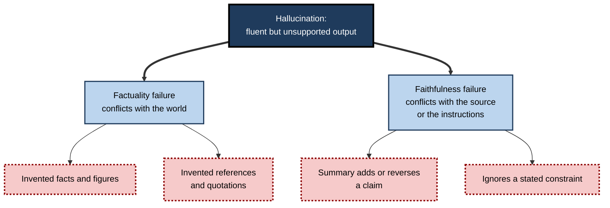
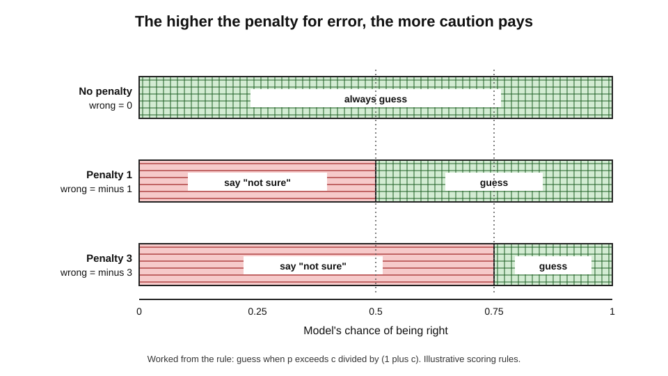
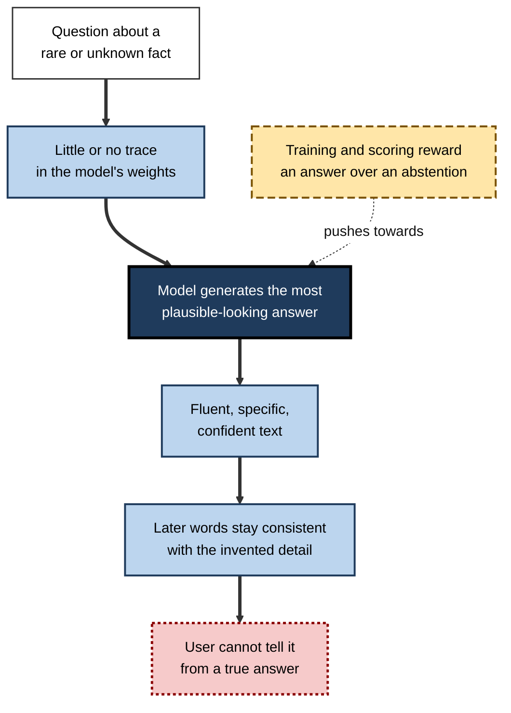
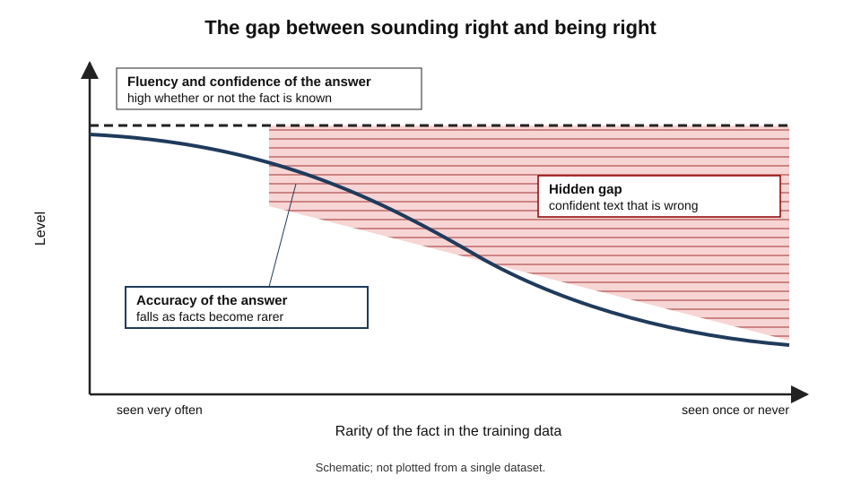
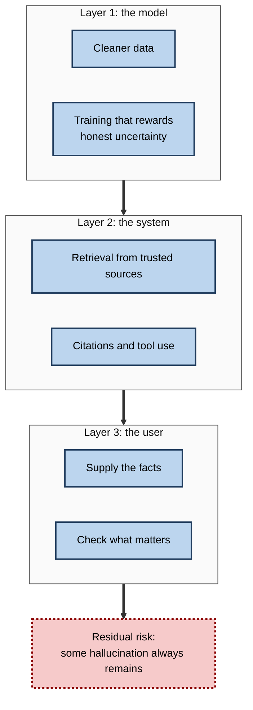

# F.6. Hallucination: when AI makes things up

Ask a chatbot for the birthday of a moderately well-known academic and it may give a precise date, in a fluent sentence, with no hint of doubt — and be wrong. Ask for sources on a niche topic and it may supply titles, authors and journals that look real and do not exist. The system has not lied; it has produced **plausible text**, which is what it was built to do. Whether the text is **true** is a separate matter.

> **Definition — Hallucination (in AI):** output from a generative system that is fluent and confident but unsupported by, or contrary to, the facts, the source material or the user's instructions.

> **Definition — Fabrication:** a hallucination in which the system invents specific details — names, numbers, quotations, citations, events — that have no basis in reality.

**Why it matters**

- Hallucination is the most visible reason that generative AI cannot be trusted as a source of facts without support.
- It is not an occasional glitch but a **consequence of how the systems are built and evaluated**; it can be reduced, not abolished.
- Because the errors are fluent, they are hard to see — they do not look like errors.
- Understanding why hallucination happens lets a professional judge **where** it is likely, **how much** to trust a given output and **what design** reduces the risk.

---

## What Hallucination Is — and Is Not

### The word and its limits

- **The term** borrows from psychology, where a hallucination is a perception without an external cause.
  - In AI it is used loosely for any confident output that is not grounded in fact.
- **Critics of the word** argue that it wrongly suggests the machine has perceptions or a mind; alternatives include **confabulation** (filling gaps with invented but plausible detail) and **bullshit** in the philosopher Harry Frankfurt's technical sense — speech made without concern for whether it is true.
- **What matters for literacy** is the behaviour, not the label: the system produces assertions with no reliable link to truth.

### Two broad kinds

- **Factuality hallucination** — the output conflicts with facts about the world.
  - *e.g.* an invented court case; a wrong date; a medicine that does not exist.
- **Faithfulness hallucination** — the output conflicts with the material the system was given.
  - *e.g.* a summary that adds a conclusion the document never states; an answer that contradicts the user's own instructions.

> **Definition — Faithfulness:** the degree to which an output stays true to the source text or instructions the system was given.

> **Definition — Factuality:** the degree to which an output matches facts in the world.

### Forms hallucination takes

- **Invented facts** — specific details with no basis: dates, statistics, biographies.
- **Invented sources** — references that look real: plausible authors, titles and journals, sometimes real names attached to papers they never wrote.
- **Invented capabilities** — claiming to have run code, checked a website or sent an email when it did not.
- **Distorted summaries** — added, dropped or reversed claims when condensing a document.
- **False consistency** — defending an earlier error with fresh invention rather than correcting it.
- **Reasoning slips** — a chain of steps that looks sound but contains an invalid step.

> **Watch out:** hallucination is not the same as an **error of knowledge**. A model that was trained before an event happened will be out of date; that is a limitation of its data. Hallucination is the *manufacture* of unsupported content, often where the data are silent.

**Figure 1.** Two kinds of hallucination: against the world and against the source.

---

## Why Hallucination Happens

### A machine built to continue text

- **Language models learn to predict the next piece of text** given what came before.
  - They are trained on very large text collections to make likely continuations.
- **Likely is not the same as true** — a plausible-sounding sentence about a person who never lived is as natural a continuation as a true one.
- **The model has no separate fact store** it consults and checks; knowledge is stored implicitly in billions of numerical weights, as patterns.
- **Generation always produces something** — the system is built to give an output for every input, including questions where it has no knowledge.

> **Definition — Next-token prediction:** the training task in which a model learns to predict the next small unit of text (a token) from those before it; repeated, it generates whole passages.

> **Key point:** a language model is a **fluency engine**. Fluency and truth often coincide, because true statements are common in its training text — but nothing in the mechanism forces them to.

### Rare facts are the weak point

- **Facts that appear many times** — capital cities, famous events — are learned reliably.
- **Facts that appear once or never** — a minor official's birth date, a small company's turnover — leave faint or no trace.
- **When asked, the model still produces an answer** in the right *shape* — a date looks like a date — but drawn from a plausible pattern, not from memory of the fact.

**Study card — "Why language models hallucinate" (Adam Kalai and colleagues, OpenAI and Georgia Institute of Technology, September 2025)**

- **Question:** why do even carefully trained models state falsehoods confidently?
- **Argument, part one — in training:**
  - generating a valid answer is a harder task than recognising whether an answer is valid;
  - for **arbitrary facts with no pattern** (such as an individual's birthday), the unavoidable error rate is at least roughly the share of such facts that appeared **only once** in the training data;
  - hallucination is therefore a predictable statistical consequence, not a mysterious malfunction.
- **Argument, part two — in evaluation:**
  - most benchmarks score a correct answer as 1 and both a wrong answer and "I don't know" as 0;
  - under such scoring, **guessing never costs anything**, so models are rewarded for guessing rather than admitting uncertainty;
  - the authors argued that scoring should penalise confident errors and give credit for appropriate abstention.
- **Conclusion:** hallucination persists partly because the whole field — training, testing and leaderboards — has rewarded confident guessing.

> **Watch out:** this is a recent and influential **theoretical argument**, not a settled law. Other researchers emphasise additional causes, and the proposed remedy of changing benchmark scoring has not yet been shown at scale to remove the problem.

### Why scoring rules matter

> **Formula — When guessing pays:** if a correct answer scores 1, a wrong answer costs a penalty *c*, and abstaining scores 0, guessing is worthwhile when **p > c ÷ (1 + c)**, where *p* is the chance of being right. With no penalty (*c* = 0) any guess is worthwhile; with *c* = 1, only when p exceeds 0.5; with *c* = 3, only when p exceeds 0.75.

- **A model that has been trained and measured under no-penalty scoring** learns that a confident guess beats an honest "I am not sure".
- **A professional exam with negative marking** produces the opposite behaviour in candidates.

**Figure 2.** How the penalty for wrong answers changes when a system should guess.

### Further contributing causes

- **Errors and falsehoods in the training data** — models reproduce common misconceptions and mistakes found in text.
- **Gaps and outdated knowledge** — events after the training date are absent; the model may extrapolate.
- **Pressure to be helpful** — training that rewards answers people like can reward agreeable, confident replies over honest uncertainty.
- **Sycophancy** — a tendency to agree with the user's stated view, even when mistaken.
- **Compounding in generation** — each word is chosen given the words already written, so an early error becomes context that later words must stay consistent with.
- **Decoding randomness** — settings that add variety also add the chance of choosing a less likely, possibly wrong, continuation.
- **Long inputs** — models can lose track of material in the middle of very long documents and fill the gap.
- **Instructions to be specific** — asking for "five references" or "exact figures" pushes a model to produce them even when it has none.

> **Mnemonic — "RGPSCDL" — "Rare Gaps Please Sycophantic Computers Deliver Lies":** Rare facts, Gaps in knowledge, Pressure to be helpful, Sycophancy, Compounding, Decoding randomness, Long inputs.

**Figure 3.** From a question the model cannot answer to a confident invention.

### Confidence is not knowledge

- **Fluent text sounds sure** — the model rarely writes the hesitations people use when unsure.
- **Stated confidence and actual accuracy only partly match** — studies of large models found that they can, to a degree, estimate whether their own answers are right, but the match is imperfect and weaker for unusual questions.
- **Asking "are you sure?"** often produces either a retreat from a correct answer or a doubling-down on a wrong one.

> **Definition — Calibration:** the match between how confident a system sounds and how often it is actually right.

> **Remember:** the **tone** of an answer carries no information about its **truth**. Confident wording is a property of the writing, not of the evidence.

---

## How Often, and Where

### Patterns in the evidence

**Study card — "Survey of hallucination in natural language generation" (Ji and colleagues, Hong Kong University of Science and Technology and collaborators, *ACM Computing Surveys*, 2023)**

- **Scope:** a review of research on unsupported output across tasks — summarisation, dialogue, question answering, translation, image captioning.
- **Findings:**
  - hallucination appears in **every** generation task studied;
  - summarisation and dialogue systems often add unsupported content;
  - causes include noisy data, the way models are trained and the way output is generated;
  - measuring hallucination is itself hard, because it needs reliable comparison against a trusted source.
- **Conclusion:** the problem is general to generative systems, not confined to one product or task.

- **Rates vary enormously** — by model, task, topic, question wording and whether the model is connected to a source.
  - Rates reported on benchmarks range from a few per cent for short summaries of supplied text, to far higher for questions on obscure topics.
  - Single numbers quoted in the press should be treated with suspicion unless the task and test are specified.
- **Newer and larger models** generally hallucinate less on common questions, but not uniformly, and may still do so more confidently.

### Where the risk is highest

| Situation | Risk | Why |
|---|---|---|
| Rare, obscure or recent facts | High | Little or no trace in training data |
| Precise details: dates, figures, quotations, citations | High | Plausible form is easy to generate |
| Niche professional detail (statutes, clinical doses, standards) | High | Specialist text is scarce, mistakes are costly |
| Questions with a false premise | High | The model tends to accept the premise |
| Long, complex tasks with many steps | Moderate to high | Errors compound |
| Summarising a document the model is given | Moderate | Better grounded, but additions and omissions occur |
| Well-known, widely documented facts | Lower | Heavily represented in training |
| Rewriting, formatting, translating supplied text | Lower | The content is supplied |

> **Key point:** risk is highest where the answer **cannot be inferred from common patterns** and **sounds equally plausible whether true or false**.

**Figure 4.** Reliability falls as facts become rarer, while the fluency of the answer stays constant.

---

## Hallucination and Trust

### Why people believe fluent falsehoods

- **Fluency as a cue to truth** — people judge easy-to-read statements as more likely true.
- **Authority and polish** — structured, well-written output resembles expert writing.
- **Confirming expectations** — answers that fit what a user hoped to hear are checked less.
- **Automation bias** — the tendency to trust an automated system's output over one's own judgement.
- **Cost of checking** — verifying takes time, and the tool was adopted to save time.

> **Definition — Automation bias:** the tendency to over-rely on automated output and to accept it without adequate scrutiny, even when contrary evidence is available.

### Trust that is calibrated

- **Appropriate trust** — relying on a system as much as its demonstrated reliability for *this kind of task* warrants.
- **Over-trust** — relying on it more than its reliability justifies; leads to unchecked errors.
- **Under-trust** — relying on it less than justified; wastes its real benefits.
- **Reliability is task-specific** — a tool excellent at drafting may be poor at citing.

> **Remember:** trust the **task**, not the **tool**. A system can be reliable for rewriting and unreliable for recall within the same conversation.

### The harm of hallucination is uneven

- **Low stakes** — a wrong suggestion for a pub quiz; harmless and easy to spot.
- **Moderate stakes** — a wrong figure in an internal report; embarrassing and costly if repeated.
- **High stakes** — a wrong clinical detail, legal citation or safety instruction; potentially harmful.
- **Compounding stakes** — a hallucinated claim copied into other documents, which then become "sources" for later work.

> **Watch out:** AI-generated text now circulates widely online. If hallucinated claims enter web pages and documents, later systems may learn from them — a loop in which errors are repeated as if they were evidence.

---

## Case Study: Galactica (Meta, November 2022)

- **Situation:** in November 2022 Meta AI and Papers with Code released a public demonstration of **Galactica**, a language model trained on scientific papers, textbooks and reference material, promoted as a tool to help researchers summarise literature, solve equations and write scientific text.
- **What users found within hours:**
  1. the model produced confident, authoritative-looking articles on invented topics — for example, a wiki entry on the "history of bears in space";
  2. it generated scientific-style papers with fabricated references and citations;
  3. it made errors in simple facts and produced biased or offensive content when prompted;
  4. its output looked like peer-reviewed prose, making errors difficult to detect.
- **Reaction:** researchers and journalists criticised the release publicly; the demonstration was taken down after about **three days**.
- **Meta's response:** the company said the model remained available to researchers, and that the demonstration had been intended to gather feedback.
- **Why it matters:**
  - the system had been framed as a tool for **scientific knowledge**, a domain where precision matters and citations signal reliability;
  - **scientific style** — equations, structure, references — made fabrication more persuasive;
  - the episode helped establish the expectation that general-purpose generative tools should carry warnings and safeguards against fabricated facts.
- **Lesson:** fluency in a specialist style raises trust without raising reliability. A system that sounds like an expert is more dangerous, not less, when it does not know.

> **Watch out:** Meta's stated aims, and the extent to which the criticism was fair, were disputed at the time. The undisputed core is that the demonstration produced fluent, fabricated scientific content and was withdrawn within days.

---

## Reducing Hallucination

### At the model and training level

- **Better and cleaner training data** — fewer falsehoods and duplicates to learn from.
- **Training for honesty** — rewarding appropriate "I don't know" and penalising confident errors.
- **Human feedback on factuality** — raters mark invented content so the model learns to avoid it.
- **Larger models and more data** — generally help with common facts, less so with rare ones.
- **Reasoning and self-checking steps** — can catch some errors, but can also produce plausible invented reasoning.

### At the system level: grounding

> **Definition — Grounding:** supplying a model with trusted source material at the moment of answering, and requiring the answer to be based on it.

- **Retrieval-augmented generation (RAG)** — the system first searches a trusted collection (company documents, a knowledge base, the web) and gives the relevant passages to the model.
- **Citations to the retrieved passage** — letting the user verify each claim against its source.
- **Tool use** — calling a calculator, database or search engine instead of generating the answer from memory.
- **Constrained answers** — allowing only answers drawn from supplied material, with "not found" as a valid response.

> **Watch out:** grounding **reduces** hallucination but does not remove it. A grounded system can retrieve the wrong passage, misread the right one, or add detail not in the source. Studies of commercial legal and research tools built on retrieval have still found substantial rates of incorrect or unsupported output.

### At the user level

- **Supply the facts** — paste the source and ask for work on *that*, rather than asking for recall.
- **Allow "I don't know"** — explicitly permit uncertainty and ask the model to say when it is unsure.
- **Ask for sources and then check that they exist** — a citation is a claim, not evidence.
- **Prefer narrow questions** — "summarise this paragraph" over "tell me about this field".
- **Beware of false premises** — avoid leading questions that assume what is to be shown.
- **Compare answers** — repeated sampling of the same question; wide disagreement signals unreliability.

**Figure 5.** Three layers of defence: the model, the system around it and the user.

### Comparing approaches

| Approach | What it does | Strength | Limit |
|---|---|---|---|
| Training for honesty | Rewards abstention and penalises confident error | Addresses the root incentive | Early; may increase refusals of answerable questions |
| Retrieval (grounding) | Supplies trusted text to answer from | Reduces invention on covered topics | Wrong or misread passages; gaps in the source |
| Tool use | Delegates calculation or lookup | Exact where the tool is exact | Wrong tool choice; misreading results |
| Self-consistency checks | Compares several answers | Flags unstable answers | Consistent errors pass; costly |
| Human review | A person checks what matters | Catches subtle errors | Slow; subject to automation bias |

---

## Working With Hallucination in Professional Practice

### Worked example (illustrative): deciding how much to trust five requests

- **Situation:** an analyst uses a general chatbot for five tasks in one afternoon.

| Task | Hallucination risk | Sensible handling |
|---|---|---|
| Rewrite a paragraph in plainer English | Low — content supplied | Read once for meaning changes |
| Summarise a 12-page supplied report | Moderate — additions possible | Check key claims and numbers against the report |
| List the main regulations governing a niche product | High — specialist and precise | Use as pointers only; confirm in primary sources |
| Provide five academic references on a topic | Very high — fabrication likely | Treat each as unverified; search for each by title |
| Draft an email apologising for a delay | Low — no factual claims beyond those supplied | Check facts the analyst supplied are correct |

*Illustrative assessments.*

1. Risk depends on **how much of the content comes from the user** and **how precise the claims are**.
2. The two highest-risk tasks are exactly those where the output *looks* most authoritative.
3. Time spent checking should be directed at the specific claims that could cause harm.

- **Conclusion:** one tool, five different trust levels — the discipline is to set the level **per task**, before reading the output.

### Case study (illustrative): the support-article assistant

- **Situation:** a software company deployed a chatbot trained on general text, with a short prompt, to answer customers' product questions.
- **Problem:** the chatbot answered confidently about features that did not exist and cited help-centre pages that had never been written; customers complained, and support staff spent time correcting its claims.
- **Diagnosis:**
  1. the model was answering from general training, not from the company's documentation;
  2. there was no instruction to say "I don't know";
  3. there was no log of what it had answered.
- **Actions:**
  1. answers were restricted to retrieved passages from current documentation, with a link to the passage used;
  2. an explicit "I can't find that in our documentation — would you like to speak to an agent?" response was added;
  3. answers about pricing, refunds and legal terms were routed to people;
  4. a sample of conversations was reviewed weekly.
- **Result:** wrong feature claims fell sharply; more conversations reached agents, but with the right context.
- **Caveats:** some answers were still wrong when documentation was out of date or ambiguous.
- **Lesson:** reliability came from **design around the model** — grounding, refusal and review — not from asking the model to be more careful.

### Disclosing and recording AI-generated content

- **Say when text is machine-generated** where readers could be misled.
- **Keep the source trail** — which documents the answer used.
- **Label unverified content** clearly in drafts, so it is not mistaken for checked material.

> **In practice:** teams that use generative AI for first drafts often adopt a rule that **every specific factual claim must be traceable to a human-checked source** before the document leaves the team.

---

## Open Questions

- **Can hallucination be eliminated?**
  - Theoretical arguments suggest that for arbitrary facts, errors cannot be avoided entirely; whether practical systems can get close enough for critical uses is unsettled.
- **Will changing benchmarks change behaviour?**
  - Rewarding abstention may reduce confident errors; it may also make models refuse too much. The trade-off is being tested.
- **Can models reliably know what they know?**
  - Self-assessment is partly accurate; making it dependable, especially for obscure questions, remains an open problem.
- **How should responsibility be allocated?**
  - Courts and regulators are still deciding how far developers, deployers and users are accountable for hallucinated statements.
- **What happens when machine text trains machines?**
  - If generated content feeds future training, errors may be amplified; how much is unclear.

---

## Summary

- **Hallucination** = fluent, confident output unsupported by facts or by the supplied source; **fabrication** = invented specifics such as names, numbers and citations.
- Two kinds: **factuality** (against the world) and **faithfulness** (against the source or instructions).
- It happens because models are **built to produce plausible continuations**, not to check facts; **rare facts** leave little trace; and **training and scoring reward guessing** over honest abstention.
- Further causes: errors in data, sycophancy, compounding of early mistakes, decoding randomness, long inputs and instructions demanding specifics.
- **Fluency and confidence carry no information about truth**; stated confidence only partly matches accuracy.
- Risk is highest for **rare, precise, niche or recent** facts and for **false premises**; lower for supplied-text rewriting.
- **Over-trust** is driven by fluency, polish and **automation bias**; trust should be set **per task**.
- Galactica (2022) showed that **scientific style** makes invention more persuasive.
- Mitigation works in **three layers**: training for honesty, **grounding** and tools, and user practice — but **residual risk remains**.

---

## Self-Check

1. Define hallucination and fabrication, and distinguish factuality from faithfulness failures.
2. Why does a language model produce an answer even when it has no knowledge?
3. Why are rare facts a special weak point?
4. Summarise the two parts of the 2025 argument about why language models hallucinate.
5. With a penalty of 2 for a wrong answer and 0 for abstaining, above what probability of being right should a system guess?
6. Name four further causes of hallucination besides rare facts and scoring.
7. Why is a system's confident tone not evidence that its answer is correct?
8. What is automation bias, and how does it worsen the effects of hallucination?
9. Rank these tasks by hallucination risk and justify: summarising a supplied report; listing sources on a niche topic; rewriting a paragraph; stating a drug's maximum dose.
10. What lessons does the Galactica episode teach?
11. Explain grounding and give two ways it can still fail.
12. List five practices a user can adopt to reduce hallucination risk.
13. A manager says "we use AI only for summaries, so hallucination is not our problem". Evaluate.
14. Design the controls for a customer-facing assistant answering questions about insurance policy terms.

### Answer Key

1. Hallucination: fluent, confident output unsupported by facts or the supplied source. Fabrication: invented specifics. Factuality failures conflict with the world; faithfulness failures conflict with the given source or instructions.
2. It is built to continue text and to give an output for every input; nothing in the mechanism forces it to stop when knowledge is absent.
3. Rarely seen facts leave little or no trace in the model's weights, yet the model still produces an answer of the right form from plausible patterns.
4. In training, for arbitrary facts the error rate is at least about the share of facts seen only once, so some hallucination is statistically unavoidable. In evaluation, benchmarks score wrong answers and "I don't know" equally at zero, so guessing is rewarded; scoring should penalise confident errors and credit abstention.
5. p > 2 ÷ 3 ≈ 0.67.
6. Errors in training data; sycophancy; compounding of early errors; decoding randomness; long inputs; pressure to be helpful; instructions demanding specific items.
7. Tone is a property of the writing, learned from text, not a measure of the evidence; stated confidence only partly matches accuracy, and fluent text rarely signals doubt.
8. Over-reliance on automated output without adequate scrutiny. It makes users accept fluent errors and reduces checking.
9. Highest: the drug dose (precise, high-stakes) and the niche sources (fabrication likely); moderate: the summary (additions possible); lowest: the rewrite (content supplied). Risk rises with precision and with content the model must recall rather than receive.
10. Fluent scientific style makes fabricated content more persuasive; high-stakes domains need safeguards; releasing a tool framed as reliable without warnings can fail within days.
11. Supplying trusted sources at answer time and basing answers on them. It can fail by retrieving the wrong passage or misreading the right one, or by adding unsupported detail.
12. Paste in the source; allow "I don't know"; ask for citations and check they exist; use narrow questions; avoid false premises; compare repeated answers.
13. Summaries are lower-risk but not safe: models can add, drop or reverse claims, and misstate numbers. Key claims must be checked against the source, with more checking where stakes are high.
14. Ground answers in the current policy documents; show the passage cited; refuse or hand over when the policy text does not answer the question; route claims decisions and anything about coverage disputes to humans; log and sample conversations; test with false-premise and edge questions; keep documents current; disclose that the assistant is automated.

---

## Glossary

| Term | Meaning |
|---|---|
| Automation bias | Over-reliance on automated output without adequate scrutiny. |
| Calibration | The match between stated confidence and actual accuracy. |
| Confabulation | Filling gaps with invented but plausible detail. |
| Fabrication | Invention of specific details such as names, numbers or citations. |
| Factuality | The degree to which output matches facts in the world. |
| Faithfulness | The degree to which output stays true to the supplied source or instructions. |
| Grounding | Basing answers on trusted source material supplied at the time of answering. |
| Hallucination | Fluent, confident output unsupported by facts or the source. |
| Next-token prediction | The training task of predicting the next unit of text from those before it. |
| Retrieval-augmented generation (RAG) | Searching a trusted collection and giving the passages to the model before it answers. |
| Sycophancy | A tendency to agree with the user's view even when mistaken. |
