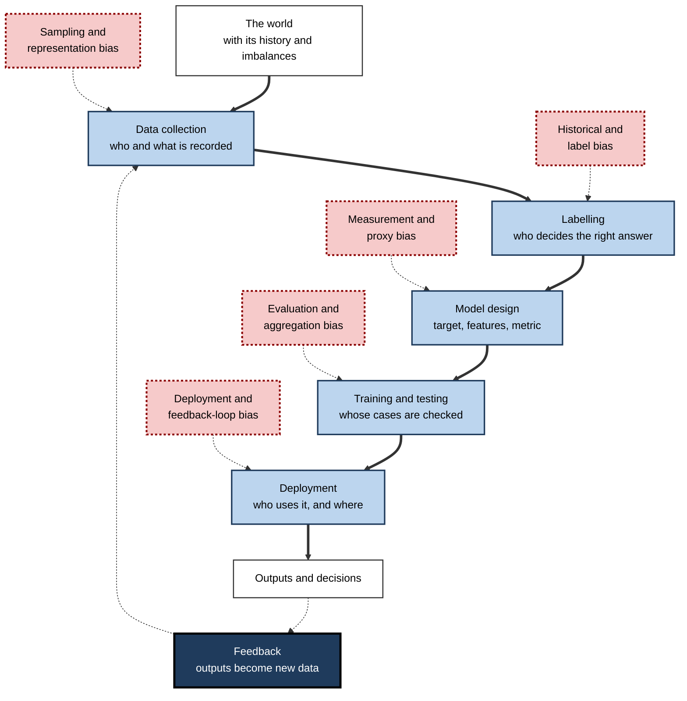
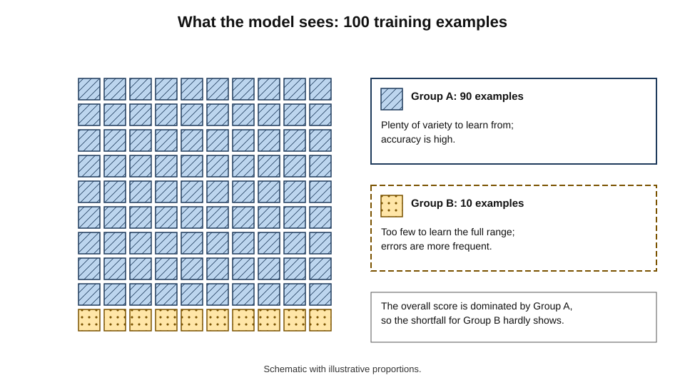
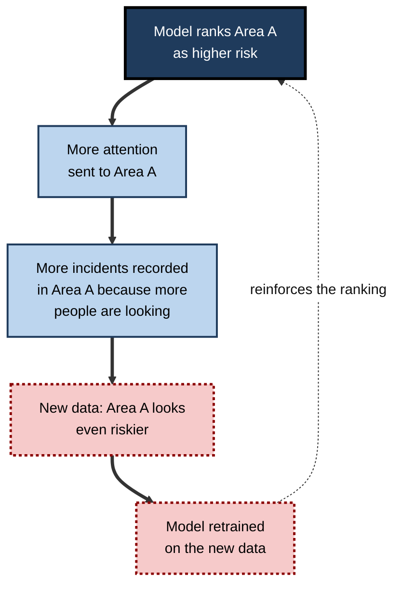
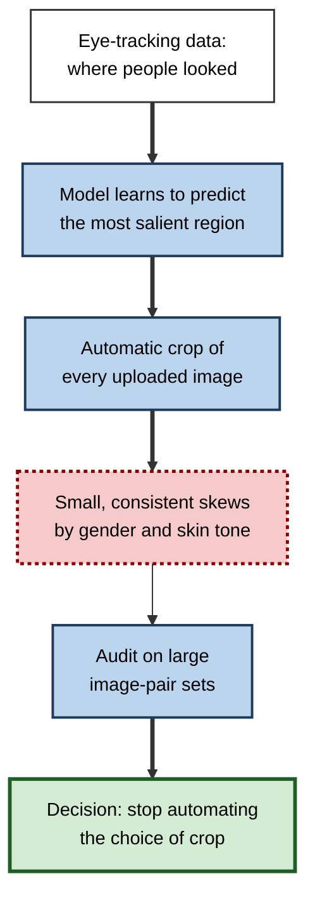
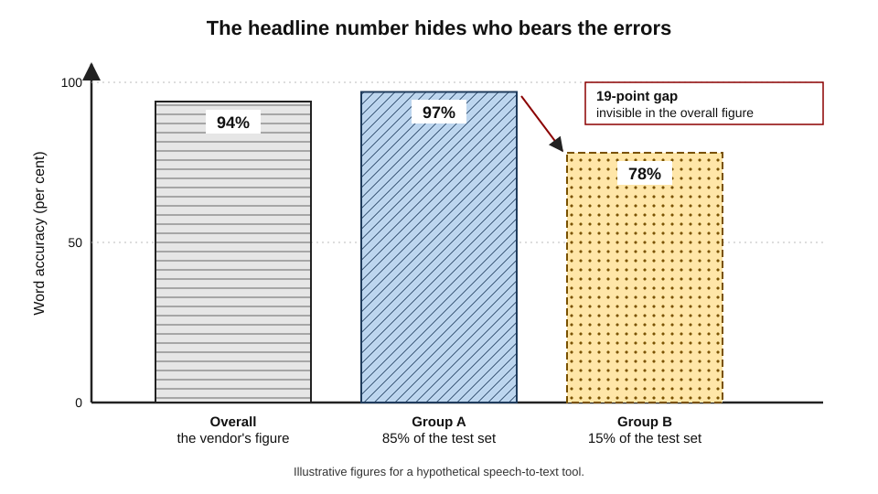
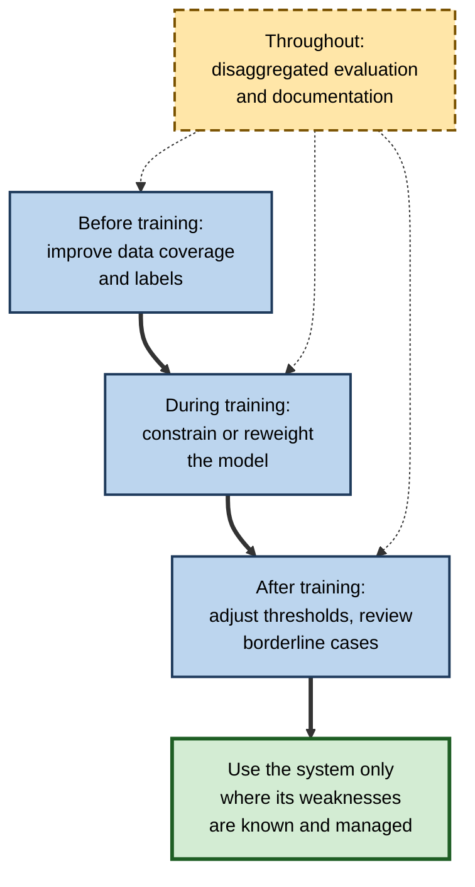

# F.7. Bias in AI: reflecting flawed training data

A photograph-cropping tool picks the "most interesting" part of each image for a social-media timeline, and a later audit finds it leans slightly towards women over men and towards lighter-skinned over darker-skinned faces. A model trained to read job applications learns from ten years of past hiring and quietly reproduces who was hired then. A word-association model places "nurse" nearer to "she" and "engineer" nearer to "he". No one wrote these tendencies into the software. They were **inherited from the data** the systems learned from.

> **Definition — Bias (in AI):** a systematic pattern in a system's outputs that departs from the truth or from what is intended, typically because of the data it learned from, the way the problem was framed or the way it was measured.

> **Definition — Training data:** the collection of examples from which a machine-learning system learns its patterns.

**Why it matters**

- Bias is the main reason an AI system can look accurate overall and still **perform badly for particular people, places or situations**.
- Because systems learn from records of the world, they absorb the world's imbalances — and can repeat them quickly and at scale.
- It is a **capability limitation**: a model cannot know what its data do not show, and cannot tell a pattern that is true from one that is merely common.
- Understanding where bias enters tells a professional what to check before relying on a system. (The questions of fairness, rights and accountability that bias raises are a separate and larger subject.)

---

## What "Bias" Means Here

### Several meanings of one word

- **Statistical bias** — a systematic error: estimates that are consistently too high or too low.
  - *e.g.* a thermometer that always reads one degree warm.
- **Bias in the learning sense** — the assumptions a model builds in so that it can generalise at all (**inductive bias**); in this sense some bias is necessary.
- **Social bias** — a pattern of systematically different treatment or accuracy for different groups of people.
  - *e.g.* a speech recogniser that makes more mistakes on some accents.
- **Cognitive bias** — a systematic shortcut in human judgement.
  - *e.g.* anchoring on the first number seen.

> **Definition — Inductive bias:** the set of assumptions a learning method uses to generalise from examples to new cases; without it, no learning from finite data is possible.

> **Watch out:** the phrase "AI is biased" slides between these meanings. A model can be **statistically accurate on average** and still **socially biased** in how its errors fall. Always ask: biased in what sense, against what standard, for whom?

### What the problem is, in plain terms

- **A model is a summary of its data** — it learns what tends to go with what in the examples.
- **If the examples are unrepresentative, the summary is too** — the model is accurate for what it saw and unreliable for what it did not.
- **If the examples record unfair human decisions, the model copies them** — it learns the decisions, not the justice.
- **If the measurements are poor proxies for what matters, the model optimises the wrong thing.**

> **Key point:** machine-learning systems have no access to "the truth" — only to the data. **Flawed data produce a flawed model, however clever the method.**

---

## Where Bias Enters

### Along the whole life of a system

**Figure 1.** Points at which bias can enter a machine-learning system.

### Sampling and representation bias

- **Who is in the data?** Data are collected from people and places that are easy to reach, online or already recorded.
- **Groups that are scarce in the data are served poorly** — the model has few examples to learn their patterns from.
- **Typical gaps:**
  - languages and dialects with little written text;
  - skin tones, ages or body types under-represented in image collections;
  - patients from some regions or health systems;
  - people who are less often online or recorded.

> **Definition — Representation bias:** weaker performance for a group because it is under-represented, or represented unrepresentatively, in the training data.

**Figure 2.** A training set dominated by one group gives the model little to learn from about the other.

### Historical and label bias

- **Historical bias** — the data accurately record a world that was itself unequal or unfair.
  - *e.g.* past hiring records showing mostly men in senior engineering roles.
- **Label bias** — the "right answers" in the data reflect human judgements that were inconsistent, prejudiced or based on poor criteria.
  - *e.g.* medical notes labelled by clinicians who under-diagnosed a condition in some groups.
- **The model learns the pattern, not the reason** — it cannot tell a pattern that reflects genuine differences from one that reflects past unfairness.

> **Definition — Historical bias:** bias that arises because the data faithfully reflect a world in which inequalities or unfair practices already existed.

### Measurement and proxy bias

- **A proxy** is a measurable stand-in for something that cannot be measured directly.
  - *e.g.* "arrests" as a stand-in for "crime"; "past healthcare spending" as a stand-in for "health need".
- **If the proxy tracks the true target differently for different groups, the model inherits the gap.**
  - *e.g.* people with less access to care spend less on care at the same level of illness.
- **Features can act as proxies for sensitive attributes** — a postcode, a first name or a school can stand in for ethnicity or class, even when the sensitive attribute is removed.

> **Definition — Proxy variable:** a measured quantity used in place of one that cannot be measured, or one that is correlated with a characteristic the system is not supposed to use.

### Evaluation and aggregation bias

- **Evaluation bias** — the test data do not represent all the people the system will meet.
  - *e.g.* a benchmark made mostly of lighter-skinned faces.
- **Aggregation bias** — one model is fitted to a diverse population though relationships differ between groups.
  - *e.g.* a single model of how a blood-test value predicts diabetes, when that relationship differs across ethnic groups.
- **Average accuracy hides subgroups** — the headline number can be excellent while one group fares badly.

### Deployment and feedback-loop bias

- **Deployment mismatch** — a system built for one setting is used in another.
  - *e.g.* a model trained on one country's hospital records applied in another.
- **Feedback loops** — the system's outputs shape the next round of data.
  - *e.g.* a system sends more patrols to areas it ranks as high-crime; more crime is recorded there; the ranking rises further.

**Figure 3.** A feedback loop in which a system's output generates the data that confirm it.

### The sources compared

| Source | Where it enters | Example | Typical sign |
|---|---|---|---|
| Representation | Data collection | Few images of darker skin | Poorer accuracy for the scarce group |
| Historical | The world itself | Past hiring records | Reproduces past patterns of selection |
| Label | Annotation | Inconsistent expert judgements | Errors that follow the annotators' blind spots |
| Proxy | Choice of target | Cost as a stand-in for need | The model optimises the wrong thing |
| Evaluation | Testing | Unrepresentative benchmark | High scores that fail in the field |
| Feedback loop | After deployment | Predictions that steer data | Growing disparity over time |

> **Mnemonic — "RHLPEF" — "Real Humans Leave Prints, Everywhere, Forever":** Representation, Historical, Label, Proxy, Evaluation, Feedback.

---

## Evidence of Bias in Learned Systems

### Language and word associations

**Study card — Bolukbasi and colleagues (2016), Boston University and Microsoft Research, "Man is to computer programmer as woman is to homemaker?"**

- **Design:** the researchers examined **word embeddings** — numerical representations of words learned from large text collections, in which words used in similar contexts lie close together — and asked them to complete analogies.
- **Results:** embeddings trained on news text completed "man is to computer programmer as woman is to ..." with "homemaker", and linked many occupations more strongly with one gender.
- **Response:** the team proposed a method for removing the gender direction from the embeddings for words that should be neutral, while keeping legitimately gendered words.
- **Conclusion:** the embeddings captured associations in how people had written, and passed them on to any system built using them.

**Study card — Caliskan, Bryson and Narayanan (2017), Princeton University and the University of Bath, *Science***

- **Design:** the researchers adapted the **Implicit Association Test** — a psychology test measuring how quickly people link concepts such as flowers or insects with pleasant or unpleasant words — to embeddings, measuring how close the word vectors were.
- **Results:** the embeddings reproduced many documented human associations, including pleasant words nearer to flower names than insect names, and gendered associations with careers and family.
- **Conclusion:** language statistics carry the **associations of the culture that produced them**; a model learning from that language absorbs them.

> **Definition — Word embedding:** a list of numbers representing a word, learned so that words used in similar ways have similar numbers.

> **Watch out:** an association in the data is not the same as an endorsement, and not the same as a causal fact. The studies show that models **mirror** the text; they do not show that the associations are true or fair.

### Images and faces

- **Face and skin-tone analysis** — audits of commercial gender-classification systems and of face-recognition algorithms found markedly higher error rates for darker-skinned women and for some demographic groups, tracing partly to data dominated by lighter-skinned faces.
- **Image generation** — studies of text-to-image systems found that prompts for high-status occupations tended to produce lighter-skinned men, and for low-status ones darker-skinned people and women, beyond real-world proportions.
- **Medical imaging** — models trained on data from a few hospitals can perform worse on patients of different backgrounds, partly through differences in equipment and in who is imaged.

### Speech and language

- **Speech recognition** — commercial systems have shown higher word-error rates for some speakers than others, with performance linked to training data that under-represent certain dialects and accents.
- **Language models** — outputs can differ systematically by the dialect or name used in the prompt, and by the language: models are generally stronger in languages with more training text.

---

## Case Study: Twitter's Image-Cropping Algorithm (2020–2021)

- **Situation:** in 2018 Twitter (now X) began using a machine-learning model to crop images in timelines to their most "salient" region — the area a person was predicted to look at first.
- **Problem:** in September 2020 users posted experiments suggesting that the crop favoured lighter-skinned faces over darker-skinned ones, and men over women, in side-by-side images; others noted the crop's preference for certain regions of a body.
- **Investigation:** Twitter's own machine-learning ethics team tested the model on a large set of image pairs and published its analysis in 2021:
  1. in comparisons of pairs of images of women and men, the crop favoured women, by about **8%** relative to parity;
  2. in pairs of white and Black individuals, the crop favoured white individuals, by about **4%**;
  3. the team also found instances of crops focusing on a woman's body rather than her head in a small share of images ("male gaze" effect).
- **Contributing factors:**
  - the model was trained to predict where people look, using eye-tracking data from human participants — it reproduced **human gaze patterns**, including their regularities;
  - the problem was a learned bias, not a decision by any programmer.
- **Outcome:** Twitter concluded that the design of **automatic cropping itself** was the problem — the choice of what is "interesting" should not be decided by an algorithm. It moved to showing full-size images wherever possible and reduced use of the crop.
- **Lesson:** a harmless-looking feature can encode bias through its **target** (what people look at). The most effective fix was **to remove the automated decision**, not to patch it.

> **Watch out:** the figures above come from the company's own analysis; the size of the effect was small in percentage terms, but at the scale of millions of images even small skews affect many people.

**Figure 4.** How a tool trained to predict human attention reproduced the patterns in it.

---

## Detecting Bias

### Disaggregate before you celebrate

- **Disaggregated evaluation** — reporting performance **separately** for each relevant group or condition, rather than only overall.
- **Slices to check:** gender, age, skin tone, language and dialect, region, device, income, disability, and combinations (intersections).
- **Metrics to compare per slice:** error rate, false-positive and false-negative rates, calibration.

> **Definition — Disaggregated evaluation:** measuring a system's performance separately for different groups or conditions so that disparities hidden by an overall average become visible.

### Worked example (illustrative): an accurate model that fails a group

- **Situation:** a speech-to-text tool is tested on 10,000 utterances; vendor reports 94% accuracy.

| Speaker group | Share of test set | Word accuracy |
|---|---|---|
| Group A (well represented in training) | 85% | 97% |
| Group B (under-represented) | 15% | 78% |

*Illustrative figures.*

1. **Overall accuracy** = (0.85 × 97) + (0.15 × 78) = 82.45 + 11.7 = **94.15%** — matching the vendor's headline.
2. **Group B's accuracy is 19 points lower** — roughly **one word in five** wrong, against one in thirty-three for Group A.
3. **Why the average hid it:** Group B is a small share of the test set, so a bad result barely moves the total.
4. **The same logic applies to the deployment:** a firm with many Group B employees would find the tool nearly unusable for them.

- **Conclusion:** the overall figure was true and unhelpful. Disaggregation reveals who bears the errors.

**Figure 5.** The same overall accuracy can hide very different results for two groups.

### Other ways to find bias

- **Counterfactual tests** — change only one attribute (a name, a pronoun, a dialect) and see whether the output changes.
- **Audits by outsiders** — independent researchers testing a deployed system.
- **Stress tests with diverse inputs** — deliberately chosen cases from underserved groups.
- **Monitoring after launch** — tracking performance by group over time.
- **Listening to affected users** — complaints often reveal slices no one tested.

### Why fixing bias is not simple

- **Removing a sensitive attribute is not enough** — proxies leak it back in.
- **Different fairness measures conflict** — it is generally impossible to satisfy several at once when groups differ in underlying rates.
- **Improving one group's accuracy can cost another's** — or cost average accuracy.
- **"Neutral" is a choice** — a model trained to match the world as recorded is not neutral about a world with inequalities.
- **Some bias cannot be tested away** — unknown groups, unmeasured attributes.

> **Remember:** bias is managed, not eliminated. The aim is to **know where a system is weak, say so, and design around it**.

---

## Reducing Bias at the Capability Level

### Three stages of intervention

| Stage | What is done | Examples | Limits |
|---|---|---|---|
| Before training (data) | Improve the data | Collect more from under-represented groups; fix labels; rebalance or reweight | Costly; cannot remove history |
| During training (model) | Change the learning | Add constraints or penalties on group differences; adversarial methods | Trade-offs with accuracy; metric choice is contested |
| After training (outputs) | Adjust the results | Different thresholds by group; human review of borderline cases; filters | Can be legally or ethically contentious |

- **Documentation** — recording what data a system was trained on and where it is weak, so users can judge fitness for purpose.
  - *e.g.* **datasheets for datasets** (a proposal by Timnit Gebru and colleagues, 2018) and **model cards** (Margaret Mitchell and colleagues, 2019).

> **Definition — Model card:** a short document describing a model's intended use, training data, performance across groups and known limitations.

**Figure 6.** Three stages at which bias can be addressed.

### Worked example (illustrative): choosing a fix

- **Situation:** the speech tool above has Group B accuracy 78%.

| Option | Expected effect | Cost | Residual issue |
|---|---|---|---|
| Collect more Group B speech and retrain | Group B maybe 90%+ | Months; recruitment and consent | Still below Group A |
| Reweight existing Group B examples | Small gain | Cheap | Limited by the data available |
| Tell users the tool is less reliable for Group B | None on accuracy | Trivial | Does not help the user |
| Provide a human-correction workflow | Fewer uncorrected errors | Ongoing staffing | Slower for Group B |

*Illustrative assessments.*

1. Only the first option addresses the root cause; the others reduce harm.
2. A realistic plan combines **new data** with an **interim human-correction route** and **honest documentation**.

> **In practice:** many organisations now require a **fitness-for-purpose review** before deployment: who is in the data, who is not, how performance differs across groups, and what happens to the people the system serves worst.

---

## Case Study (illustrative): the résumé screen that learned the past

- **Situation:** a professional-services firm trained a model on ten years of past hiring decisions — which applications progressed to interview — to rank new applicants.
- **Observation:** pilot results looked strong: the ranking agreed with past recruiters about 85% of the time.
- **Problem:** a review found that applicants who had attended a small set of universities, and applicants with continuous employment histories, were ranked far higher, and career-break applicants lower. Past recruiters had favoured both.
- **Diagnosis:**
  1. **historical bias** — the labels were past decisions, not measured job performance;
  2. **proxy bias** — university and gaps in employment stood in for ability and for caring responsibilities;
  3. **evaluation bias** — agreement with past recruiters was treated as accuracy, so copying the past scored well.
- **Actions:**
  1. the firm stopped using the model for ranking;
  2. it retained it only to flag applications for human review that a rules-based screen had rejected;
  3. recruiters were trained to review such applications against explicit job criteria.
- **Result:** more varied applicants reached interview; the firm kept humans accountable for selection.
- **Lesson:** a model trained to **reproduce past decisions** cannot be better than those decisions; agreement with the past is not a measure of quality.

---

## Bias and the Limits of Learning

- **Models are pattern-completers** — they extend the patterns in their data without judging whether the patterns are fair or true.
- **Scale does not cure it** — larger datasets collected from the internet are not more representative; they are larger samples of the same unequal record.
- **Fluent models hide it** — generative systems produce balanced-sounding text while carrying skewed assumptions, which show up in what is omitted or assumed.
- **Mitigation introduces its own choices** — whose accuracy is prioritised, and who decides, are value judgements the technology cannot make.

| | Human decision-maker | Learned system |
|---|---|---|
| Source of bias | Experience, culture, mood | Training data, labels, targets |
| Visibility | Hidden in the mind | Hidden in the numbers — but testable at scale |
| Consistency | Varies from case to case | Applies the same skew every time |
| Fixable by | Training, structure, accountability | Data, design, evaluation and oversight |
| Scale of effect | Limited by throughput | Multiplied across every case |

> **Key point:** AI does not remove bias from decisions — it **relocates it into data and design**, where it can be measured and corrected if someone looks.

---

## Open Questions

- **Can data ever be representative enough?**
  - Collecting more data from under-represented groups raises privacy and consent questions of its own.
- **How should bias be measured when groups overlap?**
  - Intersections of gender, ethnicity, age and disability multiply the slices faster than data can fill them.
- **Do general-purpose models need different tests?**
  - A system used for thousands of tasks has no single "population" to audit.
- **How do users' own biases interact with AI output?**
  - Evidence suggests people can inherit a model's skews, but how strongly is unsettled.
- **What does a "good enough" system look like?**
  - Where the line between acceptable and unacceptable disparity lies is a social judgement, not a technical one.

---

## Summary

- **Bias in AI** = a systematic pattern in outputs that departs from the truth or intention, arising from data, framing or measurement.
- A model **summarises its data**: unrepresentative data give unrepresentative models; records of unfair decisions teach unfair decisions; poor proxies lead to the wrong target.
- Bias enters through **representation, history, labels, proxies, evaluation and feedback loops** (**RHLPEF**).
- Evidence: **word embeddings** reproduce stereotypes (Bolukbasi 2016; Caliskan 2017), image, face and speech systems perform unevenly across groups.
- Twitter's **image-cropping** case: skews of about 8% (women over men) and 4% (white over Black) led to removing the automation.
- **Overall accuracy hides subgroup failure**: disaggregated evaluation and counterfactual tests expose it.
- Fixing bias involves trade-offs: removing attributes is not enough, fairness measures conflict, and neutrality is a choice.
- Interventions act **before**, **during** and **after** training, supported by **documentation** such as model cards.
- Bias is **managed, not eliminated**: know the weak points, say so and design around them.

---

## Self-Check

1. Distinguish statistical, inductive, social and cognitive bias.
2. Why can a model trained on accurate historical records still be biased?
3. Name and explain the six routes by which bias enters a system (RHLPEF).
4. What is a proxy variable? Give two examples.
5. Describe what Bolukbasi and colleagues and Caliskan and colleagues found about word embeddings.
6. Summarise the Twitter image-cropping case and its resolution.
7. A speech tool is 96% accurate overall, with 99% accuracy for 90% of users and 69% for 10%. Check the average and comment.
8. What is disaggregated evaluation, and why does it matter?
9. Why does removing a sensitive attribute not guarantee removal of bias?
10. Describe a feedback loop that increases bias over time.
11. Compare pre-training, in-training and post-training interventions.
12. Why does a larger internet-scale dataset not solve bias?
13. A model trained on past promotion decisions will be used to shortlist managers. Identify the risks and propose tests.
14. What should a model card contain, and who benefits?

### Answer Key

1. Statistical: a consistent error in estimates. Inductive: the assumptions needed to generalise. Social: systematically different treatment or accuracy across groups. Cognitive: systematic shortcuts in human judgement.
2. Accurate records of an unequal world teach the model the inequality; the model learns what happened, not what is fair or what predicts performance.
3. Representation (who is in the data), Historical (an unequal world), Label (biased "right answers"), Proxy (stand-ins for the target), Evaluation (unrepresentative tests), Feedback (outputs shape new data).
4. A measurable stand-in for something not directly measurable, or correlated with a sensitive attribute: past healthcare spending as a stand-in for health need; postcode as a stand-in for ethnicity or income.
5. Embeddings completed analogies and associations in stereotyped ways (programmer/homemaker) and reproduced human implicit-association patterns (flowers pleasant, insects unpleasant; gendered careers). They mirror the text they learn from.
6. A cropping model trained on eye-tracking data showed small skews (about 8% towards women over men, 4% towards white over Black individuals). Twitter concluded automated cropping could not be fixed adequately and moved to full images.
7. (0.9 × 99) + (0.1 × 69) = 89.1 + 6.9 = 96%. The average is correct but hides that one in three words is wrong for the 10% group.
8. Measuring performance separately for groups or conditions. Overall averages let small groups' failures vanish.
9. Other features (postcode, name, school, vocabulary) correlate with it and act as proxies, so the model can reconstruct it.
10. A system sends more attention to Area A; more incidents are recorded there; retraining on that data raises Area A's score further.
11. Before: improve data and labels — addresses cause but costly and cannot remove history. During: constraints or reweighting — flexible but with accuracy trade-offs. After: adjusted thresholds or human review — quick, but ethically and legally contentious and treats the symptom.
12. Internet data are larger samples of an already unequal and unrepresentative record; volume does not correct who is missing or what is over-represented.
13. Risks: historical bias (past promotions reflect past favouritism), proxy bias (tenure, working hours), evaluation bias (agreement with past choices). Tests: compare shortlist rates and errors by group; counterfactual tests changing gender or career break; compare predictions with measured performance, not past decisions.
14. Intended use, training data, performance by group, evaluation conditions and known limitations. Beneficiaries: developers, buyers deciding fitness for purpose, auditors and the people affected.

---

## Glossary

| Term | Meaning |
|---|---|
| Aggregation bias | Bias from fitting one model to groups whose relationships differ. |
| Bias (in AI) | A systematic departure of outputs from the truth or intention, arising from data, framing or measurement. |
| Counterfactual test | Changing one attribute of an input to see whether the output changes. |
| Disaggregated evaluation | Measuring performance separately for different groups or conditions. |
| Evaluation bias | Bias from test data that do not represent the people a system will meet. |
| Feedback loop | A process in which a system's outputs shape the data it later learns from. |
| Historical bias | Bias arising because data faithfully record an already unequal world. |
| Inductive bias | The assumptions a learning method uses to generalise. |
| Label bias | Bias in the "right answers" used for training. |
| Model card | A short description of a model's use, data, group performance and limits. |
| Proxy variable | A measurable stand-in for something not directly measured. |
| Representation bias | Poorer performance for groups under-represented in the training data. |
| Training data | The examples from which a system learns. |
| Word embedding | A list of numbers representing a word, learned so that similar words have similar numbers. |
