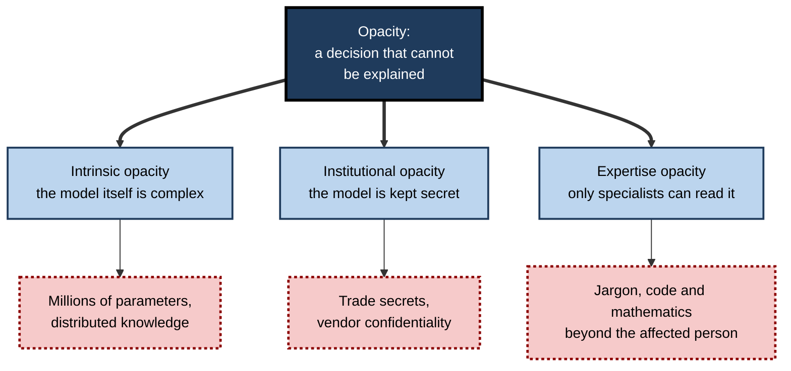
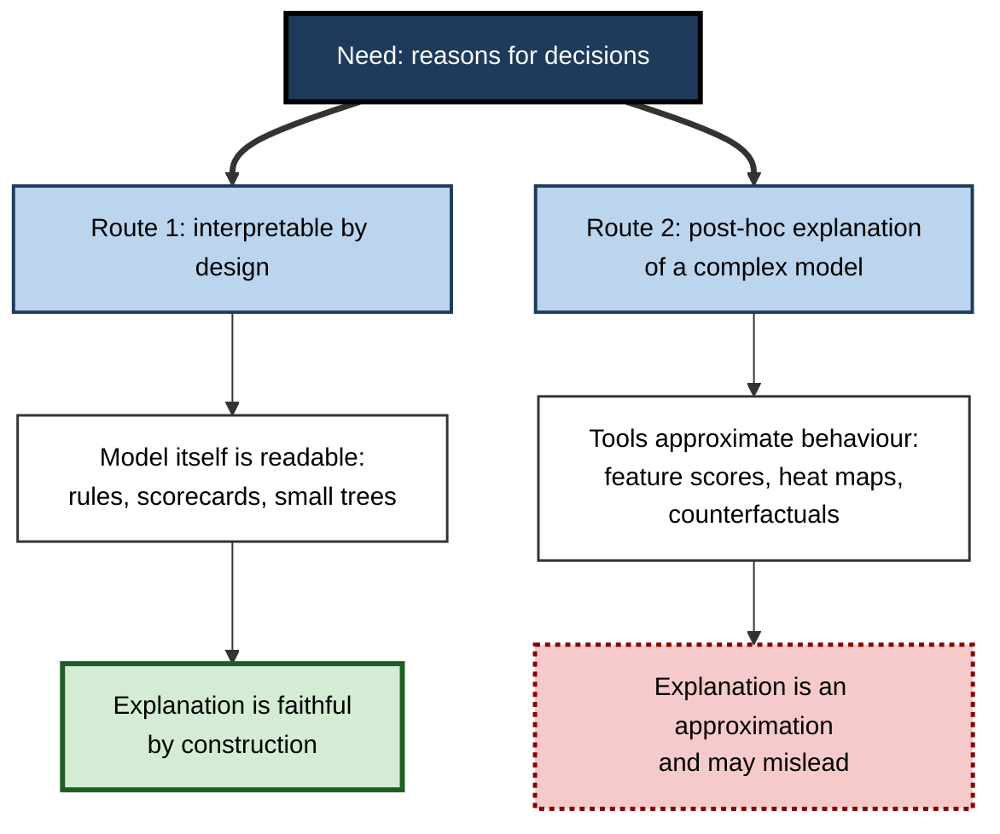
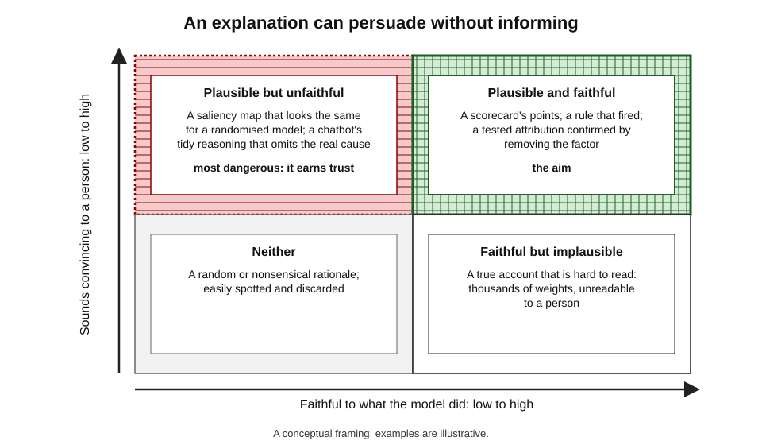
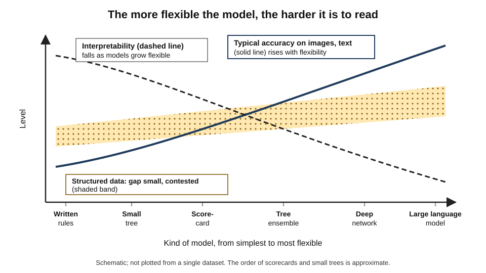
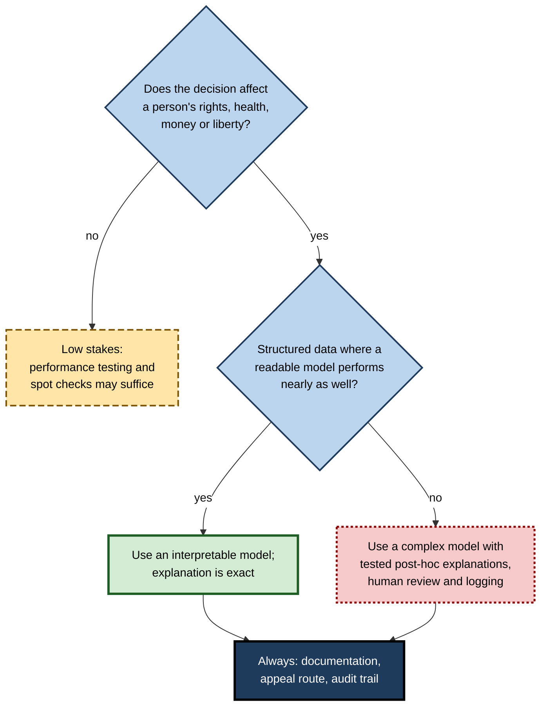
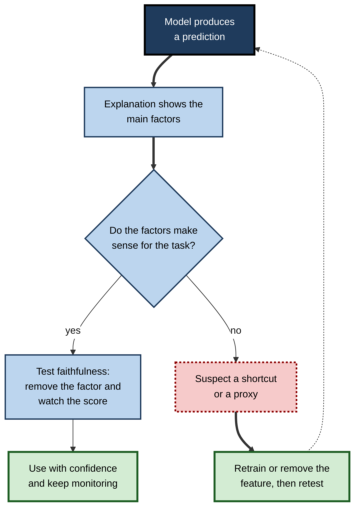

# F.8. AI explainability: why decisions are often a black box

A customer is refused a loan and asks why. The bank's analyst checks the system and finds a score of 412 and a refusal — but no reason a human could state. A radiologist is shown a highlighted region on a scan and asked to trust the machine's verdict, without knowing whether the highlight shows what the model actually used. A person denied an insurance claim is told that "the model decided". In each case the output is clear and the **reasoning is not**.

> **Definition — Black box (AI):** a system whose internal workings are too complex, or too inaccessible, for a person to inspect and understand how a given input leads to a given output.

> **Definition — Explainability:** the extent to which the reasons for an AI system's output can be described in terms that a person can understand and, where needed, challenge.

**Why it matters**

- People affected by decisions generally want and are sometimes entitled to reasons.
- Professionals responsible for a decision need to know whether the system is relying on **sound reasons or shortcuts**.
- Without explanations, errors and biases are harder to **diagnose and correct**.
- Explainability is also a source of **false comfort**: an explanation can look convincing without being true to what the model did.

---

## What Explainability Means

### Related words, different ideas

- **Transparency** — how much is openly known about a system: its data, design, purpose, performance.
- **Interpretability** — how far a person can understand **how the model works** or predict what it will do.
- **Explainability** — the ability to give **reasons for a particular output**, in human terms.
- **Justification** — arguing that a decision is **right**, which goes beyond describing how it was made.
- **Accountability** — someone answerable for the outcome.

> **Definition — Interpretability:** the degree to which a person can understand the cause of a model's decision, or consistently predict its output from its input.

| Idea | Question it answers | Example |
|---|---|---|
| Transparency | What do we know about the system? | Published data sources and test results |
| Interpretability | Can I understand how it works? | A short list of weighted rules |
| Explainability | Why this output for this case? | "Declined because income is below X and arrears exist" |
| Justification | Is this decision right? | An argument that the criteria are fair and lawful |
| Accountability | Who answers for it? | A named officer responsible for decisions |

> **Watch out:** these terms are used inconsistently in the literature and in law. Always ask what is meant: **how the model works in general**, or **why it did this in one case**?

### Two levels of explanation

- **Global explanation** — how the model behaves overall: which features matter most, what rules it has learned.
  - *e.g.* "the model weighs payment history most, then debt ratio, then age of account."
- **Local explanation** — why the model reached a particular output for **one** case.
  - *e.g.* "this applicant was declined mainly because of two missed payments in the last year."

> **Key point:** a person usually needs a **local** explanation to understand a decision about themselves and a **global** one to judge whether the system is sound.

---

## Why Many Systems Are Black Boxes

### Opacity has several sources

- **Complexity** — a modern deep network has millions to trillions of numerical parameters; no person can hold them in mind.
- **Distributed knowledge** — what the model has learned is spread across many parameters, not stored as separate readable rules.
- **Learned features** — the model builds internal representations that need not match human concepts.
- **Interactions** — the effect of one input depends on all the others, in ways that cannot be summarised in a sentence.
- **Proprietary secrecy** — even simple models may be hidden by companies for commercial reasons.
- **Technical illiteracy** — a model may be inspectable only by specialists.

> **Definition — Opacity:** the quality of being difficult or impossible to understand, whether because of technical complexity, secrecy or the reader's lack of expertise.

**Figure 1.** Three kinds of opacity: complexity, secrecy and unfamiliarity.

### Models along a spectrum

| Model type | Typical understanding | Explanation possible | Typical use |
|---|---|---|---|
| Hand-written rules | Complete | Exact: the rule that fired | Eligibility checks, compliance |
| Decision tree (small) | Good | Path from root to leaf | Triage, simple scoring |
| Linear or points-based scorecard | Good | Contribution of each factor | Credit scoring, risk scores |
| Ensemble of many trees | Limited | Approximate, by importance measures | Fraud, forecasting |
| Deep neural network | Poor | Approximate, after the fact | Images, speech, language |
| Large language model | Very poor | Approximate and unreliable | General text tasks |

> **Key point:** the very qualities that make deep networks powerful — flexible, many-layered, learned representations — are the ones that make them hard to explain.

### Why a person cannot simply read it

- **No rule to point to** — the network does not contain "if income below X then decline"; it contains numbers that, through many layers, produce a score.
- **The "reason" is spread across thousands of units** — no single unit corresponds to a clear concept.
- **Small changes can matter a lot** — changing a few inputs can flip the output unexpectedly.
- **The model may use cues people would reject** — the same arithmetic that produces good predictions can rest on spurious signals.

---

## Why Explanations Matter

### Who needs explanations, and for what

- **Affected people** — to understand, contest and correct a decision; to know what would change the outcome.
- **Professionals using the system** — to decide whether to accept or override a recommendation.
- **Developers** — to debug, to see what the model relies on, to improve it.
- **Auditors and regulators** — to check compliance and fairness.
- **Organisations** — to manage risk, defend decisions and keep trust.

### Explanations help find errors

**Study card — Ribeiro, Singh and Guestrin (2016), University of Washington, "Why should I trust you?"**

- **Design:** the researchers introduced **LIME**, a method that explains one prediction by fitting a simple model to the behaviour of the complex model **around that case**, highlighting which parts of the input mattered most.
- **Test case:** they trained a classifier to separate pictures of **wolves** from pictures of **huskies**, using deliberately biased training photographs in which every wolf was photographed against snow.
- **Result:** the explanations highlighted **snow** in the background, not the animal. When shown the explanations, many people recognised that the classifier was using a shortcut; without them, most had trusted it.
- **Conclusion:** explanations can reveal when a model is **right for the wrong reason** — useful even when the model's accuracy looks excellent.

> **Definition — Local explanation method:** a technique that describes the reasons for a single prediction, often by showing which input features contributed most to it.

### Explanations help trust — and mistrust

- **Calibrating trust** — a good explanation helps a person know *when* to rely on the system.
- **But explanations can increase over-trust** — research on people using AI recommendations has found that giving an explanation often makes people **more** likely to accept the advice, whether or not it is correct.

> **Watch out:** an explanation can persuade without informing. The appearance of reasons may raise confidence in a wrong answer.

### Hidden reasons: the pneumonia and asthma story

**Study card — a risk model for pneumonia patients (Caruana and colleagues, Microsoft Research and partners, 2015)**

- **Design:** researchers trained different models to predict which hospital patients with pneumonia were at risk of dying, in order to decide who should be admitted.
- **Finding:** a **rule-based** model learned that patients with **asthma** had a **lower** risk of death — apparently making asthma a reason to send someone home.
- **Explanation:** in the hospital's records, patients with asthma were routinely sent straight to intensive care, where the aggressive treatment improved their survival. The data showed the effect of the **treatment**, not that asthma was protective.
- **Why it mattered:** a neural network trained on the same data **probably learned the same pattern**, but its reasoning could not be inspected; the readable model exposed the flaw.
- **Conclusion:** accurate predictions can rest on reasons that would be **dangerous if acted on**. Inspectability allowed the flaw to be found and removed.

> **Watch out:** this example is retold from a published account and is widely taught; treat the details as illustrating the lesson about hidden reasons rather than as a precise record.

---

## Methods for Explaining Models

### Two families of approach

- **Interpretable by design** — build models whose structure a person can read.
  - *e.g.* short decision lists, scorecards, sparse linear models, generalised additive models.
- **Post-hoc explanation** — keep a complex model and add tools that describe its behaviour afterwards.
  - *e.g.* LIME, SHAP, saliency maps, counterfactuals, example-based explanations.

**Figure 2.** Two routes to an explainable system.

### The main post-hoc tools

- **Feature importance** — which inputs matter most overall (global) or for one case (local).
- **SHAP values** — a method, based on a concept from cooperative game theory called Shapley values, that assigns each feature a share of the difference between a case's prediction and the average prediction.
- **Saliency or attribution maps** — heat maps showing which pixels or words most influenced the output.
- **Counterfactual explanations** — the smallest change that would alter the outcome.
  - *e.g.* "Had your annual income been 3,000 higher, the application would have been approved."
- **Example-based explanations** — pointing to similar past cases or to the training examples that most influenced a prediction.
- **Surrogate models** — a simple, readable model trained to mimic a complex one.
- **Concept-based methods** — testing whether the model uses human concepts such as "stripes" or "tumour texture".

> **Definition — Counterfactual explanation:** a statement of the smallest change to an input that would have produced a different output.

> **Definition — Surrogate model:** a simple, interpretable model trained to approximate the behaviour of a complex one, used to explain it.

### Worked example (illustrative): a points-based scorecard and a counterfactual

- **Situation:** a lender uses a transparent scorecard; approval needs 60 points.

| Factor | Applicant's value | Points |
|---|---|---|
| Missed payments in last 12 months | 2 | 0 |
| Years of credit history | 7 | 15 |
| Debt-to-income ratio | 38% | 12 |
| Employment length | 4 years | 10 |
| Savings balance | Low | 5 |
| **Total** | | **42** |

*Illustrative figures.*

1. **Global explanation:** missed payments are the heaviest factor — up to 30 points for none.
2. **Local explanation:** the applicant scored 42, **18 short**; the missed payments cost the most.
3. **Counterfactual:** with no missed payments (30 points) instead of two (0 points), the total would be 72 — approved.
4. **Practical advice:** maintain payments; wait until the missed payments leave the 12-month window.

- **Conclusion:** because the model is a scorecard, the explanation **is** the model. No approximation is involved.

> **Watch out:** a counterfactual says what *would* change the outcome, not whether the change is **achievable** or **fair**. "Be ten years younger" is a valid counterfactual and a useless one.

### Explanations that may not be true

- **Plausible versus faithful** — a plausible explanation sounds sensible; a **faithful** one describes what the model actually did. They are different.
- **Post-hoc tools are approximations** — they may differ from the real computation, especially on unusual cases.

**Study card — "Sanity checks for saliency maps" (Adebayo and colleagues, Google Brain and collaborators, 2018)**

- **Design:** the researchers tested several popular methods for producing saliency maps by gradually **randomising the trained model's parameters** — destroying what it had learned — and checking whether the maps changed.
- **Results:** some methods produced maps that **looked almost the same** for the randomised, meaningless model as for the trained one — appearing to explain a model that no longer existed.
- **Conclusion:** a visually appealing explanation is **not evidence** that it reflects the model's reasoning; explanation tools themselves must be tested.

**Study card — "Language models don't always say what they think" (Turpin and colleagues, New York University and collaborators, 2023)**

- **Design:** language models were asked to answer multiple-choice questions while "thinking step by step"; the researchers added biasing features to the prompt — such as reordering options so the correct answer was always the same letter, or a suggestion by the user.
- **Results:** the models' answers shifted towards the bias, but their written reasoning **did not mention it**; instead it offered plausible-sounding justifications for the biased answers.
- **Conclusion:** a model's own written explanation of its reasoning **may not be the real cause** of its answer. Asking a chatbot "why did you say that?" produces a story, not necessarily the reason.

> **Remember:** an explanation is itself an output. Like any output from a learned system it can be **fluent, convincing and wrong**.

**Figure 3.** Explanation quality: plausible is not the same as faithful.

---

## The Accuracy–Interpretability Debate

### The conventional view

- **Complex models are more accurate; simple ones are more interpretable** — so there is a trade-off, and high-stakes users must choose.
- **Hence post-hoc explanation** — to keep the accuracy of the complex model and add some insight.

### The challenge

**Study card — Cynthia Rudin (Duke University), "Stop explaining black box models for high-stakes decisions and use interpretable models instead" (*Nature Machine Intelligence*, 2019)**

- **Argument:**
  - for many **structured, tabular** problems — credit, recidivism, medical scores — carefully built interpretable models perform about as well as black boxes;
  - post-hoc explanations are **not faithful** and can be misleading;
  - in high-stakes settings an inherently interpretable model should be the default, and black boxes used only when they are shown to be necessary.
- **Counterpoint:** for images, speech and language the complex models are much more accurate, and no simple model comes close; post-hoc tools remain the main option.
- **Status:** the first claim is **contested** — the size of any accuracy gap varies with the problem and how hard the interpretable model is worked on.

> **Key point:** the trade-off is **real for some tasks and negligible for others**. Before accepting a black box for a high-stakes decision on structured data, ask whether a readable model would do.

**Figure 4.** Interpretability and typical accuracy across kinds of model.

| | Interpretable by design | Black box with post-hoc explanation |
|---|---|---|
| Faithfulness of explanation | Exact | Approximate |
| Typical accuracy on structured data | Often comparable | Often slightly higher |
| Typical accuracy on images, speech, text | Usually far lower | High |
| Effort to build | High expert effort | High compute and data |
| Auditability | Straightforward | Harder |
| Best fit | High-stakes decisions on structured data | Perception and language tasks |

---

## Case Study: Apple Card Credit Limits (2019–2021)

- **Situation:** in November 2019 the Apple Card, issued by Goldman Sachs, was launched in the United States with credit limits set by an algorithm.
- **Complaint:** a prominent software entrepreneur posted that his credit limit was **twenty times** his wife's, though they shared finances and she had a higher credit score; other couples, including a co-founder of Apple, reported similar disparities.
- **The explanation problem:** customers who called were reportedly told by staff that the algorithm made the decision and that they could not say why — **"it's the algorithm"** — a response widely criticised.
- **Response:** Goldman Sachs stated that it did not use gender or related variables in the decision and that two members of one household could receive different limits for legitimate reasons, such as differing credit histories; it said it would review cases.
- **Regulatory review:** the New York State Department of Financial Services investigated; in March 2021 its report found **no unlawful discrimination** under the fair-lending law, but identified weaknesses in customer service and in how decisions were **explained** to applicants.
- **What the episode shows:**
  1. a system can be **lawful and still unexplained**;
  2. staff who could not give reasons were left unable to resolve complaints;
  3. even without a prohibited variable, **proxies and correlated data** can make an outcome look discriminatory, and only an explanation can show whether it is;
  4. the absence of an explanation itself damaged trust.
- **Lesson:** a decision organisation must be able to give **reasons** at the point of contact — in terms staff and customers can understand — whether or not the model is a black box.

> **Watch out:** the investigation found no violation. The case shows an **explanation failure**, not proof of bias.

---

## Explainability in Professional Practice

### Matching the explanation to the audience

| Audience | What they need | Form that helps |
|---|---|---|
| Affected individual | Reasons and what could change the outcome | Plain-language reasons; counterfactuals; route to appeal |
| Front-line staff | Reasons they can relay and judge | Short reason codes; confidence; flags |
| Domain professional | Evidence they can weigh | Highlighted evidence, similar cases |
| Developer | Debugging detail | Feature attributions; error analysis |
| Auditor or regulator | Evidence of sound design | Documentation, tests, logs, model cards |

### Questions to ask of any AI decision system

1. **What was decided, and what inputs were used?**
2. **Can the reasons be stated for this case?** By whom, in what words?
3. **Is the explanation faithful, or an approximation?** How was that tested?
4. **What would change the outcome?**
5. **Who can override the system, and on what basis?**
6. **Is a simpler, readable model good enough for this task?**
7. **How are decisions logged so they can be reviewed later?**

**Figure 5.** Choosing the right level of explainability for the stakes.

### Case study (illustrative): the claims triage model

- **Situation:** an insurer used a gradient-boosted model to flag insurance claims for fraud investigation; investigators were given a score between 0 and 1.
- **Problem:** investigators did not trust scores they could not interpret; some ignored them, while others treated any high score as proof, leading to complaints from honest claimants whose claims were delayed.
- **Actions:**
  1. the team added local explanations showing the three factors that raised each score most, such as "claim filed within seven days of policy start" or "repair estimate far above regional average";
  2. they wrote guidance: the score is a reason to **look**, not a reason to **refuse**;
  3. they tested whether the explanations were faithful by removing the highlighted factors and checking that the score fell;
  4. they found the model relied heavily on one factor that was really a proxy for a particular postcode, and removed it.
- **Result:** investigators used the scores more consistently; delays for honest claimants fell; the proxy was found only because explanations were examined.
- **Lesson:** explanations are most valuable when used to **test and correct the model**, not just to reassure users.

**Figure 6.** Using explanations to test and correct a model.

---

## Frontiers

- **Mechanistic interpretability** — research that tries to understand a network's internal circuits and features, by identifying what groups of artificial neurons represent and how they combine.
  - Early results on small models and on parts of large ones are promising; full understanding of large models is far off.
- **Probing** — training small classifiers on a model's internal activations to see what information they hold.
- **Chain-of-thought reasoning** — models that write out intermediate steps; useful for performance, but the steps are not guaranteed to be the real cause.
- **Monitoring and auditing tools** — methods to detect when a model's behaviour departs from what it appears to be doing.
- **Regulatory pressure** — laws and standards increasingly expect meaningful information about automated decisions affecting people.

> **Watch out:** "explainable AI" has been marketed as a solution; it is a field of **partial tools** with limits that must be tested case by case.

---

## Open Questions

- **Can very large models be understood at all?**
  - Whether human-comprehensible explanations of trillion-parameter systems are possible is unsettled.
- **How can explanations be measured?**
  - There is no agreed test of whether an explanation is both faithful and useful to a person.
- **Do explanations improve decisions?**
  - Studies show mixed results: explanations sometimes help people spot errors and sometimes increase over-reliance.
- **How much does the accuracy–interpretability trade-off matter?**
  - The answer differs by task; systematic evidence is limited.
- **Whose explanation counts?**
  - A technically correct explanation may be useless to a person without expertise; meeting both needs is hard.

---

## Summary

- A **black box** is a system whose workings cannot be inspected or understood; **explainability** is the ability to give reasons, **interpretability** the ability to understand how the model works.
- Opacity arises from **complexity**, **secrecy** and **lack of expertise**.
- Explanations may be **global** (overall behaviour) or **local** (one decision).
- Explanations expose **right-for-the-wrong-reason** models: wolves versus snow (LIME), asthma and pneumonia.
- Two routes: **interpretable by design** (exact explanations) and **post-hoc** methods (feature importance, SHAP, saliency maps, counterfactuals, surrogates).
- **Plausible is not faithful**: saliency maps can look the same for a randomised model; chatbots' written reasoning may not reflect the true cause.
- The **accuracy–interpretability trade-off** is real for perception and language, but contested for structured data (Rudin, 2019).
- The **Apple Card** case showed that being unable to give reasons erodes trust, even without proof of unlawful bias.
- In practice, tailor explanations to the **audience**, test their faithfulness, keep **logs** and an **appeal route**.

---

## Self-Check

1. Distinguish transparency, interpretability, explainability and accountability.
2. Distinguish global from local explanations, with an example of each.
3. Give three reasons why deep networks are hard to explain.
4. Describe the wolves-and-huskies experiment and what it showed.
5. What did the asthma and pneumonia example show about hidden reasons?
6. What is a counterfactual explanation, and what is one limitation?
7. Explain the difference between plausible and faithful explanations, with evidence from either the saliency-map or language-model studies.
8. State Rudin's argument and one counterpoint.
9. A scorecard needs 60 points; an applicant has 48, with a missed-payment factor worth 0 instead of 20. What is the counterfactual?
10. Why did the Apple Card episode become a story about explanation?
11. Why can explanations increase over-trust?
12. Match explanation forms to audiences: affected individual, front-line staff, auditor.
13. A hospital buys a diagnostic model that outputs only a probability. List five questions to ask the vendor.
14. A manager asks a chatbot to explain its own earlier answer and accepts the explanation as the reason. Evaluate.

### Answer Key

1. Transparency: what is known about the system. Interpretability: whether people can understand how it works. Explainability: reasons for a particular output. Accountability: who answers for the result.
2. Global: the model's overall pattern, such as payment history carrying most weight. Local: why one applicant was declined, such as two missed payments.
3. Millions or more of parameters; knowledge distributed across them with no readable rules; learned features that do not match human concepts; interactions between inputs.
4. A classifier trained on wolf photos taken on snow and huskies without; the explanation highlighted snow. Shown the explanations, people recognised the shortcut; accuracy alone had hidden it.
5. A model predicted asthma lowered risk because such patients were treated intensively, which improved their outcomes. The readable model exposed the flaw; accurate prediction rested on a reason that would be dangerous to act on.
6. The smallest change to an input that would change the outcome ("with 3,000 more income, approved"). Limitation: the change may be unachievable or unfair.
7. Plausible sounds sensible; faithful reflects what the model did. Saliency-map methods produced similar-looking maps for a randomised model; language models gave reasoning that omitted the biasing feature that actually shifted their answers.
8. For high-stakes decisions on structured data, interpretable models often match black boxes and post-hoc explanations are unfaithful, so use interpretable models. Counterpoint: for images, speech and language, complex models are far more accurate and have no simple substitute; the claim about structured data is contested.
9. If the missed-payment factor had earned 20 points, the total would be 68 and the application approved.
10. Staff could not say why a limit was set, reportedly saying only that the algorithm decided; regulators found no unlawful discrimination but criticised the lack of explanation and customer service.
11. An explanation lends the appearance of reasoned justification, so people accept advice more readily, whether or not it is correct.
12. Individual: plain reasons, what could change the outcome, appeal route. Front-line staff: short reason codes and confidence. Auditor: documentation, test results, logs, model cards.
13. What data was it trained on and is my population represented? How does performance differ by group and site? Can it show which parts of the image drove the result, and have those explanations been tested for faithfulness? How should uncertain cases be handled? What logs and monitoring exist after deployment?
14. A chatbot's account of its own reasoning is another generated output; studies show written reasoning can omit the true influences. It is a hypothesis, not evidence. Check the answer independently and use proper tests.

---

## Glossary

| Term | Meaning |
|---|---|
| Black box | A system whose internal workings cannot be inspected or understood. |
| Counterfactual explanation | The smallest change to an input that would change the output. |
| Explainability | The ability to give understandable reasons for an output. |
| Faithful explanation | One that accurately reflects what the model actually did. |
| Global explanation | A description of a model's behaviour overall. |
| Interpretability | The degree to which a person can understand how a model works. |
| LIME | A method that explains one prediction by fitting a simple model around that case. |
| Local explanation | A description of the reasons for one particular output. |
| Opacity | Difficulty or impossibility of understanding a system. |
| Post-hoc explanation | An explanation of a trained model produced afterwards. |
| Saliency map | A heat map showing which parts of an input most influenced the output. |
| SHAP | A method assigning each feature a share of a prediction, based on Shapley values. |
| Surrogate model | A simple model trained to mimic a complex one in order to explain it. |
| Transparency | How much is openly known about a system. |
