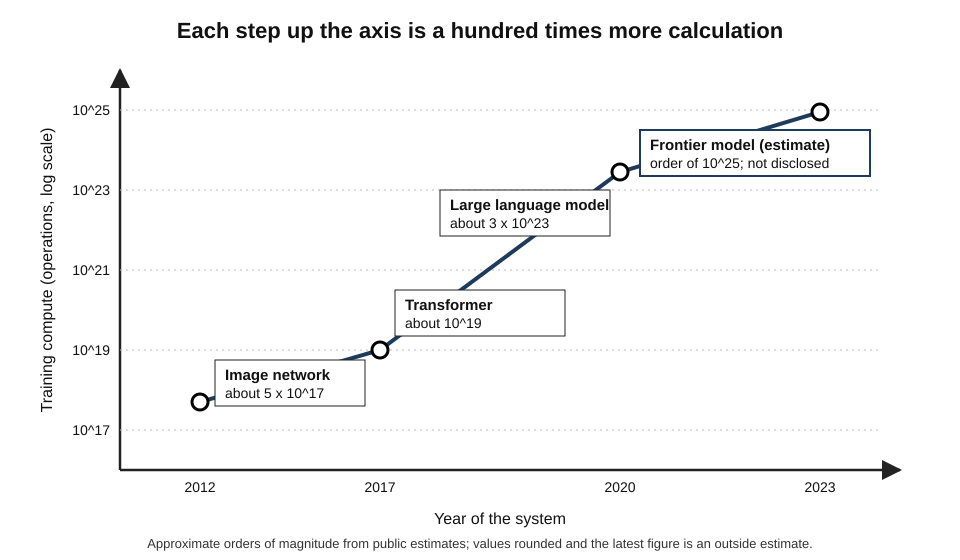
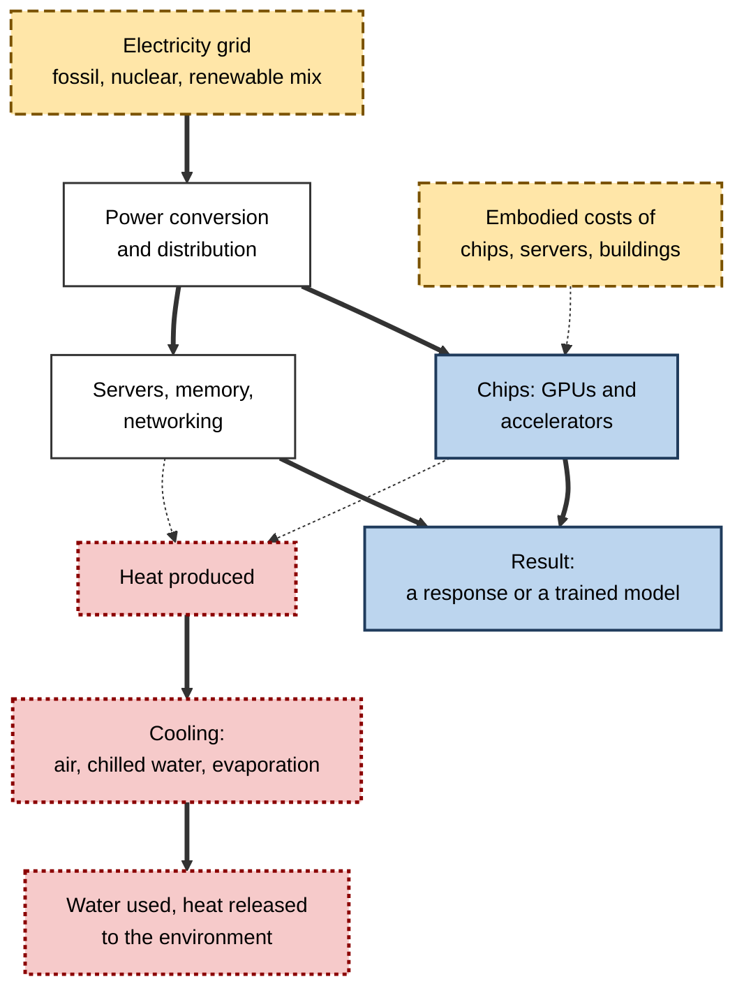
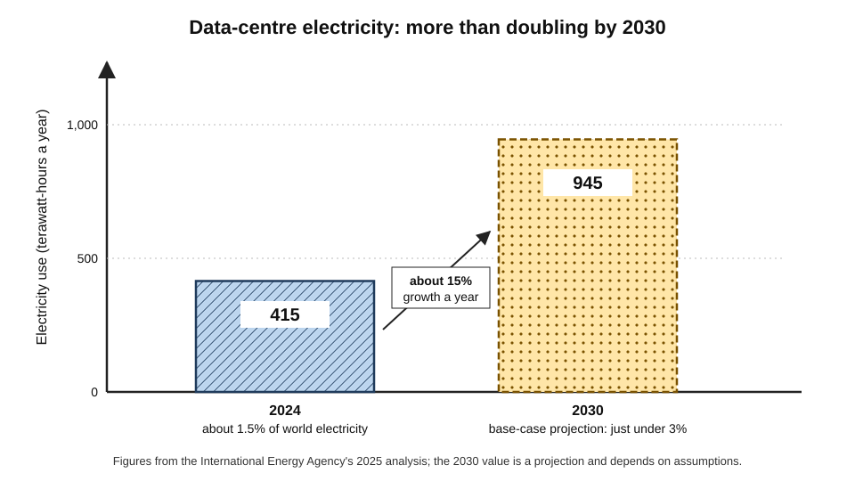
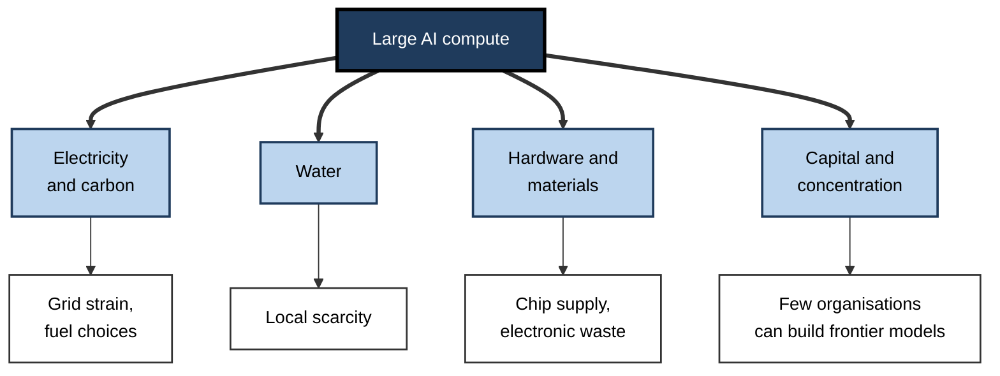
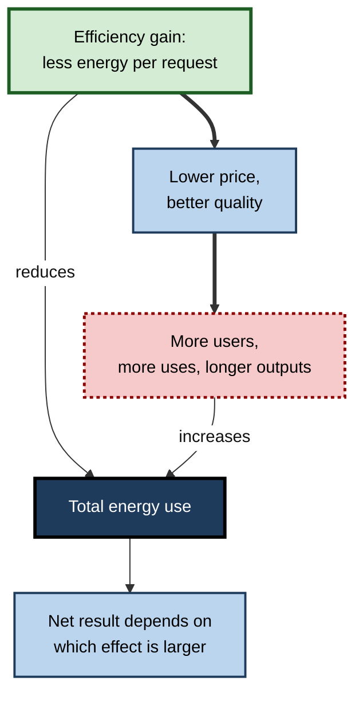

# F.9. Energy and compute costs of large AI models

A single question typed into a chatbot feels weightless. Behind it, a warehouse-sized building full of specialised processors draws electricity, produces heat that must be removed with fans, chillers or water, and sits at the end of a chain that began with mining the materials for chips and training a model for weeks on thousands of them. Multiplied by hundreds of millions of daily users, the invisible cost of intelligence becomes a significant claim on the world's power grids, water supplies and capital.

> **Definition — Compute:** the amount of calculation a task requires, usually counted in floating-point operations (FLOPs) and delivered by processors such as graphics processing units (GPUs).

> **Definition — Data centre:** a facility housing large numbers of networked computers, together with the power, cooling and communications equipment that keep them running.

**Why it matters**

- Compute is the main **physical limit** on how large and how widely used AI systems can become.
- Energy, water, hardware and money are all consumed — unevenly in time and place — and the bills fall on organisations, grids and communities.
- Costs shape **who can build** frontier systems (a handful of well-funded organisations) and **what tasks are worth automating**.
- Informed users and buyers can choose, size and use AI in ways that cut waste without giving up value.

---

## What Compute Is and Why It Is Needed

### From calculation to cost

- **A model is a very large set of numbers (parameters)** — modern systems have billions to trillions.
- **Training** adjusts those numbers by processing enormous quantities of data, over and over.
- **Inference** uses the trained numbers to answer each new request.
- **Both involve vast numbers of multiplications and additions**, performed in parallel on GPUs and similar chips.
- **Every operation uses energy**, and the total depends on model size, data volume and number of requests.

> **Definition — Training:** the one-off, intensive process of adjusting a model's parameters using data.

> **Definition — Inference:** using a trained model to produce an output for a new input; repeated every time someone uses the system.

> **Definition — Parameter:** one of the adjustable numbers inside a model that training sets.

### Training and inference compared

| | Training | Inference |
|---|---|---|
| What happens | The model is built or improved | The model answers a request |
| Frequency | Once per model version (plus experiments) | Every use, continuously |
| Cost per event | Very large | Very small |
| Total cost | Large, concentrated in time | Grows with the number of users |
| Who bears it | The developer | The provider, the customer, or both |
| Typical trend | Rising with frontier model size | Rising with adoption and with "reasoning" models that use more steps |

> **Key point:** training is a **capital cost** (large, up front); inference is an **operating cost** (small each time, enormous in total). For widely used systems, inference can come to exceed training in total energy.

### Rough scale of training compute

- **Compute counted in FLOPs** — a trillion trillion operations is a "yottaFLOP" scale; frontier training runs are estimated at the order of 10^25 to 10^26 operations.
- **Growth has been rapid:**
  - OpenAI's 2018 analysis found that the compute used in the largest AI training runs had grown roughly **300,000-fold between 2012 and 2018**, a doubling every three to four months;
  - research by the group Epoch AI has estimated that, across notable models since around 2010, training compute has typically grown **four to five times per year**.
- **Why:** scaling up model size, data and compute has repeatedly produced predictable gains in capability, encouraging ever larger runs.

**Figure 1.** Training compute of landmark AI systems has grown by many orders of magnitude.

> **Definition — Scaling law:** an empirical relationship showing that a model's performance improves smoothly and predictably as model size, data and compute are increased together.

---

## Where the Energy Goes

### The chain of consumption

- **Chips** — GPUs and accelerators draw hundreds of watts each; a training cluster may use tens of thousands.
- **Servers and networking** — memory, storage and the links between chips.
- **Cooling** — removing heat; can be as much as a quarter to a half of the energy of the computing itself in older facilities, much less in efficient ones.
- **Power conversion and losses** — transformers, backup supplies and distribution.
- **Embodied costs** — energy and materials to make chips, servers and buildings.

> **Definition — Power usage effectiveness (PUE):** the ratio of a data centre's total energy use to the energy used by its computing equipment; a PUE of 1.2 means 20% extra for cooling, power conversion and other overheads.

> **Definition — Embodied carbon:** the greenhouse-gas emissions caused by making and transporting equipment and constructing buildings, before they are ever switched on.

**Figure 2.** From chip to grid: where the energy of an AI request is used.

### Energy per task varies enormously

**Study card — "Power Hungry Processing" (Alexandra Sasha Luccioni, Yacine Jernite and Emma Strubell, Hugging Face and Carnegie Mellon University, 2024)**

- **Design:** the researchers measured the energy used by many models answering thousands of requests across tasks — text classification, summarisation, question answering, image classification and image generation.
- **Results:**
  - average energy per 1,000 requests rose steeply with task complexity: from about **0.002 kilowatt-hours** for simple text classification to nearly **3 kilowatt-hours** for image generation — a gap of more than a thousand-fold;
  - **general-purpose generative models** used markedly more energy than smaller models fine-tuned for a single task, for the same job;
  - energy depended on the model's size and the length of the output.
- **Conclusion:** the cost of AI is not one number. **Choice of model and task** changes energy per request by orders of magnitude.

> **Watch out:** these measurements concern particular models and hardware as of 2023; efficiency improves quickly and different studies use different methods, so absolute figures date fast. The pattern — large differences between tasks and model sizes — is the durable finding.

### Training energy

**Study card — "Energy and policy considerations for deep learning in NLP" (Emma Strubell, Ananya Ganesh and Andrew McCallum, University of Massachusetts Amherst, 2019)**

- **Design:** the authors estimated the energy and carbon dioxide emitted by training several popular language models, including a large model developed through an extensive architecture search.
- **Results:**
  - the extensive search with a large model was estimated to emit around **284 tonnes of carbon dioxide equivalent**, about five times the lifetime emissions of an average American car, including its manufacture;
  - most single training runs of the models studied were far smaller.
- **Impact:** the paper helped establish that the **cost of experiments** — dozens or hundreds of trial runs — often far exceeds the cost of the final training run.
- **Caveat:** the figure was for an unusual and extreme research procedure and used assumptions about energy sources; it is a vivid illustration, not a typical cost.

> **Formula — Estimating training energy:** energy (kWh) = number of chips × average power per chip (kW) × hours × PUE. For 10,000 chips at 0.7 kW each for 30 days (720 hours) with a PUE of 1.2: 10,000 × 0.7 × 720 × 1.2 = **6,048,000 kWh**, about 6 gigawatt-hours (illustrative figures).

> **Formula — Emissions:** emissions (kg CO₂) = energy (kWh) × carbon intensity of the grid (kg CO₂ per kWh). At 0.4 kg per kWh, 6,048,000 kWh gives about **2,420 tonnes**; at 0.05 kg per kWh (a low-carbon grid) about **300 tonnes** (illustrative figures).

- **The same training run can have emissions differing by a factor of eight or more** depending on where and when it is performed.

### Inference energy at scale

- **Per request, small** — recent estimates for a typical text query from a large model are fractions of a watt-hour to a few watt-hours, depending on the system and the length of the answer.
- **In total, large** — with hundreds of millions of daily users and applications calling models automatically, the totals reach many gigawatt-hours per year.
- **Longer outputs and "reasoning" modes** — models that generate long chains of thought, or process images and video, can use many times the energy of a short text reply.

### Worked example (illustrative): the energy of a customer-service assistant

- **Situation:** a company runs an AI assistant answering 2,000,000 customer messages a month.

| Item | Value |
|---|---|
| Energy per response | 0.3 watt-hours (illustrative) |
| Responses per month | 2,000,000 |
| Monthly energy | 2,000,000 × 0.3 Wh = **600,000 Wh = 600 kWh** |
| Annual energy | 600 × 12 = **7,200 kWh** |
| Comparison | About two average households' annual electricity (taking 3,600 kWh each) |

*Illustrative figures.*

1. **At this scale the energy is modest**, and may be less than the energy staff would use in offices and commuting.
2. **If the response used a 30-times more demanding model** (9 Wh) — for example, a long reasoning model — the annual figure would be **216,000 kWh**, about sixty households.
3. **If the same message volume were 200 times higher** — a large consumer service — it would be hundreds of times larger again.

- **Conclusion:** neither "negligible" nor "enormous" is correct. The answer depends on **model choice, output length and volume**.

> **Watch out:** per-request figures quoted by companies and researchers use different boundaries — some count only the chip, some include servers and cooling, some include training. Compare like with like.

---

## The Wider Footprint

### Electricity demand

**Study card — Energy and AI (International Energy Agency, 2025)**

- **Estimate:** global electricity use by data centres was about **415 terawatt-hours in 2024**, roughly **1.5%** of world electricity consumption.
- **Projection:** in its base case, demand would more than double to about **945 terawatt-hours by 2030**, just under **3%** of global electricity, growing about 15% a year — more than four times faster than demand from all other sectors.
- **Where:** the United States and China account for most of the growth.
- **AI's share:** AI-focused servers are one of the fastest-growing components, though traditional computing remains a large part.
- **Caveats:** projections depend on assumptions about chip efficiency, model sizes, adoption and policy; credible forecasts range widely, and measurement of current use is itself uncertain because companies disclose little.

**Figure 3.** Projected global data-centre electricity demand, 2024 and 2030.

- **Concentration matters more than the global share:**
  - data centres cluster in a few regions; in Ireland they account for more than a fifth of national electricity use;
  - local grids may be unable to connect new demand quickly, leading to delays, new fossil generation and higher prices;
  - in some areas utilities and regulators have paused or conditioned new connections.

### Water

- **Evaporative cooling** uses water to carry heat away; power generation also uses water.
- **Estimate:** a 2023 study by researchers at the University of California, Riverside and collaborators estimated that training a large model of the GPT-3 class in a US data centre could directly evaporate on the order of **700,000 litres** of fresh water, and that a conversation of some tens of queries could be associated with roughly half a litre of water. These are **estimates with wide uncertainty**.
- **Local effect** — water stress in a region matters more than the global total.
- **Mitigation** — closed-loop and air cooling, siting in cooler or water-rich areas, using recycled water.

### Hardware and materials

- **GPUs and accelerators** depend on advanced manufacturing concentrated in a few places, on rare materials, and on energy-intensive fabrication.
- **Short lifetimes** — hardware is replaced every few years, adding electronic waste and embodied emissions.
- **Supply constraints** — chips, high-bandwidth memory, transformers and grid connections have all been bottlenecks.

### Money and concentration

- **Frontier training runs** are estimated to cost tens to hundreds of millions of dollars in compute alone, and rising.
- **Capital spending** on AI data centres by the largest technology firms has run to hundreds of billions of dollars a year in recent years.
- **Consequence:** frontier capability is concentrated in a few organisations and countries; smaller players depend on renting access or using smaller models.

| Cost type | What is consumed | Who feels it |
|---|---|---|
| Electricity | Energy and its carbon emissions | Grids, communities, climate |
| Water | Fresh water for cooling and generation | Local water supplies |
| Hardware | Materials, manufacturing, waste | Supply chains, ecosystems |
| Capital | Billions in chips and buildings | Investors, customers, competition |
| Opportunity | Compute that could be used elsewhere | Researchers without access |

**Figure 4.** The main footprints of large-scale AI: energy, water, hardware and money.

---

## Case Study: Restarting a Nuclear Reactor for Data Centres (2024)

- **Situation:** by 2024 large technology companies were committing to rapidly growing electricity needs for AI, while holding public targets for low-carbon energy.
- **Event:** in September 2024 Constellation Energy and Microsoft announced a 20-year power purchase agreement that would restart Unit 1 of the Three Mile Island nuclear plant in Pennsylvania — the undamaged reactor that had shut down in 2019 for economic reasons, separate from the unit involved in the 1979 accident. The restarted plant, to be renamed the Crane Clean Energy Center, was reported to have a capacity of about **835 megawatts**, with return to service targeted for 2028.
- **Context:** other large technology companies announced agreements involving nuclear power, including small modular reactors, and gas-fired plants to supply data centres.
- **What the case reveals:**
  1. **AI's demand is large enough to reshape energy investment** — companies are paying to bring back plants that had been retired;
  2. **round-the-clock demand** favours firm, low-carbon supply, not only intermittent renewables;
  3. **new demand can displace or delay decarbonisation elsewhere**, if met from existing clean supply rather than new capacity;
  4. **timelines mismatch** — AI demand grows in months, power plants take years.
- **Debate:** supporters see data-centre demand as financing new clean generation; critics worry about higher prices for other users, delays to retiring fossil plants and a rush to approve projects.
- **Lesson:** the energy cost of AI is not only a matter of kilowatt-hours but of **where and when** the power comes from, and **who pays for the grid** that delivers it.

> **Watch out:** announcements of capacity and targets are not the same as delivered clean power. Figures and dates in such agreements are plans, and plans change.

---

## Efficiency and the Rebound Problem

### Efficiency gains are real and large

- **Better chips** — each generation of accelerators delivers far more computation per watt.
- **Better algorithms** — techniques that reach the same performance with fewer operations.
- **Smaller, specialised models** — "distilled" or purpose-built models that do one job at a fraction of the cost.
- **Quantisation** — storing numbers with fewer bits so that calculations are cheaper.
- **Sparse and mixture-of-experts designs** — activating only part of the model for each request.
- **Caching and batching** — reusing work across similar requests.
- **Efficient data centres** — modern facilities with PUE near 1.1 versus 1.5 or more in older ones.

> **Definition — Distillation:** training a smaller model to imitate a larger one, to keep most of its ability at much lower cost.

> **Definition — Quantisation:** representing a model's numbers with fewer bits so that it needs less memory and energy per calculation.

### But total use can still rise

- **The Jevons paradox** — in 1865 the economist William Stanley Jevons observed that more efficient steam engines led to greater, not lesser, total coal use, because cheaper energy services were used far more.
- **Applied to AI** — if each request becomes ten times cheaper, people may make a hundred times more requests, embed AI in more products and run longer reasoning chains.
- **Evidence is mixed** — the sharp drop in the price of a given level of model capability has coincided with an enormous rise in total usage.

> **Definition — Rebound effect:** the partial or complete offsetting of efficiency gains by increased use of the more efficient service.

**Figure 5.** How efficiency gains can be offset by growth in use.

### An episode of efficiency news: DeepSeek (January 2025)

- **Event:** a Chinese laboratory released a model reported to match leading systems at much lower stated training cost, prompting a sharp fall in some technology share prices.
- **Debate:** the stated cost covered only the final training run, not research, experiments and earlier models; and cheaper models were expected by many analysts to **increase** total demand for compute, in line with the Jevons paradox.
- **Lesson:** efficiency breakthroughs change *who* can afford capability, and often *how much* is used, more than they cut the total.

---

## Using AI Sensibly Under Resource Constraints

### Choose the right size

- **Match the model to the task** — a small classifier for categorising invoices, a large model only where depth is needed.
- **Prefer purpose-built models** for stable, high-volume tasks.
- **Use the large model for hard cases** and a small model for the rest.

### Reduce waste

- **Do not generate what is not needed** — shorter outputs, fewer retries, no needless regeneration of images and videos.
- **Cache repeated answers** — frequently asked questions need not call a large model each time.
- **Batch background jobs** — run non-urgent tasks when the grid is cleaner or cheaper.
- **Right-size the context** — sending a whole archive of text with every request costs more than sending the relevant extract.
- **Measure** — track energy, cost and usage per feature.

### Procurement and governance questions

1. **What is the model, and is a smaller one sufficient?**
2. **Where does it run, and with what energy mix?**
3. **What does the vendor disclose about energy, water and embodied emissions?**
4. **What is the expected volume, and what is the cost per request at that volume?**
5. **How will usage be capped or monitored?**
6. **What would the task cost without AI?** Compare the whole process, not only the compute.

> **Remember:** the cost question is **cost per useful result**, not cost per request. Wasted or poor-quality outputs multiply the real cost.

### Worked example (illustrative): right-sizing a document classifier

| Option | Cost per 1,000 documents | Accuracy on the firm's categories | Energy per 1,000 documents |
|---|---|---|---|
| Large general model | 4.00 | 96% | 2.0 kWh |
| Medium model, fine-tuned | 0.60 | 97% | 0.3 kWh |
| Small classifier, trained on 5,000 labelled examples | 0.02 | 95% | 0.005 kWh |

*Illustrative figures.*

1. The small classifier is **200 times cheaper** and uses a few hundred times less energy than the large model, for one point less accuracy.
2. The medium model is **more accurate than the large one** on this narrow task, at a seventh of the cost.
3. **Decision:** use the small classifier for the bulk, and send the 3% of documents it flags as uncertain to the medium model.

- **Conclusion:** bigger is not better for a narrow task. The largest cost saving in many deployments comes from **not using a frontier model where it is not needed**.

### Case study (illustrative): a bank's chatbot bill

- **Situation:** a retail bank launched an assistant, built on a large general model, answering customers' questions about cards and accounts.
- **Problem:** within a quarter, usage far exceeded forecasts: customers asked longer questions, the assistant produced long answers, and the system re-sent the full conversation history with every message. Monthly compute costs were several times the budget.
- **Analysis:**
  1. about 60% of questions were the same twenty queries;
  2. long answers added cost without improving satisfaction;
  3. most requests did not need a frontier model.
- **Actions:**
  1. answers to common queries were cached and checked by staff;
  2. answer length was shortened by design;
  3. a small model handled routine questions, with a larger one used only for complex ones;
  4. conversation history was summarised rather than repeated in full;
  5. monthly cost per resolved conversation was tracked.
- **Result:** cost per resolved conversation fell by more than half; customer satisfaction was unchanged.
- **Lesson:** the energy and money costs of AI at scale are **design variables**; they respond to sensible engineering.

---

## Open Questions

- **How large will AI's energy demand become?**
  - Forecasts differ by a wide margin; efficiency, adoption and regulation are all uncertain.
- **Will efficiency outpace demand?**
  - Past technology cycles show rebound effects; whether AI differs is unclear.
- **Can disclosure be standardised?**
  - Companies report little about energy, water and hardware; comparable, audited reporting is not yet routine.
- **What counts as worthwhile use?**
  - Comparing the energy cost of a summary, a drug-discovery run and a novelty image requires value judgements.
- **Will compute become the main limit on progress?**
  - Power, chips and capital may constrain frontier growth; so might algorithmic advances that make large runs unnecessary.

---

## Summary

- **Compute** is the calculation a task needs; **training** is a one-off, intensive cost, **inference** is a small cost multiplied by every use.
- Training compute for notable models has grown roughly **four to five times a year**; frontier runs are on the order of 10^25 to 10^26 operations.
- Energy is used by **chips, servers, cooling and power conversion** (**PUE** measures the overhead); **embodied carbon** adds the cost of making equipment.
- Energy per task varies enormously with **model and task**: image generation used over a thousand times more energy per request than simple text classification (2024 study).
- The IEA estimated data-centre electricity at about **415 TWh in 2024** (about 1.5% of the world's) and projected about **945 TWh by 2030**; local concentration matters more than the global share.
- Further footprints: **water**, **hardware and materials**, and **capital**, which concentrates frontier capability.
- Efficiency gains are large, but the **rebound effect** (Jevons paradox) can offset them; DeepSeek shows cheaper capability widens use.
- Practical responses: **right-size the model**, **cache and batch**, **limit outputs**, **measure**, ask for **disclosure**, and judge **cost per useful result**.

---

## Self-Check

1. Define compute, training and inference, and explain why inference can eventually exceed training in total energy.
2. What is PUE? Compute the overhead if a facility has PUE 1.3 and its computing equipment uses 10 GWh.
3. Using the formula, estimate the training energy for 2,000 chips at 0.6 kW for 20 days with PUE 1.25.
4. Why can the same training run have very different emissions in different places?
5. Summarise the findings of the "Power Hungry Processing" study.
6. What did the 2019 study of training emissions show about experiments?
7. State the IEA's 2024 estimate and 2030 projection for data-centre electricity, and one reason why the global share understates local impact.
8. What are the water, hardware and capital footprints of large-scale AI?
9. What does the Three Mile Island restart agreement show about AI and energy systems?
10. Explain the Jevons paradox in AI terms.
11. Why was the DeepSeek episode taken by many as support for the Jevons paradox?
12. List five practical ways to reduce the compute cost of an AI deployment.
13. A team wants to use a frontier model to classify 10 million routine emails a year. Advise them.
14. Draft three questions for a vendor about its AI service's resource use.

### Answer Key

1. Compute: the calculation a task requires. Training: the one-off process of building a model. Inference: using it for each request. Inference energy per request is small but multiplied by every use, so for widely used models the total can exceed that of training.
2. The ratio of total facility energy to computing energy. 10 GWh × 1.3 = 13 GWh total, so overhead is 3 GWh (30% of the computing energy).
3. 2,000 × 0.6 kW × (20 × 24 = 480 hours) × 1.25 = 720,000 kWh.
4. Emissions equal energy times the grid's carbon intensity; grids with more fossil generation emit far more per kilowatt-hour than low-carbon grids, so location and timing matter.
5. Energy per request varied by task and model: simple text classification used about 0.002 kWh per 1,000 requests, image generation nearly 3 kWh; general-purpose generative models used more than task-specific ones; size and output length mattered.
6. Estimated emissions of an extensive architecture search for a large model were about 284 tonnes, showing that the experiments leading to a model can cost far more than one final run; the figure was an extreme example.
7. About 415 TWh in 2024 (roughly 1.5% of world electricity) and about 945 TWh by 2030 (just under 3%). Data centres are concentrated in a few places, such as Ireland where they use more than a fifth of national electricity, so local grids can be strained.
8. Water for cooling and power generation; manufacturing, materials and electronic waste from short-lived chips; very large capital costs that concentrate frontier capability in a few organisations.
9. AI demand is large and continuous enough to affect energy investment: a 20-year agreement to restart a reactor for data-centre supply. It also shows tension over who benefits and the mismatch between fast demand and slow power-plant timelines.
10. Efficiency lowers cost per request, which can increase the number and length of requests so much that total energy use rises.
11. A cheaper way to reach strong capability lowers barriers and was expected to expand uses and demand for compute rather than reduce it.
12. Right-size the model; use purpose-built or distilled models; cache repeated answers; shorten outputs and context; batch non-urgent work; measure usage.
13. Use a small classifier trained on labelled examples, with a larger model only for uncertain cases. Test accuracy on the firm's categories, estimate cost and energy per 1,000 emails, and monitor drift.
14. Which model size and hardware serve my requests? What is the energy and water use per request and the carbon intensity of the grid? Can usage be capped, and what is reported to customers?

---

## Glossary

| Term | Meaning |
|---|---|
| Compute | The amount of calculation a task needs. |
| Data centre | A facility housing networked computers with power and cooling. |
| Distillation | Training a smaller model to imitate a larger one. |
| Embodied carbon | Emissions from making and building equipment before use. |
| FLOP | One floating-point operation; a basic unit of calculation. |
| GPU | Graphics processing unit; a chip suited to parallel calculation used for AI. |
| Inference | Using a trained model on new inputs. |
| Jevons paradox | Efficiency gains that lead to greater total use of a resource. |
| Parameter | An adjustable number in a model set during training. |
| Power usage effectiveness (PUE) | Total facility energy divided by computing energy. |
| Quantisation | Representing model numbers with fewer bits to save memory and energy. |
| Rebound effect | Offsetting of efficiency gains by increased use. |
| Scaling law | A predictable relationship between model size, data, compute and performance. |
| Training | The process of adjusting a model's parameters using data. |
