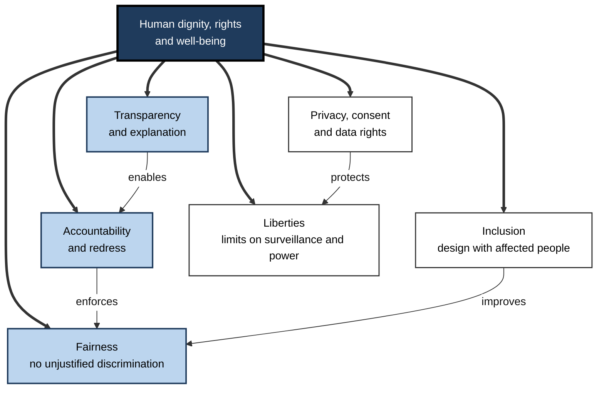
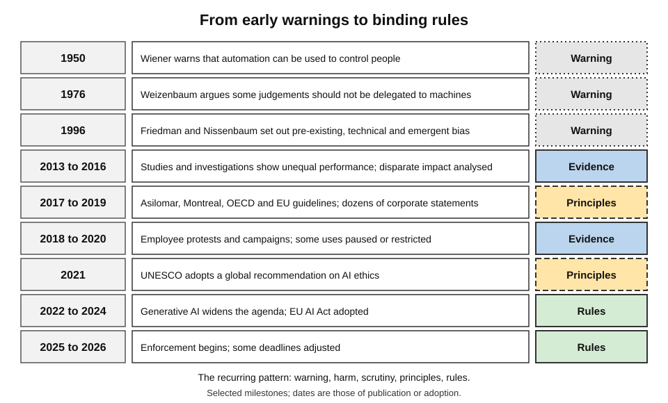
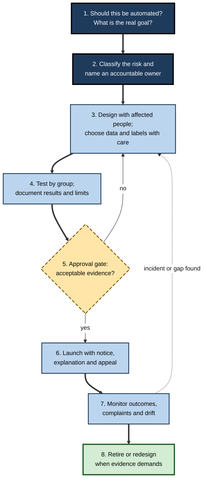
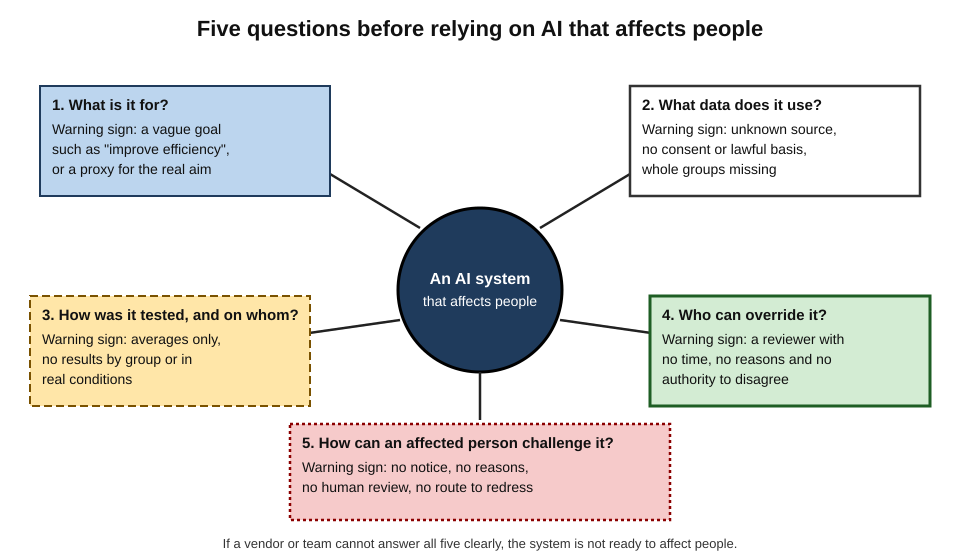
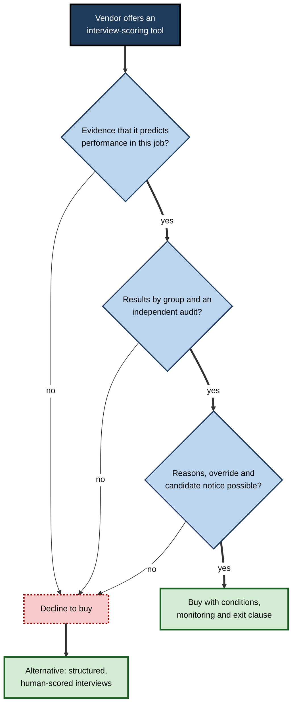

# G. Ethics and Fairness in AI

In the early 1980s a computerised reservation system, used by travel agents across the United States, listed flights on its screens in an order that favoured the airline that owned it. Agents rarely looked beyond the first screen, so the ordering steered bookings, and competitors complained to regulators. 

Nobody had to intend harm for the design to produce it: a technical choice about ranking, made inside a powerful system, quietly shaped who won and who lost. Today's AI systems rank, score and sort people at far greater scale — which is why ethics and fairness are not decorations on artificial intelligence but part of what it means for AI to work.

> **Definition — Ethics and fairness in AI:** the study and practice of making AI systems — and the decisions made with them — morally defensible: respectful of rights and dignity, free of unjustified discrimination, honest about what they do, answerable to the people they affect, and governed so that harms are prevented, found and put right.

> **Definition — Responsible AI:** the organisational practice of designing, building, buying and using AI in line with ethical principles and legal duties, backed by roles, processes, evidence and accountability.

**Why it matters**

- **AI is used where stakes are high** — in credit, hiring, health, education, welfare, policing and public information.
- **AI scales both benefit and error.** A mistake is repeated at machine speed across millions of cases.
- **AI learns from human history.** It inherits the patterns — including the injustices — in the data of the past.
- **AI is often opaque to the people it affects.** They may not know it was used, and cannot easily contest it.
- **Trust, law and licence to operate depend on it.** Organisations that ignore ethics face regulation, litigation, loss of customers and loss of public legitimacy.
- **Every professional is involved.** Whoever builds, buys, approves or relies on AI shares in the responsibility for how it is used.

---

## What the Field Covers

### Ethics, fairness and their neighbours

- **Ethics** asks what ought to be done; **fairness** asks whether people are treated and affected justly; both are wider than **legal compliance**, which sets the enforceable minimum, and than **technical quality**, which asks whether a system works as intended.
- **Safety, security and robustness** concern whether systems fail or can be attacked; **ethics and fairness** concern whether they are right and just even when they work.
- **Overlaps are real.** An unreliable system is also an unfair one if its failures fall on particular groups; a secure system can still be an instrument of surveillance.

| | Ethics and fairness | Law and regulation | Technical quality | Safety and security |
|---|---|---|---|---|
| Core question | Is it right and just? | Is it permitted or required? | Does it work as specified? | Can it cause harm by failing or being attacked? |
| Standard | Reasons, values and rights | Statutes, cases, regulators | Specifications, tests | Hazard analysis, threat models |
| Strength | Applies where no rule exists | Enforceable and clear | Measurable | Established engineering methods |
| Limit | Contested at the edges | Lags technology | Ignores whether the goal is right | Ignores whether the intended behaviour is just |

### The ideas at the core

- **Fairness** — avoiding unjustified differences in treatment and outcome between people or groups, and sharing the burden of errors justly.
- **Transparency and explanation** — people can know that AI is used and understand, at a suitable level, why a decision was reached.
- **Accountability** — identifiable people and organisations answer for a system's effects and put harm right.
- **Privacy, consent and data rights** — people keep meaningful control over information about them and creative works.
- **Rights and liberties** — systems that watch, score or sort people must respect freedom, dignity and equality, and the law's limits on power.
- **Inclusion** — systems are designed with and for the full diversity of people.

> **Key point:** these ideas are connected. A system that cannot be explained cannot be held accountable; one that is not accountable cannot be reliably fair; one that was built without the people affected is unlikely to be inclusive.

**Figure 1.** The core ideas of ethical AI and how they support one another.

---

## How the Field Developed

### Early warnings

- **Norbert Wiener (1950)**, founder of cybernetics, warned in *The Human Use of Human Beings* that automation could be used to dehumanise or control people, and that machines performing tasks faster than humans could review required care about the purposes set for them.
- **Joseph Weizenbaum**, creator of ELIZA, argued in *Computer Power and Human Reason* (1976) that some tasks — such as acting as a judge or a therapist — should not be delegated to computers even if they could be, because they require human understanding and responsibility.
- **Langdon Winner (1980)** argued in "Do artifacts have politics?" that technologies can embody power relationships in their design.

### Bias in computer systems

**Study card — Batya Friedman and Helen Nissenbaum (1996), "Bias in Computer Systems"**

- **Aim:** to describe how computer systems can systematically and unfairly discriminate, years before machine learning became widespread.
- **Examples examined:** a computerised airline reservation system that listed flights by one airline first, and a system used to allocate places in a medical school that reproduced the biases of earlier human admissions decisions.
- **Contribution — three kinds of bias:**
  - **pre-existing** bias — from social institutions, practices and attitudes, which enters through the designers or the data;
  - **technical** bias — from technical constraints and design decisions, such as limited screen space or crude rules;
  - **emergent** bias — from use in a context that the designers did not foresee, as the user population or values change.
- **Conclusion:** bias is a property of the **system in its social setting**, not only of its code; designers can anticipate and reduce it.

### The modern wave

- **2013–2016: evidence accumulates.** Studies of search advertising (2013), face and speech recognition, and the 2016 investigation of a criminal-justice risk score show unequal performance and unequal harm; lawyers Solon Barocas and Andrew Selbst published "Big Data's Disparate Impact" (2016), analysing how algorithms can produce discrimination that existing law only partly reaches.
- **2016–2019: principles proliferate.** The **Asilomar AI Principles** (2017, 23 principles drafted at a conference organised by the Future of Life Institute), the **Montréal Declaration** (2018), the **OECD Principles** (2019) and the European Union's guidelines for trustworthy AI (2019) appear, alongside dozens of corporate statements.
- **2018–2020: scandals and activism.** Employee protests, civil-society campaigns and investigative journalism lead companies and cities to restrict some uses, such as facial recognition.
- **2021–2024: from principles to rules.** UNESCO's global recommendation (2021); the EU AI Act (adopted 2024); national strategies, standards and sector rules; risk-management frameworks.
- **2022 onwards: generative AI.** Large language models and image generators widen the agenda to include synthetic media, copyright and training data, emotional reliance, labour behind data labelling, and large-scale misinformation.
- **2025–2026: implementation and recalibration.** Regulators begin enforcing, some deadlines are postponed, and debates continue about how much regulation innovation can bear.

**Figure 2.** A timeline of the development of AI ethics.

> **Watch out:** the field's history shows a repeated pattern — **warning, harm, scrutiny, principles, rules**. Ethical concerns raised early were often dismissed until harm had been documented, which is why prevention, not apology, is the aim.

---

## Why AI Systems Treat People Unfairly

### The sources of unfairness

- **Historical bias** — the data faithfully records an unjust world.
- **Representation gaps** — some groups are too few in the data.
- **Measurement problems** — a convenient proxy stands in for the real goal, such as past spending standing in for health need.
- **Model and objective choices** — optimising for the average favours the majority.
- **Evaluation blind spots** — results reported only as averages hide group differences.
- **Deployment context** — a system used in a setting, or in a way, it was not designed for.
- **Feedback loops** — outputs shape the data that later trains the system.

### The role of choices

- **Every system embodies human decisions** — what to build, whom to include, what to optimise, where to set the threshold, when to let a person override it.
- **The question "is it biased?" has no single answer** because fairness has several competing definitions; each protects different people from different errors.
- **Removing sensitive attributes does not remove unfairness**, since other features can carry the same information.
- **Humans are not an automatic cure.** People using AI suffer automation bias, and human decision-makers are themselves biased; the right comparison is between a **human-plus-system** process and the alternatives.

**Study card — Solon Barocas and Andrew Selbst (2016), "Big Data's Disparate Impact" (*California Law Review*)**

- **Question:** can data mining produce discrimination, and does existing anti-discrimination law reach it?
- **Mechanisms identified:**
  - **defining the target variable** — what counts as a "good" employee or "creditworthy" customer can embed bias;
  - **labelled examples** — training data reflecting past prejudiced decisions teaches the model to repeat them;
  - **collecting data** — under-sampled groups are poorly modelled;
  - **choosing features** — a narrow feature set may be less accurate for some groups;
  - **proxies** — innocuous-looking inputs correlate with protected characteristics;
  - **masking** — deliberate use of these routes to discriminate while appearing neutral.
- **Legal finding:** United States employment-discrimination doctrine, built around identifying a specific biased practice and a business-necessity defence, fits poorly when bias arises diffusely from data and no one intended it.
- **Conclusion:** unintentional algorithmic discrimination is common and hard to fix by legal doctrine alone; prevention depends on **careful choices about targets, data and testing**.

> **Key point:** most unfairness is **found by examining the goal and the data**, not by inspecting the algorithm alone.

---

## Defining and Measuring Fairness

### Competing meanings

- **Equal treatment** — one rule for everyone.
- **Equal outcomes** — similar shares of benefits and burdens across groups.
- **Equal error rates** — the same chance of being wrongly rejected or wrongly flagged.
- **Equal meaning of a score** — a score of 70 means the same risk for everyone.
- **Individual fairness** — similar people treated similarly.

Mathematicians have shown that when groups differ in their base rates, several of these cannot hold together except in special cases. The choice among them is therefore an ethical and legal decision: it depends on whether the decision is a benefit or a burden, on the quality of the data, on the law and on who bears the cost of mistakes.

### A practical method for measuring

1. **Define the decision, the people affected and the groups to compare**, including combinations such as sex and age.
2. **Choose measures that match the harm** — selection rates, false positive rates, false negative rates, calibration.
3. **Measure each group separately**, with counts and uncertainty.
4. **Look for the cause** — which features, labels or data differences drive the gap.
5. **Search for less discriminatory alternatives** and record why the chosen design was preferred.
6. **Monitor after launch**, because populations and data change.

> **Formula — Impact ratio:** selection rate of a group ÷ selection rate of the most-selected group. A ratio below 0.80 prompts investigation. Example: 30 % ÷ 50 % = **0.60**.

| | Equal selection rates | Equal error rates | Calibrated scores |
|---|---|---|---|
| Question | Are groups chosen in similar proportions? | Do groups bear errors equally? | Does a score mean the same for everyone? |
| Useful when | History of exclusion; labels untrustworthy | Wrong flags are costly (investigations) or misses are costly (treatment) | Scores are read as risks by decision-makers |
| Weakness | May ignore real differences or force less-suited selections | Depends on trustworthy labels | Can coexist with unequal error rates |
| Common source of dispute | Whether differences are justified | Which error matters more | Which fairness the law requires |

---

## Transparency, Accountability and Oversight

### Making systems understandable

- **Disclosure** — people are told when AI is used.
- **Documentation** — records of purpose, data, testing and limits, so that others can review a system.
- **Explanations** — reasons for an individual decision, in plain language, with a route to challenge.
- **Access for auditors** — independent checks of data, models and outcomes.

> **Remember — a usable explanation answers four things:** the main **reasons**, the **records** relied on, what would change the outcome (the **remedy**), and how to obtain a human **review**.

### Making responsibility clear

- **Many hands** — many people contribute, so responsibility is easily diffused; accountability must be designed.
- **Roles** — developers, providers, deployers, operators and boards each have distinct duties, and buying a system does not transfer the responsibility for using it.
- **Meaningful human oversight** — requires **time, information, competence and authority**; otherwise the human becomes a rubber stamp and a scapegoat.
- **Mechanisms** — impact assessments, logs, monitoring, incident reporting, redress, independent investigation and liability.

> **Watch out:** adding a human reviewer does not by itself make a system accountable. Research on human oversight of algorithms shows that people often defer to systems when they should not, and sometimes override them when they should not.

**Figure 3.** The life of a responsible AI system, from the first question to retirement.

---

## Privacy, Consent and Data Rights

- **AI raises privacy risk** by collecting at scale, inferring undisclosed traits, memorising training data, enabling re-identification and combining data into revealing patterns.
- **Privacy by design** builds protection into architecture and defaults: collect less, keep less, protect more, and use techniques such as on-device processing, federated learning and differential privacy where they fit.
- **Consent** is valid only when freely given, specific, informed, unambiguous and withdrawable; many "consents" are manufactured by interface design, and one person's consent cannot cover data about others.
- **Other lawful bases** for processing personal data — contract, legal duty, public task, legitimate interests — are often used for AI; each carries its own tests.
- **Data is not property** in most legal systems; overlapping rights — data protection, intellectual property, contract — decide who may do what, and collective models of governance are growing.
- **Creative works and training data** are the subject of active litigation and legislation, with early court decisions differing between countries.

> **Key point:** the most effective privacy measure is usually the cheapest: **do not collect or keep what the purpose does not require**.

---

## Power, Rights and Liberties

### Where the stakes are highest

- **Hiring, lending and criminal justice** are the areas where discrimination by automated decisions has the longest history, the strongest laws and the clearest measurements.
- **Surveillance and facial recognition** change the balance of power between individuals and institutions; courts and legislators have begun to impose legal-basis, proportionality and equality requirements, and some uses are banned.
- **Welfare and public services** — automated systems that decide eligibility, flag fraud or allocate support have repeatedly produced large-scale harm when they lacked transparency and appeal.

### The shape of the argument

- **Proportionality** — an interference with rights must be lawful, pursue a legitimate aim, be necessary and proportionate, and carry safeguards.
- **Burden of proof** — where a system's operator controls the evidence, it should bear the burden of showing the system works fairly.
- **Collective harms** — harms to groups and to democratic life call for collective remedies: representative actions, regulators and public registers of systems.

### Case study: Housing and job adverts delivered unequally (2019–2022)

- **Situation:** online platforms let advertisers choose whom to target, and then use algorithms to decide who actually sees each advert, aiming to maximise engagement.
- **Research (2019):** researchers at Northeastern University, the University of Southern California and the technology-policy group Upturn placed identical adverts with neutral targeting.
  - Delivery of **job adverts** was skewed by sex and race — for example, adverts for supermarket cashier jobs reached mostly women, and for taxi-company jobs mostly Black users.
  - Delivery of **housing adverts** was likewise skewed by race, depending on the apparent content of the image used.
  - The skew arose from the platform's optimisation, not from the advertiser's choices.
- **Legal action:** in 2019 the platform removed detailed targeting options for housing, job and credit adverts. In **June 2022** the United States Department of Justice announced a settlement with Meta Platforms over alleged violations of the Fair Housing Act in how housing adverts were delivered.
  - The company agreed to stop using a particular advertising tool, to develop a new system to reduce disparities in delivery, to submit to oversight by an independent reviewer, and to pay the maximum civil penalty available.
- **Diagnosis:**
  - **Feedback and optimisation** — the system learned from past clicks, which reflected existing patterns.
  - **No visibility** — advertisers did not know who was seeing their adverts.
  - **Evidence by outsiders** — researchers, not the company, found the pattern.
- **Lesson:** discrimination can arise from a **neutral optimisation goal** operating on a world with unequal histories; preventing it required **outcome measurement, outside scrutiny and legal pressure**.

---

## Inclusive and Responsible Design

### Principles in practice

- **Design with, not for.** Include affected people in defining problems, choosing data and testing outputs, with payment, access and real influence.
- **Test across the range** — languages, accents, disabilities, ages, cultures and settings — using assistive technology and realistic conditions.
- **Provide human fallbacks** and appeal routes, and treat their use as information about where design must improve.
- **Document** with model cards, data records and decision logs.
- **Align with standards** — management and risk frameworks, engineering standards and legal requirements.

### Frameworks and regulation

- **Principles** such as those of the OECD and UNESCO state shared values; **guidelines and standards** from the European Commission's expert group, IEEE, NIST and ISO translate them into requirements and processes; **binding law**, most prominently the European Union's AI Act, imposes risk-based duties on providers and deployers.
- **Convergence in words, divergence in meaning** — organisations agree on principles such as fairness and transparency but read them differently.
- **Voluntary pledges are fragile** and may be revised; many advocates therefore seek binding law and independent audit.

| | Principles | Guidelines and standards | Binding regulation |
|---|---|---|---|
| Examples | OECD, UNESCO | Trustworthy-AI guidelines, IEEE 7000 series, NIST AI RMF, ISO/IEC 42001 | EU AI Act; discrimination, data-protection and consumer law |
| Binding? | No | No (unless adopted by contract or law) | Yes |
| Strength | Shared vocabulary and values | Concrete requirements and processes | Enforceable, with penalties |
| Weakness | Vague; easily ignored | Voluntary; compliance can be superficial | Slow; varies by country; details change |

> **Watch out:** regulatory timetables and details change. The EU AI Act's high-risk obligations, for example, were postponed in 2026. Professionals should check the current position rather than assume dates.

---

## Your Position: Rights and Responsibilities

### As a citizen, customer or employee

- **You have rights** over your data, to know when AI affects you, to reasons for significant decisions, to human review in many cases, to equal treatment and to redress.
- **Exercising them is practical:** record the decision, ask in writing, request the data and the main reasons, request human review, correct errors, complain, escalate to an ombudsman or regulator, and seek help from unions and advice organisations.
- **Collective action** reveals patterns that individuals cannot.

### As a builder, buyer or user

- **Ask the five questions** before adopting any AI system that affects people.

> **In practice — five questions before adopting AI that affects people:** *What is it for? What data does it use? How was it tested, and on whom? Who can override it? How can an affected person challenge it?*

**Figure 4.** Five questions for any AI system that affects people.

### Worked example (illustrative): reviewing a vendor's "AI interview scorer"

An organisation is considering a tool that scores recorded video interviews and ranks candidates.

1. **Purpose.** The vendor claims it predicts "job fit" and "enthusiasm". The buyer asks for evidence that those traits predict performance in this kind of job. The evidence supplied is a study of 200 sales staff — not relevant to the buyer's engineering roles.
2. **Data.** The model was trained on past hires at the vendor's clients. The buyer notes that past hiring decisions may encode bias.
3. **Testing.** The vendor shows overall accuracy, but not performance by sex, age, accent or disability. The buyer requests group-level results and an independent audit.
4. **Legal duties.** The buyer's jurisdiction requires notice to candidates and, for automated hiring tools, a bias audit; disability law requires alternatives for candidates who cannot take part.
5. **Oversight.** Recruiters would see only a rank, with no reasons — and no time for a second look. The buyer requires reasons, the ability to override, and monitoring of overrides.
6. **Decision.** The vendor can supply none of the group-level evidence. The organisation declines to purchase, and instead pilots structured, skills-based interviews with human scoring and a documented rubric.

*Illustrative example.*

> **Key point:** the decisive step was not clever mathematics but **asking for evidence and refusing to proceed without it**.

**Figure 5.** How the buyer's questions led to a decision.

---

## Professional Practice

### What responsible organisations do

- **Governance** — an accountable executive, a review body with authority to stop launches, and clear escalation routes.
- **Inventory and risk classification** — a list of AI systems and their risk levels.
- **Impact assessments** for higher-risk uses, covering rights, fairness, privacy and safety.
- **Testing and documentation** — group-level evaluation, model and data documentation, records of design choices.
- **Procurement discipline** — contracts that require evidence, audit access, incident notification and clear liability.
- **Training** — staff understand the principles, the law and when to escalate.
- **Monitoring and incident response** — outcomes, complaints and drift tracked; harms contained, investigated, remedied and disclosed.
- **Independent challenge** — internal audit, external audit, advisory bodies with real access, and channels for whistle-blowing.

### What distinguishes the best practitioners

- **They ask first whether to automate at all**, and what the real goal is.
- **They examine labels and proxies**, not only algorithms.
- **They report by group** and combination, with uncertainty.
- **They state which fairness they chose, why and at what cost**, in writing.
- **They design for contest** — reasons, review and redress.
- **They treat ethics as a continuing discipline**, like safety, not a one-time sign-off.
- **They have the courage to stop** — and the organisational authority to do so.

### Case study (illustrative): an insurer builds a responsible-AI programme

- **Situation:** a mid-sized insurer used AI in pricing, claims triage and customer chat, with no common oversight. A regulator's questionnaire exposed that no one could list the systems.
- **Actions over eighteen months:**
  1. A senior executive was named accountable; a cross-functional panel — data science, legal, claims, customer representatives and an external adviser — was given authority to pause launches.
  2. An inventory found 46 systems; eleven were classed as higher risk, including pricing and claims-fraud models.
  3. For higher-risk systems the panel required impact assessments, group-level testing and documented reasons for design choices.
  4. A customer explanation template — reasons, data, remedy, review — was introduced for pricing and claims decisions, and a human-review route was staffed.
  5. Contracts with three vendors were amended to require testing evidence and incident notification.
  6. Quarterly reports to the board showed outcomes by group, complaints and overrides.
- **Results:**
  - A claims-fraud model was found to flag customers in two postcode areas more often with no additional fraud found; its inputs were revised.
  - One vendor tool could not meet the evidence requirements and was replaced.
  - Complaints about opaque decisions fell, and the next regulatory inspection found a documented programme.
- **Side effects:** project timelines lengthened by weeks; the panel was initially seen as an obstacle until early catches demonstrated its value.
- **Lesson:** responsible AI is mostly **organisational discipline** — ownership, evidence and the authority to say no — not a technical add-on.

*Illustrative figures and events.*

---

## Open Questions

- **Whose values should AI embody?**
  - Systems used worldwide cannot reflect every society's norms; the legitimate process for choosing values remains unclear.
- **Can fairness be reconciled across definitions, groups and cultures?**
  - Mathematical trade-offs, intersectional groups and differing social categories mean no single metric will suffice.
- **How should responsibility work for increasingly autonomous systems and long supply chains?**
  - General-purpose models and agents strain ideas of who decided what.
- **Will regulation keep pace, and will it be enforced?**
  - Timetables slip, resources are limited and cross-border enforcement is hard.
- **Can ethics scale with generative AI?**
  - Review processes built for slow product cycles struggle with rapid release; evaluation of general-purpose systems is unsettled.
- **What do we owe the people who label data and bear the environmental costs?**
  - The labour and resource costs of building AI are often invisible to its users.

---

## Summary

- **Ethics and fairness in AI** make systems morally defensible: respectful of rights, free of unjustified discrimination, transparent, accountable and governed; **responsible AI** is the organisational practice that delivers it.
- Ethics differs from **law**, **technical quality** and **safety**; its core ideas — fairness, transparency, accountability, privacy and consent, liberties, inclusion — support one another.
- The field moved from early warnings (Wiener, Weizenbaum), through **bias in computer systems** (pre-existing, technical, emergent) to modern evidence, principles, and from 2021–2024 **binding rules** — repeating a pattern of warning, harm, scrutiny, principles and law.
- Unfairness arises from **history, representation, measurement, objectives, evaluation, deployment and feedback**; the choice of **target and label** is often the culprit.
- **Fairness** has competing meanings — equal selection, equal errors, calibration, individual fairness — which cannot all hold; choosing is an ethical and legal decision, and must be documented.
- **Transparency** and **accountability** need disclosure, documentation, explanations (reasons, records, remedy, review), named roles and **meaningful oversight** (time, information, competence, authority).
- **Privacy**, **consent** and **data rights** rely on minimisation, privacy by design and valid consent; **rights and liberties** require proportionality and safeguards against surveillance.
- **Inclusion** means designing with affected people and testing across the range; **frameworks and regulation** convert principles into duties, but voluntary pledges are fragile and rules change.
- Citizens can exercise **rights** by recording, asking in writing and escalating, and collectively; professionals ask **five questions** and build **governance, evidence and the authority to stop**.

---

## Self-Check

1. Define ethics and fairness in AI and distinguish them from legal compliance and technical quality.
2. Using the Barocas and Selbst analysis, explain how the choice of target variable can introduce bias.
3. What three kinds of bias did Friedman and Nissenbaum identify?
4. List the sources of unfairness in AI systems and give an example of two.
5. Why can equal selection rates and equal error rates conflict?
6. Describe the four parts of a usable explanation.
7. What four conditions make human oversight meaningful?
8. What role did optimisation play in the unequal delivery of housing and job adverts?
9. Name two reasons why consent may not be a sufficient privacy safeguard in AI.
10. What distinguishes principles, standards and binding regulation as frameworks?
11. Why are voluntary ethical pledges considered fragile?
12. List five practical steps a citizen can take after an adverse automated decision.
13. Apply the five questions to a chatbot a council wants to use for answering questions about benefits.
14. An executive says: "We removed gender and ethnicity from the model, so it cannot discriminate." Write a short reply.

### Answer Key

1. Ethics and fairness in AI make systems morally defensible — rights-respecting, non-discriminatory, honest, accountable and governed. Law sets the enforceable minimum; technical quality asks whether a system works. A system can be legal and accurate and still unjust.
2. The target variable defines what counts as "good" or "creditworthy"; if it reflects past biased decisions, or a proxy such as spending for need, the model learns the bias even when the code is neutral.
3. Pre-existing bias from social institutions and attitudes; technical bias from design constraints; emergent bias from use in unforeseen contexts.
4. Historical bias, representation gaps, measurement or proxy problems, model objectives, evaluation blind spots, deployment context and feedback loops. Examples: historical — hiring records favouring one group; feedback loop — flagged areas receive more investigation, generating more flags.
5. When groups have different base rates, equalising selection rates means selecting people at different accuracy, which changes error rates; equalising error rates yields different selection rates.
6. The main reasons; the records or data relied on; the remedy, meaning what would change the outcome; and review, meaning how to correct data and get human reconsideration.
7. Time to review, information to judge, competence to understand, and authority to override without penalty.
8. The platform's delivery algorithm, optimising for predicted engagement from past behaviour, steered identical adverts towards different groups, even though advertisers had not chosen them.
9. People do not read or understand notices, so consent is often a product of design; and one person's consent cannot cover data about others; future uses such as AI training are unforeseeable at the time of consent.
10. Principles state shared values and are non-binding; standards translate them into processes and requirements, still voluntary; regulation is binding and enforceable with penalties.
11. They are self-written and unenforced, so they can be revised or ignored when commercial or political pressure changes.
12. Record the decision; ask in writing whether it was automated; request the main reasons and data used; ask for human review and correct errors; complain formally, then escalate to an ombudsman or regulator, or seek advice.
13. Purpose: answering benefits queries — is it limited to information, not decisions? Data: knowledge base and any personal data used. Testing: accuracy on real questions, across languages and disabilities. Override: staff available and a clear route to a human. Challenge: people can complain and have wrong answers corrected, and are told they are speaking to AI.
14. Other features such as postcode, names, career gaps or purchasing patterns can carry the same information, so discrimination can continue by proxy; and removing the attributes makes it harder to measure. The team should audit outcomes by group using protected data held under controls, and test for proxies.

---

## Glossary

| Term | Meaning |
|---|---|
| Accountability | The obligation to answer for a system's effects and put harm right. |
| Algorithmic bias | Systematic differences in outputs or errors that unfairly affect people by group. |
| Allocative harm | Unfairly withholding a resource or opportunity. |
| Automation bias | Over-reliance on automated suggestions. |
| Calibration | Scores that match actual outcome rates, ideally in every group. |
| Differential privacy | A guarantee that outputs barely change with any one person's data. |
| Ethics washing | Projecting an ethical image without effective practice. |
| Explainability | The capacity to give an understandable account of why an output occurred. |
| Feedback loop | A cycle in which a system's outputs shape the data it later learns from. |
| Impact assessment | A documented analysis of a system's risks before and during use. |
| Impact ratio | A group's selection rate divided by the highest group's rate. |
| Intersectionality | Distinct disadvantage arising from overlapping characteristics. |
| Meaningful human oversight | Human involvement with time, information, competence and authority. |
| Model card | A short document describing a model's uses, performance and limits. |
| Proportionality | A test of whether an intrusion on rights is justified by its aim and benefits. |
| Proxy | A measurable stand-in for a hard-to-measure goal. |
| Responsible AI | Organisational practice delivering ethical, lawful AI with evidence and accountability. |
| Soft law | Non-binding principles and guidance. |
| Stakeholder | Anyone who affects or is affected by an AI system. |
| Transparency | Availability of appropriate information about an AI system to those who need it. |
