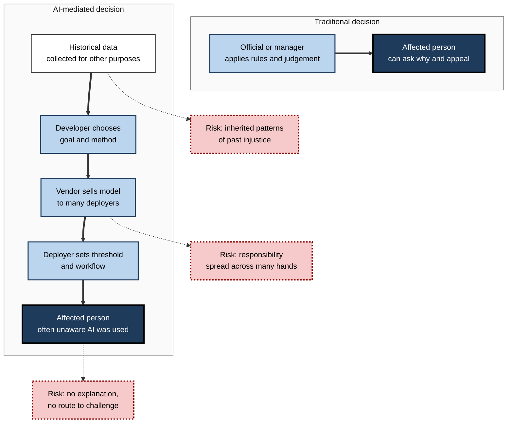
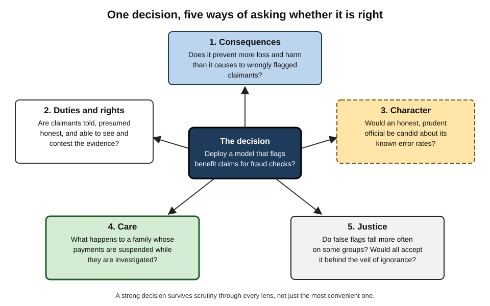
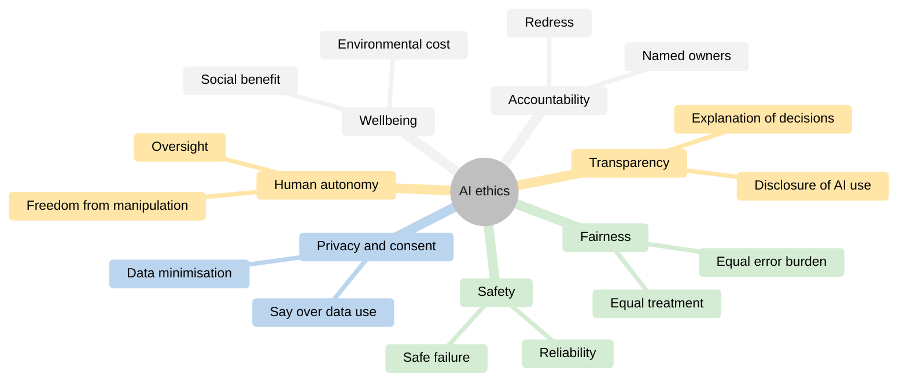
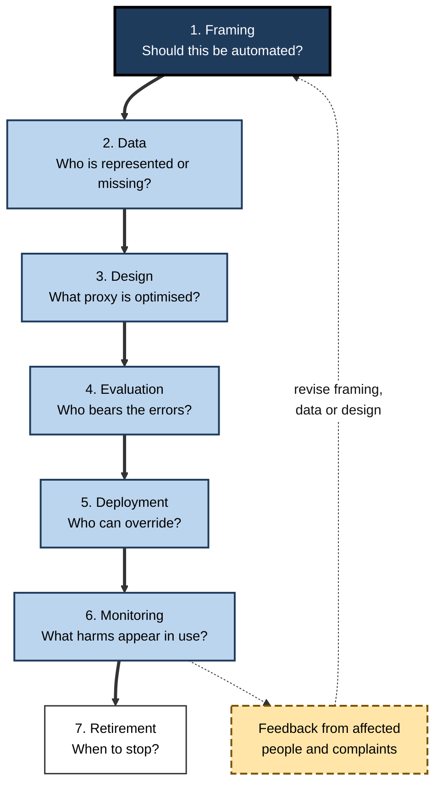
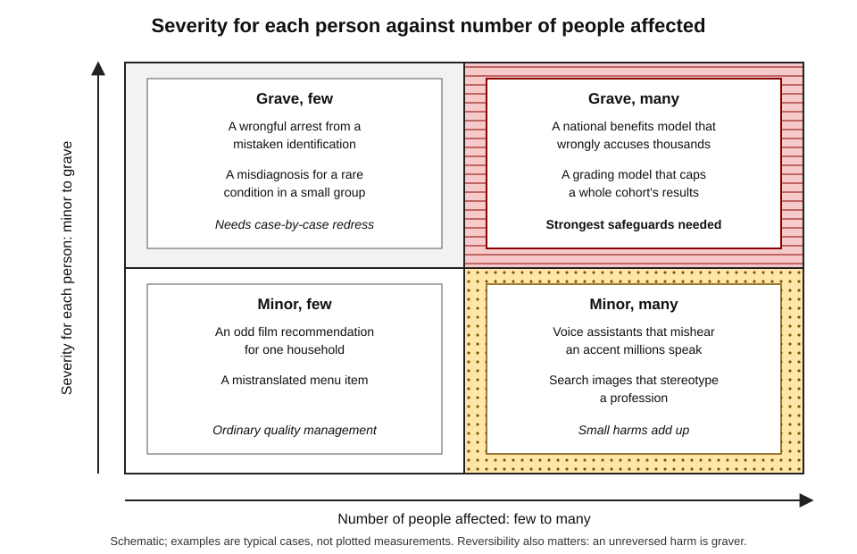
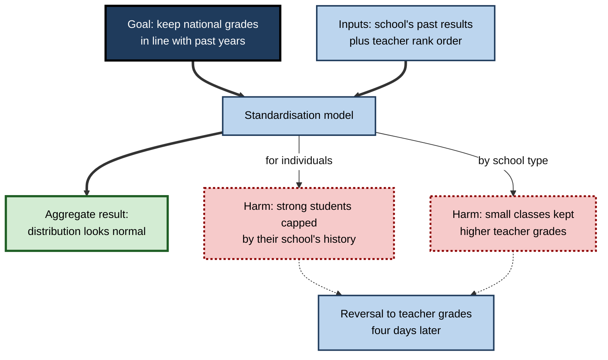

# G.1. What is AI ethics and why it matters

A bank's model declines a small-business loan in forty milliseconds. A hospital's software places one patient above another on a waiting list. A chatbot gives a lonely teenager advice at three in the morning. None of these systems was programmed with a sentence saying "be fair", "be honest" or "do no harm" — yet every one of them is making choices that people would, without hesitation, call **moral**.

> **Definition — AI ethics:** the study and practice of the moral questions raised by designing, building, deploying and using artificial intelligence — what such systems should and should not do, for whom, at whose cost, and who answers for the results.

**Why it matters**

- **Decisions that used to be human are now partly automated.** Credit, hiring, policing, medicine, education and welfare increasingly involve AI somewhere in the chain.
- **Values are built in whether or not anyone chooses them.** Every choice of data, goal and threshold expresses a judgement about what matters.
- **Harms scale.** A biased clerk affects dozens of people; a biased system affects millions, identically and quickly.
- **Trust is the condition of use.** People and organisations adopt AI only when they believe it serves them and can be challenged when it does not.
- **Every professional is now a participant.** The person who buys, configures, approves or relies on an AI tool shares in its ethics, not only the person who built it.

---

## Ethics, Law and Good Engineering

AI ethics is often confused with three neighbouring ideas. Separating them early prevents most muddled thinking.

### Four different questions

- **Ethics** — *what ought to be done?*
  - Concerned with right and wrong, good and bad, fairness, harm, dignity and respect.
  - Applies even where no rule exists.
- **Law** — *what is required or forbidden, with what penalty?*
  - A society's enforceable minimum.
  - Often lags behind technology by years.
- **Organisational policy** — *what has this organisation decided to require of its people?*
  - Narrower than ethics; can be stricter than law.
- **Technical quality** — *does the system work as intended?*
  - Accuracy, reliability, security, robustness.
  - Necessary for ethical AI but never sufficient: a system can work perfectly and still do wrong.

> **Definition — Ethics:** the systematic study of what is right and wrong, good and bad, and of the reasons that justify such judgements.

> **Definition — Applied ethics:** the branch of ethics that examines concrete practical questions in a particular field, such as medicine, business, engineering or computing.

| | Ethics | Law | Organisational policy | Technical quality |
|---|---|---|---|---|
| Core question | What ought to be done? | What is required? | What has the organisation decided? | Does it work as intended? |
| Source of authority | Reasons and shared moral values | Legislatures, courts, regulators | Leadership and governance bodies | Specifications and testing |
| Speed of change | Debated continuously | Slow; years | Moderate | Fast |
| Gap it leaves | Can be vague and contested | Leaves much lawful harm | Varies with culture and incentives | Ignores whether the goal was right |
| AI example | Should emotion detection be used on job candidates at all? | Is it permitted in this jurisdiction? | Does the firm allow it? | Does it detect what it claims to? |

> **Key point:** "it is legal" and "it works" are the **start** of an ethical analysis, not its conclusion.

> **Watch out:** ethics is not personal taste. Moral claims can be argued for, tested against cases and found weaker or stronger. Reasonable people disagree at the edges, but there is wide agreement that deception, needless harm and unjust discrimination are wrong.

### Moral agents and moral patients

- **Moral agent** — a being that can act for reasons and be held responsible.
  - Humans are moral agents; today's AI systems are generally **not** treated as such.
- **Moral patient** — a being whose interests count morally.
  - Users, customers, workers, data subjects, bystanders and future generations.
- **Consequence for AI ethics:** responsibility flows back to the **people and organisations** behind a system, while concern flows outward to **everyone it affects**.

> **Definition — Stakeholder:** any person or group who affects, or is affected by, an AI system — including people who never use it directly.

---

## What Makes AI Ethically Distinctive

Most ethical questions about AI are old questions — fairness, honesty, privacy, responsibility — in a new setting. What is new is a set of features that make those questions sharper.

### Eight amplifying features

- **Scale**
  - One model may make millions of decisions a day, repeating the same error in every one.
- **Speed**
  - Decisions happen faster than any human can review them.
- **Opacity**
  - Many models cannot readily explain why they produced a result.
  - The people affected often do not know an AI was involved at all.
- **Learning from the past**
  - Models trained on historical data inherit the patterns of history, including its injustices.
- **Distance**
  - The designer, the deployer and the affected person are often in different organisations and countries and never meet.
- **Apparent objectivity**
  - Numbers and computer outputs feel neutral, which discourages challenge.
- **Human-like interaction**
  - Conversational systems invite trust, disclosure and emotional attachment.
- **Dual use**
  - The same capability — generating realistic faces, writing persuasive text — serves both good and harmful ends.

> **Definition — Automation bias:** the tendency to favour suggestions from automated systems and to overlook contradicting information, even when it is correct.

> **Mnemonic — "SOLD AHD" ("Sold a hard deal"):** Scale and Speed, Opacity, Learning from the past, Distance, Apparent objectivity, Human-like interaction, Dual use.

**Figure 1.** How AI changes the path between a decision and the person it affects.

### Old questions in a new setting

- **Fairness** — who benefits and who bears the errors?
- **Honesty** — is the system, and the organisation using it, truthful about what it is and does?
- **Autonomy** — are people's choices respected, or quietly steered?
- **Privacy** — what is known about people, and how is it used?
- **Responsibility** — who answers when things go wrong?
- **Dignity** — are people treated as persons, not merely as data points?

> **Key point:** AI ethics is mostly **ordinary ethics under unusual pressure** — the pressures of scale, speed, opacity and distance.

---

## The Main Lenses of Moral Reasoning

Moral philosophy offers several established ways of reasoning about what is right. None settles every question; together they reveal what a single viewpoint misses.

### Five lenses

- **Consequences (consequentialism)**
  - The right action produces the best overall outcomes.
  - Associated with Jeremy Bentham and John Stuart Mill (utilitarianism).
  - *e.g.* deploy a diagnostic model if it saves more lives than it costs — counting all errors.
  - **Weakness:** can justify sacrificing a minority for the majority.
- **Duties and rights (deontology)**
  - Some actions are required or forbidden regardless of outcome.
  - Associated with Immanuel Kant: treat people never merely as means.
  - *e.g.* do not deceive users about whether they are talking to a machine, even if deception would improve engagement.
  - **Weakness:** duties can conflict, and rigid rules can produce bad outcomes.
- **Character (virtue ethics)**
  - Ask what a person of good character — honest, prudent, just, courageous — would do.
  - Rooted in Aristotle.
  - *e.g.* a responsible engineer raises a concern about a misleading demonstration even when not required to.
  - **Weakness:** gives less precise guidance in novel cases.
- **Relationships (ethics of care)**
  - Attend to relationships, dependency and the needs of the vulnerable.
  - Developed by Carol Gilligan and Nel Noddings, among others.
  - *e.g.* a companion chatbot for older people should be designed around their wellbeing, not time-on-app.
  - **Weakness:** harder to apply at the level of whole populations.
- **Justice (fairness and contract)**
  - Ask what rules people would accept if they did not know their own position in society.
  - John Rawls's "veil of ignorance" (1971).
  - *e.g.* would the designers accept this credit model if they did not know whether they would be a well-documented applicant or a newcomer with a thin credit file?
  - **Weakness:** principles of justice remain contested.

> **Definition — Veil of ignorance (John Rawls, 1971):** a thought experiment in which people choose the rules of a society without knowing what position — rich or poor, majority or minority — they will occupy in it.

> **Mnemonic — "Careful Designers Value Clear Justice":** Consequences, Duties, Virtues, Care, Justice.

**Figure 2.** Five lenses applied to a single AI decision.

| | Consequences | Duties and rights | Character | Care | Justice |
|---|---|---|---|---|---|
| Central question | What produces the best outcomes overall? | What must never be done to a person? | What would a good professional do? | Who is vulnerable and what do they need? | Would everyone accept the rule from behind the veil? |
| Applied to a fraud-detection model | Does it reduce total losses more than it costs wrongly blocked customers? | Are customers told and given a way to contest? | Is the team candid about known failure modes? | How are elderly or low-income customers affected by a frozen account? | Do false alarms fall disproportionately on one group? |
| Typical blind spot | Minorities outvoted by totals | Rigid when duties conflict | Vague in new cases | Hard to scale | Contested definitions |

> **Watch out:** treating AI ethics as a series of **trolley problems** — choosing whom a self-driving car should hit — distracts from the far more common questions: whose data was used, who was tested, who can appeal, and who profits.

**Study card — The Moral Machine experiment (Massachusetts Institute of Technology and partners; published in *Nature*, 2018)**

- **Design:** an online game presented unavoidable-crash dilemmas for an autonomous car.
  - Players chose whom the car should spare: passengers or pedestrians, young or old, more or fewer, humans or animals, law-abiding or jaywalking.
  - About **40 million decisions** were collected from people in **233 countries and territories**.
- **Results:**
  - Strong, near-universal preferences to spare **humans over animals**, **more lives over fewer** and the **young over the old**.
  - Systematic regional differences — the researchers grouped countries into broad "Western", "Eastern" and "Southern" clusters with different strengths of preference.
- **Conclusion:** moral intuitions about machine decisions vary across cultures in measurable ways.
- **Limits:** players were self-selected; the dilemmas were artificial; and expressed **preferences are not the same as justified ethics** — a majority preference to spare the young is not an argument that the old matter less.

> **Key point:** surveys tell designers what people *feel*; ethical reasoning asks what can be *justified* to everyone affected.

---

## The Recurring Themes of AI Ethics

Hundreds of public statements on AI ethics have appeared since about 2016. They use different words but return to a small set of themes.

### The core themes

- **Fairness and non-discrimination** — systems should not produce unjust differences in treatment or outcome between groups.
  - Bias can enter from data, design choices and the context of use; it is rarely a single "bug".
- **Transparency and explainability** — people should know when AI is used and be able to understand, in suitable terms, how significant decisions about them were reached.
- **Accountability** — identifiable people and organisations must answer for a system's effects and put things right.
- **Privacy** — personal data should be collected, used and kept only in ways that respect people's reasonable expectations and rights.
- **Consent and data rights** — people should have meaningful say over how their data, words and creative work are used.
- **Safety and reliability** — systems should work as intended and fail safely.
- **Human autonomy and oversight** — humans should remain able to understand, override and switch off systems that affect them.
- **Wellbeing and sustainability** — benefits to people and society, including environmental costs, should be weighed.

> **Remember — the "FAT" core:** **F**airness, **A**ccountability, **T**ransparency — the three themes that appear in almost every framework, often joined by privacy and safety.

**Figure 3.** The recurring themes of AI ethics.

### Themes in tension

- **Accuracy versus privacy** — more data often improves a model and erodes privacy.
- **Transparency versus security** — revealing how a fraud model works helps fraudsters game it.
- **Fairness versus accuracy** — some fairness constraints reduce overall accuracy, at least on historical measures.
- **Personalisation versus autonomy** — tailoring helps users and can also manipulate them.
- **Innovation versus precaution** — waiting for certainty forgoes benefits; rushing imposes risks.

> **Key point:** ethical AI work is rarely the application of one principle. It is the **explicit, documented balancing** of several, with the reasons stated.

---

## Where Ethical Questions Arise in the AI Life Cycle

Ethical choices are made long before a model produces a single output. Each stage of building and using AI has its own characteristic questions.

### Stage by stage

1. **Problem framing** — should this be automated at all? Whose problem is being solved, and how is success defined?
2. **Data** — where did it come from, was its collection fair and lawful, and whom does it represent or omit?
3. **Model design** — what is the system optimising? What proxy stands in for the real goal?
4. **Evaluation** — is performance measured separately for different groups and conditions, not only on average?
5. **Deployment** — who uses the outputs, with what training, and with what power to override?
6. **Monitoring** — are harms, complaints and drift tracked after launch?
7. **Retirement** — when should the system be withdrawn, and what happens to its data?

> **Definition — Proxy:** a measurable quantity used in place of the real but hard-to-measure goal — for example, "past spending on care" standing in for "need for care".

**Figure 4.** Ethical questions at each stage of an AI system's life.

> **Watch out:** the most consequential ethical decision is usually the **first** — what problem to solve and how to define success. A perfectly fair model of the wrong goal is still wrong.

### Worked example (illustrative): a council prioritises home-repair inspections

A local council wants a model to rank its 20,000 social-housing homes for damp and mould inspections, because inspectors can visit only 400 homes a month.

1. **Framing.**
   - Goal: find homes where damp threatens health, soonest.
   - Ethical question: is ranking acceptable at all? It is — inspection capacity is genuinely scarce and a ranking can save lives — but it must not replace tenants' right to report problems.
2. **Data.**
   - Available: past repair requests, building age, construction type, occupancy.
   - Problem: tenants who complain less — some older residents, people with limited English, people afraid of eviction — appear to have fewer problems.
   - Response: add building-condition data that does not depend on complaints.
3. **Design.**
   - Proxy risk: "number of past complaints" would reward the loudest tenants.
   - Response: predict confirmed damp found at inspection, not complaints.
4. **Evaluation.**
   - Check how well the ranking finds damp separately for blocks with high and low complaint rates.
5. **Deployment.**
   - Inspectors may move any home up the list; tenant reports still trigger visits.
6. **Monitoring.**
   - Track the share of serious damp found in homes the model ranked low.
7. **Result.**
   - The model becomes **one input** to a human schedule, with a named manager accountable for it.

> **Remember:** at each stage ask three questions — **who benefits, who bears the risk, who decides?**

---

## A Vocabulary of AI Harms

Naming harms precisely makes them easier to find, measure and prevent.

### Types of harm

- **Allocative harm** — a system withholds an opportunity or resource.
  - *e.g.* a loan, a job interview, a benefit payment, a medical referral.
- **Representational harm** — a system reinforces demeaning or stereotyped portrayals of a group.
  - *e.g.* an image generator depicting nearly every "doctor" as a man.
  - The distinction between allocative and representational harm was popularised by researcher Kate Crawford in a 2017 keynote at the NeurIPS machine-learning conference.
- **Quality-of-service harm** — a system works worse for some people.
  - *e.g.* voice assistants that misunderstand certain accents more often.
- **Interpersonal harm** — a system damages relationships or enables abuse.
  - *e.g.* tracking tools used for stalking; synthetic intimate images.
- **Societal harm** — a system erodes shared goods.
  - *e.g.* polluted information environments, concentration of power, environmental cost.

> **Definition — Allocative harm:** harm that occurs when a system unfairly withholds an opportunity or resource from a person or group.

> **Definition — Representational harm:** harm that occurs when a system portrays a group in a demeaning, stereotyped or invisible way.

| | Allocative | Representational | Quality-of-service | Societal |
|---|---|---|---|---|
| What is lost | A resource or opportunity | Dignity, accurate portrayal | Equal usefulness | Shared goods: trust, fair markets, environment |
| Typical systems | Credit, hiring, welfare, triage | Search, image generation, translation | Speech, vision, language tools | Recommendation feeds, large-scale generation |
| How it is detected | Outcome rates by group | Audits of outputs and associations | Error rates by group | Long-term, population-level studies |
| Who notices first | Rejected individuals, often too late | Affected communities | Frustrated users | Researchers, journalists, regulators |

**Figure 5.** Mapping harms by severity for each person and by number of people affected.

> **Key point:** small harms to millions can matter as much as grave harms to a few. Ethical review must consider **severity, scale, reversibility and who is affected** together.

---

## Why AI Ethics Matters to Organisations and Professionals

### The organisational case

- **Legal exposure** — data-protection, equality, consumer-protection and sector-specific law already apply to AI; dedicated AI law adds more.
- **Reputation and trust** — public failures are remembered long after they are fixed.
- **Product quality** — many ethical failures are also quality failures: a model that misreads some customers loses those customers.
- **Talent** — skilled staff increasingly weigh employers' conduct.
- **Licence to operate** — public bodies especially depend on legitimacy; an unfair algorithm can undermine an entire policy.

> **Definition — Ethics washing:** presenting an organisation as ethical through statements, boards or principles without the practices, resources or accountability that would make them effective.

> **Watch out:** "ethics slows innovation" is a common belief, but ethical failures often stop products entirely. The more useful framing is that **unexamined risk** slows innovation — by producing withdrawals, lawsuits and lost trust later.

### The professional case

- **Codes of conduct already apply.**
  - The Association for Computing Machinery's Code of Ethics and Professional Conduct (revised 2018) asks computing professionals to contribute to society and human well-being, avoid harm, be honest and trustworthy, be fair and take action not to discriminate, and respect privacy.
  - Doctors, lawyers, accountants and engineers keep their own professional duties when they use AI tools.
- **Responsibility does not transfer to the tool.**
  - A professional who signs off an AI-drafted report owns its errors.
- **Ethical skill is practical.**
  - Recognising a problem, raising it clearly, documenting it and escalating it inside a hierarchy are learned skills.

> **In practice:** before adopting any AI tool for decisions about people, a professional can ask five questions — **What is it for? What data does it use? How was it tested, and on whom? Who can override it? How can an affected person challenge it?**

### Case study: grading by algorithm in England (2020)

- **Situation:** in spring 2020 the COVID-19 pandemic cancelled England's A-level examinations, which determine university places.
- **Approach:**
  - Teachers submitted predicted grades and a rank order of students.
  - The exams regulator, Ofqual, used a statistical **standardisation model** that adjusted grades to fit each school's results in previous years.
  - Where classes were very small, teachers' grades were used largely unchanged, because there was too little history to model.
- **What happened on results day (13 August 2020):**
  - Around **two in five** teacher-assessed grades were lowered by the model.
  - Students at schools with historically weaker results were capped by their school's past, however strong their own work.
  - Small classes — more common in independent, fee-paying schools — kept teachers' higher grades more often.
- **Response:**
  - Public protest followed; students held signs criticising "the algorithm".
  - On **17 August** the government reversed course and allowed teacher-assessed grades; Scotland had made a similar reversal days earlier.
  - Ofqual's chief regulator resigned later that month.
- **Diagnosis through the five lenses:**
  - **Consequences:** the model achieved its aggregate goal — national grade distributions resembled previous years — while producing serious individual injustice.
  - **Duties:** individuals were judged largely by others' past performance, not their own.
  - **Justice:** the burden fell unevenly by type of school, and therefore by social background.
  - **Accountability and transparency:** the method was published only on results day, leaving no time for challenge.
- **Lesson:** a system can be **technically competent at the wrong goal**. The model was not machine learning, yet it shows the central pattern of algorithmic harm — optimising an aggregate target, inheriting historical inequality, and leaving individuals without a fair route to challenge.

**Figure 6.** How the 2020 grading model turned an aggregate goal into individual harm.

---

## Debates About AI Ethics Itself

### Principles versus practice

- **The criticism:** principles such as "fairness" and "transparency" are easy to endorse and hard to apply; without enforcement they change little.
  - Philosopher Brent Mittelstadt argued in 2019 that, unlike medicine, AI development lacks common aims, professional history, proven methods for turning principles into practice, and robust accountability.
- **The response:** the field has moved towards **concrete practices** — impact assessments, documentation of datasets and models, audits, red-teaming, incident reporting — and towards binding law.

### Whose ethics?

- **Cultural variation** — views of privacy, collective versus individual interests and the role of the state differ between societies.
- **Power and participation** — many frameworks were written by large companies and wealthy countries; affected communities were rarely in the room.
- **The response:** participatory design, consultation with affected groups and attention to the Global South have grown, but unevenly.

### Near-term harms and long-term risks

- **One camp** emphasises present, documented harms — discrimination, surveillance, labour exploitation, misinformation.
- **Another** emphasises possible future catastrophic risks from highly capable systems.
- **A growing view:** both share the same root need — systems that are understood, controlled and accountable — and attention to one need not crowd out the other.

> **Watch out:** "AI is neutral; only people are biased" is a persistent myth. Systems embody the choices of their designers and the patterns of their data. Neutrality is something to be **tested for**, never assumed.

> **Watch out:** "ethics is the job of the ethics team" is equally misleading. Most ethically significant decisions are made by product managers, engineers, data scientists, procurement officers and the professionals who use the outputs.

### The state of the field

- **Institutionalisation** — dedicated roles, review boards, standards and laws now exist in many countries and large organisations.
- **Measurement** — tools for measuring bias and documenting systems have matured, though agreement on what to measure has not.
- **Generative AI** — has widened the agenda to include copyright, synthetic media, emotional reliance on chatbots and the labour behind training data.

> **In practice:** mature organisations treat ethics like safety or security — a **continuous discipline** with owners, processes, metrics and the authority to stop a launch — not a one-time sign-off.

---

## Open Questions

- **Can ethical principles be made precise without losing their meaning?**
  - Turning "fairness" into a number forces choices that the principle itself does not settle.
- **Who should decide the values built into widely used systems?**
  - A model used in 150 countries cannot reflect every society's norms; the legitimate process for choosing remains unclear.
- **How should responsibility work as systems become more autonomous?**
  - Agents that act over many steps strain existing ideas of who decided what.
- **Should some applications simply not be built?**
  - Debates continue over emotion recognition, autonomous weapons and mass biometric surveillance.
- **Could AI systems themselves ever have interests that matter morally?**
  - Most researchers think current systems do not; how anyone would know if that changed is unresolved.
- **How can ethics keep pace with rapid capability gains?**
  - Review processes designed for slow product cycles struggle with monthly model releases.

---

## Summary

- **AI ethics** studies and practises the moral questions of designing, deploying and using AI — what systems should do, for whom, at whose cost, and who answers for the results.
- Ethics differs from **law** (the enforceable minimum), **policy** (organisational rules) and **technical quality** (working as intended); legality and accuracy begin, not end, the analysis.
- Responsibility lies with **people and organisations** (moral agents); concern extends to **all stakeholders** (moral patients).
- AI sharpens old questions through **scale, speed, opacity, learning from the past, distance, apparent objectivity, human-like interaction and dual use** ("SOLD AHD").
- Five lenses — **consequences, duties, character, care and justice** — reveal different aspects of a decision; the Moral Machine study showed intuitions vary culturally, but preferences are not justification.
- Recurring themes: **fairness, transparency, accountability, privacy, consent, safety, human autonomy, wellbeing** — often in tension, so balancing must be explicit.
- Ethical questions arise at every life-cycle stage; the **framing** decision is usually the most consequential.
- Harms are **allocative, representational, quality-of-service, interpersonal or societal**; weigh severity, scale, reversibility and who is affected.
- The 2020 English grading case shows an aggregate goal producing individual injustice — a pattern common to algorithmic harm.
- Critiques — **principles without practice**, **whose ethics**, and **near-term versus long-term** — have pushed the field towards concrete practices and law.

---

## Self-Check

1. Define AI ethics and explain how it differs from AI law and from technical quality.
2. What is the difference between a moral agent and a moral patient, and why does it matter for AI?
3. Name the eight features that make AI ethically distinctive and explain two of them.
4. What is automation bias, and how does apparent objectivity make it worse?
5. Apply the consequentialist and deontological lenses to a chatbot that pretends to be human to increase sales.
6. Explain Rawls's veil of ignorance and use it to evaluate a credit model.
7. Describe the Moral Machine study, its main findings and its main limitation.
8. Give two examples of tensions between AI ethics themes.
9. Why is problem framing often the most consequential ethical decision?
10. Distinguish allocative, representational and quality-of-service harm, with an example of each.
11. What is ethics washing, and how might one detect it?
12. Analyse the 2020 English grading case: what went wrong ethically, even though the model met its statistical goal?
13. A manager says "our model is accurate and legal, so there is no ethical issue." Give three reasons this is incomplete.
14. A vendor offers a tool that scores job candidates' "enthusiasm" from video. Which questions would you ask before adopting it?

### Answer Key

1. AI ethics is the study and practice of the moral questions raised by building and using AI. Law sets the enforceable minimum and lags behind technology; technical quality asks whether the system works as intended. A legal, accurate system can still be unfair, deceptive or harmful.
2. A moral agent can act for reasons and be held responsible; a moral patient is anyone whose interests count. Current AI systems are not treated as moral agents, so responsibility rests with people and organisations, while everyone affected — including non-users — deserves consideration.
3. Scale, speed, opacity, learning from the past, distance, apparent objectivity, human-like interaction, dual use. For example, *scale* means one error repeats across millions of decisions; *learning from the past* means historical injustice is carried into new decisions.
4. Automation bias is the tendency to over-trust automated suggestions and overlook contrary evidence. Because computer outputs look neutral and precise, people challenge them less, so errors pass unchecked.
5. Consequentialist: weigh higher sales against harms from deception, lost trust and possible exploitation of vulnerable users — likely negative overall once trust effects are counted. Deontological: deception treats people merely as means and is wrong regardless of sales.
6. People choose rules without knowing their own position. The designers should ask whether they would accept the credit model if they might be a newcomer with a thin file or a member of a group the model scores poorly; if not, the model is unjust.
7. An online game collected about 40 million choices in crash dilemmas from 233 countries and territories. People broadly preferred sparing humans, more lives and the young, with regional differences. Limitation: expressed preferences from self-selected players in artificial scenarios do not establish what is morally justified.
8. Any two of: accuracy versus privacy; transparency versus security; fairness versus accuracy; personalisation versus autonomy; innovation versus precaution.
9. It determines what the system optimises and whether automation is appropriate at all. Every later stage inherits the framing; a fair, accurate model of the wrong goal still causes harm.
10. Allocative: withholding a resource, such as a loan. Representational: stereotyped portrayal, such as images showing only men as engineers. Quality-of-service: poorer performance for some, such as speech recognition misunderstanding certain accents.
11. Presenting an ethical image without effective practice. Signs: principles with no owners, budgets or metrics; review bodies without authority to stop launches; no published evidence of audits or changes made.
12. The model kept national results stable but judged individuals by their school's history, capped strong students at historically weaker schools, favoured small (often independent) classes, and gave no time to challenge. Aggregate success masked individual injustice and unequal burden.
13. Accuracy averages can hide poor performance for groups; law permits many harmful practices and lags technology; the goal or proxy may be wrong; affected people may lack explanation or appeal; consent and privacy may be ignored.
14. Is "enthusiasm" a valid, job-related trait, and does video reliably measure it? On whom was the tool tested, and do error rates differ by group, disability, accent or culture? Are candidates told and able to opt out or appeal? Who is accountable for decisions? Is it lawful in the relevant jurisdictions? Would the organisation accept being assessed this way itself?

---

## Glossary

| Term | Meaning |
|---|---|
| Accountability | The obligation of identifiable people and organisations to answer for a system's effects and put things right. |
| AI ethics | The study and practice of the moral questions raised by designing, deploying and using AI. |
| Allocative harm | Unfairly withholding an opportunity or resource. |
| Applied ethics | Ethics applied to concrete practical questions in a particular field. |
| Automation bias | Over-reliance on automated suggestions, overlooking contrary evidence. |
| Consequentialism | The view that the right action produces the best overall outcomes. |
| Deontology | The view that some actions are required or forbidden regardless of outcomes. |
| Dual use | A capability that can serve both beneficial and harmful purposes. |
| Ethics | The systematic study of right and wrong, good and bad, and their justification. |
| Ethics of care | An approach centred on relationships, dependency and the needs of the vulnerable. |
| Ethics washing | Projecting an ethical image without effective practice or accountability. |
| Moral agent | A being that can act for reasons and be held responsible. |
| Moral patient | A being whose interests count morally. |
| Proxy | A measurable stand-in for a hard-to-measure goal. |
| Quality-of-service harm | A system working worse for some people than others. |
| Representational harm | Demeaning, stereotyped or invisible portrayal of a group. |
| Societal harm | Damage to shared goods such as trust, fair markets or the environment. |
| Stakeholder | Anyone who affects or is affected by an AI system. |
| Veil of ignorance | Rawls's device of choosing rules without knowing one's position in society. |
| Virtue ethics | An approach asking what a person of good character would do. |
