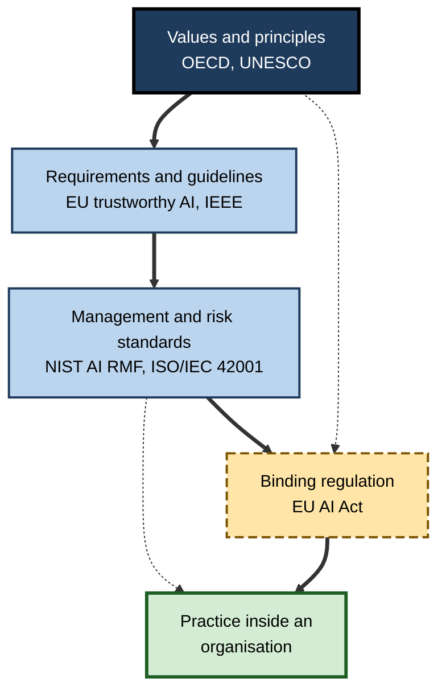
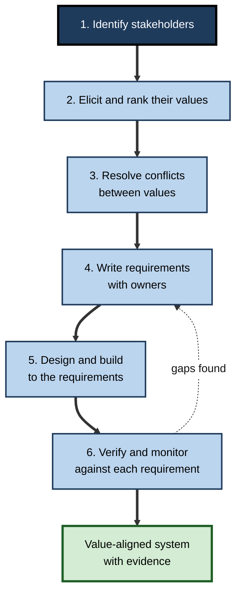
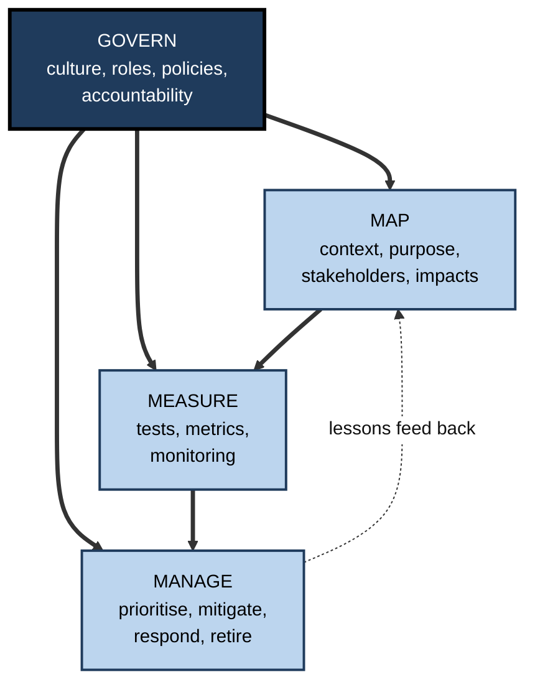
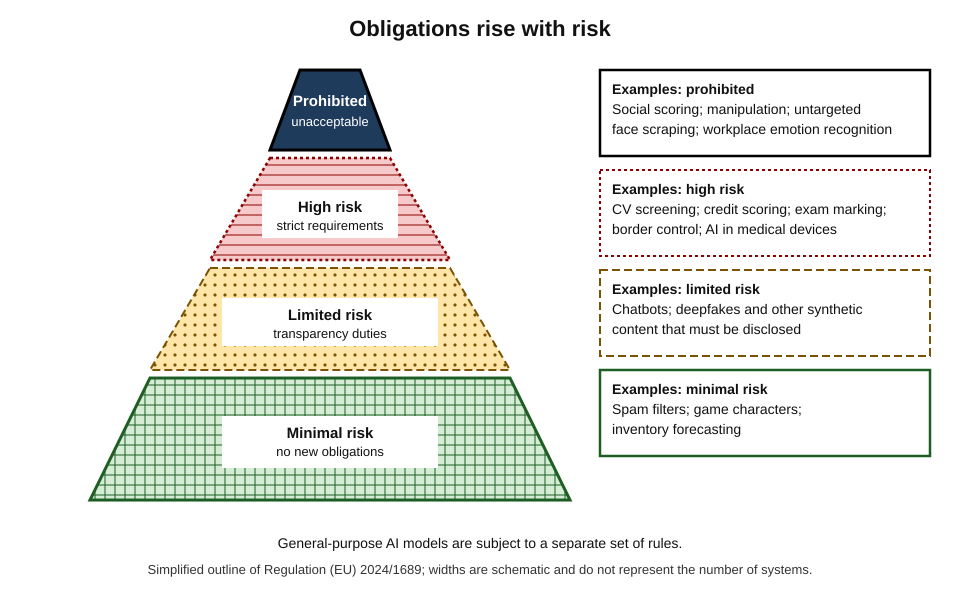
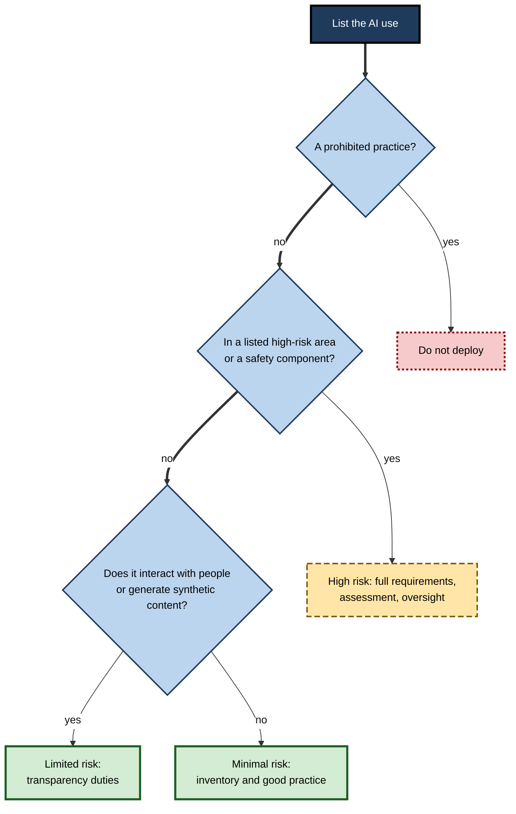

# G.10. Ethical AI frameworks: EU AI Act, IEEE guidelines

In June 2018 Google published a short list of principles for its AI work, promising among other things to build AI that is "socially beneficial", to avoid creating or reinforcing unfair bias, and to be accountable to people. 

The list followed a protest by thousands of its own employees against a Pentagon contract to analyse drone imagery. Within a few years, hundreds of organisations had published similar lists. The more interesting question was never whether to have principles, but what turns a principle into a practice — and when a principle must become a law.

> **Definition — Ethical AI framework:** a structured set of principles, requirements, processes or standards that guides the responsible design, development, deployment and use of AI, whether voluntary or binding.

> **Definition — Soft law:** guidance, principles and standards that shape behaviour without being legally enforceable by themselves — as distinct from **hard law**, which is binding and backed by sanctions.

**Why it matters**

- **Frameworks translate values into action.** "Fairness" cannot be audited; a framework's requirements and tests can.
- **They allow comparison.** Customers, regulators and partners can judge organisations against a shared reference.
- **They shape law.** Voluntary principles of the late 2010s became the vocabulary of binding rules in the 2020s.
- **They reveal the gaps.** Comparing frameworks shows where agreement is broad and where it is only apparent.
- **Professionals meet them daily** in procurement questionnaires, audits, vendor contracts and compliance programmes.

---

## The Landscape of Frameworks

### Four kinds

- **Principles** — high-level statements of values.
  - *e.g.* OECD AI Principles; UNESCO Recommendation.
- **Requirements and guidelines** — more specific expectations that organisations can assess themselves against.
  - *e.g.* the European Union's guidelines for trustworthy AI; IEEE's Ethically Aligned Design.
- **Management and risk standards** — processes for organisations to adopt and be certified or audited against.
  - *e.g.* the NIST AI Risk Management Framework; ISO/IEC 42001.
- **Binding regulation** — laws with obligations and penalties.
  - *e.g.* the EU Artificial Intelligence Act.

**Figure 1.** From principles to law: four kinds of framework and their relationship.

### What the frameworks have in common

**Study card — Jobin, Ienca and Vayena (ETH Zurich; *Nature Machine Intelligence*, 2019), "The global landscape of AI ethics guidelines"**

- **Method:** collected and compared 84 documents of AI ethics principles or guidelines issued by governments, companies, professional bodies and civil society worldwide.
- **Findings:**
  - No single principle appeared in **all** documents, but five appeared in more than half: **transparency**, **justice and fairness**, **non-maleficence** (avoiding harm), **responsibility** and **privacy**.
  - Transparency was the most frequently named.
  - Documents differed widely in **how** they interpreted each principle, why it matters, who should act and how.
  - **Sustainability** and **solidarity** were rarely mentioned; documents came mostly from wealthier countries in Europe and North America.
- **Conclusion:** a **convergence on words** hides **divergence on meaning** — the same principle can be read in very different ways.

> **Watch out:** agreement on a principle's name is not agreement on what to do. "Fairness" may mean equal outcomes to one author and equal opportunity to another, and the rival statistical definitions of fairness can contradict one another.

---

## Principles and Guidelines

### OECD AI Principles

- **Adopted** in May 2019 by member countries of the Organisation for Economic Co-operation and Development, and later endorsed by many others; **updated in 2024** to cover generative and general-purpose systems and to deal with safety, information integrity and environmental sustainability.
- **Five value-based principles:**
  1. **inclusive growth, sustainable development and well-being;**
  2. **human rights and democratic values**, including fairness and privacy;
  3. **transparency and explainability;**
  4. **robustness, security and safety;**
  5. **accountability.**
- **Five recommendations to governments:** investing in research, fostering a digital ecosystem, shaping policy, building human capacity and international cooperation.
- **Significance:** the first intergovernmental standard on AI; its definition of an AI system was reused, in revised form, in the EU AI Act.

### UNESCO Recommendation on the Ethics of Artificial Intelligence (2021)

- **Adopted** by all 193 member states of UNESCO in November 2021.
- **Values:** human rights and dignity; living in peaceful, just and interconnected societies; ensuring diversity and inclusiveness; environment and ecosystem flourishing.
- **Principles include:** proportionality and do no harm; safety and security; privacy and data protection; human oversight; transparency; responsibility and accountability; non-discrimination; sustainability; awareness and literacy; multi-stakeholder governance.
- **Policy areas:** ethical impact assessment, data governance, gender, environment, education, culture, health and labour.
- **Distinctive features:** explicit attention to **gender equality, the environment and cultural diversity**, and a global rather than regional scope.

### EU Ethics Guidelines for Trustworthy AI (2019)

- **Produced** by an independent High-Level Expert Group appointed by the European Commission.
- **Core idea:** AI should be **lawful, ethical and robust** — all three throughout the system's life.
- **Four ethical principles**, grounded in fundamental rights: **respect for human autonomy, prevention of harm, fairness, explicability.**
- **Seven requirements:**
  1. **human agency and oversight;**
  2. **technical robustness and safety;**
  3. **privacy and data governance;**
  4. **transparency;**
  5. **diversity, non-discrimination and fairness;**
  6. **societal and environmental well-being;**
  7. **accountability.**
- **A self-assessment list** (the Assessment List for Trustworthy AI, 2020) turned the requirements into questions for organisations.
- **Influence:** the seven requirements shaped the later AI Act's requirements for high-risk systems.

> **Mnemonic — "Hiking Trails Pass Through Diverse, Sunny Areas":** Human agency, Technical robustness, Privacy, Transparency, Diversity and fairness, Societal well-being, Accountability.

| | OECD (2019, 2024) | UNESCO (2021) | EU trustworthy AI (2019) | IEEE Ethically Aligned Design (2019) |
|---|---|---|---|---|
| Issuer | Intergovernmental organisation | UN agency, 193 states | Expert group for the European Commission | Professional engineering body |
| Status | Non-binding principles | Non-binding recommendation | Non-binding guidelines | Non-binding, with linked standards |
| Style | Five principles plus policy advice to governments | Values, principles and eleven policy areas | Seven requirements and an assessment list | Broad principles with detailed recommendations for designers |
| Emphasis | Growth, rights, safety | Human rights, gender, environment, culture | Rights-based, lawful-ethical-robust | Human well-being, transparency, accountability, awareness of misuse |
| Typical use | Basis for national policy | Basis for national strategy and capacity building | Design and assessment checklists | Engineering practice and standards development |

---

## IEEE: Standards by Engineers

### Ethically Aligned Design

- **Who:** the **IEEE** (Institute of Electrical and Electronics Engineers), the world's largest technical professional body, launched a Global Initiative on the Ethics of Autonomous and Intelligent Systems in 2016.
- **Output:** *Ethically Aligned Design*, whose first edition appeared in 2019 after several public drafts and input from hundreds of contributors.
- **Core principles** for designers and developers:
  - **human rights** — systems should respect and promote internationally recognised rights;
  - **well-being** — prioritise human and environmental well-being in design and success measures;
  - **data agency** — people should keep agency over their identity and data;
  - **effectiveness** — creators should provide evidence of fitness for purpose;
  - **transparency** — the basis for a decision should be discoverable;
  - **accountability** — clear responsibility and redress;
  - **awareness of misuse** — designers should guard against misuse and abuse;
  - **competence** — operators should be trained to the level required.
- **Character:** unlike many corporate statements, it is aimed at **practising engineers** and links to concrete standards work.

### The IEEE 7000 series

- **IEEE 7000-2021** — a **model process** for addressing ethical concerns during system design: identify stakeholders, elicit their values, translate them into system requirements and trace them through design to verification.
- **Other standards in the series** address specific concerns, including:
  - transparency of autonomous systems (IEEE 7001);
  - data privacy processes (IEEE 7002);
  - algorithmic bias considerations (IEEE 7003);
  - children's and students' data governance (IEEE 7004);
  - employer data governance (IEEE 7005);
  - machine-readable personal-data "terms" for individuals (IEEE 7012).
- **Significance:** standards translate ethics into **repeatable procedures**, which can be audited and written into contracts.

> **Definition — Value-based engineering:** a design approach in which stakeholders' values are identified at the start, turned into requirements and traced through the whole development life cycle.

### Worked example (illustrative): turning a value into a requirement

A city council plans an AI tool that prioritises housing repairs. Using a value-based process of the kind IEEE 7000 describes:

1. **Identify stakeholders.** Tenants, repair staff, councillors, housing charities, the complaints ombudsman.
2. **Elicit values.** Tenants stress **safety** and **being heard**; staff stress **workload fairness**; the council stresses **value for money**; charities stress **non-discrimination**.
3. **Rank and resolve.** Safety outranks cost; being heard means the tool cannot ignore tenants who report problems rarely.
4. **Turn values into requirements.**

| Value | Requirement | How it is verified |
|---|---|---|
| Safety | Homes with reported damp or heating failure are inspected within a stated time, whatever the model ranks | Audit of response times for reported faults |
| Being heard | Every tenant report triggers a human review; model scores never suppress a report | Sample of reports checked monthly |
| Non-discrimination | Inspection rates and wait times are compared by tenant group; gaps above an agreed limit trigger review | Quarterly group-level report |
| Value for money | Savings measured against a baseline without the tool | Annual evaluation |

5. **Trace through design.** Each requirement has an owner, a test and a place in the project documents.

*Illustrative example.*

> **Key point:** a value counts only when it becomes a **requirement with an owner and a test**.

**Figure 2.** From stakeholders' values to verified requirements.

---

## Risk Management Frameworks

### NIST AI Risk Management Framework (2023)

- **Issuer:** the United States National Institute of Standards and Technology, released January 2023 after a public, multi-stakeholder process; a profile for generative AI followed in 2024.
- **Status:** **voluntary**, sector-neutral and usable by any organisation.
- **Trustworthy characteristics it describes:** valid and reliable; safe; secure and resilient; accountable and transparent; explainable and interpretable; privacy-enhanced; fair with harmful bias managed.
- **Four functions:**
  - **Govern** — build a culture, roles and policies for risk management across the organisation;
  - **Map** — understand context, purpose, stakeholders and potential impacts;
  - **Measure** — assess and track risks with suitable metrics and tests;
  - **Manage** — prioritise and act on risks, including incident response and decommissioning.

> **Mnemonic — "Good Managers Measure Meticulously":** Govern, Map, Measure, Manage.

**Figure 3.** The four functions of the NIST AI Risk Management Framework.

### ISO/IEC 42001 (2023)

- **What it is:** the first international **management-system standard** for AI, published December 2023.
- **Idea:** like standards for quality or information security, it asks an organisation to establish, run and continually improve a **system of policies, roles, risk assessments and controls** for AI, and allows **independent certification**.
- **Use:** often requested by customers and procurement teams as evidence of governance.

> **Watch out:** certification shows that a **management process exists**, not that a particular product is safe or fair. A well-run process can still produce a poor model if its risk criteria are weak.

---

## The EU Artificial Intelligence Act as an Ethical Framework

The AI Act, formally Regulation (EU) 2024/1689, entered into force on 1 August 2024. It turns many of the earlier principles into binding obligations, using a **risk-based approach**. It is the clearest example of ethical principles becoming law.

### The four tiers

- **Unacceptable risk — prohibited.** Practices judged incompatible with fundamental rights, including:
  - harmful manipulation and exploitation of vulnerabilities;
  - social scoring leading to unjustified detrimental treatment;
  - untargeted scraping of faces; emotion recognition in workplaces and schools; certain biometric categorisation;
  - real-time remote biometric identification in public for law enforcement, with narrow exceptions.
  - These prohibitions applied from **February 2025**.
- **High risk — strict requirements.** Systems in listed areas such as employment, education, essential services including credit, law enforcement, migration and justice, and AI as safety components of regulated products.
  - Requirements: **risk management; data governance and quality; technical documentation; logging; transparency to deployers; human oversight; accuracy, robustness and cybersecurity.**
  - Providers face **conformity assessment**; deployers have duties of oversight and monitoring.
- **Limited risk — transparency obligations.** People must be told when they interact with a chatbot, and synthetic content such as deepfakes must be identifiable.
- **Minimal risk — no new obligations.** Most AI, such as spam filters and game characters, with voluntary codes encouraged.

Separate rules apply to **general-purpose AI models**, including documentation, copyright policies and, for models posing systemic risk, evaluation and incident reporting.

**Figure 4.** The risk tiers of the EU AI Act.

### How the requirements echo the ethical principles

| Ethical principle (trustworthy AI) | AI Act mechanism |
|---|---|
| Human agency and oversight | Human oversight duties for high-risk systems; ban on manipulative AI |
| Technical robustness and safety | Accuracy, robustness and cybersecurity requirements; post-market monitoring |
| Privacy and data governance | Data governance requirements; links to data-protection law |
| Transparency | Technical documentation; instructions for use; disclosure of AI interaction and synthetic content |
| Diversity, non-discrimination and fairness | Data quality and bias examination; fundamental-rights impact assessments for some deployers |
| Societal and environmental well-being | Prohibitions; reporting on energy use for general-purpose models |
| Accountability | Provider and deployer duties; conformity assessment; logging; penalties |

### Timing and caution

- **Phased application:** prohibitions and AI-literacy duties from February 2025; general-purpose model rules from August 2025; most remaining rules from August 2026.
- **Adjustment in 2026:** a simplification package agreed in 2026 postponed the application of the high-risk requirements — for the listed standalone systems to **December 2027**, and for AI embedded in regulated products to **August 2028** — while leaving transparency rules for synthetic content on their earlier timeline.
- **Penalties:** the most serious infringements can attract fines of up to 7 % of worldwide annual turnover or €35 million, whichever is higher.

> **Watch out:** dates and details of regulation change. Professionals should check the current position for their sector and country instead of relying on a summary — the principles of risk-based, rights-grounded regulation are more stable than the schedule.

### Strengths and criticisms

- **Strengths:** legal certainty; risk-proportionate design; fundamental-rights focus; extraterritorial reach — it applies to providers outside the EU whose systems are placed on the EU market or whose outputs are used there.
- **Criticisms:**
  - **burden** on smaller firms and uncertainty about definitions;
  - reliance on **technical standards** still being written;
  - **exemptions** for national security and some law-enforcement uses;
  - concern that **self-assessment** by providers may be too light for some high-risk systems.

---

## Turning Frameworks into Practice

### Why principles alone are not enough

- **Vagueness** — principles can be read to suit the reader.
- **Voluntariness** — there is no penalty for ignoring them.
- **Ethics washing** — principles published for reputation, with no change in practice.
- **Internal conflict** — commercial pressure, speed and revenue often outweigh abstract values.

### Case study: Google's AI principles and Project Maven (2018–2025)

- **Situation:** in 2017 Google won part of a US military project, **Project Maven**, using machine learning to analyse drone-camera video.
- **Internal reaction (2018):** thousands of employees signed a letter urging the company to stay out of "the business of war"; some resigned.
- **Response:** in June 2018 the company said it would not renew the contract, and published **AI principles**: seven objectives — be socially beneficial; avoid creating or reinforcing unfair bias; be built and tested for safety; be accountable to people; incorporate privacy design principles; uphold high standards of scientific excellence; be made available for uses that accord with these principles — plus a list of **applications it would not pursue**, including weapons and technologies that cause overall harm, surveillance violating accepted norms, and technologies contravening international law and human rights.
- **Later change (2025):** in February 2025 the company published an updated version of its principles that **no longer contained the list of specific applications it would not pursue**, instead emphasising bold innovation, responsible development and collaboration, and referring to supporting national security.
- **Analysis:**
  - **What worked:** employees' voices and a public commitment changed a decision, and the principles gave staff a reference point.
  - **What was fragile:** voluntary pledges can be **revised** when strategy, politics or competition change; no outside body enforced them.
  - **Contested point:** the company argued that democracies should lead in AI and that its commitments to human rights remain; critics saw the change as a retreat from a clear restriction.
- **Lesson:** a self-written principle is only as strong as the **governance behind it** — who can enforce it, who can amend it and how openly changes are made. This is why many advocates seek **binding law** and **independent audit**.

### What good implementation looks like

- **A named owner and a decision body** with authority to stop a launch.
- **Requirements, not slogans** — each principle expressed as testable criteria.
- **A risk classification step** at the start of every project.
- **Impact assessments** for higher-risk uses, kept and reviewed.
- **Documentation** — model cards, data records, decision logs.
- **Training** for staff in the principles and in escalation routes.
- **Monitoring and incident handling** after launch.
- **Independent challenge** — internal audit, external audit or ethics advisory boards with real access.

### Worked example (illustrative): classifying five systems

An insurer lists five AI uses and applies an EU-style risk classification.

| System | Likely tier | Reason | Immediate actions |
|---|---|---|---|
| Spam filter on staff email | Minimal | No impact on rights or opportunities | Record in the inventory |
| Customer chatbot for general queries | Limited | People interact with AI directly | Disclose that it is AI; give a route to a human |
| Model that prices life-insurance premiums using health data | High risk (as a system affecting access to essential services, and processing sensitive data) | Directly affects people's access to insurance on terms | Conformity process, data-quality and bias tests, human oversight, logging, impact assessment |
| CV-screening tool for hiring | High risk | Employment is a listed area | As above; inform candidates |
| Tool inferring customers' emotions from call audio to adjust sales scripts | Possibly prohibited or high risk depending on context | Emotion inference is restricted in workplaces, and heavily criticised for validity | Legal review; likely withdraw or redesign |

*Illustrative classification; actual classification depends on the precise Annex definitions and legal advice.*

**Figure 5.** A decision path for classifying an AI use.

---

## Comparing Approaches Across the World

- **European Union:** comprehensive, horizontal, rights-based law with risk tiers.
- **United States:** no single federal AI statute; guidance (such as the NIST framework) plus sector regulators, civil-rights law, state laws and executive actions that have shifted between administrations.
- **United Kingdom:** a principles-based, regulator-led approach built on existing regulators, with a focus on safety evaluation of advanced models.
- **China:** targeted binding rules for specific uses, such as recommendation algorithms, synthetic media and generative AI, with an emphasis on social stability and state oversight.
- **International bodies:** OECD, UNESCO, the Council of Europe's framework convention on AI and human rights (opened for signature in 2024) and the G7 and UN processes seek common ground.

> **Key point:** a global organisation must satisfy **the strictest relevant regime** for each market, which is why the EU Act, in practice, influences product design well beyond Europe.

---

## Open Questions

- **Can principles be enforced without law?**
  - Voluntary commitments have weakened under commercial and political pressure; whether independent audit can substitute is unresolved.
- **Are the frameworks truly global?**
  - Most were written in wealthy countries; whether they fit other cultures and economies is contested.
- **Will risk tiers keep pace with general-purpose AI?**
  - A single model may be used for minimal-risk and high-risk tasks; classifying the model versus the use is a continuing difficulty.
- **Does compliance equal ethics?**
  - A system can satisfy every listed duty and still harm people in ways the list did not foresee.
- **How should conflicting frameworks be reconciled?**
  - Multinational organisations face overlapping and sometimes inconsistent expectations.

---

## Summary

- An **ethical AI framework** is a structured set of principles, requirements, standards or rules; frameworks range from **soft law** to **binding regulation**.
- Comparison of 84 guideline documents found convergence on **transparency, justice and fairness, non-maleficence, responsibility and privacy** but wide divergence on meaning (Jobin and colleagues, 2019).
- **OECD** (2019, 2024) and **UNESCO** (2021) set intergovernmental principles; the **EU's trustworthy-AI guidelines** (2019) set seven requirements — lawful, ethical, robust.
- **IEEE** contributes *Ethically Aligned Design* and the **7000 series**, including a model process for turning stakeholders' values into verified requirements.
- **NIST AI RMF** (Govern, Map, Measure, Manage) and **ISO/IEC 42001** provide risk and management-system approaches; certification shows a process, not a safe product.
- The **EU AI Act** (Regulation 2024/1689) classifies AI into **unacceptable, high, limited and minimal risk**; its requirements echo the ethical principles; high-risk obligations were pushed back to 2027–2028 in 2026.
- Principles alone fail through vagueness, voluntariness, ethics washing and commercial pressure; Google's principles (2018, revised 2025) show how voluntary pledges can change.
- Good practice: owner, requirements with tests, risk classification, impact assessments, documentation, training, monitoring and independent challenge.

---

## Self-Check

1. Distinguish soft law from hard law, with an AI example of each.
2. What did the Jobin, Ienca and Vayena study find about convergence among AI ethics guidelines?
3. List the OECD's five value-based principles.
4. What are the seven requirements of the EU trustworthy-AI guidelines?
5. What is IEEE 7000-2021, and what does a value-based process involve?
6. Name the four functions of the NIST AI Risk Management Framework and say what each does.
7. What does ISO/IEC 42001 certify, and what does it not certify?
8. Describe the four risk tiers of the EU AI Act, with one example of each.
9. Which obligations apply to providers of high-risk AI systems?
10. How did the 2026 changes affect the timetable of the EU AI Act?
11. What does the Google/Project Maven case show about voluntary principles?
12. Why does "convergence on words" not mean agreement on practice?
13. Classify the following using an EU-style approach: (a) a chatbot answering shop-opening-hours queries; (b) software that ranks job applicants; (c) a game's non-player characters.
14. A start-up says its "AI ethics board" has approved the product, so it needs no further checks. What would you ask?

### Answer Key

1. Soft law is non-binding guidance, such as the OECD AI Principles; hard law is binding with sanctions, such as the EU AI Act.
2. Of 84 documents, no principle appeared in all, but transparency, justice and fairness, non-maleficence, responsibility and privacy appeared in most; interpretations, justifications and recommended actions varied widely, and sustainability and solidarity were rare.
3. Inclusive growth, sustainable development and well-being; human rights and democratic values; transparency and explainability; robustness, security and safety; accountability.
4. Human agency and oversight; technical robustness and safety; privacy and data governance; transparency; diversity, non-discrimination and fairness; societal and environmental well-being; accountability.
5. A model process for addressing ethical concerns in system design: identify stakeholders, elicit and rank values, resolve conflicts, translate values into requirements, design to them and verify them with traceability.
6. Govern: culture, roles, policies. Map: context, stakeholders, impacts. Measure: tests and metrics. Manage: prioritise and act on risks, respond to incidents and retire systems.
7. That an organisation runs a management system for AI — policies, roles, risk assessment and controls. It does not certify that any particular model is safe or fair.
8. Unacceptable: social scoring (prohibited). High: CV screening or credit scoring (strict requirements). Limited: chatbots (transparency). Minimal: spam filters (no new obligations).
9. Risk management, data governance, technical documentation, logging, transparency to deployers, human oversight, accuracy and robustness, conformity assessment and post-market monitoring.
10. A 2026 simplification package delayed high-risk requirements for listed standalone systems to December 2027 and for AI in regulated products to August 2028, leaving some transparency rules on their original timeline.
11. Employee action and a public pledge changed a decision, but voluntary principles can be revised without outside enforcement — the 2025 update removed the list of applications the company would not pursue.
12. The same word — such as fairness — can mean equal outcomes, equal opportunity or equal error rates, so agreeing on the word does not decide what to build or measure.
13. (a) Limited risk — disclose that it is AI; (b) high risk — employment is a listed area; (c) minimal risk.
14. Does the board have authority to stop launch? Who sits on it, and is it independent? What did it review — data, tests by group, impact assessment? How are requirements verified? What monitoring and complaint routes exist? What legal duties apply that a board cannot waive?

---

## Glossary

| Term | Meaning |
|---|---|
| Conformity assessment | A procedure showing that a high-risk AI system meets legal requirements before it is placed on the market. |
| Ethical AI framework | A structured set of principles, requirements or standards guiding responsible AI. |
| Ethics washing | Projecting an ethical image without effective practice. |
| General-purpose AI model | A model trained on broad data that can serve many tasks. |
| Hard law | Binding rules with sanctions. |
| High-risk AI system | A system in a listed area or product category subject to strict requirements. |
| IEEE 7000 | A standard providing a model process for addressing ethical concerns in system design. |
| ISO/IEC 42001 | An international management-system standard for AI. |
| NIST AI RMF | A voluntary framework for managing AI risk through Govern, Map, Measure and Manage. |
| Risk-based approach | Regulation whose obligations scale with the level of risk. |
| Soft law | Non-binding guidance and principles. |
| Trustworthy AI | AI that is lawful, ethical and robust. |
| Value-based engineering | Design that traces stakeholders' values into requirements and verification. |
