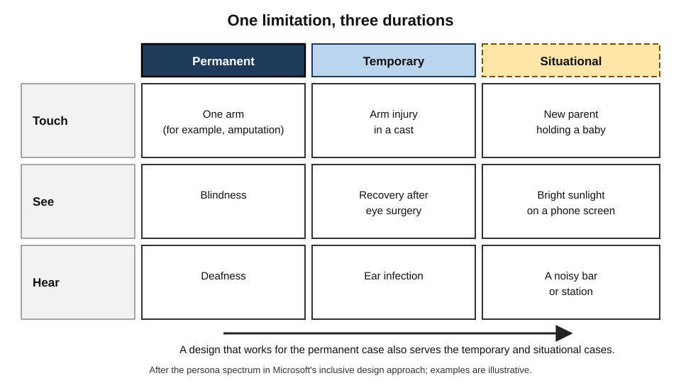
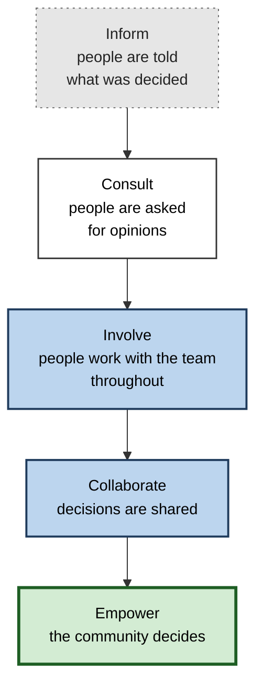
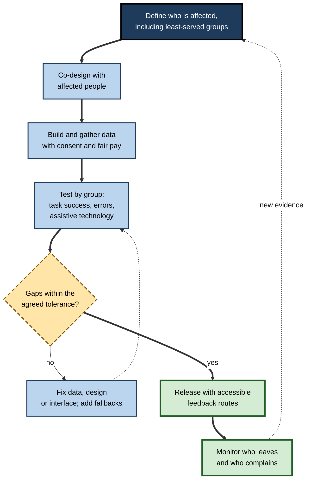
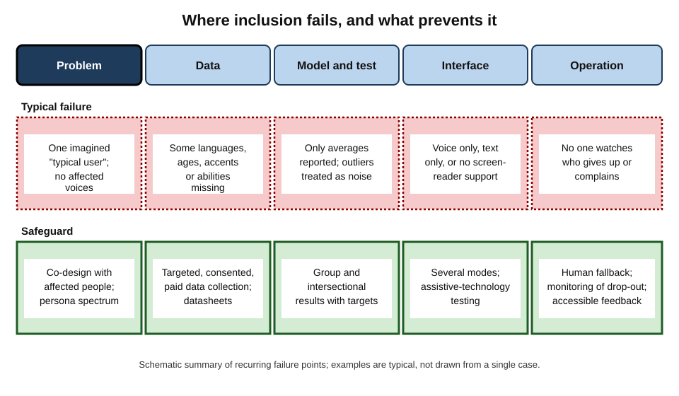
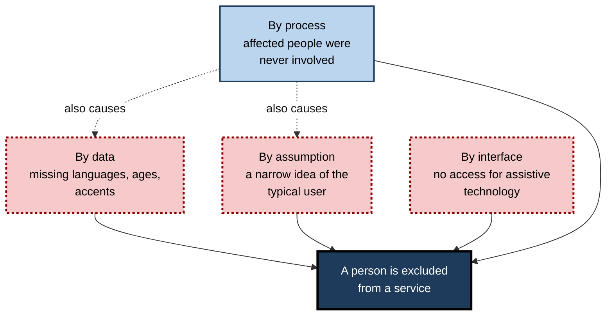

# G.11. Inclusive AI design for diverse populations

Public body-scanners at airports were designed around a simple question put to the operator: is the person male or female? The operator presses one of two buttons, and the machine compares the scan with a template for that choice. For many transgender and non-binary travellers, and for some people with prostheses, head coverings or particular hairstyles, the machine raised an alarm that had nothing to do with security. Nobody set out to cause that. The designers had simply imagined a narrower population than the one that arrived.

> **Definition — Inclusive design:** a design approach that considers the full range of human diversity — ability, language, age, culture, gender, income, geography and circumstance — from the start, so that products work well for as many people as possible.

> **Definition — Inclusive AI:** AI that is designed, trained, tested and governed so that it works fairly and usefully across the diversity of the people it will affect, and in which those people can take part in shaping it.

**Why it matters**

- **AI systems encode their designers' assumptions.** Whoever is imagined as the "typical user" becomes the person for whom the system works.
- **Exclusion is quiet.** People for whom a system fails often simply stop using it; the failure does not appear in the average.
- **The population is larger and more varied than most teams.** Around one in six people worldwide lives with a significant disability (World Health Organization estimate), thousands of languages are spoken, and billions of people have limited or intermittent internet access.
- **Inclusion improves products.** Designing for the edge often helps everyone: captions, voice control and predictive text all began as accessibility features.
- **Law increasingly requires it.** Accessibility, equality and consumer-protection rules apply to AI-based products and services.

---

## Who Is Left Out, and How

### Four routes to exclusion

- **Exclusion by data** — people are missing or poorly represented in training data.
  - *e.g.* languages with little text online; rural users; older voices; people with atypical speech.
- **Exclusion by assumption** — the design takes for granted a particular body, culture or circumstance.
  - *e.g.* a form that requires a "first name" and "surname"; a voice assistant that assumes fluent, fast, standard speech.
- **Exclusion by interface** — the means of using the system is unavailable to some.
  - *e.g.* a chatbot unusable with a screen reader; an app needing a camera and a fast connection.
- **Exclusion by process** — affected people were not involved in decisions about what to build.
  - *e.g.* a tool for people with dementia designed without any person with dementia or carer.

> **Definition — Digital divide:** the gap between people who have ready access to digital technology, skills and connectivity and those who do not, along lines such as income, age, geography, disability and language.

### The groups most often overlooked

- **People with disabilities** — visual, hearing, motor, cognitive, speech and neurodivergent differences.
- **Speakers of less-resourced languages and dialects** — including regional, minority and Indigenous languages, and non-standard varieties of major languages.
- **Older people and children** — different speech, motor skills, attention and understanding of technology.
- **People outside the wealthy world** — whose names, addresses, currencies, networks, social structures and legal systems differ from those assumed.
- **People with low literacy, low income or intermittent connectivity.**
- **Gender-diverse and minority communities** — whose identities are not captured by the categories in the data.

> **Key point:** most people belong to one of these groups at some point in their lives, or in some circumstance. Inclusion is not a minority concern.

### The persona spectrum

**Microsoft's Inclusive Design toolkit** (2016) describes disability as a mismatch between a person and their environment, not as a fixed personal trait. It shows how a single kind of limitation can be permanent, temporary or situational.

**Figure 1.** The persona spectrum: one limitation, three durations.

> **Definition — Situational limitation:** a temporary constraint caused by circumstances rather than by an impairment — for example, a parent holding a baby, a person in a noisy station, or a driver whose hands are occupied.

> **Remember:** design for the **permanent** limitation, and the **temporary** and **situational** users benefit too.

---

## Evidence of Exclusion in AI

### Language

**Study card — Joshi, Santy, Budhiraja, Bali and Choudhury (Microsoft Research India and collaborators; Association for Computational Linguistics, 2020), "The State and Fate of Linguistic Diversity and Inclusion in the NLP World"**

- **Question:** how well do language technologies serve the world's roughly 7,000 languages?
- **Method:** classified languages by how much labelled and unlabelled data and research attention they receive, and compared this with the number of speakers.
- **Findings:**
  - A **small number** of languages — mostly European and East Asian — have large amounts of data and receive most research and funding.
  - The great majority of the world's languages, including many with millions of speakers, have **little or no** usable data and almost no technology.
  - The gap between the best-served languages and the rest was **large and persistent**.
- **Conclusion:** AI language tools reproduce, and may amplify, the world's existing inequalities of power and resources; speakers of under-served languages are excluded from the benefits, and from their own representation.

> **Definition — Low-resource language:** a language with little digital text, speech data or labelled material, and therefore little language technology, regardless of how many people speak it.

### Different societies, different fairness categories

**Study card — Sambasivan, Arnesen, Hutchinson, Doshi and Prabhakaran (Google Research; ACM Conference on Fairness, Accountability, and Transparency, 2021), "Re-imagining Algorithmic Fairness in India and Beyond"**

- **Question:** do the fairness concepts developed mainly in the United States and Europe fit India?
- **Method:** interviews with researchers, activists and community members, and analysis of how fairness was framed in Indian contexts.
- **Findings:**
  - The categories commonly used in fairness work — race and gender in particular — **do not capture** the most important axes of disadvantage in India, such as **caste, religion, region and tribe**.
  - **Data** is not always available, reliable or safe to collect; many people are not represented in datasets, and recording sensitive categories can itself be risky.
  - The wide gap in access to technology means that those who appear in data may differ greatly from those affected.
  - Public trust in automated systems was often high, which means **errors are accepted** without challenge.
- **Conclusion:** fairness cannot simply be exported. Local social structures decide **who is likely to be harmed**, and therefore what needs testing.

### Disability

**Study card — Whittaker and colleagues (AI Now Institute, New York University, 2019), "Disability, Bias, and AI"**

- **Argument:** disability has been largely **missing** from AI fairness research, despite disabled people being among the most exposed to automated decisions.
- **Reasons given:**
  - disability is highly **diverse**, with no single pattern of data that "represents" it;
  - disabled people are often **outliers** in data, treated as noise and trimmed away by models designed for the typical case;
  - privacy and **disclosure** risks make collecting disability data fraught.
- **Examples discussed:** hiring tools that analyse speech or facial movement, systems that flag unusual behaviour, and ways in which "normal" is defined by the data.
- **Conclusion:** methods that treat the typical case as correct will tend to **exclude** disabled people unless disability is considered explicitly, with disabled people taking part.

> **Watch out:** "we tested on diverse users" is not enough if the test group excluded disabled people, or if the number from each group was too small to reveal a problem.

---

## Principles of Inclusive AI Design

### Seven principles

1. **Include people from the start.** Involve the people who will be affected in defining the problem, not only in testing the answer.
2. **Recognise diversity as the norm.** Replace the single "typical user" with a range of personas, including edge and extreme cases.
3. **Collect representative data — responsibly.** Aim for coverage of the real population, with consent, fair pay, privacy and community control.
4. **Evaluate by group and by combination.** Report performance for each relevant group and for intersections, not only on average.
5. **Offer multiple ways to interact.** Text, voice, touch and assistive-technology compatibility; adjustable speed, size and language.
6. **Provide fallbacks and human routes.** A person to talk to; an alternative route when the automated one fails.
7. **Keep listening after launch.** Monitor who stops using the service and why; invite feedback in accessible ways.

> **Mnemonic — "I Really Care: Everyone Might Fit, Keep":** Include, Recognise diversity, Collect representative data, Evaluate by group, Multiple modes, Fallbacks, Keep listening.

### Participation and co-design

> **Definition — Participatory design (co-design):** a process in which the people who will use or be affected by a system take part in designing it as partners, with real influence over decisions.

- **"Nothing about us without us"** — the slogan of the disability-rights movement, adopted widely in design.
- **Design justice** — the approach set out by Sasha Costanza-Chock (2020): design should be led by those most affected, should centre their needs and should share benefits and decision-making power; she uses the airport-scanner example above.
- **Levels of participation:**
  - **informing** — telling people what has been decided;
  - **consulting** — asking opinions;
  - **involving** — working with people throughout;
  - **collaborating** — sharing decisions;
  - **empowering** — placing final decisions in the hands of the community.

**Figure 2.** Levels of participation in designing AI systems.

> **Watch out:** participation can be tokenistic: a single user on a panel, consulted after the design is fixed, unpaid, and without power to change anything. Real participation includes **payment, access arrangements and authority**.

---

## Inclusive Data

### Representation in training and testing data

- **Coverage** — are all relevant groups, languages, dialects, devices and settings present in sufficient numbers?
- **Quality** — are labels reliable for each group, or do annotators misunderstand some dialects or contexts?
- **Context** — was the data collected in settings like those of deployment?
- **Annotators** — who labels the data matters; labellers from a narrow background import their assumptions.

### Responsible collection

- **Consent and compensation** — people who contribute data or labour are informed and fairly paid.
- **Community governance** — communities decide how data about them is used (as in Indigenous data-sovereignty principles).
- **Risk of harm** — collecting data on sensitive characteristics can expose people to harm; weigh the benefit of measuring bias against the risk of misuse.
- **Documentation** — datasheets stating who is represented, who is missing and why.

### Synthetic and augmented data

- **Use:** supplement data for rare groups by simulation or augmentation.
- **Caution:** synthetic data reflects the assumptions of the model that generated it and may produce stereotyped versions of the groups it is meant to represent; it should supplement, not replace, real participation.

### Case study: Masakhane and African-language translation (2019 onwards)

- **Situation:** African languages — more than two thousand of them — were almost absent from machine-translation systems, and almost all research on them was done outside the continent.
- **Approach:** in 2019 researchers, students and practitioners across Africa formed **Masakhane** ("we build together" in isiZulu), a grassroots, open research community. Its principle was that translation for African languages should be built **by Africans**, working in their own languages.
- **How it worked:**
  - participants — many not formally trained researchers — **volunteered** as translators, data curators and evaluators;
  - they created datasets and benchmarks for many languages, often from religious texts and news at first, and later from more varied sources;
  - results and methods were shared openly.
- **Findings reported by the community (2020):** a paper written by dozens of participants described **participatory research** as a way to include people who are normally absent from machine-learning research, and showed that **community knowledge** of languages catches errors that outsiders miss, such as problems with orthography, dialect and context.
- **Limits:** data was scarce, early sources skewed towards religious texts, funding was limited, and quality for the least-resourced languages remained modest.
- **Lesson:**
  - Inclusion of low-resource languages required **community ownership**, not only more data.
  - The people who speak a language are best placed to judge a model's output.
  - Participation produces better data **and** wider capability.

---

## Inclusive Interaction and Accessibility

### Accessibility standards and law

- **Web Content Accessibility Guidelines (WCAG)** — the main international technical standard for accessible digital content; **version 2.2** was published in October 2023. Its four principles are **perceivable, operable, understandable and robust**.
- **European Accessibility Act** — requires many consumer products and services, including e-commerce, banking services, e-books and some communications services, to meet accessibility requirements; it applies from **28 June 2025**.
- **Equality and disability law** — the UK Equality Act 2010 and the US Americans with Disabilities Act require reasonable adjustments or accommodation in many services.
- **Public-sector accessibility rules** — in the EU and UK, public-sector websites and apps must meet accessibility standards.

> **Mnemonic — "POUR":** Perceivable, Operable, Understandable, Robust.

### AI as an accessibility tool — and a barrier

| | Where AI helps | Where AI can exclude |
|---|---|---|
| Vision | Describing images and scenes; reading text aloud; navigation | Chat interfaces and visual outputs without screen-reader support; wrong or confident image descriptions |
| Hearing | Live captions and transcription; sign-language research tools | Poor accuracy for accents, deaf speech and noisy settings; voice-only interfaces |
| Speech | Voice banking; recognition tuned to atypical speech | General speech systems that fail on stammering, dysarthria or non-standard speech |
| Cognition and learning | Plain-language rewriting; summaries; reminders | Fast, dense text; systems that mislead without clear confidence cues; complex consent flows |
| Motor | Voice control; predictive text; eye-gaze | Timing-sensitive interfaces; small targets; mandatory gestures |
| Language | Translation and interpretation | Poor quality for minority languages; mistranslation in medical or legal settings |

> **Key point:** the same technology can open doors for some and close them for others. **The test is whether a given person can actually complete a task.**

### Avoiding stereotypes in generative systems

- **Default outputs** often assume a narrow "normal": a particular skin tone, body type, age or gender for each profession.
- **Responses to prompts** may be less accurate or less respectful for some dialects and cultures.
- **Mitigation:**
  - test prompts and outputs across a representative set of identities and contexts;
  - involve reviewers from the communities depicted;
  - avoid correcting by crude means that distort history or reality — inclusion requires accuracy, not just variety.

---

## Making Inclusion Operational

### Inclusive testing

1. **Define the population** — including the least-served groups and intersections.
2. **Recruit participants** across them, with accessible methods and fair payment.
3. **Set measurable targets** — task completion, error rate and satisfaction **for each group**, with a stated gap tolerance.
4. **Test with assistive technologies** — screen readers, switch controls, voice control, magnifiers, captioning.
5. **Test in context** — noisy rooms, poor connections, older devices, interrupted tasks.
6. **Publish and act** — report gaps, assign owners and retest after fixing.

**Figure 3.** An inclusive design and testing cycle.

### Worked example (illustrative): a telephone assistant for a pension service

A pension provider plans a voice assistant to answer routine questions.

| Group tested | Task completed without help | Main problem found |
|---|---|---|
| Fluent speakers, standard accent (reference) | 91 % | Few |
| Speakers with strong regional accents | 78 % | Mis-heard names and place names |
| Older callers (75 and over) | 66 % | Pauses misread as the end of speech; prompts too fast |
| Callers with speech impairment | 41 % | Frequent misrecognition; no easy route to a person |
| Callers using English as a second language | 70 % | Idioms misunderstood |
| Deaf callers using relay services | 35 % | Latency breaks the relay; voice-only verification |

*Illustrative figures.*

1. **Read the average.** About 76 % overall — apparently acceptable.
2. **Disaggregate.** Two groups complete fewer than half of their tasks, and they are the groups least able to cope with a failed call.
3. **Diagnose.**
   - Pause tolerance and speaking-rate settings were tuned on young adults.
   - Verification relied on spoken security answers.
   - There was no visible route to a human.
4. **Redesign.**
   - Longer, adjustable pauses; slower prompts on request.
   - A text-chat and secure web-form alternative; relay-compatible verification.
   - "Say *agent* at any time" and an immediate transfer after two failures.
   - Recognition retuned and tested with recordings from the groups concerned, collected with consent and paid.
5. **Retest and set a rule.** Target: no group below 85 % task completion, or a human route offered automatically. After fixes, the lowest group reached 83 % with the human route used on the remainder.
6. **Monitor.** Monthly report by group; calls abandoned within thirty seconds reviewed.

> **Remember:** the people who need the human fallback are not a failure of design to be minimised; they are the evidence of where the design must still improve.

---

## Culture, Context and the Global Picture

### Beyond translation: cultural fit

- **Names and forms** — single names, multiple family names, patronymics and different orderings; forms that reject valid names exclude people.
- **Concepts** — categories such as race, income band or "household" vary or may not exist.
- **Norms of politeness and directness** — a system trained mainly on one culture's communication styles may sound abrupt, rude or evasive elsewhere.
- **Visual and symbolic content** — gestures, colours, clothing and images carry different meanings.
- **Legal and institutional context** — documents, addresses and identity systems vary.

### Infrastructure and affordability

- **Connectivity** — a service requiring constant fast connection excludes people with limited data.
- **Devices** — older and cheaper phones have less memory and processing.
- **Cost** — paid AI tools may widen gaps between those who can afford them and those who cannot.
- **Literacy** — voice and image interfaces can serve people who read little; design for oral, not only written, use.

### Case study (illustrative): an agricultural advice assistant

- **Situation:** a development organisation built a text-based assistant giving smallholder farmers advice on crop disease from photographs.
- **Trigger:** a six-month review found that usage was concentrated among men with smartphones in district centres; women farmers, who did much of the field work, rarely used it.
- **Investigation:**
  1. Interviews showed that many women shared phones with male relatives, read in a regional language the assistant handled poorly, and preferred voice messages.
  2. Photographs taken in poor light on older phones were often rejected.
  3. The image model had been trained mostly on crops from research stations, not from smallholder fields.
- **Redesign:**
  - voice interaction in three regional languages, built with local speakers;
  - an offline mode and tolerance for low-quality images;
  - farmer groups, led by women, helped collect field images and review the advice;
  - agricultural extension workers as a human fallback.
- **Result:** after a year, women made up a substantial minority of users, and diagnosis accuracy in field conditions improved; costs rose modestly.
- **Lesson:** the original "failure" was invisible in the usage numbers, which looked healthy — it appeared only when the team asked **who was not using the service, and why**.

*Illustrative case; no figures are claimed.*

---

## Organisational Practice

- **Diverse teams** — people with different backgrounds, abilities and languages spot failures others cannot; diversity must extend to decision-making roles, not only junior ones.
- **Inclusion in requirements** — accessibility and group performance targets in the product specification.
- **Procurement** — require vendors to show accessibility conformance and performance by group; build remedies into contracts.
- **Training** — staff understand accessibility, cultural humility and bias.
- **Accountability** — a named owner for inclusion outcomes, with authority to delay launch.
- **Transparency** — publish accessibility statements, known limitations and how to ask for help.

**Figure 4.** The stages at which inclusion can fail, and the safeguard for each.

> **In practice:** treat inclusion as a quality requirement like security: specified, tested before release, reported and owned.

**Figure 5.** Four routes by which an AI system can exclude people.

---

## Open Questions

- **Can one global model serve everyone?**
  - General-purpose systems may favour dominant languages and cultures; whether small, local models serve communities better is under study.
- **How should sensitive data be collected to test fairness?**
  - Measuring exclusion needs data about the groups affected; collecting it can itself create risk.
- **Who should own and benefit from community data?**
  - Models trained on communities' languages and knowledge raise questions of ownership and benefit-sharing.
- **How can participation be made genuine at scale?**
  - Co-design works well with small groups; global systems affect billions.
- **When does adapting to difference become stereotyping?**
  - Personalisation by inferred group risks reinforcing the assumptions inclusion aims to remove.

---

## Summary

- **Inclusive design** considers the full range of human diversity from the start; **inclusive AI** works fairly across it and lets affected people take part in shaping it.
- Exclusion arises through **data, assumptions, interfaces and process**; the groups most often overlooked include disabled people, speakers of low-resource languages, older people and children, people outside wealthy countries, and people with low income, literacy or connectivity.
- The **persona spectrum** shows limitations as permanent, temporary or situational; designing for the permanent helps all.
- Evidence: language technology serves few of the world's languages (Joshi and colleagues, 2020); fairness categories differ across societies (Sambasivan and colleagues, 2021); disability is missing from much fairness work (Whittaker and colleagues, 2019).
- Seven principles: include people early, treat diversity as normal, collect representative data responsibly, evaluate by group and combination, offer multiple modes, provide fallbacks and keep listening.
- **Participation** ranges from informing to empowering; Masakhane shows community-led development of language technology; participation must have real power, payment and access.
- **Accessibility standards** — WCAG 2.2 (POUR) and the European Accessibility Act — and equality laws apply to AI products.
- Make inclusion operational with group-level testing, assistive-technology testing, targets, human fallbacks and monitoring of who leaves.

---

## Self-Check

1. Define inclusive AI and give four routes by which AI systems exclude people.
2. What is the persona spectrum, and why does it help designers?
3. Summarise the main finding of the study of linguistic diversity in language technology.
4. Why do fairness categories from the United States not fit India?
5. Why has disability been described as under-represented in AI fairness work?
6. List the seven principles of inclusive AI design.
7. Distinguish consultation from collaboration and empowerment in participation.
8. What did Masakhane show about developing language technology for African languages?
9. What are the four principles of WCAG, and what is the European Accessibility Act?
10. Give one way AI helps and one way it can exclude blind users.
11. In the pension-assistant example, why is a 76 % average misleading?
12. Why is a human fallback an essential part of an inclusive design, not an admission of failure?
13. A company tests its chatbot with 20 volunteers from its own staff and declares it "inclusive". Identify at least four weaknesses.
14. A start-up wants to train a speech model for older speakers. Describe a responsible data-collection plan.

### Answer Key

1. Inclusive AI works fairly across human diversity and involves those affected. Routes: exclusion by data, by assumption, by interface and by process.
2. It shows a limitation as permanent, temporary or situational — for example, one arm affected by amputation, injury or holding a baby. Designing for the permanent case serves the many people with temporary or situational versions.
3. A small number of languages have most data and research; the great majority, including many with millions of speakers, have little or none, and the gap between the two groups was large and persistent.
4. The key axes of disadvantage in India include caste, religion, region and tribe, which are not captured by race and gender categories; data may be unavailable or risky to collect; and trust in automation can mean errors go unchallenged.
5. Disabilities are diverse and cannot be represented by one data pattern; disabled people are often treated as outliers and removed as noise; disclosure and privacy risks complicate data collection; so the typical case dominates.
6. Include people from the start; recognise diversity as the norm; collect representative data responsibly; evaluate by group and combinations; offer multiple ways to interact; provide fallbacks and human routes; keep listening after launch.
7. Consulting asks opinions after key choices may be made; collaboration shares decisions; empowerment places decisions in the community's hands.
8. A grassroots community of African researchers and speakers produced datasets and translation models using participatory research, and community knowledge caught errors outsiders missed; data scarcity and funding remained limits.
9. Perceivable, operable, understandable, robust. The Act requires many consumer products and services to meet accessibility requirements across the EU from 28 June 2025.
10. Helps: image description and reading text aloud. Excludes: chat interfaces or visual outputs incompatible with screen readers, or confident but wrong descriptions.
11. It hides that some groups, such as callers with speech impairments and deaf callers using relay services, complete fewer than half their tasks, while the reference group does very well.
12. People for whom automation fails most often are often those least able to cope with failure; a fallback keeps them able to complete the task, and the rate of fallback use reveals where to improve.
13. Small sample; staff are not representative; no disabled or older participants likely; no assistive technology; no group-level results; no real-world conditions; no way to know what non-users need; no targets.
14. Define the population including ages, accents, health conditions and settings; recruit with consent, plain-language information and fair pay; allow carers to assist and sessions to be paused; record in realistic environments; store securely with stated retention; document who is represented; test performance by subgroup; involve older people in review.

---

## Glossary

| Term | Meaning |
|---|---|
| Accessibility | Design that enables people with disabilities to use a product or service. |
| Co-design | A process in which affected people take part in design as partners. |
| Design justice | An approach centring design on the needs and leadership of those most affected. |
| Digital divide | The gap between those with and without access to digital technology and skills. |
| European Accessibility Act | EU law setting accessibility requirements for many products and services. |
| Inclusive AI | AI built, tested and governed to work fairly across human diversity. |
| Inclusive design | Design that considers the full range of human diversity from the start. |
| Low-resource language | A language with little digital data and technology. |
| Participatory design | Design in which users and affected people take part as partners. |
| Persona spectrum | A model of limitations as permanent, temporary or situational. |
| Situational limitation | A temporary constraint due to circumstances. |
| WCAG | Web Content Accessibility Guidelines, the main international accessibility standard. |
