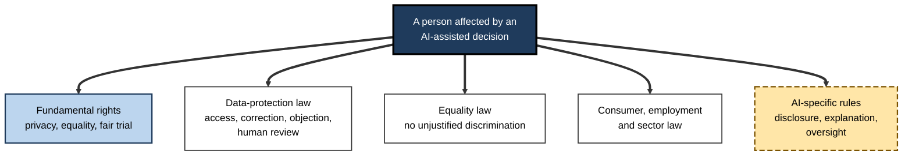
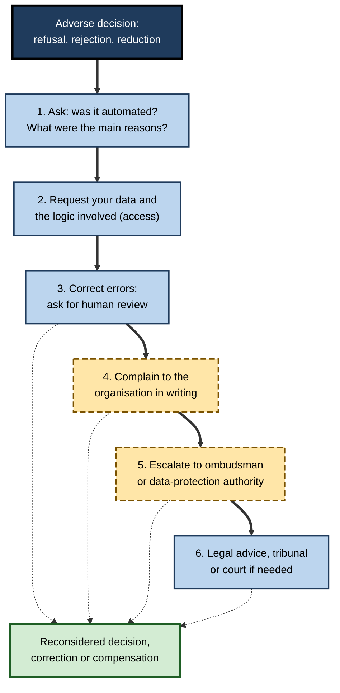
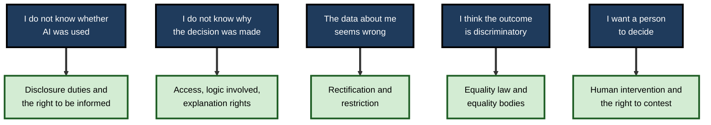
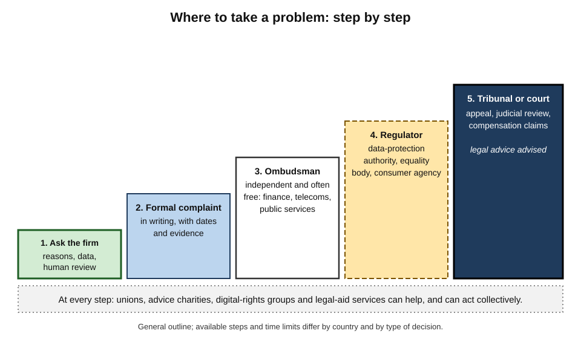
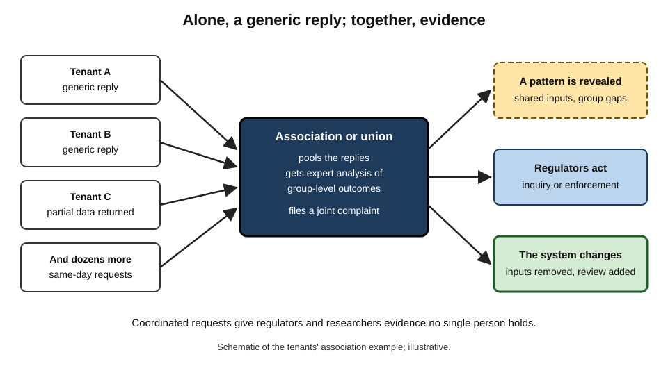

# G.12. Your rights as a citizen in an AI-driven society

A woman applies online for a credit card and is refused within seconds. No person looked at her application. The message says only that she "did not meet the criteria". She has a steady job, no debts and a clean record. What can she do? 

She cannot argue with a machine, but she is not powerless: the law gives her rights to know what was done, to see and correct the data used, to ask for a person to look again, and to complain to an independent authority. Most people never use these rights, mainly because they do not know they exist.

> **Definition — Data subject:** an identified or identifiable living person whose personal data is processed; the person to whom data-protection rights belong.

> **Definition — Redress:** a route through which a person who has been wronged can obtain correction, reconsideration, an explanation, an apology or compensation.

**Why it matters**

- **AI-assisted decisions are everywhere** — credit, jobs, insurance, benefits, school places, health triage, online content and prices.
- **Rights exist only if they are used.** An unclaimed right changes nothing.
- **Rights differ by country.** The details depend on where a person lives, where the organisation operates and what kind of decision it is.
- **Knowing the main rights is a form of literacy.** Citizens, employees and customers who understand them can notice problems early and press for remedies.
- **Collective action matters.** Many harms from AI affect groups; individual rights work best alongside unions, consumer bodies, charities and regulators.

> **Watch out:** this is general information, not legal advice. Laws change, and exceptions apply. For a serious matter — a lost job, a denied benefit, a wrongful accusation — seek advice from a lawyer, a trade union, a citizens' advice service or a legal-aid body.

---

## The Layers of Protection

No single "AI rights law" exists in most countries. Protection comes from several overlapping layers.

### Five layers

- **Fundamental rights** — human rights law and national constitutions.
  - *e.g.* privacy, equality before the law, fair trial, freedom of expression, human dignity.
- **Data-protection law** — rules on personal data that apply whenever AI uses it.
  - *e.g.* the GDPR in the European Union; the UK GDPR and Data Protection Act 2018; many national laws elsewhere.
- **Equality and discrimination law** — bans on unjustified discrimination by protected characteristics.
- **Consumer, employment and sector law** — rules on fair dealing, unfair terms, workplace rights, credit, insurance, health and education.
- **AI-specific rules** — such as the EU AI Act, and city or state rules on automated hiring tools.

**Figure 1.** Layers of protection that apply to a person affected by an AI-assisted decision.

> **Key point:** the most important rights for individuals today usually come from **data-protection law**, because almost every AI system processes personal data.

---

## Your Rights Over Your Data

### The core rights under GDPR-style law

These rights apply in the European Union, the United Kingdom and in many countries whose laws were modelled on the GDPR.

- **Right to be informed** — to be told who is processing your data, why, on what basis, for how long and with whom it is shared.
- **Right of access** — to obtain a copy of your personal data and information about how it is used.
  - Usually free; the organisation generally must reply **within one month**, extendable for complex requests.
- **Right to rectification** — to have inaccurate data corrected.
- **Right to erasure ("right to be forgotten")** — to have data deleted in certain circumstances, such as when it is no longer needed or consent is withdrawn.
- **Right to restriction** — to ask that processing be paused while a dispute is resolved.
- **Right to data portability** — to receive data you provided in a usable format and move it elsewhere.
- **Right to object** — to object to processing based on legitimate interests or public tasks, and **absolutely** to direct marketing.
- **Rights related to automated decisions and profiling** — see below.

> **Definition — Subject access request (SAR):** a request by a person to an organisation for a copy of their personal data and information about its use.

> **Mnemonic — "I Am Really Entitled, Right? Often Always":** Informed, Access, Rectification, Erasure, Restriction, Objection (and portability), Automated decisions.

### Rights in automated decisions

- **The principle:** you have the right not to be subject to a decision based solely on automated processing that produces legal or similarly significant effects — unless it is necessary for a contract, authorised by law, or based on your explicit consent — and, even then, safeguards must apply.
- **The safeguards:** the right to **human intervention**, to **express your view**, to **contest** the decision, and to receive **meaningful information about the logic involved**.
- **Special-category data** (health, ethnicity, biometrics and so on) is more tightly restricted.
- **Meaning of "solely automated":** a person who merely rubber-stamps the system's output does not make the decision human; the human involvement must be real.
- **Examples of "significant effects":** refusal of credit or a job, loss of a benefit, a decision on insurance terms or on admission to a course.

**Recent developments:**

- **European Union:** the Court of Justice has held that an automated credit score can itself count as an automated decision when a lender relies heavily on it (December 2023), and that people are entitled to an individual, intelligible explanation of how a decision was reached, with trade-secret objections weighed by a regulator or court (February 2025).
- **United Kingdom:** since February 2026 the older Article 22 has been replaced with new provisions that generally permit significant automated decisions but require safeguards: information about the decision, the opportunity to make representations, human intervention and the ability to contest. Decisions using special-category data remain more restricted.
- **Elsewhere:** other jurisdictions, including several US states, have introduced notice, opt-out or assessment rights for automated decision-making; the details change frequently.

**Figure 2.** What a person can do after an adverse automated decision.

---

## Your Rights to Know

### Knowing when AI is involved

- **Disclosure of interaction.** The EU AI Act requires that people be told when they are interacting with an AI system, such as a chatbot, unless this is obvious. The rules on this and on marking synthetic content apply from 2026.
- **Labelling of synthetic content.** Deepfakes and AI-generated media that could mislead should be disclosed and, where the law applies, identifiable.
- **Emotion-recognition and biometric categorisation.** People exposed to these systems, where permitted, must be informed.
- **Candidates and workers.** Employers using automated tools in hiring or management must in many places notify people; some cities and states require audits and notices.
- **High-risk systems.** The AI Act gives people affected by decisions based on certain high-risk systems the right to obtain **clear and meaningful explanations** of the system's role and of the main elements of the decision.

### Knowing why

- **Reasons for adverse decisions.** In US consumer credit, lenders must state the specific main reasons for refusing credit; credit-report laws give rights to see and dispute the information used.
- **Meaningful information about the logic involved** — the GDPR-style right described above.
- **Access to records.** Data held about you by public bodies is often accessible through freedom-of-information or subject-access rights.

### Knowing what the public sector is doing

- **Algorithm registers.** Some cities and governments publish lists of the automated systems they use.
- **Impact assessments.** Public bodies in several countries must assess and publish the impact of automated decision systems.
- **Public sector equality duties.** In the United Kingdom, public bodies must consider the impact of their decisions, including automated ones, on equality.

| | What you can ask for | Typical legal source | Typical time limit |
|---|---|---|---|
| Whether AI was used | Disclosure of AI interaction or automated decision | AI Act transparency rules; data-protection law | At the time, or on request |
| Your data | Copy of personal data and its uses | Subject access right | About one month |
| Why a decision was made | Main reasons; logic involved; role of the AI system | Data-protection law; AI Act for high-risk systems; credit law | About one month; reasons for credit refusal usually in writing |
| A human decision-maker | Human review of an automated decision | Data-protection law | Without undue delay |
| A fix | Correction of wrong data; reconsideration | Rectification and contest rights | About one month |
| Records of public systems | Information about public-sector algorithms | Freedom of information; registers | Varies |

**Figure 3.** Which right helps with which problem.

---

## Your Rights Against Unfairness

### Discrimination

- **Equality law** protects against direct and indirect discrimination in jobs, housing, credit, education and services; using an algorithm is no defence.
- **How to spot a possible problem:**
  - outcomes that differ sharply between groups;
  - decisions that seem to depend on proxies such as postcode or name;
  - a tool that fails for a disability, accent or language.
- **What to do:** keep records; request reasons and data; ask for a reasonable adjustment where a disability is involved; raise a complaint; contact an equality body or union.

### Consumer protection

- **Misleading claims about AI** — claims that a product "uses AI" or is "unbiased" must be truthful; regulators have acted against exaggerated claims.
- **Chatbots speaking for companies** — statements made by an organisation's automated assistant can bind the organisation in some jurisdictions, so keep a record of what you were told.
- **Unfair terms and dark patterns** — consent obtained by trickery may be invalid.

### Worker's rights

- **Notice** of monitoring and automated management; in some jurisdictions, consultation with representatives.
- **Contesting automated dismissal or deactivation** — platform workers in several countries have won rights to explanations and human review, notably through data-protection claims.
- **Trade unions** can negotiate limits on algorithmic management, disclosure and training.

### Rights against the state

- **Due process** — a person facing a state decision, particularly in welfare, immigration, tax or criminal justice, is entitled to know the case and to respond.
- **Proportionality** — surveillance and automated profiling by public bodies must be lawful, necessary and proportionate.
- **Judicial review and appeal** — public decisions can be challenged in court or tribunal.

### Case study: SyRI, the Dutch welfare-fraud system (2014–2020)

- **Situation:** the Netherlands passed a law in 2014 allowing the government to combine data from many public bodies — tax, benefits, employment, housing, education, debts and more — to produce risk reports identifying people considered likely to commit benefit or tax fraud. The system was called SyRI (System Risk Indication).
- **Deployment:** SyRI was used in projects in several neighbourhoods, mostly with lower-income and immigrant populations.
- **The challenge:** civil-society organisations, joined by prominent writers, took the state to court, supported by a United Nations special rapporteur on extreme poverty, who warned about a "digital welfare dystopia".
- **The ruling (The Hague District Court, 5 February 2020):**
  - The law **violated the right to respect for private life** under the European Convention on Human Rights.
  - The reasons: the measure was **not sufficiently transparent or verifiable** — citizens could not know what data was used or how risk was calculated, and the law did not provide enough safeguards against the risk of discrimination and stigmatisation, particularly because it was deployed in poorer neighbourhoods.
  - The court did not accept that the secrecy of the model — said to be needed to prevent fraudsters adapting — justified the lack of transparency.
- **Outcome:** the law was struck down and the Dutch government did not appeal.
- **Lesson:** citizens' rights are not only individual. Organisations can bring **collective challenges** against systems that individuals could not see and that were aimed at particular communities, and courts have shown they will test automated public systems against **transparency, proportionality and non-discrimination**.

---

## How to Exercise Your Rights

### Practical steps

1. **Notice and record.** Keep the decision, date, reference numbers and any messages. Take screenshots of online decisions.
2. **Ask who is responsible.** Find the organisation's data-protection contact or complaints route; many publish a privacy notice that names them.
3. **Ask for reasons and data.** State the decision, ask whether it was automated, and ask for the main reasons, the data used and the logic involved.
4. **Ask for human review.** Say clearly that you want a person to reconsider, and why.
5. **Correct errors.** If data is wrong, give the evidence and ask for correction and for the decision to be reviewed.
6. **Complain formally.** Follow the organisation's complaints process, in writing, with dates.
7. **Escalate.** Use the relevant ombudsman, regulator or data-protection authority; many accept complaints free of charge.
8. **Seek help.** Consumer advice charities, trade unions, legal-aid clinics and digital-rights organisations can assist and sometimes act collectively.

### Who can help

- **Data-protection authorities** — the Information Commissioner's Office in the United Kingdom; national authorities across the EU; the equivalent bodies in other countries.
- **Equality bodies** — handle discrimination complaints and give guidance.
- **Financial and sector ombudsmen** — resolve disputes with banks, insurers, telecoms and public bodies, often free.
- **Consumer protection agencies and trading standards.**
- **Trade unions and employee representatives.**
- **Courts and tribunals.**
- **Civil-society organisations** — they bring collective complaints and strategic cases.

### Worked example (illustrative): challenging a refused insurance application

Ananya applies online for travel insurance and is quoted a very high premium. The quote says the price is "based on our risk model".

1. **Notice.** She saves the quote, screenshots the questions she answered and notes the date.
2. **Ask.** She emails the insurer's data-protection contact:

   > "I applied for travel insurance on 12 March (reference 48213). The quote appears to be calculated by an automated model. Please confirm whether the price was determined solely by automated means; provide a copy of the personal data you used about me; explain the main factors that led to this price; and explain how I can request that a person review it."

3. **Receive.** Within a month the insurer replies. The data shows that a previous claim, made by someone else at her former address, was linked to her record.
4. **Correct.** She sends proof of residence dates and asks for the record to be corrected and for the quote to be recalculated.
5. **Result.** The corrected quote is 40 % lower.
6. **If it had failed.** She could have complained to the insurer, then to the financial ombudsman, and to the data-protection authority about the inaccurate data and failure to explain.

*Illustrative example and figures.*

> **Key point:** most rights are exercised by **asking in writing, clearly and with evidence**. The first letter often resolves the problem.

**Figure 4.** Where to take a problem, from the organisation to the courts.

---

## Rights Beyond the Individual

### Collective rights and representation

- **Representative actions** — in the EU, qualified consumer organisations can bring collective claims; in the US, class actions are available in many fields.
- **Complaints by non-profit organisations** — under the GDPR, a person can mandate a non-profit to lodge a complaint on their behalf; some countries allow organisations to complain without a mandate.
- **Collective bargaining** — unions can obtain disclosure, consultation and limits on algorithmic management.
- **Public participation** — consultations on new AI laws, registers of systems and citizen assemblies.

### Duties as well as rights

- **Respect others' data and rights** — do not misuse tools to generate deceptive or defamatory content, or to infringe others' privacy.
- **Use AI responsibly at work and at home** — check outputs, avoid pasting confidential material into public tools and follow organisational rules.
- **Build AI literacy** — the AI Act itself requires providers and deployers to ensure staff have a sufficient level of AI literacy (from February 2025).

### Limits and gaps

- **Not every AI use is regulated.** Many everyday uses, such as recommendation feeds and personalised pricing, face limited specific rules.
- **Enforcement is slow and uneven.** Regulators are under-resourced; cross-border cases are complex.
- **Information asymmetry.** People often do not know a system was used, and organisations hold the evidence.
- **Exemptions.** Security, defence and some law-enforcement uses carry wide exceptions.
- **Rights vary across the world.** A person's protection depends on where they live; many countries have no comprehensive data-protection law.

> **Watch out:** rights on paper are not rights in practice. Organisations that make exercising a right difficult — hidden forms, delays, refusals — may themselves be in breach, and delays can be reported to the regulator.

**Figure 5.** Individual requests and collective action working together.

### Case study (illustrative): a tenants' association challenges a scoring tool

- **Situation:** a housing company introduced an automated "tenant-risk" score used to decide who gets priority for repairs, rent-arrears support and lease renewals.
- **Trigger:** tenants noticed that people with disabilities and single parents seemed to receive worse outcomes, but individual requests for reasons produced generic replies.
- **Actions:**
  1. The association helped about forty tenants make subject access requests on the same day.
  2. The replies revealed that "number of missed phone calls" and "irregular payment days" were inputs — both correlated with disability and shift work.
  3. The association asked a university research group to analyse the anonymised results and found that disabled tenants were rated higher risk at similar payment records.
  4. It filed a complaint with the data-protection authority and an equality body, and the company's board was asked to respond publicly.
- **Result:** the company withdrew the two inputs, introduced a human review for lease decisions, agreed to publish a description of the scoring and offered to review past cases.
- **Lesson:** an individual request may get a generic reply, but **coordinated requests, expert analysis and regulators** can reveal patterns that no one tenant could see.

---

## Open Questions

- **Should there be a general right to a human decision?**
  - Some argue a human should be available for all important decisions; others warn of cost, delay and the weakness of human review.
- **Can rights keep pace with agents and generative AI?**
  - Systems that act on a person's behalf, or generate content about them, strain rights written for databases and documents.
- **How should rights be enforced across borders?**
  - Platforms and models operate globally while remedies are national.
- **Should people have rights over their likeness, voice and style?**
  - Law is moving but unevenly, and the boundaries between parody, tribute and exploitation are unsettled.
- **Who will help those who cannot assert rights themselves?**
  - Digital exclusion, disability, language and poverty make rights hardest to use for those most affected.

---

## Summary

- Citizens are protected by several **layers**: fundamental rights, data-protection law, equality law, consumer, employment and sector law, and AI-specific rules.
- Core data rights: **to be informed, access, rectification, erasure, restriction, portability, objection**, and **safeguards in solely automated significant decisions** — human intervention, representation, contest and meaningful information.
- Rights to know: **disclosure** of AI interaction, labelling of synthetic content, **reasons** for adverse decisions, and **explanations** for certain high-risk systems.
- Rights against unfairness: **discrimination law**, **consumer protection**, **worker's rights** and **due process** against the state.
- **SyRI** (2020) shows courts striking down an opaque public risk system on privacy, transparency and non-discrimination grounds.
- Exercise rights by **recording, asking in writing, requesting reasons, data and human review, correcting errors, complaining, escalating and seeking help**.
- **Collective** action — representative claims, non-profit complaints, unions, coordinated requests — reveals patterns that individuals cannot.
- Limits: unregulated everyday uses, slow enforcement, information gaps, exemptions and differences between countries.

---

## Self-Check

1. Name the five layers of protection that apply when AI affects a person.
2. List the main GDPR-style data rights.
3. What are the safeguards for solely automated decisions with significant effects?
4. Why does a human who merely approves a system's output not make a decision "human"?
5. What did the EU Court of Justice decide in 2025 about explanations of automated decisions?
6. What disclosures does the EU AI Act require about AI interaction and synthetic content?
7. In what ways can discrimination law apply to an algorithm?
8. What did the Hague court decide about SyRI, and why?
9. Outline a first email to an organisation after an automated refusal.
10. Which bodies can help if an organisation does not respond?
11. Why can collective action reveal problems that individual requests cannot?
12. What gaps remain in people's protection?
13. A bank refuses your loan and says "our system decided". What three things would you ask for?
14. A colleague says "I don't need to know about these rights because I have nothing to hide." Respond.

### Answer Key

1. Fundamental rights; data-protection law; equality and discrimination law; consumer, employment and sector law; AI-specific rules.
2. Informed, access, rectification, erasure, restriction, portability, objection, and rights relating to automated decisions and profiling.
3. Human intervention, the chance to express a view, the right to contest, and meaningful information about the logic involved.
4. The involvement must be real — with authority and information to change the outcome. A rubber-stamp leaves the decision effectively automated.
5. People are entitled to an individual, intelligible explanation of the procedure and principles applied and which of their data were used; trade-secret objections are weighed by a regulator or court rather than allowing refusal.
6. People must be told when interacting with an AI system, unless obvious, and certain synthetic content must be marked or disclosed; these rules apply from 2026.
7. Equality law applies to outcomes, so algorithmic direct or indirect discrimination in jobs, credit, housing, education or services is unlawful unless justified; the user remains responsible.
8. It struck down the SyRI law for violating the right to private life: the system lacked transparency and safeguards against discrimination and stigmatisation, and secrecy about the model was not justified.
9. State the decision, date and reference; ask whether it was solely automated; request the data used, the main reasons and logic; request human review and a response within the statutory period.
10. Ombudsmen, data-protection authorities, equality bodies, consumer agencies, unions, advice charities, courts and tribunals.
11. Many people's requests and data together show patterns, such as group differences or shared inputs, that no individual can see; organisations and regulators take pooled evidence more seriously.
12. Unregulated everyday uses, slow enforcement, information asymmetry, wide exemptions for security, differences across countries and difficulty for excluded groups.
13. Whether the decision was solely automated, the main reasons, the data used about you, the logic involved and how to obtain a human review; also the right to correct wrong data.
14. Rights protect against errors, misuse and discrimination, not only wrongdoing; automated systems often hold wrong or misleading data about innocent people; and rights also protect others and the wider community.

---

## Glossary

| Term | Meaning |
|---|---|
| Automated decision | A decision made by technological means without meaningful human involvement. |
| Data subject | The living person to whom personal data relates. |
| Digital welfare state | Public services in which automated systems determine eligibility, risk or payment. |
| Equality body | A public authority that promotes equality and handles discrimination complaints. |
| Human intervention | A real review by a person with authority to change a decision. |
| Ombudsman | An independent official who investigates complaints about organisations or public bodies. |
| Profiling | Automated processing of personal data to evaluate aspects of a person. |
| Redress | A route to correction, reconsideration, explanation or compensation. |
| Rectification | The right to have inaccurate data corrected. |
| Representative action | A claim brought by an organisation on behalf of a group of people. |
| Right to erasure | The right to have personal data deleted in certain circumstances. |
| Subject access request | A request for a copy of one's personal data and information about its use. |
