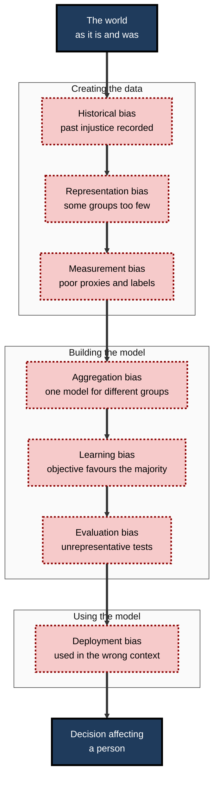
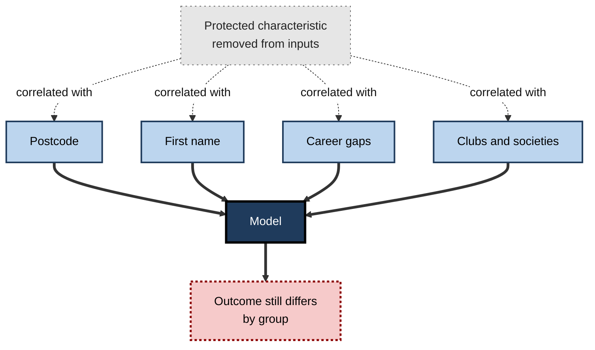
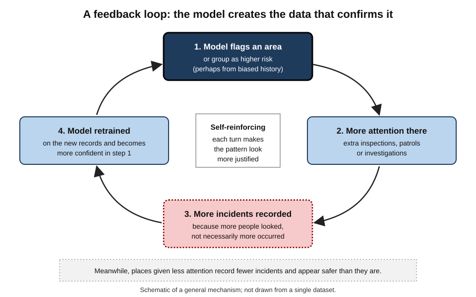
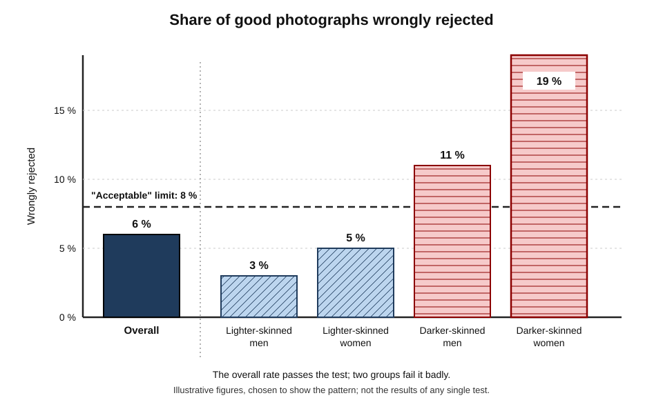
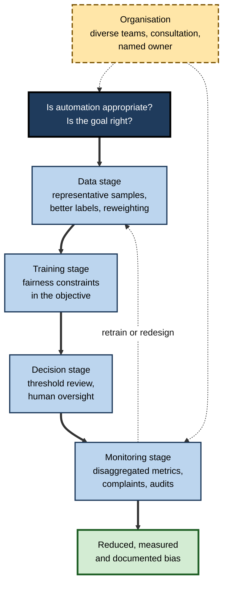

# G.2. Algorithmic bias: causes and real-world examples

In 2019 a young Black man in Britain uploaded a photograph to the government's online passport service and was told that his mouth appeared to be open. It was closed. The automated photo checker had been tested; its overall performance had been judged acceptable; and the people for whom it worked worst had been, in effect, averaged away. Nobody had set out to build a biased system — which is exactly how most biased systems are built.

> **Definition — Algorithmic bias:** systematic and repeatable differences in an automated system's outputs or errors that unfairly advantage or disadvantage people because of their membership of a group, or because of some other characteristic that should not matter to the decision.

**Why it matters**

- **It is common.** Bias has been documented in face analysis, speech recognition, translation, search, advertising, hiring, credit, healthcare and policing systems.
- **It is usually unintended.** It emerges from data, design and context, not from a programmer's prejudice.
- **It is hard to see from the inside.** Average performance can look excellent while one group experiences failure after failure.
- **It compounds.** Biased decisions generate biased data, which trains the next system.
- **It can be found and reduced** — but only by those who look for it deliberately.

---

## What "Bias" Means

The word "bias" has several meanings, and confusing them causes endless argument.

### Three senses of the word

- **Statistical bias** — a systematic difference between an estimate and the true value.
  - *e.g.* a thermometer that always reads two degrees high.
  - Morally neutral: it is simply error with a direction.
- **Cognitive bias** — a systematic pattern in human judgement.
  - *e.g.* confirmation bias; anchoring; in-group favouritism.
  - People who build and use AI carry these into their choices.
- **Societal bias** — patterns of advantage and disadvantage in a society.
  - *e.g.* unequal pay, unequal policing, unequal access to credit.
  - Recorded in the data that AI learns from.

> **Key point:** algorithmic bias is where the three meet — **societal** patterns, captured in data and filtered through **human** design choices, produce **systematic** differences in a system's behaviour.

### Bias, error and unfairness

- **Every model makes errors.** Bias concerns *how errors are distributed*, not merely how many there are.
- **Not every difference is unfair.** A medical model that predicts higher breast-cancer risk for women than men is reflecting biology, not prejudice.
- **Unfairness requires a judgement** that a difference is unjustified given the purpose of the decision.
  - That judgement draws on law, ethics and the context of use.

> **Definition — Protected characteristic:** a personal attribute on which discrimination is prohibited by law — in the United Kingdom's Equality Act 2010, for example, age, disability, gender reassignment, marriage and civil partnership, pregnancy and maternity, race, religion or belief, sex and sexual orientation.

> **Watch out:** "the model is biased" and "the model is inaccurate" are different claims. A model can be highly accurate overall and still biased, and a model can be equally inaccurate for everyone and therefore not biased in the group sense — merely poor.

---

## Where Bias Comes From

Bias is not a single defect located in one place. It can enter at any step from the world to the decision.

### A map of the sources

**Study card — Harini Suresh and John Guttag, "A Framework for Understanding Sources of Harm throughout the Machine Learning Life Cycle" (Massachusetts Institute of Technology; first circulated 2019, published 2021)**

- **Problem:** "biased data" had become a catch-all explanation that hid where problems actually arose and what could be done.
- **Contribution:** a framework of **seven distinct sources** of harm, placed along the path from data generation to deployment:
  - **historical**, **representation**, **measurement** — arising in how data is created;
  - **aggregation**, **learning**, **evaluation** — arising in how models are built and tested;
  - **deployment** — arising in how a system is used.
- **Conclusion:** each source needs a different remedy; collecting "more data" fixes some and does nothing for others.

> **Mnemonic — "Hungry Rabbits Munch Apples, Leaving Every Daisy":** Historical, Representation, Measurement, Aggregation, Learning, Evaluation, Deployment.

**Figure 1.** Seven sources of bias from the world to the decision.

### Historical bias

The data faithfully records a world that was itself unfair.

- **Mechanism:** even perfectly measured, perfectly sampled data reproduces past patterns of discrimination or exclusion.
- *e.g.* if a profession was historically dominated by men, records of "successful employees" will mostly describe men.
- **Why it persists:** a model trained to predict the past will, if accurate, predict a future that looks like the past.

**Study card — Bolukbasi and colleagues (Boston University and Microsoft Research, 2016), "Man is to Computer Programmer as Woman is to Homemaker?"**

- **Background:** *word embeddings* represent words as points in a mathematical space learned from large text collections, so that related words lie close together; they were widely used in search and language software.
- **Design:** the researchers probed embeddings trained on Google News articles with analogy questions of the form "man is to X as woman is to Y".
- **Results:**
  - The embeddings produced stereotyped analogies — the title's "computer programmer" to "homemaker" among them.
  - Occupations lined up along a gender direction: some strongly "male", others strongly "female".
- **Conclusion:** systems trained on ordinary, professionally edited text absorb the social stereotypes in that text.
- **Follow-up:** the authors proposed a "debiasing" method; later work showed much of the stereotyped structure remained recoverable after it was applied.

**Study card — Caliskan, Bryson and Narayanan (Princeton University and University of Bath; *Science*, 2017)**

- **Design:** adapted the **Implicit Association Test** — a psychological test of how quickly people pair concepts — to measure associations inside word embeddings trained on a large web crawl.
- **Results:**
  - Embeddings reproduced well-known human associations: flowers with pleasant words, insects with unpleasant ones.
  - They also reproduced social ones: European-American names more associated with pleasant words than African-American names; female names more associated with family than career.
  - Occupation–gender associations in the embeddings correlated strongly with the actual gender composition of those occupations in United States labour statistics.
- **Conclusion:** language itself carries historical bias, so models that learn from language will carry it too unless corrected.

> **Key point:** historical bias is not a data-quality failure. The data is accurate — it is the **world it describes** that was unfair.

### Representation bias

Some people are too few in the data for the model to learn about them.

- **Mechanism:** the sample under-represents part of the population the system will serve.
- *e.g.* image collections drawn mostly from North America and Europe; medical datasets drawn mainly from people of European ancestry; speech data drawn mostly from standard accents.

**Study card — DeVries and colleagues (Facebook AI Research, 2019), "Does Object Recognition Work for Everyone?"**

- **Design:** tested several commercial object-recognition services on photographs of everyday household items — soap, toothbrushes, cooking stoves — taken in homes across many countries and income levels, from a collection known as Dollar Street.
- **Results:**
  - Accuracy was noticeably **lower for photographs from lower-income households**.
  - Accuracy was also lower for many countries in Africa and Asia than for the United States and Europe.
  - *e.g.* soap in a low-income home might be a bar on a basin edge; the systems often failed to recognise it.
- **Conclusion:** training images over-represented wealthier Western homes, so "everyday objects" meant *their* everyday objects.

> **Definition — Representation bias:** bias that arises when the data used to build a system under-samples part of the population the system will be used on.

### Measurement bias

The things that can be measured are not quite the things that matter.

- **Mechanism:** features or labels are **proxies** that are measured differently, or mean different things, for different groups.
- *e.g.* using **arrests** as a label for **offending** — arrests depend on where police patrol, not only on who offends.
- *e.g.* using **past healthcare spending** as a proxy for **health need** — a widely used United States risk tool was shown in 2019 to understate the needs of Black patients, who had historically received less care for the same level of illness.
- *e.g.* using **customer complaints** as a proxy for **service failures** — some customers complain far less than others.

> **Definition — Label bias:** measurement bias in the target the model learns to predict, so that the model faithfully learns the wrong thing.

> **Watch out:** a proxy chosen because it is *convenient* is one of the most common and damaging sources of bias. Always ask: **what is this number really measuring, and for whom might it mean something different?**

### Aggregation bias

One model is applied to groups for whom the same patterns do not hold.

- **Mechanism:** a single model assumes one relationship between inputs and outcomes for everyone.
- *e.g.* in diabetes care, a common blood marker (HbA1c) is known to differ across ethnic groups for the same underlying blood-sugar level; one threshold for all can misclassify some groups.
- *e.g.* slang, emoji and dialect carry different meanings in different communities; a single toxicity classifier may misread one community's ordinary speech as offensive.

### Learning bias

The way the model is trained favours some people.

- **Mechanism:** training objectives that minimise **average** error reward getting the majority right.
- *e.g.* compressing a model to run on a phone can preserve accuracy for common cases while sharply reducing it for rarer groups.
- *e.g.* a model that maximises overall accuracy may simply learn to ignore a group that makes up 2 % of the data.

### Evaluation bias

The tests used to judge the model do not reflect the people it will serve.

- **Mechanism:** benchmark datasets are unrepresentative, or results are reported only as averages.
- *e.g.* a face-analysis system declared "99 % accurate" on a benchmark composed mostly of lighter-skinned men.
- **Consequence:** models are selected and approved because they excel on the wrong test.

### Deployment bias

A system is used in a way, or a place, its designers did not intend.

- **Mechanism:** the context of use differs from the context of design.
- *e.g.* a risk score built to help allocate support services is later used to decide punishment.
- *e.g.* a model trained in urban hospitals is installed in rural clinics with different patients and equipment.
- *e.g.* human users over-trust the system for some groups and override it for others, adding their own bias on top.

| Source | What goes wrong | Example | Typical remedy |
|---|---|---|---|
| Historical | Accurate data records an unfair world | Hiring records dominated by one group | Question the target; adjust outcomes; change the process, not only the model |
| Representation | Some groups too few in the data | Object recognition weak in lower-income homes | Collect targeted data; reweight samples |
| Measurement | Proxies mean different things for different groups | Arrests used for offending | Choose better labels; validate proxies by group |
| Aggregation | One model for groups with different patterns | One clinical threshold for all ethnicities | Group-aware modelling, with care and legal advice |
| Learning | Training rewards average accuracy | Compression degrades rare groups | Fairness-aware objectives; check after every change |
| Evaluation | Tests do not match the population served | Benchmarks of mostly lighter-skinned men | Representative test sets; disaggregated reporting |
| Deployment | Used in the wrong context or with biased human use | Support score reused for punishment | Restrict use; train users; monitor in context |

---

## Why Removing Sensitive Data Does Not Remove Bias

The most common first instinct — "just delete race, sex and age from the data" — rarely works.

### Redundant encoding

- **Mechanism:** other features are correlated with the protected characteristic and let the model reconstruct it.
  - **Postcode** is correlated with ethnicity and income in many cities.
  - **First name** and **language** correlate with ethnicity and sex.
  - **Career gaps** correlate with sex and with disability.
  - **Hobbies and clubs** — women's sports teams, women's colleges — reveal sex directly.
- **Consequence:** the model can discriminate *by proxy* without ever seeing the protected attribute.

> **Definition — Redundant encoding:** the presence of a protected characteristic's information in other, apparently neutral features, so that the characteristic can be inferred.

> **Definition — Fairness through unawareness:** the approach of excluding protected attributes from a model's inputs in the hope of preventing discrimination; usually ineffective because of redundant encoding.

**Figure 2.** How a model can discriminate without ever seeing a protected characteristic.

> **Watch out:** removing protected data can make bias **harder to detect**. Without recording the characteristic somewhere — under strict controls — an organisation cannot measure whether its outcomes differ by group.

> **In practice:** many organisations keep protected characteristics **out of the model** but **in a separate, access-controlled monitoring dataset**, so that outcomes can be audited by group.

---

## How Bias Feeds Itself

### Feedback loops

- **Mechanism:**
  1. a model directs attention or resources somewhere;
  2. more activity is recorded there *because attention was directed there*;
  3. the new records are used to retrain the model;
  4. the model becomes more confident that the original place deserved attention.
- *e.g.* a fraud model flags claims from one region; investigators examine those claims more closely and find more irregularities; the next model learns that the region is riskier still.
- *e.g.* a recommender shows one kind of creator more often; those creators gain more views; the next model ranks them higher again.

> **Definition — Feedback loop (in AI):** a cycle in which a system's outputs shape the data later used to train or evaluate it, so that initial patterns — including biased ones — are amplified.

**Figure 3.** A self-reinforcing loop between a model, attention and the data it learns from.

> **Key point:** in a feedback loop, the data can seem to **confirm** the model's bias — because the model created the data.

### Human–machine interaction

- **Selective trust** — people may accept a model's suggestion more readily for some groups than others.
- **Automation bias** — busy staff may stop checking outputs at all.
- **Override bias** — staff may override the model mainly in favour of people like themselves.
- **Consequence:** the combined human-plus-model system can be more or less biased than either alone; it must be evaluated **as a combination**.

---

## Real-World Examples

### Case study: the passport photo checker

- **Situation:** the United Kingdom's online passport application service introduced an automated check of uploaded photographs in 2016, rejecting images judged to be poor quality — eyes closed, mouth open, face unclear.
- **First reports (2019):**
  - A Black applicant was told his mouth looked open when it was closed; others reported similar errors.
  - Documents later released under freedom-of-information rules showed that the government's own user research had found the checker struggled with very light and very dark skin, and that the service had been launched because its **overall** performance was judged sufficient.
- **Systematic test (2020):** the BBC submitted more than a thousand photographs of politicians from around the world.
  - Photos of **darker-skinned women** were judged poor quality markedly more often than those of lighter-skinned women — roughly **one in five** compared with **one in seven**.
  - Darker-skinned men also fared worse than lighter-skinned men.
- **Diagnosis:**
  - **Representation and evaluation bias** — the underlying face-detection technology performed worse on darker skin.
  - **Deployment decision** — known disparity was accepted because the average was acceptable.
  - **Mitigating factor** — users could override the warning, but were told their application might then be delayed or rejected.
- **Result:** the government stated that the checker was being improved and that applicants could override it; the case became a widely cited example of known bias being deployed.
- **Lesson:** the bias was **known, measured and accepted** — a failure not of technology alone but of a decision rule that looked only at the average.

**Figure 4.** How an acceptable average can conceal unequal error rates (illustrative figures).

### Three shorter examples

> **Example — image labelling (2015):** a photo-organising app labelled photographs of two Black friends as "gorillas". The company apologised; reporting in 2018 found its main fix had been to block the label "gorilla" (and some other primate terms) entirely — a sign of how hard the underlying problem was to correct.

> **Example — search advertising (2013):** computer scientist Latanya Sweeney at Harvard found that searches for names more typically given to Black Americans were more likely to show advertisements suggesting an arrest record than searches for names typically given to white Americans, regardless of whether any record existed.

> **Example — clinical scores:** several long-standing clinical calculators, including a widely used estimate of kidney function, once included an adjustment by race. Professional bodies in the United States moved away from the race adjustment around 2021, after evidence that it could delay diagnosis and specialist referral for Black patients.

### What the examples share

- **No malicious intent** in any of them.
- **Good average performance** in most of them.
- **Discovery by outsiders** — journalists, academics, affected users — rather than by the builders.
- **Partial fixes** — blocking a label, adding a warning — more often than root-cause repair.

> **Key point:** bias is usually **found by those who suffer it**. Organisations that wait for complaints learn about bias last.

---

## Detecting Bias

### Disaggregated evaluation

- **Principle:** report performance **separately for each relevant group**, not just overall.
- **What to compare:**
  - **error rates** — false positives and false negatives;
  - **outcome rates** — the share of each group approved, flagged or selected;
  - **calibration** — whether a score of 70 means the same risk in each group.
- **Intersectional groups:** check combinations — *e.g.* older women, young disabled men — because harm often concentrates where characteristics overlap.

> **Definition — Disaggregated evaluation:** measuring a system's performance separately for different groups and conditions rather than only on average.

> **Definition — Intersectionality:** the idea, introduced by legal scholar Kimberlé Crenshaw in 1989, that overlapping characteristics such as race and sex can produce distinct forms of disadvantage not visible when each is considered alone.

### Worked example (illustrative): a claims-fraud model

An insurer's model flags motor-insurance claims for investigation. Overall accuracy is 95 %. Investigation delays payment by several weeks.

| Group | Genuine claims | Genuine claims wrongly flagged | False positive rate |
|---|---|---|---|
| Customers in Region A | 9,000 | 270 | 270 ÷ 9,000 = **3 %** |
| Customers in Region B | 1,000 | 120 | 120 ÷ 1,000 = **12 %** |
| All customers | 10,000 | 390 | 390 ÷ 10,000 = **3.9 %** |

*Illustrative figures.*

1. **Read the average.** 3.9 % of honest customers are wrongly flagged — it looks acceptable.
2. **Disaggregate.** An honest customer in Region B is **four times** as likely to have payment delayed.
3. **Ask why.**
   - Region B has more older vehicles and more cash repairs — features the model associates with fraud.
   - Region B's past claims were investigated more intensively, so more "fraud" was recorded there — a possible **feedback loop**.
4. **Ask whether it is justified.** Are the features genuinely predictive of fraud, or of being poorer? Region B also has a larger minority-ethnic population — a possible indirect discrimination issue.
5. **Act.** Re-examine features and labels; set a target for comparable false positive rates; monitor quarterly; give flagged customers a faster review route.

> **Formula — False positive rate:** wrongly flagged negatives ÷ all actual negatives. Region B: 120 ÷ 1,000 = **12 %**.

> **Watch out:** with small groups, rates can swing by chance. Report the **number of cases** behind every rate and use statistical confidence intervals before drawing conclusions.

### Audits

- **Internal audits** — the organisation tests its own systems, ideally by a team independent of the builders.
- **External audits** — regulators, researchers or contracted auditors test the system.
  - New York City's Local Law 144, in force from 2023, requires employers using automated tools in hiring decisions to commission an independent bias audit and publish a summary.
- **Black-box audits** — testers who cannot see inside the system submit carefully varied inputs and compare outputs.
  - *e.g.* identical CVs differing only in the name.

---

## Reducing Bias

Bias can be reduced at each stage, but no technique is a cure on its own.

### Technical approaches

- **Before training (pre-processing)**
  - collect more representative data;
  - reweight or resample under-represented groups;
  - fix or replace biased labels.
- **During training (in-processing)**
  - add fairness constraints or penalties to the training objective.
- **After training (post-processing)**
  - adjust decision thresholds by group to equalise chosen error rates — legally sensitive in many jurisdictions.

### Organisational approaches

- **Diverse teams** — people with different experiences notice different failure modes.
- **Stakeholder consultation** — affected communities identify harms that builders miss.
- **Clear ownership** — a named person responsible for fairness outcomes.
- **The option not to automate** — sometimes the right remedy is to keep a decision human.

**Figure 5.** Points at which bias can be reduced.

| | Pre-processing | In-processing | Post-processing | Organisational |
|---|---|---|---|---|
| Acts on | The data | The learning objective | The outputs and thresholds | People and processes |
| Strength | Addresses root causes in data | Builds fairness into the model | Simple; works with any model | Catches problems no metric shows |
| Weakness | Cannot fix historical bias alone | Needs technical skill; may cost accuracy | Can be legally contentious; treats symptoms | Slow; depends on culture |
| Example | Adding images from lower-income homes | Penalising unequal error rates | Reviewing cut-offs for each region | Consulting affected customers |

> **Remember:** **measure, then mitigate, then measure again.** Every change to data, model or threshold can shift bias somewhere else.

> **Watch out:** a model can be made to look fair on one measure while becoming less fair on another. Choosing *which* fairness to aim for is an ethical decision, not a technical default.

### Bias in generative systems

- Text and image generators trained on internet-scale data reproduce stereotypes in **what they produce**, not only in decisions they make.
- *e.g.* default images of professions, assumptions about names, and uneven quality across languages.
- Attempts to correct defaults can overcorrect, producing inaccurate depictions — showing that representation choices are value judgements, not neutral fixes.

---

## Open Questions

- **When is a group difference a bias, and when is it a fact?**
  - Some differences reflect real variation; others reflect unjust history. Telling them apart needs domain knowledge and ethical judgement.
- **How can bias be measured without collecting sensitive data?**
  - Organisations face a genuine tension between privacy and the ability to audit.
- **Can historical bias be corrected without "rewriting history"?**
  - Adjusting a model's outcomes is contested; leaving them unadjusted perpetuates the past.
- **How should bias be tested in general-purpose models?**
  - A system used for thousands of tasks cannot be evaluated for each; which tests are sufficient is unresolved.
- **Who should audit, and with what access?**
  - Independent auditors often lack access to data and models; companies cite confidentiality and security.

---

## Summary

- **Algorithmic bias** = systematic, repeatable differences in outputs or errors that unfairly advantage or disadvantage people by group or by irrelevant characteristics.
- "Bias" has **statistical, cognitive and societal** senses; algorithmic bias is where they meet. Bias concerns the **distribution** of errors; unfairness requires a judgement about justification.
- Seven sources (Suresh and Guttag): **historical, representation, measurement, aggregation, learning, evaluation, deployment** — "Hungry Rabbits Munch Apples, Leaving Every Daisy". Each needs its own remedy.
- Word-embedding studies (2016, 2017) showed that ordinary text carries **historical stereotypes**; household-object studies (2019) showed **representation bias** by income and region.
- **Removing protected attributes** rarely works because of **redundant encoding**, and makes bias harder to detect.
- **Feedback loops** let a model generate the data that appears to confirm its bias; human–machine interaction can add further bias.
- Real cases — the passport photo checker, image labelling, advertising, clinical scores — share good averages, no intent and discovery by outsiders.
- Detect bias with **disaggregated and intersectional evaluation** and **audits**; reduce it through **pre-, in- and post-processing** plus organisational measures; measure again after every change.

---

## Self-Check

1. Define algorithmic bias and explain how it differs from ordinary inaccuracy.
2. Distinguish statistical, cognitive and societal bias, with one example of each.
3. Why is not every group difference in a model's output unfair?
4. List the seven sources of bias and give an example of three of them.
5. What did the word-embedding studies of 2016 and 2017 show, and why does it matter for language-based AI?
6. Explain representation bias using the household-object study.
7. Why is using arrests as a label for offending an example of measurement bias?
8. Why does deleting protected attributes rarely remove bias? What is lost by deleting them?
9. Describe a feedback loop and explain why it makes bias look justified.
10. In the passport photo case, which sources of bias were involved, and what decision made it an ethical failure?
11. A model's false positive rate is 2 % for one group (5,000 people) and 8 % for another (200 people). What would you conclude, and what more would you want to know?
12. Compare pre-processing, in-processing and post-processing approaches to reducing bias.
13. Why is it important to evaluate the combined human-plus-model system?
14. A team says its hiring model is unbiased because it was trained without names, ages or gender. Write a short response.

### Answer Key

1. Systematic, repeatable differences in outputs or errors that unfairly advantage or disadvantage people by group or by irrelevant characteristics. Inaccuracy concerns how many errors occur; bias concerns how they are distributed — a model can be accurate and biased, or inaccurate and unbiased.
2. Statistical: an estimate systematically off the true value, such as a scale reading high. Cognitive: patterned human error, such as confirmation bias. Societal: patterned advantage, such as unequal pay — recorded in data.
3. Some differences reflect genuine, relevant variation, such as biological differences in disease risk. Unfairness requires a judgement that the difference is unjustified given the decision's purpose.
4. Historical, representation, measurement, aggregation, learning, evaluation, deployment. Examples: historical — hiring records dominated by one group; measurement — arrests for offending; deployment — a support score reused for punishment.
5. Embeddings trained on ordinary text reproduced gender and racial stereotypes and correlated with real occupational statistics. Language models learn from such text, so they inherit its biases unless measured and corrected.
6. Commercial recognisers were less accurate on photographs of household objects from lower-income homes and some regions, because training images over-represented wealthier Western homes.
7. Arrests depend on where police patrol and whom they stop, not only on who offends, so the label records policing patterns that differ by group.
8. Other features — postcode, names, career gaps, clubs — encode the same information, so the model can still discriminate by proxy. Deleting the attribute also removes the ability to measure outcomes by group.
9. The model directs attention, attention produces more records, records retrain the model. Because the model generated the evidence, the data appears to confirm the original pattern.
10. Representation and evaluation bias in face detection, plus deployment bias. The ethical failure was the decision to launch despite a known disparity because the average was acceptable.
11. The second group is four times as likely to suffer false positives, but with only 200 people the 8 % rate (16 cases) is uncertain. One would want confidence intervals, the reasons for the difference, the consequences of a false positive, and whether the features act as proxies.
12. Pre-processing changes the data (sampling, labels); in-processing builds fairness into the objective; post-processing adjusts outputs or thresholds. Pre-processing tackles root causes but not all history; in-processing needs skill and may cost accuracy; post-processing is simple but can be legally contentious.
13. People may trust or override a model unevenly across groups, adding their own bias. The decisions that affect people come from the combination, so only evaluating the combination reveals real outcomes.
14. Excluding attributes does not prevent discrimination, because other features can stand in for them; it also prevents checking outcomes. The team should audit outcomes by group using a controlled monitoring dataset, test for proxy effects, and compare selection rates and error rates.

---

## Glossary

| Term | Meaning |
|---|---|
| Aggregation bias | Bias from applying one model to groups with different underlying patterns. |
| Algorithmic bias | Systematic differences in outputs or errors that unfairly affect people by group or irrelevant characteristics. |
| Audit (algorithmic) | A structured examination of a system's behaviour, often for bias. |
| Deployment bias | Bias from using a system in a context or way different from its design. |
| Disaggregated evaluation | Measuring performance separately for groups and conditions. |
| Evaluation bias | Bias from testing on data unrepresentative of the population served. |
| Fairness through unawareness | Excluding protected attributes from inputs; usually ineffective. |
| False positive rate | Share of actual negatives wrongly classed as positive. |
| Feedback loop | A cycle in which outputs shape future training data, amplifying patterns. |
| Historical bias | Bias present in accurate data because the world it records was unfair. |
| Intersectionality | Distinct disadvantage arising from overlapping characteristics. |
| Label bias | Measurement bias in the target a model learns to predict. |
| Learning bias | Bias introduced by training choices such as optimising average accuracy. |
| Measurement bias | Bias from features or labels measured differently across groups. |
| Protected characteristic | An attribute on which discrimination is legally prohibited. |
| Proxy | A measurable stand-in for a hard-to-measure quantity. |
| Redundant encoding | Protected information carried by other, apparently neutral features. |
| Representation bias | Bias from under-sampling part of the population served. |
| Word embedding | A numerical representation of words learned from text, placing related words close together. |
