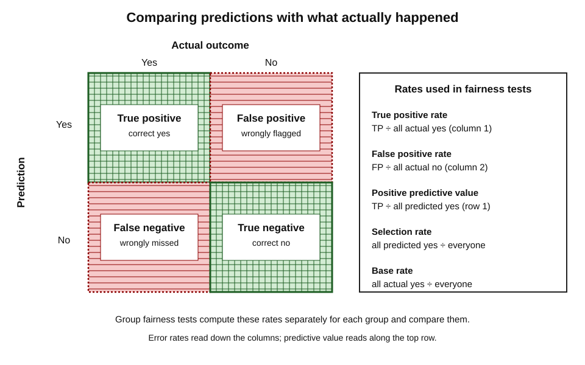
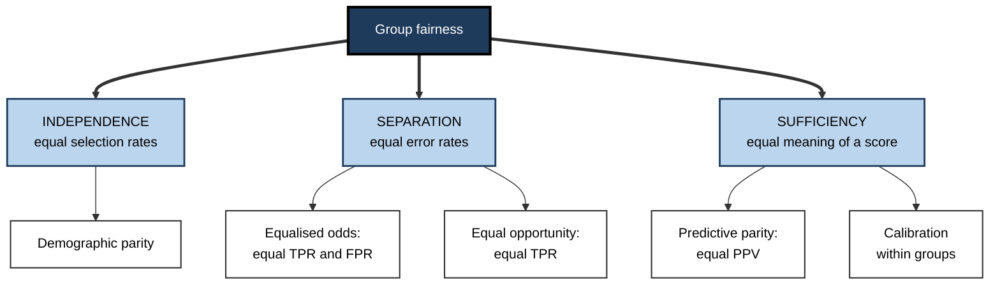
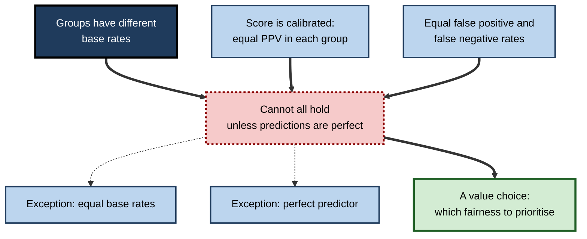
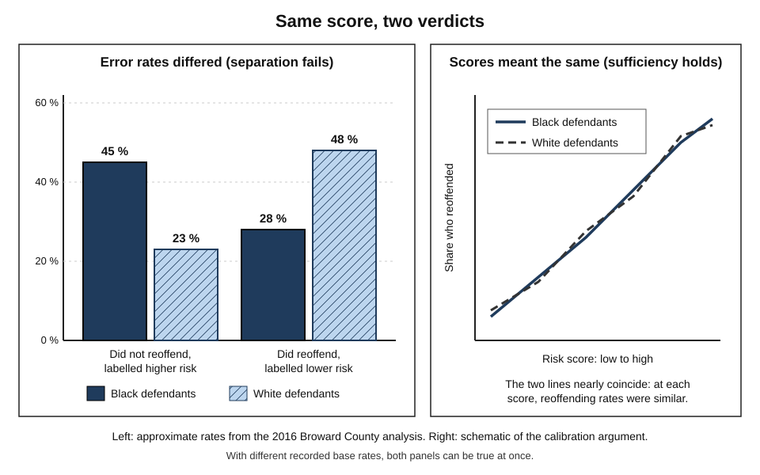
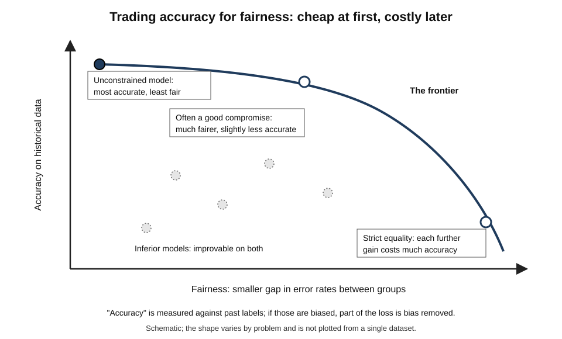
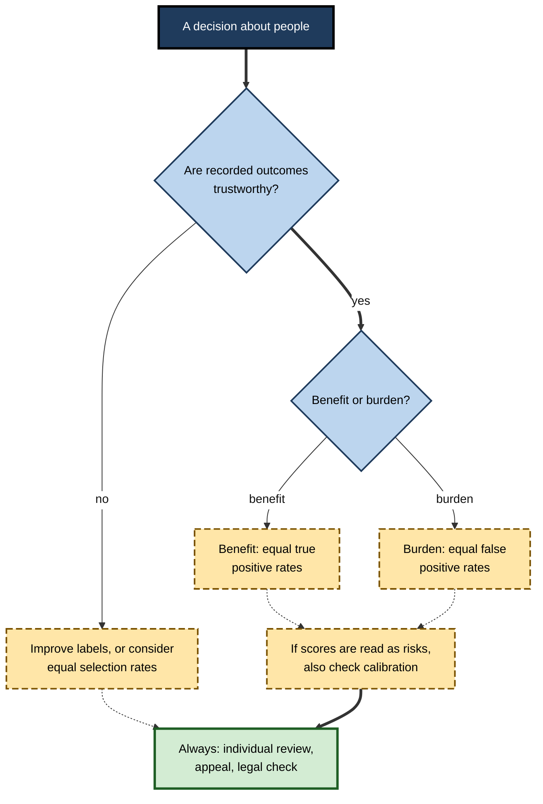

# G.3. Fairness definitions and trade-offs

In 2016 journalists analysed a risk score used by American courts and concluded that it was unfair to Black defendants. The company that made it replied that the score was fair — and produced its own analysis to prove it. Both analyses were arithmetically correct. They disagreed because they measured **different kinds of fairness**, and mathematicians soon showed that, in most real situations, those kinds of fairness **cannot all hold at once**.

> **Definition — Fairness criterion (in AI):** a precise, usually statistical, statement of what it would mean for a system's decisions to be fair — for example, that two groups are selected at equal rates, or that they experience equal error rates.

**Why it matters**

- **"Make it fair" is not an instruction a system can follow.** Fairness must be defined before it can be measured or built.
- **Definitions conflict.** Choosing one often means giving up another — a choice of values, not of code.
- **The choice has winners and losers.** Different definitions protect different people from different harms.
- **Law, ethics and statistics use the word differently.** Professionals need to translate between them.
- **Most public disputes about "biased AI" are, underneath, disputes about which definition should apply.**

---

## Intuitions Before Mathematics

Ordinary moral language already contains several distinct ideas of fairness.

### Four everyday ideas

- **Equal treatment** — apply the same rule to everyone.
  - *e.g.* the same pass mark for every candidate.
- **Equal outcomes** — groups should end up with similar shares of a benefit or burden.
  - *e.g.* shortlists that reflect the applicant pool.
- **Equal accuracy** — the system should be equally good at judging everyone.
  - *e.g.* a test that is as likely to miss a strong candidate from one group as from another.
- **Desert** — people should get what their own qualities and actions merit.
  - *e.g.* the most qualified candidate should get the job.

> **Key point:** each of these sounds obviously right on its own. The difficulty is that **they can pull in opposite directions** when groups differ in their circumstances.

### Distributive and procedural fairness

- **Distributive fairness** — is the **result** fair? Who gets what?
- **Procedural fairness** — is the **process** fair?
  - Psychologist Gerald Leventhal (1980) proposed criteria for fair procedures, including consistency, freedom from bias, accuracy, correctability, representation of affected people and ethical standards.
  - Research by Tom Tyler and others found that people accept unfavourable outcomes more readily when they believe the process treated them with respect and gave them a voice.
- **Consequence for AI:** a system can be distributively fair on a chosen metric and still feel unfair if people cannot understand it, question it or correct its errors.

> **Definition — Procedural fairness:** fairness of the process by which a decision is reached — consistency, accuracy, impartiality, voice and the chance to correct errors.

---

## The Building Blocks

Most statistical fairness definitions are built from a few quantities that any professional can learn.

### Predictions and outcomes

Consider a system that predicts a yes-or-no outcome — *will this applicant repay?*, *will this patient deteriorate?* — and then compare its prediction with what actually happened.

- **True positive (TP)** — predicted yes, actually yes.
- **False positive (FP)** — predicted yes, actually no.
- **True negative (TN)** — predicted no, actually no.
- **False negative (FN)** — predicted no, actually yes.

> **Definition — Confusion matrix:** a table counting a classifier's true positives, false positives, true negatives and false negatives.

**Figure 1.** The confusion matrix and the rates derived from it.

### Rates that matter

- **Base rate** — the share of a group for whom the outcome is actually *yes*.
- **Selection rate** — the share of a group the system predicts as *yes*.
- **True positive rate (TPR, also sensitivity or recall)** — of those who are actually *yes*, the share correctly identified.
- **False positive rate (FPR)** — of those who are actually *no*, the share wrongly predicted *yes*.
- **Positive predictive value (PPV, also precision)** — of those predicted *yes*, the share who really are.

> **Formula — The core rates:** TPR = TP ÷ (TP + FN); FPR = FP ÷ (FP + TN); PPV = TP ÷ (TP + FP); selection rate = (TP + FP) ÷ everyone. Example: 400 TP, 100 FP, 100 FN, 400 TN gives TPR = 400 ÷ 500 = **0.80**, FPR = 100 ÷ 500 = **0.20**, PPV = 400 ÷ 500 = **0.80**, selection rate = 500 ÷ 1,000 = **50 %**.

> **Definition — Calibration:** a score is calibrated when, among people given the same score, the share who actually experience the outcome matches the score — and, for fairness, matches it in **every** group.

> **Watch out:** which outcome counts as "positive" depends on the system. In a lending model "positive" may mean *will repay* (a benefit); in a risk score it may mean *will reoffend* (a burden). Always check which error hurts whom.

---

## Three Families of Group Fairness

Researchers Solon Barocas, Moritz Hardt and Arvind Narayanan grouped the many proposed group-fairness criteria into three families, according to what each requires to be independent of group membership.

### Independence: equal selection rates

- **Requirement:** the system selects members of each group at the same rate.
- **Common names:** demographic parity, statistical parity.
- *e.g.* if 30 % of applicants from Group A are shortlisted, about 30 % from Group B should be too.
- **Appeal:** directly addresses unequal outcomes; does not rely on possibly biased labels.
- **Problem:** if base rates genuinely differ, forcing equal selection means accepting different error rates — and may select less suitable people from one group or reject suitable ones from another.

> **Definition — Demographic parity:** the requirement that a system's selection rate be equal across groups.

### Separation: equal error rates

- **Requirement:** among people with the **same actual outcome**, the system behaves the same regardless of group.
- **Equalised odds** — equal true positive rates **and** equal false positive rates across groups (Hardt, Price and Srebro, 2016).
- **Equal opportunity** — equal true positive rates only: qualified people have the same chance of being recognised.
- *e.g.* among defendants who will not reoffend, each group should be equally likely to be wrongly labelled high-risk.
- **Appeal:** captures the idea that the **burden of mistakes** should be shared equally.
- **Problem:** relies on the recorded outcomes being accurate; if the labels themselves are biased, equal error rates against biased labels are not real fairness.

> **Definition — Equalised odds:** the requirement that true positive rates and false positive rates both be equal across groups.

> **Definition — Equal opportunity (in AI fairness):** the requirement that true positive rates be equal across groups, so that people who merit a positive outcome are equally likely to receive it.

### Sufficiency: equal meaning of a score

- **Requirement:** a given prediction or score **means the same thing** in every group.
- **Predictive parity** — equal positive predictive value across groups.
- **Calibration within groups** — a score of 7 out of 10 corresponds to the same actual risk whatever the person's group.
- **Appeal:** a decision-maker can trust a score equally for everyone.
- **Problem:** with different base rates, a calibrated score usually produces **unequal error rates**.

> **Mnemonic — "I See Some" (Independence, Separation, Sufficiency):** equal **selection**, equal **errors**, equal **meaning**.

**Figure 2.** Three families of group fairness and what each equalises.

| | Independence | Separation | Sufficiency |
|---|---|---|---|
| Equalises | Selection rates | Error rates (TPR, FPR) | Meaning of predictions (PPV, calibration) |
| Typical name | Demographic parity | Equalised odds; equal opportunity | Predictive parity; calibration |
| Moral intuition | Equal outcomes | Equal burden of mistakes | Equal accuracy of judgement |
| Relies on accurate labels? | No | Yes | Yes |
| Main weakness | Ignores real differences in base rates | Inherits bias in recorded outcomes | Allows unequal error burdens |
| Often favoured by | Those concerned with historical exclusion | Those concerned with wrongful burdens | Those who use the score to decide |

---

## Fairness for Individuals

Group metrics say nothing about whether a particular person was treated fairly.

### Treat similar people similarly

**Study card — Dwork, Hardt, Pitassi, Reingold and Zemel (2012), "Fairness Through Awareness"**

- **Problem:** a system can satisfy a group metric while treating individuals arbitrarily — *e.g.* meeting a quota by selecting the least qualified members of one group.
- **Proposal:** **individual fairness** — two people who are similar *with respect to the task* should receive similar outcomes.
  - Formally, the difference in how two people are treated should be no greater than the difference between them on a task-relevant similarity measure.
- **Difficulty:** someone must define the **similarity measure** — which already embodies a view of what is relevant.
- **Conclusion:** individual fairness moves the ethical question into the definition of "similar"; it does not remove it.

> **Definition — Individual fairness:** the principle that people who are similar in task-relevant respects should be treated similarly.

### Counterfactual fairness

- **Idea:** a decision is fair to a person if it would have been the same had the person belonged to a different group, all else causally downstream being adjusted accordingly.
  - Proposed by Matt Kusner and colleagues in 2017, using causal models.
- **Strength:** captures the intuition "would I have been treated differently if I were a woman?"
- **Weakness:** requires a causal model of how group membership influences everything else — usually contested and uncertain.

> **Watch out:** individual and group fairness are not rivals to be chosen between once. Mature practice checks **both** — group metrics for systematic patterns, individual review for arbitrary treatment.

---

## Why Not Every Kind of Fairness Is Possible

### The impossibility results

**Study card — Kleinberg, Mullainathan and Raghavan (Cornell, Harvard and Cornell, 2016), "Inherent Trade-Offs in the Fair Determination of Risk Scores"**

- **Question:** can a risk score simultaneously be calibrated within groups and give equal error burdens to the groups?
- **Result (a mathematical proof):** three natural conditions — calibration within groups, balance for the positive class and balance for the negative class (close relatives of equal TPR and FPR) — **cannot all hold** at once, except in two special cases:
  - the groups have **identical base rates**; or
  - the predictor is **perfect**, making no errors.
- **Conclusion:** in almost every real application, some form of fairness must be traded for another.

**Study card — Alexandra Chouldechova (Carnegie Mellon University, 2017), "Fair Prediction with Disparate Impact"**

- **Setting:** recidivism prediction instruments.
- **Result:** when base rates differ, a tool that has **equal positive predictive value** across groups must have **unequal false positive or false negative rates**.
  - The relationship follows directly from the definitions of the rates.
- **Conclusion:** the 2016 dispute over a United States risk score was not a matter of one side making an error — it was a **mathematical certainty** given the different base rates.

**Figure 3.** Why calibration and equal error rates cannot usually coexist.

> **Key point:** the impossibility results do not show that fairness is impossible. They show that **"fair" must be specified**, and that the choice between specifications is an ethical and political decision, not a technical one.

### Case study: the COMPAS risk score (2016)

- **Situation:** COMPAS, a commercial tool sold by the company then called Northpointe, gave defendants in some United States courts a score estimating their risk of reoffending; judges and officials could consult it in bail, sentencing and supervision decisions.
- **The ProPublica analysis (May 2016):**
  - Journalists obtained scores for thousands of defendants in Broward County, Florida, and checked who was charged with a new offence within two years.
  - **Black defendants who did not reoffend** were labelled higher-risk about **45 %** of the time, compared with about **23 %** for white defendants who did not reoffend — nearly twice as often.
  - **White defendants who did reoffend** were labelled lower-risk about **48 %** of the time, compared with about **28 %** for Black defendants who reoffended.
  - Conclusion drawn: the tool was biased — its **false positive rate** was much higher for Black defendants.
- **The company's response:**
  - Among defendants given the same score, Black defendants and white defendants reoffended at roughly similar rates — the score was approximately **calibrated** and had similar **predictive value** for both groups.
  - Conclusion drawn: the tool was fair.
- **Resolution by mathematics:** recorded reoffending rates differed between the groups in this data, so — as Chouldechova and Kleinberg's team proved — a calibrated score **had** to produce unequal error rates.
- **Further evidence:** a 2018 study at Dartmouth College found that people recruited online with no criminal-justice expertise, given a short description of each defendant, predicted reoffending about as accurately as the tool, and that a simple model using just age and number of prior convictions matched it as well.
- **Side questions the metrics leave open:**
  - Are recorded rearrests an accurate measure of reoffending, or do they also reflect policing patterns?
  - Should a tool with roughly two-in-three accuracy influence liberty at all?
- **Lesson:** a fairness dispute is often a disagreement about **which harm matters most** — wrongly treating someone as dangerous, or wrongly treating someone as safe.

**Figure 4.** Two analyses of the same risk score: calibration held while error rates differed.

---

## Worked Example (illustrative): One Score, Three Verdicts

A bank uses a model to flag loan applications for a stricter manual review that often ends in refusal. "Positive" here means **will default**. Two groups of 1,000 applicants have different historical default rates.

| | Group A | Group B |
|---|---|---|
| Applicants | 1,000 | 1,000 |
| Actually default (base rate) | 500 (50 %) | 200 (20 %) |
| Flagged by the model | 500 | 150 |
| True positives (flagged and defaulted) | 400 | 120 |
| False positives (flagged, would have repaid) | 100 | 30 |
| False negatives (not flagged, defaulted) | 100 | 80 |
| True negatives | 400 | 770 |

*Illustrative figures.*

1. **Sufficiency — predictive parity.**
   - PPV A = 400 ÷ 500 = **0.80**; PPV B = 120 ÷ 150 = **0.80**.
   - A flag means the same in both groups. **Fair** on this test.
2. **Separation — error rates.**
   - FPR A = 100 ÷ 500 = **20 %**; FPR B = 30 ÷ 800 ≈ **3.8 %**.
   - TPR A = 400 ÷ 500 = **0.80**; TPR B = 120 ÷ 200 = **0.60**.
   - An honest Group A applicant is about **five times** as likely to be wrongly flagged. **Unfair** on this test.
3. **Independence — selection rates.**
   - Selection A = **50 %**; selection B = **15 %**.
   - **Unfair** on this test, by a wide margin.
4. **Try to equalise false positive rates.**
   - Raising Group A's threshold so that only 3.8 % of its repayers are flagged would let many more defaulters through, lower Group A's PPV and require **different thresholds by group** — which may itself be unlawful direct discrimination in some jurisdictions.
5. **Conclusion:** the model is simultaneously fair and unfair, depending on the definition. The bank must decide — and justify — which errors it is least willing to impose and on whom, and whether the different base rates themselves reflect past exclusion.

> **Watch out:** the base rates came from **historical** defaults. If Group A was historically offered worse loan terms, its higher default rate partly reflects past treatment — and a "calibrated" model would carry that history forward.

---

## Trade-offs

### Fairness against fairness

- **Calibration versus equal error rates** — proven incompatible with unequal base rates.
- **Group versus individual fairness** — equalising group rates can mean treating similar individuals differently.
- **Different groups at once** — fairness by sex, by ethnicity and by age may each require different adjustments; intersectional groups multiply the constraints.

### Fairness against accuracy

- **Mechanism:** adding a fairness constraint restricts the choices available to the model, so measured accuracy on historical data usually falls somewhat.
- **The shape of the trade-off:** often there is a range in which large fairness gains cost little accuracy, and a range in which further gains become expensive.
- **Caveats:**
  - "accuracy" is measured against **historical labels** that may themselves be biased — so lost accuracy may partly be lost *bias*;
  - the cost and the benefit fall on different people, so the trade-off is itself a question of fairness.

> **Definition — Pareto frontier (fairness–accuracy):** the set of models for which no other available model is both fairer and more accurate; moving along it trades one for the other.

**Figure 5.** The fairness–accuracy frontier.

### Fairness and the law

- **Statistical definitions are not legal tests.**
  - Discrimination law asks whether a person was treated less favourably *because of* a protected characteristic (**direct discrimination**), or whether a neutral rule puts a group at a particular disadvantage *without objective justification* (**indirect discrimination**, called disparate impact in the United States).
- **Some fixes may be unlawful.**
  - Explicit group-specific thresholds can amount to direct discrimination in the United Kingdom and the European Union, outside narrow positive-action provisions.
- **Justification matters.**
  - A disparity may be lawful if it is a proportionate means of achieving a legitimate aim — so documentation of the reasoning is essential.

> **In practice:** fairness work in regulated settings is a **joint task** for data scientists, lawyers and domain experts — the metric must match both the ethical concern and the applicable legal test.

---

## Choosing a Definition

No definition is correct everywhere. The right choice depends on the decision, the harms, and the quality of the data.

### Guiding questions

1. **Is the decision a benefit or a burden?**
   - Benefit (loan, job, treatment): missing qualified people is the main harm — **equal opportunity** (equal TPR) is often appropriate.
   - Burden (investigation, detention, account freeze): wrongly burdening innocent people is the main harm — **equal FPR** is often appropriate.
2. **Can the recorded outcomes be trusted?**
   - If labels reflect biased history (arrests, past hiring), separation and sufficiency inherit that bias; **independence** or improved labels may be needed.
3. **Who uses the score, and how?**
   - If decision-makers interpret scores as probabilities, **calibration** matters for honest communication.
4. **Do individuals need protection from arbitrariness?**
   - Add **individual review** and appeal, whatever the group metric.
5. **What does the law require here?**

**Figure 6.** A guide to choosing a fairness criterion.

> **Remember:** state the chosen definition, the reasons for it, the definitions rejected and the expected cost — **in writing, before deployment**.

---

## The Limits of Fairness Metrics

### Five traps

**Study card — Selbst, boyd, Friedler, Venkatasubramanian and Vertesi (2019), "Fairness and Abstraction in Sociotechnical Systems"**

- **Argument:** treating fairness as a property of a model alone, abstracted from the social setting, leads to five traps:
  - **framing trap** — leaving the wider system (people, institutions, incentives) out of the analysis;
  - **portability trap** — assuming a fairness solution designed for one context works in another;
  - **formalism trap** — believing that a mathematical definition can fully capture a social concept like fairness;
  - **ripple-effect trap** — ignoring how introducing technology changes the behaviour and values of the system around it;
  - **solutionism trap** — failing to consider that the best solution may involve no technology at all.
- **Conclusion:** fairness metrics are useful **instruments**, not definitions of justice.

> **Mnemonic — "Fair People Fear Rushed Solutions":** Framing, Portability, Formalism, Ripple effect, Solutionism.

### What metrics cannot see

- **Whether the decision should be made at all.**
- **Whether the target is the right one** — predicting arrests is not predicting crime.
- **Dignity and respect** — how people are treated in the process.
- **Structural causes** — why base rates differ in the first place.

> **Key point:** a fairness metric answers *"fair according to what?"*. Professionals must also ask *"fair to whom, decided by whom, and compared with what alternative?"* — including the alternative of human decision-making, which is often biased too.

---

## Open Questions

- **Who should choose the fairness definition?**
  - Developers, deployers, regulators, courts or affected communities — and by what process?
- **How should fairness be handled across many overlapping groups?**
  - Constraints multiply with intersectional groups, and small groups make estimates unreliable.
- **Can fairness be ensured when protected attributes are not recorded?**
  - Methods for inferring or estimating group membership raise their own privacy and accuracy concerns.
- **Is fairness relative to the past or to an ideal?**
  - Matching historical outcomes perpetuates history; departing from them requires a defensible target.
- **How does fairness change over time?**
  - A decision that is fair now may shift populations and base rates later; long-term effects are poorly understood.

---

## Summary

- A **fairness criterion** states precisely what fairness means for a system; everyday ideas — **equal treatment, equal outcomes, equal accuracy, desert** — conflict when groups differ. **Procedural fairness** concerns the process.
- Building blocks: the **confusion matrix**, **base rate**, **selection rate**, **TPR**, **FPR**, **PPV** and **calibration**.
- Three families ("I See Some"): **independence** (equal selection, demographic parity), **separation** (equal error rates: equalised odds, equal opportunity), **sufficiency** (equal meaning: predictive parity, calibration).
- **Individual fairness** treats similar people similarly but requires a contested similarity measure; **counterfactual fairness** needs a causal model.
- **Impossibility results** (Kleinberg and colleagues, 2016; Chouldechova, 2017): with unequal base rates and imperfect prediction, calibration and equal error rates cannot coexist.
- The **COMPAS** dispute showed both sides correct under different definitions; the real question was which harm matters most.
- Trade-offs: fairness against fairness, fairness against (historically measured) accuracy, and statistical fairness against **legal** tests.
- Choose a definition by asking whether the decision is a **benefit or burden**, whether **labels are trustworthy**, how scores are **used**, and what the **law** requires; document the choice.
- Metrics have limits — the **framing, portability, formalism, ripple-effect and solutionism traps**.

---

## Self-Check

1. Why must fairness be defined before it can be built into a system?
2. Distinguish distributive from procedural fairness, with an AI example.
3. Define true positive rate, false positive rate and positive predictive value.
4. Explain the three families of group fairness and the moral intuition behind each.
5. Why does separation depend on the accuracy of recorded outcomes?
6. What is individual fairness, and what makes it hard to apply?
7. State the core result of the impossibility theorems and its two exceptions.
8. Explain how both sides in the COMPAS dispute could be arithmetically correct.
9. In the worked example, calculate the false positive rates and explain why predictive parity did not prevent unequal burdens.
10. Why might a fairness constraint's "cost in accuracy" be overstated?
11. Which criterion would you favour for a model that flags benefit claimants for fraud investigation, and why?
12. Which criterion would you favour for a model that identifies patients who should be offered a scarce preventive treatment, and why?
13. Name and explain three of the five traps described by Selbst and colleagues.
14. A product manager asks you to "make the model fair by next week". What would you need to agree with them first?

### Answer Key

1. Fairness has several incompatible meanings; a system can be optimised or tested only against a precise criterion, and choosing among criteria is a value judgement that must be made explicitly.
2. Distributive: whether outcomes are fair, such as approval rates by group. Procedural: whether the process is fair, such as whether applicants are told AI is used, can see the main reasons and can appeal.
3. TPR = TP ÷ (TP + FN), the share of actual positives found. FPR = FP ÷ (FP + TN), the share of actual negatives wrongly flagged. PPV = TP ÷ (TP + FP), the share of flagged cases that are truly positive.
4. Independence: equal selection rates — equal outcomes. Separation: equal error rates — equal burden of mistakes. Sufficiency: scores mean the same for all — equal accuracy of judgement.
5. Error rates are calculated against recorded outcomes; if those outcomes reflect biased processes such as policing patterns, equalising errors against them does not equalise real-world fairness.
6. Similar people should be treated similarly. Someone must define task-relevant similarity, which already embodies contested judgements about what matters.
7. With different base rates, calibration within groups and equal false positive and false negative rates cannot all hold together. Exceptions: equal base rates, or a perfect predictor.
8. ProPublica measured error rates and found higher false positive rates for Black defendants; the company measured calibration and found similar reoffending rates at each score. With different recorded base rates, both had to be true.
9. FPR A = 100 ÷ 500 = 20 %; FPR B = 30 ÷ 800 ≈ 3.8 %. Equal PPV says flags are equally reliable, but because Group A has a higher base rate and more flags, more of its repayers are caught up in flags.
10. Accuracy is measured against historical labels that may encode bias; part of the "lost accuracy" may be the model ceasing to reproduce that bias.
11. Usually equal false positive rates, because the main harm is wrongly burdening honest claimants; plus individual review and a fast appeal route, and a check on whether fraud labels reflect past investigation patterns.
12. Usually equal opportunity (equal TPR), because the main harm is missing patients who would benefit; plus calibration if clinicians read the score as a risk.
13. Framing: ignoring the wider social system. Portability: reusing a fairness fix in a different context. Formalism: assuming maths captures fairness. Ripple effect: ignoring how technology changes behaviour. Solutionism: not considering a non-technical solution.
14. Which decision and harms are involved; which groups must be protected; whether labels can be trusted; which fairness criterion applies and why; legal constraints; acceptable accuracy cost; who signs off; and how results will be monitored after release.

---

## Glossary

| Term | Meaning |
|---|---|
| Base rate | The share of a group for whom the outcome actually occurs. |
| Calibration | Scores matching actual outcome rates, ideally within every group. |
| Confusion matrix | Counts of true and false positives and negatives. |
| Counterfactual fairness | A decision unchanged had the person belonged to a different group, per a causal model. |
| Demographic parity | Equal selection rates across groups. |
| Direct discrimination | Less favourable treatment because of a protected characteristic. |
| Equal opportunity | Equal true positive rates across groups. |
| Equalised odds | Equal true positive and false positive rates across groups. |
| Fairness criterion | A precise statement of what fairness requires of a system. |
| False positive rate | Share of actual negatives wrongly predicted positive. |
| Independence | Fairness family requiring predictions independent of group: equal selection. |
| Indirect discrimination | A neutral rule causing unjustified group disadvantage (disparate impact). |
| Individual fairness | Similar people treated similarly. |
| Pareto frontier | Models for which no alternative is both fairer and more accurate. |
| Positive predictive value | Share of predicted positives that are truly positive. |
| Predictive parity | Equal positive predictive value across groups. |
| Procedural fairness | Fairness of the decision process. |
| Selection rate | Share of a group predicted positive. |
| Separation | Fairness family requiring equal error rates given the actual outcome. |
| Sufficiency | Fairness family requiring predictions to mean the same in every group. |
| True positive rate | Share of actual positives correctly identified. |
