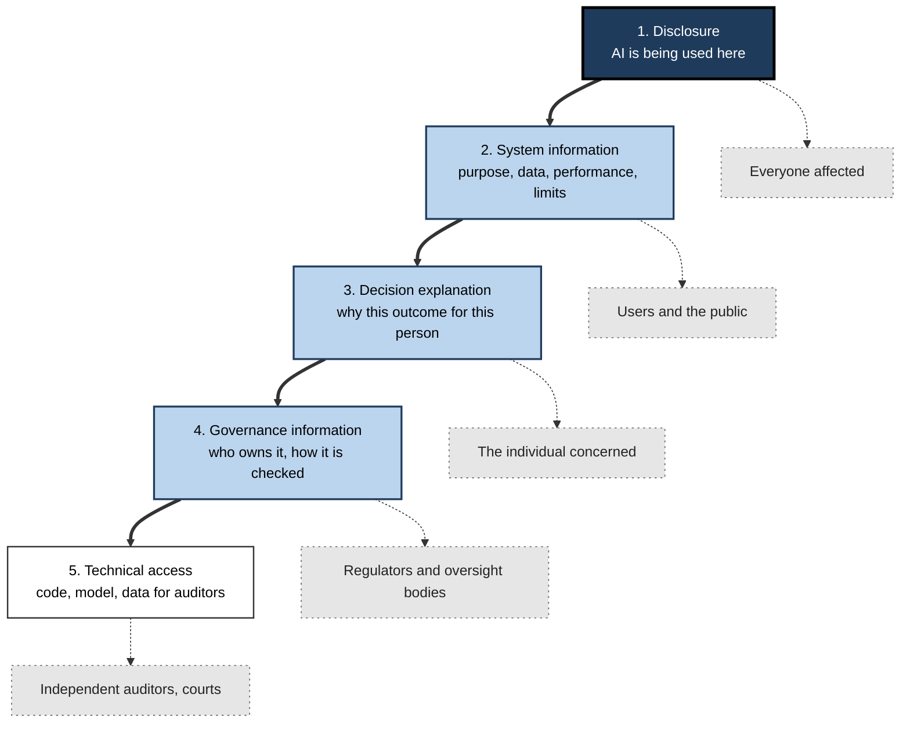
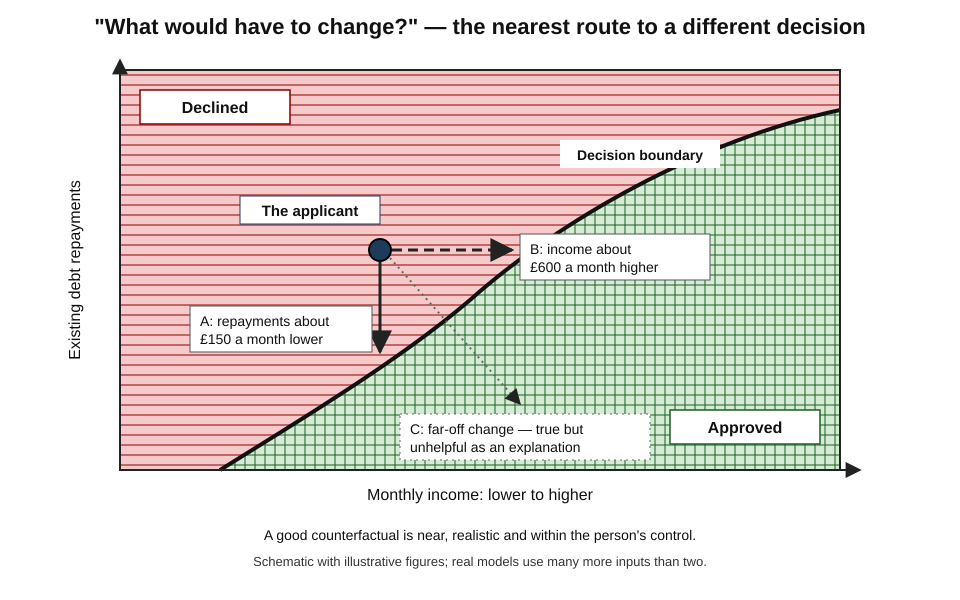
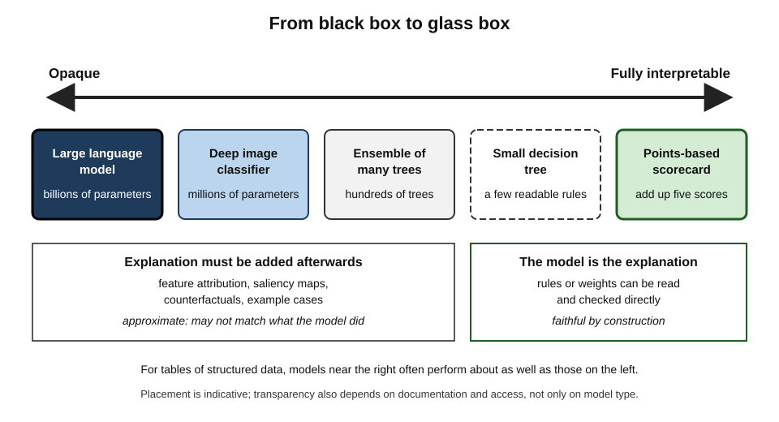
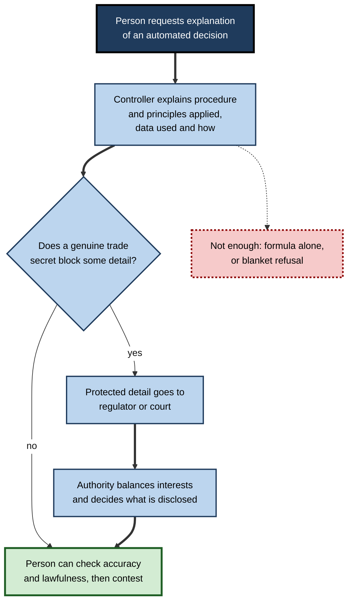
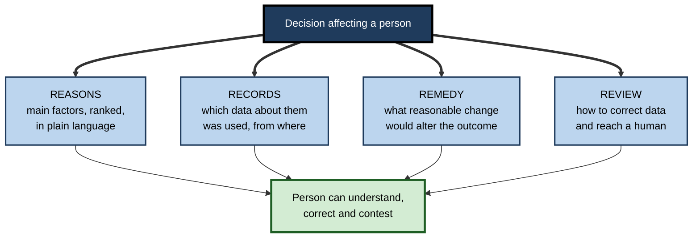

# G.4. Transparency and the right to explanation

In 2013 a Wisconsin man named Eric Loomis was sentenced to six years in prison. The judge had seen a risk score that placed him in a high-risk category. Loomis asked how the score had been calculated. He was told that the method was a trade secret belonging to the company that sold it. A person was losing years of liberty partly on the basis of a calculation that neither he, his lawyer nor the judge could examine.

> **Definition — Transparency (in AI):** the availability of appropriate information about an AI system — that it is being used, what it is for, how it works, how well it performs and how it reached particular outcomes — to the people who need that information.

> **Definition — Right to explanation:** an entitlement, in law or in ethics, of a person affected by an automated or AI-assisted decision to receive an intelligible account of how that decision was reached.

**Why it matters**

- **People cannot challenge what they cannot see.** Appeal, complaint and correction all depend on knowing what happened.
- **Errors hide in opacity.** Wrong data and faulty logic surface only when someone can inspect the reasoning.
- **Trust needs grounds.** Users, regulators and the public trust systems they can scrutinise.
- **Accountability depends on it.** Responsibility cannot be assigned for decisions no one can reconstruct.
- **Law increasingly requires it.** European data-protection law, the European Union's AI Act and consumer-credit rules in several countries create explanation duties.

---

## The Vocabulary of Openness

Several overlapping words are used loosely. Precision prevents false comfort — a system can be "transparent" in one sense and opaque in every other.

### Five related terms

- **Disclosure** — telling people that AI is being used.
  - *e.g.* "This chat is with an automated assistant."
- **Transparency** — making appropriate information about a system available.
  - About purpose, data, performance, limits and governance.
- **Interpretability** — the degree to which a human can understand how a model works **internally**.
  - *e.g.* a short scoring rule is interpretable; a model with billions of parameters is not.
- **Explainability** — the ability to give an understandable account of **why** a system produced a particular output, whether or not its internals are understood.
- **Contestability** — the practical ability of an affected person to challenge a decision and have it reconsidered.

> **Definition — Interpretability:** the extent to which a model's internal workings can be understood directly by a human.

> **Definition — Explainability:** the capacity to provide an understandable account of why a system produced a given output.

> **Definition — Contestability:** the ability of affected people to challenge an automated decision and obtain a genuine reconsideration.

> **Key point:** transparency is not an end in itself. It serves **understanding**, **correction** and **accountability** — and should be judged by whether it achieves them.

### Layers of transparency

**Figure 1.** Five layers of transparency, from disclosure to full access.

---

## Who Needs What Explanation

Different people need different explanations for different purposes. A single "explanation" rarely serves all of them.

### Audiences and their purposes

- **The affected person** — wants to understand, correct errors, and decide whether and how to challenge.
  - Needs: the main reasons, the data used about them, what would change the outcome, how to appeal.
- **The operator or decision-maker** — wants to decide whether to rely on the output.
  - Needs: confidence, known failure conditions, the factors driving this case.
- **The regulator or auditor** — wants to check legality, fairness and safety.
  - Needs: design documentation, test results by group, logs, access for testing.
- **The developer** — wants to debug and improve.
  - Needs: detailed technical diagnostics.
- **The public** — wants to know what systems govern shared life.
  - Needs: registers of systems in use, their purposes and safeguards.

| | Affected person | Operator | Regulator or auditor | Developer | Public |
|---|---|---|---|---|---|
| Main purpose | Understand and contest | Decide whether to rely | Verify compliance | Debug and improve | Democratic oversight |
| Key content | Main reasons, data used, how to change outcome, appeal route | Confidence, limits, key factors | Documentation, group results, logs | Technical diagnostics | Purpose, scope, safeguards |
| Form | Plain language, short | In-workflow, immediate | Detailed, structured | Technical | Registers, reports |
| Typical failure | Jargon or generic text | Over-trust of plausible reasons | Access refused as trade secret | Only averages examined | Systems hidden entirely |

> **Remember:** a good explanation answers **"why me?", "based on what?", "what would change it?" and "how do I challenge it?"**

> **Watch out:** an explanation written for engineers is not an explanation for the affected person. A list of feature weights is technically complete and practically useless to someone refused a mortgage.

---

## How Explanations Can Be Produced

### Interpretable models

- **Approach:** use a model whose reasoning is inherently readable.
  - *e.g.* a short points-based scorecard; a small decision tree; a linear model with a handful of variables.
- **Advantage:** the explanation **is** the model — faithful by construction.
- **Limit:** for images, speech and language, such models usually perform far worse than complex ones.

**Study card — Cynthia Rudin (Duke University), "Stop Explaining Black Box Machine Learning Models for High Stakes Decisions and Use Interpretable Models Instead" (*Nature Machine Intelligence*, 2019)**

- **Argument:**
  - For structured data — the tables of numbers used in credit, criminal justice and much of healthcare — carefully built interpretable models often perform **about as well** as black-box models.
  - Post-hoc explanations of black boxes are **approximations**; they may be wrong about what the model actually did.
  - Therefore, in high-stakes decisions, the burden should be on those who choose a black box to show that an interpretable model would be meaningfully worse.
- **Evidence offered:** Rudin's group had built short, transparent rule lists for predicting rearrest that matched the accuracy of proprietary tools.
- **Conclusion:** the supposed trade-off between accuracy and interpretability is **often a myth** for structured data — though not for perception tasks.

> **Watch out:** "the more accurate model must be the more complex one" is a common assumption. For tabular data it should be **tested**, not presumed.

### Post-hoc explanations of complex models

- **Feature-attribution methods** — estimate how much each input contributed to an output.
  - *e.g.* LIME (2016) fits a simple local model around one prediction; SHAP (2017) assigns contributions using ideas from cooperative game theory.
- **Example-based explanations** — show similar past cases.
- **Saliency maps** — highlight the parts of an image that most affected the output.
- **Limits:**
  - attributions can differ between methods for the same prediction;
  - they describe correlations the model uses, not causes in the world;
  - they can be unstable — tiny input changes may produce very different explanations.

### Counterfactual explanations

**Study card — Wachter, Mittelstadt and Russell (Oxford Internet Institute, 2017), "Counterfactual Explanations Without Opening the Black Box"**

- **Problem:** affected people rarely need — or can use — a description of a model's internal logic; and companies resist revealing it.
- **Proposal:** explain a decision by stating the **smallest change** in the person's circumstances that would have produced a different outcome.
  - *e.g.* "Your application would have been approved if your annual income had been £3,000 higher."
- **Advantages:**
  - understandable without technical knowledge;
  - points to **actionable** changes;
  - can be generated without revealing the whole model.
- **Limits:**
  - many counterfactuals may exist — which one to give is a choice;
  - some suggested changes are not actionable (*e.g.* age) or are unfair to suggest;
  - a counterfactual does not reveal whether the decision rule itself is lawful or fair.

> **Definition — Counterfactual explanation:** a statement of how the inputs would have had to differ for the system to reach a different decision.

**Figure 2.** A counterfactual explanation finds the nearest point on the other side of the decision boundary.

| | Interpretable model | Feature attribution | Counterfactual | Example-based |
|---|---|---|---|---|
| What it shows | The whole decision rule | Which inputs mattered most for this output | What change would flip the outcome | Similar past cases and their outcomes |
| Faithful to the model? | Yes, by construction | Approximately | Yes for that point, if computed on the real model | Partly |
| Best audience | Everyone, including auditors | Developers, operators | Affected people | Operators, affected people |
| Main risk | Lower accuracy on perception tasks | Unstable or misleading attributions | Unactionable or unfair suggestions | Misleading similarity |

**Figure 3.** From opaque to fully interpretable: a spectrum of model transparency.

---

## The Right to Explanation in Law

Several legal regimes now create duties to explain automated decisions, though their scope is narrower and more contested than the phrase "right to explanation" suggests.

### European data-protection law

- **The General Data Protection Regulation (GDPR, applying since May 2018):**
  - **Articles 13–15** — where solely automated decisions with legal or similarly significant effects are made, people are entitled to "meaningful information about the logic involved", and about the significance and envisaged consequences.
  - **Article 22** — a right not to be subject to such decisions, subject to exceptions; where they are allowed, safeguards include the right to obtain human intervention, to express one's view and to contest the decision.
  - **Recital 71** — mentions a right "to obtain an explanation of the decision reached", but recitals are not themselves binding.
- **The academic dispute (2017):**
  - Sandra Wachter, Brent Mittelstadt and Luciano Floridi argued that GDPR contains no general right to an explanation of individual decisions — only a right to information about system functionality in advance.
  - Andrew Selbst and Julia Powles replied that "meaningful information about the logic involved" must, to be meaningful, enable an individual to understand and contest the decision.
- **The courts' answer — two cases from the Court of Justice of the European Union:**
  - **SCHUFA (December 2023)** — a credit score produced by an agency counts as an automated decision when a lender draws strongly on it, so Article 22 protections apply to the scoring company itself.
  - **Dun & Bradstreet Austria (February 2025)** — see the study card below.

**Study card — CK v Dun & Bradstreet Austria (Court of Justice of the European Union, 27 February 2025)**

- **Facts:** a mobile-phone operator refused an Austrian customer a contract costing about ten euros a month after an automated creditworthiness assessment by a credit agency. She asked how the assessment was reached; the agency cited trade secrets.
- **Holding:**
  - The right to "meaningful information about the logic involved" means the controller must explain **the procedure and principles actually applied** so that the person can understand **which of their personal data were used and how**.
  - Handing over a complex mathematical formula, or describing every technical step, is **not** sufficient.
  - The explanation must allow the person to check whether the data were accurate and the processing lawful.
  - Where trade secrets are genuinely at stake, the information must be given to the **supervisory authority or court**, which balances the interests — the controller cannot simply refuse.
  - The court noted that explaining how a different input would have changed the outcome could be one helpful way to meet the duty.
- **Conclusion:** in the European Union, an individualised, intelligible explanation of significant automated decisions is now firmly part of data-protection law.

### Other regimes

- **The EU AI Act (Regulation (EU) 2024/1689):**
  - **Article 86** gives people affected by decisions based on certain **high-risk** AI systems a right to obtain "clear and meaningful explanations of the role of the AI system in the decision-making procedure and the main elements of the decision taken".
  - **Article 50** requires people to be told when they are interacting with an AI system, and requires certain synthetic content to be marked or disclosed.
  - Deployers of high-risk systems must also follow providers' instructions, which include information on how to interpret outputs.
- **The United Kingdom:**
  - From February 2026, reformed rules replaced the old Article 22 approach: significant decisions based solely on automated processing are generally permitted, but only with safeguards — information about the decision, the ability to make representations, to obtain human intervention and to contest.
- **United States consumer credit:**
  - Under the Equal Credit Opportunity Act, lenders must give applicants who are refused the **specific principal reasons**.
  - The Consumer Financial Protection Bureau stated in 2022 that this duty applies in full when lenders use complex algorithms; "the model is too complex to explain" is no defence.

| | GDPR (EU) | EU AI Act | UK (from 2026) | US credit law |
|---|---|---|---|---|
| Trigger | Solely automated decisions with legal or similarly significant effects | Decisions based on listed high-risk AI systems | Significant decisions based solely on automated processing | Adverse credit action |
| What must be given | Meaningful information about the logic; individual explanation per 2025 ruling | Explanation of AI's role and main elements of the decision | Information, representations, human intervention, contest | Specific principal reasons |
| Human involvement | Right to human intervention | Human oversight duties on deployers | Right to human intervention | Not required by this rule |
| Trade secrets | Balanced by authority or court | Not a bar to explaining main elements | Similar balancing expected | No exemption from giving reasons |

> **Key point:** across regimes the direction is the same — **"it's a black box" is no longer an acceptable answer** to a person affected by a significant decision.

**Figure 4.** How an explanation request is handled when trade secrets are claimed, following the 2025 European ruling.

---

## Case Study: The Loomis Sentencing Case

- **Situation:** in Wisconsin in 2013, Eric Loomis pleaded guilty to two lesser charges connected with a drive-by shooting. The pre-sentence report included a score from the commercial COMPAS tool indicating high risk of reoffending.
- **The challenge:**
  - Loomis argued that using a proprietary score he could not examine violated his right to due process — to be sentenced on accurate information and as an individual.
  - The method was protected as a trade secret; neither he nor the court could test it.
- **The decision (Wisconsin Supreme Court, 2016):**
  - Use of the score was **permitted**, because it was not the determinative factor and the judge had other grounds.
  - But the court required that future pre-sentence reports carry **written warnings** to judges, including that:
    - the tool's proprietary nature prevents disclosure of how factors are weighted;
    - scores are based on **group** data and cannot identify specific high-risk individuals;
    - some studies had raised questions about whether the tool disproportionately classified minority offenders as higher risk;
    - the tool had not been validated on a Wisconsin population at the time.
  - The United States Supreme Court declined to hear an appeal in 2017.
- **Analysis:**
  - **Transparency** was replaced by **warnings** — the judge was told the tool was opaque rather than shown how it worked.
  - **Contestability** was weak: a defendant cannot rebut reasoning he cannot see.
  - **Automation bias** risk: research on judges and other professionals suggests that warnings alone often do little to change reliance on a score.
- **Lesson:** where liberty, livelihood or health is at stake, **"trust us" is not an explanation**. The later European rulings show a different approach — trade secrets are weighed by a court, not used to shut the door.

---

## The Limits and Risks of Explanation

Explanations are necessary but not sufficient. They can fail, mislead or be misused.

### When explanations mislead

- **Unfaithful explanations** — a post-hoc explanation may not reflect what the model actually computed.
- **Plausible but wrong** — fluent, reasonable-sounding explanations increase trust whether or not the decision was right.
- **Fairwashing** — a 2019 study showed it is possible to generate explanations that make an unfair model *appear* to rely only on acceptable factors.
- **Self-explanations by language models** — a chatbot's account of "why I said that" is itself generated text and may not describe its real internal process.

**Study card — Poursabzi-Sangdeh and colleagues (Microsoft Research; published at the CHI conference, 2021), "Manipulating and Measuring Model Interpretability"**

- **Design:** large online experiments asked people to predict apartment prices with the help of a model.
  - Participants saw models with few or many features, presented either transparently (showing the weights) or as a black box.
- **Results:**
  - A transparent, simple model helped participants **simulate** what the model would predict.
  - It did **not** significantly help them follow the model when it was right or correct it when it was wrong.
  - Showing more detail sometimes made it **harder** for people to notice when the model had made an obvious mistake — information overload.
- **Conclusion:** transparency that helps people *understand* a model does not automatically help them *judge* it. Explanations must be designed and tested for their purpose.

> **Watch out:** explanations can **increase over-reliance**. A confident explanation attached to a wrong answer is more persuasive than a wrong answer alone.

### Legitimate limits on transparency

- **Gaming** — revealing exactly how a fraud or spam filter works helps adversaries evade it.
- **Privacy** — explaining one person's decision may reveal information about others in the data.
- **Intellectual property** — firms have genuine interests in protecting methods; the European answer is controlled disclosure to authorities, not none.
- **Comprehensibility** — some systems cannot be explained fully in human terms at all.

> **In practice:** distinguish **what must be disclosed to whom**. The affected person gets reasons and a route to contest; the regulator gets documentation and test access; adversaries get neither the detailed rules nor the thresholds.

---

## Instruments of Transparency

### Documentation and registers

- **Model cards** — short documents accompanying a model, reporting intended use, performance across groups and conditions, and known limitations.
  - Proposed by Margaret Mitchell and colleagues at Google in 2019.
- **Datasheets for datasets** — records of how a dataset was created, by whom, for what purpose, with what consent and known gaps.
  - Proposed by Timnit Gebru and colleagues in 2018.
- **System cards** — documents describing a whole AI product, including safety testing and mitigations; widely used for large language models.
- **Public algorithm registers** — lists of the automated systems a public body uses.
  - Amsterdam and Helsinki launched city registers in 2020.
  - The United Kingdom's Algorithmic Transparency Recording Standard, published in 2021, became a requirement for central government departments in 2024.
- **Impact assessments** — documented analyses of a system's risks before deployment.

> **Definition — Model card:** a short, structured document describing a trained model's intended uses, performance across relevant groups and conditions, and known limitations.

### Worked example (illustrative): explaining a declined loan

A lender's model declines an online application for a £10,000 personal loan.

**Version 1 — inadequate:**

> "Unfortunately your application has been unsuccessful. Our decision is based on a range of factors assessed by our automated system. We are unable to provide further details."

- No reasons, no data, no route to change or contest — unlawful in several jurisdictions and useless to the applicant.

**Version 2 — technically complete but unusable:**

> "Score 412 (cut-off 450). SHAP contributions: DTI −21.4; months_at_address −9.8; revolving_util −6.1; …"

- Accurate, but jargon; the applicant cannot tell what these mean or what to do.

**Version 3 — good:**

1. **Disclosure:** "This decision was made by an automated system and checked against our lending policy."
2. **Main reasons (ranked):**
   - "Your monthly debt repayments are high compared with your income."
   - "You have lived at your current address for less than a year."
   - "You are using most of the credit available on your cards."
3. **Data used:** "We used the income you gave us and your credit file from [agency], dated 3 March."
4. **What would change the outcome:** "If your monthly repayments on existing debts were about £150 lower, or if you applied for £7,000 instead, the application would likely have been approved."
5. **Right to contest:** "If any of this information is wrong, or you want a person to review the decision, reply within 30 days or call us; a member of the credit team will reconsider."

*Illustrative figures.*

> **Remember — the four parts of a usable explanation:** **Reasons, Records, Remedy, Review** — the main reasons, the data relied on, what would change it, and how to get a human review.

> **Watch out:** the counterfactual in step 4 should suggest **reasonable** changes. Telling someone to "be older" or "move to a different postcode" is unhelpful at best and discriminatory at worst.

**Figure 5.** The four parts of a usable explanation for an affected person.

---

## Open Questions

- **How much explanation is enough?**
  - Courts are beginning to define "meaningful", but the threshold for different decisions is unsettled.
- **Can large language models be explained at all?**
  - Research into their internal mechanisms ("interpretability research") is advancing, but faithful explanations of individual outputs remain elusive.
- **Do explanations actually help people?**
  - Evidence that explanations improve affected people's outcomes, rather than just their satisfaction, is limited.
- **How should trade secrets and transparency be balanced in practice?**
  - The European model of confidential disclosure to authorities is new and untested at scale.
- **Should high-stakes decisions require interpretable models?**
  - Some argue yes; others fear it would forgo real accuracy gains in medicine and other fields.

---

## Summary

- **Transparency** = appropriate information about an AI system available to those who need it; the **right to explanation** = an affected person's entitlement to an intelligible account of a decision.
- Distinguish **disclosure, transparency, interpretability, explainability and contestability**; transparency has layers from disclosure to technical access.
- Different audiences — **affected person, operator, regulator, developer, public** — need different explanations. The affected person needs **"why me, based on what, what would change it, how do I challenge it"**.
- Explanations come from **interpretable models**, **post-hoc attribution**, **counterfactuals** and **examples**. Rudin argued interpretable models often match black boxes on structured data.
- **GDPR** requires "meaningful information about the logic involved"; the **2025 Dun & Bradstreet** ruling requires an intelligible, individual account and sends trade secrets to authorities, not refusal. The **EU AI Act** adds explanation (Article 86) and disclosure duties; the **UK** and **US credit** rules impose their own.
- **Loomis (2016)** replaced transparency with warnings, leaving contestability weak.
- Explanations can **mislead**, be **unfaithful**, enable **fairwashing** and increase **over-reliance**; legitimate limits include gaming, privacy and IP.
- Instruments: **model cards, datasheets, system cards, algorithm registers, impact assessments**. A usable personal explanation covers **Reasons, Records, Remedy, Review**.

---

## Self-Check

1. Distinguish transparency, interpretability, explainability and contestability.
2. Name the five layers of transparency and the main audience for each.
3. What four questions should an explanation to an affected person answer?
4. Summarise Rudin's argument, and say for which kinds of data it is strongest.
5. What is a counterfactual explanation, and what are its advantages and limits?
6. Why did scholars disagree in 2017 about whether GDPR contains a right to explanation?
7. What did the Court of Justice decide in the Dun & Bradstreet Austria case about trade secrets?
8. What does Article 86 of the EU AI Act provide?
9. In the Loomis case, what did the court require instead of disclosure, and why is that weaker?
10. What did the 2021 Microsoft Research experiments find about transparent models?
11. Give two legitimate reasons for limiting transparency, and say how each can be handled without denying explanation altogether.
12. What is a model card, and what should it contain?
13. Rewrite this explanation to make it usable: "Declined due to automated risk assessment. Score below threshold."
14. A vendor says its hiring model "cannot be explained because it uses deep learning". How would you respond?

### Answer Key

1. Transparency: appropriate information is available. Interpretability: humans can understand the model's internals. Explainability: an understandable account of why an output occurred can be given. Contestability: affected people can challenge a decision and get it reconsidered.
2. Disclosure — everyone affected; system information — users and public; decision explanation — the individual; governance information — regulators; technical access — auditors and courts.
3. Why me? Based on what data? What would change the outcome? How do I challenge it?
4. For high-stakes decisions on structured data, interpretable models often perform about as well as black boxes, and post-hoc explanations are unreliable approximations, so interpretable models should be preferred unless shown to be meaningfully worse. Strongest for tabular data; weakest for images, speech and language.
5. The smallest change in inputs that would flip the decision. Advantages: understandable, actionable, needs no disclosure of the full model. Limits: many possible counterfactuals; some changes are not actionable or are unfair; it does not show whether the rule is fair.
6. Wachter, Mittelstadt and Floridi read the binding text as giving only general information about system functionality; Selbst and Powles argued "meaningful information" must enable individual understanding and challenge. The binding articles do not use the word "explanation"; the recital does.
7. Trade secrets do not permit refusal. Protected information must be provided to the supervisory authority or court, which balances interests and determines what the person receives.
8. People affected by decisions based on certain high-risk AI systems can obtain clear and meaningful explanations of the AI's role and the main elements of the decision.
9. Written warnings to judges about the tool's proprietary nature, group basis, possible disparities and lack of local validation. Warnings tell the judge the tool is opaque but do not let the defendant examine or rebut its reasoning.
10. Transparent simple models helped people predict what the model would say, but did not significantly help them detect its mistakes; more detail could make obvious errors harder to notice.
11. Gaming — give reasons and contest routes to individuals without revealing exact thresholds publicly; trade secrets — disclose confidentially to regulators or courts. Privacy — explain using the person's own data without revealing others'.
12. A short structured document for a model: intended and out-of-scope uses, training and evaluation data, performance across groups and conditions, limitations, ethical considerations.
13. For example: "This decision was made by an automated system. The main reasons were [ranked reasons]. We used [data and sources]. If [reasonable change], the outcome would likely differ. If anything is wrong or you want a person to review it, contact [route] within [period]."
14. Complexity does not remove legal or ethical duties: employers must be able to give candidates reasons and allow review; ask for model documentation, group-level test results, what explanations can be produced for individuals, whether a simpler interpretable model was tested, and how candidates can contest outcomes — and decline the product if those cannot be provided.

---

## Glossary

| Term | Meaning |
|---|---|
| Algorithm register | A public list of automated systems used by an organisation, with their purposes and safeguards. |
| Contestability | The ability of affected people to challenge a decision and obtain reconsideration. |
| Counterfactual explanation | The change in inputs that would have produced a different decision. |
| Datasheet for a dataset | A record of how and why a dataset was created, its contents, consent and gaps. |
| Disclosure | Telling people that AI is being used. |
| Explainability | The capacity to give an understandable account of why an output occurred. |
| Fairwashing | Using explanations to make an unfair model appear fair. |
| Feature attribution | Estimating each input's contribution to an output. |
| Interpretability | The extent to which a model's internals can be understood directly. |
| Meaningful information about the logic involved | GDPR's phrase for what must be explained about automated decisions. |
| Model card | A short document on a model's uses, performance by group and limitations. |
| Post-hoc explanation | An explanation generated after the fact for a model not designed to be interpretable. |
| Right to explanation | An affected person's entitlement to an intelligible account of a decision. |
| Saliency map | An image highlighting regions that most influenced a model's output. |
| System card | A document describing an AI product's behaviour, testing and safeguards. |
| Transparency | Availability of appropriate information about an AI system to those who need it. |
