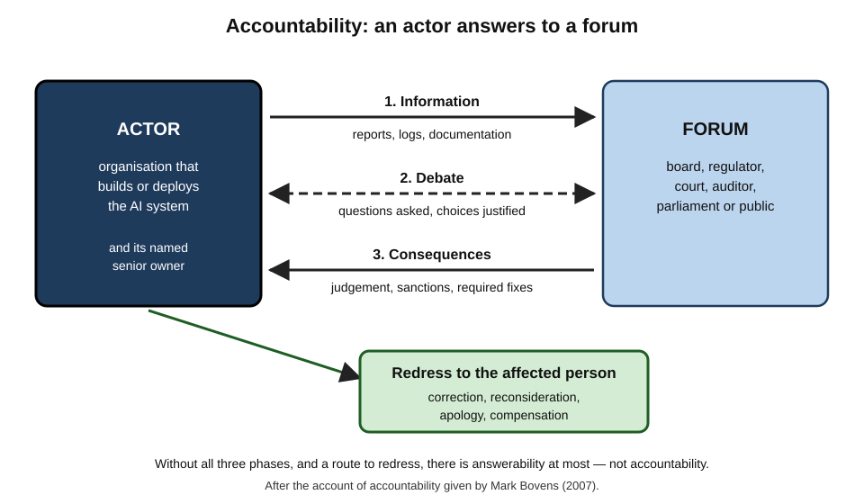
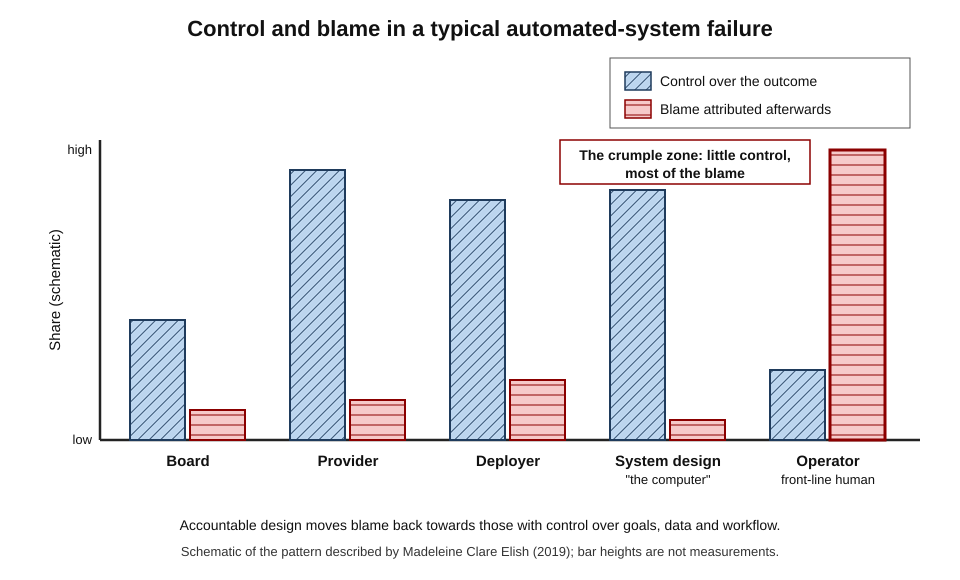
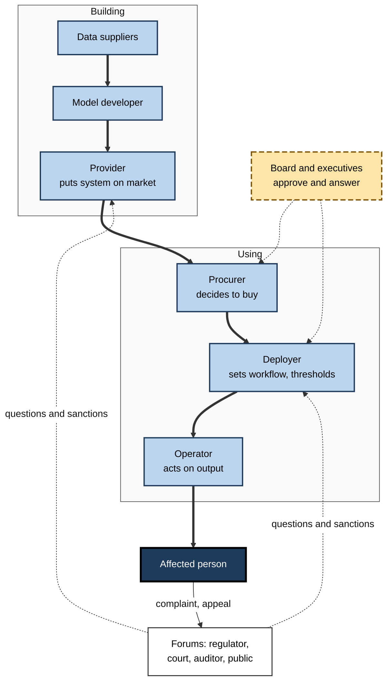
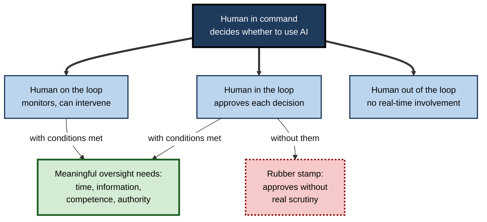
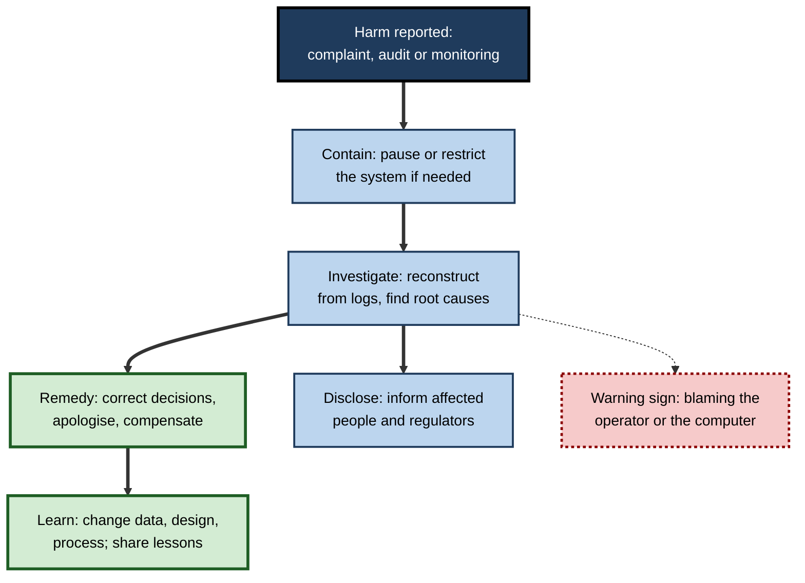

# G.5. Accountability: who is responsible for AI decisions?

Between 1999 and 2015 the British Post Office prosecuted hundreds of the people who ran its local branches for theft and false accounting. The evidence came from a computer system that showed money missing from their tills. Some went to prison; some lost their homes; some died before their names were cleared. The system had bugs. For years, the question "who is responsible when the computer is wrong?" was answered with a presumption that the computer was not.

> **Definition — Accountability:** the obligation of a person or organisation to explain and justify its conduct to a forum that can ask questions, pass judgement and impose consequences — and to put right any harm that has been caused.

**Why it matters**

- **Every AI decision has human authors.** Someone chose the goal, the data, the threshold and the decision to deploy.
- **AI spreads responsibility thin.** Many people and organisations each contribute a little, so it is easy for everyone to disclaim the result.
- **Harmed people need someone to answer.** Without an identifiable responsible party there is no apology, no correction and no compensation.
- **Accountability drives quality.** People who expect to answer for outcomes test more carefully and listen to warnings.
- **Law is assigning duties.** Data-protection law, product liability and the European Union's AI Act all place obligations on named roles.

---

## Responsibility, Accountability and Liability

Four related words describe different relationships between a person and an outcome.

### Four terms

- **Responsibility** — being the agent whose choices brought something about, or the person whose role it is to see that it goes right.
  - **Causal** responsibility: *who did it?*
  - **Role** responsibility: *whose job was it?*
  - **Moral** responsibility: *who deserves praise or blame?*
- **Answerability** — being obliged to give an account: to explain what was done and why.
- **Accountability** — answerability **plus consequences** before a forum such as a board, regulator, court or the public.
- **Liability** — legal responsibility to compensate or be penalised.

> **Definition — Liability:** a legal obligation to compensate for harm or to bear a penalty, established by law or contract.

> **Key point:** a system can be **causally** involved in harm, but only people and organisations can be **morally responsible**, **accountable** or **liable** for it.

| | Responsibility | Answerability | Accountability | Liability |
|---|---|---|---|---|
| Core question | Who brought it about, or whose job was it? | Who must explain? | Who must answer to whom, with what consequences? | Who must pay or be penalised? |
| Established by | Causation, roles, moral judgement | Duties to inform | Governance structures, forums | Law and contract |
| Example in AI | The team that chose the training data | A bank explaining a declined loan | A board reviewing a model failure; a regulator's inquiry | A court ordering compensation for a defective product |
| Can exist without the others? | Yes — blame without a forum | Yes — explanation without sanction | Rarely without answerability | Yes — strict liability without fault |

### The anatomy of accountability

**Political scientist Mark Bovens (2007)** described accountability as a relationship with three phases:

1. **Information** — the actor is obliged to inform the forum about conduct.
2. **Debate** — the forum can question, and the actor must justify.
3. **Consequences** — the forum can pass judgement and impose sanctions or require remedies.

**Figure 1.** The accountability relationship between an actor and a forum.

> **Mnemonic — "IDC" ("I Don't Comply" is not an option):** Information, Debate, Consequences.

---

## Why AI Strains Accountability

AI does not abolish responsibility, but several of its features make responsibility easy to lose.

### The problem of many hands

**Study card — Helen Nissenbaum, "Accountability in a Computerized Society" (*Science and Engineering Ethics*, 1996)**

- **Argument:** computing creates four barriers to accountability:
  - **many hands** — so many people contribute to a system that no single person seems responsible;
  - **bugs** — errors are treated as an unavoidable fact of software, so no one is blamed for them;
  - **the computer as scapegoat** — "the computer made a mistake" shifts attention away from the people behind it;
  - **ownership without liability** — software makers claim the rights of ownership while disclaiming responsibility for harm through licence terms.
- **Origin of the phrase:** "the problem of many hands" was introduced by philosopher Dennis Thompson in 1980 for public officials.
- **Conclusion:** accountability in computing must be **deliberately designed**; it will not arise on its own.

> **Definition — Problem of many hands:** the difficulty of attributing responsibility for an outcome when many people each contribute in small ways and none appears decisive.

### The responsibility gap

- **Philosopher Andreas Matthias (2004)** argued that systems which **learn and act** in ways their makers cannot fully predict create a **responsibility gap**: the makers could not foresee the specific harmful action; the machine is not a moral agent; so no one seems properly responsible.
- **Responses:**
  - responsibility can attach to the **decision to deploy** an unpredictable system;
  - organisations can accept **strict liability** — responsibility without proof of fault — for systems they choose to use;
  - the gap is often a **gap in governance**, not a gap in principle.

> **Definition — Responsibility gap:** a situation in which harm results from an autonomous or learning system and no human appears to satisfy the usual conditions for being responsible.

### The moral crumple zone

**Study card — Madeleine Clare Elish, "Moral Crumple Zones: Cautionary Tales in Human-Robot Interaction" (*Engaging Science, Technology, and Society*, 2019)**

- **Analogy:** a car's crumple zone absorbs the force of a crash to protect the passengers. In automated systems, the **human operator** often absorbs the moral and legal blame to protect the **system and its makers**.
- **Evidence:** Elish examined cases including the 1979 Three Mile Island nuclear accident and the 2009 loss of Air France Flight 447, where public and legal attention fell on operators who had been given limited control and poor information by the automation around them.
- **Conclusion:** when a human is placed "in the loop" with little real power, they become a **liability sponge** — blamed for failures the system design made likely.

> **Definition — Moral crumple zone:** the tendency for responsibility for a failure of a highly automated system to be attributed to the nearest human operator, who had limited control over its behaviour.

**Figure 2.** Where blame tends to fall compared with where control actually lies.

> **Watch out:** adding a human reviewer can **reduce** real accountability if the reviewer has no time, information or authority — it creates a person to blame rather than a person able to prevent harm.

---

## Who Is Responsible for What

Responsibility follows roles. A clear allocation of roles is the foundation of accountable AI.

### The chain of actors

- **Data suppliers** — collect, label or license the data.
- **Model developers** — design, train and test the model.
- **Providers** — place an AI system on the market or into service under their name.
- **Procurers** — decide to buy a system and on what terms.
- **Deployers** — organisations that use the system in their operations.
- **Operators and users** — staff who act on outputs.
- **Executives and boards** — set risk appetite, approve deployment and answer for results.
- **Regulators, courts and auditors** — the external forums.

**Figure 3.** The chain of actors behind a single AI-assisted decision.

### Typical duties by role

| | Provider | Deployer | Operator | Board |
|---|---|---|---|---|
| Core duty | Build a system fit for its stated purpose | Use it appropriately in context | Exercise real judgement on outputs | Set risk appetite and oversee |
| Typical tasks | Testing, documentation, instructions for use, post-market monitoring | Impact assessment, staff training, monitoring outcomes, informing affected people | Check outputs, escalate anomalies, record overrides | Approve high-risk uses, receive incident reports, fund controls |
| Typical failure | Overstated claims; untested groups | Using it outside intended purpose | Rubber-stamping | Delegating ethics to the vendor |
| Example under the EU AI Act | Conformity assessment for high-risk systems | Human oversight, logs, informing workers | Following instructions for use | Not named as such; follows from corporate governance |

> **Key point:** **buying** an AI system does not transfer responsibility for **using** it. A deployer remains accountable for decisions made in its name.

> **In practice:** contracts with AI vendors should specify performance by group, documentation, audit access, incident notification, and who bears which liabilities — before purchase, not after the first failure.

---

## Human Oversight: Real and Illusory

Human oversight is the most common safeguard required by law and policy. Its value depends entirely on how it is designed.

### Degrees of human involvement

- **Human in the loop** — a person must approve each decision before it takes effect.
- **Human on the loop** — the system acts, while a person monitors and can intervene.
- **Human out of the loop** — the system acts with no real-time human involvement.
- **Human in command** — people decide whether, when and how the system is used at all.

**Figure 4.** Degrees of human involvement and the conditions that make oversight real.

**Study card — Ben Green (University of Michigan), "The Flaws of Policies Requiring Human Oversight of Government Algorithms" (*Computer Law & Security Review*, 2022)**

- **Review:** examined policies around the world that require human oversight of automated decisions, and the research on how people actually interact with algorithmic advice.
- **Findings:**
  - People are often poor at judging when to follow and when to override algorithms — they defer when they should not and override when they should not.
  - Oversight requirements frequently **legitimise** flawed systems by implying that a human safeguard exists.
  - Requirements rarely specify what the human must know or be able to do.
- **Proposal:** shift from assuming oversight works to **requiring evidence** that it does — and to asking first whether an algorithm should be used at all.

> **Definition — Meaningful human control:** human involvement in which the person has the information, time, competence and authority to understand a system's output and change the outcome.

> **Remember — the four conditions of meaningful oversight: "TICA":** **T**ime to review, **I**nformation to judge, **C**ompetence to understand, **A**uthority to override without penalty.

> **Watch out:** measuring overrides is revealing. An override rate near **zero** may mean the system is excellent — or that reviewers have stopped thinking. A rate near **fifty per cent** may mean the system adds little.

---

## Mechanisms of Accountability

Accountability is built from concrete practices at each stage of a system's life.

### Before deployment

- **Clear ownership** — a named senior owner for each significant system.
- **Impact assessments** — structured analysis of risks before use.
  - Canada's federal Directive on Automated Decision-Making (2019) requires government departments to complete an Algorithmic Impact Assessment that sorts systems into four impact levels, with stronger requirements — peer review, human involvement, explanation — at higher levels.
- **Documentation** — model cards, data records, decision logs explaining design choices.
- **Approval gates** — independent review before launch, with power to stop it.

### During operation

- **Logging and audit trails** — recording inputs, outputs, versions and human actions so any decision can be reconstructed.
- **Monitoring** — tracking performance, drift, complaints and outcomes by group.
- **Escalation routes** — a way for staff to raise concerns without fear.

### After harm

- **Incident reporting** — recording and analysing failures, as aviation does.
  - Public collections of AI incidents have been maintained by researchers since 2020.
- **Complaints and redress** — a route for affected people to obtain correction, reconsideration and compensation.
- **Independent investigation** — external review of serious failures.
- **Liability** — legal consequences.
  - The European Union's revised Product Liability Directive (2024) explicitly treats software, including AI systems, as a product, making producers liable for harm caused by defects without proof of fault; a separate proposed AI liability directive was withdrawn in 2025.

| | Before deployment | During operation | After harm |
|---|---|---|---|
| Purpose | Prevent foreseeable harm | Detect problems early | Correct, compensate and learn |
| Key instruments | Owner, impact assessment, documentation, approval gate | Logs, monitoring, escalation | Incident reports, redress, investigation, liability |
| Who acts | Provider, deployer, board | Deployer, operators | Deployer, regulator, courts |
| Typical gap | Assessment done as paperwork | Logs kept but never read | No route for affected people to complain |

**Figure 5.** How an accountable organisation responds when an AI system causes harm.

---

## Case Study: The Post Office Horizon Scandal

- **Situation:** from 1999 the Post Office in the United Kingdom installed an accounting system called Horizon, supplied by Fujitsu, in its branches. Branches were run by sub-postmasters — self-employed people contractually responsible for any shortfalls.
- **What happened:**
  - Horizon showed unexplained shortfalls in many branches.
  - Sub-postmasters who reported problems were told that no one else was experiencing them.
  - Between 1999 and 2015 more than **900** were convicted of theft, fraud or false accounting, many after Post Office prosecutions relying on Horizon data; many others repaid "shortfalls" from their own savings.
- **The legal presumption:** courts in England and Wales presumed that computer evidence was reliable unless shown otherwise — a burden almost impossible for an individual to meet without access to the system.
- **Turning points:**
  - In **2019**, in group litigation brought by 555 sub-postmasters, the High Court found that Horizon contained bugs, errors and defects capable of causing shortfalls, and that the Post Office's conduct had been oppressive.
  - In **2021** the Court of Appeal quashed dozens of convictions, describing the prosecutions as an affront to the conscience of the court.
  - In **2024**, after a television drama renewed public attention, Parliament passed an Act quashing the remaining relevant convictions in England, Wales and Northern Ireland; a public inquiry examined who knew what and when.
- **Accountability failures (Nissenbaum's barriers in action):**
  - **Computer as scapegoat in reverse** — the system was presumed infallible, so the humans were blamed.
  - **Many hands** — the supplier, the Post Office's investigators, lawyers, executives and the government shareholder each held part of the picture.
  - **Ownership without liability** — those who controlled the system did not bear the cost of its errors; the sub-postmasters did.
  - **No real forum** — individuals faced an organisation that was both accuser and prosecutor, with control of the evidence.
- **Lesson:** although Horizon was not AI, it shows what happens when an automated system's outputs are treated as truth and the burden of proving error falls on the person with the least access. AI systems, being harder to inspect, raise the same risk more sharply.

> **Key point:** accountability requires that the **organisation with control of a system carries the burden** of showing it worked correctly — not the individual it harmed.

**Study card — The Dutch childcare benefits scandal ("toeslagenaffaire")**

- **Situation:** for years the Dutch Tax and Customs Administration pursued parents receiving childcare benefits for suspected fraud.
  - Tens of thousands of families were ordered to repay large sums, often for minor administrative errors, and treated as fraudsters with little chance to contest.
- **The algorithmic element:**
  - A risk-classification model used to select applications for scrutiny included **dual nationality** as a risk indicator.
  - In 2021 the Dutch data-protection authority fined the tax administration for processing nationality in a discriminatory and unlawful way.
- **Accountability response:**
  - A parliamentary inquiry report in December 2020 was titled "Unprecedented Injustice".
  - In January 2021 the Dutch government **resigned** over the scandal.
  - A compensation scheme for affected parents followed, though its delivery was slow.
- **Lesson:** the tools were partly automated, but the failure was **institutional** — a culture of suspicion, no effective appeal and no one taking responsibility until political consequences forced it.

---

## Worked Example (illustrative): A Responsibility Map for a Claims-Triage Model

An insurer plans to use a model that sorts home-insurance claims into "fast-track payment", "standard review" and "investigate". The ethics lead builds a responsibility map before launch, using the common **RACI** convention — **R**esponsible (does the work), **A**ccountable (owns the outcome, one person only), **C**onsulted, **I**nformed.

| Activity | Data science lead | Claims operations head | Claims handlers | Compliance | Vendor | Chief operating officer |
|---|---|---|---|---|---|---|
| Choose target and features | R | A | C | C | C | I |
| Test performance by customer group | R | A | I | C | C | I |
| Approve launch | C | R | I | C | I | **A** |
| Review "investigate" decisions | I | A | R | I | I | I |
| Monitor outcomes and complaints monthly | R | A | C | C | I | I |
| Respond to an incident | R | A | C | R | C | I |

*Illustrative example.*

1. **One accountable person per activity.** Shared accountability usually means none.
2. **Board-level sign-off for launch.** The chief operating officer is accountable for the decision to deploy, closing the responsibility gap at its source.
3. **Handlers are responsible for reviews — with conditions.** They receive the model's main reasons, have a target of fifteen minutes per case, and can overturn any flag without justification to their manager.
4. **The vendor is consulted, not accountable.** The contract requires it to share test results and to notify the insurer of model changes within five working days.
5. **Outcome:** when a later audit finds that claims from older customers are flagged more often, the map shows at once who must investigate, who must decide and who must tell the regulator.

> **Remember:** if no one is named, **no one is accountable**. Write the names down before launch.

---

## Open Questions

- **How should responsibility be shared along long AI supply chains?**
  - General-purpose models are adapted by thousands of deployers; allocating responsibility between the original provider and each deployer is unsettled.
- **What happens when AI agents act on people's behalf?**
  - Systems that book, buy or send messages autonomously raise new questions about whose act it is.
- **Can human oversight be made genuinely effective?**
  - Evidence on designs that improve human judgement, rather than merely adding a reviewer, is limited.
- **Should the burden of proof shift to deployers?**
  - Some argue that, for high-risk systems, deployers should have to prove their systems did not cause harm.
- **Can criminal or personal liability apply to executives?**
  - Whether individual senior managers should face personal consequences for AI harms is debated.

---

## Summary

- **Accountability** = answering to a forum that can question, judge and impose consequences, and putting harm right. Distinguish **responsibility** (causal, role, moral), **answerability** and **liability**.
- Bovens's accountability relationship has three phases: **Information, Debate, Consequences**.
- AI strains accountability through **many hands**, bugs treated as inevitable, the **computer as scapegoat** and **ownership without liability** (Nissenbaum, 1996); the **responsibility gap** (Matthias, 2004); and the **moral crumple zone**, where blame falls on the nearest operator (Elish, 2019).
- Responsibility follows **roles**: data supplier, developer, provider, procurer, deployer, operator, board — and buying a system does not transfer responsibility for using it.
- **Human oversight** is real only with **Time, Information, Competence and Authority**; otherwise it creates a rubber stamp and a scapegoat (Green, 2022).
- Mechanisms span **before** (owner, impact assessment, documentation, approval), **during** (logs, monitoring, escalation) and **after** harm (incident reports, redress, investigation, liability).
- The **Post Office Horizon** scandal and the **Dutch childcare benefits** scandal show the cost of presuming systems correct and placing the burden of proof on the people harmed.
- A **responsibility map** with one accountable person per activity closes gaps before launch.

---

## Self-Check

1. Distinguish responsibility, answerability, accountability and liability.
2. What are the three phases of Bovens's accountability relationship?
3. Name Nissenbaum's four barriers to accountability and give an AI example of one.
4. What is the responsibility gap, and how can organisations close it?
5. Explain the moral crumple zone with an example.
6. Why does buying an AI system not transfer responsibility to the vendor?
7. Distinguish human in the loop, on the loop, out of the loop and in command.
8. What four conditions make human oversight meaningful?
9. What did Green's 2022 review conclude about human-oversight policies?
10. Give one accountability mechanism for each of: before deployment, during operation, after harm.
11. How did the legal presumption about computer evidence contribute to the Post Office Horizon scandal?
12. What made the Dutch childcare benefits scandal an institutional, not just technical, failure?
13. A team proposes "a human will review every flagged case" as its main safeguard. What questions would you ask?
14. Draft three lines of a responsibility map for a chatbot that answers customers' questions about their pension.

### Answer Key

1. Responsibility: having brought something about, or having the role to ensure it goes right. Answerability: being obliged to explain. Accountability: answerability before a forum that can impose consequences. Liability: a legal obligation to compensate or be penalised.
2. Information (the actor informs the forum), debate (the forum questions; the actor justifies), consequences (the forum judges and can impose sanctions or remedies).
3. Many hands; bugs as inevitable; computer as scapegoat; ownership without liability. Example: a vendor's licence disclaiming all liability for a model's errors while the deployer's customers bear the harm.
4. Harm from a learning or autonomous system where no one seems to meet the usual conditions for responsibility. Close it by making the decision to deploy a responsible act, assigning strict liability, and building governance around unpredictable behaviour.
5. Blame for an automated system's failure falls on the nearest human operator, who had limited control — for example, pilots or plant operators blamed for accidents in which automation gave poor information.
6. The deployer chooses to use the system, in its context, on its customers; it controls the workflow and thresholds and makes decisions in its own name, so it remains accountable to affected people and regulators.
7. In the loop: a human approves each decision. On the loop: the system acts while a human monitors. Out of the loop: no real-time human. In command: humans decide whether and how the system is used.
8. Time to review, information to judge, competence to understand, authority to override without penalty.
9. People are often poor at overseeing algorithms; oversight requirements can legitimise flawed systems; policies should require evidence that oversight works and first ask whether the algorithm should be used.
10. Before: impact assessment or named owner. During: logging and monitoring by group. After: complaint and redress route or incident investigation.
11. Courts presumed computer evidence reliable unless shown otherwise; sub-postmasters had no access to the system to prove errors, so the burden fell on those least able to bear it.
12. Beyond the discriminatory risk indicator, there was a culture of suspicion, no effective appeal, disproportionate penalties and no one taking responsibility until political consequences — including the government's resignation — forced it.
13. Do reviewers have enough time per case? What information do they see? Are they trained? Can they override without penalty? How often do they override, and is that monitored? Who is accountable if they miss an error?
14. For example: "Approve the knowledge base the bot answers from — Responsible: pensions content team; Accountable: head of member services." "Review a sample of answers weekly for accuracy — Responsible: quality team; Accountable: head of member services; Consulted: compliance." "Handle a complaint about a wrong answer — Responsible: complaints team; Accountable: head of member services; Informed: chief risk officer."

---

## Glossary

| Term | Meaning |
|---|---|
| Accountability | Answering to a forum that can question, judge and impose consequences, and putting harm right. |
| Algorithmic Impact Assessment | A structured pre-deployment analysis of an automated system's risks, used for example by the Canadian government. |
| Answerability | The obligation to explain and justify conduct. |
| Audit trail | A record of inputs, outputs, versions and actions allowing a decision to be reconstructed. |
| Deployer | An organisation that uses an AI system in its operations. |
| Human in command | Humans decide whether, when and how a system is used. |
| Human in the loop | A human approves each decision before it takes effect. |
| Human on the loop | A system acts while a human monitors and can intervene. |
| Liability | A legal obligation to compensate or bear a penalty. |
| Meaningful human control | Human involvement with the time, information, competence and authority to change outcomes. |
| Moral crumple zone | The tendency for blame to fall on the nearest operator of an automated system. |
| Problem of many hands | Difficulty of attributing responsibility when many contribute in small ways. |
| Provider | The party that places an AI system on the market or into service under its name. |
| RACI | Responsible, Accountable, Consulted, Informed — a convention for allocating roles. |
| Redress | Correction, reconsideration or compensation for a harm. |
| Responsibility gap | Harm from an autonomous system where no human seems to meet the conditions for responsibility. |
| Strict liability | Legal responsibility without proof of fault. |
