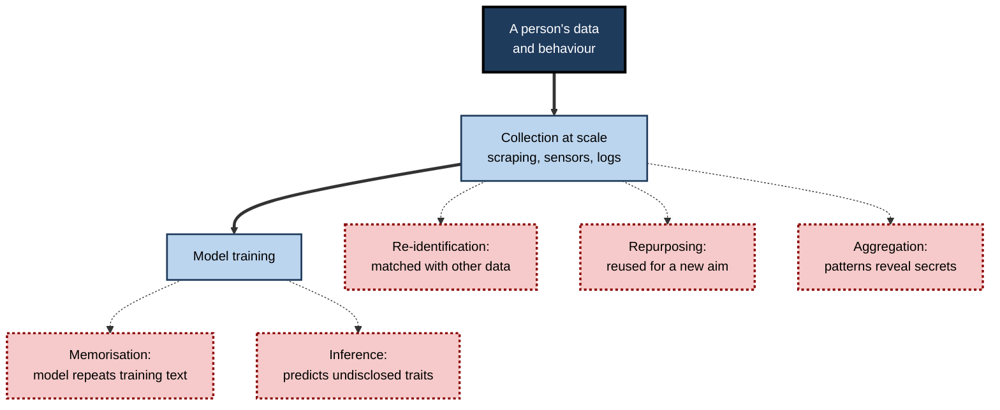
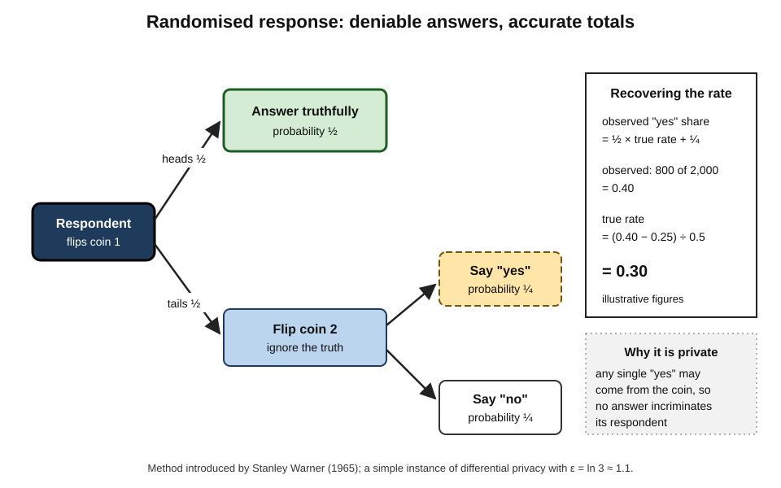
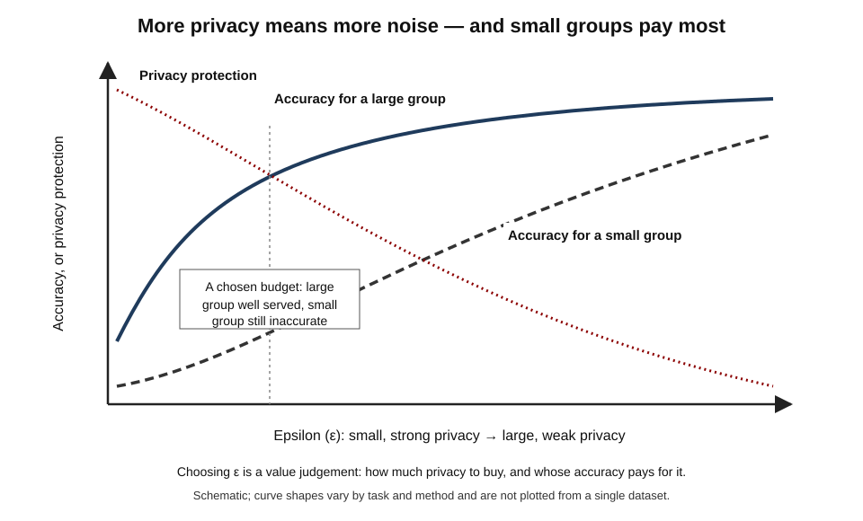
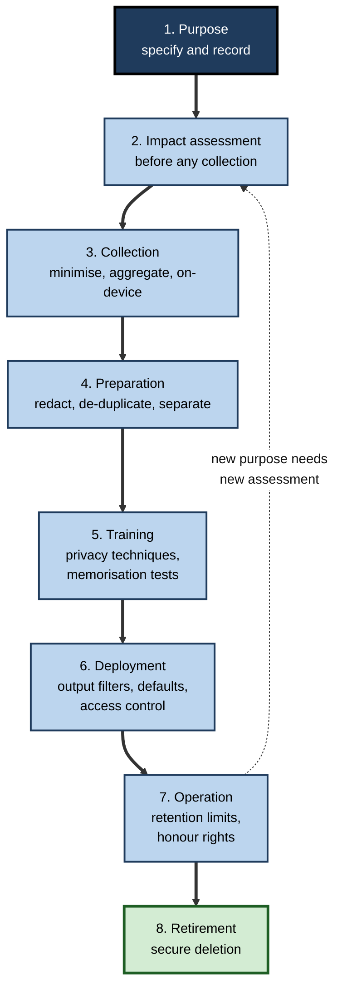
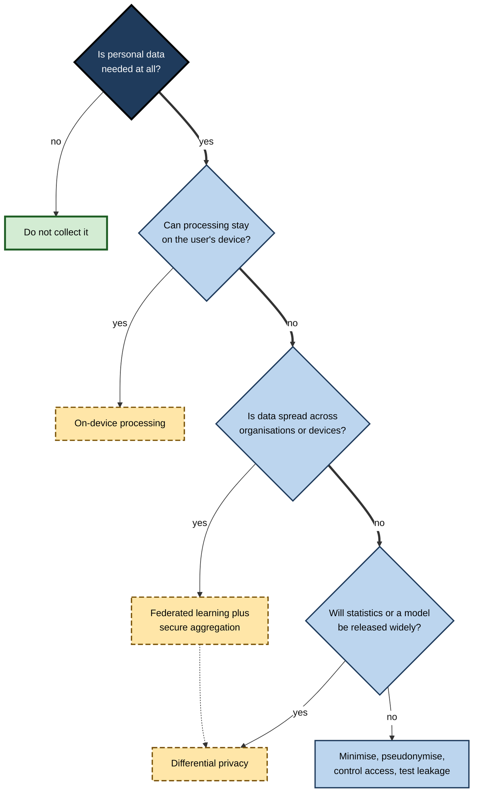

# G.6. Privacy by design in AI systems

In January 2018 a university student in Australia noticed something odd on a fitness company's public "heatmap", which showed where millions of users had run and cycled. In deserts and remote mountains, faint glowing loops traced the perimeters of military bases — soldiers jogging laps with their fitness trackers on. No single data point was secret. The harm came from **aggregation**, from **defaults** that shared activity publicly, and from a design that had never asked what the combined data might reveal.

> **Definition — Privacy by design:** an approach to building systems in which the protection of personal information is built into their architecture, defaults and processes from the start, rather than added after problems appear.

> **Definition — Personal data:** any information relating to an identified or identifiable living person — directly, or indirectly by combining it with other information.

**Why it matters**

- **AI systems are hungry for data**, and much of the most useful data is about people.
- **AI can infer what people never disclosed** — health, sexuality, politics, pregnancy — from innocuous traces.
- **Models can memorise** and later reveal pieces of their training data.
- **Fixing privacy after launch is expensive** and often impossible: data, once shared or learned, is hard to recall.
- **Law requires it.** European and UK data-protection law demands "data protection by design and by default"; many other jurisdictions follow similar principles.

---

## Why AI Makes Privacy Harder

Traditional privacy thinking focused on keeping recorded facts secret. AI adds new routes by which personal information can be exposed or created.

### Six ways AI raises privacy risk

- **Collection at scale** — training sets may contain billions of items scraped from the public web, including personal details never meant for that use.
- **Inference** — models predict sensitive attributes from non-sensitive data.
- **Memorisation** — models can store and reproduce fragments of their training data.
- **Re-identification** — "anonymous" records are matched back to individuals using other data.
- **Repurposing** — data collected for one purpose is reused to train systems for another.
- **Aggregation** — individually harmless data points, combined, reveal patterns — as the fitness heatmap showed.

> **Definition — Inference (privacy sense):** deriving new information about a person — possibly sensitive — from data they did provide.

**Study card — Kosinski, Stillwell and Graepel (University of Cambridge and Microsoft Research; *Proceedings of the National Academy of Sciences*, 2013)**

- **Design:** about 58,000 volunteers in the United States shared their Facebook "likes" — pages they had publicly liked — along with survey answers and profile information.
- **Results:** simple statistical models using likes alone distinguished, with accuracy well above chance:
  - men's sexual orientation;
  - ethnic origin;
  - political and religious views;
  - personality traits, and whether parents had separated before the user turned 21.
- **Key observation:** few likes were obviously related to the attribute predicted; the predictions came from patterns across many weak signals.
- **Conclusion:** sensitive information can be **inferred** from public, mundane behaviour — so protecting privacy means governing **what is inferred**, not only what is collected.

> **Watch out:** "we don't collect sensitive data" is not the same as "we don't process sensitive data". If a system infers health or ethnicity, it is handling that information in effect — and often in law.

**Figure 1.** Routes by which an AI system can expose or create personal information.

### The limits of anonymisation

- **Removing names is not anonymisation.** Combinations of ordinary fields — postcode, date of birth, sex — identify most people uniquely.
- **Rich data resists anonymisation.** Location traces, purchase histories and browsing logs are so distinctive that a handful of points can single out an individual.
  - A 2013 study of mobile-phone location data from 1.5 million people found that **four** approximate time-and-place points were enough to identify about 95 % of them uniquely.
- **Pseudonymised data is still personal data** under European law, because it can be linked back.

> **Definition — Pseudonymisation:** replacing direct identifiers such as names with codes, while keeping a separate means of re-linking; the data remains personal data.

> **Definition — Anonymisation:** processing data so that individuals can no longer be identified by any means reasonably likely to be used; truly anonymous data falls outside data-protection law, but the standard is hard to meet.

---

## The Seven Principles of Privacy by Design

**Ann Cavoukian**, then Information and Privacy Commissioner of Ontario, Canada, developed privacy by design in the 1990s and set out seven foundational principles in 2009. In 2010 an international conference of data-protection authorities endorsed them.

### The principles

1. **Proactive, not reactive; preventive, not remedial** — anticipate and prevent privacy harms before they occur.
2. **Privacy as the default setting** — personal data is protected automatically; the user need do nothing.
3. **Privacy embedded into design** — part of the core architecture, not a bolt-on.
4. **Full functionality — positive-sum, not zero-sum** — seek designs that achieve both privacy and the system's purpose, rather than trading one for the other.
5. **End-to-end security** — protect data throughout its life, from collection to secure destruction.
6. **Visibility and transparency** — practices are open and verifiable.
7. **Respect for user privacy** — keep the individual's interests central: strong defaults, clear notice, user-friendly controls.

> **Mnemonic — "Please Do Embed Full Security, Visibly Respecting users":** Proactive, Default, Embedded, Full functionality, Security, Visibility, Respect.

> **Key point:** the most powerful principle is the second — **privacy by default**. Most people never change default settings, so the default *is* the policy for most users.

> **Watch out:** "positive-sum" is an aspiration, not a guarantee. Real trade-offs between privacy and accuracy exist and should be stated honestly rather than wished away.

### From principle to law

- **The GDPR (Article 25)** — "data protection by design and by default": controllers must implement appropriate technical and organisational measures, both when designing processing and during it, and ensure that by default only the data necessary for each specific purpose is processed.
- **Data protection impact assessments (Article 35)** — required before processing likely to result in high risk, which regulators consider includes many uses of new technologies such as AI, large-scale profiling and systematic monitoring.
- **The core GDPR principles (Article 5)** translate directly into AI design choices.

| GDPR principle | Meaning | What it implies for an AI system |
|---|---|---|
| Lawfulness, fairness, transparency | A legal basis; no deception; people informed | Decide the legal basis for training *and* for use; tell people their data trains models |
| Purpose limitation | Collected for specified purposes; not reused incompatibly | Check whether training a new model is compatible with the original purpose |
| Data minimisation | Adequate, relevant and limited to what is necessary | Use the fewest fields and records that achieve the goal; avoid "collect everything" |
| Accuracy | Kept correct and up to date | Correct errors in training data; allow people to fix their records |
| Storage limitation | Kept no longer than necessary | Set retention periods for training data, logs and prompts |
| Integrity and confidentiality | Protected by appropriate security | Access controls, encryption, protection against model-extraction and leakage |
| Accountability | Able to demonstrate compliance | Document decisions, impact assessments and tests |

> **Definition — Data protection impact assessment (DPIA):** a documented process for identifying and minimising the data-protection risks of a planned processing activity before it begins.

---

## When Models Leak Their Training Data

### Memorisation and extraction

**Study card — Carlini and colleagues (Google, OpenAI, Apple, Stanford, Berkeley and Northeastern; USENIX Security Symposium, 2021), "Extracting Training Data from Large Language Models"**

- **Design:** the researchers generated large amounts of text from GPT-2, a publicly released language model trained on web pages, and searched the output for passages that the model appeared to have memorised.
- **Results:**
  - They recovered **hundreds** of verbatim sequences from the training data.
  - These included names, telephone numbers, email addresses and physical addresses of real individuals, along with code and other text.
  - Some sequences had appeared in only a **small number** of training documents, yet the model reproduced them exactly.
  - Larger models memorised more than smaller ones.
- **Conclusion:** language models can act as an unintended **database** of their training data; anything in the training set may be retrievable.
- **Follow-up:** later research in 2023 showed that a production chatbot could be induced, by a simple repeated-word prompt, to emit memorised training text at a much higher rate than normal.

> **Definition — Memorisation (in machine learning):** a model's storage of specific training examples such that it can reproduce them, rather than only learning general patterns.

> **Definition — Membership inference:** an attack that determines whether a particular person's record was in a model's training data, by probing how the model responds to it.

### What follows for design

- **Filter training data** — remove or redact personal identifiers before training where possible.
- **De-duplicate** — repeated text is memorised far more readily.
- **Limit what models can output** — detect and block personal data in responses.
- **Train with formal privacy guarantees** — such as differential privacy, at some cost in accuracy.
- **Control access** — restrict who can query sensitive models and how often.

---

## Privacy-Enhancing Technologies

A family of techniques — often called **PETs** — can let systems learn from data while revealing less about individuals.

### The main techniques

- **Data minimisation and on-device processing**
  - Process data on the user's own phone or computer, sending only results — or nothing — to a central server.
  - *e.g.* keyboard suggestions and photo face-grouping computed on the device.
- **Differential privacy**
  - Add carefully calibrated statistical noise so that results reveal almost nothing about any single individual.
- **Federated learning**
  - Train a shared model across many devices or organisations; each trains on its own data and shares only model updates.
  - Popularised by Google researchers from 2016, including for mobile-keyboard prediction.
- **Secure enclaves (trusted execution environments)**
  - Hardware-protected areas where data is processed in a way even the operator cannot inspect.
- **Homomorphic encryption**
  - Perform calculations on encrypted data without decrypting it; still slow for large models.
- **Secure multi-party computation**
  - Several parties jointly compute a result without revealing their inputs to each other.
- **Synthetic data**
  - Artificial records that preserve statistical patterns of real data; must be checked, because poorly generated synthetic data can leak real records.

| | Differential privacy | Federated learning | On-device processing | Homomorphic encryption | Synthetic data |
|---|---|---|---|---|---|
| Protects against | Learning about any one person from outputs | Central collection of raw data | Data leaving the device | Exposure during computation | Sharing real records |
| Main cost | Lower accuracy, especially for small groups | Complexity; updates can still leak | Limited device power | Very slow, specialised | Fidelity and leakage risk |
| Typical use | Official statistics, usage analytics | Keyboards, cross-hospital research | Phone assistants, photo apps | Narrow high-value computations | Testing, sharing for research |
| Guarantee | Mathematical, if implemented correctly | None on its own | Strong if data never leaves | Mathematical | None unless combined with differential privacy |

> **Watch out:** federated learning is often described as "privacy-preserving", but model updates can themselves reveal information about the data. It is usually combined with secure aggregation and differential privacy for real protection.

---

## Differential Privacy

### The idea

- **Question:** how can useful statistics be published about a group without revealing anything significant about any member?
- **Answer (Cynthia Dwork, Frank McSherry, Kobbi Nissim and Adam Smith, 2006):** design the computation so that its results would be **almost the same whether or not any one person's data were included**.
  - Then no one can learn much about an individual from the results — because the individual made almost no difference.
- **How:** add random noise of a carefully chosen size to results or to the training process.

> **Definition — Differential privacy:** a mathematical guarantee that the output of a computation is nearly unchanged by the inclusion or removal of any single person's data, achieved by adding calibrated randomness.

> **Formula — Privacy-loss parameter (epsilon, ε):** the outputs with and without any one person's data may differ in probability by at most a factor of e^ε. Example: ε = 1 limits that factor to about e¹ ≈ **2.7**; ε = 0.1 limits it to about **1.1**. Smaller ε means stronger privacy and more noise.

### Worked example (illustrative): randomised response

A professional body wants to know what share of its members have used a generative AI tool against their employer's rules. Members fear honest answers could be traced back to them.

**The method** (proposed by statistician Stanley Warner in 1965, and a simple form of differential privacy):

1. Each member privately flips a coin.
2. **Heads:** answer truthfully.
3. **Tails:** flip again — heads, answer "yes"; tails, answer "no" — regardless of the truth.

**Figure 2.** Randomised response: every individual answer is deniable, yet the group rate can be recovered.

**Recovering the true rate:**

- Let *p* be the true share who used the tool.
- Probability of a "yes" = ½ × *p* (truthful) + ¼ (random yes).
- Survey of 2,000 members: **800** answer "yes" → observed rate 0.40.
- Solve: 0.40 = 0.5*p* + 0.25 → *p* = (0.40 − 0.25) ÷ 0.5 = **0.30**.

*Illustrative figures.*

- **Estimate:** about **30 %** of members used the tool against the rules.
- **Privacy:** any individual "yes" might be a coin's answer — at least a 25 % chance for every respondent — so no answer incriminates anyone.
- **Privacy level:** a truthful "yes" person answers "yes" with probability ¾; a "no" person with probability ¼. The ratio 3 means ε = ln 3 ≈ **1.1**.
- **Cost:** the estimate is noisier than a direct survey; more respondents are needed for the same precision.

> **Key point:** differential privacy turns privacy into a **budget**. Each published statistic spends some of it; once the budget is spent, further releases risk identification.

**Figure 3.** The privacy–accuracy trade-off controlled by epsilon.

### Case study: the 2020 United States census

- **Situation:** the US Census Bureau is legally required to keep individual responses confidential while publishing detailed statistics down to very small areas.
- **The discovery:**
  - Bureau researchers tested whether published 2010 census tables could be used to **reconstruct** individual records.
  - Combining the many published tables with commercial data, they found that a substantial share of the population could be reconstructed and, for a meaningful fraction, re-identified.
  - Traditional protections — swapping some households between areas — were judged no longer sufficient against modern computing.
- **The response:**
  - For the 2020 census the Bureau adopted a **differential privacy** framework, adding calibrated noise to published counts under a set **privacy-loss budget**, while keeping certain totals, such as state populations, exact.
- **The controversy:**
  - Demographers, local governments and redistricting experts worried about **accuracy for small areas and small groups** — rural towns, Native American reservations, specific age bands.
  - The state of Alabama sued in 2021; the case did not stop the method.
  - The Bureau adjusted the budget in response to feedback, choosing more accuracy (and less privacy) for some tables.
- **Lesson:** privacy by design at national scale is possible, but it makes the **privacy–accuracy trade-off explicit and political** — someone must decide how much of each to give up, and those who depend on small-area data bear the accuracy cost.

> **Watch out:** differential privacy can have **unequal effects**. Research presented in 2019 found that training models with differential privacy reduced accuracy most for under-represented groups, because noise drowns out the few examples available. Privacy and fairness must be assessed together.

---

## Privacy by Design Across the AI Life Cycle

### Stage by stage

1. **Purpose** — define precisely what the system is for; record it.
2. **Assessment** — carry out a data protection impact assessment before collecting data.
3. **Collection** — gather only what is needed; prefer aggregated or on-device data; respect opt-outs.
4. **Preparation** — remove identifiers, de-duplicate, separate sensitive attributes into controlled stores.
5. **Training** — consider differential privacy or federated learning; test for memorisation.
6. **Deployment** — filter personal data from outputs; restrict access; set privacy-protective defaults.
7. **Operation** — limit retention of prompts, logs and outputs; honour access and deletion requests.
8. **Retirement** — delete data and models securely when no longer needed.

**Figure 4.** Privacy safeguards at each stage of an AI system's life.

### The problem of deletion

- **People can ask for their data to be erased** in many jurisdictions.
- **Deleting a record from a database is easy; removing its influence from a trained model is not.**
  - Retraining from scratch without the record is costly for large models.
  - **Machine unlearning** — methods to remove a data point's influence without full retraining — is an active research area with no complete solution for large models.
- **Design implication:** decide **before training** which data can be included, because removal later may be impractical.

> **Definition — Machine unlearning:** techniques for removing the influence of specific training data from a trained model without retraining it entirely.

### Worked example (illustrative): a bank's support assistant

A bank wants to fine-tune a language model on three years of customer-support chat transcripts so that it can draft replies for its agents.

| Design question | Privacy-careless approach | Privacy-by-design approach |
|---|---|---|
| Purpose | "Improve service with AI" | "Draft replies to common account queries for agent review" |
| Data volume | All 4 million transcripts | A sample of 300,000 covering the target query types |
| Identifiers | Left in | Account numbers, names, addresses, card numbers replaced with placeholders before training |
| Sensitive content | Included | Chats about bereavement, health, financial hardship and fraud victims excluded or reviewed separately |
| Memorisation | Not tested | Test prompts probe for real names and numbers; de-duplication of repeated templates |
| Outputs | Unfiltered | Filter blocks account numbers and personal details not present in the current conversation |
| Retention | Transcripts and prompts kept indefinitely | Training copy deleted after training; prompts kept 30 days for quality review |
| Transparency | None | Privacy notice updated; customers told transcripts may improve service tools; opt-out honoured |

*Illustrative example.*

- **Result:** the privacy-by-design version uses less data, but drafts for the target queries are nearly as good — and a leaked or memorised account number becomes far less likely.

> **In practice:** the most effective privacy measure is usually the cheapest — **not collecting or not keeping** data that the purpose does not require.

**Figure 5.** Choosing a privacy technique for an AI project.

---

## Open Questions

- **Can large models trained on the open web ever comply with privacy principles?**
  - Purpose limitation, minimisation and erasure fit poorly with training on billions of scraped documents.
- **What epsilon is "private enough"?**
  - Deployed systems use values ranging widely; there is no agreed standard for different uses.
- **Can machine unlearning be made reliable and verifiable?**
  - Proving that a model has truly forgotten something remains unsolved.
- **How should inferred data be governed?**
  - Law focuses on collected data; rules for sensitive inferences are less developed.
- **How can privacy and fairness auditing coexist?**
  - Measuring bias needs sensitive attributes that privacy principles say to minimise.

---

## Summary

- **Privacy by design** builds protection of personal data into architecture, defaults and processes from the start; GDPR Article 25 makes **data protection by design and by default** a legal duty, with **impact assessments** for high-risk processing.
- AI raises privacy risk through **collection at scale, inference, memorisation, re-identification, repurposing and aggregation**. Likes data (2013) showed sensitive traits can be inferred from mundane behaviour.
- **Anonymisation is hard**; pseudonymised data remains personal data; a few location points can identify most people.
- Cavoukian's seven principles — **Proactive, Default, Embedded, Full functionality, Security, Visibility, Respect** — with **privacy by default** the most powerful.
- Language models can **memorise and leak** training data (2021 extraction study); design responses include filtering, de-duplication, output controls and formal privacy.
- **PETs** — differential privacy, federated learning, on-device processing, enclaves, homomorphic encryption, multi-party computation, synthetic data — each protect against different risks at different costs.
- **Differential privacy** limits what any one person's data can change, governed by **ε**; randomised response is a simple example. The **2020 US census** made the privacy–accuracy trade-off explicit and contested; noise can hurt small groups most.
- Apply safeguards at every stage — purpose, assessment, collection, preparation, training, deployment, operation, retirement — and remember that removing data from a trained model is hard, so **decide before training**.

---

## Self-Check

1. Define privacy by design and data protection by design and by default.
2. Give the six ways AI raises privacy risk, with an example of two.
3. What did the 2013 Facebook likes study show, and why does it matter for design?
4. Why is removing names not enough to anonymise data?
5. List Cavoukian's seven principles. Why is privacy by default so powerful?
6. How does data minimisation apply to training an AI model?
7. What did the 2021 extraction study find about GPT-2, and what design measures follow?
8. Compare federated learning and differential privacy: what does each protect against?
9. Explain differential privacy and the meaning of epsilon in plain language.
10. In a randomised-response survey (coin method above), 46 % answer "yes". Estimate the true rate.
11. Why was the 2020 US census's use of differential privacy controversial?
12. Why is deletion difficult for trained models, and what follows for design?
13. How can privacy protections create fairness problems?
14. A start-up wants to train a mental-health chatbot on users' conversations. Propose five privacy-by-design measures.

### Answer Key

1. Privacy by design: building protection of personal data into architecture, defaults and processes from the start. Data protection by design and by default (GDPR Article 25): appropriate measures throughout processing, and by default processing only the data necessary for each purpose.
2. Collection at scale, inference, memorisation, re-identification, repurposing, aggregation. E.g. inference — predicting sexuality from likes; aggregation — fitness routes revealing military bases.
3. Sensitive traits could be predicted from mundane public likes using simple models. Designers must govern what systems infer, not only what they collect.
4. Combinations of ordinary attributes — postcode, birth date, sex, or a few location points — can single people out, and pseudonymised data can be re-linked.
5. Proactive; default; embedded; full functionality; end-to-end security; visibility; respect for the user. Most people never change defaults, so the default determines protection for most users.
6. Use only the fields and records needed for the purpose; avoid collecting everything "in case"; exclude sensitive categories unless essential; keep training copies only as long as needed.
7. Hundreds of verbatim training sequences, including personal contact details, could be extracted, some from rare documents. Measures: filter and redact identifiers, de-duplicate, test for memorisation, filter outputs, use formal privacy, restrict access.
8. Federated learning avoids central collection of raw data but updates can leak; differential privacy limits what anyone can learn about one person from outputs. They are often combined.
9. Results are almost the same whether or not any one person's data is included, so no one can learn much about any individual. Epsilon sets how much difference is allowed: smaller means more privacy and more noise.
10. 0.46 = 0.5p + 0.25 → p = 0.21 ÷ 0.5 = 0.42, about 42 %.
11. Noise reduced accuracy for small areas and small groups — rural towns, reservations — which matter for funding and redistricting; choosing the privacy budget was a value judgement about whose accuracy to sacrifice.
12. A model's parameters blend the influence of all training data, so removing one record's effect requires retraining or imperfect unlearning methods. Decide carefully what to include before training.
13. Differential privacy noise can reduce accuracy most for under-represented groups; minimising sensitive attributes can prevent bias audits.
14. For example: explicit purpose and impact assessment; opt-in consent for training use; strip identifiers and exclude crisis conversations from training; on-device processing or differential privacy; short retention and easy deletion; output filters; strict access control; clear privacy notice.

---

## Glossary

| Term | Meaning |
|---|---|
| Aggregation | Combining individually harmless data points into revealing patterns. |
| Anonymisation | Processing data so individuals can no longer reasonably be identified. |
| Data minimisation | Limiting personal data to what is necessary for the purpose. |
| Data protection impact assessment | A documented pre-processing assessment of privacy risks and safeguards. |
| Differential privacy | A guarantee that outputs barely change with or without any one person's data. |
| Epsilon (ε) | The privacy-loss parameter in differential privacy; smaller is more private. |
| Federated learning | Training a shared model across devices or organisations without pooling raw data. |
| Homomorphic encryption | Computing on encrypted data without decrypting it. |
| Inference (privacy) | Deriving new, possibly sensitive, information from data provided. |
| Machine unlearning | Removing specific data's influence from a trained model. |
| Membership inference | Determining whether a person's record was in a model's training data. |
| Memorisation | A model storing specific training examples it can reproduce. |
| Personal data | Information relating to an identified or identifiable living person. |
| Privacy by default | Protective settings applied automatically without user action. |
| Privacy by design | Building privacy into architecture, defaults and processes from the start. |
| Privacy-enhancing technologies | Techniques that let data be used while revealing less about individuals. |
| Pseudonymisation | Replacing identifiers with codes while retaining a means to re-link. |
| Randomised response | A survey method adding deliberate randomness so individual answers are deniable. |
| Re-identification | Linking supposedly anonymous data back to individuals. |
| Synthetic data | Artificial records mimicking the statistics of real data. |
