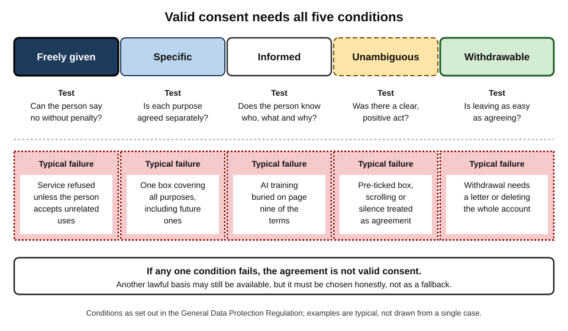
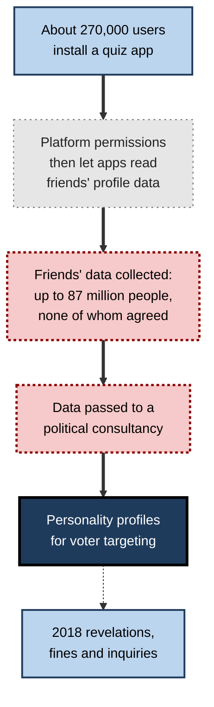
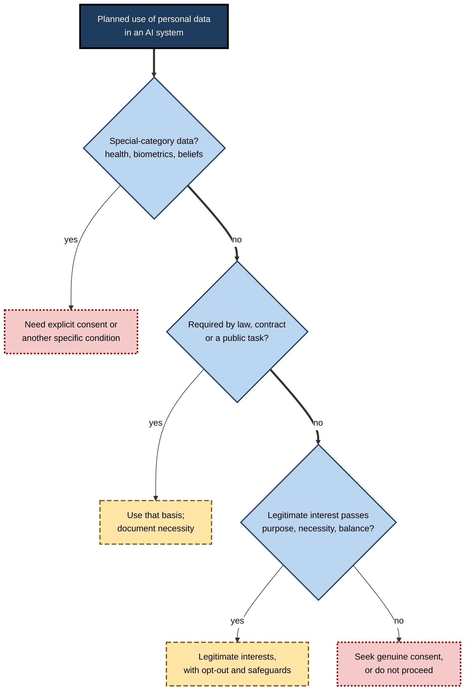
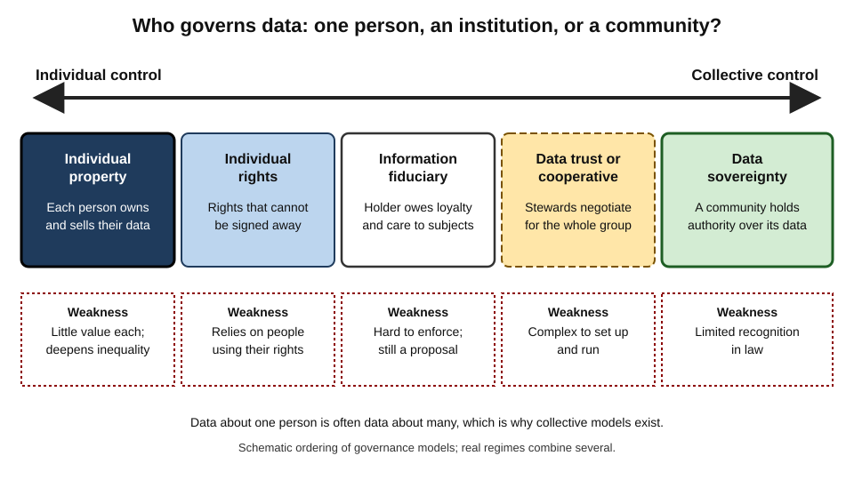
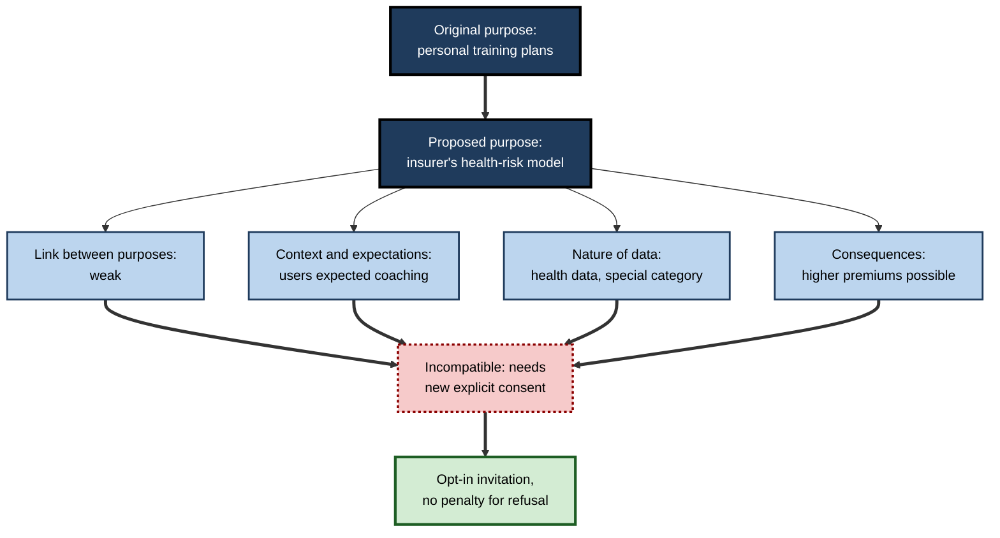

# G.7. Consent and data ownership

In 2014 about 270,000 people took a personality quiz on Facebook. By installing it, they allowed the app to collect not only their own profile data but also data about their friends. The friends — eventually estimated at up to 87 million people — had agreed to nothing. Their information reached a political consultancy, Cambridge Analytica, which promoted its ability to target voters by personality. Every step had been permitted by some setting somewhere; almost none of it reflected anything the people concerned would have recognised as their choice.

> **Definition — Consent (data protection):** a freely given, specific, informed and unambiguous indication of a person's wishes, by a statement or clear affirmative action, agreeing to the processing of their personal data — and which can be withdrawn as easily as it was given.

> **Definition — Data ownership:** the question of who holds rights to control, use, benefit from and exclude others from data — a question that law usually answers not with property but with a mix of personal rights, contracts and intellectual property.

**Why it matters**

- **AI is built from data about people and from work made by people.** Who agreed, and on what terms, decides whether that use is legitimate.
- **Click-through consent is weak.** People agree to terms they have not read, for uses no one can yet foresee.
- **Data about one person is often data about others** — friends, family, colleagues, people photographed in the background.
- **Creators' works train generative systems.** Writers, artists, photographers and musicians ask whether they should have been asked, credited or paid.
- **Law is unsettled and changing fast**, especially on copyright and training data.

---

## What Valid Consent Requires

### Five conditions

Under the European Union's General Data Protection Regulation (GDPR) and the similar UK regime, consent counts only if it is:

- **Freely given**
  - A real choice, with no detriment for refusing.
  - Not bundled into a contract when the processing is not needed for that contract.
  - Rarely valid where there is a clear imbalance of power — *e.g.* employer and employee, public authority and citizen.
- **Specific**
  - Given for particular, stated purposes; separate consent for separate purposes.
- **Informed**
  - The person knows who is processing, for what, and that they can withdraw.
- **Unambiguous**
  - A clear affirmative act: ticking an unticked box, pressing "I agree".
  - Silence, inactivity and pre-ticked boxes do not count.
- **Withdrawable**
  - As easy to withdraw as to give; withdrawal stops further processing.

> **Mnemonic — "FSIUW":** Freely given, Specific, Informed, Unambiguous, Withdrawable.

**Figure 1.** The five conditions of valid consent.

### Stronger forms of consent

- **Explicit consent** — an express statement, often written, required for special-category data such as health, biometric identification, sexual orientation, religion or political opinion.
- **Children's consent** — for online services offered directly to children, parental consent is required below an age set by each country: between 13 and 16 in the European Union, and 13 in the United Kingdom.

| | Valid consent | Invalid "consent" |
|---|---|---|
| Choice | Real; refusing has no penalty | Service withheld unless the person agrees to unrelated uses |
| Scope | Specific purposes, separately agreed | One box covering "all purposes, including future ones" |
| Information | Clear, short, plain language | Buried in long terms of service |
| Action | Positive act — unticked box ticked | Pre-ticked box, scrolling, silence |
| Withdrawal | One click, any time | Requires a letter, a call or account deletion |
| Example in AI | "Use my voice recordings to improve speech recognition: Yes / No" | "By using the app you agree that all data may be used to develop products" |

> **Key point:** consent is not a signature on a form. It is a **continuing state of agreement** that the person controls.

---

## Why Notice-and-Consent Fails

### The limits of individual choice

**Study card — Daniel Solove (George Washington University), "Privacy Self-Management and the Consent Dilemma" (*Harvard Law Review*, 2013)**

- **Argument:** modern privacy law relies on **privacy self-management** — giving individuals notice and choice and leaving them to manage their own privacy. Solove identified two kinds of problems.
- **Cognitive problems:**
  - people do not read privacy notices, and would not understand them if they did;
  - decisions are skewed by framing, defaults and present bias;
  - people cannot weigh risks they cannot see.
- **Structural problems:**
  - **scale** — too many organisations, too many notices to manage;
  - **aggregation** — harms arise from combining data, which no single consent decision covers;
  - **assessing harm** — the downstream uses that create harm, including future AI training, are unknown at the moment of consent.
- **Conclusion:** consent cannot carry the whole weight of privacy protection; law must also set **substantive rules** about what may be done, whatever people click.

> **Definition — Privacy self-management:** an approach to privacy that relies on individuals reading notices and making choices about each organisation's use of their data.

### Dark patterns

> **Definition — Dark pattern:** a user-interface design that steers people towards choices they would not otherwise make, often against their interests — such as hiding the "reject" option or making refusal take many more clicks than acceptance.

**Study card — Nouwens and colleagues (MIT, University College London and Aarhus University; CHI conference, 2020), "Dark Patterns after the GDPR"**

- **Design:** analysed the cookie-consent pop-ups of the 10,000 most popular websites in the United Kingdom that used the five most common consent-management platforms, and ran an experiment on how design affected choices.
- **Results:**
  - Only about **one in nine** of the pop-ups met the minimal requirements the researchers derived from European law, such as no pre-ticked boxes and rejection as easy as acceptance.
  - Removing the "reject all" button from the first page **increased** consent substantially.
  - Pre-ticked options and granular controls hidden on a second page also pushed users towards accepting.
- **Conclusion:** much of what is recorded as consent online is a **product of interface design**, not of user preference.

> **Watch out:** a high consent rate is not evidence that people agree. It may be evidence of a well-designed dark pattern.

### Consent and AI in particular

- **Unforeseeable uses** — data collected in 2015 for a photo-sharing service is used in 2025 to train an image generator.
- **Data about others** — photographs, messages and recordings contain people who never agreed.
- **Inferences** — consent to share purchases is not consent to have pregnancy or illness inferred from them.
- **Irreversibility** — once data shapes a trained model, withdrawing consent may not undo its influence.
- **Scale of public data** — web-scale training sets contain billions of items; individual consent from each person is practically impossible.

**Figure 2.** How the 2014 quiz turned 270,000 agreements into data on tens of millions.

### Case study: Cambridge Analytica (revealed 2018)

- **Situation:** a Cambridge University researcher built a personality-quiz app in 2014. Facebook's rules at the time allowed apps to collect data about users' friends.
- **What happened:**
  - Roughly 270,000 people used the app; data on up to **87 million** profiles — mostly of friends — was harvested.
  - The data was passed to Cambridge Analytica, a consultancy that offered "psychographic" political targeting, in breach of the platform's policies.
  - Facebook learned of the transfer in 2015 and asked for the data to be deleted, but did not verify deletion or tell users.
- **Revelation (March 2018):** reporting in newspapers in Britain and the United States, based partly on a whistle-blower, made the story public.
- **Consequences:**
  - The United States Federal Trade Commission imposed a **$5 billion** penalty on Facebook in 2019 for privacy violations, then the largest of its kind.
  - The UK Information Commissioner fined Facebook **£500,000**, the maximum under the law in force at the time.
  - Cambridge Analytica closed in 2018.
- **Contested point:** whether the psychographic targeting actually changed voting behaviour is **disputed**; many researchers doubt it was as effective as claimed. The ethical failure does not depend on its effectiveness.
- **Lesson:** a chain of technically permitted steps can add up to a **massive breach of reasonable expectations**. Consent by one person cannot authorise the use of another person's data.

---

## Consent Is Not the Only Lawful Basis

In European and UK law, consent is one of **six** lawful bases for processing personal data. For AI it is often not the most appropriate one.

### The six lawful bases

1. **Consent** — the person has agreed.
2. **Contract** — processing is necessary to perform a contract with the person.
3. **Legal obligation** — required by law.
4. **Vital interests** — to protect someone's life.
5. **Public task** — to perform a task in the public interest or official authority.
6. **Legitimate interests** — necessary for the organisation's or a third party's legitimate interests, unless overridden by the person's interests, rights and freedoms.

> **Mnemonic — "Can Clever Lawyers Verify Public Legitimacy?":** Consent, Contract, Legal obligation, Vital interests, Public task, Legitimate interests.

### Legitimate interests and AI training

- **Many developers rely on legitimate interests** rather than consent to train models on large datasets.
- **The test has three parts:**
  1. **Purpose** — is there a legitimate interest?
  2. **Necessity** — is the processing necessary for it, or could less intrusive means work?
  3. **Balancing** — do the person's interests and rights override it, considering their reasonable expectations, the nature of the data and safeguards offered?
- **The European Data Protection Board's opinion of December 2024** on AI models confirmed that legitimate interests *can* be a basis for developing and deploying AI models, but only after a careful, case-by-case assessment; it also said that whether a trained model is truly anonymous must be assessed case by case, because models can retain personal data.

**Figure 3.** Choosing a lawful basis for using personal data in an AI system.

> **Watch out:** organisations sometimes ask for consent **and** rely on another basis "just in case". If consent is refused or withdrawn and processing continues on another basis, people are misled about the choice they were offered.

### Purpose limitation and reuse

- **Data collected for one purpose may be reused only for compatible purposes** unless there is a new lawful basis.
- **Compatibility factors** under GDPR Article 6(4):
  - the link between the original and new purposes;
  - the context of collection and the relationship with the person;
  - the nature of the data — especially sensitive data;
  - the possible consequences for the person;
  - the safeguards in place, such as encryption or pseudonymisation.

### Case study: hospital records for an app (2015–2017)

- **Situation:** in 2015 the Royal Free London NHS Foundation Trust agreed to share patient records with Google DeepMind to develop and test **Streams**, an app to alert clinicians to signs of acute kidney injury.
- **What was shared:** records of about **1.6 million** patients, covering several years — far more than those at risk of kidney injury at any one time.
- **The basis claimed:** "direct care" — the assumption that patients would expect their data to be used to care for them.
- **The regulator's finding (2017):** the UK Information Commissioner ruled that the Royal Free had **failed to comply** with data-protection law:
  - patients were not adequately informed that their data would be used for testing a new app;
  - the processing was not shown to be necessary and proportionate;
  - patients could not reasonably have expected this use.
- **Outcome:** the trust signed an undertaking to change its practices; clinicians reported the app itself was useful.
- **Lesson:** a **beneficial purpose does not substitute for a lawful, transparent basis**. "It's for patient care" did not stretch to cover testing a new technology on 1.6 million people's records without telling them.

---

## Who Owns Data?

### Why "ownership" is the wrong word in law

- **In most legal systems, facts and personal data are not property.**
  - No one owns the fact of their birth date or address.
- **Instead, several kinds of rights overlap:**
  - **Data-protection rights** — access, correction, erasure, objection and portability, held by the person the data is about.
  - **Intellectual property** — copyright in creative expression (text, images, music, code); database rights in some jurisdictions, including the EU and UK.
  - **Contract** — terms of service and licences that allocate rights between parties.
  - **Trade secrets and confidentiality** — protection for valuable undisclosed information.
- **Consequence:** asking "who owns this data?" usually yields several answers — the person it describes, the creator of a work within it, the organisation that compiled it, and the platform whose terms govern it.

> **Definition — Data portability:** the right of a person to receive personal data they provided in a structured, machine-readable format and to transmit it to another organisation.

### Models of data governance

- **Individual property** — treat personal data as something people own and can sell.
  - Appeal: gives people a share of value.
  - Problems: most people's data is individually worth little; selling privacy may deepen inequality; data about one person is often about others.
- **Individual rights** — the European model: rights that cannot be signed away entirely.
- **Information fiduciaries** — legal scholar Jack Balkin proposed in 2016 that companies holding personal data should owe duties of loyalty and care to the people it describes, like doctors or lawyers.
- **Collective governance** — data trusts and data cooperatives in which a group pools data and appoints stewards to negotiate its use.
- **Data sovereignty** — communities, especially Indigenous peoples, assert collective authority over data about them.
  - The **CARE principles** for Indigenous data governance (Global Indigenous Data Alliance, 2019): **C**ollective benefit, **A**uthority to control, **R**esponsibility, **E**thics.

**Figure 4.** Models of data governance, from individual to collective.

| | Individual property | Individual rights | Information fiduciary | Collective trust or cooperative | Data sovereignty |
|---|---|---|---|---|---|
| Who decides | Each person, by selling or licensing | Each person, within legal limits | The organisation, bound by duties | Stewards on behalf of members | The community |
| Main protection | Price and refusal | Rights that cannot be waived | Loyalty and care duties | Collective bargaining power | Collective authority over use |
| Main weakness | Low individual value; inequality | Relies on individuals exercising rights | Hard to enforce | Complex to set up and run | Limited recognition in law |
| Example | Paid data marketplaces | GDPR rights | Proposed in US scholarship | Health-data cooperatives | Indigenous data-governance principles |

> **Key point:** because data about one person is often data about many, and harms often arise collectively, purely individual models — property or consent — struggle. Collective approaches try to match the governance to the shape of the data.

---

## Creative Work and Training Data

Generative AI raised a question that consent and data protection do not answer: may developers train models on copyrighted works without permission or payment?

### The legal landscape

- **European Union** — the 2019 Copyright in the Digital Single Market Directive permits **text and data mining** of lawfully accessible works, unless the rights-holder has **opted out** in a machine-readable way. The AI Act requires general-purpose AI providers to have a policy for respecting such opt-outs and to publish a summary of their training content.
- **United Kingdom** — commercial text and data mining is not generally permitted without a licence; the government consulted in 2024–2025 on introducing an exception with an opt-out, and the question remained contested.
- **United States** — the question turns on **fair use**, decided case by case, weighing purpose, nature of the work, amount used and effect on the market.

**Study card — Bartz v. Anthropic (US District Court, Northern District of California, 2025)**

- **Claim:** authors sued an AI developer for training language models on their books without permission.
- **Ruling (June 2025):**
  - Training on lawfully acquired books was held to be **fair use** — described as highly transformative.
  - But downloading and keeping **pirated** copies from unauthorised online libraries was **not** fair use.
- **Outcome:** the parties agreed a class settlement of about **$1.5 billion** — roughly $3,000 per book for around half a million works — which the court preliminarily approved in September 2025; it was reported as the largest copyright settlement in US history.
- **Significance:** the ruling separated **training** (permitted in this case) from **acquisition** (how the data was obtained) — a distinction with large consequences for how training data must be sourced.
- **Caution:** it is a single first-instance decision; other US judges may reason differently.

**Study card — Getty Images v Stability AI (High Court of England and Wales, November 2025)**

- **Claim:** the image library alleged that an image-generation model had been trained on millions of its photographs without a licence, and that the model and its outputs infringed copyright and trade marks.
- **Course of the case:** Getty abandoned its claim about the training itself, because the training had taken place outside the United Kingdom.
- **Ruling:**
  - The model's weights were held **not** to be an "infringing copy" of the photographs, because the model does not store or reproduce them.
  - Limited **trade-mark** infringement was found where older versions generated images bearing Getty-like watermarks.
- **Significance:** the first UK judgment on generative-AI training; it left the central question — whether training in the UK on unlicensed works infringes — unanswered.

> **Watch out:** these decisions are **early, narrow and jurisdiction-specific**. Appeals, other cases and legislation may change the position; no professional should treat any of them as settled law everywhere.

### Ethical questions beyond the law

- **Credit** — should creators be acknowledged when their work shapes a model?
- **Compensation** — should value be shared, through licensing deals or collective schemes?
- **Consent** — should creators be able to opt out, or should the default be opt-in?
- **Likeness and voice** — should a person's face, voice or style be usable without permission?

> **Example — voice likeness (2024):** after a technology company demonstrated a conversational voice that many listeners found strikingly similar to that of an actress who had declined to lend her voice, the company paused that voice. The episode showed how quickly questions of consent move from data to **identity**.

---

## Designing Meaningful Consent

### Principles

- **Ask at the right moment** — just in time, when the person understands the context.
- **Separate choices** — one decision per purpose, especially for training AI models.
- **Make refusal as easy as acceptance** — symmetric buttons, no penalty.
- **Be specific about AI** — say plainly whether data will train models, and whose.
- **Offer granular and dynamic consent** — let people change their minds as uses evolve.
- **Keep records** — consent receipts showing what was agreed, when and how.
- **Respect withdrawal in practice** — including for future training runs.

> **Remember:** good consent is **specific, symmetric, revisitable and recorded**.

### Worked example (illustrative): a fitness app and an insurer

A fitness app has five years of users' workout logs and heart-rate data, collected to provide training plans. An insurer offers to pay for a model trained on the data to predict health risk.

**Figure 5.** Testing whether a proposed reuse of data is compatible with its original purpose.

1. **Compatibility test.** Every factor points against compatibility: different purpose, different expectations, sensitive data, potentially serious consequences.
2. **Lawful basis.** Heart-rate and workout data used to infer health is special-category data; **explicit consent** is needed.
3. **Validity of consent.** It must be **freely given** — users who decline must keep full access to the app; no discount may be withheld.
4. **Design.** A separate, plain-language opt-in: "Allow [insurer] to use your workout and heart-rate history to build a health-risk model. You will not be identified to the insurer. Yes / No." Withdrawal available in settings.
5. **Ethical check beyond the law.** Even with consent, could the model raise premiums for people with disabilities or chronic conditions? The app consults a patient group and limits the model's permitted uses in the contract.
6. **Outcome.** About 12 % of users opt in — far fewer than the insurer hoped, but a **legitimate** dataset.

*Illustrative figures.*

> **Key point:** a low opt-in rate is not a design failure. It is **accurate information about what people actually want**.

---

## Open Questions

- **Can consent ever be meaningful at web scale?**
  - Training sets with billions of items make individual consent impractical; alternatives — opt-outs, collective licensing, public-interest rules — are contested.
- **Should training on copyrighted works require permission?**
  - Courts and legislatures in different countries are reaching different answers.
- **How should data about many people be governed?**
  - Genetic data, group photographs and social networks involve people who never consented; collective models are still experimental.
- **Can withdrawal of consent apply to trained models?**
  - Removing influence from models is technically hard; what withdrawal should mean is unresolved.
- **Should people share in the value created from their data?**
  - Proposals range from data dividends to cooperatives; none is established at scale.

---

## Summary

- **Valid consent** must be **Freely given, Specific, Informed, Unambiguous and Withdrawable**; explicit consent is required for special-category data, and children need parental consent below a national age threshold.
- **Notice-and-consent fails** for cognitive and structural reasons (Solove, 2013); **dark patterns** manufacture consent (cookie-banner study, 2020); AI adds unforeseeable uses, data about others, inferences and irreversibility.
- **Cambridge Analytica** showed one person's consent cannot authorise use of others' data; consequences included a $5 billion US penalty.
- Consent is one of **six lawful bases**; AI developers often rely on **legitimate interests**, which require purpose, necessity and balancing tests. Reuse must pass a **compatibility** test.
- The **Royal Free–DeepMind** case showed a beneficial purpose does not replace a lawful, transparent basis.
- Data is rarely **owned**; overlapping **data-protection rights, intellectual property, contracts and confidentiality** apply. Governance models range from **individual property** and **rights** to **fiduciaries, collectives and data sovereignty** (CARE principles).
- On training data, the EU allows text and data mining with **opt-out**; US cases turn on **fair use** (Bartz: training fair use, pirated acquisition not; $1.5 billion settlement); the UK Getty judgment found model weights not an infringing copy. All are early and contested.
- Meaningful consent is **specific, symmetric, revisitable and recorded**; a low opt-in rate is honest information.

---

## Self-Check

1. List the five conditions of valid consent and give an example that fails each.
2. Why is consent rarely valid between an employer and an employee?
3. Summarise Solove's cognitive and structural problems with privacy self-management.
4. What did the 2020 cookie-banner study find, and what does it imply about consent rates?
5. Why could the quiz users in the Cambridge Analytica case not consent for their friends?
6. Name the six lawful bases and explain the three-part legitimate-interests test.
7. What factors decide whether reuse of data is compatible with its original purpose?
8. What did the regulator find in the Royal Free–DeepMind case?
9. Why is "ownership" a misleading way to think about personal data in law?
10. Compare individual rights, information fiduciaries and data sovereignty as governance models.
11. What distinction did the 2025 US ruling in Bartz v. Anthropic draw, and why does it matter?
12. What did the UK court decide about model weights in Getty Images v Stability AI, and what did it leave open?
13. Redesign this prompt to meet consent standards: "By continuing you agree we may use your content to improve our services, including AI."
14. A company finds that 95 % of users accept AI training on their data. What should it check before treating this as genuine agreement?

### Answer Key

1. Freely given — fails if the service is refused unless one agrees to unrelated uses. Specific — fails with one box for "all purposes". Informed — fails if the purpose is buried in long terms. Unambiguous — fails with pre-ticked boxes. Withdrawable — fails if withdrawal requires deleting the account.
2. The power imbalance means employees may fear consequences for refusing, so consent is not freely given; another basis is usually more appropriate.
3. Cognitive: people do not read or understand notices and are swayed by framing and defaults. Structural: too many organisations (scale), harms from combined data (aggregation), and unknown future uses (assessing harm).
4. Only about one in nine pop-ups met minimal legal requirements; removing "reject all" from the first page raised consent substantially. Consent rates largely reflect interface design.
5. Consent must come from the person whose data is processed; a user cannot give valid, informed consent on another person's behalf, and the friends had no notice or choice.
6. Consent, contract, legal obligation, vital interests, public task, legitimate interests. Test: a legitimate purpose; processing necessary for it; the person's interests not overriding it, considering expectations, data nature and safeguards.
7. The link between purposes, the context and relationship, the nature of the data, the possible consequences and the safeguards.
8. The trust failed to comply with data-protection law: patients were not adequately informed, the processing was not shown to be necessary and proportionate, and patients would not reasonably have expected this use.
9. Facts and personal data are generally not property; instead, overlapping rights — data protection, intellectual property, contract, confidentiality — give different parties different controls.
10. Individual rights: each person holds non-waivable legal rights. Information fiduciaries: organisations owe loyalty and care duties to data subjects. Data sovereignty: a community holds collective authority over data about it.
11. Training on lawfully acquired books was fair use; acquiring pirated copies was not. How data is obtained can create liability even where its use in training is permitted.
12. Model weights did not store or reproduce the images, so were not an infringing copy; whether training in the UK on unlicensed works infringes was not decided because the training occurred abroad.
13. For example: "Can we use the documents you upload to train our AI models? This helps improve features for all users. You can change this at any time in Settings. [Yes, allow] [No, don't allow]" — with refusal not affecting the service.
14. Whether acceptance was the default; whether rejection was equally easy; whether the request was separate from other terms; whether users understood it concerned AI training; whether refusing affected the service; whether withdrawal works; and what users say when asked neutrally.

---

## Glossary

| Term | Meaning |
|---|---|
| CARE principles | Collective benefit, Authority to control, Responsibility, Ethics — principles for Indigenous data governance. |
| Compatibility test | The assessment of whether reusing data fits its original purpose. |
| Consent | A freely given, specific, informed, unambiguous and withdrawable agreement to processing. |
| Dark pattern | Interface design that steers people to choices against their interests. |
| Data cooperative | A member-owned body that pools and governs members' data. |
| Data ownership | The question of who holds rights to control and benefit from data. |
| Data portability | The right to receive one's data in machine-readable form and move it elsewhere. |
| Data sovereignty | Collective authority of a community over data about it. |
| Data trust | A legal structure in which trustees govern data on behalf of beneficiaries. |
| Explicit consent | An express, usually written, consent required for special-category data. |
| Fair use | A US legal doctrine allowing some unlicensed use of copyrighted works. |
| Information fiduciary | An organisation owing duties of loyalty and care to people whose data it holds. |
| Lawful basis | One of six legal grounds for processing personal data under GDPR. |
| Legitimate interests | A lawful basis requiring purpose, necessity and balancing tests. |
| Privacy self-management | Relying on individuals to manage privacy through notice and choice. |
| Purpose limitation | The rule that data may be reused only for compatible purposes. |
| Special-category data | Sensitive data such as health, biometrics, religion or sexual orientation. |
| Text and data mining | Automated analysis of large bodies of text and data, including for AI training. |
