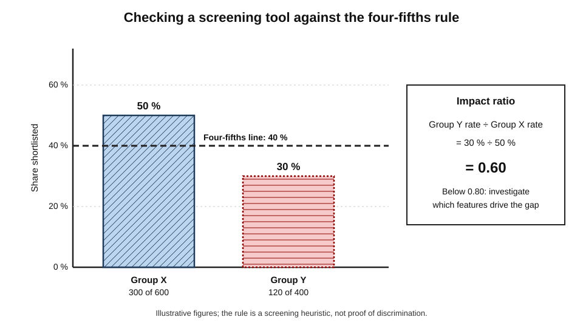
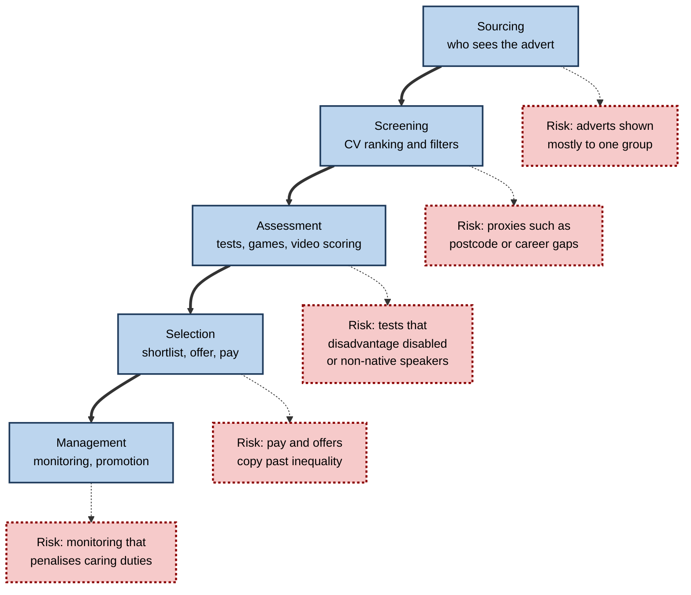
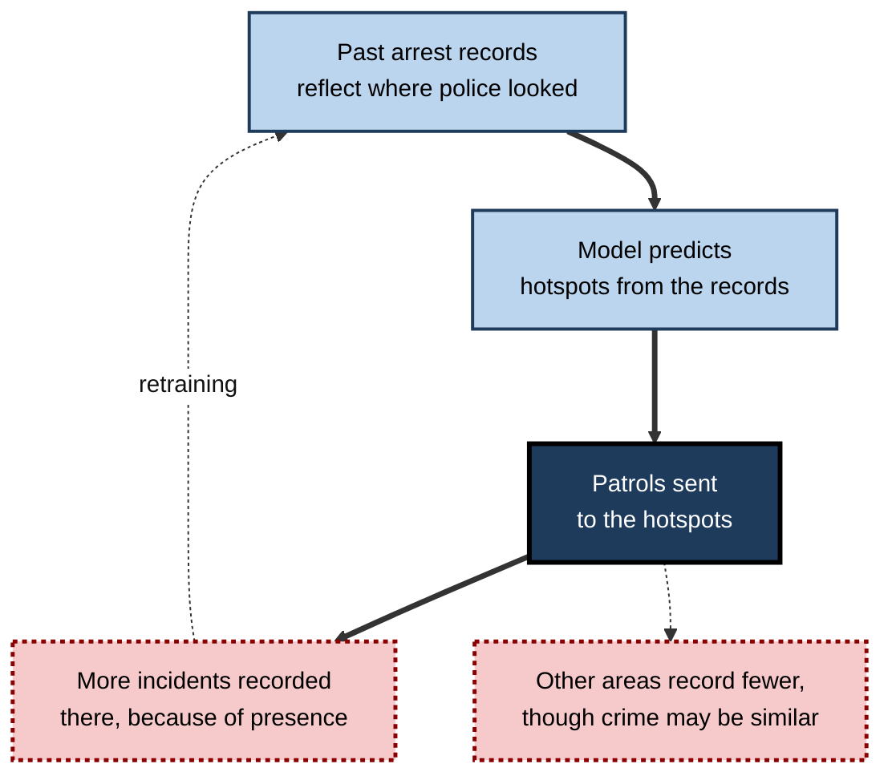
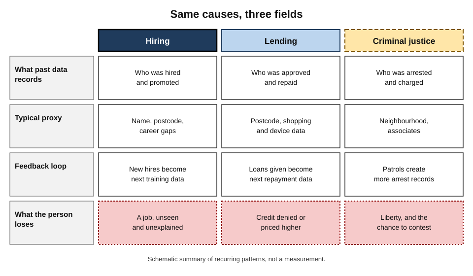
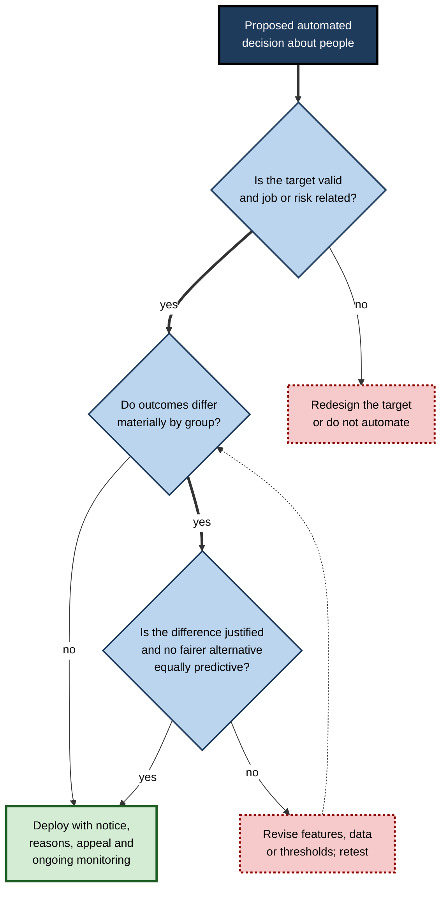

# G.8. AI and discrimination in hiring, lending, justice

In 2004 two economists sent about 5,000 fictitious CVs to employers advertising jobs in Boston and Chicago. The CVs were identical in quality; only the names differed. Those with names common among white Americans received about 50 per cent more callbacks than those with names common among Black Americans. 

That experiment tested human recruiters, long before automated screening. It matters here because it shows what a system trained on past hiring decisions would learn — and why hiring, lending and criminal justice are the three fields where AI discrimination is most closely watched.

> **Definition — Discrimination:** treating a person less favourably, or placing them at a particular disadvantage, because of a characteristic such as race, sex, age, disability or religion, in a way that law or morality does not justify.

> **Definition — Disparate impact:** a pattern in which a neutral-looking rule or system produces markedly worse outcomes for a protected group, whether or not anyone intended it.

**Why these three fields**

- **High stakes.** A job, a loan and liberty shape whole lives and are hard to recover once denied.
- **Long histories of discrimination.** Records of past decisions carry the patterns that equality law was written to remove.
- **Decisions at scale.** One hiring tool may screen millions of applicants; one credit model may price millions of loans.
- **Strong existing law.** Equality, employment, consumer-credit and criminal-procedure rules already apply to AI-assisted decisions.
- **Clear affected groups.** Outcomes can be compared across groups, so patterns of harm can actually be measured.

---

## How Discrimination Law Applies to Automated Decisions

### Direct and indirect discrimination

- **Direct discrimination** — a decision is made because of a protected characteristic.
  - A model that takes sex as an input and scores women lower is a clear case.
- **Indirect discrimination** (called disparate impact in the United States) — a neutral rule disadvantages a group and cannot be justified.
  - A model that penalises career gaps may disadvantage women, who take more caring breaks.
- **The justification defence** — an indirectly discriminatory rule may be lawful if it is a proportionate way of achieving a legitimate aim.
  - The burden is on the organisation using it, which is why documentation matters.

### The legal frameworks in outline

| | United States | United Kingdom | European Union |
|---|---|---|---|
| Employment | Title VII (race, sex, religion, national origin), Age Discrimination in Employment Act, Americans with Disabilities Act | Equality Act 2010 | Equal-treatment directives; national law |
| Credit | Equal Credit Opportunity Act; Fair Housing Act | Equality Act 2010; consumer-credit rules | Equal-treatment directive on goods and services; consumer-credit rules |
| Key concept | Disparate treatment and disparate impact | Direct and indirect discrimination | Direct and indirect discrimination |
| Who is liable | Employers and lenders, and in some cases their agents | Service users, with vendors potentially liable as agents | Deployers; the AI Act adds duties on providers |
| AI-specific rules | State and city rules, such as New York City's bias-audit law for hiring tools | Data-protection rules on automated decisions | AI Act: employment, credit and justice systems are classed as high-risk |

> **Key point:** these laws apply to **outcomes and decisions**, not to technology. Using an algorithm does not dilute an organisation's duty not to discriminate, and buying a tool does not transfer that duty to the vendor.

### Measuring disparate impact: the four-fifths rule

- **Origin:** US federal guidelines on employee selection (1978) offered a rule of thumb: if one group's selection rate is **less than four-fifths (80 per cent)** of the highest group's rate, that is generally treated as evidence of adverse impact.
- **Status:** a screening heuristic, not a legal definition; courts also use statistical significance tests and practical context.

> **Formula — Impact ratio:** selection rate of a group ÷ selection rate of the most-selected group. A ratio below **0.80** raises a flag. Example: 30 % ÷ 50 % = **0.60**.

### Worked example (illustrative): screening 1,000 applicants

A company's automated CV screen shortlists applicants for a graduate programme.

| Group | Applicants | Shortlisted | Selection rate | Impact ratio |
|---|---|---|---|---|
| Group X | 600 | 300 | 300 ÷ 600 = **50 %** | 1.00 (reference) |
| Group Y | 400 | 120 | 120 ÷ 400 = **30 %** | 30 ÷ 50 = **0.60** |

*Illustrative figures.*

1. **Compute selection rates.** 50 % against 30 %.
2. **Compute the ratio.** 0.60 — below 0.80, so the screen is flagged.
3. **Ask whether the difference is job-related.**
   - Which features drive it? Postcode, university name, hobbies, career gaps?
   - Does each feature predict later job performance in a way the company can show?
4. **Check significance.** With these numbers, the gap is far larger than chance would explain; with small groups it might not be.
5. **Act.** Remove or re-test the features; compare with a less discriminatory alternative; record the reasoning; monitor monthly.

> **Watch out:** passing the four-fifths rule does not make a system fair or lawful, and failing it does not prove discrimination. It is a prompt for investigation.

**Figure 1.** Selection rates by group and the four-fifths threshold.

---

## Hiring

### Where AI enters the hiring pipeline

- **Sourcing** — targeted job adverts and candidate search.
- **Screening** — ranking or filtering CVs and applications.
- **Assessment** — online tests, games, recorded video interviews scored by software.
- **Selection and offer** — scoring, shortlisting, pay suggestions.
- **Management** — performance monitoring, promotion and dismissal decisions.

**Figure 2.** Points in the hiring pipeline at which automated tools can introduce or amplify discrimination.

### Why hiring models discriminate

- **Historical bias in the target.** A model trained to find people "like our successful employees" learns who was hired and promoted in the past, not who would have performed well.
- **Proxies.** Names, postcodes, schools, gaps in employment, verbs used in a CV and even hobbies correlate with sex, race or class.
- **Unequal measurement.** Video and voice analysis may work worse for some accents, skin tones, disabilities and speech patterns.
- **Skewed advertising delivery.** Even a neutral advertiser can find that the platform's optimisation shows a job advert mostly to men or mostly to women, because it is learning from who clicks.
- **Feedback loops.** If a tool's recommendations are followed, the new hires become the training data for the next version.

**Study card — Bertrand and Mullainathan (University of Chicago and Massachusetts Institute of Technology; *American Economic Review*, 2004), "Are Emily and Greg More Employable than Lakisha and Jamal?"**

- **Design:** a field experiment. The researchers responded to more than 1,300 newspaper job advertisements in Boston and Chicago with about 5,000 fictitious CVs. CVs were randomly assigned names that were distinctively white or distinctively Black, and varied in quality.
- **Results:**
  - Applicants with white-sounding names received about **50 per cent more callbacks** than applicants with Black-sounding names, with identical CVs.
  - Improving CV quality helped white-named applicants noticeably more than Black-named applicants.
- **Conclusion:** hiring outcomes in the data used to train systems already contain **discrimination in the human decisions behind them**.
- **Why it matters for AI:** a tool trained to predict who gets a callback would learn this pattern as if it were merit.

> **Watch out:** "the model only looks at skills" is not a defence if the *measure* of skills, or the label it is trained to predict, reflects past bias.

### Disability and accessibility

- Automated tests can **screen out** people with disabilities who could do the job with reasonable adjustments — timed tests, video analysis of facial movement, voice-pattern scoring.
- Legal duties to make **reasonable adjustments** (UK) or provide **reasonable accommodation** (US) apply to automated processes.
- **Practical safeguard:** tell candidates a tool is used, offer an alternative route, and ensure someone can grant adjustments.

### Case study: Mobley v. Workday (United States, from 2023)

- **Situation:** a job applicant, Derek Mobley, applied for more than a hundred jobs through employers using the applicant-screening features of the human-resources software company Workday, and was rejected every time.
- **Claim:** he alleged that Workday's automated screening tools discriminated against applicants by **race, age and disability**, in breach of US anti-discrimination law, and sued the **vendor** rather than a single employer.
- **Key legal step (2024):** the federal court held that Workday could potentially be liable as an **agent** of the employers using its tools, because the employers had delegated a core hiring function to the software; it allowed the age-discrimination claims to proceed.
- **Later developments (2025–2026):**
  - The court allowed the age-discrimination claim to proceed as a **collective action** for applicants aged 40 or over, and authorised notice to potential members in 2026.
  - Rulings in 2026 continued to let the core claims proceed.
- **Status and caution:** these are decisions about whether the case may go forward, **not findings that the tool discriminated**; Workday denies the allegations. The outcome was still unresolved at the time of writing.
- **Why it matters:**
  - It tests whether **vendors**, not only employers, can be liable for discriminatory automated screening.
  - It shows that **applicants can bring claims** about disparate impact from algorithmic tools.
- **Lesson:** an employer that outsources screening to a tool cannot outsource its legal and ethical responsibility; contracts should require **bias testing, documentation and audit access**.

### Rules specific to hiring tools

- **New York City Local Law 144 (in force 2023):** employers using automated employment decision tools for hiring or promotion in the city must have an **independent bias audit** each year, publish a summary, and notify candidates.
- **Illinois Artificial Intelligence Video Interview Act (2019):** requires notice and consent before AI analyses video interviews.
- **EU AI Act:** AI systems used for recruitment, selection, evaluation or management of workers are classed as **high-risk**, with requirements for risk management, data quality, documentation, human oversight and logging.
  - The date from which the high-risk obligations apply has been postponed by the 2026 simplification package, to 2027; employers should plan on the basis that they will apply.
- **Data-protection law:** significant solely automated hiring decisions trigger rights to information, human review and contestation.

---

## Lending

### How credit models work and where harm arises

- **Credit scoring** predicts the likelihood of default from past repayment and other data.
- **Newer models** use many more variables — transaction histories, device data, education, even app usage — often with machine learning.
- **Harms:**
  - **Denial** of credit to creditworthy people ("thin files", recent migrants, people outside the banking system);
  - **Price discrimination** — higher interest rates or fees for similar risk;
  - **Redlining by proxy** — location and shopping patterns that stand in for race.

> **Definition — Redlining:** denying or worsening financial services to people in certain areas, historically drawn on maps around Black neighbourhoods in the United States, and today a risk when location acts as a proxy for race.

> **Definition — Thin-file applicant:** a person with little or no credit history, who may be creditworthy but is invisible to scoring models trained on conventional records.

### What the evidence shows

**Study card — Bartlett, Morse, Stanton and Wallace (University of California, Berkeley and collaborators; *Journal of Financial Economics*, 2022), "Consumer-lending discrimination in the FinTech era"**

- **Design:** analysed millions of US mortgage loans, comparing interest rates paid by Black and Latinx borrowers with those paid by other borrowers of similar credit risk, for both traditional lenders and algorithmic "fintech" lenders.
- **Results:**
  - Black and Latinx borrowers paid **somewhat higher interest rates** on purchase mortgages — on the order of a few hundredths of a percentage point — a pattern consistent with discrimination in pricing.
  - Algorithmic lenders discriminated **less** than face-to-face lenders — roughly a third to a half less — but did not eliminate the gap.
  - Fintech lenders also did not appear to reject minority applicants more often.
- **Conclusion:** algorithms can **reduce** some human discrimination while still reproducing a residual pattern, probably through pricing that exploits borrowers' limited shopping around.
- **Caution:** the exact magnitudes vary with the data and method; the lesson is the **direction and the persistence** of the gap.

**Key point:** the evidence does not support either slogan — "algorithms are neutral" or "algorithms are always worse". Outcomes depend on data, design and monitoring.

### Case study: the Apple Card complaint (2019)

- **Situation:** in November 2019 a prominent software developer posted that his Apple Card credit limit was about twenty times his wife's, although they filed joint tax returns and she had a better credit score. Other users, including a company co-founder, reported similar experiences.
- **Response:** the New York State Department of Financial Services opened an investigation into the issuing bank, Goldman Sachs.
- **Finding (March 2021):** the regulator reported that it **found no unlawful discrimination** in the bank's underwriting but criticised the **lack of transparency**: customer-service staff could not explain why limits differed, and customers could not see the reasons.
- **Why it matters:**
  - **Absence of unlawful discrimination** and **perception of unfairness** are different things; trust depends on being able to explain.
  - The bank's difficulty in explaining its own model to a complaining customer is a transparency failure even where the outcome was lawful.
- **Lesson:** a lender should be able to give each customer **specific reasons** for a credit decision in plain language — a legal duty in many countries and good practice everywhere.

### Law and practice in lending

- **Reasons for refusal:** in the United States, the Equal Credit Opportunity Act requires lenders to give applicants specific reasons for adverse action; regulators have said complex models do not excuse vague reasons.
- **Less discriminatory alternatives:** under disparate-impact doctrine, if a model produces a disparity, the lender may be expected to consider whether an equally predictive model with less disparity exists.
- **Alternative data:** can widen access for thin-file applicants (rent, utility and cash-flow data) but can also introduce new proxies; each variable needs testing.
- **Monitoring:** compare approval rates, prices and error rates by group — using protected data held in a separate, controlled monitoring file.

| | Approval decision | Pricing decision | Limit-setting |
|---|---|---|---|
| Main discrimination risk | Proxies lead to refusal of creditworthy groups | Higher rates for groups that shop around less | Unexplained differences by sex or age |
| What to test | Approval rates and error rates by group | Rate gaps for similar risk | Limit differences for similar income and score |
| Remedy | Better features; alternative data with testing | Price caps; transparent rate bands | Explainable rules; review of outliers |
| Evidence available | Approval-rate comparison | Loan-level pricing data | Complaint patterns and audit samples |

---

## Criminal Justice

### Where AI is used

- **Risk assessment** — scores for bail, sentencing, parole and supervision, including the widely discussed COMPAS tool.
- **Predictive policing** — models that forecast where crime will occur or who will be involved.
- **Facial recognition and surveillance** — identification of suspects from images.
- **Case management** — prioritising investigations and allocating resources.
- **Evidence tools** — analysis of recordings, documents and forensic data.

> **Definition — Predictive policing:** the use of statistical or machine-learning models to forecast where or when crime is likely, or who is likely to offend or be victimised, in order to direct police resources.

### Why justice systems are especially risky

- **Labels are not neutral.** "Crime" in the data means **recorded** crime, such as arrests and reports, which depend on where police look and which reports are taken.
- **Feedback loops are strong.** Patrols sent to a neighbourhood record more incidents there, which directs further patrols.
- **The stakes include liberty.** Errors cost freedom, not merely money.
- **Due-process rights.** A person must be able to know the basis of a decision and challenge it.
- **Power imbalance.** The people affected have the least access to the system and the least ability to contest it.

**Study card — Lum and Isaac (Human Rights Data Analysis Group; *Significance*, 2016), "To predict and serve?"**

- **Design:** the researchers applied a published predictive-policing algorithm of the kind used in several US cities to drug-offence records in Oakland, California, and compared its predicted "hotspots" with an independent estimate of where drug use actually occurred, from national survey data modelled at neighbourhood level.
- **Results:**
  - Survey-based estimates indicated drug use spread fairly evenly across the city.
  - The model trained on police records concentrated predicted hotspots in a few neighbourhoods with mainly low-income and Black populations, because that is where arrests had been recorded.
  - Simulating the loop, the model repeatedly sent patrols back to the same places.
- **Conclusion:** a model trained on records of police activity predicts **police activity**, not crime, and can lock in earlier patterns of enforcement.

**Figure 3.** The feedback loop in predictive policing.

### Case study: a predictive-policing programme examined (United States, 2023)

- **Situation:** a US police department used a commercial predictive-policing tool that generated daily forecasts of locations at which particular crimes were likely.
- **Investigation:** journalists at The Markup and Wired analysed many thousands of predictions from the tool and compared them with later reports.
- **Findings:**
  - The predictions were **very rarely** followed by a matching reported crime — success rates were well below one per cent for the crimes analysed.
  - Predicted locations disproportionately included neighbourhoods with larger Black and Latino populations and lower household incomes.
- **Outcome:** the department stopped using the tool; other cities had earlier ended similar contracts.
- **Contested point:** vendors argued that deterrence — crime not occurring because patrols were present — is not measurable by such comparisons; independent evidence that such tools reduce crime is thin.
- **Lesson:** claims of crime reduction should be **tested independently** before a system affects policing, and **disparate burden** on over-policed communities should be measured from the start.

### Safeguards in justice settings

- **Independent validation** on the local population before use.
- **Open documentation** so defence lawyers and courts can examine tools.
- **Restricted use** — risk scores as one input, never decisive, never for punishment beyond the purpose they were built for.
- **Human authority** — decision-makers trained in what the scores can and cannot show.
- **Bans or moratoria** on the highest-risk uses: the EU AI Act prohibits some predictive-policing systems that assess an individual's risk of offending solely from profiling or personality traits.

> **Remember:** in justice settings the burden of proof should sit with **the system's operator**, not the person subject to it.

---

## Common Patterns and Practical Responses

### What the three fields share

- **Historical records as targets**: past hires, past loans, past arrests.
- **Proxies for protected traits**: postcode, name, school, associates.
- **Unequal data quality**: thin files, uneven policing, uneven recording.
- **Feedback loops**: the system shapes the data it later learns from.
- **Weak recourse**: affected people often do not know a system was used.

**Figure 4.** The same causes, three fields.

### Practical responses for organisations

1. **Define the decision and the lawful, job-related or risk-related target** before choosing a model.
2. **Test the label**, not only the model: does it measure performance, repayment or offending — or someone's past decision?
3. **Audit by group** before launch and on a schedule, using protected data held under strict controls.
4. **Search for less discriminatory alternatives** and record why the chosen model was preferred.
5. **Provide notice, reasons, human review and an appeal route.**
6. **Contract carefully**: require vendors to supply testing results, documentation and audit access.
7. **Retain evidence**: decisions, versions, thresholds and monitoring results for each system.

**Figure 5.** A pre-deployment discrimination review.

### Case study (illustrative): a lender reviews its small-business model

- **Situation:** a mid-sized lender introduced a machine-learning model to price small-business loans.
- **Trigger:** a monitoring report showed that businesses in two postcode areas with large minority-ethnic populations were quoted rates about half a percentage point higher than similar businesses elsewhere.
- **Investigation:**
  1. The data team confirmed the gap after controlling for turnover, years trading and credit history.
  2. Feature analysis found that "number of cash-intensive transactions" and "landline versus mobile contact number" carried much of the effect — both correlated with area and ethnicity.
  3. Neither feature improved prediction of default once the others were included.
- **Actions:**
  - Both features were removed; the model was retrained and compared with the old one.
  - Performance was almost unchanged; the rate gap fell to a level within statistical noise.
  - A review panel including compliance and a community-lending adviser now examines the monitoring results quarterly.
  - Affected customers who had paid higher rates were identified and offered a refund of the difference.
- **Result:** a modest cost in refunds, no loss of predictive power and a documented audit trail.
- **Lesson:** features that **add discrimination without adding prediction** are the easiest to remove — but they are found only by looking.

---

## Open Questions

- **When is a disparity justified?**
  - Courts and regulators differ on how much predictive benefit justifies a group difference, and on how hard lenders and employers must look for alternatives.
- **Who is liable along the supply chain?**
  - The Workday case tests whether vendors share liability with the employers who use their tools.
- **Should protected data be collected to test for bias?**
  - Testing needs the data that privacy rules seek to minimise; legal clarity differs by country.
- **Do automated tools reduce discrimination overall?**
  - Evidence points both ways; careful, independent comparisons with human decisions are still scarce.
- **Where should the line be drawn on justice uses?**
  - Some jurisdictions prohibit certain predictive-policing uses; others permit them with safeguards.

---

## Summary

- **Discrimination** can be **direct** or **indirect (disparate impact)**; equality law applies to automated decisions, and the deployer remains responsible.
- The **four-fifths rule** (impact ratio below 0.80) flags possible adverse impact; it prompts investigation but does not prove or disprove discrimination.
- **Hiring:** tools trained on past decisions learn historical bias; the Bertrand–Mullainathan experiment (2004) showed human callback discrimination; **Mobley v. Workday** tests vendor liability; **New York City's audit law** and the **EU AI Act** regulate hiring tools. Disability adjustments must reach automated tests.
- **Lending:** algorithms can reduce some human discrimination yet leave **residual pricing gaps** (Bartlett and colleagues, 2022); **Apple Card** showed that lawful outcomes still need **explanations**; refusal reasons must be specific.
- **Criminal justice:** recorded crime reflects policing, so **predictive policing** can launder past enforcement into forecasts (Lum and Isaac, 2016); independent testing, open documentation, restricted use and human authority are essential.
- Common causes: **historical targets, proxies, unequal data, feedback loops, weak recourse**. Responses: validate the target, audit by group, seek **less discriminatory alternatives**, give notice and appeal, contract for evidence, retain records.

---

## Self-Check

1. Distinguish direct from indirect discrimination with an AI example of each.
2. What is the four-fifths rule, and why is it only a screening heuristic?
3. Compute the impact ratio: Group A selection rate 40 %, Group B selection rate 25 %. Does it raise a flag?
4. What did the 2004 CV experiment show, and why does it matter for hiring AI?
5. Give four ways a hiring tool can discriminate without using protected attributes.
6. What legal question does Mobley v. Workday raise, and what has the court decided so far?
7. What did the research on fintech mortgage lenders find about algorithmic discrimination?
8. What lesson does the Apple Card case teach about lawful outcomes and explanations?
9. Why do predictive-policing models risk predicting police activity rather than crime?
10. What safeguards should surround risk tools in justice settings?
11. What is a "less discriminatory alternative", and why does it matter?
12. Which hiring and lending uses are classed as high-risk under the EU AI Act, and what does that imply?
13. A vendor offers a video-interview scoring tool and says "it is bias-free because it ignores names and photographs". What do you ask?
14. A bank finds its model approves 62 % of one group and 41 % of another, with similar default rates in both groups when approved. What are the next steps?

### Answer Key

1. Direct: a model that scores women lower because of sex. Indirect: a model that penalises career gaps, disadvantaging women, without objective justification.
2. A group selected at less than 80 % of the top group's rate is flagged as showing possible adverse impact. It is a rule of thumb that does not account for sample size or justification.
3. 25 ÷ 40 = 0.625, below 0.80, so it raises a flag for investigation.
4. Identical CVs with white-sounding names received about 50 % more callbacks than with Black-sounding names. Training data from past hiring contains such discrimination, which a model would learn as if it were merit.
5. Proxies such as postcode, name-like cues, employment gaps, school, hobbies; unequal accuracy of video or voice analysis; skewed advertising delivery; labels based on past hires.
6. Whether a software vendor can be liable for discrimination as the agent of employers using its screening tool. The court allowed claims to proceed, including a collective action on age, without deciding that the tool discriminated.
7. Algorithmic lenders discriminated less than face-to-face lenders in pricing but did not eliminate the gap; minority borrowers still paid somewhat more.
8. A lawful outcome can still erode trust if the lender cannot explain it; staff must be able to give customers specific reasons.
9. The data record where police recorded incidents, which depends on where they patrolled; sending patrols to predicted hotspots produces more records there, reinforcing the pattern.
10. Local validation, open documentation, use as one input only, trained human decision-makers, restrictions on use, and routes to contest.
11. A model that predicts about as well but produces smaller group differences. Law may expect organisations to look for and adopt it if one exists.
12. AI systems for recruitment and worker management, credit scoring and several justice uses are high-risk; they must meet requirements on risk management, data quality, documentation, oversight and logging.
13. What data it was trained on; whether it works equally well across accents, disabilities and skin tones; independent bias audit results; whether it can be used with adjustments; how candidates can contest; whether the vendor shares liability.
14. Check the impact ratio (41 ÷ 62 ≈ 0.66); examine which features drive it; see whether similar default rates imply the model is calibrated but possibly using proxies; search for less discriminatory alternatives; document justification; monitor; consider legal advice.

---

## Glossary

| Term | Meaning |
|---|---|
| Adverse impact | A selection rate for a group substantially lower than for the most-selected group. |
| Bias audit | An independent examination of a tool's outcomes by group. |
| Direct discrimination | Less favourable treatment because of a protected characteristic. |
| Disparate impact | A neutral rule that disadvantages a protected group. |
| Four-fifths rule | A rule of thumb flagging selection rates below 80 % of the highest group's rate. |
| Impact ratio | A group's selection rate divided by the highest group's selection rate. |
| Indirect discrimination | Disparate impact that cannot be justified (UK and EU term). |
| Less discriminatory alternative | An equally effective model or rule with smaller group differences. |
| Predictive policing | Using models to forecast where or who for policing purposes. |
| Reasonable adjustment | A change to a process so a disabled person can take part fairly. |
| Redlining | Worsening services for an area, historically a proxy for race. |
| Thin-file applicant | A person with little credit history. |
