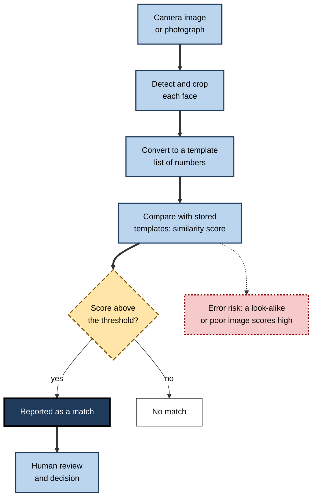
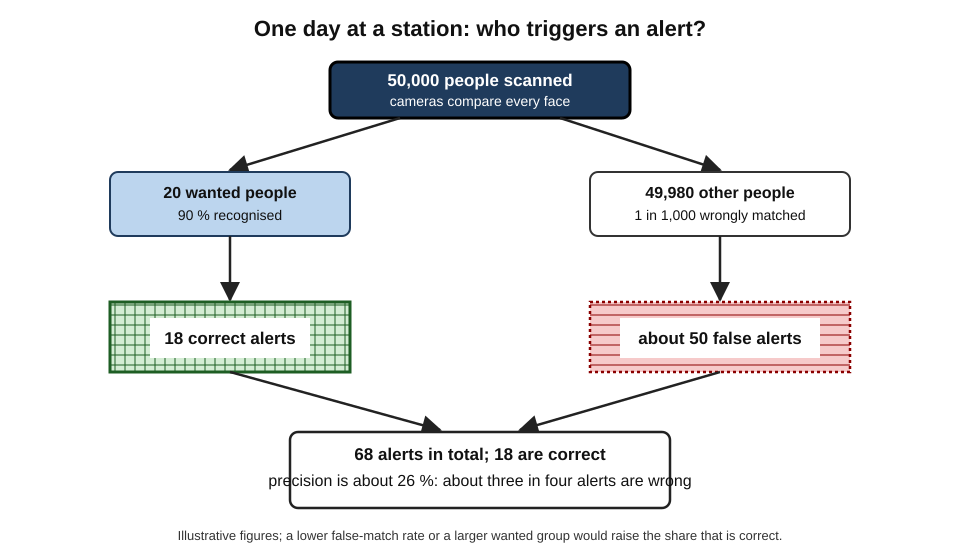
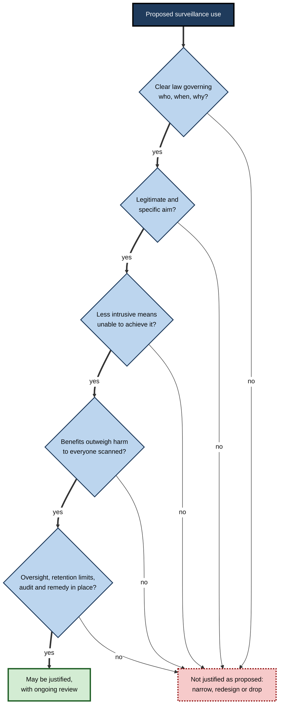
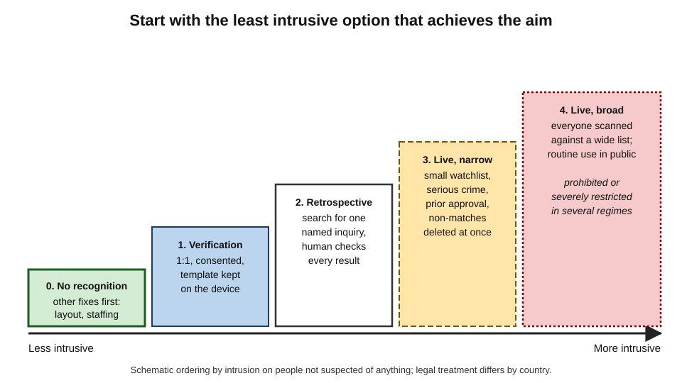
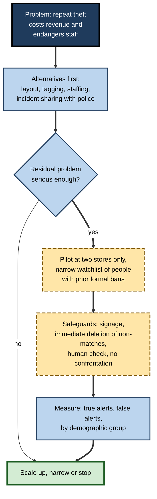

# G.9. Surveillance, facial recognition, and civil liberties

In 2017 a police van fitted with cameras parked outside a shopping centre in Cardiff. Software compared the faces of passers-by with a watchlist of people wanted by the police or of interest to them. A local man, Ed Bridges, was captured by the cameras twice without knowing why, and he later asked a court whether this was lawful. The question he raised applies far beyond one city: when cameras can recognise everyone, what happens to the ordinary freedom of walking down a street without being identified?

> **Definition — Surveillance:** the systematic observation or monitoring of people, their behaviour or their communications, usually to influence, manage, protect or control them.

> **Definition — Civil liberties:** the basic freedoms that protect individuals from unjustified interference by the state, including privacy, freedom of expression, freedom of assembly, freedom of movement and freedom from discrimination.

**Why it matters**

- **AI makes watching cheap, constant and searchable.** What once needed a person per target can now run over every camera feed, continuously.
- **Faces cannot be changed.** A password can be reset; a face cannot, so a leaked or misused face template is permanent.
- **Errors fall on people.** A false match can mean being stopped, arrested or refused entry.
- **Freedoms depend on not being watched.** People behave differently when they believe they are observed.
- **Law is moving.** Several jurisdictions have banned or restricted certain uses; others are still deciding.

---

## How Facial Recognition Works and What It Can Do

### Four different tasks

Facial recognition is a family of tasks with different risks. Mixing them up is the commonest source of confusion in public debate.

- **Verification (one-to-one)** — *Is this person who they claim to be?*
  - *e.g.* unlocking a phone; matching a passport photo to the traveller at a border gate.
  - The person usually takes part and has agreed.
- **Identification (one-to-many)** — *Who is this person, among many?*
  - *e.g.* searching a database of millions to name an unknown face in a crime-scene image.
- **Watchlist matching (live)** — *Is anyone in this crowd on a list?*
  - *e.g.* cameras in a street, station or shop comparing every passer-by with a list.
  - Everyone in view is scanned, including people who are not suspected of anything.
- **Analysis, not identification** — *What can be inferred from a face?*
  - *e.g.* estimating age, sex or claimed emotion; categorising people by inferred traits.
  - Scientific validity of emotion and trait inference is widely disputed.

> **Definition — Biometric data:** personal data produced by technical processing of a person's physical, physiological or behavioural characteristics — such as face, fingerprint, iris, voice or gait — that allows or confirms identification.

### How matching works

1. **Detect** a face in an image.
2. **Convert** it into a **template** — a list of numbers capturing distinguishing features, produced by a neural network.
3. **Compare** the template with stored templates and compute a similarity score.
4. **Decide** using a **threshold**: scores above it count as a match.

**Figure 1.** From camera image to match decision.

### Errors and thresholds

- **False match (false positive)** — the system says two different people are the same.
- **False non-match (false negative)** — the system fails to match two images of the same person.
- **The threshold trades one for the other.** A strict threshold reduces false matches and misses more true ones; a loose threshold does the reverse.
- **Image quality matters** — lighting, angle, resolution, masks, age of the photograph.
- **Performance differs by group.** Independent evaluations by national standards bodies have found that many algorithms produce more false matches for some demographic groups, particularly women and people with darker skin, although the best algorithms show much smaller differences.

> **Key point:** a system's published accuracy is measured on particular images under particular conditions. **Accuracy in the street, on a watchlist, is a different thing.**

### The base-rate trap

When a system scans many people to find a few wanted individuals, even a very low false-match rate yields mostly false alarms.

### Worked example (illustrative): a station watchlist

Cameras at a busy station scan **50,000** people in a day. The watchlist contains people wanted for serious offences. Suppose **20** wanted people truly pass through that day. The system correctly flags **90 %** of wanted people who pass and wrongly flags **1 in 1,000** innocent people.

1. **True alerts.** 90 % of 20 = **18**.
2. **Innocent people scanned.** 50,000 − 20 = 49,980.
3. **False alerts.** 49,980 ÷ 1,000 ≈ **50**.
4. **Total alerts.** 18 + 50 = 68.
5. **Share of alerts that are correct.** 18 ÷ 68 ≈ **26 %**.
6. **Meaning.** Roughly **three out of every four alerts point to an innocent person**, though the system looks 99.9 % specific.

*Illustrative figures.*

> **Formula — Precision of an alert:** true alerts ÷ all alerts. Here 18 ÷ 68 ≈ **0.26**. Precision falls when the people sought are rare among those scanned.

> **Watch out:** "the system is 99.9 % accurate" is meaningless without knowing **how many people are scanned, how many are truly sought and what happens after an alert**. Human review must be designed to resist automation bias, since officers tend to trust a machine's match.

**Figure 2.** Why most alerts can be false when the people sought are rare.

---

## What Is at Stake: Rights and Freedoms

### The rights engaged

- **Privacy and private life** — being identified and tracked in public, where traditionally one has some anonymity.
- **Freedom of expression and assembly** — attending protests, religious services or meetings of political groups.
- **Equality and non-discrimination** — unequal error rates and targeting of particular communities.
- **Due process and fair trial** — the ability to know and contest evidence derived from a system.
- **Freedom of movement** — being stopped, excluded or tracked.
- **Human dignity** — being reduced to a data point in a constant sorting process.

### Chilling effects

> **Definition — Chilling effect:** the discouragement of lawful behaviour, such as speaking, protesting or seeking information, because of fear of being watched or penalised.

**Study card — Jonathon Penney (Oxford Internet Institute; *Berkeley Technology Law Journal*, 2016), "Chilling Effects: Online Surveillance and Wikipedia Use"**

- **Design:** a time-series analysis of monthly traffic to 48 Wikipedia articles on terrorism-related topics, before and after the June 2013 revelations of mass government surveillance by Edward Snowden.
- **Results:**
  - Traffic to the terrorism-related articles **fell** immediately after the revelations, and stayed lower for the following months, a drop of about 20 per cent in the comparison used.
  - The decline appeared to be a lasting change in behaviour, not a short-lived reaction.
- **Conclusion:** awareness of surveillance can change what people read, even when what they read is lawful.
- **Caution:** it is a single observational study of one site; it indicates an effect but cannot show exactly why each reader changed behaviour.

> **Key point:** surveillance harms people even when no one is arrested. It changes what people feel safe to do, which is why the **possibility** of watching, not only its use, is a rights issue.

### The proportionality test

Courts and legislatures commonly ask whether an interference with rights is lawful, necessary and proportionate.

1. **Legal basis** — is there a clear, accessible law that sets out who may use the system, for what, and with what limits?
2. **Legitimate aim** — such as preventing serious crime or protecting national security.
3. **Necessity** — could a less intrusive method achieve the aim?
4. **Proportionality** — do the benefits justify the intrusion on rights, taking account of everyone scanned, not only those sought?
5. **Safeguards** — oversight, retention limits, audit, remedies.

> **Mnemonic — "Large Aims Need Proper Safeguards":** Legal basis, Aim, Necessity, Proportionality, Safeguards.

**Figure 3.** A proportionality test for a surveillance technology.

---

## Case Study: Bridges and South Wales Police

- **Situation:** from 2017 South Wales Police trialled **live facial recognition** (an automated system named AFR Locate). Vans with cameras scanned faces in public places — a shopping street, a defence exhibition, football matches — and compared them with watchlists of wanted or otherwise relevant people. Faces that did not match were deleted immediately.
- **The claimant:** Ed Bridges, a civil-liberties campaigner and former councillor, said that he was scanned in December 2017 in a shopping street and again in March 2018 at a protest against an arms fair. He brought a legal challenge supported by the civil-liberties organisation Liberty.
- **High Court (2019):** rejected the challenge, finding the use lawful and proportionate.
- **Court of Appeal (August 2020):** allowed the appeal on three grounds:
  - the **legal framework** left too much discretion to individual officers over who could be put on a watchlist and where the system could be used — it was not "in accordance with the law" under the European Convention on Human Rights, Article 8;
  - the **data protection impact assessment** was deficient, since it failed to deal properly with the risks to rights;
  - the force had not satisfied the **public sector equality duty**, because it had not taken reasonable steps to check whether the software had a bias on grounds of race or sex.
- **What the court did not decide:** it did not hold that live facial recognition is unlawful in itself, and the technology continued to be used elsewhere, under revised policies.
- **Lesson:**
  - The legal question was not whether the technology **works**, but whether **clear rules, assessment and bias testing** governed its use.
  - A pilot with good intentions can still fail the tests of legality, necessity and equality.
  - Cases like this are why regulators ask for **published policies**, **impact assessments** and **demographic testing** before deployment.

---

## Scraping, Databases and Commercial Use

### Face databases built from the web

**Study card — Garvie, Bedoya and Frankle (Georgetown Law Center on Privacy & Technology, 2016), "The Perpetual Line-Up"**

- **Question:** how widely is facial recognition used by United States police, and how is it regulated?
- **Method:** a year-long investigation using public records requests to more than 100 police departments.
- **Findings:**
  - Photographs of roughly **half of American adults** — including driver's licence and ID photographs of people who had never been arrested — were in databases that police could search with facial recognition.
  - Few departments had **rules** on who could be searched, audited their use or tested for accuracy and bias.
  - Systems were more likely to be used in communities that were already heavily policed.
- **Conclusion:** a technology was adopted at scale **without public debate** or clear legal limits, and people were placed in a permanent virtual line-up simply because they held an identity document.

### Case study: Clearview AI

- **Situation:** Clearview AI, a US company, built a database of billions of facial images **scraped from social media and websites** without the knowledge or consent of the people shown, and sold search access to law-enforcement agencies and others.
- **Responses across the world:**
  - Regulators in the **European Union, the United Kingdom, Canada, Australia** and elsewhere found that its processing of biometric data breached privacy law.
  - The UK Information Commissioner fined the company **£7.5 million** in 2022 and ordered it to stop processing UK residents' data and delete it.
  - The company challenged jurisdiction, arguing that it served foreign agencies only. In **October 2025** the UK Upper Tribunal held that the regulator **did** have jurisdiction, because the processing related to monitoring the behaviour of people in the UK, reinstating the enforcement against the company; further proceedings may follow.
  - In the United States, a settlement of lawsuits brought under the Illinois biometric privacy law (2022–2025) gave claimants a share in the company's value instead of cash.
- **Why it matters:**
  - It shows that **publicly available** does not mean **free to use** for biometric identification.
  - It tests how far national law reaches over foreign companies.
- **Lesson:** a company can build a powerful identification system from material that people shared for entirely different purposes — **context matters more than availability**.

> **Definition — Biometric categorisation:** assigning people to groups — by sex, ethnicity, sexual orientation, political or religious views — on the basis of their biometric data.

### Retail and workplace surveillance

- **Shops** use face recognition to flag people previously associated with theft; workplaces monitor employees through cameras, keystrokes and "productivity" scoring.
- **Risks:** misidentification, no due process, discrimination, loss of dignity, and a power imbalance in which the person has no meaningful choice.

**Study card — Federal Trade Commission and Rite Aid (United States, December 2023)**

- **Situation:** from about 2012 to 2020 the pharmacy chain Rite Aid used a facial-recognition system in hundreds of stores to identify customers it believed had shoplifted or behaved badly.
- **Findings by the regulator:**
  - The system generated many **false positives**, and these were more frequent in stores in lower-income and predominantly non-white neighbourhoods.
  - Staff received alerts with low-quality images and acted on them — following or searching customers, calling police, and accusing innocent people, including a child.
  - The company had not tested accuracy, trained employees adequately or monitored for bias.
- **Outcome:** a settlement banned the company from using facial recognition for surveillance for **five years** and required it to delete the data, notify people and put a security programme in place.
- **Lesson:** the harm came less from the algorithm alone than from **how the alerts were used** — with poor images, poor training and no check on errors or bias.

---

## Broader Surveillance with AI

### Beyond faces

- **Behavioural and gait analysis** — identifying people from how they walk.
- **Emotion recognition** — inferring feelings from face, voice or posture; scientific basis disputed, error rates high.
- **Predictive monitoring** — flagging "suspicious" behaviour in video.
- **Social media monitoring** — analysing posts for threats, protest organising or immigration status.
- **Location and communications data** — phone-location data purchased from commercial brokers.
- **Workplace and school monitoring** — keystroke, screen and attention tracking.

### Social scoring and population control

- **Social scoring** — rating people on behaviour across contexts and using the score to reward or punish.
- **Distinction:** a credit score, used within finance, differs from a general score used to limit access to unrelated services.
- **EU position:** the AI Act prohibits certain forms of social scoring by public and private actors where it leads to unjustified or disproportionate detrimental treatment in unrelated contexts.

> **Watch out:** "I have nothing to hide" misses the point. Privacy protects against **mistakes, misuse, discrimination and the loss of freedom to dissent** — and the question is not what an individual has to hide but what power others should have over them.

---

## Regulation and Responses

### The EU AI Act's approach to biometrics

- **Prohibited practices** (applying from February 2025) include:
  - building facial-recognition databases through **untargeted scraping** of images from the internet or CCTV;
  - **emotion recognition** in workplaces and education, except for medical or safety reasons;
  - **biometric categorisation** that infers sensitive characteristics such as race, political opinions or sexual orientation;
  - **real-time remote biometric identification** in publicly accessible spaces by law enforcement, with narrow exceptions for serious crimes, missing persons and imminent threats, subject to prior authorisation.
- **High-risk systems** include most other remote biometric identification and some biometric categorisation, subject to strict requirements.
- **Transparency duties** apply where people are exposed to emotion-recognition or biometric-categorisation systems.

### Elsewhere

- **United States:** no comprehensive federal law; some cities and states ban or limit government use of face recognition; the **Illinois Biometric Information Privacy Act** requires notice and written consent for collecting biometric identifiers and allows private lawsuits.
- **United Kingdom:** governed by data-protection law, human-rights law and equality law, rather than a specific statute; the Bridges judgment sets expectations for police.
- **Other jurisdictions:** approaches range from restricted use under data-protection law to widespread state deployment.

| | Prohibited or severely restricted | Permitted with safeguards | Generally accepted |
|---|---|---|---|
| Example uses | Untargeted scraping of faces; emotion recognition at work; real-time public identification for routine policing | Targeted live matching for serious crimes with prior authorisation; retrospective matching for investigations | One-to-one phone unlock; consented border e-gates |
| Main reason | Disproportionate intrusion on the many | Legitimate aim with proportionate controls | Person chooses and controls |
| Typical safeguards | Legal prohibition | Impact assessment; oversight; accuracy and bias testing; retention limits | Opt-in; local template storage; alternatives |
| Typical failure | Quiet adoption without rules | Weak threshold setting; unreviewed alerts | Function creep; weak consent |

> **Definition — Function creep:** the gradual widening of a system's use beyond its original, stated purpose.

---

## Responsible Practice

### For organisations considering surveillance technology

1. **Ask whether the problem needs surveillance at all.** Better lighting or staffing may achieve the aim.
2. **Choose the least intrusive form** — one-to-one verification over one-to-many identification; consent-based over covert.
3. **Assess before deploying.** Carry out a data protection and human-rights impact assessment, including equality testing on the intended population.
4. **Set a strict threshold and design the human review.** Officers or staff must receive training, know the false-alert rate and be free to disagree with the system.
5. **Limit the data.** Delete non-matches immediately; restrict watchlists to narrow, documented categories; set retention limits.
6. **Tell people.** Visible notices, public policies and a route to complain or seek redress.
7. **Audit and publish.** Report alerts, errors, outcomes and demographic performance regularly.
8. **Plan for stopping.** Define in advance what evidence would lead to the system being suspended.

**Figure 4.** Choosing the least intrusive form of recognition.

### Worked example (illustrative): a supermarket considers face recognition for theft

A supermarket chain loses revenue to repeat shoplifting and asks whether to use facial recognition to flag banned individuals at the door.

**Figure 5.** Reviewing a retail proposal using the proportionality questions.

1. **Alternatives.** Improved shelf layout, product tagging and incident-sharing with local police cut losses by a third in a trial.
2. **Residual problem.** Losses from a small number of repeat offenders remain.
3. **Proposal narrowed.** A two-store pilot, using a watchlist limited to people **formally banned** after a documented incident and reviewed monthly.
4. **Safeguards.** Clear signs at entrances; immediate deletion of non-matching faces; any alert checked by a trained manager against a clear photograph; no confrontation, only discreet offer of help; appeals handled by a named person.
5. **Measurement.** Weekly counts of alerts, correct alerts and complaints, split by demographic group where lawful.
6. **Decision rule.** If more than one in five alerts proves wrong, or error rates differ markedly between groups, the pilot is suspended.

*Illustrative figures.*

> **In practice:** a surveillance proposal is easier to defend if it starts from the **alternatives**, shrinks the **scope**, builds in **stopping rules** and publishes its **results**.

---

## Open Questions

- **Can live public facial recognition ever be compatible with a free society?**
  - Some argue that narrow, authorised uses are justified; others that the technology's very capacity for mass identification is incompatible with freedom of assembly.
- **Who should regulate private biometric surveillance?**
  - Shops, landlords, employers and event organisers raise issues that police-focused rules do not cover.
- **How should rules handle scraped public images?**
  - Law is divided on whether scraping publicly visible photographs for biometric databases is lawful.
- **Can accuracy gaps between groups be closed?**
  - Gaps have narrowed for the best algorithms; whether they can disappear in operational conditions is uncertain.
- **What counts as a chilling effect, and how can it be measured?**
  - Evidence is limited and context-dependent, yet the concept underlies much rights law.

---

## Summary

- **Surveillance** with AI is cheap, constant and searchable; faces are permanent identifiers, so misuse is hard to undo.
- Distinguish **verification (1:1)**, **identification (1:N)**, **live watchlist matching** and **analysis of traits or emotion**; they carry increasing risk.
- Errors depend on **thresholds**, image quality and group; the **base-rate trap** means most alerts can be false when the people sought are rare (18 of 68 correct in the example).
- Rights engaged: **privacy, expression and assembly, equality, due process, movement, dignity**; **chilling effects** show harm without arrest (Penney, 2016).
- A **proportionality test** — legal basis, aim, necessity, proportionality, safeguards — asks whether an intrusion is justified.
- **Bridges v South Wales Police** (2020): live facial recognition failed for lacking a clear legal framework, an adequate impact assessment and equality checks.
- **Clearview AI** and **Rite Aid** show scraping and poorly governed retail use produce enforcement; "publicly available" does not mean free to use.
- The **EU AI Act** prohibits untargeted face scraping, workplace and school emotion recognition, sensitive biometric categorisation and most real-time public identification by police; other regimes vary.
- Practice: use the **least intrusive form**, assess first, set thresholds and human review carefully, limit data, tell people, audit, and plan stopping rules.

---

## Self-Check

1. Distinguish verification, identification and live watchlist matching, with an example of each.
2. What is a template and what is a threshold in facial recognition?
3. Why can a system with a very low false-match rate still produce mostly false alerts?
4. In the station example, suppose the false-match rate falls to 1 in 10,000. Recalculate the share of alerts that are correct.
5. Why might facial-recognition errors fall unevenly across groups?
6. Describe the chilling effect and the evidence for it.
7. List the steps of the proportionality test.
8. On what grounds did the Court of Appeal find the South Wales Police use unlawful?
9. What did the Clearview AI cases show about "publicly available" images?
10. What went wrong in the Rite Aid case beyond the algorithm?
11. Which biometric practices does the EU AI Act prohibit?
12. Why does "I have nothing to hide" misunderstand privacy?
13. Rank these from least to most intrusive: phone unlock; identifying an unknown suspect in an image by searching a database; scanning everyone in a street against a watchlist.
14. A school proposes cameras to detect "student attention levels". Which questions would you raise?

### Answer Key

1. Verification: is this the claimed person (phone unlock). Identification: who is this among many (searching a database for an unknown suspect). Watchlist matching: is anyone in a crowd on a list (live street cameras).
2. A template is a list of numbers capturing a face's distinguishing features; a threshold is the similarity score above which the system reports a match.
3. When wanted people are rare among those scanned, the few false matches among many innocent people outnumber the true ones.
4. False alerts ≈ 49,980 ÷ 10,000 ≈ 5. Total alerts 18 + 5 = 23. Correct share 18 ÷ 23 ≈ 78 %.
5. Training data and image quality may under-represent some groups; algorithms differ; operational conditions differ; best algorithms show smaller gaps.
6. Fear of being watched leads people to avoid lawful activity. Penney found traffic to terrorism-related Wikipedia articles fell after the 2013 surveillance revelations and stayed lower, though one observational study cannot show the reasons.
7. Legal basis; legitimate aim; necessity (no less intrusive means); proportionality; safeguards.
8. The legal framework left too much discretion to officers (Article 8); the data protection impact assessment was deficient; the equality duty was not met because bias was not checked.
9. That images shared for social purposes cannot simply be reused to build a biometric identification database; regulators found breaches, and courts confirmed they have jurisdiction over foreign firms.
10. Poor-quality images, no accuracy testing, inadequate training, no bias monitoring, and staff acting on alerts by accusing and searching customers.
11. Untargeted scraping for face databases, emotion recognition in workplaces and education, biometric categorisation inferring sensitive traits, and most real-time remote biometric identification in public by law enforcement (with narrow exceptions).
12. Privacy protects against mistakes, misuse, discrimination and loss of freedom to dissent; it concerns power over people, not whether they have anything improper to conceal.
13. Phone unlock (least); database search for an unknown suspect; scanning everyone against a watchlist (most).
14. Is attention detection scientifically valid? What decisions will follow? Who sees the data and for how long? Is it proportionate for children? Does it discriminate against neurodivergent or disabled pupils? Can parents or pupils refuse? Are there less intrusive alternatives?

---

## Glossary

| Term | Meaning |
|---|---|
| Base-rate trap | Mostly false alerts when targets are rare among those scanned. |
| Biometric categorisation | Assigning people to groups from biometric data. |
| Biometric data | Personal data from physical or behavioural characteristics that allows identification. |
| Chilling effect | Discouragement of lawful behaviour from fear of being watched. |
| Civil liberties | Basic freedoms protecting individuals from unjustified state interference. |
| False match | The system says two different people are the same. |
| False non-match | The system fails to match two images of one person. |
| Function creep | Gradual widening of a system's use beyond its original purpose. |
| Identification (1:N) | Finding who someone is among many stored identities. |
| Proportionality | A test of whether an intrusion is justified by its benefits. |
| Social scoring | Rating people on behaviour and using the score to reward or punish. |
| Surveillance | Systematic observation of people or their behaviour. |
| Template | A numerical representation of a face used for matching. |
| Threshold | The similarity score above which a match is reported. |
| Verification (1:1) | Checking whether a person is who they claim to be. |
| Watchlist | A list of people to be searched for in live or recorded images. |
