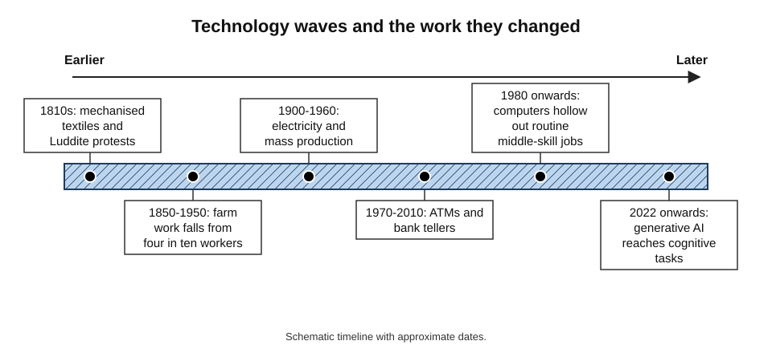
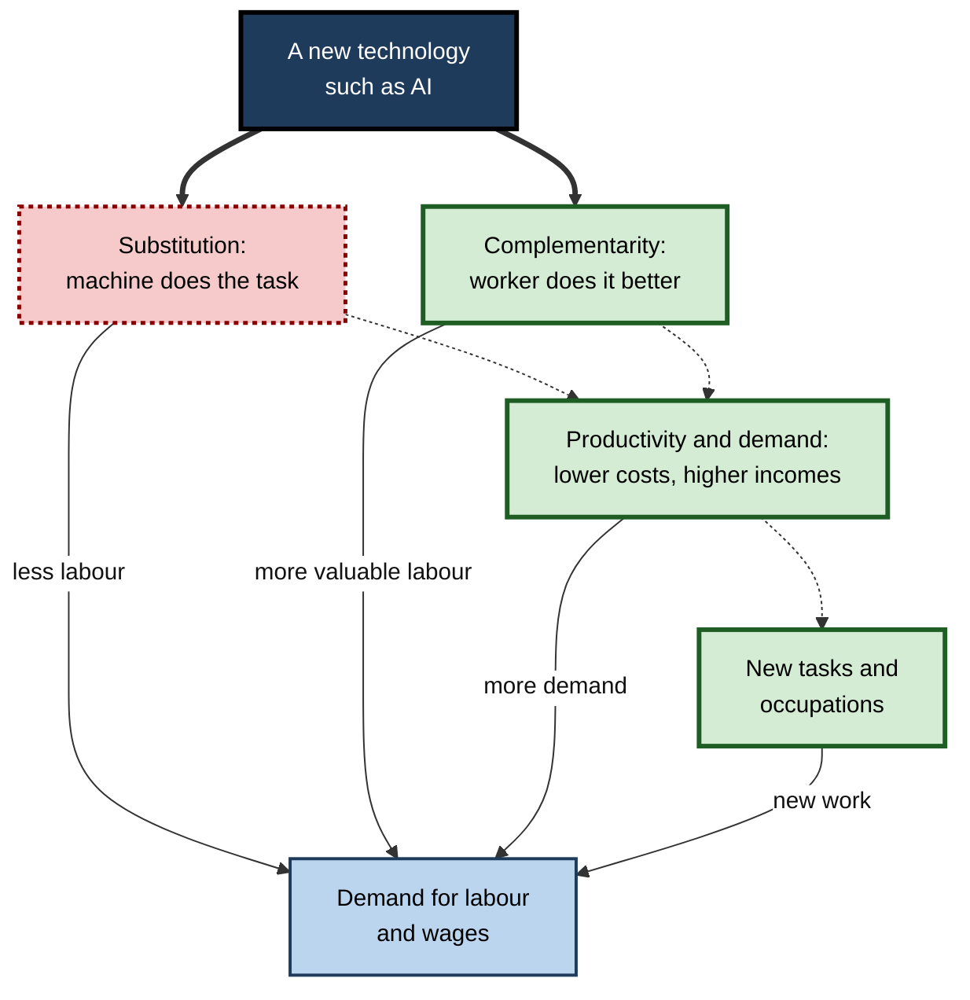
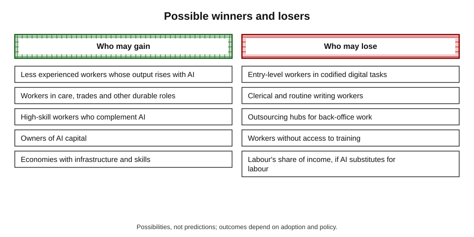
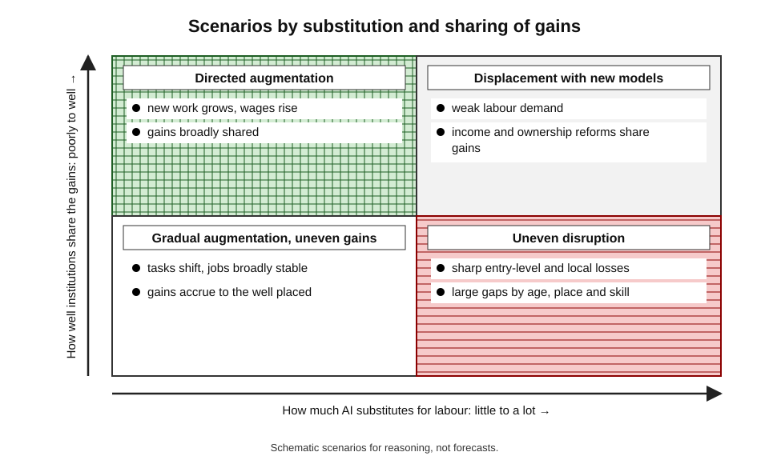
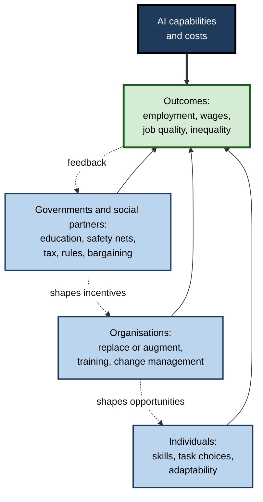

# H. AI and the Workforce

In 1930, in the depths of the Great Depression, the economist John Maynard Keynes predicted that within a century technology would raise living standards so far that people would need to work only about fifteen hours a week — and warned of a new disease he called **technological unemployment**. A century later living standards have indeed multiplied, hours have fallen only modestly, and the same worry returns each time a machine learns something people used to do.

Artificial intelligence revives the worry in a sharper form, because it reaches tasks — writing, analysing, coding, advising — that were long thought uniquely human.

> **Definition — AI and the workforce:** the study of how artificial intelligence changes the demand for human labour — which tasks, jobs, skills and wages grow or shrink — and how individuals, organisations and governments can respond so that the gains are widely shared.

**Why it matters**

- **For individuals** — decisions about education, specialisation and career moves depend on a realistic view of what will be valued.
- **For organisations** — every manager now decides, task by task, whether AI will replace, assist or leave alone the work of their people.
- **For societies** — the distribution of AI's gains determines inequality, political stability and the meaning of work.
- **For clear thinking** — the subject is full of confident forecasts, both utopian and catastrophic, that history and evidence do not support.

---

## A Long History of Technology and Work

### Four patterns that recur

- **Tasks are automated before whole occupations disappear.**
  - Mechanisation of weaving, farming and manufacturing changed jobs for decades before they shrank.
- **Productivity gains eventually raise demand for labour elsewhere.**
  - Cheaper goods leave households with income to spend on new goods and services, creating new work.
- **The transition is painful and uneven.**
  - Workers who lose out are often not those who gain; places and generations are affected differently.
- **The gains depend on institutions.**
  - Schooling, labour law, unions and social insurance decided who shared in them.

### Episodes

- **The Luddites (1811–1816).**
  - Skilled textile workers in the English Midlands broke machines, mainly where employers used them to cut wages and bypass customary trade practice; the government sent troops and made machine-breaking a capital offence.
  - The episode is often misread as hostility to technology as such; it was a conflict over **who controlled work and shared its returns**.
- **Engels' pause.**
  - The economic historian Robert Allen showed that in Britain, from about 1790 to 1840, output per worker rose substantially while real wages stagnated and profits grew.
  - Wages caught up only after decades, helped by new industries, schooling and collective bargaining.
- **Agriculture to industry to services.**
  - In 1900 about four in ten American workers farmed; today fewer than two in a hundred do.
  - The people who left farms did not remain unemployed; the economy created work that did not previously exist.
- **The computer era.**
  - Computers automated routine office and factory tasks from the 1980s, and employment polarised: growth in high-skill and low-wage service work, with a hollowing-out of middle-skill routine jobs.
- **The horse warning.**
  - Wassily Leontief argued in 1983 that humans might be like horses: their economic role was reduced by engines, and their number fell sharply.
  - The analogy is contested, because people, unlike horses, are also consumers, voters and creators of new demand.

**Figure 1.** Waves of technology and the work they changed.

> **Key point:** history supports **both** reassurance and caution. Total employment has not collapsed under technology, yet particular groups have suffered lasting losses, and the adjustment has sometimes taken a generation.

### Case study: ATMs and bank tellers

- **Situation:** automated teller machines spread across the United States from the 1970s. Many predicted the end of the bank teller.
- **What happened:**
  - the number of tellers needed per branch fell by roughly a third, from about twenty to about a dozen;
  - this lowered the cost of running a branch, so banks opened many more branches;
  - total teller employment **rose** between 1980 and 2010;
  - the job changed from counting cash to **selling, advising and relationship work**.
- **Later:** teller numbers began to decline after about 2010 as online and mobile banking spread.
- **Lesson (James Bessen; David Autor):** automating **one task** within a job can raise demand for the job by lowering costs and changing what the worker does — **until** a different technology removes the need for the branch itself. Predictions based on a single technology and a single job are unreliable.

---

## How Technology Changes the Demand for Labour

### Four forces

> **Definition — Substitution:** a technology performs a task previously done by a worker, so less labour is needed for that task.

> **Definition — Complementarity:** a technology makes workers more productive at a task, raising the value of their labour.

- **Substitution** — reduces demand for labour in the affected tasks.
- **Complementarity** — raises the value of the remaining tasks and the workers who do them.
- **Productivity and demand effects** — lower costs raise real incomes and can raise demand for goods and services, including labour-intensive ones.
- **New tasks** — new products and new ways of working create tasks and occupations that did not exist before.

**Figure 2.** The four forces through which technology changes the demand for labour.

### Skill-biased and task-based explanations

- **Skill-biased technical change** — the older view that technology raises the relative demand for **educated** workers.
  - It explains rising returns to a degree from the 1980s.
  - **Goldin and Katz** described a **race between education and technology**: when schooling keeps pace, inequality stays contained; when it lags, the premium for skills rises.
- **The task-based view** — the newer, sharper view that technology performs **tasks**, not skills, so it can raise or lower the demand for educated workers depending on the tasks it takes over.
  - It explains why middle-skill routine jobs fell while both high-skill and some low-skill jobs grew.
- **Why the difference matters for AI:** generative AI reaches tasks done by well-educated workers, so the old assumption that more education is always safer no longer holds automatically.

| | Skill-biased view | Task-based view |
|---|---|---|
| Unit of analysis | Skill level of workers | Tasks within jobs |
| Prediction for new technology | Benefits the more educated | Depends on which tasks it performs |
| Explains job polarisation? | Poorly | Well |
| Fits generative AI? | Poorly — educated workers' tasks exposed | Better — can handle exposure of cognitive tasks |

### The direction of technology is a choice

- **Daron Acemoglu and Simon Johnson, *Power and Progress* (2023):**
  - argued that the effect of technology on workers depends on whether it is directed at **replacing** or at **augmenting** them;
  - the direction is shaped by the incentives of firms, tax rules, the views of technologists and the bargaining power of workers;
  - in the post-war decades technology and wages rose together; since the 1980s, they have diverged in many countries.
- **"So-so automation" (Acemoglu and Restrepo):** automation that barely raises productivity but displaces workers — such as self-service checkouts that shift labour to customers — hurts workers without generating the gains that would compensate them.

> **Watch out:** "technology determines outcomes" is a trap. Technology sets the possibilities; **choices** by firms, governments and workers decide which are taken.

---

## Which Tasks and Jobs Are Exposed — and Which Are Not

- **The core logic.**
  - Tasks that are codified, digital, well-documented and easy to check are the most automatable; some entire occupations that bundle few such tasks can shrink.
  - Generative AI has moved the frontier into writing, analysis and coding, so exposure now reaches higher-paid, more educated, office-based work.
- **The resisting core.**
  - Work that depends on dexterity in varied physical settings, on trust and relationships, on accountability, or on judgement in unstructured situations is harder to replace; Moravec's paradox explains why physical competence is harder than chess.
- **Exposure is not loss.**
  - Estimates of exposed jobs vary widely with method: from under a tenth to nearly a half of employment in earlier studies; about one in four workers globally in the ILO's generative-AI index; about 40% of jobs worldwide in the IMF's analysis, rising to about 60% in advanced economies.
  - Exposure measures **technical potential**; adoption, cost, regulation and demand decide the outcome.

---

## Collaboration, Not Replacement: The Present Pattern

- **Most real use is augmentation.**
  - AI performs some tasks in a job; a person frames, checks, decides and remains accountable.
- **Combinations are not automatically better.**
  - A 2024 meta-analysis of 106 experiments found that human–AI teams on average did worse than the better of person or AI alone, though they did better in creative content tasks and where the human was the stronger partner.
- **Design decides.**
  - Giving people AI advice without good information or training can lower accuracy; routing clear cases to AI and hard cases to people can raise it.
- **Professions illustrate it best.**
  - Doctors, lawyers and engineers use AI to read, draft and design while remaining licensed and answerable, which slows replacement and shapes how tools are introduced.

> **Remember:** in the present pattern, **people do framing, judgement, checking and relationships; AI does retrieval, drafting, pattern detection and scale**.

---

## Evidence So Far

### What has been observed since 2022

- **Productivity studies at the task level** — experiments with writers, customer-service agents, consultants and programmers have found sizeable gains on suitable tasks, often larger for less experienced workers, but also errors when tools were used beyond their competence, and in one study a slowdown among experienced developers on their own projects.
- **Labour market data:**
  - broad measures — unemployment, occupational mix — showed no clear economy-wide disruption in the first years after generative AI arrived, according to analyses in 2025;
  - but studies of payroll data found **declines in employment of young workers in the most exposed occupations**, such as software development and customer service — a finding disputed because of other forces, such as interest rates and the post-pandemic correction in technology hiring;
  - online freelancing platforms showed falling demand for some writing and translation work.
- **Interpretation:** the pattern fits **early, concentrated effects at the entry level** more than mass displacement.

> **Watch out:** the evidence is **early and mixed**. Absence of visible economy-wide effects after a few years is not proof of future safety: the effects of electricity and computers took decades to show. Equally, early local effects do not prove an economy-wide trend.

### Why forecasts keep failing

- **Predictions of "half of jobs gone"** were widely reported from an occupation-based study, while task-based studies found much lower numbers.
- **Predictions that radiologists would be obsolete within years** proved wrong; imaging demand grew and radiologists remained scarce.
- **Predictions that driverless trucks would end trucking** in the mid-2010s were wrong; driverless taxis arrived later and in a few cities only.
- **Causes:** forecasters assume whole jobs are single tasks, ignore the demand response, ignore adoption costs and regulation, and overestimate how fast organisations change.

---

## Distribution: Who Gains and Who Loses

### Groups and dimensions

- **By skill and experience.**
  - Early studies suggest AI raises output more for **less experienced** workers by spreading the know-how of the best performers, narrowing gaps within occupations.
  - At the same time, entry-level tasks are the easiest to automate, threatening the first rung of the career ladder.
- **By occupation.**
  - Clerical, administrative, translation and routine writing roles face high exposure; skilled trades, care and many hands-on roles face little.
- **By gender.**
  - Women are over-represented in clerical work, which the ILO finds most exposed; they are also over-represented in care work, which is less exposed.
- **By age.**
  - Young workers face a thinner entry route; older workers may find retraining harder.
- **By place and country.**
  - Advanced economies face more exposure and more opportunity; low-income countries less exposure but weaker infrastructure and skills to benefit; outsourcing hubs may lose back-office work.
- **Between labour and capital.**
  - If AI substitutes for labour, a larger share of income may flow to owners of capital and a few high-skill workers; the **labour share** of income has been declining in many countries since the 1980s.

> **Definition — Labour share:** the portion of national income paid to workers as wages and benefits, as opposed to profits and returns to capital.

**Figure 3.** How AI's gains and losses may be distributed.

---

## Scenarios, Not Predictions

Because the future depends on technology and on choices, thoughtful analysis uses **scenarios** rather than single forecasts.

| Scenario | Technology | Labour market effect | Distribution | Typical response |
|---|---|---|---|---|
| Gradual augmentation | Steady progress; tools need supervision | Tasks shift; employment broadly stable | Gains shared if institutions adapt | Training, guidance, light regulation |
| Uneven disruption | Rapid in some tasks and sectors | Sharp local and entry-level losses | Sharp gaps by age, place and skill | Wage insurance, retraining, regional policy |
| Broad displacement | AI matches humans on most cognitive tasks | Persistent weak labour demand | Capital owners gain; labour share falls | New income and ownership models |
| Directed augmentation | Technology and policy steered towards complementing people | New work grows; wages rise | Broadly shared gains | Incentives for augmentation; strong worker voice |

**Figure 4.** Four scenarios arranged by how much AI substitutes for labour and how well institutions share the gains.

- **Signals to watch:**
  - hiring of junior staff in exposed occupations;
  - vacancy rates and wages by occupation;
  - the share of work tasks done by AI in firm data;
  - productivity growth that is broad rather than confined to a few firms;
  - labour share of income.

---

## Organisations: Choices That Shape Outcomes

- **Replace, augment or leave alone** — each firm decides task by task; the same technology can reduce headcount or expand output.
- **Where gains come from** — redesigning whole processes, not dropping tools onto old ones; early measured productivity can dip before it rises.
- **Skills** — shortages of people who can use and supervise AI make training an investment, not a cost; employers under-invest in general skills, which is why public and shared systems matter.
- **People** — staff watch how leaders talk about AI; announcements are read as statements about jobs, and trust determines whether people use the tools or resist them.
- **Management by software** — platforms and workplaces increasingly use algorithms to assign, monitor and evaluate workers, raising questions about transparency, review and fairness.
- **Workforce structure** — new roles appear in building, governing and integrating AI, but the numbers so far are small compared with the jobs affected, and hidden data work behind AI is often low-paid.

### The individual's view: a personal task audit

> **Definition — Task audit:** an analysis of one's own role that breaks it into tasks and rates each by time spent, exposure to AI, value and enjoyment, in order to plan how to adapt.

**Worked example (illustrative): a marketing analyst's task audit**

A marketing analyst lists her weekly tasks. *Illustrative figures.*

| Task | Share of week | AI can do or speed up substantially? | Value of the human contribution |
|---|---|---|---|
| Pulling and cleaning campaign data | 25% | Yes | Low |
| Building standard weekly reports | 20% | Yes | Low |
| Interpreting results and advising managers | 20% | Partly | High |
| Designing tests and experiments | 15% | Partly | High |
| Presenting to clients and negotiating budgets | 15% | No | High |
| Learning new tools and methods | 5% | — | High |

1. **Exposed share:** the first two tasks account for 25% + 20% = **45%** of her week.
2. **Core:** interpreting, test design and client work account for 20% + 15% + 15% = **50%** — the part where human judgement and relationships matter.
3. **Plan:** use AI to compress the first two tasks; invest the freed time in interpretation, experimentation and client relationships; develop skills in supervising AI analysis.
4. **Risk:** if her employer simply expects the same volume of reports with fewer people, the savings become headcount cuts rather than growth in her role — so she should record outcomes and shape how the time is used.

> **In practice:** repeat a task audit every six months; the exposed share changes as tools change.

---

## The Policy Landscape

- **Preparation** — education systems, lifelong learning accounts, labour market information and notice rules.
- **Cushioning** — unemployment insurance, short-time work and social protection.
- **Transition** — job-search help, retraining that is demand-led and linked to employers, wage insurance, and regional development.
- **Direction** — tax systems that favour capital over labour, rules about AI in hiring and monitoring, and worker voice through bargaining and consultation.
- **Income floors** — proposals for a universal basic income have been revived, though evidence from cash experiments shows modest effects on work and the case depends on how severe displacement proves to be.
- **Platform work** — new laws, such as the European Union's platform directive, aim to give gig workers rights to transparency and human review of automated decisions.

> **Key point:** the effect of AI on the workforce is **not predetermined**. Education, institutions, tax design and bargaining power influence whether AI is used to replace or to augment, and who benefits.

**Figure 5.** How individual, organisational and public decisions together shape the outcome of AI for workers.

---

## A Realistic Position

- **Neither utopia nor catastrophe** — history and current evidence support neither "no job will remain" nor "nothing will change".
- **Task thinking** — ask which tasks change, not whether a job will vanish.
- **Time horizons** — expect early effects at the entry level and in digital, codified tasks; expect larger effects to arrive over a decade or more, as organisations redesign work.
- **Judgement and responsibility** — human accountability, relationships and judgement remain valued, and become more valuable where AI output must be checked.
- **Literacy as a baseline** — understanding what AI can and cannot do, and using it responsibly, is becoming a general workplace expectation, much like earlier digital skills.
- **Action over prediction** — individuals, firms and governments that build skills, redesign work thoughtfully and keep safety nets in place do better under any scenario.

> **Mnemonic — "TASKS":** **T**hink in tasks, **A**ssess exposure honestly, **S**kill up continuously, **K**eep judgement and relationships strong, **S**hape the choices — five habits for working through AI change.

---

## Monitoring the Transition: Indicators and Data

Decisions about AI and work are made under uncertainty, so measurement matters.

### What to watch

- **Hiring of juniors in exposed occupations** — early signs of change often show as fewer entry-level vacancies before layoffs.
- **Vacancies and wages by occupation** — shifts in demand for specific skills.
- **Task-level adoption** — what share of work tasks firms actually perform with AI, from usage data and surveys.
- **Productivity** — whether gains are broad or confined to a few firms, and whether they appear in output per hour.
- **Labour share and inequality** — whether wages keep pace with output.
- **Job quality** — hours, intensity, surveillance, autonomy and security, not only the number of jobs.
- **Transitions** — what happens to workers who leave exposed jobs: how quickly they find work and at what pay.

### Kinds of evidence and their limits

| Source | What it shows | Limitation |
|---|---|---|
| Official labour force surveys | Employment, unemployment, occupation, hours | Slow; occupation categories lag new work |
| Payroll records | Employment and pay by age and firm, near real time | Coverage limited to firms using a provider |
| Job advertisements | Skills demanded and new titles | Biased towards office and technology work; advertised is not hired |
| Platform and usage data | How people actually use AI at work | Reflects one company's users |
| Employer surveys | Plans and expectations | Stated intentions; optimistic or pessimistic bias |
| Worker surveys | Experiences, fear, use and training | Self-report; sampling issues |
| Experiments and case studies | Causal effects on tasks | Limited scope; hard to generalise |

> **Key point:** no single source is reliable alone. Credible conclusions rest on **several independent sources pointing the same way**, with attention to who is counted and who is missing.

### Worked example (illustrative): reading three signals

An analyst sees three indicators for a software-services sector. *Illustrative figures.*

| Indicator | Two years ago | Now | Change |
|---|---|---|---|
| Junior developer vacancies | 1,000 | 700 | −30% |
| Senior developer vacancies | 800 | 840 | +5% |
| Average wage of existing developers | 100 (index) | 104 | +4% |

1. **Compute changes:** junior vacancies (700 − 1,000) ÷ 1,000 = −30%; senior (840 − 800) ÷ 800 = +5%.
2. **Pattern:** demand has shifted from entry-level to experienced staff while wages for those in post rise.
3. **Possible explanations:** AI tools reduce the need for junior tasks; or interest-rate effects and a post-boom correction hit hiring of juniors first.
4. **How to decide:** check other sectors with different AI exposure; compare with periods before generative AI; look at firms that adopted AI heavily versus lightly.
5. **Conclusion:** the data are **consistent with** AI-related entry-level erosion, but do not prove it.

> **Watch out:** a single pattern with several plausible causes should be reported as such. Overclaiming harms trust in the evidence on both sides of the debate.

---

## Open Questions

- **Will AI's gains be broadly shared?**
  - History shows that gains were shared only after institutions and collective action made it so; the same is not assured now.
- **Will entry-level erosion break the career ladder?**
  - If juniors no longer learn on routine tasks, new routes to expertise are needed.
- **Is this wave different in kind?**
  - Past technologies spared general cognitive work; if AI matches humans across most cognitive tasks, historical analogies may fail.
- **How fast will adoption move?**
  - Organisational redesign has been slow in the past; AI diffusion has been unusually fast among individuals.
- **What is the right measure of success?**
  - Employment alone neglects pay, security, meaning and dignity; broader measures of job quality are needed.

---

## Summary

- **AI and the workforce** concerns how AI changes demand for labour — tasks, jobs, skills and wages — and how responses shape the sharing of gains.
- **History** shows tasks automated before jobs vanish, new work arising, painful uneven transitions and institutions deciding who benefits (Luddites, Engels' pause, ATMs and tellers).
- Four forces: **substitution, complementarity, productivity and demand effects, new tasks**; the **task-based view** fits AI better than the skill-biased view.
- The **direction** of technology is a choice (Acemoglu and Johnson); "so-so automation" harms workers without large gains.
- Exposure now reaches **educated, office-based work**; exposure is **not** loss — estimates range widely and adoption depends on cost, reliability, regulation and demand.
- The dominant pattern is **collaboration**; combinations do not automatically beat the best single party, so design matters.
- **Evidence so far:** gains at task level, early declines in some entry-level hiring, no clear economy-wide disruption — all contested and early.
- **Distribution** differs by skill, age, gender, place, country and between labour and capital.
- Use **scenarios** and signals rather than single forecasts.
- Organisations choose replace or augment; individuals should audit tasks; governments shape preparation, cushioning, transition and direction.
- Habits: **TASKS**.

---

## Self-Check

1. Define AI and the workforce and explain why the topic is a recurring concern.
2. Name four patterns in the history of technology and work, with an example for each.
3. What did the Luddites actually protest about?
4. What happened to bank tellers after the spread of ATMs, and what does it teach?
5. Distinguish substitution from complementarity, and name the other two forces.
6. Compare the skill-biased and task-based explanations of technological change.
7. What is "so-so automation"?
8. Why is exposure not the same as job loss? Give two figures that illustrate the range of estimates.
9. Summarise the evidence from 2022–2025 on AI and employment, including one caveat.
10. Why have forecasts about technology and jobs repeatedly failed?
11. Describe how AI's effects may differ by experience, gender, age and country.
12. Name the four scenarios and one signal that would help distinguish them.
13. A marketing analyst finds 45% of her week is highly exposed. Advise her, and say what a manager should do.

### Answer Key

1. The study of how AI changes demand for labour — tasks, jobs, skills and wages — and how responses shape who gains. It recurs because each wave of automation raises fears of technological unemployment.
2. Tasks automated before jobs vanish (weaving); productivity raises demand elsewhere (agriculture to industry and services); transitions are uneven (Engels' pause); institutions decide sharing (schooling and bargaining).
3. Mainly the use of machines to cut wages and bypass trade customs — a conflict over control and the sharing of returns, not technology as such.
4. ATMs reduced tellers per branch, which lowered branch costs and led to more branches, so teller employment rose to 2010 as the job shifted to relationship work; later online banking reduced it. Lesson: effects of automating one task depend on demand and on later technologies.
5. Substitution: a machine does the task, reducing labour needed. Complementarity: makes workers more productive and valuable. Others: productivity and demand effects, new tasks.
6. Skill-biased: technology favours educated workers; task-based: technology performs tasks, so effects depend on which tasks. The task view explains polarisation and AI's reach into educated work better.
7. Automation that barely raises productivity but displaces workers, such as self-checkouts that shift work to customers.
8. Exposure measures technical potential; adoption depends on cost, reliability, regulation and demand. Estimates range from 9% to 47% of US or OECD jobs by method, or about one in four workers (ILO) to about 40% worldwide (IMF).
9. Large gains on suitable tasks in experiments; no clear economy-wide disruption through 2025; declines in employment of young workers in highly exposed occupations. Caveat: other causes, such as interest rates and technology-sector corrections, may explain declines.
10. They treat jobs as single tasks, ignore demand responses, adoption costs and regulation, and overestimate organisational speed.
11. Less experienced workers gain more within occupations but entry-level tasks are exposed; clerical work, where women are over-represented, is most exposed; young workers face thinner entry routes; advanced economies are more exposed but better placed, while low-income countries may lack infrastructure.
12. Gradual augmentation, uneven disruption, broad displacement, directed augmentation. Signals: junior hiring in exposed occupations, wages and vacancies by occupation, labour share, broad productivity growth.
13. Compress routine tasks with AI, invest in interpretation, experimental design and client work, supervise AI analysis, track outcomes and repeat the audit. Managers should decide in advance how freed time is used, redesign roles and reskill rather than only cut headcount.

---

## Glossary

| Term | Meaning |
|---|---|
| Augmentation | Using technology to make workers more capable while they stay in the task. |
| Complementarity | A technology raising the productivity and value of workers' labour. |
| Directed technology | The idea that firms and policy steer innovation towards replacing or augmenting labour. |
| Exposure | Share of tasks that AI could technically perform or speed up. |
| Job polarisation | Growth of high- and low-wage jobs with decline of middle-skill routine jobs. |
| Labour share | Portion of national income paid to workers. |
| Skill-biased technical change | Technology that raises relative demand for educated workers. |
| So-so automation | Automation with little productivity gain that displaces workers. |
| Substitution | A technology doing a task and reducing labour needed for it. |
| Task audit | Breaking a role into tasks and rating each for exposure and value. |
| Task-based approach | Analysing technology's effect on tasks rather than whole jobs. |
| Technological unemployment | Job loss caused by technology outpacing the creation of new work. |
