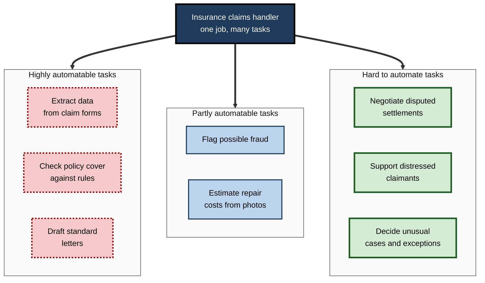
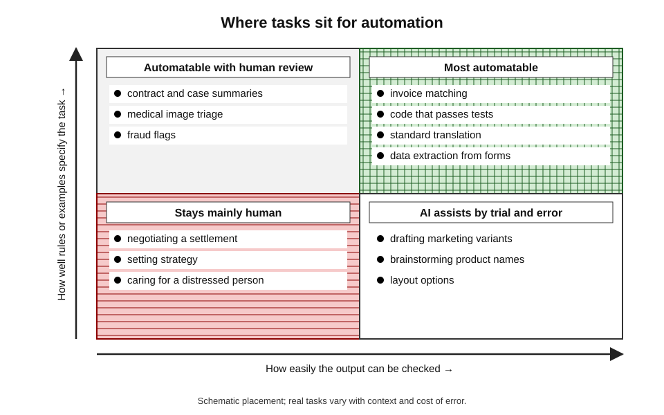
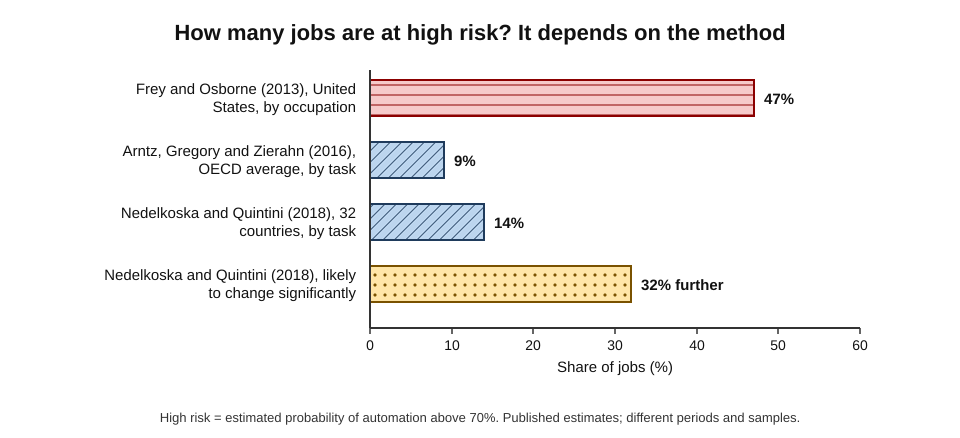
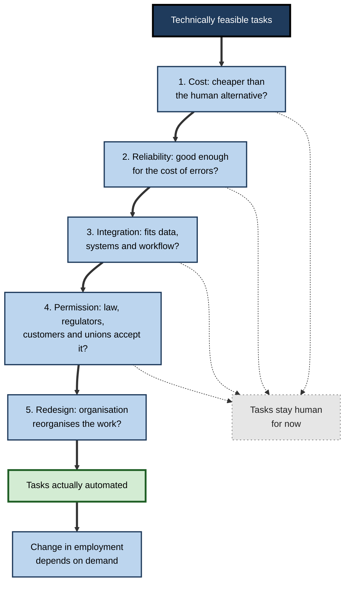
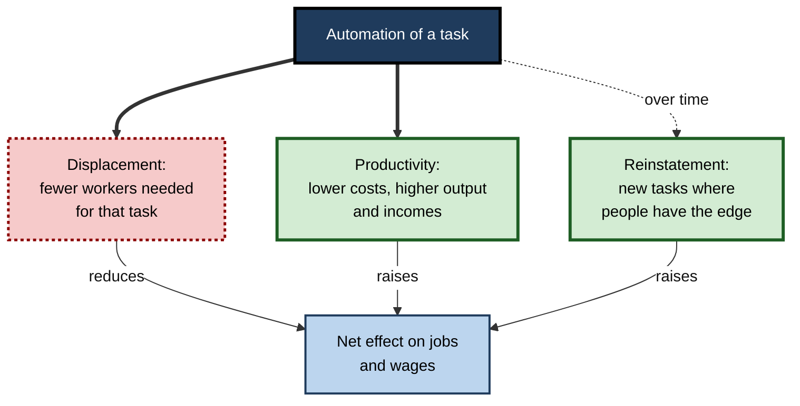

# H.1. Which jobs AI is likely to automate and why

In the 1920s, one of the most common jobs for young American women was telephone operator: sitting at a switchboard, plugging cords to connect each call by hand. Within two decades, mechanical switching had removed the need for most of them. Today a customer-service agent, a translator or a junior programmer watches software draft in seconds what used to fill a morning. The question in each era is the same — **which work will machines take over, and why that work rather than other work?**

> **Definition — Automation:** the use of a machine or software system to perform a task that a person previously performed, so that the task no longer needs human labour, or needs much less of it.

**Why the question matters**

- **Careers** — a person choosing a field, a degree or a specialism is making a bet on which tasks will still need people in twenty years.
- **Organisations** — workforce plans, hiring and training budgets depend on judging which roles will shrink, grow or change shape.
- **Public policy** — governments must decide where to put retraining money and how to support workers who are displaced.
- **Clear thinking** — headlines claiming that "half of all jobs" will vanish, or that "no jobs will be lost", are both wrong in instructive ways.

---

## Tasks, Not Jobs

The most important idea in this subject is that technology automates **tasks**, and jobs are bundles of tasks.

> **Definition — Task:** a unit of work activity that produces an output, such as checking an invoice, answering a customer query or welding a seam.

> **Definition — Occupation:** a set of jobs with similar bundles of tasks, such as "accounts clerk" or "nurse", as defined in official classifications.

**Why the distinction changes the answer**

- A job rarely consists of one task.
  - *e.g.* a paralegal searches documents, summarises cases, drafts letters, files court papers, liaises with clients and checks deadlines.
- A technology that performs **some** of those tasks changes the job; only one that performs nearly **all** of them, more cheaply, removes it.
- Whole occupations disappear mainly when they were **narrow bundles** to begin with.
  - *e.g.* lift operators, switchboard operators, typesetters.

> **Key point:** "Will AI take my job?" is the wrong first question. The better questions are "Which of my tasks can AI perform?", "How much of my time do they take?" and "What remains when they are gone?"

**Figure 1.** One job decomposed into tasks with different exposure to automation.

### The task framework

- **David Autor, Frank Levy and Richard Murnane (2003)** sorted tasks along two lines:
  - **routine** (follows explicit rules) versus **non-routine** (needs judgement or adaptation);
  - **cognitive** versus **manual**.
- Computers from the 1970s to the 2010s automated mainly **routine** tasks of both kinds.
- **Generative AI** reaches into **non-routine cognitive** tasks — drafting, summarising, translating, coding — that earlier software could not touch.

> **Definition — Routine task:** a task that can be fully specified as a sequence of explicit rules that a machine could follow.

### Polanyi's paradox

- **Michael Polanyi (1966):** "we can know more than we can tell."
- **David Autor (2014)** applied the idea to automation:
  - classic software needs a programmer to **write down** the rules;
  - tasks that people perform by **tacit knowledge** — recognising a face, judging a mood, writing persuasively — resisted automation because nobody could state the rules.
- **Machine learning** partly dissolves the paradox:
  - it **infers** rules from examples instead of being told them;
  - so tasks with abundant examples become automatable even when no one can explain how they are done.

> **Definition — Polanyi's paradox:** the observation that people can perform many tasks they cannot explain, which limited rule-based automation to tasks whose steps could be written down.

> **Watch out:** machine learning has not abolished Polanyi's paradox. It replaces explicit rules with **examples**, so tasks with few examples, rare cases or no recorded outcomes still resist it.

---

## What Makes a Task Automatable

### Seven properties that raise automation potential

1. **Codified or well-documented** — clear procedures, forms, rules or standards.
   - *e.g.* checking an expense claim against a travel policy.
2. **Rich in data** — many past examples with known correct outcomes.
   - *e.g.* millions of labelled transactions for fraud detection.
3. **Digital inputs and outputs** — the work begins and ends as text, numbers, images or code.
   - *e.g.* translating a document; writing a SQL query.
4. **Easy to verify** — a correct answer can be checked quickly and cheaply.
   - *e.g.* code that passes its tests; a reconciliation that balances.
5. **Low cost of error** — mistakes are cheap, rare or easily reversed.
   - *e.g.* a product description that can be edited.
6. **High volume and repetition** — the task recurs often enough to repay the investment.
   - *e.g.* processing thousands of invoices a day.
7. **Bounded context** — little depends on unwritten knowledge of the people, history or politics around the task.
   - *e.g.* formatting a reference list, compared with drafting a sensitive board paper.

> **Mnemonic — "CODE VBC":** Codified, data-rich (Observations), Digital, Easy to check, Volume, Bounded context, Cheap errors — the more letters a task ticks, the likelier it is to be automated.

### Properties that hold automation back

- **Physical dexterity in unstructured settings** — tasks with irregular objects and changing environments.
  - *e.g.* a plumber under a sink in an old house.
- **Live social interaction** — persuasion, negotiation, care, leadership.
- **Accountability** — a named person must answer for the outcome in law or in a profession.
- **Rare, high-stakes exceptions** — the unusual case is often the reason the job exists.

**Figure 2.** Tasks placed by how well they can be specified from data and how easily their output can be checked.

### Generative AI shifts the frontier

| | Earlier automation (robots, rule-based software) | Generative AI |
|---|---|---|
| Typical tasks reached | Routine manual and routine cognitive | Non-routine cognitive tasks with text, image or code outputs |
| What it needs | Explicit rules or a fixed physical setting | Very large example sets; a task expressible in language |
| Occupations most exposed | Production workers, clerks, book-keepers | Clerical support, writers, translators, programmers, customer service, some analysts |
| Pay level of exposed work | Mostly middle-wage | Middle- and higher-wage, more educated |
| Weak point | Anything outside its rules | Accuracy, reliability and verification on unfamiliar cases |

- The **exposure profile reverses**: higher-paid, more educated, office-based work is now more exposed than before.
  - A widely cited 2023 analysis by OpenAI and University of Pennsylvania researchers reached this conclusion for the United States.
- **Physical, manual work** that robots still find hard is now comparatively **less** exposed.

> **Key point:** generative AI did not change *why* tasks are automated — codification, data, verifiability and cost still decide. It changed *which* tasks meet those conditions, because so much knowledge work turns out to be well represented in written examples.

---

## Measuring Automation Risk

### Occupation-based estimates

**Study card — Carl Benedikt Frey and Michael Osborne, University of Oxford (working paper 2013; journal version 2017)**

- **Question:** how susceptible are 702 US occupations to computerisation?
- **Method:**
  - machine-learning experts labelled 70 occupations as automatable or not;
  - a statistical model extended the labels to all occupations using three "bottlenecks": perception and manipulation, creative intelligence and social intelligence.
- **Result:** about **47%** of US employment was in occupations with a high (over 70%) probability of automation, over an unspecified period "perhaps a decade or two".
- **Reception:** cited thousands of times; widely reported as "half of all jobs will disappear", which the authors did not claim.
- **Main criticism:** it treated whole occupations as automatable, ignoring the different tasks within them.

### Task-based estimates

**Study card — Melanie Arntz, Terry Gregory and Ulrich Zierahn, for the OECD (2016)**

- **Method:** used survey data on the tasks individual workers actually do, rather than occupation averages.
- **Result:** on average across 21 OECD countries, about **9%** of jobs were at high risk of automation.
- **Reason for the gap:** many workers in "automatable" occupations spend much of their time on tasks that are hard to automate, such as face-to-face interaction.

**Study card — Ljubica Nedelkoska and Glenda Quintini, for the OECD (2018)**

- **Coverage:** 32 countries, using worker-level task data.
- **Result:**
  - about **14%** of jobs at high risk (over 70% probability);
  - a further **32%** likely to change significantly (50–70%).
- **Who is most exposed:** workers with low education, in low-paid jobs, and young people in entry-level roles.

**Figure 3.** Estimates of the share of jobs at high risk of automation from occupation-based and task-based methods.

| | Occupation-based (Frey and Osborne) | Task-based (OECD studies) |
|---|---|---|
| Unit of analysis | Whole occupation | Tasks done by individual workers |
| Treats a paralegal as | One automatable bundle | A mix of automatable and resistant tasks |
| Typical headline | Nearly half of jobs at high risk | About one in ten to one in seven at high risk |
| Strength | Simple, comparable across occupations | Captures variation within occupations |
| Weakness | Overstates loss of whole jobs | Depends on survey task data and expert judgement of feasibility |

### Exposure indices in the generative AI era

> **Definition — Exposure:** the share of an occupation's tasks that an AI system could, in principle, perform or speed up substantially. Exposure measures **technical potential**, not job loss.

- **Approach:** score each task in an occupational database (in the United States, O\*NET, with about 1,000 occupations and tens of thousands of tasks) for whether AI could perform it.
- **International Labour Organization (2023; refined index 2025):**
  - about **one in four** workers worldwide is in an occupation with some generative AI exposure;
  - **clerical** occupations are the most exposed, followed increasingly by digitised professional and technical roles;
  - women are more often in the highest-exposure group (about 4.7% of female employment against 2.4% of male), mainly because clerical work is female-dominated;
  - the ILO concluded that **transformation** of jobs is more likely than outright replacement for most exposed occupations.
- **Usage-based measures** — newer studies count what people actually ask AI systems to do at work.
  - *e.g.* a 2025 Microsoft Research analysis of 200,000 anonymised conversations with its Copilot assistant found the highest overlap for interpreters and translators, writers, customer-service representatives and sales roles, and the lowest for hands-on healthcare support, construction and other physical work.

> **Watch out:** a high exposure score does not mean a job will be lost. Exposure is compatible with **automation** (the AI does the task instead of the worker), **augmentation** (the worker does the task faster or better) or **no change** (adoption never happens). The authors of the Microsoft study warned explicitly against reading their scores as forecasts of job loss.

---

## From Technical Feasibility to Actual Automation

Being *able* to automate a task does not mean it *will* be automated. Five filters lie between the two.

**Figure 4.** The filters between what AI can do and the jobs it actually displaces.

### The five filters

- **Cost** — automation must be cheaper than labour once all costs are counted.
  - *e.g.* a 2024 study by researchers at the Massachusetts Institute of Technology of computer-vision tasks in US firms estimated that only about a quarter of the wages paid for vision-based tasks would be economically worth automating at then-current costs.
- **Reliability** — the tolerable error rate depends on the cost of an error.
  - A 95%-accurate draft email is useful; a 95%-accurate drug-dosage check is not.
- **Integration** — data must be accessible, systems connected, and the output fit the next step in the process.
- **Permission** — regulation, professional rules, liability, customer acceptance and collective agreements.
- **Redesign** — the largest gains usually come only when the organisation reorganises the whole process, which takes years.

> **Watch out:** the MIT computer-vision estimate applies to one family of tasks at one point in time; costs of AI systems fall quickly, so the economically viable share rises over time.

### Displacement and reinstatement

**Daron Acemoglu and Pascual Restrepo** describe three forces that together decide the effect on employment:

- **Displacement effect** — machines take over tasks workers did; demand for that labour falls.
- **Productivity effect** — cheaper production raises output and incomes, increasing demand for labour in other tasks and sectors.
- **Reinstatement effect** — new tasks are created in which people have the advantage.
  - *e.g.* data annotation, AI system supervision, new kinds of analysis.

**Figure 5.** Three forces that together decide how automation changes employment.

> **Definition — Reinstatement effect:** the creation of new tasks and occupations in which human labour has a comparative advantage, offsetting the displacement caused by automation.

**Study card — Daron Acemoglu and Pascual Restrepo, "Robots and Jobs" (*Journal of Political Economy*, 2020)**

- **Setting:** US local labour markets, 1990–2007, comparing areas with more and fewer industrial robots.
- **Result:** one additional robot per thousand workers was associated with a fall of about **0.2 percentage points** in the employment-to-population ratio and about **0.4%** in wages.
- **Interpretation:** for robots in that period, displacement outweighed the productivity and reinstatement effects **locally**.
- **Caveat:** studies of other countries found different balances; German research found manufacturing job losses offset by gains in services.

> **Key point:** whether automation reduces employment in a field depends on **demand**. If cheaper output leads people to buy much more of it, employment can rise even as each unit needs less labour.

> **Example:** when spreadsheets automated hand calculation in the 1980s, the number of book-keeping clerks fell, but demand for financial analysis rose so much that the number of accountants and analysts grew.

---

## The Evidence Since 2022

The early evidence on generative AI is still thin and contested. Three findings stand out.

**Study card — Xiang Hui, Oren Reshef and Luofeng Zhou, online freelancing (published 2024)**

- **Setting:** a large online freelancing platform, before and after the release of ChatGPT in November 2022.
- **Result:** freelancers in writing-related work saw a small but significant fall in the number of jobs won (about 2%) and in monthly earnings (about 5%) relative to other freelancers; image-generation tools had a similar effect on image-related work.
- **Surprise:** the highest-quality freelancers were **not** protected; if anything, they lost more.
- **Interpretation:** substitution showed up first in short, well-specified, digital tasks bought on a spot market — exactly the kind of work that scores highest on automatability.

**Study card — Erik Brynjolfsson, Bharat Chandar and Ruyu Chen, Stanford University, "Canaries in the Coal Mine?" (2025)**

- **Data:** monthly payroll records for millions of US workers from the payroll firm ADP.
- **Result:**
  - from late 2022, employment of workers aged **22–25** in the most AI-exposed occupations (such as software development and customer service) fell by roughly **13–16%** relative to the least exposed occupations, depending on version and specification;
  - employment of older workers in the same occupations held steady or grew;
  - declines were concentrated where AI is used mainly to **automate** rather than to **augment** work.
- **Interpretation:** AI may first reduce **hiring at the entry level**, where tasks are most codified and least dependent on experience.

> **Watch out:** this finding is **contested**. Other researchers argue that the decline in AI-exposed jobs began before ChatGPT, and that higher interest rates and the post-pandemic correction in technology hiring explain much of it. Payroll data also cover only firms using one provider. Treat it as an early warning, not a settled result.

### Why entry-level work is exposed

- **Junior tasks are the most codified** — first drafts, document review, simple code, data cleaning, standard replies.
- **Experience is hard to automate** — senior staff hold tacit knowledge about clients, history and judgement.
- **The pipeline problem:** if junior tasks are automated, how will people gain the experience that makes them senior?

> **In practice:** firms that automate junior tasks need to design deliberate routes to experience — rotations, supervised exposure to complex work and apprenticeship-style mentoring — or they will face a shortage of experienced professionals a decade later.

### Case study: the telephone operators

- **Situation:** in the early twentieth century, telephone exchanges in the United States were staffed by operators who connected every call by hand. The occupation employed a large share of young, white, native-born women with a high-school education.
- **Technology:** from the 1920s, the Bell System converted local exchanges to **mechanical (dial) switching**, which connected calls automatically.
- **The task fit:** connecting calls was **codified** (one rule: link line A to line B), **high-volume**, **verifiable** (the call connects or it does not) and **cheap to get wrong** (a redial).
- **Research — James Feigenbaum and Daniel Gross, *Quarterly Journal of Economics* (2024):**
  - compared cities that converted at different times;
  - **incumbent operators** were more likely to be out of work or in lower-paid jobs a decade later, and older operators were hit hardest;
  - **later cohorts** of young women were not less employed overall — they moved into other growing jobs, such as secretarial and clerical work, and service work.
- **Result:** the occupation all but disappeared, yet the labour market absorbed the next generation.
- **Lesson:** the cost of automation falls mainly on **incumbent workers** with specific skills; the young adjust by choosing other paths. Policy and employers must focus on the people already in the role.

---

## Which Jobs Are Most Exposed Now

### Jobs with a high share of automatable tasks

- **Clerical and administrative support** — data entry, scheduling, records, routine correspondence.
- **Customer service and contact-centre work** — especially text-based, scripted queries.
- **Translation and interpreting of standard texts** — technical manuals, product descriptions.
- **Routine writing and content production** — product copy, simple reports, search-optimised articles.
- **Entry-level programming and testing** — boilerplate code, unit tests, simple scripts.
- **Bookkeeping, payroll and accounts processing** — invoice matching, reconciliations.
- **Telemarketing and inside sales** — scripted outreach and lead qualification.
- **Basic research and document review** — first-pass legal review, literature screening.

> **Remember:** the most exposed jobs share four traits — **digital** work, **codified** procedures, **checkable** outputs and **many examples** of past work.

### Signs that a role is likely to shrink

| Signal | Role likely to shrink | Role likely to be reshaped but kept |
|---|---|---|
| Share of time on automatable tasks | Most of the working day | A minority of the working day |
| Who buys the output | A spot market paying per piece | A long-term client or employer relationship |
| Cost of an error | Low and easily corrected | High, with legal or safety consequences |
| Demand response to lower prices | Little extra demand | Much extra demand |
| Accountability | No named person must sign off | A licensed or named professional is responsible |

### Worked example (illustrative): assessing a claims-handler role

A claims handler spends a typical week on five task groups. Each is given a 0–10 score summarising the CODE VBC properties (higher means more automatable) and weighted by time. *Illustrative figures.*

| Task group | Share of time | Automatability score (0–10) | Weighted score |
|---|---|---|---|
| Extracting data from forms | 25% | 9 | 2.25 |
| Checking cover against policy | 20% | 8 | 1.60 |
| Drafting standard letters | 15% | 8 | 1.20 |
| Handling disputed or unusual claims | 25% | 3 | 0.75 |
| Supporting distressed claimants | 15% | 2 | 0.30 |
| **Total** | **100%** | | **6.10** |

1. **Compute exposure:** about 60% of time sits in tasks scoring 8 or more.
2. **Apply the filters:** high volume and digital forms favour automation; regulation requires human decisions on rejected claims.
3. **Predict the outcome:** fewer handlers per thousand claims; the remaining role shifts towards disputes, exceptions and claimant support.
4. **Advise the worker:** build negotiation, complex-case and customer-care skills; learn to supervise the automated steps.

> **Watch out:** a weighted score is a structured judgement, not a measurement. Two analysts may score the same task differently; its value lies in making the reasoning explicit.

---

## Common Errors in Reasoning About Automation

- **The lump-of-labour fallacy** — assuming there is a fixed amount of work, so every automated task is a job lost for good.
  - In reality, lower costs raise demand and new tasks appear.
- **Confusing exposure with loss** — counting tasks AI *could* do as jobs that *will* go.
- **Ignoring timing** — technical feasibility often precedes large-scale adoption by a decade or more.
- **Assuming "skilled" means "safe"** — generative AI reaches tasks requiring degrees.
- **Assuming "manual" means "doomed"** — many manual tasks remain very hard for robots.
- **Generalising from demonstrations** — a system that performs well in a demonstration may fail on the messy cases that make up real work.

> **Definition — Lump-of-labour fallacy:** the mistaken belief that an economy has a fixed quantity of work to be shared out, so that any work done by machines is permanently lost to people.

> **Watch out:** rejecting the lump-of-labour fallacy does not mean nobody loses. Aggregate employment can recover while **particular** workers, places and age groups suffer lasting losses — as the telephone operators and the communities hit by industrial robots both show.

---

## Open Questions

- **Will generative AI mainly automate or augment knowledge work?**
  - The same tool substitutes for some workers and complements others; the balance depends on design and on firms' choices, and current evidence covers only a few years.
- **Is the entry-level hiring decline caused by AI?**
  - Payroll studies point to AI; critics point to interest rates and technology-sector corrections. Longer data series will be needed.
- **How fast will costs fall?**
  - Economic viability is moving quickly; estimates made at one point in time age rapidly.
- **Can exposure measures predict anything?**
  - They are built from task descriptions and expert or model judgement; their predictive validity for actual job loss is largely untested.
- **Will robotics catch up with language models?**
  - Recent progress in robot learning could expose physical work faster than past experience suggests; the timing is uncertain.

---

## Summary

- **Automation** replaces human labour in **tasks**; jobs are bundles of tasks, so most jobs change rather than vanish.
- Tasks are automatable when **codified, data-rich, digital, easy to verify, high-volume, bounded and cheap to get wrong** (CODE VBC).
- **Polanyi's paradox** limited rule-based automation to explicit tasks; machine learning extends it to tasks with many examples.
- **Generative AI** reaches **non-routine cognitive** tasks, so the most exposed work is now more educated and better paid than in earlier waves.
- **Frey and Osborne** estimated 47% of US jobs at high risk by occupation; **task-based OECD studies** estimated about 9–14%, with a further 32% likely to change significantly.
- **Exposure** measures technical potential, not job loss; the **ILO** finds about one in four workers exposed, with clerical work highest and women over-represented.
- Between feasibility and displacement lie **cost, reliability, integration, permission and redesign**.
- Employment depends on **displacement, productivity and reinstatement** effects; robots reduced local US employment in 1990–2007.
- Early generative AI evidence shows small declines for **online freelancers** and contested declines in **entry-level hiring** in exposed occupations.
- Automation costs fall most on **incumbent workers**; later cohorts adjust by choosing other paths.

---

## Self-Check

1. Why is the task, rather than the job, the right unit for analysing automation?
2. State Polanyi's paradox and explain how machine learning changes it.
3. List the seven properties that raise a task's automatability and give an example of each.
4. How does the exposure profile of generative AI differ from that of industrial robots?
5. Explain why Frey and Osborne's estimate (47%) was much higher than the OECD task-based estimates (9–14%).
6. What does an "exposure" score measure, and what does it not measure?
7. Name the five filters between technical feasibility and actual automation.
8. Describe the displacement, productivity and reinstatement effects.
9. Summarise the "Robots and Jobs" findings and one important caveat.
10. What did the telephone operator research find about incumbent workers and later cohorts?
11. Why might entry-level jobs be especially exposed to generative AI, and what problem does this create?
12. A newspaper headline reads "AI could do 60% of tasks in this occupation — 60% of these jobs will go". Identify at least three errors.
13. A bank asks whether to automate its mortgage-document checking team. Using the concepts above, outline the analysis you would carry out.

### Answer Key

1. Jobs are bundles of tasks with different properties; technology usually performs some tasks, changing the job rather than removing it. Only narrow bundles disappear entirely.
2. People know more than they can tell, so classic software could not automate tasks whose rules could not be written down. Machine learning infers rules from examples, extending automation to tacit tasks — but only where many examples exist.
3. Codified (expense checks), data-rich (fraud detection), digital (translation), easy to verify (tested code), cheap errors (editable copy), high volume (invoices), bounded context (formatting references).
4. Robots and rule-based software reached routine, mostly middle-wage manual and clerical tasks; generative AI reaches non-routine cognitive tasks, exposing more educated, higher-paid office work while leaving much manual work less exposed.
5. Frey and Osborne classified whole occupations; the OECD studies used workers' actual tasks, recognising that many people in "automatable" occupations spend much time on hard-to-automate tasks.
6. The share of tasks that AI could technically perform or speed up. It does not measure whether firms will adopt it, whether work will be automated or augmented, or how demand and employment will respond.
7. Cost, reliability, integration, permission and organisational redesign.
8. Displacement: machines take over tasks, reducing labour demand for them. Productivity: lower costs raise output and incomes, increasing demand for labour elsewhere. Reinstatement: new tasks are created in which people have the advantage.
9. In US local labour markets, 1990–2007, one more robot per thousand workers reduced the employment-to-population ratio by about 0.2 percentage points and wages by about 0.4%. Caveat: other countries, such as Germany, showed different balances, with service jobs offsetting manufacturing losses.
10. Incumbent operators were more likely to be out of work or in lower-paid jobs years later, older ones especially; later cohorts of young women were not less employed because they entered other growing occupations.
11. Junior tasks are the most codified and least dependent on tacit experience. If they are automated, new entrants lose the route by which they gain the experience that senior roles need.
12. It confuses exposure with displacement; ignores augmentation, cost, reliability, permission and redesign; ignores the demand response; ignores timing; and assumes the remaining 40% of tasks cannot sustain a job.
13. Decompose the role into tasks and time shares; score each task's automatability; apply the five filters (cost, accuracy needed, systems integration, regulatory constraints, redesign effort); estimate demand response; identify tasks that remain (exceptions, customer contact, oversight); plan redeployment and training for incumbents.

---

## Glossary

| Term | Meaning |
|---|---|
| Augmentation | Use of technology to make a worker faster or better at a task rather than replacing them. |
| Automation | Use of a machine or software to perform a task previously done by a person. |
| Displacement effect | Fall in labour demand when machines take over tasks. |
| Exposure | The share of an occupation's tasks that AI could technically perform or speed up. |
| Lump-of-labour fallacy | The mistaken belief that there is a fixed amount of work in an economy. |
| Non-routine task | A task needing judgement, adaptation or tacit knowledge. |
| Occupation | A set of jobs with similar bundles of tasks. |
| Polanyi's paradox | People can perform tasks they cannot explain, limiting rule-based automation. |
| Productivity effect | Rise in labour demand elsewhere as automation lowers costs and raises output. |
| Reinstatement effect | Creation of new tasks in which human labour has the advantage. |
| Routine task | A task that can be fully specified as explicit rules. |
| Task | A unit of work activity that produces an output. |
| Task-based approach | Analysing technology's effect on work task by task rather than job by job. |
