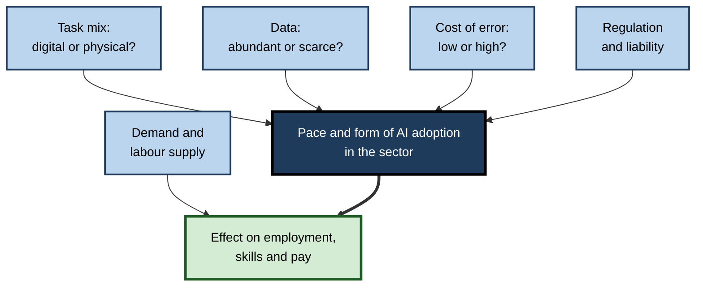
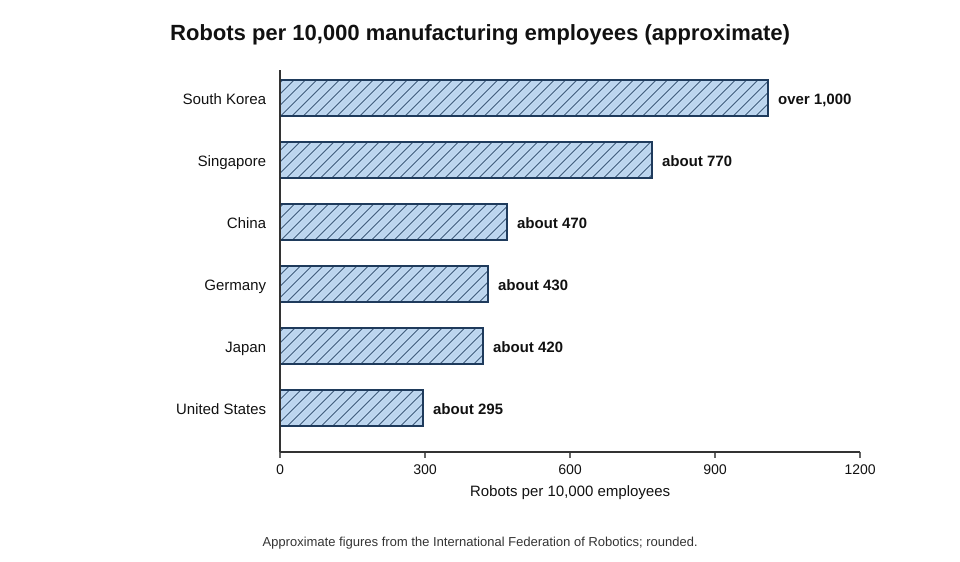
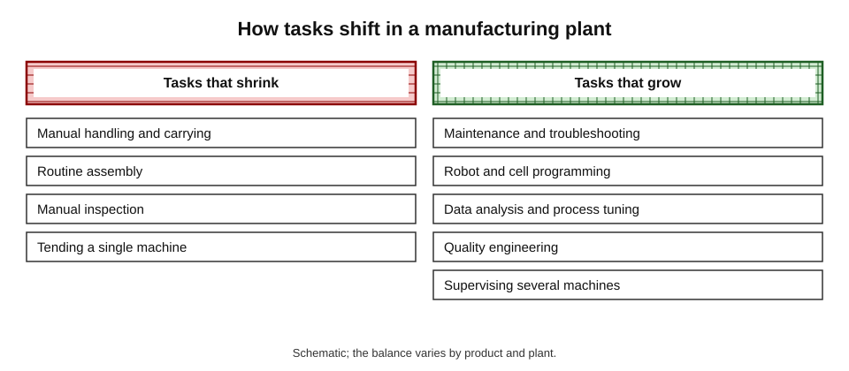
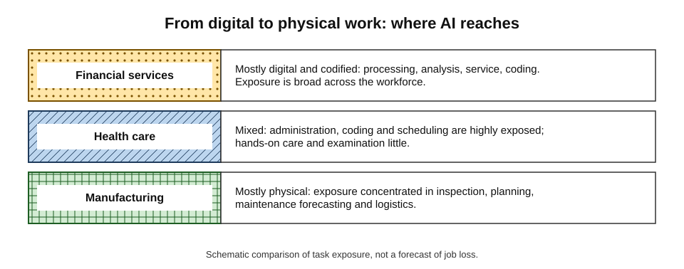
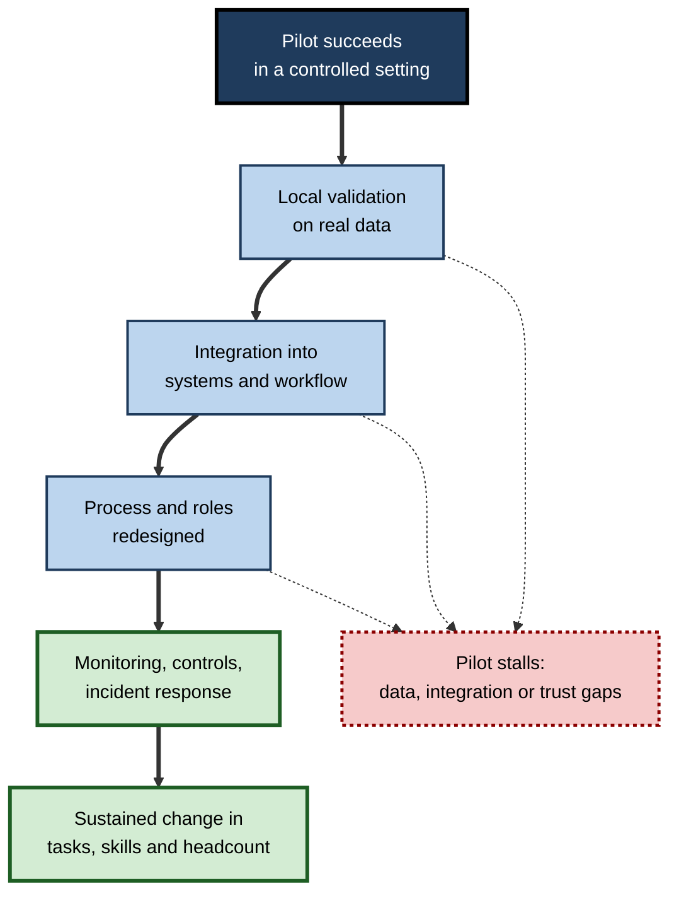

# H.10. Sector-by-sector impact: manufacturing, healthcare, finance

A car factory, a hospital and a bank all use AI, yet the effect on their workers could hardly differ more. In the factory, vision systems inspect welds and robots move parts, and the question is how much physical work remains. In the hospital, the pressing problem is a shortage of staff, and AI is welcomed where it relieves paperwork.

In the bank, most work is already digital, so almost every task is a candidate for software. **The same technology meets different tasks, rules, labour markets and incentives in each sector** — and the results differ accordingly.

> **Definition — Sector:** a broad part of the economy defined by what it produces or does — for example manufacturing, health care or financial services — each with its own tasks, regulation, technology and workforce.

**Why it matters**

- **Careers** — a worker's prospects depend on the sector's economics as much as on the occupation.
- **Policy** — support for displaced workers and training needs differ between sectors.
- **Realism** — general claims about "AI and jobs" hide large differences; sector detail shows where and why.
- **Lessons transfer** — success and failure patterns in one sector often predict others.

---

## Why Sectors Differ

### Five drivers of difference

1. **Task mix** — the share of work that is digital and codified rather than physical or relational.
2. **Data** — how much digitised, labelled data exists to train systems.
3. **Cost of error** — whether mistakes cost money, injure people or can be tolerated.
4. **Regulation and liability** — rules on safety, privacy, licensing and explanation.
5. **Demand and labour supply** — whether the sector is short of workers or has surplus capacity, and whether demand grows when costs fall.

**Figure 1.** How the five drivers combine to shape a sector's response to AI.

### A comparison

| | Manufacturing | Health care | Financial services |
|---|---|---|---|
| Dominant tasks | Physical production, handling, inspection, logistics | Care, diagnosis, administration, coordination | Digital analysis, transactions, advice, compliance |
| Data availability | Sensor data plentiful; labelled defects scarce | Rich but fragmented and sensitive | Abundant, structured, digitised |
| Cost of error | Safety and scrap | Patient harm | Money, fraud, systemic risk |
| Regulation | Product and workplace safety | Heavy: medical devices, privacy, licensing | Heavy: prudential, conduct, anti-money-laundering |
| Labour market | Ageing workforce in many countries; skills shortages | Chronic shortages | Large back-office workforce; competitive pressure |
| Main AI effect so far | Productivity and quality; physical automation | Administrative relief; decision support | Process automation; analytics; customer service |

---

## Manufacturing

### Where AI and automation are used

- **Industrial robots** — welding, painting, assembly, palletising; now increasingly fitted with vision and learning.
- **Collaborative robots ("cobots")** — smaller robots designed to work beside people without cages.
- **Machine vision** — automated inspection for defects at line speed.
- **Predictive maintenance** — models forecast machine failure from vibration, temperature and current data.
- **Process optimisation** — setting parameters in chemicals, semiconductors and metals to raise yield.
- **Digital twins and simulation** — virtual models of lines and plants to test changes.
- **Warehouse and logistics robotics** — mobile robots moving goods, with software orchestrating thousands of them.

> **Definition — Digital twin:** a continuously updated virtual model of a physical asset or process, used to monitor, simulate and optimise it.

**Evidence on scale**

- **International Federation of Robotics (IFR):**
  - about **4.3 million** industrial robots were operating worldwide in 2023, with roughly **540,000** newly installed that year;
  - **robot density** (robots per 10,000 manufacturing employees) is highest in South Korea (over 1,000), followed by Singapore and some European countries; China passed Germany and Japan in density in 2023.
**Figure 2.** Robot density in selected economies, 2023.

- **Warehouse operators** such as Amazon have reported deploying on the order of a million robots across their network.

### What happens to the workforce

- **Evidence from robots:** studies of past industrial robot adoption found local employment and wage losses in the United States, but different patterns in Germany, where firms using robots tended to retain existing workers while hiring fewer new ones.
- **Task shifts:**
  - routine assembly and handling shrink;
  - demand rises for **technicians**, robot programmers, maintenance staff and quality engineers;
  - operators supervise several machines instead of tending one.
- **Skill upgrading:** manufacturing jobs tend to require more technical and data skills, with persistent shortages of skilled technicians in many countries.
- **Reshoring effects:** automation can make high-wage countries more competitive, retaining some production that would otherwise move.

### Limits

- **Variation** — products with changing designs, small batches or delicate handling resist automation.
- **Capital cost and flexibility** — fixed automation is expensive to reconfigure when products change.
- **Integration** — old machines, mixed data formats and proprietary systems slow adoption.
- **Small firms** — many small manufacturers lack capital and skills to automate, widening gaps with large firms.

### Case study: Tesla's "excessive automation" (2018)

- **Situation:** in 2017–2018, Tesla was struggling to meet production targets for its Model 3 car. Its leader had championed a heavily automated production line.
- **Problem:** parts of the automated system, including conveyors and robots handling delicate components, proved unreliable and slow; production lagged far behind schedule.
- **Actions:** the company removed some automated systems and added human workers and manual stations; it built extra production capacity in a temporary tent.
- **Statement:** in April 2018 the chief executive wrote publicly that **excessive automation at Tesla was a mistake** and that humans had been underrated.
- **Result:** production later ramped up.
- **Lesson:** automation is not automatically better; **flexible, human-based** processes can outperform rigid automation while a design is immature. The best allocation depends on stage, stability and cost of failure.

**Figure 3.** Typical task shift in a manufacturing plant as automation advances.

---

## Health Care

### The setting

- **Workforce shortage:** the World Health Organization has projected a global shortfall of around **11 million** health workers by 2030, concentrated in low- and middle-income countries.
- **Administrative burden:** clinicians in many countries spend a large share of their time on records, coding, scheduling and insurance tasks.
- **Ageing populations** raise demand while budgets are limited.

> **Key point:** in health care, AI is widely viewed as a tool to **fill gaps** rather than to cut staff — a different employment story from sectors with surplus capacity.

### Where AI is used (beyond the clinician's own tasks)

- **Administration and revenue cycle** — coding, billing, prior authorisation, scheduling and call handling.
- **Operations** — predicting admissions, bed occupancy and no-shows; rostering.
- **Patient flow and triage** — directing patients to the right level of care.
- **Drug discovery and development** — predicting protein structures, screening molecules, designing trials.
- **Population health** — identifying patients at risk of deterioration or readmission.
- **Remote monitoring** — wearable data and alerts for chronic disease.
- **Medical devices** — approved AI software, especially in imaging.

**Study card — Wong and colleagues, University of Michigan, external validation of a widely used sepsis prediction model (*JAMA Internal Medicine*, 2021)**

- **Setting:** an early-warning model for sepsis embedded in a major electronic health record system and used in hundreds of hospitals.
- **Design:** the researchers tested its performance on records of about **38,000** hospitalised patients at one academic hospital.
- **Results:**
  - the model's discrimination was **much poorer** than the developer reported — it missed most sepsis cases (sensitivity around one in three at the alert threshold used);
  - it produced many false alerts, creating "alert fatigue" for staff.
- **Interpretation:** AI sold into thousands of hospitals had **not been independently validated**, and its real-world value for staff was limited.
- **Lesson:** adoption in health care should depend on **local validation** and monitoring, not vendor claims.

### Workforce effects

- **Relief and redesign:**
  - fewer hours spent on documentation, in successful implementations;
  - new roles for clinical informatics, data governance and AI safety.
- **Task shifting** — with AI support, nurses, pharmacists and technicians can take on tasks previously reserved for doctors, which can expand access.
- **Risks:**
  - alert fatigue and extra monitoring work;
  - "efficiency" used to raise patient loads rather than ease them;
  - inequality, as well-funded hospitals adopt faster than poorly resourced ones.
- **Global health:** AI may help in settings with few specialists, for example by supporting screening programmes, but depends on infrastructure, data quality and local validation.

### Constraints

- **Regulation** — medical device approval, privacy law and professional rules.
- **Evidence** — few tools have been tested in randomised trials of patient outcomes.
- **Integration** — fragmented record systems.
- **Trust** — clinicians and patients must accept the tools.

> **Watch out:** "AI will replace doctors" and "AI changes nothing" are both unsupported. The strongest evidence points to **targeted gains in specific tasks** where tools are validated and workflows are redesigned.

---

## Financial Services

### The setting

- **Highly digital** — much work is already text, numbers and rules, which gives AI a large surface to act on.
- **Competitive and cost-driven** — banks and insurers seek efficiency and have long invested in analytics.
- **Heavily regulated** — rules on risk, capital, conduct, privacy and fairness.

### Where AI is used

- **Operations** — document processing, reconciliation, customer onboarding, loan servicing.
- **Customer service** — chat assistants, call routing and summarisation.
- **Risk and fraud** — transaction monitoring, anti-money-laundering alerts, credit risk scoring.
- **Trading and investment** — algorithmic execution, signals from data, portfolio tools.
- **Compliance and legal** — reading regulations and contracts, monitoring communications.
- **Software** — a large share of bank staff are engineers, and coding assistants affect them directly.
- **Insurance** — claims triage, underwriting and pricing.

**Reported example — contract review at a large bank**

- **Claim:** in 2017 JPMorgan Chase described a software system, "COiN", that reviewed commercial loan agreements in seconds, work reported to have consumed hundreds of thousands of lawyer and loan-officer hours a year.
- **Caveat:** the figure is the bank's own claim as reported in the press, and it describes a **narrow, well-defined** document task — the kind that suits automation.

### Workforce effects

- **Large back-office workforces** — processing, operations and support — are most exposed.
- **Surveys of banks** (for example by a major market-data firm in 2025) found that banks expected to reduce staffing in some functions over the following years, with operations and customer support most affected; such forecasts are uncertain.
- **Growth areas:** data and AI roles, model risk management, cyber-security, compliance technology and relationship roles.
- **Branch and call-centre roles** shrank for a decade before generative AI because of online banking; generative AI continues the trend.
- **Advice and sales** — AI-supported advisers handle more clients; fully automated advice ("robo-advice") has grown but has not replaced human advisers for complex needs.

### Constraints

- **Model risk** — regulators require validation, documentation and governance of models used in decisions.
- **Fairness** — credit and insurance decisions must not discriminate; explanations may be required.
- **Systemic risk** — many firms using similar models may behave alike under stress.
- **Operational resilience** — outages and errors have large financial and reputational costs.

### Case study: Knight Capital (2012)

- **Situation:** on 1 August 2012, the US trading firm Knight Capital deployed new trading software across its servers; one of eight servers did not receive the update and retained old code that was re-activated by the new release.
- **Problem:** the old code began sending large volumes of unintended orders into the market at the opening.
- **Result:** within about 45 minutes the firm accumulated roughly **US$440 million** in losses, nearly its entire capital; it needed an emergency rescue and was soon sold.
- **Cause:** a failure of deployment and control, not artificial intelligence — but it shows the stakes of **automated decision systems operating at speed** with inadequate monitoring and manual "kill switches".
- **Lesson:** in finance, automation's value is bound to controls: testing, monitoring, limits and the ability for humans to stop the system quickly.

---

## Comparing Workforce Effects

| | Manufacturing | Health care | Financial services |
|---|---|---|---|
| Tasks most reduced | Routine assembly, handling, inspection | Documentation, coding, scheduling | Processing, reconciliation, standard service |
| Tasks most increased | Maintenance, programming, quality engineering | Informatics, data governance; nursing and care in demand | Data and AI, risk, compliance technology, advice |
| Overall labour demand | Mixed; depends on competitiveness | Rising; shortages | Pressure in back office; growth in specialist roles |
| Skills shift | Technical and data skills | Digital literacy; AI oversight | Data, AI and domain expertise |
| Biggest constraint | Capital cost; variation | Validation; regulation; trust | Model risk; regulation |
| Main equity concern | Older production workers | Under-resourced hospitals | Entry-level staff and branch workers |

**Figure 4.** Relative exposure of tasks to AI in each sector, from physical to digital work.

### Worked example (illustrative): ranking a firm's functions for AI projects

A diversified group has three divisions and scores one candidate project in each on four criteria (1 = poor, 5 = strong). *Illustrative figures.*

| Project | Data availability | Task is codified | Error cost tolerable | Staff shortage or cost pressure | Total |
|---|---|---|---|---|---|
| Visual inspection on a packaging line (manufacturing) | 4 | 4 | 4 | 3 | 15 |
| Appointment no-show prediction (health clinic) | 4 | 3 | 5 | 4 | 16 |
| Loan-document checking (bank) | 5 | 4 | 3 | 4 | 16 |

1. **Add scores:** 4+4+4+3 = 15; 4+3+5+4 = 16; 5+4+3+4 = 16.
2. **Rank:** a tie between the clinic and the bank; the factory project is close behind.
3. **Break the tie:** the bank project has a lower error tolerance (3), so it needs stronger controls; the clinic project is lower risk and addresses a shortage.
4. **Decision:** start with the clinic project and a controlled pilot at the bank.

> **Watch out:** summed scores hide trade-offs. A low score on **error cost** can outweigh high scores elsewhere; treat it as a gate, not an average.

---

## Cross-Sector Lessons

- **Pilots do not equal scale** — many AI projects stall between demonstration and production because of data, integration and change management.
- **Workflow redesign matters more than the model** — gains come when the whole process is rebuilt.
- **Validation is local** — performance depends on local data and workflow.
- **Labour effects depend on demand** — shortage sectors absorb productivity gains as relief; surplus sectors convert them to headcount reductions.
- **Incentives shape outcomes** — the same time saving may be used to cut staff, raise volumes or improve quality; the choice reflects management and regulation.
- **Small organisations lag** — adoption is concentrated in large firms.
- **Sectors converge** — banking and health care both depend on regulated data and human accountability, so lessons about governance transfer.

**Figure 5.** The path from an AI pilot to sustained workforce change.

---

## Other Sectors in Brief

- **Retail and logistics** — warehouse robots, demand forecasting, self-checkout; shop floor and driver roles under pressure, last-mile delivery remains human.
- **Education** — tutoring, marking, administration; teacher shortages shape adoption.
- **Agriculture** — precision farming, autonomous machinery; labour shortages at harvest drive uptake.
- **Professional and business services** — drafting, analysis, research; apprenticeship models under pressure.
- **Public administration** — case processing, citizen contact; accountability and fairness constraints.

> **Remember:** to judge any sector, ask: what tasks does it do, how digital are they, how costly are errors, who regulates them, is labour scarce or abundant — and does demand grow when costs fall?

---

## Adoption Barriers and Enablers by Sector

| Barrier | Manufacturing | Health care | Financial services |
|---|---|---|---|
| Data quality and access | Machines from different eras; sensor data siloed | Fragmented records; privacy limits sharing | Legacy systems; data held in silos across products |
| Skills | Shortage of technicians and data staff | Clinicians' time and digital confidence | Competition for data talent |
| Capital | Large investment in equipment; small firms stretched | Public budgets and procurement cycles | Funds available; competition for returns |
| Trust | Workers' fears of replacement; safety culture | Clinicians' and patients' trust | Customers' and regulators' trust |
| Regulation | Product and workplace safety | Device approval; privacy; licensing | Model risk; conduct; anti-money-laundering |
| Culture | Engineering-led, process-driven | Professional autonomy; caution | Risk-averse; strongly compliance-driven |

### Enablers that recur

- **Leadership commitment** with realistic expectations.
- **Process redesign** alongside tools.
- **Good data foundations** — clean, accessible, governed.
- **Strong integration** with existing systems.
- **Frontline involvement** from design to rollout.
- **Governance** that is proportionate to risk.

---

## Productivity and Pay at Sector Level

- **Sectoral productivity differs.**
  - Digital sectors have seen faster productivity growth than care and personal services, which affects wages and prices.
- **Baumol effects across sectors.**
  - Where AI raises productivity quickly (digital services), relative prices fall and employment may shrink; where productivity stays slow (care), costs rise and employment grows.
- **Wages follow bargaining and skills, not only productivity.**
  - Technical staff in finance may gain; back-office staff may lose; nurses' pay depends largely on public budgets.
- **Regional effects.**
  - A factory closing or a call centre relocating can hit a town; a data centre or robot-integration firm opening can help another.

### Worked example (illustrative): who benefits when productivity doubles?

A hospital trust and a bank each reduce the labour time needed per unit of work by 20% with AI. *Illustrative figures.*

| | Hospital trust | Bank operations unit |
|---|---|---|
| Staff before | 1,000 | 1,000 |
| Labour time per unit of work | −20% | −20% |
| Demand for the service | +25% (waiting lists, ageing population) | +2% (stable market) |
| Staff needed after (assuming proportional work) | 1,000 × 0.80 × 1.25 = **1,000** | 1,000 × 0.80 × 1.02 = **816** |
| Change in headcount | 0 | −184 |

1. **Hospital:** the 20% time saving is offset by a 25% rise in demand, so staffing is unchanged but waiting lists shorten.
2. **Bank:** a small rise in demand does not offset the saving; about 184 posts are no longer needed unless the bank finds new work.
3. **Conclusion:** identical productivity gains produce very different employment outcomes depending on **demand**.
4. **Formula:** staff needed = staff before × (1 − time saving) × (1 + demand growth).

> **Formula — Staffing after productivity change:** staff before × (1 − fractional time saving) × (1 + fractional demand growth). Example: 1,000 × 0.80 × 1.25 = **1,000**.

---

## Case Study (illustrative): A Regional Hospital Trust's Triage Rollout

- **Situation:** a regional hospital trust faces long waits in its emergency department. It adopts an AI tool that predicts, from arrival data, which patients are likely to be admitted, to speed bed planning.
- **Early results:** bed planning improves; average waits fall modestly.
- **Problems:**
  1. nurses report extra data entry to keep the tool's inputs current;
  2. the tool performs less well for patients who arrive with unusual symptoms and for people with limited English;
  3. managers begin using the predictions to set staffing targets, which nurses feel ignores clinical judgement.
- **Diagnosis:**
  - the tool was validated on the trust's older data; patient mix had shifted;
  - nobody had decided who could override predictions;
  - the project team did not include front-line staff.
- **Actions:**
  - a joint group of nurses, doctors and data staff reviews performance by patient group and revalidates monthly;
  - the tool's outputs become advisory, with a clear override right and logged reasons;
  - data entry is simplified, with some fields captured automatically;
  - managers agree that staffing decisions must combine predictions with clinical review.
- **Result:** performance gaps narrow; nurses' acceptance rises; waiting times improve more than at first.
- **Lesson:** sector adoption succeeds when **local validation, override rights, frontline voice and honest limits on use** are built in.

> **Key point:** across sectors, the question that matters is not "does the AI work?" but "does the **whole process**, with people and rules, work better — for staff, customers and patients, and fairly?"

---

## Open Questions

- **Will generative AI change manufacturing as much as robots did?**
  - Language models mostly affect planning, design and support functions; physical-world AI is advancing but unproven at scale.
- **Will health-care AI relieve shortages or raise workloads?**
  - Outcomes depend on how organisations use freed time and on independent evidence.
- **Will finance concentrate or distribute AI's benefits?**
  - Large institutions have data and capital; effects on competition and systemic risk are uncertain.
- **How will small firms cope?**
  - Without shared platforms or support, gaps may widen.
- **Which sector indicators will warn early?**
  - Hiring of juniors, vacancy rates and productivity data may signal change earlier than layoffs.

---

## Summary

- Sector impact depends on **task mix, data, cost of error, regulation, and demand and labour supply**.
- **Manufacturing:** robots, vision, predictive maintenance, digital twins; roles shift towards technicians and supervision; Tesla's 2018 episode shows over-automation can fail.
- **Health care:** shortages (about 11 million workers projected by 2030) make AI a gap-filler; evidence needs **local validation**, as the sepsis-model study showed.
- **Financial services:** highly digital, so exposure is broad — operations and service roles most; model risk and controls essential, as **Knight Capital** showed.
- **Labour demand** — shortage sectors absorb gains as relief; surplus sectors convert them into headcount changes.
- Cross-sector lessons: pilots stall; **workflow redesign** matters more than the model; validation is local; incentives decide outcomes.

---

## Self-Check

1. List the five drivers that make sectors respond differently to AI.
2. Name four uses of AI in manufacturing and one limit on automation.
3. What happened at Tesla in 2018 and what is the lesson?
4. Why is AI often described as filling gaps in health care?
5. What did the study of the sepsis prediction model find?
6. List four administrative uses of AI in health care outside diagnosis.
7. Why is finance especially exposed to AI?
8. What did the Knight Capital incident show about automated systems?
9. Compare the likely workforce effects of AI in the three sectors.
10. Why do many AI pilots fail to scale?
11. In the worked example, why is the bank project treated carefully despite its high total?
12. A hospital director and a bank manager each save 20% of staff time with AI. Explain why the outcomes for employment may differ.
13. Choose a sector not covered and apply the five drivers.

### Answer Key

1. Task mix, data availability, cost of error, regulation and liability, and demand and labour supply.
2. Industrial robots, machine vision, predictive maintenance, digital twins, cobots. Limits: variation in products, capital cost, integration, small-firm barriers.
3. Tesla's heavily automated Model 3 line proved unreliable, so it added manual stations and the chief executive said excessive automation was a mistake. Lesson: flexible human processes can beat rigid automation while a design is immature.
4. The world faces a large projected shortage of health workers and heavy administrative burdens; AI is used to relieve workload and extend capacity rather than cut staff.
5. A widely used sepsis model performed far worse in independent testing than claimed, missing most cases and producing many false alerts; local validation is needed.
6. Coding and billing, scheduling, prior authorisation, call handling, bed and admissions forecasting.
7. Much work is already digital, structured and rule-based, so many tasks are codified and data-rich.
8. Automated systems operating at speed can cause huge losses within minutes if deployment, monitoring and kill-switch controls fail.
9. Manufacturing: fewer routine production roles, more technicians and supervisors. Health care: relief and role expansion amid shortages. Finance: pressure on back-office roles, growth in data, risk and advice.
10. Data and integration gaps, lack of local validation, unredesigned workflows, trust and change-management failures.
11. Its error-cost score of 3 means mistakes are costly; it needs stronger controls and a gated pilot, so the total alone is misleading.
12. Hospitals face shortages, so freed time relieves existing demand; banks face cost pressure and surplus back-office capacity, so savings can convert to fewer staff — unless demand grows.
13. E.g. agriculture: tasks are physical and variable (low codification), data growing, error costs moderate, regulation light, seasonal labour shortages — leads to machinery and monitoring rather than wholesale replacement.

---

## Glossary

| Term | Meaning |
|---|---|
| Alert fatigue | Reduced response to warnings because there are too many, often false. |
| Cobot | A collaborative robot designed to work safely beside people. |
| Digital twin | A live virtual model of a physical asset or process. |
| Local validation | Testing an AI system on the data and workflows where it will be used. |
| Machine vision | AI that interprets images for inspection or guidance. |
| Model risk | The risk of loss or harm from errors in a model or its use. |
| Predictive maintenance | Forecasting equipment failure to schedule repairs. |
| Robot density | Number of industrial robots per 10,000 manufacturing employees. |
| Sector | A broad part of the economy defined by what it produces or does. |
| Task shifting | Moving tasks from one occupation to another, often to expand access. |
