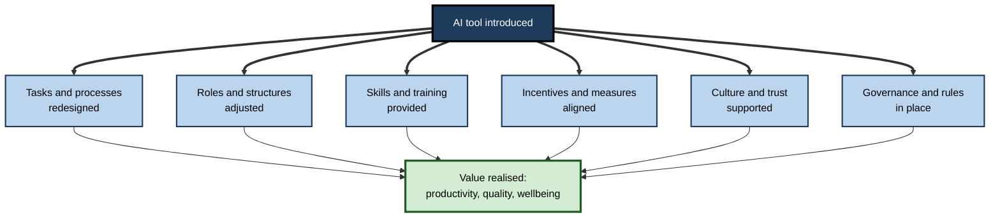
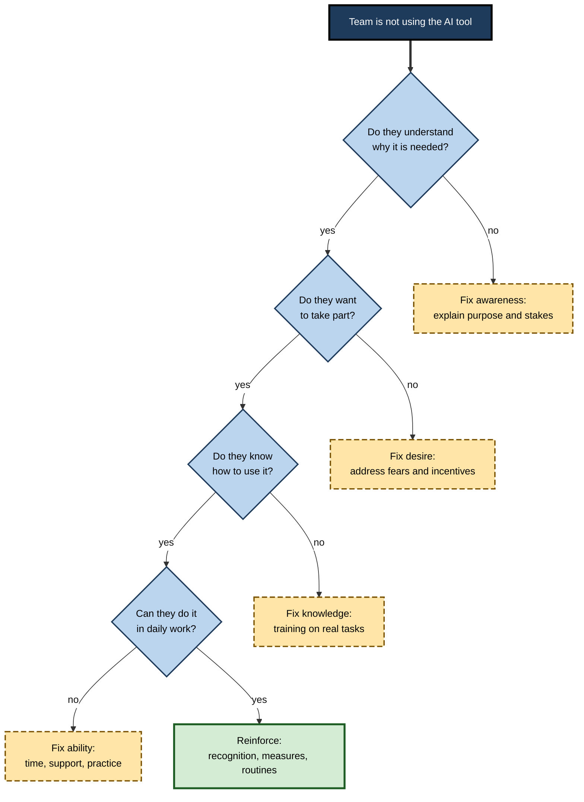
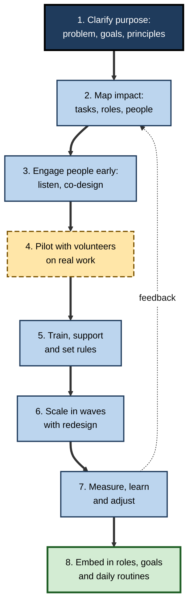
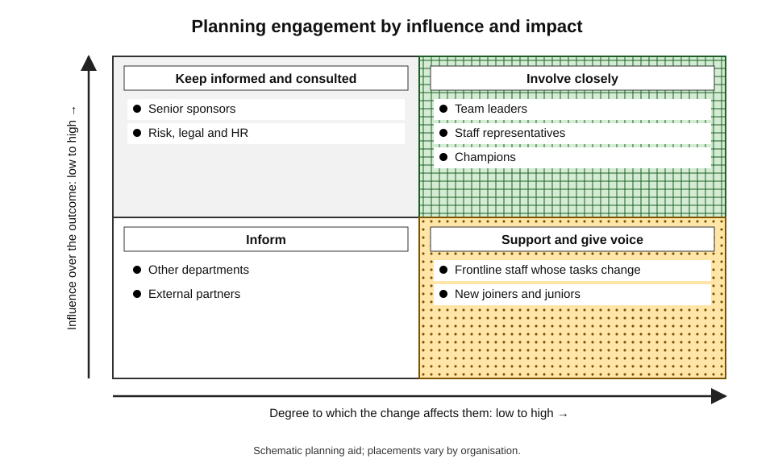
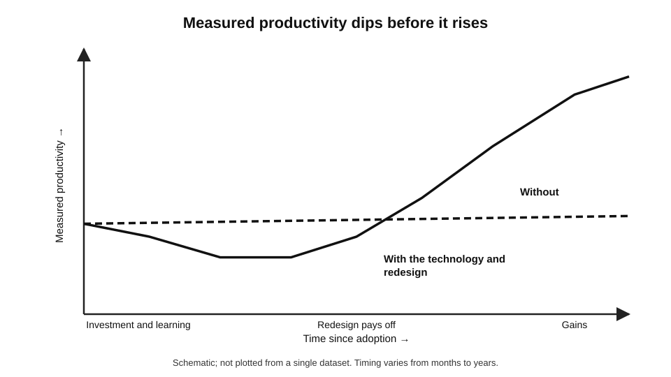

# H.11. Managing AI-driven change in organisations

A company buys an AI assistant for its customer-service team. The technology works in the demonstration. Six months later, a third of the agents use it daily, a third have tried it once and a third have never opened it; two have started looking for other jobs because they heard it was "to replace them".

The tool is not the problem. **Most AI projects succeed or fail on the human side — trust, skills, incentives, redesigned work and honest communication.** Managing that side is the discipline of change management.

> **Definition — Organisational change management:** the structured approach to moving people, teams and organisations from a current way of working to a desired future way, so that the intended benefits of a change are actually realised.

> **Definition — AI-driven change:** change in tasks, roles, processes, skills and structures that results from adopting AI systems.

**Why it matters**

- **Technology alone delivers little** — value appears only when work is redesigned and people use the tools well.
- **Fear is real** — employees reasonably wonder about jobs, status and surveillance; unaddressed, it undermines adoption.
- **Pace** — AI tools change every few months, so change is continuous rather than a one-off project.
- **Fairness and trust** — how an organisation treats people during change shapes its reputation and ability to change again.

---

## Why AI Change Is Different

- **It touches knowledge work** — the tasks of people who previously felt secure, often including those leading the change.
- **It is general-purpose** — one tool can affect hundreds of tasks across functions, so impact is diffuse and hard to plan.
- **It is probabilistic** — outputs vary, so processes need checking steps rather than fixed rules.
- **It can be adopted bottom-up** — employees can use public tools without approval, creating unmanaged "shadow" use.
- **It evolves fast** — a policy written for one tool may be obsolete within a year.
- **It raises identity questions** — craft, expertise and status are bound up with tasks that AI can now perform.

> **Key point:** AI adoption is not an IT project with a technical go-live date. It is a **continuous organisational change** touching skills, roles, rules, culture and trust.

---

## The Socio-Technical View

### Technology and work as one system

> **Definition — Socio-technical system:** the view that organisations work through the interaction of social elements (people, roles, relationships, culture) and technical elements (tools, processes, data), so that changing one without the other leads to poor results.

**Study card — Eric Trist and Ken Bamforth, English coal mining (Tavistock Institute, 1951)**

- **Setting:** British coal mines introducing mechanised "longwall" cutting.
- **Before:** small, self-selected teams of miners worked a whole cycle together, with flexible roles and mutual support.
- **Change:** the new method split work into rigid shifts and specialised roles, chosen for technical efficiency.
- **Results:**
  - the teams' social structure broke down;
  - absenteeism, tension and conflict rose;
  - productivity fell short of what the technology promised.
- **Resolution:** mines that reorganised into **composite teams** — combining new technology with team autonomy — achieved better results.
- **Lesson:** the best technical design on paper can fail if it ignores how people actually work together; the most effective arrangements **jointly optimise** technology and social organisation.

**Figure 1.** The elements that must change together when AI is introduced.

### The people-first rule of thumb

- **Boston Consulting Group** has described a "10-20-70" pattern in successful AI transformations: about **10%** of effort goes to algorithms, **20%** to technology and data, and **70%** to people, processes and cultural change.
- **Caveat:** the figures are a practitioner heuristic from consulting experience, not a measured law; their value is as a reminder of where effort tends to be underspent.

---

## Why People Adopt or Resist

### What drives adoption

> **Definition — Technology acceptance model:** a theory, proposed by Fred Davis (1989), that people adopt a technology when they perceive it to be **useful** (it helps their performance) and **easy to use**.

- **Later extensions** (the unified theory of acceptance and use of technology, 2003) added **social influence** — what colleagues and managers expect — and **facilitating conditions** — training, support and access.

| Factor | Question the employee asks | What organisations can do |
|---|---|---|
| Perceived usefulness | Does this help me do my work better? | Start with real pain points; show examples from peers |
| Ease of use | Can I learn it without a struggle? | Training, templates, support channels |
| Social influence | What do my colleagues and boss expect? | Visible leadership use; champions |
| Facilitating conditions | Do I have time, access and permission? | Approved tools; protected learning time |
| Trust | Is it safe, fair and will my data be respected? | Clear rules; transparency; human oversight |
| Job security | Will this cost me my job or my status? | Honest commitments; reskilling routes |

### Resistance as information

- **Not all resistance is irrational.**
  - Employees may see real problems — wrong outputs, workload increases, surveillance, unfairness — that planners missed.
- **Typical sources:**
  - **fear** of job loss or deskilling;
  - **loss of status or autonomy**;
  - **extra work** — checking outputs while targets stay the same;
  - **poor tools** — unreliable, badly fitted to the real task;
  - **distrust** of management's motives;
  - **change fatigue** after many initiatives.

**Study card — Lester Coch and John French, "Overcoming Resistance to Change" (Harwood Manufacturing Corporation, 1948)**

- **Setting:** a pyjama factory in the United States where frequent changes in methods caused drops in output, grievances and resignations.
- **Design:** after a transfer to new jobs, different groups were handled differently: one group was simply told of the change; others took part, through representatives or as a whole group, in designing the new methods.
- **Results:**
  - the group that was told recovered slowly, with complaints and some quitting;
  - the groups that **participated** recovered faster and reached higher output, with little turnover.
- **Interpretation:** participation reduces resistance and improves outcomes.
- **Caveats:** a small field study from the 1940s with limited controls; later work shows that the effect of participation depends on whether it is genuine and on the context.

> **Watch out:** treating resistance only as a problem to be "overcome" misses the information it carries. Listen to it as feedback on design and fairness.

---

## Models of Planned Change

### Lewin's three stages (1947)

- **Unfreeze** — create awareness that the current state must change; loosen old habits.
- **Change** — move to new behaviours and processes.
- **Refreeze** — embed the new way so it becomes normal.
- **Critique:** continuous AI change means the "refreeze" is brief; many practitioners prefer to speak of building **adaptability**.

### Kotter's eight steps (1996)

1. Create urgency.
2. Build a guiding coalition.
3. Form a strategic vision.
4. Enlist a volunteer army.
5. Remove barriers.
6. Generate short-term wins.
7. Sustain acceleration.
8. Institute change.

### ADKAR (Prosci)

- **Awareness** of the need for change.
- **Desire** to participate.
- **Knowledge** of how to change.
- **Ability** to implement skills and behaviours.
- **Reinforcement** to sustain the change.
- **Use:** diagnoses *where* an individual or group is stuck — a team with awareness and desire but lacking knowledge needs training, not a motivational speech.

### Bridges' transitions

- **William Bridges (1991)** distinguished **change** (the external event) from **transition** (the internal psychological process): **an ending**, a **neutral zone** of confusion, and a **new beginning**.
- **Lesson:** people need to **let go** of the old role before embracing the new one; leaders who rush to the "new beginning" skip the ending.

**Figure 2.** Using the five ADKAR conditions to diagnose where a person or team is stuck.

| Model | Focus | Strength | Limitation |
|---|---|---|---|
| Lewin | Stages of movement | Simple | Assumes stability afterwards |
| Kotter | Leading large change | Practical sequence | Top-down; less suited to continuous change |
| ADKAR | Individual readiness | Diagnostic for each person | Individual focus; less on structure |
| Bridges | Emotional transition | Humane; explains confusion | Gives little guidance on technical design |

> **Mnemonic — "ADKAR":** **A**wareness, **D**esire, **K**nowledge, **A**bility, **R**einforcement — the five conditions each person needs.

---

## Leading an AI Change

### A roadmap

**Figure 3.** A phased approach to AI-driven change.

### Core practices

- **Start with a problem, not a tool** — a clear business or people problem gives purpose and a test of success.
- **State principles publicly** — for example: "AI will augment people; humans stay accountable; we will not use AI to monitor individuals without telling them; we will invest in reskilling."
- **Be honest about jobs** — do not promise "no job losses" if that cannot be guaranteed; explain how decisions will be made and what support exists.
- **Involve the people doing the work** — they know the exceptions and workarounds.
- **Use champions** — respected peers in each team who experiment, help others and report problems.
- **Pilot, then scale** — begin with volunteers on real tasks, learn, then widen.
- **Redesign the work** — decide which tasks move to AI, which change and which stay human; update roles, targets and handovers.
- **Align measures and incentives** — if people are measured on volume only, they will not spend time checking AI outputs.
- **Provide time to learn** — learning in "spare time" does not happen.
- **Communicate continually** — frequent, two-way and plain.

> **Remember:** **why, what, how, what next** — people need to hear the reason for the change, what is changing for them, how they will be supported, and what comes next.

### Communication that builds trust

- **Say what is known and unknown.**
- **Explain how decisions are made** — who decides about roles, on what criteria.
- **Show leaders using the tools** — and admitting mistakes.
- **Give channels for concerns** — and show what changed as a result.
- **Avoid hype and euphemism** — "right-sizing" language destroys trust.

### Stakeholder analysis

**Figure 4.** Planning engagement by stakeholders' influence and how much they are affected.

---

## The Productivity J-Curve

> **Definition — Productivity J-curve:** the pattern, described by Erik Brynjolfsson, Daniel Rock and Chad Syverson (2021), in which general-purpose technologies first show **slow or negative measured productivity** because firms invest heavily in complementary changes — training, process redesign, new organisation — before benefits appear.

- **Historic parallel:** electric motors were available from the 1880s, but factories gained large productivity benefits only decades later, once layouts were redesigned around individual machine drives.
- **Implication for AI:** early disappointment is expected; judging a project by results in the first quarter may kill a project that would succeed after redesign — or conceal a project that will never succeed.

**Figure 5.** The productivity J-curve for a general-purpose technology.

> **Watch out:** the J-curve can become an **excuse**. "Wait for the benefits" must be accompanied by defined milestones and a willingness to stop a project that is not progressing.

### Evidence on failure rates

- **Many studies report high failure rates** for AI and digital projects — often a majority failing to deliver expected value — but the numbers vary by definition and source.
- **MIT report (2025):** a widely cited study from an MIT initiative stated that about **95%** of enterprise generative AI pilots produced no measurable impact on profit and loss; critics questioned its sample, definitions and timing, and others noted that individual employees were widely using tools informally even where official pilots stalled.
- **Reasonable reading:** many pilots do not reach production value; the exact rate is unknown; the **common causes** — poor fit with workflow, lack of learning in the tools, weak integration and unclear ownership — are well documented.

---

## Job Security, Fairness and Redeployment

- **Job insecurity itself harms.**
  - Research on job insecurity links it with stress, lower wellbeing and reduced trust; fear of AI can damage performance even before any job is lost.
- **Principles of fair change:**
  1. **Transparency** — explain criteria and timelines.
  2. **Voice** — involve employees and their representatives.
  3. **Opportunity** — offer training and internal moves before redundancy.
  4. **Support** — severance, outplacement and time to find work.
  5. **Consistency** — apply rules equally.
- **Legal duties:** many jurisdictions require consultation with workers or their representatives about significant technological change and about redundancies, and rules on automated decisions apply to people management.
- **Keeping the survivors:** employees who stay after cuts often experience guilt, workload increases and reduced loyalty; leaders must address their needs too.

### Case study: Duolingo's "AI-first" announcement (2025)

- **Situation:** in April 2025 the chief executive of the language-learning company Duolingo shared an internal memo announcing that the company would be "AI-first".
- **Reported content:**
  - the company would gradually stop using contractors for work that AI could handle;
  - AI use would be considered in hiring and performance reviews;
  - headcount requests would be considered only if a team could not automate its work.
- **Reaction:** the announcement was criticised widely online, including by users, who said they would leave the app, and by commentators who read it as signalling job cuts.
- **Response:** the chief executive later said he had not intended to suggest replacing employees, that the company would keep hiring and that AI was meant to help staff do more; he acknowledged that the memo had been poorly communicated.
- **Lesson:** announcements about AI strategy are read first as **statements about jobs**. Framing, sequencing and clarity about what is and is not changing matter as much as the strategy itself, and employees, customers and the public are all audiences.

---

## Measuring AI Adoption and Change

- **Adoption** — share of staff using approved tools weekly; depth of use (simple versus advanced tasks).
- **Proficiency** — assessed skill, not course completion.
- **Outcomes** — quality, speed, customer satisfaction, error rates, cost.
- **Experience** — workload, stress, trust, sense of fairness.
- **Risk and incidents** — data leaks, errors reaching customers, complaints.
- **Equity** — whether benefits and burdens are fairly spread across groups.

| Level | Example measure | What it tells you | Weakness |
|---|---|---|---|
| Activity | Logins, prompts sent | Whether tools are being tried | Does not show value |
| Behaviour | Tasks completed with AI, verification steps taken | How work has changed | Needs sampling |
| Outcome | Time per case, error rate, customer ratings | Whether work improved | Confounded by other changes |
| Wellbeing and trust | Survey scores, turnover | Whether people are healthy and engaged | Self-report; lagging |

### Worked example (illustrative): impact assessment for an invoice-processing change

A finance operations team of 30 will adopt AI to extract and match invoice data. *Illustrative figures.*

| Role | Headcount | Share of time on tasks AI will take over | Impact | Response |
|---|---|---|---|---|
| Invoice entry clerks | 12 | 70% | High | Reskill to exception handling; some to supplier-queries team |
| Exception handlers | 8 | 25% | Medium | Train in AI checking; redefine targets |
| Supplier-query team | 6 | 10% | Low–medium | Extend scope |
| Team leaders | 4 | 15% | Medium | Train in monitoring AI quality |

1. **Compute affected full-time equivalents:** clerks 12 × 0.70 = 8.4; handlers 8 × 0.25 = 2.0; query team 6 × 0.10 = 0.6; leaders 4 × 0.15 = 0.6. Total = **11.6** FTE of time freed.
2. **Interpret:** about 39% of the team's capacity (11.6 ÷ 30) could be released.
3. **Decide the use of the time:** absorb growing volume without hiring; move people into supplier-query and analysis work; reduce overtime; only then consider reductions through natural turnover.
4. **Plan communication:** tell the team early, give the logic and timelines, and agree what is guaranteed.

> **Watch out:** "FTE freed" is a notional figure. Time saved rarely maps neatly onto whole jobs; much of it is dispersed across many people in small amounts.

### Case study (illustrative): an insurer's claims team

- **Situation:** a mid-sized insurer introduces an AI assistant that summarises claim files and drafts decision letters for 120 claims handlers.
- **Problem:** after three months, usage is uneven. Experienced handlers distrust the summaries; new handlers rely on them heavily; managers see handling times falling but complaint rates rising.
- **Diagnosis:**
  1. **Awareness and knowledge gaps** — no shared understanding of what the assistant gets wrong;
  2. **Incentives** — handlers are measured on speed, so checking is penalised;
  3. **Skill erosion risk** — juniors never form their own view of a claim;
  4. **Trust** — rumours of redundancies.
- **Actions:**
  - a joint working group of handlers and managers lists failure types and writes checking routines;
  - targets change to include accuracy and complaint rates;
  - juniors do a weekly set of unassisted claims reviewed by seniors;
  - leaders publish principles and a commitment to redeployment before redundancy;
  - champions run short sessions on real claims.
- **Result:** speed gains partly retained; complaints fall below their earlier level over two quarters; use becomes more even.
- **Lesson:** the fix was not a better model but **aligned measures, shared checking routines, learning for juniors and honest communication**.

---

## The Middle Manager's Position

### Why middle managers matter

- **They translate strategy into daily work** — setting priorities, giving feedback and deciding how time is used.
- **They are the main source of information for staff** — people trust their line manager more than corporate announcements.
- **They face squeezes from both sides** — pressure from above to deliver AI gains and pressure from below to protect people.
- **Their own roles change** — AI that summarises reports and drafts communications changes what managers do, and some fear for their own positions.

### What they need

- **A clear picture** of the intended change and the principles behind it.
- **Skills** — coaching, change communication and basic AI literacy.
- **Authority** to adjust local implementation within limits.
- **Honest information** about job implications, so they are not forced to give false reassurance.
- **Feedback channels** upward, so problems reach decision-makers.

> **Watch out:** a change programme that announces AI strategy but leaves line managers unprepared produces **inconsistent messages**, rumours and uneven adoption.

---

## Failure Patterns and Remedies

| Failure pattern | Symptoms | Typical remedy |
|---|---|---|
| Technology push | Tool selected before the problem is defined; low use | Start from a user problem; involve users in selection |
| Vague purpose | Staff unsure what AI is for; fear fills the gap | Publish purpose and principles; explain what will not change |
| Training as an event | One session, then nothing; skills decay | Embed learning in work; use champions; refresh regularly |
| Misaligned incentives | Staff are measured on speed so skip checking | Add quality and accuracy measures; reward verification |
| Pilot purgatory | Many pilots, none scaled | Set criteria for scaling or stopping; assign owners and budgets |
| Hidden headcount agenda | Staff suspect cuts behind the project | Be explicit about intentions; commit to redeployment where true |
| Ignoring the informal organisation | Official process changes, but real work-arounds persist | Map actual workflows; involve those who know the shortcuts |
| Shadow AI | Staff use unapproved tools | Provide approved tools; simple rules; non-punitive reporting |
| Change overload | Too many initiatives at once | Sequence and prioritise; protect capacity |

### Psychological safety

- **Definition used in organisational research:** a shared belief that the team is safe for interpersonal risk-taking — asking questions, admitting mistakes or raising concerns.
- **Why it matters for AI:** people need to say "this output looks wrong", "I do not understand this tool" or "this will harm our customers" without fear.
- **Practical steps:** leaders admit their own errors with AI, thank people who report problems, and respond to concerns visibly.

---

## Measuring Readiness

Before launching, organisations can assess how ready people and processes are.

- **Awareness and attitude** — surveys on understanding, excitement and worry.
- **Skills** — baseline performance on realistic tasks.
- **Data and systems** — quality, access and integration needs.
- **Process fit** — whether the targeted workflow is stable and well understood.
- **Leadership alignment** — whether senior leaders agree on purpose and principles.
- **Capacity** — time, budget and support available.
- **Trust** — confidence in management's honesty and in the tool.

### Worked example (illustrative): a readiness scorecard

Three teams are scored from 1 (weak) to 5 (strong) on five dimensions. *Illustrative figures.*

| Dimension | Finance operations | Customer support | Legal |
|---|---|---|---|
| Understanding of purpose | 4 | 3 | 2 |
| Skills | 3 | 4 | 3 |
| Data and systems | 4 | 3 | 2 |
| Trust in management | 3 | 2 | 4 |
| Capacity and time | 2 | 2 | 3 |
| **Average** | **3.2** | **2.8** | **2.8** |

1. **Compute averages:** finance (4+3+4+3+2) ÷ 5 = 3.2; support (3+4+3+2+2) ÷ 5 = 2.8; legal (2+3+2+4+3) ÷ 5 = 2.8.
2. **Read beyond the average:** support has strong skills but low trust and capacity; legal has trust but weak understanding and data.
3. **Plan:** start with finance operations as a pilot; in support, address trust and capacity first (clear job principles, protected time); in legal, run an understanding and data-readiness programme.
4. **Re-measure** after three months.

> **Watch out:** a scorecard guides conversation; it should not be used to rank teams for blame.

> **In practice:** in successful programmes, leaders ask three questions at every review: **What have we learned? What are people telling us? What will we change?**

---

## Open Questions

- **How should leaders balance speed and care?**
  - Competitors move fast; rushed change erodes trust and quality.
- **How much redeployment is realistic?**
  - Not everyone can move into new roles quickly; evidence on large-scale internal transitions is limited.
- **What is the right level of employee voice?**
  - Participation helps, but decisions about technology and headcount often sit with management and investors.
- **Will continuous change cause fatigue?**
  - Frequent tool changes may exhaust people and reduce engagement.
- **How can small organisations manage change without specialist teams?**
  - Guidance and support models for small firms are underdeveloped.

---

## Summary

- **AI-driven change** is continuous organisational change in tasks, roles, skills and culture, not a one-off IT project.
- **Socio-technical** thinking (Trist and Bamforth) shows that technology and social organisation must be designed together.
- Rule of thumb: much more effort goes into **people and process** than into the algorithm (BCG's 10-20-70 heuristic).
- Adoption depends on perceived **usefulness**, **ease of use**, **social influence**, **facilitating conditions**, **trust** and **job security**.
- **Resistance** carries information; **participation** helps (Coch and French).
- Models: **Lewin** (unfreeze–change–refreeze), **Kotter** (eight steps), **ADKAR** (five conditions), **Bridges** (endings, neutral zone, beginnings).
- Practice: problem first, publish principles, be honest about jobs, involve workers, use champions, pilot then scale, redesign work, align incentives, give time, communicate continually.
- The **productivity J-curve** warns that gains lag; define milestones so patience does not become an excuse.
- Announcements are read as statements about jobs (Duolingo, 2025); fair change needs transparency, voice, opportunity and support.
- Measure activity, behaviour, outcomes, experience, risk and equity.

---

## Self-Check

1. Define organisational change management and explain why AI change is continuous.
2. What is a socio-technical system, and what did Trist and Bamforth find?
3. What do the acceptance model and its extensions say drives adoption?
4. Why can resistance be valuable information? List four sources.
5. Summarise the Harwood study and a caveat.
6. Compare Lewin, Kotter, ADKAR and Bridges, stating when each helps most.
7. List eight core practices for leading an AI change.
8. What is the productivity J-curve and how can it be misused?
9. Why should the 95% pilot-failure claim be treated carefully?
10. What lessons does the Duolingo case offer about communication?
11. In the invoice-processing example, compute the FTE freed if clerks' share were 60% instead of 70%.
12. Why are activity metrics insufficient for judging adoption?
13. Advise a manager whose team uses an AI tool inconsistently, with some using it blindly and some avoiding it.

### Answer Key

1. Structured approach to moving people and organisations to a new way of working so that benefits are realised. AI tools and rules change every few months, so change never really finishes.
2. A system of interacting social and technical elements; changing one without the other fails. In mines, mechanised longwall cutting with rigid roles broke up teams and underperformed; composite teams combining technology with autonomy did better.
3. Usefulness and ease of use, plus social influence and facilitating conditions such as training and access; trust and job security matter greatly with AI.
4. Resistance can reveal real problems in design, workload or fairness. Sources: fear of job loss, loss of status or autonomy, extra work, poor tools, distrust, change fatigue.
5. A pyjama factory introduced changed methods; groups told of the change recovered slowly with quitting, while participating groups recovered faster and reached higher output. Caveat: small, 1940s field study with limited controls; effect depends on genuine participation.
6. Lewin: simple stages; Kotter: leading large change; ADKAR: diagnosing where individuals are stuck; Bridges: handling emotional transitions.
7. Problem first; public principles; honesty about jobs; involve workers; champions; pilot then scale; redesign work; align incentives; time to learn; continual communication (any eight).
8. General-purpose technologies show slow or negative measured productivity at first because of complementary investments before gains appear. It can be misused as an excuse to wait indefinitely; set milestones and stopping rules.
9. Its sample, definitions and timing were questioned; informal use was widespread; the failure rate is uncertain though common causes are well documented.
10. Announcements are read as statements about jobs; unclear framing triggers backlash; leaders must say what is and is not changing and address employees, customers and the public.
11. 12 × 0.60 = 7.2; plus 2.0 + 0.6 + 0.6 = 3.2; total 10.4 FTE.
12. Logins and prompts show only that tools are tried, not whether work improved or was checked; behaviour, outcome and wellbeing measures are needed.
13. Diagnose using ADKAR; share failure examples and checking routines; train on real tasks; align measures so checking is rewarded; use champions; clarify rules and job-security principles.

---

## Glossary

| Term | Meaning |
|---|---|
| ADKAR | Awareness, Desire, Knowledge, Ability, Reinforcement: five conditions for individual change. |
| Champion | A respected peer who helps colleagues adopt and report on a change. |
| Change management | Structured approach to realising the benefits of change through people. |
| Change fatigue | Weariness from frequent or poorly managed change. |
| Facilitating conditions | Training, support and access that make adoption possible. |
| Productivity J-curve | Early dip or stall in measured productivity before gains from a general-purpose technology. |
| Shadow AI | Use of AI tools by employees without organisational approval. |
| Socio-technical system | Interacting social and technical elements of an organisation. |
| Technology acceptance model | Theory that perceived usefulness and ease of use drive adoption. |
| Transition (Bridges) | The internal psychological process of letting go, passing through confusion and beginning anew. |
