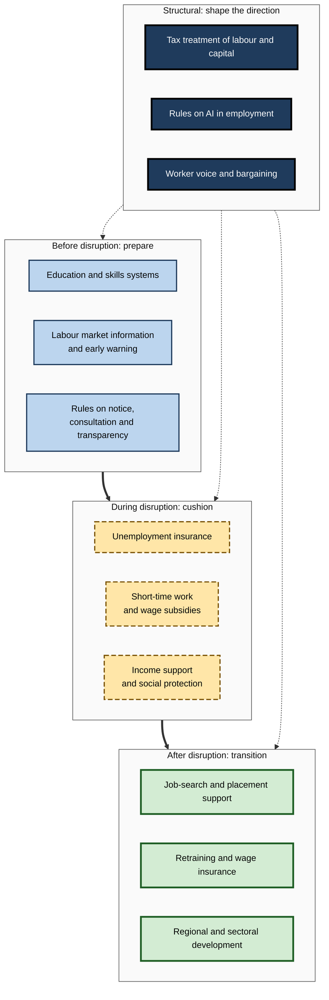
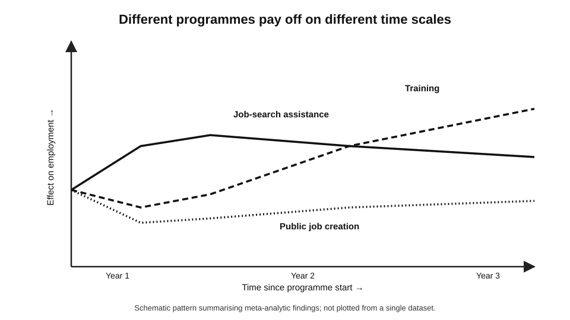
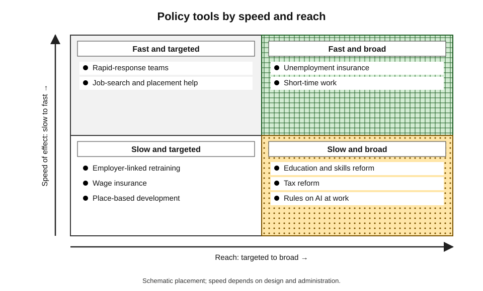
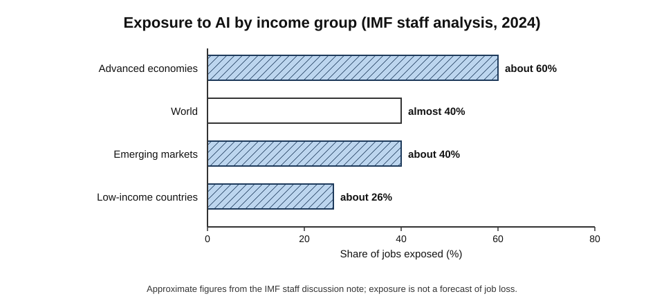
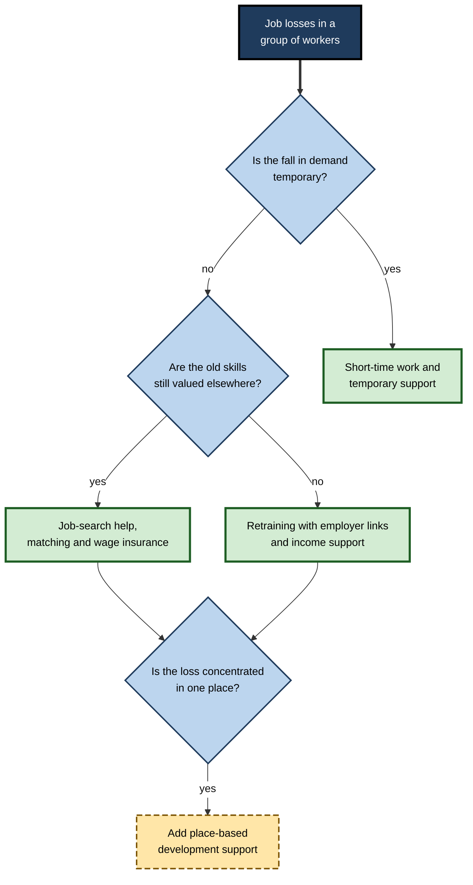
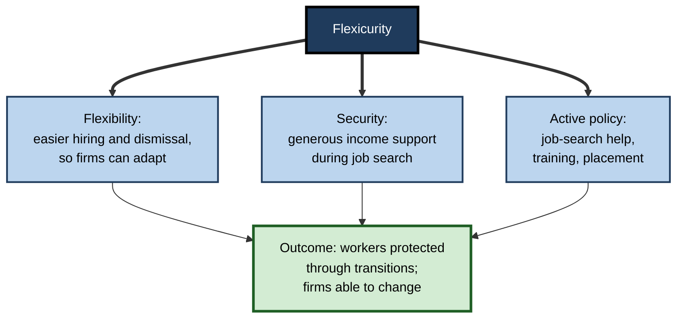

# H.12. Policy responses to AI-driven labour disruption

When a factory closes, a town feels it for a generation: wages fall, young people leave, and shops and clubs close. Economists have long observed that the gains from technology are spread across the whole economy while the losses fall on **particular workers and places**. Governments therefore build institutions — unemployment insurance, retraining, wage support, labour law, collective bargaining — to cushion the blow and to help people move.

Generative AI raises the question of whether those institutions are ready for a wave of change that reaches office work as well as factories, and whether new ones are needed.

> **Definition — Labour market policy:** the set of laws, programmes and institutions through which governments shape employment, pay, working conditions and the support available to workers who lose jobs or need new skills.

> **Definition — Labour disruption:** a rapid or large change in the demand for particular jobs or skills that forces workers to change tasks, employers, occupations or places.

**Why it matters**

- **Distribution** — even if AI raises total income, some groups may lose, and unmanaged losses damage lives and politics.
- **Speed** — policies take years to design and fund; preparation must precede disruption.
- **Choice** — policy shapes whether AI is used to augment or replace workers, through taxes, rules and incentives.
- **Legitimacy** — public support for new technology depends on a belief that its gains will be shared fairly.

---

## The Case for Public Action

### Why markets alone fall short

- **Adjustment costs** — moving occupation, region or industry takes time, money and risk that individuals bear alone.
- **Credit constraints** — displaced workers often cannot borrow to retrain.
- **Under-investment in general skills** — employers will not fully pay for training that workers can take elsewhere.
- **Information gaps** — workers do not know which skills will be valued.
- **Insurance failure** — private markets rarely insure against job loss, because risks are correlated and hard to price.
- **Concentrated losses, diffuse gains** — those who lose have strong reasons to resist change; those who gain are scattered.
- **Local effects** — job losses in a town reduce house prices and local demand, spreading harm beyond those who lose jobs.

> **Key point:** the justification for policy is not that disruption is always bad — it is that **adjustment is costly and unevenly borne**, and that society can reduce that cost and share it more fairly.

### Evidence that disruption can scar

- **Studies of displaced workers** in many countries find that workers who lose jobs in mass layoffs suffer **long-lasting earnings losses**, often of a sizeable fraction of earnings for a decade or more, especially after long job tenure.
- **Studies of trade shocks** found concentrated, persistent local damage in the United States, with slow adjustment.
- **Lesson for AI:** if disruption concentrates in specific occupations or regions, similar scarring is plausible, although AI-driven change may be spread more broadly.

---

## A Map of Policy Tools

### Four stages of intervention

**Figure 1.** Policy tools arranged by when they act in the course of disruption.

---

## Before Disruption: Preparation

### Education and skills

- **Foundational skills** — literacy, numeracy, reasoning and communication, which support later learning.
- **Digital and AI literacy** — taught in schools and workplaces.
- **Lifelong learning systems** — individual learning accounts, paid training leave, recognition of prior learning; examples include Singapore's SkillsFuture credits.
- **Skills forecasting** — government agencies and sector councils estimate demand; accuracy is limited, so flexibility is preferred to prediction.

> **Watch out:** forecasts of occupational demand are often wrong. Policy based on a single forecast can train people for jobs that do not appear; broad skills and flexible learning routes hold up better.

### Information and early warning

- **Labour market data** — vacancies, hiring of junior staff and occupational wage changes can indicate disruption early.
- **Employer disclosure** — the US state of New York added a question to its mass-layoff notice in 2025 asking employers whether **technological innovation or automation** contributed; in its first year, reports noted that employers had not attributed layoffs to AI, which shows both the interest in data and the difficulty of attributing cause.
- **Notice and consultation** — many countries require employers to notify authorities and consult workers' representatives before large redundancies or major technological change.

### Rules on AI in employment

- **EU AI Act** — treats AI systems used for recruitment, selection, promotion, termination, task allocation and monitoring of workers as **high-risk**, with requirements for risk management, data quality, documentation, human oversight and transparency; application dates have been the subject of proposed adjustments.
- **New York City Local Law 144** (in force from July 2023) requires employers using automated employment decision tools to commission an annual **bias audit** and give candidates notice.
- **Other US states** have passed or considered laws on automated decision-making and employment; some have been delayed or amended.
- **Data protection law** (such as the General Data Protection Regulation) limits solely automated decisions with significant effects.

---

## During Disruption: Cushioning

### Unemployment insurance

- **Role:** replaces part of lost income for a period, giving time to search and protecting demand.
- **Design choices:** benefit level, duration, coverage (gig and self-employed workers are often excluded), and links to job search.
- **Evidence:** more generous benefits lengthen job search somewhat but also improve **job match quality**; they stabilise the economy in recessions.

### Short-time work

> **Definition — Short-time work:** a scheme in which the state pays part of the wages of employees whose hours are temporarily reduced, so that employers keep workers rather than dismissing them.

- **Germany's Kurzarbeit** was used on a large scale in the 2008–09 financial crisis, when about 1.4 million workers were on short-time work at the peak, and again in 2020, when the number reached about six million.
- **Evidence:** studies credit it with preserving many jobs during temporary downturns.
- **Limit for AI:** it suits **temporary** drops in demand; where disruption is **permanent**, it can delay needed adjustment, so schemes should be coupled with training.

### Income support and social protection

- **Safety nets** — minimum income, housing support, health coverage — give a floor.
- **Portability** — benefits that do not depend on a single employer help people who move or work for several platforms.
- **Universal income** — one proposed approach to guarantee an income floor, with its own costs and trade-offs.

---

## After Disruption: Transition

### Active labour market policies

> **Definition — Active labour market policies (ALMPs):** programmes that help unemployed or at-risk workers back into work, including job-search assistance, training, wage subsidies and public employment.

**Study card — David Card, Jochen Kluve and Andrea Weber, meta-analysis of active labour market programmes (*Journal of the European Economic Association*, 2018)**

- **Evidence base:** more than **200 studies** of programmes in many countries, covering about 850 estimates.
- **Results:**
  - **job-search assistance** programmes tend to have the largest effects **in the short run**;
  - **training** programmes have small or even negative effects in the first year (workers are in classes rather than searching) but **larger effects after two to three years**;
  - **wage subsidies** to private employers have moderate effects; **public-sector job creation** tends to have the weakest effects on later employment;
  - effects are larger for **long-term unemployed**, women and people re-entering the labour market, and larger in recessions.
- **Lesson:** retraining takes **time** to pay off and should be judged on a horizon of years; mixing services works better than single measures.

**Figure 2.** Schematic pattern of effects of different active labour market programmes over time.

### Wage insurance

- **Idea:** pay displaced workers part of the difference between their old and new wages for a limited time if they take a lower-paid job.
- **Rationale:** encourages quick re-employment and reduces the earnings loss.
- **Concerns:** cost, employers lowering wages, and limited help for those whose skills are no longer needed.

### Retraining that works

- **Evidence-based features**: employer links, targeting jobs that exist, income support while training, career guidance and placement support.
- **AI adds a challenge:** if the targets move quickly, long programmes risk training for yesterday's jobs; shorter, modular, stackable programmes linked to employers are favoured.

### Place-based policy

- **Local concentration of disruption** can justify regional development funds, infrastructure, anchor institutions and incentives for new employers.
- **Evidence:** place-based programmes have a mixed record; the more successful ones build on existing local strengths and connect workers to jobs.

### Case study: Sweden's job security councils

- **Situation:** Sweden's labour market combines flexible dismissal rules with strong support for people who lose jobs.
- **Institution:** since the 1970s, employers and trade unions in many sectors have funded **job security councils** (for example for white-collar workers in the private sector), which provide **advice, coaching, retraining funds and financial support** to employees made redundant.
- **How it works:**
  1. an employer notifies the council of planned redundancies;
  2. the council offers each affected employee a personal adviser;
  3. employees receive support to search, retrain or start a business, and extra financial support beyond public benefits;
  4. funding comes from collectively bargained contributions by employers.
- **Reported outcomes:** councils report that a large majority of people supported find new employment or start businesses within a relatively short period, and that people leave less fearful of change; independent evidence is more limited than the councils' own reports.
- **Lesson:** a **social-partner model** shares the risk of change between employers and workers, builds trust, and gives employers a legitimate, orderly way to reduce staff. It relies on strong unions, high coverage of agreements and high trust — features not found everywhere.

---

## Shaping the Direction: Structural Policy

### Tax treatment of labour and capital

- **Observation:** in many countries, taxes on **labour** (income and payroll taxes) are much higher than taxes on **capital** (equipment, software); this tilts firms towards automation even where it is not more productive.
- **Proposals:**
  - lower payroll taxes on employment;
  - align tax treatment of capital and labour;
  - "robot tax" or levies on automation;
  - taxes on excess profits or windfall gains from AI;
  - fund transition and basic services from these revenues.
- **Concerns:** difficulty defining what to tax; risk of discouraging productive investment; international competition.

> **Definition — Tax bias towards automation:** the tendency of tax rules that tax labour more heavily than equipment or software to encourage replacing workers with machines beyond what would otherwise be efficient.

### Rules on how AI is used at work

- **Algorithmic transparency and human review** — required in some jurisdictions for hiring, monitoring and dismissal decisions.
- **Worker consultation on technology** — duties to inform and consult representatives before introducing monitoring or automated decision systems.
- **Bans or limits** on certain uses, such as emotion recognition at work, in some regimes.
- **Impact assessments** — requirements to assess risks to workers before deployment.

### Worker voice and bargaining

- **Collective agreements** can set rules on AI use, retraining, notice, data and job protection; several unions and industry bargaining parties have negotiated AI provisions.
- **Co-determination** — in Germany, works councils have rights to co-decide on technical systems that can monitor employees.
- **Evidence:** where workers have a voice, technology adoption is often smoother and more widely shared, though outcomes depend on context.

**Figure 3.** Policy tools by speed of effect and breadth of reach.

| Tool | Acts on | Strength | Weakness |
|---|---|---|---|
| Unemployment insurance | Income of the displaced | Fast, established | Does not create jobs; excludes gig workers |
| Short-time work | Jobs during temporary slumps | Preserves jobs and skills | Poor for permanent change |
| Training and active programmes | Skills and matching | Targets the root issue | Slow; uneven quality |
| Wage insurance | Earnings loss after re-employment | Encourages quick return to work | Cost; employer behaviour |
| Tax reform | Incentive to automate | Shapes direction of technology | Hard to design; trade-offs |
| AI-at-work rules | Fairness and transparency | Protects dignity and rights | Compliance burden; uneven enforcement |
| Bargaining and voice | Terms of adoption | Shares gains; builds trust | Needs strong institutions |

---

## International Perspectives

**Study card — International Monetary Fund staff analysis, "Gen-AI: Artificial Intelligence and the Future of Work" (January 2024)**

- **Finding:** almost **40%** of jobs worldwide are exposed to AI, rising to about **60%** in advanced economies and falling to about 26% in low-income countries; in advanced economies about half of exposed jobs may benefit from AI integration, the other half may see lower labour demand.
- **Distribution:** advanced economies face greater exposure and greater opportunity; emerging and low-income economies face less immediate disruption but may lack the infrastructure and skills to benefit, potentially widening inequality between countries.
- **Policy conclusion:** advanced economies should prioritise innovation and regulation; emerging economies should build digital infrastructure and skills; all should strengthen safety nets and retraining.
- **Caveat:** exposure measures potential, not outcomes.

**Figure 4.** Share of jobs exposed to AI by country income group, according to the IMF staff analysis.

- **Developing economies** — large informal sectors, limited social protection and reliance on outsourced services (call centres, back-office work) create distinct vulnerabilities and opportunities.
- **International bodies** — the International Labour Organization, the OECD and the European Union have issued principles and guidance on AI and work.

---

## Choosing and Designing Policy

### Principles

1. **Be evidence-led** — pilot and evaluate; use randomised or comparison-group studies where possible.
2. **Target the actually affected** — use early data on occupations, regions and age groups.
3. **Combine tools** — income support, training, matching and place-based help work better together.
4. **Protect people, not specific jobs** — shield workers' incomes and mobility rather than freezing obsolete roles.
5. **Preserve incentives to work and adapt.**
6. **Include everyone** — gig, part-time, self-employed and informal workers.
7. **Plan for speed** — build triggers that scale up support automatically when indicators cross thresholds.
8. **Maintain trust** — involve employers, unions and communities in design.

> **Mnemonic — "PROTECT":** **P**repare, **R**eplace income, **O**ffer retraining, **T**arget the affected, **E**valuate, **C**ombine tools, **T**ransparency — seven habits of good transition policy.

### Automatic stabilisers and triggers

- **Idea:** link support to indicators — for example unemployment in an occupation or region — so help increases without waiting for a new law.
- **Advantage:** speed and predictability.
- **Challenge:** choosing indicators that capture AI-related disruption rather than the general economic cycle.

### Worked example (illustrative): costing a transition package

A country expects **40,000** workers to be displaced from back-office jobs over three years. It designs a package. *Illustrative figures.*

| Component | Share of displaced workers receiving it | Cost per recipient | Total |
|---|---|---|---|
| Job-search and placement services | 100% (40,000) | £800 | £32 million |
| Retraining programme | 40% (16,000) | £6,000 | £96 million |
| Wage insurance (up to 50% of earnings gap for two years) | 30% (12,000) | £5,000 | £60 million |
| Extended income support during training | 40% (16,000) | £4,000 | £64 million |
| **Total** | | | **£252 million** |

1. **Compute totals:** 40,000 × £800 = £32m; 16,000 × £6,000 = £96m; 12,000 × £5,000 = £60m; 16,000 × £4,000 = £64m. Sum = £252 million.
2. **Cost per displaced worker:** £252m ÷ 40,000 = **£6,300**.
3. **Compare with the cost of doing nothing:** if each displaced worker without support loses, say, £10,000 in lifetime earnings beyond what the package prevents, and the public loses tax and pays benefits, support may pay for itself — but only if programmes work.
4. **Test:** evaluate against a comparison group and adjust funding based on results.

> **Watch out:** a package costed on a forecast of 40,000 displaced workers is only as good as the forecast. Design it to scale with actual numbers.

**Figure 5.** Decision path for choosing between short-term cushioning and longer-term transition support.

---

## Political Economy

- **Winners and losers differ in power** — displaced workers are numerous but dispersed; firms and investors are concentrated and organised.
- **Timing** — politicians favour visible, short-term measures; preparation pays off later.
- **Public opinion** — surveys in many countries show concern about AI and jobs; support for retraining is typically high, while support for new taxes is more divided.
- **Populist risk** — localities hit by past industrial decline have shown strong political reactions; policymakers worry about repeating the pattern.
- **Regulatory competition** — countries compete for AI investment, tempering willingness to impose costs.
- **Institutional capacity** — countries with strong public employment services, social partnership and fiscal space have a head start.

> **Key point:** whether AI's gains are widely shared is a **political and institutional** question as much as a technological one. History — from the industrial revolution to globalisation — shows that gains were broadly shared only after institutions, laws and collective action made them so.

---

## Flexicurity: Combining Flexibility and Security

> **Definition — Flexicurity:** a policy approach that combines **flexible** hiring and dismissal rules with **generous income support** and **active labour market policies**, so that workers are protected through support in transition rather than protection of particular jobs.

### The Danish "golden triangle"

- **Flexible labour market** — employers can hire and dismiss relatively easily, with notice and consultation.
- **Generous unemployment benefits** — high replacement rates for a limited period, with strong job-search conditions.
- **Active labour market policy** — substantial spending on job-search help, training and placement.
- **Result:** high job turnover, high employment and public support for change, with high public spending and taxes.
- **Limits:**
  - it depends on high trust, strong institutions and the capacity to fund generous support;
  - long-term unemployed and low-skilled workers still face difficulty;
  - housing, location and age can limit mobility;
  - it was designed for a world of routine job change; whether it can handle faster change is untested.

**Figure 6.** The three corners of flexicurity and what each provides.

> **Key point:** flexicurity shifts protection from **jobs** to **people**. It does not guarantee success where trust is low, funding is limited or the pace of change is much faster than design assumed.

---

## Take-up, Administration and Design Pitfalls

Policies that look good on paper often fail in delivery.

- **Take-up** — benefits and training are used only if people know of them, qualify and can access them.
  - Complicated forms, stigma and lack of information reduce take-up, especially among the people with greatest need.
- **Targeting errors** — tight eligibility rules exclude people who need help; loose rules waste funds.
- **Administrative capacity** — public employment services need trained staff, good data and local employer links.
- **Timing** — support that arrives months after job loss loses much of its value.
- **Incentives** — very generous support without conditions may slow job search; very strict conditions can force poor job matches.
- **Quality of training** — funding without quality control produces low-value courses.
- **Evaluation** — without comparison groups, programmes cannot show whether they work.

### Worked example (illustrative): how take-up changes cost-effectiveness

A retraining voucher programme costs £5,000 per participant and raises later earnings by £12,000 per participant over five years. The government offers it to 10,000 displaced workers. *Illustrative figures.*

| | 30% take-up | 70% take-up |
|---|---|---|
| Participants | 3,000 | 7,000 |
| Programme cost | 3,000 × £5,000 = £15 million | 7,000 × £5,000 = £35 million |
| Earnings gain | 3,000 × £12,000 = £36 million | 7,000 × £12,000 = £84 million |
| Net gain | £21 million | £49 million |
| Share of the 10,000 who benefit | 30% | 70% |

1. **Compute for 30% take-up:** cost £15m; gain £36m; net £21m.
2. **Compute for 70% take-up:** cost £35m; gain £84m; net £49m.
3. **Interpretation:** the programme is equally good **per participant** (net £7,000 each), but its total benefit depends on how many people use it; low take-up wastes most of its potential.
4. **Action:** invest in outreach, simple applications, trusted messengers (unions, community groups) and early contact — as important as the content of the training.

> **Formula — Net gain per participant:** earnings gain − programme cost. Example: £12,000 − £5,000 = **£7,000**.

> **Watch out:** the example assumes that those who take up the programme gain as much as those who do not; in practice, **selection** can make early participants look better than the average person, so evaluations need comparison groups.

---

## Coordination Across Levels

- **Local** — cities and regions know their labour markets and can link training with employers and housing.
- **National** — sets benefits, taxes, labour law and education systems.
- **International** — shares evidence, sets common standards (for example on platform work and algorithmic transparency), and addresses cross-border issues such as outsourcing and tax competition.
- **Social partners** — employers' associations and unions design and run training funds and adjust to sectors' needs.
- **Employers** — are essential partners; they know the vacancies and can offer on-the-job learning and hiring.

> **Remember:** an effective response to disruption is less a single policy than a **system**: early information, income security, training that connects to jobs, support for places, fair rules on technology and a way for workers to be heard.

---

## Open Questions

- **Is disruption large enough to need new institutions?**
  - If AI mainly changes tasks gradually, existing tools may suffice; if it displaces many workers quickly, they may not.
- **How can support reach gig, informal and self-employed workers?**
  - Many systems are built around standard employment.
- **Can tax systems stop favouring automation without harming investment?**
  - Proposals exist; designs are untested at scale.
- **Will rules on AI at work be enforced?**
  - Many laws are new, with delays and amendments; enforcement capacity is uncertain.
- **How should costs and gains be shared between countries?**
  - Gains may flow to a few countries and firms while others bear disruption.

---

## Summary

- **Labour market policy** shapes how the costs of disruption are borne; **public action** is justified because adjustment is costly, credit-constrained, uninsured and unevenly distributed.
- Displacement leaves **lasting earnings losses** for many workers; local concentration deepens harm.
- Tools act at four stages: **prepare** (skills, information, notice rules), **cushion** (unemployment insurance, short-time work), **transition** (active programmes, wage insurance, place-based support), and **structural** (tax, AI-at-work rules, bargaining).
- **ALMP meta-analysis:** job-search help works fast, training pays off after two to three years, public job creation is weakest.
- **Short-time work** suits temporary shocks, not permanent change.
- **Sweden's job security councils** show a social-partner model sharing risk.
- **Tax rules** that favour capital over labour can tilt towards automation.
- **IMF analysis:** about 40% of jobs worldwide are exposed, rising to about 60% in advanced economies.
- Principles of good policy: **PROTECT** — prepare, replace income, offer retraining, target, evaluate, combine, transparency.
- Outcomes depend on **political economy** and institutional strength.

---

## Self-Check

1. Why does disruption justify public action even if total output rises?
2. What does research on displaced workers show about long-run earnings?
3. List the four stages at which policy acts, with two tools in each.
4. What did the meta-analysis of active labour market programmes find about job-search help and training?
5. What is short-time work and why is it poorly suited to permanent change?
6. Describe how Sweden's job security councils work and one limit on copying them.
7. Why might tax systems encourage automation?
8. What do the EU AI Act and New York City Local Law 144 require of AI in employment?
9. Summarise the IMF's findings on exposure across income groups.
10. What does the New York layoff-notice question tell us about measuring AI-related job loss?
11. In the costing example, what is the cost per displaced worker, and what happens if only 20,000 workers are displaced and costs scale in proportion?
12. List four principles of good transition policy.
13. A town loses 3,000 customer-service jobs to AI within a year. Propose a response using at least five tools, in sequence.

### Answer Key

1. Adjustment is costly and uninsured; losses are concentrated while gains are diffuse; workers face credit constraints and information gaps; local damage spreads.
2. Mass-layoff studies find long-lasting earnings losses, often a sizeable share of earnings for a decade or more, especially for long-tenured workers.
3. Prepare: skills systems, early-warning data, notice rules. Cushion: unemployment insurance, short-time work. Transition: active programmes, wage insurance, place-based support. Structural: tax reform, AI rules, bargaining.
4. Job-search help has the largest short-run effects; training has small or negative first-year effects but larger gains after two to three years; public job creation is weakest.
5. The state pays part of wages for reduced hours so employers retain staff. It suits temporary demand drops; for permanent change it can delay adjustment unless combined with training.
6. Employers and unions fund councils that provide advisers, coaching, retraining and extra financial support to people made redundant. It depends on strong unions, high agreement coverage and high trust, which many countries lack.
7. Labour is taxed more heavily than equipment and software, so firms may substitute machines for workers beyond what is efficient.
8. EU AI Act: high-risk classification for AI in recruitment, promotion, termination, task allocation and monitoring, with oversight, documentation and transparency duties. NYC LL144: annual bias audits and notices for automated employment decision tools.
9. About 40% of jobs worldwide exposed; about 60% in advanced economies; about 26% in low-income countries; advanced economies face more exposure and opportunity.
10. Authorities want data on automation-related layoffs, but employers did not attribute layoffs to AI in the first year — attribution is difficult and voluntary disclosure is weak.
11. £252m ÷ 40,000 = £6,300 per worker. With 20,000 displaced: costs scale to £126 million (if proportional), still £6,300 per worker.
12. Any four of: evidence-led; target the affected; combine tools; protect people, not jobs; preserve work incentives; include all workers; plan for speed; maintain trust.
13. Immediate: notice and consultation, unemployment insurance, rapid-response advice; short term: job-search help and matching, income support during training; medium term: employer-linked retraining, wage insurance; place-based: regional development and attracting employers; evaluation throughout.

---

## Glossary

| Term | Meaning |
|---|---|
| Active labour market policy | Programmes helping unemployed workers back into work. |
| Co-determination | Legal right of employee representatives to share decisions with management. |
| Job security council | A body funded by employers and unions that supports redundant workers. |
| Labour disruption | A rapid or large shift in demand for jobs or skills. |
| Labour market policy | Laws and programmes shaping employment, pay and support for workers. |
| Place-based policy | Support targeted at particular regions or localities. |
| Short-time work | State-supported reduction of working hours to avoid dismissals. |
| Social partners | Employers' organisations and trade unions. |
| Unemployment insurance | Income support for people who lose work. |
| Wage insurance | A top-up for workers who take a lower-paid job after displacement. |
