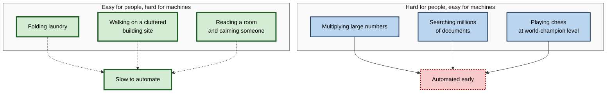
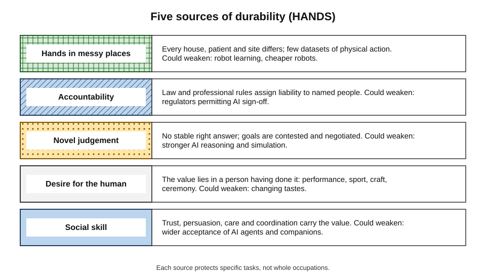
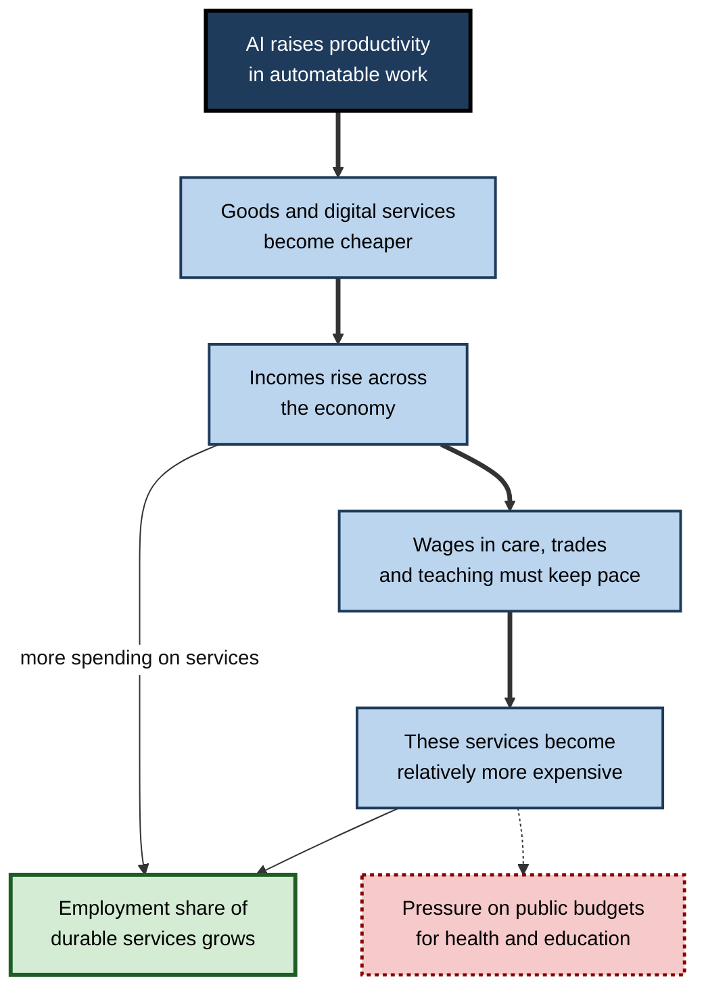
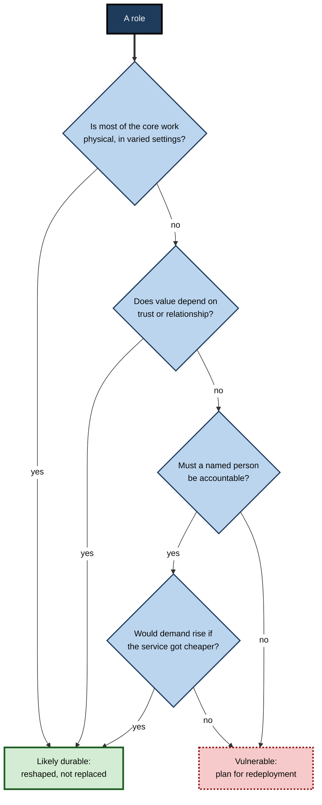
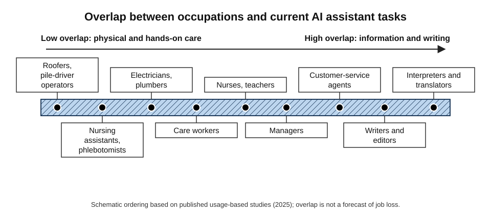
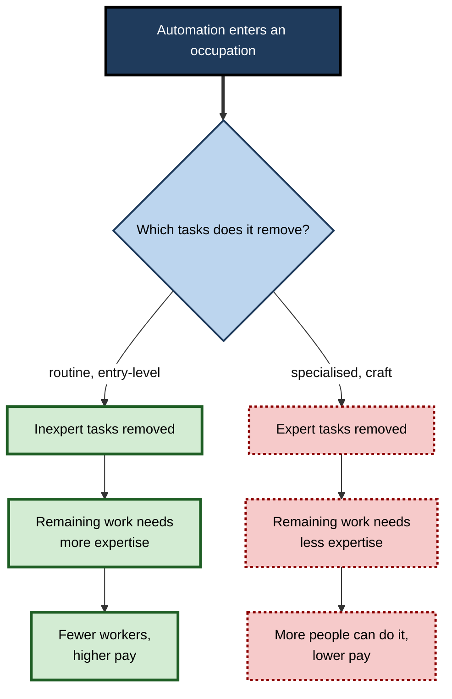

# H.2. Which jobs AI is unlikely to replace

In 2016 a pioneer of deep learning told an audience that hospitals should stop training radiologists, because within five years algorithms would read scans better than people. A decade later radiologists were still in short supply. Meanwhile a computer that can pass professional examinations still cannot fix a leaking pipe under a kitchen sink, sit with a frightened patient at three in the morning, or be held responsible in court for a decision.

Some work is far harder to replace than it looks — and the reasons are instructive.

> **Definition — Automation-resistant work:** work whose core tasks AI and robots are unlikely to perform at acceptable cost, reliability and social acceptability in the foreseeable future, so that human workers remain necessary even if the job changes.

**Why it matters**

- **Career choice** — people want to know where their skills will remain valued.
- **Education** — schools, universities and training providers must decide which capabilities to emphasise.
- **Workforce planning** — organisations need to know which roles to keep investing in.
- **Avoiding false comfort** — "unlikely to be replaced" does not mean "unchanged", "well paid" or "safe forever".

---

## Moravec's Paradox

Machines find hard what people find easy, and easy what people find hard.

> **Definition — Moravec's paradox:** the observation, made by roboticist Hans Moravec in 1988, that it is comparatively easy to make computers perform at adult level on intelligence tests or games, but very hard to give them the perception and mobility of a one-year-old.

**Why the paradox exists**

- **Evolution's head start** — perception, balance and dexterity were refined over hundreds of millions of years; they run unconsciously and feel effortless.
- **Recent skills feel hard** — abstract reasoning, mathematics and formal logic are evolutionarily new, so people find them effortful.
- **Effort misleads** — what feels hard to a person says little about what is hard to engineer.

**Figure 1.** Moravec's paradox: human effort and machine difficulty run in opposite directions.

> **Key point:** the work that resists automation is not the work society labels most "skilled". It is work that depends on **perception and manipulation in messy settings**, **social understanding**, and **responsibility**.

---

## Five Sources of Durability

### 1. Dexterity in unstructured physical environments

- **The problem for robots:**
  - real environments are irregular — every house, patient and building site differs;
  - objects are soft, slippery, fragile or hidden;
  - errors can injure people or damage property;
  - unlike text, there are few large datasets of physical actions.
- **Typical durable roles:**
  - electricians, plumbers, heating engineers, roofers;
  - nurses, care workers, physiotherapists, paramedics;
  - cleaners in varied buildings, landscape gardeners;
  - mechanics and maintenance technicians.

> **Example:** a factory robot can weld the same car seam thousands of times a day because the car arrives in exactly the same place. A plumber must diagnose a leak hidden behind a different wall in every house.

### 2. Social and emotional intelligence

- **Tasks:** persuading, negotiating, comforting, coaching, leading, building trust, reading unspoken concerns.
- **Why they resist:**
  - meaning depends on context, relationship history and subtle cues;
  - people often want the interaction to be with **another person**;
  - the value lies partly in the relationship itself.

**Study card — David Deming, "The Growing Importance of Social Skills in the Labor Market" (*Quarterly Journal of Economics*, 2017)**

- **Question:** which kinds of jobs grew in the United States between 1980 and 2012?
- **Method:** classified occupations by their demand for mathematical and social skills.
- **Results:**
  - jobs requiring **high social skills** grew strongly as a share of employment;
  - jobs requiring high mathematical skill but **low** social skill fared poorly;
  - wage returns to social skills rose.
- **Explanation:** social skills reduce the cost of **coordinating** with others; computers are poor substitutes for coordination, flexibility and teamwork.
- **Implication:** combining technical competence with social skill is the most durable profile.

### 3. Judgement under ambiguity and genuine originality

- **Tasks:** setting strategy, framing problems, deciding with incomplete information, creating work that redefines a field.
- **Why they resist:**
  - there is no stable "right answer" to learn from;
  - the goal itself is contested and must be negotiated;
  - generative AI recombines patterns in its training data, which helps routine creative work but less so work that must break with existing patterns.

> **Watch out:** "creativity" is not a safe category as a whole. Generative AI performs routine creative tasks — stock images, jingles, product copy, variants of a design — well and cheaply. What resists is **originality that matters to an audience** and **creative direction**: choosing what is worth making.

### 4. Accountability, licensing and trust

- **Many decisions require a named, accountable person.**
  - *e.g.* a surgeon consents a patient; a structural engineer signs off a design; a judge gives a sentence; an auditor signs an opinion.
- **Why it matters:**
  - law and professional regulation assign **liability** to people and firms;
  - patients, clients and citizens expect someone to answer for errors;
  - courts and regulators move slowly, so the requirement for human sign-off persists even when AI could do the analysis.

> **Definition — Accountability:** the obligation to explain and justify a decision and to bear the consequences if it is wrong.

### 5. Human preference and authenticity

- **Some value comes from the fact that a person did the work.**
  - *e.g.* live music, professional sport, handmade goods, a teacher who knows the pupil, a priest at a funeral.
- **Chess is the clearest case:**
  - computers have beaten the world champion since 1997;
  - yet professional human chess has grown in popularity, sponsorship and online audience — people want to watch **people** compete.

> **Mnemonic — "HANDS":** **H**ands in messy places, **A**ccountability, **N**ovel judgement, **D**esire for the human, **S**ocial skill — the five sources of durability.

**Figure 2.** Five sources of durability, with what makes each hard for AI and what could weaken it.

| Source of durability | Why it is hard for AI | Example roles | What could weaken it |
|---|---|---|---|
| Dexterity in unstructured settings | Variable environments; little physical training data; safety risks | Electrician, care worker, paramedic | Advances in robot learning and cheaper robots |
| Social and emotional intelligence | Context, relationship and trust carry the value | Nurse, teacher, salesperson for complex deals, manager | Customers accepting AI companions and agents |
| Judgement under ambiguity | No stable correct answer; goals contested | Chief executive, policy adviser, creative director | Better AI reasoning and simulation |
| Accountability and licensing | Law assigns liability to people | Surgeon, auditor, judge, structural engineer | Regulatory change allowing AI sign-off |
| Human preference | Value lies in human origin | Performer, athlete, craftsperson, clergy | Changing tastes, especially among the young |

---

## The Economics of Persistence

Technical difficulty is only half the story. Economic forces also keep human jobs alive.

### Rising demand when productivity rises

- **Elastic demand:** if AI makes a service cheaper and people want much more of it, total employment can rise.
  - *e.g.* cheaper legal advice could bring millions of people who never consulted a lawyer into the market.
- **Jevons paradox:** when a resource is used more efficiently, total use can increase.
  - Named after William Stanley Jevons (1865), who observed that more efficient steam engines raised Britain's coal consumption.

> **Definition — Jevons paradox:** the tendency for improvements in efficiency to increase, rather than reduce, total use of a resource, because lower costs stimulate demand.

### Baumol's cost disease

- **William Baumol and William Bowen (1966)** studied the performing arts:
  - a string quartet needs the same four players and the same time as in 1800;
  - yet musicians' wages must rise with wages elsewhere, or they would leave;
  - so services with **slow productivity growth** become relatively more expensive — and take a growing share of employment.
- **Application to AI:** the sectors AI struggles to automate — care, education, skilled trades, personal services — are likely to **grow** as a share of jobs.

> **Definition — Baumol's cost disease:** the rise in the relative cost of services whose productivity grows slowly, because their wages must keep pace with sectors whose productivity grows fast.

**Figure 3.** How fast productivity growth in automatable work shifts employment towards durable services.

### Job polarisation and the growth of service work

**Study card — David Autor and David Dorn, "The Growth of Low-Skill Service Jobs and the Polarization of the US Labor Market" (*American Economic Review*, 2013)**

- **Finding:** from 1980 to 2005, employment and wages grew in **low-skill service occupations** — food service, cleaning, personal care, security — as routine middle-skill jobs declined.
- **Mechanism:** computers substituted for routine tasks; service jobs required in-person, flexible, non-routine manual work that computers could not do.
- **Lesson:** durability is not the same as high pay. Many of the jobs that resisted computerisation were low-paid.

> **Watch out:** a job can be unlikely to be replaced and still be **badly paid, insecure and exhausting**. Durability protects employment, not working conditions; those depend on bargaining power, regulation and labour supply.

---

## Durable Does Not Mean Unchanged

Almost every durable role is being **reshaped** by AI, even where its core is safe.

- **Nurses** — AI drafts care notes, flags deteriorating patients and optimises shift rotas; the bedside work stays human.
- **Electricians** — AI tools help diagnose faults, read schematics and price jobs; the installation stays human.
- **Teachers** — AI generates practice questions and marks routine work; motivation, relationships and classroom management stay human.
- **Managers** — AI summarises reports and drafts communications; deciding, persuading and supporting people stays human.

| | Replaced role | Reshaped durable role | Unaffected role |
|---|---|---|---|
| Share of tasks AI performs | Most | Some, usually administrative | Few or none |
| What happens to headcount | Falls | Stable or rising if demand grows | Driven by other factors |
| What happens to the job content | Disappears | Shifts towards the human core | Little change |
| Skill implication | Move to another role | Learn to use AI for the peripheral tasks; deepen the core | Monitor change |

> **Key point:** the realistic future for most durable roles is that AI takes the **paperwork** and people keep the **work**. Professionals who adopt AI for the periphery gain time for the core.

---

## Where the Boundary Is Moving

"Unlikely to replace" is a statement about the present state of technology and institutions. Three frontiers are moving.

### Robotics and physical AI

- **Driverless taxis** — by 2025, fully driverless commercial ride services operated in several US cities, after more than a decade of predictions that proved premature.
- **Warehouse automation** — robots move shelves and sort parcels at large scale; picking irregular items by hand remains partly human.
- **Robot learning** — models trained on large collections of robot demonstrations and video are improving general-purpose manipulation, though deployment outside controlled settings remains limited.

> **Watch out:** both directions of error are common. Predictions of driverless lorries "within five years" were made repeatedly from the mid-2010s and failed; yet driverless taxis did eventually arrive. Durability arguments must be revisited every few years.

### Emotional AI and companionship

- AI chatbots are used for emotional support and companionship by many people.
- Whether people will accept AI in roles such as counselling, coaching or elder companionship — and whether it serves them well — is uncertain and ethically contested.

### Regulatory change

- If regulators permit AI systems to make decisions now reserved to licensed professionals, the accountability barrier could fall in specific areas.

### Case study: the radiologist forecast

- **Situation:** in 2016 deep-learning pioneer Geoffrey Hinton said that people should stop training radiologists, because deep learning would soon outperform them at reading images.
- **What happened next:**
  - AI image-reading tools multiplied — radiology became the medical specialty with the most AI devices authorised by the US Food and Drug Administration;
  - demand for imaging grew with ageing populations and cheaper scanning;
  - many health systems reported **shortages** of radiologists rather than surpluses.
- **Why the forecast failed:**
  1. **Task bundle** — radiologists do far more than detect findings: they protocol scans, consult clinicians, perform image-guided procedures, compare with history and communicate results.
  2. **Reliability** — tools that perform well on curated test sets often perform worse on scans from other hospitals and machines.
  3. **Accountability** — reports must be signed by a responsible doctor.
  4. **Demand** — more scans were ordered than ever.
  5. **Integration** — fitting tools into hospital systems and workflows proved slow and costly.
- **Lesson:** forecasting job loss from performance on a single task ignores the bundle, the demand response and the institutions around the work. Hinton later said he had been wrong about the timing.

**Study card — James Wright, *Robots Won't Save Japan* (2023)**

- **Setting:** ethnographic fieldwork in a Japanese care home that trialled government-backed care robots, including a lifting robot, a communication robot and a seal-like therapy robot.
- **Findings:**
  - the robots often **created more work** for care staff, who had to move, set up, monitor and clean them;
  - residents' interest in the companion robots faded;
  - several devices were set aside after the trial;
  - human relationships remained the centre of care.
- **Lesson:** technology designed to "solve" labour shortages in care can add tasks rather than remove them when it does not fit the realities of the work.

---

## Judging Durability

### A decision sequence for any role

**Figure 4.** Questions that indicate whether a role is likely to remain human.

### Worked example (illustrative): three roles compared

Each role is scored 0–2 on the five HANDS sources (2 = strong protection). *Illustrative figures.*

| Source | Domestic electrician | Paralegal (document review) | Hospital ward nurse |
|---|---|---|---|
| Hands in messy places | 2 | 0 | 2 |
| Accountability | 2 (certifies safety) | 0 (supervised) | 1 |
| Novel judgement | 1 | 1 | 1 |
| Desire for the human | 0 | 0 | 2 |
| Social skill | 1 | 0 | 2 |
| **Total (out of 10)** | **6** | **1** | **8** |

1. **Electrician** — strongly protected by physical variation and safety certification; AI will help with diagnosis, design and quoting.
2. **Paralegal on document review** — weakly protected; AI already performs first-pass review. The durable paralegal role will shift towards case management, client contact and supervising AI review.
3. **Ward nurse** — strongly protected by physical care, relationships and clinical judgement; AI will take documentation and monitoring tasks.

> **Watch out:** the score describes the **role as currently bundled**. A paralegal who moves into client-facing case management changes their own score.

### Where the durable jobs are

- Studies of what people actually ask AI assistants to do at work find the **least overlap** with hands-on healthcare support, construction, maintenance and other physical work, and the most with translation, writing and information work.

**Figure 5.** Occupations along a spectrum from low to high overlap with what current AI assistants do.

- **Health and social care** — nursing, care work, therapy, midwifery, paramedics.
- **Skilled trades** — electrical, plumbing, construction, maintenance, repair.
- **Education and childcare** — especially early years and special educational needs.
- **Complex sales, leadership and management** — work built on relationships and coordination.
- **Emergency and protective services** — firefighters, police, rescue.
- **Performing arts, sport and craft** — where human origin is the product.
- **Licensed professions at the point of decision** — the clinician, engineer or lawyer who signs off.

> **In practice:** employers in durable fields face the opposite problem from employers in exposed fields — not surplus workers but **shortages**. Their AI strategy is to remove administrative load so that scarce skilled staff spend more time on the core work.

---

## Expertise: Which Tasks Does Automation Remove?

The durability of a job depends not only on whether tasks are automated, but on **which** tasks.

> **Definition — Expertise (in labour economics):** the specialised knowledge needed to perform a task well, which gives workers who hold it scarcity value in the labour market.

**Study card — David Autor and Neil Thompson, "Expertise" (*Journal of the European Economic Association*, 2025)**

- **Question:** when automation takes over tasks within an occupation, do wages and employment rise or fall?
- **Core idea:** occupations are bundles of tasks that differ in the **expertise** they demand.
  - If automation removes the **inexpert** tasks, what remains is more expert work: fewer workers are needed, but each is scarcer and better paid.
  - If automation removes the **expert** tasks, what remains is inexpert work that many people can do: employment may rise but wages fall.
- **Illustration:** the authors contrast occupations in which computerisation took away routine clerical tasks (leaving higher-skilled coordination and judgement) with occupations in which it took away specialised craft tasks (leaving simpler tending of machines).
- **Lesson:** exposure alone does not predict whether workers gain or lose; the **kind of task removed** does.

**Figure 6.** The two ways automation can change the expertise content of an occupation.

### Applying the idea to AI

- **AI that takes first drafts and routine analysis** removes inexpert tasks from many professional jobs, which may concentrate the work on judgement — good for those who hold it, hard on those who would have learned it through the routine tasks.
- **AI that spreads expert know-how to novices** — as in studies of customer-support assistants — moves the other way: it lets less expert workers perform tasks that once required experience, which may widen the pool of people able to do a job and put downward pressure on its pay.
- **Autor (2024)** has argued that AI could, if directed that way, **rebuild middle-skill work** by letting workers with fewer credentials take on higher-stakes decisions in fields such as health care, with the support of decision tools — a hopeful scenario that depends on design, regulation and bargaining rather than on technology alone.

> **Watch out:** durability is not a property of a job title. Two workers with the same title can face opposite futures depending on whether their daily tasks are the expert or the inexpert ones in their field.

---

## Why Robots Find Dexterity Hard

### Four obstacles

1. **Variation** — every sink, cable run, roof and patient is different, so a system cannot rely on memorised positions.
2. **Little training data** — text and images exist in vast quantities; recordings of skilled hands doing real work, with the forces they apply, do not.
3. **The simulation gap** — robots can practise in simulation, but the real world's friction, flexing and wear differ from the model, so skills often fail when transferred.
4. **Safety and cost** — a mistake can injure someone or damage property, and a general-purpose robot must be cheap enough to beat human labour once maintenance and supervision are counted.

> **Definition — Simulation-to-reality gap:** the drop in performance when a skill learned in a computer simulation is applied in the physical world, because the simulation cannot capture every detail of reality.

### What is changing

- **Learning from demonstrations** — robots trained on large collections of human or teleoperated demonstrations are improving at tasks such as folding and kitchen work in controlled settings.
- **Foundation models for robots** — large models that connect vision, language and action allow robots to follow instructions in unfamiliar settings, though reliability remains limited.
- **Specialised machines** — purpose-built machines (floor-cleaning robots, bricklaying systems, drones for roof inspection) take narrow tasks from trades without replacing the tradesperson.

### Worked example (illustrative): will a robot replace this plumber?

A domestic plumber's week is scored on four obstacles (1 = robot-friendly, 5 = robot-hostile). *Illustrative figures.*

| Task | Variation | Data scarcity | Simulation gap | Safety and cost | Total (max 20) |
|---|---|---|---|---|---|
| Fixing a leak behind a wall | 5 | 5 | 5 | 4 | 19 |
| Replacing a standard tap | 3 | 3 | 3 | 3 | 12 |
| Diagnosing a heating fault | 4 | 4 | 3 | 3 | 14 |
| Quoting and invoicing | 1 | 1 | 1 | 1 | 4 |

1. **Add scores** across each row: 5+5+5+4 = 19; 3+3+3+3 = 12; 4+4+3+3 = 14; 1+1+1+1 = 4.
2. **Interpret:** quoting and invoicing are already automatable by software; tap replacement is the likeliest physical task to be assisted by tools; leak-finding is the most robot-hostile.
3. **Conclusion:** the plumber's role is **reshaped** — paperwork automated, diagnosis aided by tools — with the physical core protected for the foreseeable future.

> **Watch out:** a scoring grid is a way of structuring judgement, not a prediction. The scores change as robots improve, so they should be revisited every few years.

---

## Skills, Shortages and Pay in Durable Work

- **Shortages are common.**
  - Many durable occupations — nursing, skilled trades, social care — report persistent vacancies in ageing societies, so employment demand is likely to stay high even where AI helps.
- **Pay does not always follow durability.**
  - Care work is often low-paid despite high social value; pay depends on funding models, bargaining power and who bears the cost.
- **Training routes are long.**
  - Trades take several years of apprenticeship; nursing takes years of degree and practice; shortages cannot be closed quickly.
- **AI as a support for scarce workers.**
  - Tools that remove paperwork, plan routes, diagnose faults and train newcomers can raise the output of scarce workers, which is more likely to expand services than reduce jobs.

> **In practice:** a person choosing a durable career should consider **working conditions, pay and progression** as well as automation risk; a secure job that is exhausting or poorly paid is not necessarily a good one.

---

## Open Questions

- **How fast will physical AI improve?**
  - Robot learning from large datasets is advancing; whether it will transform trades and care within a decade or several is unknown.
- **Will people accept AI in relational roles?**
  - Attitudes to AI companions, tutors and counsellors are changing; their effects on wellbeing are not yet well studied.
- **Will durable jobs be good jobs?**
  - Care and service work resists automation but is often low-paid; whether productivity gains elsewhere will fund better wages is a political question.
- **Will accountability rules change?**
  - Regulators may allow AI decisions in narrow areas; the pace and limits are uncertain.
- **Does AI in the periphery erode the core?**
  - If AI takes routine tasks, practitioners may lose the practice that kept their judgement sharp.

---

## Summary

- **Automation-resistant work** depends on tasks that AI and robots cannot perform at acceptable cost, reliability and acceptability.
- **Moravec's paradox:** perception and dexterity are hard for machines; abstract reasoning is comparatively easy.
- Five sources of durability — **HANDS**: hands in messy places, accountability, novel judgement, desire for the human, social skill.
- **Deming (2017):** jobs requiring high social skill grew strongly; social skill lowers coordination costs.
- **Economics of persistence:** elastic demand (**Jevons paradox**) and **Baumol's cost disease** shift employment towards slow-productivity services.
- **Autor and Dorn (2013):** many jobs that resisted computerisation were low-paid service jobs — durability is not the same as good pay.
- Durable roles are **reshaped**: AI takes the paperwork; people keep the core.
- The boundary moves — **driverless taxis** arrived late but did arrive; the **radiologist forecast** failed because it ignored the task bundle, demand, reliability and accountability; **care robots** in Japan often added work.

---

## Self-Check

1. State Moravec's paradox and explain why it exists.
2. List the five sources of durability (HANDS) with one example role for each.
3. Summarise Deming's (2017) findings on social skills.
4. Why is "creativity" not a safe category as a whole?
5. Explain the Jevons paradox and how it can increase employment.
6. Explain Baumol's cost disease and its implication for employment in care and education.
7. What did Autor and Dorn (2013) find, and what lesson does it hold about durability and pay?
8. Give two examples of how AI reshapes a durable role without replacing it.
9. Why did the 2016 forecast about radiologists fail? Give at least four reasons.
10. What did ethnographic research on care robots in Japan find?
11. Why must durability arguments be revisited regularly? Give one example of a boundary that has moved.
12. Score a primary-school teacher on the HANDS sources and explain your reasoning.
13. A government plans to solve care-worker shortages mainly by funding robots. Using the evidence above, advise it.

### Answer Key

1. Machines find easy what people find hard (calculation, chess) and hard what people find easy (perception, mobility). Perception and motor skills were refined by evolution and run unconsciously; abstract reasoning is evolutionarily recent and effortful for humans but easy to formalise.
2. Hands in messy places — plumber; Accountability — structural engineer; Novel judgement — chief executive; Desire for the human — performer or athlete; Social skill — nurse or teacher.
3. From 1980 to 2012, jobs requiring high social skills grew as a share of US employment and paid rising returns; high-maths, low-social-skill jobs fared poorly. Social skills reduce coordination costs, which computers cannot.
4. Generative AI performs routine creative tasks well and cheaply. What resists is originality that matters to an audience and creative direction — deciding what is worth making.
5. Efficiency lowers costs, stimulating more demand, so total use rises. If AI makes a service much cheaper and demand is elastic, more people may be employed in providing it.
6. Wages in slow-productivity services must keep pace with wages elsewhere, so their relative cost rises and they take a growing share of employment. Care and education are likely to grow as shares of jobs as AI raises productivity elsewhere.
7. Low-skill service jobs grew in employment and wages from 1980 to 2005 because they required flexible, in-person work. Durability does not guarantee good pay.
8. Nurses: AI drafts notes and flags deterioration, bedside care stays human. Electricians: AI aids diagnosis and quoting, installation stays human.
9. Radiologists do many tasks beyond detection; AI tools are less reliable on unfamiliar data; reports require an accountable doctor; demand for imaging grew; integration was slow and costly.
10. The robots often created more work for staff, residents' interest faded, devices were set aside, and human relationships remained central.
11. Technology and institutions change. Driverless taxis, long predicted and long delayed, began operating commercially in several US cities by 2025.
12. Hands: 1 (physical classroom presence, but not dexterity-heavy); Accountability: 1 (safeguarding responsibility); Novel judgement: 1; Desire for the human: 2 (parents want a human teacher); Social skill: 2 (motivation, relationships). About 7/10 — durable, with AI taking marking and preparation.
13. Robots tend to support rather than replace care; Japanese evidence shows they can add work and lose residents' interest. Fund robots only for tasks that genuinely remove load (such as lifting) after testing with staff; invest mainly in recruitment, pay, training and administrative AI that frees carers' time.

---

## Glossary

| Term | Meaning |
|---|---|
| Accountability | The obligation to justify a decision and bear its consequences. |
| Automation-resistant work | Work whose core tasks AI is unlikely to perform at acceptable cost, reliability and acceptability. |
| Baumol's cost disease | Rising relative cost of services with slow productivity growth. |
| Durable role | A role likely to remain human, though its tasks may change. |
| Elastic demand | Demand that rises substantially when price falls. |
| Jevons paradox | Efficiency gains increasing total use of a resource. |
| Job polarisation | Growth of high- and low-wage jobs with a decline in routine middle-wage jobs. |
| Moravec's paradox | Perception and dexterity are hard for machines; abstract reasoning is comparatively easy. |
| Social skill | The ability to coordinate, persuade, negotiate and work with others. |
| Unstructured environment | A physical setting that varies unpredictably from one job to the next. |
