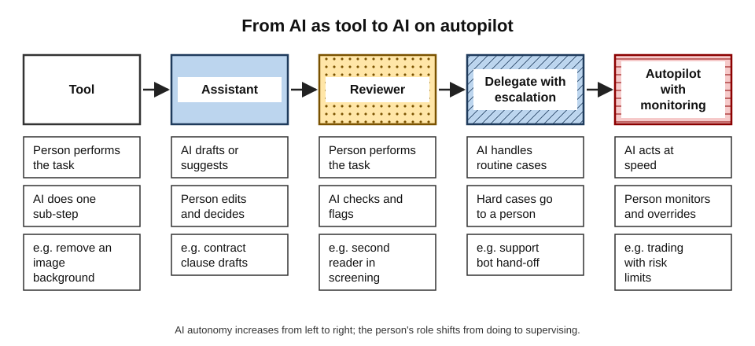
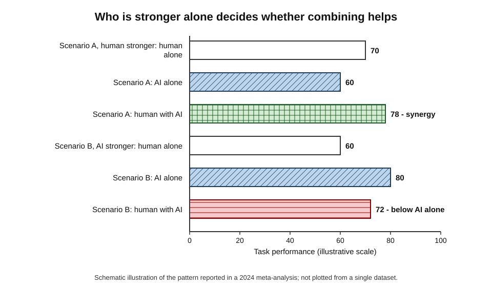
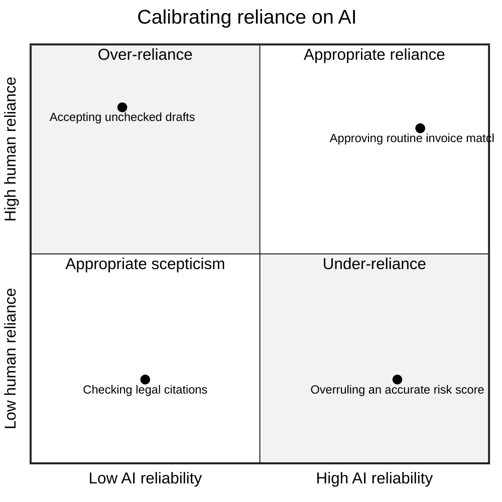
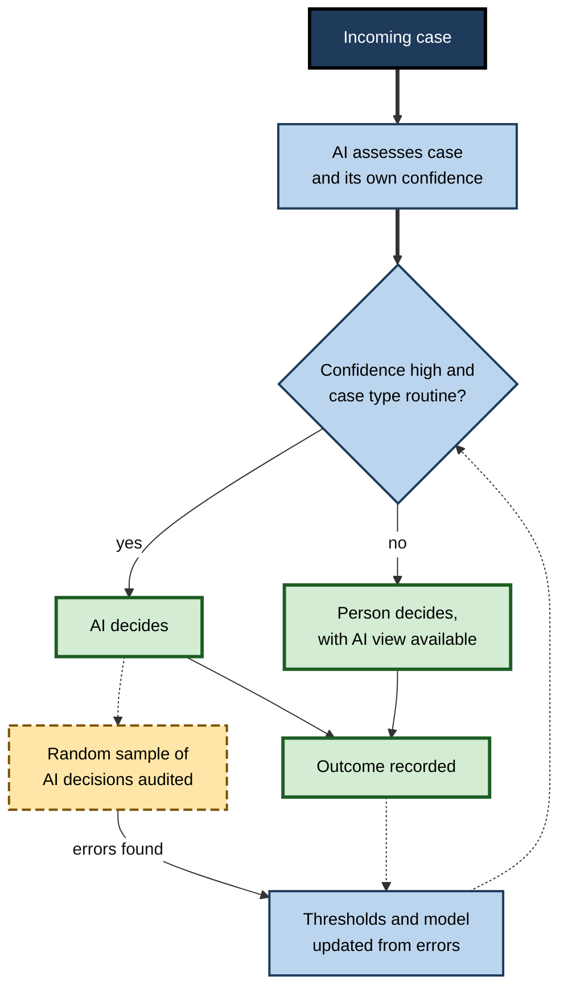
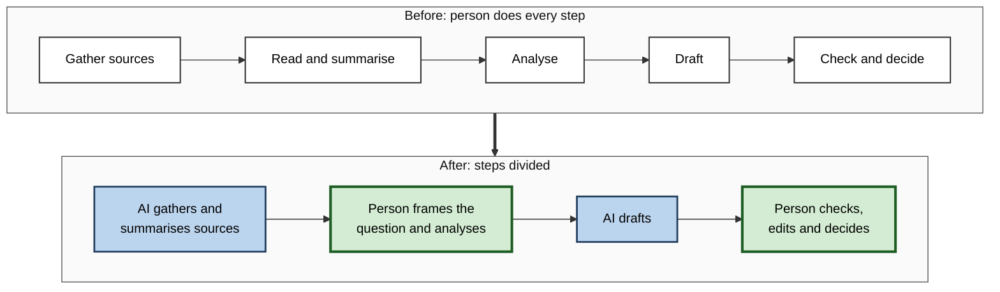

# H.3. Human-AI collaboration as the dominant model

In 2005 an online chess tournament allowed any combination of people and computers to enter. Grandmasters with powerful machines took part, as did the strongest chess programs playing alone. The winner was a pair of amateur players from New Hampshire using three ordinary computers — because they were better than anyone else at **working with** their machines. Two decades later, the same question faces every organisation using AI: not "human or machine?" but "how should people and machines divide and combine the work?"

> **Definition — Human–AI collaboration:** an arrangement in which people and AI systems contribute different capabilities to a shared task, with the division of labour, the flow of information and the final authority designed so that the combination performs better than either would alone.

**Why it matters**

- **It is how most AI is used** — in most jobs AI performs some tasks while people perform others and remain responsible for the outcome.
- **The combination can be worse than either part** — badly designed collaboration produces errors that neither people nor AI would make alone.
- **Design is a choice** — whether AI replaces or augments workers depends partly on how organisations build the work.

---

## Augmentation and Automation

> **Definition — Augmentation:** using technology to extend what a person can do — faster, more accurately or at larger scale — while the person stays in the task.

| | Automation | Augmentation |
|---|---|---|
| Who performs the task | The machine | The person, with machine support |
| Role of the human | Absent, or supervising from outside | Inside the task, deciding and acting |
| Main economic effect | Substitutes for labour | Complements labour, raising its value |
| Typical risk | Brittle failure on unusual cases; loss of jobs | Over-reliance; deskilling; unclear responsibility |
| Example | Automatic invoice matching | A doctor reading a scan with an AI second opinion |

- **Most real deployments mix the two.** A single workflow may automate data extraction, augment analysis and leave decisions to a person.
- **The same tool can do either.** A drafting assistant augments a lawyer who edits its work, and automates a task when its drafts go out unread.

### Why collaboration dominates

1. **Jobs are bundles of tasks** — AI rarely performs every task in a job, so people remain for the rest.
2. **Reliability is uneven** — AI performance is excellent on some tasks and poor on others of apparently similar difficulty, so a person is needed to catch failures.
3. **Accountability** — law, regulation and professional ethics require a responsible person for consequential decisions.
4. **Context** — people hold knowledge about clients, history and goals that is not in the data.
5. **Economics** — the largest gains often come from making people more productive rather than removing them, because demand expands.

> **Key point:** collaboration dominates not because it is fashionable but because, for most tasks today, neither the person nor the AI alone is the best available performer across **all** the cases the task contains.

---

## Origins of the Idea

- **J. C. R. Licklider, "Man-Computer Symbiosis" (1960):**
  - proposed that people and computers would work as partners;
  - people would set goals, formulate hypotheses and evaluate; computers would do the routine work of calculation and retrieval;
  - he expected this partnership to last a long time before machines could think independently.
- **Douglas Engelbart, "Augmenting Human Intellect" (1962):**
  - argued that computers should increase people's capacity to tackle complex problems;
  - his 1968 demonstration introduced the mouse, hypertext and shared editing — tools designed to augment, not replace.
- **Garry Kasparov and "advanced chess" (1998):**
  - after losing to Deep Blue in 1997, he organised matches in which each human player used a computer;
  - he later argued that "weak human + machine + better process" could beat a strong computer alone.

> **Definition — Centaur:** a human–AI team in which the person directs and judges while the AI calculates and suggests — named after the half-human, half-horse creature of myth, a term popularised by advanced chess.

### Case study: freestyle chess, 2005

- **Situation:** the chess website PlayChess.com held a "freestyle" tournament open to any team of people and computers.
- **Entrants:** grandmasters using computers; strong chess programs running alone on powerful hardware; and many mixed teams.
- **Result:** the winners, playing as "ZackS", were **two amateur players**, Steven Cramton and Zackary Stephen, using three ordinary computers.
- **Why they won:**
  - they had developed a disciplined **process** for consulting several programs;
  - they knew when the programs disagreed, and investigated those positions more deeply;
  - they knew where each program was weak.
- **Later history:** as engines improved, unaided programs eventually outplayed human–computer teams in chess, because the engines became better than people at nearly every part of the game.
- **Lesson:** the value of a centaur comes from **process and knowledge of the machine's limits**, not from the strength of the human player alone — and that value lasts only while the human adds something the machine lacks.

---

## Patterns of Collaboration

Collaboration takes several distinct forms, which differ in who acts and who decides.

**Figure 1.** Five patterns of human–AI collaboration, from AI as a tool to AI acting with minimal oversight.

- **AI as tool** — the person performs the task and invokes AI for specific steps.
  - *e.g.* a designer uses AI to remove an image background.
- **AI as assistant** — AI drafts or suggests; the person reviews and decides.
  - *e.g.* a lawyer edits an AI-drafted contract clause.
- **AI as reviewer** — the person performs the task; AI checks it.
  - *e.g.* a second reader in breast-cancer screening; code-review bots.
- **AI as delegate with escalation** — AI handles routine cases and passes difficult ones to a person.
  - *e.g.* a support bot that hands complex complaints to a human agent.
- **AI on autopilot with monitoring** — AI acts; a person monitors and intervenes on exceptions.
  - *e.g.* an automated trading system with risk limits and a human supervisor.

| Pattern | Who acts | Who decides | Main risk | Best suited to |
|---|---|---|---|---|
| Tool | Person | Person | Little — limited AI role | Discrete sub-tasks |
| Assistant | AI drafts, person edits | Person | Accepting drafts uncritically | Writing, analysis, coding |
| Reviewer | Person | Person, prompted by AI | Ignoring or over-trusting alerts | Safety checks, quality control |
| Delegate with escalation | AI, then person | AI on routine, person on hard cases | Wrong cases escalated or kept | High-volume work with a long tail |
| Autopilot with monitoring | AI | AI, with human override | Monitoring fatigue; slow takeover | Fast, high-volume, well-bounded work |

> **Definition — Human-in-the-loop:** a design in which a person must approve or act on each AI output before it takes effect. In **human-on-the-loop** designs, the AI acts and the person supervises and can intervene; in **human-out-of-the-loop** designs, the AI acts alone.

> **Watch out:** placing a person "in the loop" does not by itself make a system safe. If the person reviews thousands of outputs, lacks time or information, or tends to agree with the machine, the review becomes a formality.

---

## When Combinations Help — and When They Hurt

### The evidence across many studies

**Study card — Michelle Vaccaro, Abdullah Almaatouq and Thomas Malone, MIT, *Nature Human Behaviour* (2024)**

- **Design:** a preregistered systematic review and meta-analysis of **106 experiments** (370 effect sizes) comparing humans alone, AI alone and human–AI combinations.
- **Main result:** on average, human–AI combinations performed **worse than the better of the two alone** (Hedges' g ≈ −0.23).
- **But:**
  - combinations **did** beat the best single performer when the **human alone was better than the AI alone**;
  - they did worse when the **AI alone was better** — people over-rode correct AI answers;
  - combinations helped more in **creating content** (writing, design) than in **making decisions** (classification, diagnosis).
- **Lesson:** collaboration is not automatically synergistic. Gains depend on task type and on whether people know when to trust the AI.

> **Definition — Human–AI synergy:** a combined performance better than both the human alone and the AI alone. **Augmentation** in the weaker sense means the combination beats the human alone but not necessarily the AI.

**Figure 2.** When human–AI combinations outperform either alone, as found across many experiments.

### Why people misuse AI advice

**Study card — Nikhil Agarwal, Alex Moehring, Pranav Rajpurkar and Tobias Salz, radiology experiment (2023)**

- **Design:** professional radiologists read chest X-rays with and without AI predictions, and with and without patient history.
- **Results:**
  - the AI alone was more accurate than about two-thirds of the radiologists;
  - yet giving radiologists the AI's predictions **did not improve their accuracy on average**;
  - radiologists **under-weighted** the AI when it was confident, and were slowed down by it;
  - they treated their own information and the AI's as if they were independent, when in fact they overlapped.
- **Interpretation:** the **design of the collaboration**, not the AI's accuracy, limited performance. The authors suggested that delegating clear-cut cases entirely to the AI, and the rest to radiologists, could do better than having radiologists review every AI output.

**Two opposite errors**

- **Over-reliance (automation bias)** — accepting AI output that is wrong.
  - *e.g.* approving an AI-drafted report without noticing an invented figure.
- **Under-reliance (algorithm aversion)** — rejecting AI output that is right.
  - *e.g.* overruling an accurate risk score because of a vivid but unrepresentative case.

> **Definition — Appropriate reliance:** accepting AI output when it is right and rejecting it when it is wrong — trust calibrated to the AI's actual reliability on that kind of case.

**Figure 3.** Four combinations of AI reliability and human reliance.

> **Mnemonic — "TRUST":** **T**ask fit (is this a task the AI does well?), **R**eliability known, **U**ncertainty shown, **S**kill to check retained, **T**ime to review — the five conditions for appropriate reliance.

### Conditions for complementarity

- **Different information** — the person knows things the AI does not (the patient's history; the client's politics), or vice versa.
- **Different error patterns** — the two make mistakes on different cases, so one can catch the other.
- **Good allocation** — each case goes to whoever handles it best.
- **Calibrated trust** — the person can tell when the AI is likely to be wrong.
  - Showing **confidence levels** helps if they are accurate; misleading confidence harms.
- **Retained skill** — the person must still be able to do or check the task.

> **Watch out:** **explanations** from an AI do not reliably improve joint decisions. Several experiments have found that explanations increase people's acceptance of AI recommendations whether or not they are correct.

---

## Designing Collaboration

### Allocate by comparative advantage

- **Comparative advantage** — give each party the tasks where its advantage is greatest, not just where it is better.
- **Learning to defer** — some AI systems are trained to decide which cases they should hand to a person, based on where the person is likely to do better.

> **Definition — Deferral:** a design in which an AI system decides some cases itself and passes others to a person, usually based on its confidence or on the type of case.

**Figure 4.** A deferral workflow that routes each case to the AI or to a person.

### Worked example (illustrative): routing loan-document checks

A lender's team checks 10,000 loan documents a month. *Illustrative figures.*

| Arrangement | Cases to AI | Cases to people | Accuracy on AI cases | Accuracy on people's cases | Overall accuracy | Human workload |
|---|---|---|---|---|---|---|
| People check everything | 0 | 10,000 | — | 90% | 90.0% | 100% |
| AI decides everything | 10,000 | 0 | 98% on clear cases, 70% on unclear | — | 89.6% | 0% |
| Deferral: AI takes clear cases (70%), people take unclear (30%) | 7,000 | 3,000 | 98% | 85% | **94.1%** | 30% |

1. **AI alone:** 0.7 × 98% + 0.3 × 70% = 68.6% + 21.0% = **89.6%**.
2. **Deferral:** 0.7 × 98% + 0.3 × 85% = 68.6% + 25.5% = **94.1%**.
3. **Conclusion:** routing each case to the better performer beats both people alone and AI alone, while cutting human workload by 70%.

> **Formula — Accuracy of a deferral system:** overall accuracy = (share to AI × AI accuracy on those cases) + (share to people × human accuracy on those cases).

> **Watch out:** the gain depends on the AI's **confidence being trustworthy**. If the AI is confidently wrong on some "clear" cases, the audit sample is the only safeguard — which is why it must never be dropped.

### Designing the human's part

- **Give reviewers the right information** — source documents, AI confidence, reasons for flags.
- **Avoid rubber-stamping** — limit volumes per reviewer; audit agreement rates; require independent judgement on a sample before seeing the AI's view.
- **Keep skills alive** — rotate people through unassisted work, so they can still detect AI errors.
- **Clarify responsibility** — record who decided what, and on what basis.
- **Measure the team, not the parts** — evaluate the combined system on real cases, not the AI's test-set accuracy.

> **In practice:** a common protocol in safety-critical settings is for the person to form an **independent judgement first**, then see the AI's view, and to record a reason whenever they overrule it. This reduces anchoring on the AI and creates data for learning.

### The economic choice

- **Erik Brynjolfsson, "The Turing Trap" (2022):**
  - argued that building AI to **imitate and replace** people concentrates wealth and power;
  - building AI to **augment** people creates more value and spreads its benefits more widely;
  - he called the bias towards replacement a "trap" reinforced by tax systems that favour capital over labour.
- **Implication:** whether collaboration remains the dominant model is partly a matter of **choices** by firms, designers and governments, not only of technology.

> **Watch out:** the claim that collaboration is "the dominant model" describes the present and the near future. In tasks where AI becomes reliably better than people across nearly all cases — as chess engines did — collaboration gives way to automation with monitoring.

---

## Collaboration in Practice Today

**Figure 5.** How collaboration shifts work within a single knowledge-work process.

- **Writing and analysis** — AI drafts; people frame, edit and decide. Experimental studies of professional writing and consulting have found faster work and often higher quality inside the AI's capabilities, with more errors when people relied on it outside them.
- **Software development** — AI suggests code; developers design, review and test.
- **Medicine** — AI reads images or drafts notes; clinicians decide and communicate.
- **Customer service** — AI suggests replies or handles routine queries; agents handle complaints, emotion and exceptions.

> **Remember:** in good collaboration the person does **framing, judgement, checking and relationships**; the AI does **retrieval, drafting, pattern detection and scale**.

---

## Oversight in Practice: When the Human Cannot Really Intervene

### Meaningful human control

> **Definition — Meaningful human oversight:** supervision in which the person has the **information, time, competence, authority and motivation** to understand an AI output and to change or stop it.

- **Information** — enough about the case and about how the system reached its output.
- **Time** — a realistic opportunity to check, not a few seconds per item.
- **Competence** — the training and experience to judge the output.
- **Authority** — the power to override, without penalty.
- **Motivation** — incentives that reward careful checking rather than speed alone.

> **Watch out:** where any of the five is missing, the person becomes a **formality** whose signature transfers blame without adding safety.

### Case study: the 2018 Tempe crash of an Uber test vehicle

- **Situation:** in March 2018, an Uber test vehicle operating in automated mode struck and killed a pedestrian, Elaine Herzberg, who was crossing a road at night in Tempe, Arizona. A safety driver sat behind the wheel to monitor the system.
- **Findings of the US National Transportation Safety Board (2019):**
  - the system detected the pedestrian several seconds before impact but repeatedly changed its classification of her, and did not predict her path;
  - automatic emergency braking from the vehicle's manufacturer had been disabled during automated operation, and the system relied on the human to intervene;
  - the safety driver was looking away from the road, at a device, in the moments before the crash;
  - the operator had weak safety oversight and monitoring of its drivers.
- **Interpretation:** the design **assigned a vigilance task to a person** — watching a system that rarely required action — while removing a safeguard; human attention drifts in such conditions.
- **Lesson:** a supervisor is only as effective as the **system design, workload and organisation** make possible; blaming the individual alone hides design faults.

### The vigilance problem

- **People are poor at monitoring rarely failing systems** for long periods; attention declines and complacency grows.
- **The more reliable the system, the worse the monitoring**, because errors become rare and unexpected.
- **Remedies:**
  - give the person **active tasks** rather than passive watching;
  - **vary** the work and insert test cases that reveal whether checks are done;
  - limit **monitoring shifts** and rotate people;
  - design alerts that appear only when needed and are specific.

---

## Interface Design for Collaboration

**Study card — Microsoft Research, "Guidelines for Human-AI Interaction" (CHI conference, 2019)**

- **Method:** the researchers synthesised more than 150 recommendations from research and industry into **eighteen guidelines**, then evaluated them with practitioners on real products.
- **Themes (in outline):**
  - **Set expectations** — make clear what the system can do and how well it does it.
  - **During interaction** — give timely, context-sensitive help; let users dismiss or correct suggestions easily.
  - **When wrong** — support efficient correction and explain why the system did what it did.
  - **Over time** — learn from user behaviour cautiously, notify users of changes, and allow global controls.
- **Lesson:** good collaboration is **designed** into the interface — through calibrated confidence displays, easy overrides and honest statements of limits — not left to the user's goodwill.

### What good collaboration interfaces do

- **Show uncertainty honestly** — confidence levels only if they are well calibrated.
- **Make the evidence visible** — highlight the source passages or image regions behind an output.
- **Make disagreement easy** — one action to reject or edit a suggestion, with the reason recorded.
- **Prevent anchoring** — in high-stakes judgements, let the person commit to a view before seeing the AI's.
- **Preserve skills** — occasional unassisted tasks and feedback on the person's own accuracy.

| Design choice | Helps because | Risk if done badly |
|---|---|---|
| Confidence display | Directs attention to uncertain cases | False confidence encourages over-trust |
| Highlighting evidence | Speeds checking | Narrows attention to what is highlighted |
| Showing AI view first | Saves time | Anchors the person on the AI's answer |
| Showing AI view after the person's | Preserves independent judgement | Slower; duplicate effort |
| Explanations | Aid understanding of failures | May raise acceptance whether or not correct |

---

## Collaboration and Skill Over Time

- **Skills can strengthen or erode.**
  - Used as a **tutor** (giving hints, then feedback), AI can speed learning; used as an **answer machine**, it can reduce the effort that builds skill.
- **Experts and novices differ.**
  - Experts can spot errors and gain efficiency; novices may gain most in output but lack the knowledge to check, risking dependency.
- **Team effects.**
  - AI changes who talks to whom: junior staff may ask a machine rather than a colleague, which can reduce mentoring and shared knowledge.
- **Responsibility drift.**
  - When AI drafts and a person approves, responsibility can become blurred; clear sign-off rules prevent "the system said so".

### Worked example (illustrative): designing sign-off for an AI-drafted client report

A consultancy uses an assistant to draft client reports. It must decide who checks what. *Illustrative.*

1. **Classify claims:** numbers and quotations (checked line by line against sources), analysis and conclusions (checked by the project lead), and tone and recommendations (owned by the partner).
2. **Assign checks:** the analyst verifies numbers and sources; the project lead reviews logic and alternatives; the partner approves recommendations.
3. **Record:** a short log notes which parts were AI-drafted, who verified them and which edits were made.
4. **Audit:** each month, a sample of reports is traced back to sources by someone not on the project.
5. **Result:** responsibility is clear, errors are found earlier, and the log provides data on where the assistant fails.

> **Remember:** collaboration works when **who does what, who checks what and who is answerable** are written down before problems occur.

---

## Open Questions

- **Will collaboration persist or give way to automation?**
  - In chess, centaurs eventually lost their edge. Which professional tasks will follow, and when, is unknown.
- **How can trust be calibrated reliably?**
  - Confidence displays and explanations help in some studies and harm in others; there is no general solution.
- **What happens to human skill over time?**
  - Long-term studies of deskilling in AI-assisted professions are only beginning.
- **Who is responsible when a combination fails?**
  - Responsibility can fall on the person who had little real control — sometimes called a "moral crumple zone".
- **How should collaboration be evaluated?**
  - Most AI is evaluated alone on test sets; methods for evaluating human–AI teams on real work are immature.

---

## Summary

- **Human–AI collaboration** divides and combines work so that people and AI contribute different strengths; it dominates because jobs are task bundles, AI reliability is uneven, accountability requires people, and context matters.
- **Augmentation** keeps the person in the task; **automation** removes them; most deployments mix both.
- Ideas of partnership go back to **Licklider (1960)** and **Engelbart (1962)**; **centaur chess** showed that process and knowledge of the machine's limits matter more than raw human strength.
- Five patterns: **tool, assistant, reviewer, delegate with escalation, autopilot with monitoring**.
- **Vaccaro, Almaatouq and Malone (2024):** across 106 experiments, combinations on average did **worse** than the better of human or AI alone — but better when humans were the stronger party and in content-creation tasks.
- **Radiology experiment (2023):** AI predictions did not improve radiologists' accuracy on average, because they under-weighted the AI and misjudged overlap.
- Avoid **over-reliance** and **under-reliance**; aim for **appropriate reliance** (TRUST).
- Design by **comparative advantage** and **deferral**; protect independent judgement, skills and clear responsibility.
- Whether augmentation prevails is partly a **choice** — the "Turing Trap" argument.

---

## Self-Check

1. Define human–AI collaboration and distinguish augmentation from automation.
2. Give five reasons why collaboration is currently the dominant model.
3. What did Licklider and Engelbart propose?
4. Why did the "ZackS" team win the 2005 freestyle chess tournament, and what happened to centaurs later?
5. Describe the five patterns of collaboration and the main risk of each.
6. Explain human-in-the-loop, human-on-the-loop and human-out-of-the-loop.
7. Summarise the main result of the 2024 meta-analysis and the two conditions that changed it.
8. What did the radiology experiment show about giving professionals AI predictions?
9. Distinguish over-reliance from under-reliance and give an example of each.
10. List the conditions under which human–AI combinations are likely to be complementary.
11. A deferral system sends 60% of cases to an AI that is 99% accurate on them and 40% to people who are 88% accurate on theirs. Calculate overall accuracy.
12. What is the "Turing Trap" argument?
13. A hospital plans to make doctors review every AI-flagged scan. Using the evidence, identify risks and propose a better design.

### Answer Key

1. People and AI contribute different capabilities to a shared task, designed so the combination outperforms either alone. Augmentation keeps the person in the task with AI support; automation lets the machine perform it.
2. Jobs are task bundles; AI reliability is uneven; accountability requires people; people hold context; augmentation often creates more value as demand expands.
3. Licklider: a partnership in which people set goals and judge while computers do routine work. Engelbart: computers as tools to augment human capacity to solve complex problems.
4. They had a disciplined process for consulting several programs, investigated disagreements and knew the programs' weaknesses. As engines improved, unaided programs outplayed human–computer teams.
5. Tool (little risk); assistant (uncritical acceptance); reviewer (ignoring or over-trusting alerts); delegate with escalation (wrong cases routed); autopilot with monitoring (monitoring fatigue, slow takeover).
6. In the loop: a person approves each output. On the loop: AI acts while a person supervises and can intervene. Out of the loop: AI acts alone.
7. On average combinations did worse than the better of human or AI alone (g ≈ −0.23). They did better when the human alone outperformed the AI, and in content-creation rather than decision tasks.
8. AI predictions did not improve average accuracy; radiologists under-weighted confident AI predictions, slowed down, and treated overlapping information as independent. Collaboration design limited the gains.
9. Over-reliance: accepting a wrong AI output, such as an invented figure in a report. Under-reliance: rejecting a correct output, such as overruling an accurate risk score.
10. Different information, different error patterns, good allocation of cases, calibrated trust and retained human skill.
11. 0.6 × 99% + 0.4 × 88% = 59.4% + 35.2% = 94.6%.
12. Building AI to imitate and replace people concentrates wealth and power; building it to augment people creates more value and spreads benefits. Tax systems that favour capital push firms towards replacement.
13. Risks: alert fatigue, rubber-stamping, under-weighting accurate AI, anchoring, slower work and unclear responsibility. Better: route clear-cut cases by confidence; have doctors read independently first on hard cases; audit samples of AI decisions; monitor agreement rates; rotate unassisted reading to keep skills.

---

## Glossary

| Term | Meaning |
|---|---|
| Algorithm aversion | Tendency to reject algorithmic advice, especially after seeing it err. |
| Appropriate reliance | Accepting AI output when right and rejecting it when wrong. |
| Augmentation | Using technology to extend what a person can do while they stay in the task. |
| Automation bias | Tendency to accept automated output without sufficient checking. |
| Centaur | A human–AI team in which the person directs and the AI calculates and suggests. |
| Comparative advantage | Allocating each task to the party whose relative advantage in it is greatest. |
| Deferral | An AI system deciding some cases and passing others to a person. |
| Human-in-the-loop | Design requiring human approval of each AI output. |
| Human-on-the-loop | Design in which AI acts and a person supervises and can intervene. |
| Human–AI collaboration | People and AI contributing different capabilities to a shared task. |
| Human–AI synergy | Combined performance better than both human and AI alone. |
| Moral crumple zone | A person who absorbs blame for failures of a system they had little control over. |
| Turing Trap | The argument that building AI to replace rather than augment people is economically and socially costly. |
