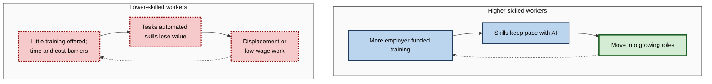
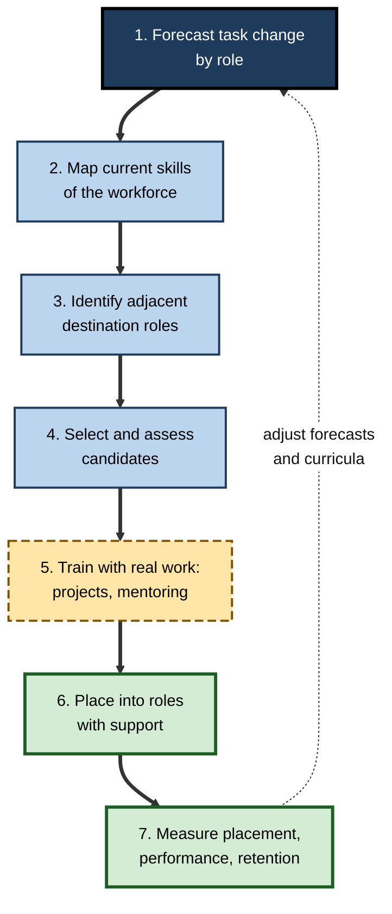
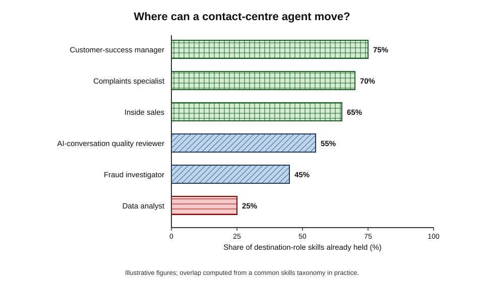
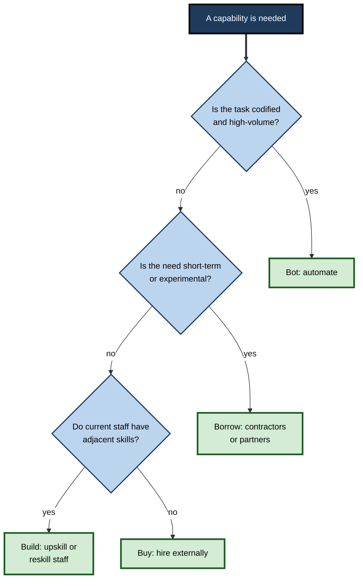
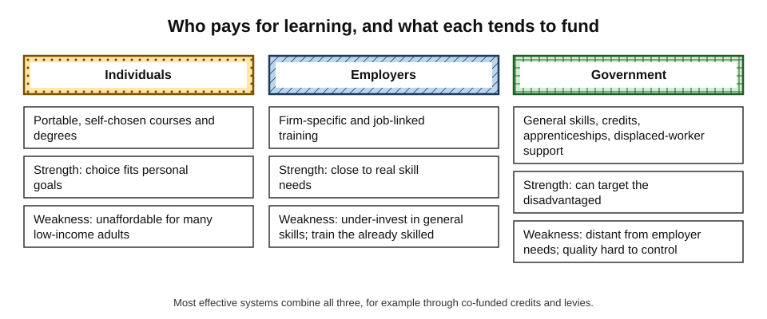

# H.4. Upskilling and reskilling for an AI economy

A bank's contact centre introduces an AI assistant that answers most balance and payment queries. Some agents learn to handle the complex complaints the assistant passes on; some move into fraud investigation after a six-month programme; some leave. Which of these happens to whom is rarely an accident — it depends on how employers, governments and workers organise learning. In an economy reshaped by AI, the ability to **build new skills at scale** becomes as important as the technology itself.

> **Definition — Upskilling:** developing new or deeper skills so that a person can perform their **current** role to a higher or changed standard.

> **Definition — Reskilling:** developing substantially new skills so that a person can move into a **different** role or occupation.

**Why it matters**

- **For workers** — skills that are not renewed lose value as tasks are automated or redefined.
- **For employers** — hiring for every new skill is slow, expensive and often impossible in tight labour markets.
- **For governments** — displaced workers who cannot retrain impose costs on public budgets and on social cohesion.
- **For the economy** — the benefits of AI depend on people learning to use it and to do the work around it.

---

## The Vocabulary of Skill Change

| | Upskilling | Reskilling | Redeployment |
|---|---|---|---|
| Destination | Same role, changed content | Different role or occupation | Different role, using mostly existing skills |
| Typical duration | Days to months | Months to years | Weeks |
| Example | A claims handler learns to supervise AI document extraction | A claims handler trains as a fraud analyst | A claims handler moves to customer retention |
| Main cost | Training time | Training time plus reduced output while learning | Matching and induction |
| Main risk | Superficial training that changes nothing | Long programme, no job at the end | Mismatch with real skill needs |

> **Definition — Skill:** a learned capacity to perform a task to a standard. A **competency** usually bundles skills, knowledge and behaviours needed for a role.

> **Definition — Skills taxonomy:** a structured list of skills and their relationships, used to describe jobs and people in comparable terms — for example the European ESCO classification or the US O\*NET database.

### How fast skills change

- **Employer surveys** expect substantial change: the World Economic Forum's 2025 survey suggested that a large share of workers' core skills will change by 2030 and that roughly six in ten workers will need some training in that period.
- **Change is uneven:**
  - technical and digital skills change fastest;
  - foundational skills — reading, numeracy, reasoning, communication — change slowly and support new learning.

> **Watch out:** the popular claim that skills have a fixed "half-life" of about five years has no solid empirical basis. Rates of change differ greatly by skill and field, and estimates rest mostly on surveys of expectations, not measurement.

---

## Why Learning at Work Is Under-supplied

### General and specific skills

**Gary Becker, *Human Capital* (1964)**

- **General skills** — valuable to many employers.
  - *e.g.* data analysis, project management, using AI tools.
- **Firm-specific skills** — valuable mainly to the current employer.
  - *e.g.* the company's internal systems and processes.
- **Prediction:**
  - firms will pay for **specific** training, because they capture the return;
  - firms will under-invest in **general** training, because trained workers can leave and take the return to a competitor — the **poaching problem**;
  - workers would have to pay for general training themselves, often by accepting lower wages.

> **Key point:** AI-era skills are mostly **general** — using AI tools well, data literacy, judgement. Becker's logic predicts that employers alone will provide too little of this training, which is why governments and collective schemes often step in.

### The Matthew effect in adult learning

- **Pattern found across OECD countries:** adults with higher qualifications and skills take part in job-related training far more than adults with low skills.
- **Result:** training **widens** gaps rather than closing them.
  - Those most exposed to automation are least likely to retrain.
- **Reasons:**
  - low-skilled workers' employers offer less training;
  - time, cost and childcare barriers;
  - poor earlier experiences of education;
  - weaker information about which skills pay.

> **Definition — Matthew effect:** the tendency for advantage to accumulate — "to those who have, more will be given" — applied here to adults' access to learning.

**Figure 1.** How unequal access to training widens skill gaps over time.

---

## What Works in Retraining

The evidence on retraining is mixed: some programmes produce large, lasting gains; many produce none.

### Programmes that disappoint

**Study card — evaluation of US Trade Adjustment Assistance (Mathematica Policy Research, 2012)**

- **Programme:** income support and training for workers displaced by foreign trade, running since 1962.
- **Design:** compared participants with similar displaced workers who did not take part.
- **Results:**
  - participants who trained earned **no more**, and in the early years less, than the comparison group over the four years studied;
  - part of the gap reflected time spent in training rather than working;
  - training often did not lead to jobs in the field trained for.
- **Lesson:** generic retraining, detached from employer demand, often fails to raise earnings.

### Programmes that succeed

**Study card — Lawrence Katz, Jonathan Roth, Richard Hendra and Kelsey Schaberg, "Why Do Sectoral Employment Programs Work?" (*Journal of Labor Economics*, 2022)**

- **Evidence reviewed:** randomised trials of US **sectoral** programmes — such as Project QUEST, Year Up and Per Scholas — that train disadvantaged adults for specific in-demand occupations.
- **Results:** several produced earnings gains for participants that were large by the standards of training programmes — in some cases between about 14% and 39% in follow-up years — and some lasted many years.
- **Common features:**
  1. **upfront screening** for basic skills and motivation;
  2. **occupational skills training** for jobs that local employers actually need;
  3. **close relationships with employers**, who help design curricula and hire graduates;
  4. **wraparound support** — career coaching, help with transport and childcare;
  5. **job placement and support** after training.
- **Lesson:** retraining works when it is **demand-led** and supports the whole person.

| | Generic retraining | Sectoral, demand-led training |
|---|---|---|
| Who chooses the skills | Trainee or provider, often from a broad menu | Employers and providers together, for specific vacancies |
| Link to jobs | Weak; graduates search alone | Strong; placement built in |
| Support beyond training | Limited | Coaching, childcare, transport, mentoring |
| Typical evidence | Small or no earnings gains | Substantial earnings gains in several randomised trials |
| Cost per participant | Lower | Higher |

> **Mnemonic — "SEEDS":** **S**creen, **E**mployer-linked, **E**ssential support, **D**emand-led skills, **S**upport into work — the features of retraining that works.

### Apprenticeships and work-based learning

- **Apprenticeships** combine paid work with structured training, typically over one to four years.
  - Germany, Switzerland and Austria run large **dual systems** in which most young people not entering university train this way.
- **Advantages:** learning is tied to real tasks; employers shape the content; trainees earn while learning.
- **Adult and degree apprenticeships** extend the model to career changers and professional roles, including data and AI roles.

### Short courses, bootcamps and micro-credentials

- **Micro-credentials** — short certified courses in a specific skill.
- **Coding and data bootcamps** — intensive programmes of weeks to months.
- **Evidence:** outcomes vary widely; rigorous evaluations are scarce; quality depends on employer links and selection.

> **Watch out:** completion certificates are not evidence of skill. Employers increasingly assess **demonstrated** skill — work samples, practical tests, portfolios — rather than course completion.

---

## Upskilling for AI Inside Organisations

### A reskilling pipeline

**Figure 2.** The stages of an organisational reskilling programme.

### Skill adjacency

> **Definition — Skill adjacency:** the degree to which the skills of one role overlap with those needed in another, so that moving between them requires less new learning.

- **Adjacent moves are faster and more likely to succeed.**
  - *e.g.* a customer-service agent → customer-success manager shares most skills; → data scientist shares few.
- **Mapping adjacency:**
  - describe roles in a common skills taxonomy;
  - compute overlap between the current and destination roles;
  - identify the **gap** to be filled by training.

**Figure 3.** Adjacent destination roles for a contact-centre agent, by skill overlap.

### Build, buy, borrow or bot

**Figure 4.** Choosing how to obtain a capability that AI has made necessary.

| Option | What it means | Speed | Cost profile | When it fits |
|---|---|---|---|---|
| Build | Upskill or reskill current staff | Months | Training cost; retains knowledge; lowers severance | Adjacent skills; loyal, experienced workforce |
| Buy | Hire people who already have the skills | Weeks to months | Recruitment fees; higher salaries | Scarce, very different skills |
| Borrow | Use contractors, consultants or partners | Fast | High day rates; little capability left behind | Short-term or experimental needs |
| Bot | Automate the task | Varies | Technology and integration costs | Codified, high-volume tasks |

### Worked example (illustrative): reskill or replace?

A firm needs 20 data analysts and has 20 claims handlers whose roles will shrink. *Illustrative figures.*

| Cost item, per person | Reskill a claims handler | Hire externally and make the handler redundant |
|---|---|---|
| Training programme | £12,000 | — |
| Salary during six months of reduced output | £10,000 | — |
| Recruitment fee | — | £12,000 |
| Redundancy payment for the handler | — | £15,000 |
| Ramp-up time for a new hire unfamiliar with the business | — | £8,000 |
| Expected failure rate | 25% (re-hire needed) → £5,000 expected extra | 15% (re-hire needed) → £3,000 expected extra |
| **Total expected cost** | **£27,000** | **£38,000** |

1. **Direct comparison:** reskilling is about £11,000 cheaper per person.
2. **Hidden benefits of reskilling:** knowledge of the business, customers and systems; signal to other staff that the firm invests in them.
3. **Hidden risks:** not every handler wants or suits the analyst role; a poorly designed programme raises the failure rate.
4. **Conclusion:** reskill those who pass a fair aptitude assessment; hire externally for the remainder.

> **Watch out:** the comparison depends heavily on the failure rate. Selection, real-work training and mentoring drive it down; voluntary online courses without support drive it up.

### What AI upskilling should cover

- **Using AI tools** for the tasks of the role.
- **Judging AI output** — checking accuracy, spotting fabrication and bias.
- **Redesigning work** — deciding which tasks to delegate and how to integrate AI into processes.
- **Deepening the human core** — judgement, relationships, domain expertise.
- **Domain-specific rules** — confidentiality, regulation, professional standards.

> **In practice:** the most effective AI upskilling is **embedded in real work**. Teams learn by redesigning one of their own processes with AI, supported by a coach, rather than attending generic awareness sessions.

### Case study: AT&T's "Workforce 2020"

- **Situation:** around 2013, AT&T's leadership concluded that its shift from hardware and cables to software-defined networks and cloud services would leave a large part of its workforce — reported at around 100,000 of about 250,000 employees — in roles the company would no longer need.
- **Choice:** rather than replace them wholesale, the company launched a reskilling programme reported to cost around **US$1 billion**.
- **Actions:**
  1. built an internal **career portal** showing which roles were growing and shrinking, with the skills and pay for each;
  2. offered online courses and short credentials, partly through partnerships with online learning providers and universities;
  3. supported employees to take an online master's degree in computer science with a partner university;
  4. linked internal job applications to skills demonstrated.
- **Reported results:** large numbers of employees took courses; the company reported filling a growing share of technical vacancies internally.
- **Caveats:**
  - much of the learning was done in employees' own time;
  - the company continued to reduce headcount during the period;
  - independent evaluation of outcomes is limited.
- **Lesson:** transparency about which roles are growing, plus funded routes into them, can mobilise a workforce — but reskilling programmes coexist with redundancies and must be honest about it.

---

## Public Systems for Lifelong Learning

### Who should pay?

**Figure 5.** Three funders of adult learning and what each tends to fund.

| Funder | Strength | Weakness |
|---|---|---|
| Individuals | Choose what suits them; portable | Low-income and low-skilled adults cannot afford it |
| Employers | Close to real skill needs | Under-invest in general skills; train those already skilled |
| Government | Can target the disadvantaged; fund general skills | Distant from employer needs; quality control is hard |

### Individual learning accounts

**Study card — Singapore's SkillsFuture (from 2015)**

- **Design:** every Singaporean aged 25 and over receives a **SkillsFuture Credit** (initially S$500) to spend on approved courses, with periodic top-ups.
- **Expansion:** in 2024 the government added a larger credit for citizens aged 40 and over to support mid-career reskilling, followed by a training allowance for those studying full-time.
- **Supporting elements:** subsidised courses, career guidance, mid-career job programmes linked to employers.
- **Lessons:**
  - universal credits are simple and politically durable;
  - uptake and course quality, not just funding, decide outcomes;
  - credits are most effective when combined with guidance and employer links.

> **Example:** France's *compte personnel de formation* gives each worker a training account credited annually in euros. It boosted participation, but early experience showed spending on courses of uneven value, prompting tighter quality controls.

### Making training available to those who need it most

- **Paid training leave** — protects income during study.
- **Modular, flexible provision** — evening, online and part-time options.
- **Recognition of prior learning** — credit for skills already held.
- **Guidance** — impartial advice on which skills pay.
- **Targeting** — extra support for the low-skilled, older workers and those in exposed occupations.

---

## Measuring Whether Reskilling Worked

- **Completion and satisfaction** — weak evidence; easy to collect.
- **Assessed skill** — practical tests after a delay.
- **Placement** — share moving into target roles.
- **Performance and retention** — how the reskilled perform and how long they stay.
- **Earnings** — relative to a comparison group.
- **Cost per successful transition** — total cost divided by successful placements.

> **Formula — Cost per successful transition:** total programme cost ÷ number placed and retained in target roles. Example: £600,000 ÷ 24 retained analysts = **£25,000** per transition. *Illustrative figures.*

> **Remember:** judge reskilling by **placements, performance and earnings against a comparison group** — not by the number of courses completed.

---

## Credentials, Signals and Skills-Based Hiring

### Signalling

> **Definition — Signalling:** the use of observable credentials, such as degrees and certificates, to convey otherwise hidden qualities like ability or reliability to employers.

- **Michael Spence (1973)** argued that part of the value of education is that it **signals** ability, not only that it builds skill.
- **Implication for retraining:** a certificate is only valuable if employers believe it signals real skill; weak or unfamiliar credentials may not raise pay or improve job prospects.
- **Employers' response:** many large employers have said they will hire on **demonstrated skills** rather than degrees, though studies of actual hiring suggest practice has changed less than announcements imply.

### What employers actually look for

- **Evidence of doing** — work samples, projects, portfolios, practical tests.
- **Trusted intermediaries** — references, apprenticeships and employer-run programmes.
- **Transferable foundations** — communication, problem-solving, numeracy, learning to learn.
- **Recent, relevant practice** — an old certificate carries less weight than a recent project.

### Recognition of prior learning

- **Idea:** give credit for skills gained through work and life, so that experienced workers do not repeat what they know.
- **Benefit:** shortens retraining for mid-career workers.
- **Difficulty:** assessing informal skills is costly and needs trusted standards.

---

## Learning as an Adult

- **Time is the scarcest resource.**
  - Working adults often have a few hours a week to spare; programmes must fit around jobs and caring duties.
- **Practice beats exposure.**
  - Spaced, effortful practice with feedback builds durable skill; watching videos produces familiarity that is easily mistaken for competence.
- **Confidence and identity.**
  - Workers who left education early may doubt their ability to learn; early successes and supportive peers matter.
- **Older workers.**
  - Older adults can learn new skills effectively, but are less likely to be offered training and face age bias in hiring; employers who invest in them gain experience and retention.
- **Use AI as a tutor, not a crutch.**
  - Tools that give hints, quiz the learner and explain errors support learning; tools that simply produce the answers can leave the learner no better off when unaided.

> **Key point:** the programmes with the best evidence combine **practice on realistic tasks**, **support from people** (mentors, coaches, peers) and **a visible route to a job**.

### Worked example (illustrative): a personal reskilling plan

A 42-year-old accounts-payable clerk wants to move into data-driven finance roles within eighteen months. *Illustrative figures.*

| Stage | Months | Weekly hours | Activity | Hours |
|---|---|---|---|---|
| 1. Foundations | 1–3 | 5 | Spreadsheet modelling, basic statistics | 65 |
| 2. Tools | 4–9 | 5 | Database queries and a data visualisation tool, with AI assistance for explanation, not answers | 130 |
| 3. Project | 10–14 | 6 | Analysis of the employer's own payment-delay data, reviewed by a mentor | 130 |
| 4. Move | 15–18 | 4 | Portfolio, applications, internal secondment | 70 |

1. **Total hours:** 65 + 130 + 130 + 70 = **395 hours** over eighteen months.
2. **Weekly average:** 395 ÷ (18 × 4.3 weeks) ≈ 5.1 hours — realistic alongside a job.
3. **Checks along the way:** a practical test at the end of each stage, unaided.
4. **Risk management:** agree a secondment with the employer so that the project is real work; keep the current role while learning.

> **Watch out:** plans of this kind assume steady time. If personal circumstances interrupt study, the loss of momentum is the main reason for dropout; build slack into the plan.

---

## Who Is Left Behind

- **Workers in small firms** — less access to employer training and fewer internal moves.
- **Gig, part-time and temporary workers** — often outside employer-funded programmes.
- **Older and low-qualified workers** — least likely to be offered training and often most exposed.
- **People in rural and declining regions** — fewer providers and employers.
- **Workers with limited digital skills or language skills** — face barriers to online learning.

### Approaches that reach them

- **Learning at work** — short, task-based sessions during paid time.
- **Trusted messengers** — unions, community organisations and peers who encourage participation.
- **Funding that follows the person** — individual accounts that persist across jobs.
- **Support for the basics** — literacy, numeracy and digital skills courses with no stigma.
- **Targeted outreach** — contacting people in exposed occupations before layoffs.

> **In practice:** unions in several countries negotiate training rights, paid study leave and joint training funds with employers, which reaches workers that individual accounts alone often miss.

---

## Open Questions

- **Can retraining keep pace with AI?**
  - If AI capabilities change in months and training takes years, the skills targeted may already be shifting.
- **Which skills will remain valuable?**
  - Foundational and social skills look durable; specific technical skills less so — but the evidence is thin.
- **How can low-skilled workers be reached?**
  - The Matthew effect persists in almost every country; successful outreach models are small-scale.
- **Should training be funded by taxing automation?**
  - Proposals to fund learning from levies on AI-intensive firms are debated but untested.
- **Does AI make learning faster?**
  - AI tutors may accelerate skill acquisition, but early evidence shows that unrestricted AI help can also reduce durable learning.

---

## Summary

- **Upskilling** deepens skills for the current role; **reskilling** prepares people for a different role; **redeployment** moves people using existing skills.
- Skill change is rapid in technical areas; the **"half-life" claim** lacks a firm basis.
- **Becker:** firms under-invest in **general** skills because of poaching; AI-era skills are mostly general.
- The **Matthew effect:** the highly skilled train most; the most exposed train least.
- **Generic retraining** (as in US Trade Adjustment Assistance) often fails; **sectoral, demand-led programmes** have produced large earnings gains in randomised trials (**SEEDS**).
- **Apprenticeships** tie learning to work; short courses vary widely in value.
- Organisations should forecast task change, map skills and **adjacency**, choose between **build, buy, borrow and bot**, and embed AI training in real work.
- **AT&T's Workforce 2020** shows the power of transparency and funded routes — alongside the reality of continued redundancies.
- Public systems such as **SkillsFuture** combine individual credits with guidance and employer links.
- Measure **placements, performance, earnings and cost per successful transition**.

---

## Self-Check

1. Distinguish upskilling, reskilling and redeployment, with an example of each.
2. Why should the claim that skills have a five-year half-life be treated with caution?
3. Explain Becker's distinction between general and specific skills and why it predicts under-investment in AI training.
4. What is the Matthew effect in adult learning, and why does it matter for automation?
5. What did the evaluation of Trade Adjustment Assistance find?
6. List the five features of successful sectoral programmes (SEEDS).
7. What is skill adjacency and how is it used in planning?
8. When should a firm build, buy, borrow or automate a capability?
9. In the reskill-or-replace example, how would raising the reskilling failure rate to 60% change the conclusion?
10. Describe AT&T's Workforce 2020 programme and two caveats.
11. How does Singapore's SkillsFuture work, and what makes credits effective?
12. Which measures show whether a reskilling programme worked?
13. A government plans to give every displaced worker a voucher for any online course. Using the evidence, critique the plan and propose improvements.

### Answer Key

1. Upskilling: a claims handler learns to supervise AI extraction. Reskilling: the handler trains as a fraud analyst. Redeployment: the handler moves to customer retention using existing skills.
2. Rates of change differ widely by skill and field; the figure rests on expectations rather than measurement.
3. General skills are valuable to many employers, so trained workers can be poached and the training firm loses the return; firms therefore under-invest. AI skills — tool use, data literacy, judgement — are general.
4. Those with more skills receive more training, so gaps widen. The workers most exposed to automation are least likely to retrain.
5. Participants who trained earned no more, and initially less, than comparable non-participants over four years; training was often not linked to available jobs.
6. Screening; employer links; essential wraparound support; demand-led skills; support into work.
7. The overlap between the skills of two roles. Mapping roles in a common taxonomy identifies short, feasible moves and the training gap for each.
8. Build: adjacent skills and an experienced workforce. Buy: scarce, very different skills needed quickly. Borrow: short-term or experimental needs. Bot: codified, high-volume tasks.
9. Expected extra cost rises to 60% × £20,000 = £12,000, so reskilling costs about £34,000 — still slightly cheaper than £38,000, but the margin narrows sharply; better selection and support become decisive.
10. AT&T forecast that many roles would become obsolete and invested around US$1 billion in a career portal, online courses and degree partnerships, filling more technical roles internally. Caveats: much learning was in employees' own time; headcount reductions continued; independent evaluation is limited.
11. Citizens aged 25+ receive credits for approved courses, with extra support for those over 40. Credits work best with quality control, career guidance and employer links.
12. Assessed skill after a delay, placement in target roles, performance and retention, earnings compared with a control group, and cost per successful transition.
13. Vouchers without guidance or employer links resemble generic retraining, which often fails; the low-skilled may not use them; course quality varies. Improve by linking to sectoral programmes with employers, adding guidance and wraparound support, accrediting quality, paying income support during training and measuring placements and earnings.

---

## Glossary

| Term | Meaning |
|---|---|
| Apprenticeship | Paid work combined with structured training over a period of years. |
| Competency | A bundle of skills, knowledge and behaviours needed for a role. |
| General skills | Skills valuable to many employers. |
| Matthew effect | Accumulation of advantage: those with more skills receive more training. |
| Micro-credential | A short certified course in a specific skill. |
| Poaching problem | Firms' reluctance to fund general training because trained staff may leave. |
| Redeployment | Moving a worker to a different role using mostly existing skills. |
| Reskilling | Developing substantially new skills to move to a different role. |
| Sectoral programme | Training linked to specific in-demand occupations and employers. |
| Skill | A learned capacity to perform a task to a standard. |
| Skill adjacency | Overlap between the skills of two roles. |
| Skills taxonomy | A structured list of skills used to describe jobs and people. |
| Specific skills | Skills valuable mainly to the current employer. |
| Upskilling | Developing deeper or new skills for the current role. |
