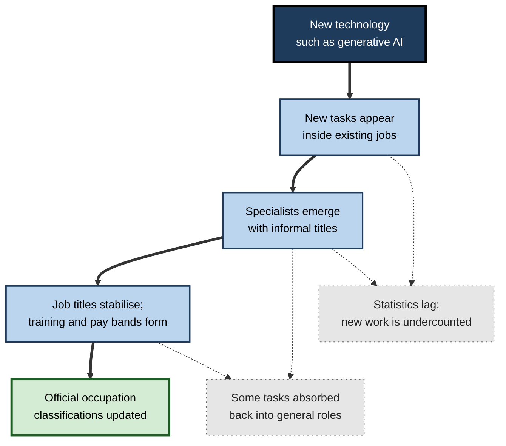
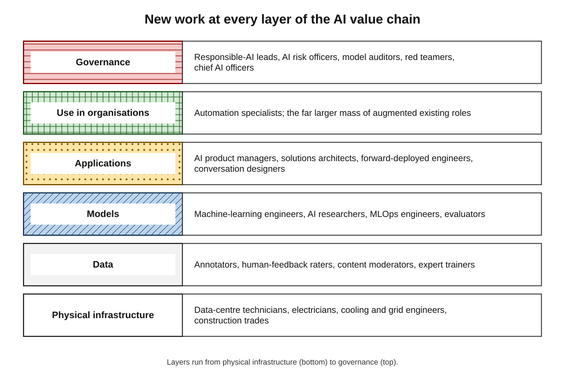
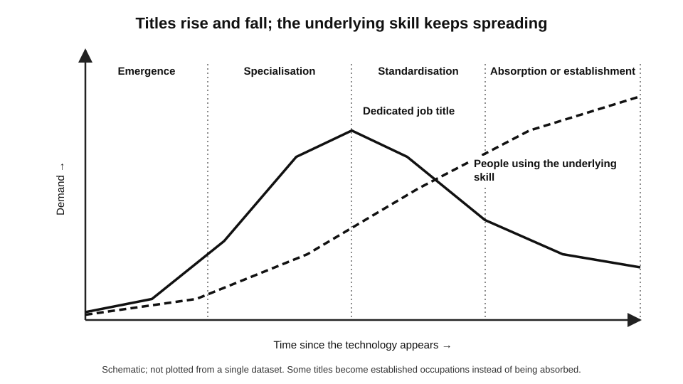
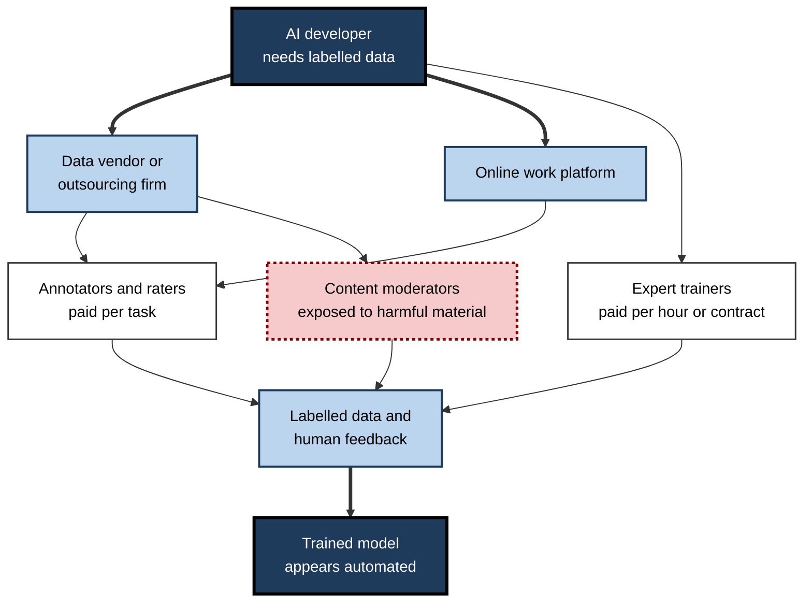
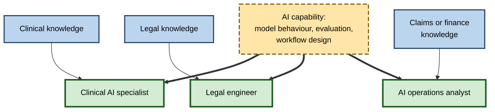
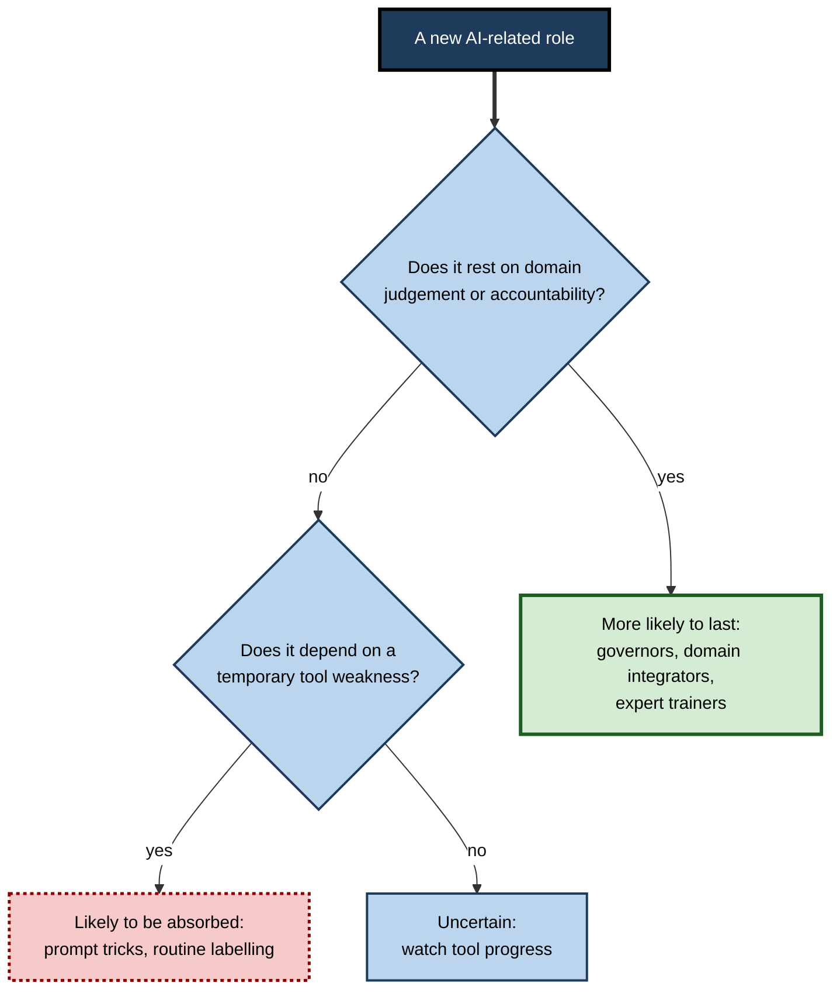

# H.5. New job categories AI is creating

The 1940 census of the United States had no category for computer programmers, web designers or data scientists — the work did not yet exist. By the mid-2020s, job advertisements were seeking "prompt engineers", "AI trainers", "machine-learning operations engineers", "AI governance leads" and "chief AI officers". Every major technology destroys some work and invents other work; the invented work is harder to see in advance, because it does not yet have a name.

> **Definition — New work:** tasks and job titles that did not previously exist, created by new technologies, new products or shifts in what people demand.

**Why it matters**

- **Balancing the picture** — debates about AI and jobs focus on losses because existing jobs are visible and future ones are not.
- **Career opportunity** — early entrants to new fields often gain scarce, well-paid expertise.
- **Planning** — employers, educators and governments must prepare people for roles that are still taking shape.
- **Conditions** — some new AI work is skilled and well paid; some is low-paid, hidden and precarious.

---

## How New Work Arises

### The long-run evidence

**Study card — David Autor, Caroline Chin, Anna Salomons and Bryan Seegmiller, "New Frontiers: The Origins and Content of New Work, 1940–2018" (*Quarterly Journal of Economics*, 2024)**

- **Method:** traced the job titles added to US census occupation manuals over almost eight decades, and linked them to patents and demand shifts.
- **Results:**
  - about **60%** of US employment in 2018 was in job titles that **did not exist in 1940**;
  - new work appeared where **augmenting** innovations created new tasks for people, and where demand for new goods and services grew;
  - **automating** innovations reduced employment in the occupations they affected;
  - after 1980, new work was concentrated in **highly paid professional** roles and **lower-paid personal-service** roles, with less in the middle.
- **Lesson:** technology's employment effect depends on the race between **automation of old tasks** and **creation of new ones**.

> **Key point:** most of today's jobs were once "new work". The question is not whether AI will create new jobs — it already has — but **how many, how fast, for whom and of what quality**.

### Where new work appears

- **In cities with educated workforces** — research on US cities found that new job titles emerged disproportionately where many university graduates and diverse industries were already concentrated.
- **Near the technology** — first in the firms that build it, then in firms that adopt it.
- **At the boundary between disciplines** — new roles often combine two existing skill sets.
  - *e.g.* a clinical informatician combines medicine and data; a legal engineer combines law and software.

**Figure 1.** How a new technology turns into new occupations over time.

> **Watch out:** official statistics count new work late. Classifications are revised only every decade or so, so a new role may exist for years before it appears in the data. Early estimates come from job advertisements and professional networking sites, which over-represent office and technology work.

---

## Families of AI-Created Work

### Builders

- **Who:** people who design, train and run AI systems.
- **Roles:**
  - **machine-learning engineers** — build and deploy models;
  - **data engineers** — build the pipelines that feed models;
  - **AI researchers** — develop new methods;
  - **MLOps engineers** — monitor, update and scale models in production.
- **Skills:** programming, statistics, mathematics, software engineering.
- **Conditions:** among the highest-paid jobs in the economy; concentrated in a few firms and cities.

> **Definition — MLOps (machine-learning operations):** the practice of deploying, monitoring, updating and governing machine-learning models in live use, adapted from software operations.

### Physical infrastructure workers

- **Who:** the people who build and operate the data centres, power and networks AI runs on.
- **Roles:** data-centre technicians, electricians, cooling and mechanical engineers, construction workers, grid engineers.
- **Why it matters:** the boom in AI computing has created demand for skilled trades — a reminder that AI's new work is not only digital.

### Data workers

- **Who:** people who produce, label, check and rate the data AI learns from.
- **Roles:**
  - **data annotators** — label images, text and audio;
  - **human-feedback raters** — compare and score model responses so that models learn preferred behaviour;
  - **content moderators** — remove harmful material and label it for training;
  - **expert trainers** — doctors, lawyers, scientists and programmers paid to write high-quality examples and evaluate answers in their field.
- **Conditions:** highly variable — from piece-rate platform work in low-income countries to well-paid expert contracts.

> **Definition — Human-feedback rater:** a worker who compares or scores AI outputs so that the model can be trained, through reinforcement learning from human feedback, to produce responses people prefer.

### Integrators

- **Who:** people who put AI to work inside organisations.
- **Roles:**
  - **AI product managers** — decide what AI features to build and how to measure them;
  - **solutions architects and forward-deployed engineers** — adapt AI systems to a client's data and processes;
  - **automation specialists** — redesign workflows around AI;
  - **conversation and agent designers** — design how assistants and agents behave, escalate and hand over.
- **Skills:** a combination of domain knowledge, process design, technical understanding and communication.

### Governors

- **Who:** people who make AI safe, lawful, fair and accountable.
- **Roles:**
  - **responsible-AI and AI-ethics leads**;
  - **AI risk and compliance officers** — map regulatory obligations such as those in the European Union's AI Act;
  - **model auditors and evaluators** — test systems for accuracy, bias and robustness;
  - **red teamers** — attack systems deliberately to find harmful behaviour;
  - **chief AI officers** — lead AI strategy and governance at the top of the organisation.
- **Example:** in 2024 the US Office of Management and Budget required federal agencies to designate a chief AI officer.

### Augmented existing roles

- **The largest category by far** — existing roles that acquire AI tasks rather than new titles.
  - *e.g.* a marketing manager who directs AI content generation; a financial analyst who builds AI-assisted forecasts.

> **Mnemonic — "BIDIG":** **B**uilders, **I**nfrastructure, **D**ata workers, **I**ntegrators, **G**overnors — five families of new AI work, beside the larger mass of augmented existing roles.

**Figure 2.** The layers of the AI value chain and the new work each creates.

| Family | Typical roles | Core skills | Common entry routes | Typical conditions |
|---|---|---|---|---|
| Builders | ML engineer, data engineer, AI researcher | Programming, statistics, mathematics | Computer science or quantitative degrees | High pay; concentrated in large firms and hubs |
| Infrastructure | Data-centre technician, electrician, cooling engineer | Electrical and mechanical trades | Apprenticeships, technical colleges | Skilled-trade pay; strong demand near data centres |
| Data workers | Annotator, rater, moderator, expert trainer | Attention, language, domain knowledge | Online platforms; contractors; expert networks | From low piece rates to well-paid expert work |
| Integrators | AI product manager, solutions architect, automation specialist | Domain knowledge plus process and technical design | Moves from adjacent business or technical roles | Good pay; growing demand |
| Governors | Responsible-AI lead, AI auditor, red teamer | Law, risk, ethics, evaluation | Moves from compliance, law, security, research | Good pay; demand driven by regulation |

---

## Three Ways of Classifying the New Roles

**Paul Daugherty and James Wilson, *Human + Machine* (2018)** proposed three roles in which people support AI:

| Role | What the person does | Example |
|---|---|---|
| Trainer | Teaches AI systems how to perform — supplying data, examples and feedback | A rater teaching a support assistant to sound empathetic |
| Explainer | Interprets AI outputs for decision-makers and the public | An analyst explaining why a model rejected a loan |
| Sustainer | Keeps AI systems working properly, safely and responsibly | A model-risk officer monitoring drift and bias |

- **Complementary view:** these "missing middle" roles are where people and machines work together, rather than either working alone.

> **Key point:** almost every AI system requires people **before** deployment (data, training, testing), **during** deployment (integration, supervision, explanation) and **after** deployment (monitoring, auditing, improvement).

---

## The Life Cycle of a New Role

New AI roles do not all last. Many follow a recognisable path.

1. **Emergence** — a new task appears; enthusiasts take it on informally.
2. **Specialisation** — demand outruns supply; dedicated titles and premium pay appear.
3. **Standardisation** — training courses, certifications and tools make the skill easier to acquire.
4. **Absorption or institutionalisation** — either the skill becomes part of many ordinary jobs, or the role becomes an established occupation.

**Figure 3.** The typical life cycle of a new technology-related job title.

### The "prompt engineer"

- **Emergence (2022–2023):** after ChatGPT's release, the ability to write effective prompts seemed a scarce skill; some technology firms advertised dedicated prompt-engineering roles with high reported salaries.
- **Standardisation:** guides, courses and templates spread the techniques widely.
- **Absorption:** models became better at understanding plain requests; tools began rewriting prompts automatically; the skill was folded into many roles.
- **Result:** dedicated prompt-engineer titles became rarer, while related work evolved into roles such as AI application engineering and evaluation.

> **Watch out:** a job title that is fashionable today may be absorbed within a few years. The durable career asset is usually the **underlying capability** — understanding how models behave, designing tasks for them, evaluating outputs — rather than the title.

### Comparing established and emerging roles

| | Established occupation | Emerging AI role |
|---|---|---|
| Job title | Stable, widely recognised | Varies between employers |
| Entry route | Degrees, apprenticeships, licensing | Lateral moves, self-teaching, short courses |
| Pay | Known bands | Volatile; premium for scarcity |
| Career ladder | Clear | Unclear; may disappear or merge |
| Professional body | Usually exists | Rarely exists yet |

---

## Hidden Work Behind AI

### Ghost work

> **Definition — Ghost work:** task-based work done by people, often through online platforms, that is hidden behind apparently automated services — a term popularised by Mary Gray and Siddharth Suri (2019).

- **Examples:** labelling images for self-driving cars; transcribing audio; rating search results; checking that a "fully automated" service got the answer right.
- **Features:**
  - piece-rate pay;
  - little employment protection;
  - work distributed across many countries;
  - the worker is often invisible to the end user.

### Case study: data labelling in Kenya

- **Situation:** to make ChatGPT less likely to produce violent, sexual and hateful content, OpenAI contracted an outsourcing firm, Sama, whose workers in Nairobi labelled tens of thousands of text passages describing abuse and violence.
- **Reporting (*Time* magazine, January 2023):**
  - workers were reported to be paid roughly US$1.30–2 per hour after tax;
  - many described lasting psychological distress from reading disturbing material;
  - the outsourcing firm ended the contract early in 2022.
- **Responses:**
  - in 2023 content moderators working for technology firms in Kenya voted to form a union;
  - lawsuits and petitions asked Kenya's parliament to investigate working conditions.
- **Context:** the firms involved stated that workers had access to wellness support and were paid above local minimum wages.
- **Lesson:** AI creates new work at the bottom of the value chain as well as the top. Whether that work is decent depends on contracts, pay, psychological support and the bargaining power of workers — not on the technology.

> **In practice:** organisations buying AI services increasingly ask suppliers about their **data supply chain** — who labelled the data, under what conditions — as part of responsible procurement.

**Figure 4.** The supply chain of human data work behind an AI model.

---

## How Much New Work?

- **Numbers so far are modest** relative to the work AI affects.
  - Builders, governors and integrators number in the hundreds of thousands to low millions worldwide, against hundreds of millions of workers in exposed occupations.
- **Indirect new work** may be larger:
  - new products and services made possible by cheaper AI;
  - new firms founded around AI capabilities;
  - spending of the income gains AI generates.
- **Timing gap:** displacement can be fast; new work grows over decades, as the 1940–2018 evidence shows.

> **Watch out:** "AI will create more jobs than it destroys" is a forecast, not a fact. Employer surveys predicting net job creation have been wrong before, and the new jobs may require different skills, in different places, from the jobs lost.

### Worked example (illustrative): designing a new role in an insurer

An insurer finds that its AI claims assistant needs constant tuning, monitoring and explanation. It designs a new role, **AI operations analyst**.

1. **List the tasks:**
   - monitor the assistant's accuracy weekly against a sample of human-reviewed claims;
   - investigate errors and complaints;
   - update prompts, rules and knowledge sources;
   - explain the assistant's decisions to claims managers and the regulator;
   - test changes before release.
2. **Map the skills:** claims expertise, data analysis, basic understanding of language models, testing discipline, clear writing.
3. **Choose the source:** experienced claims handlers have the domain knowledge and the hardest-to-teach part; they need training in data analysis and testing.
4. **Set the conditions:** a 12-week programme with a data-team mentor; a pay band between senior handler and data analyst.
5. **Plan the career path:** progression to AI product owner or model-risk specialist.

> **Remember:** new AI roles are often built from **domain experts plus new technical skills**, not technical specialists plus domain training — because domain knowledge takes longest to acquire.

---

## Preparing for New Work

- **For individuals:**
  - combine a domain specialism with AI understanding — the scarcest profile;
  - build a record of real projects;
  - focus on underlying capabilities rather than fashionable titles.
- **For organisations:**
  - recognise new roles formally — titles, pay bands, career paths — so that people who take them on are not penalised;
  - recruit from within, using adjacency.
- **For educators:**
  - teach foundations that transfer between roles;
  - create short, stackable programmes for career changers.
- **For governments:**
  - update occupational classifications faster;
  - set standards for data work and platform conditions.

**Figure 5.** Combining domain knowledge with AI capability to reach new roles.

---

## Entry Routes, Credentials and Pay in New Roles

### How people enter

- **From adjacent roles** — the most common route: analysts become AI operations leads; compliance officers become AI risk leads.
- **From degrees** — computer science, statistics and data science graduates enter builder roles.
- **From trades** — electricians and technicians enter data-centre work through apprenticeships.
- **From short programmes and self-teaching** — for integrator and evaluation roles, where portfolios of real projects count for more than certificates.
- **From expert networks** — doctors, lawyers, scientists and engineers contracted to write and check training data.

### Pay and security

- **Premiums for scarce skills** — analyses of job advertisements by consultancies have reported pay premiums for roles requiring AI skills; the size varies by method, and some of the premium reflects specialist rather than general skills.
- **Volatility** — new roles can be highly paid when scarce and then fall as supply catches up, as happened in earlier technology booms.
- **Contract versus employment** — data work and expert training are often done through contracts and platforms, with less security than employed roles.
- **Concentration** — builder roles cluster in a few cities and firms, while integration and governance roles spread more widely.

> **Watch out:** headline salaries for AI roles describe a **small group** at leading firms. Typical new AI-related work — data labelling, operations, support — is paid far less.

---

## When New Work Is Itself Automated

- **AI labelling AI.**
  - Models increasingly generate and check training data, reducing demand for some low-skilled labelling; demand shifts towards **expert** feedback in specialised fields.
- **Tool-building tools.**
  - Assistants can write code, tests and documentation, shrinking the routine parts of builder and integrator roles.
- **Standardisation.**
  - As practices mature, tasks that once needed specialists become templated and move into general roles.
- **Implication:** new work is **provisional**. Roles that depend on a temporary gap in tool capability may disappear, while roles that depend on domain judgement, accountability or relationships are more lasting.

**Figure 6.** Which new roles are more and less likely to last.

### Worked example (illustrative): from nurse to clinical AI specialist

A ward nurse with ten years' experience considers a new role, **clinical AI specialist**, in a hospital deploying AI documentation and risk-alert tools. *Illustrative.*

1. **Map the role's tasks:** testing tools with clinicians; training staff; monitoring alerts and errors; liaising with data and safety teams; reporting incidents.
2. **Match skills:** the nurse already has clinical judgement, knowledge of workflows and trust among colleagues (the hardest to acquire); she lacks data skills, knowledge of validation methods and project experience.
3. **Gap plan:** a 12-month part-time programme in health informatics; shadowing the data team; leading a small pilot on her own ward.
4. **Risks:** the role may be redefined as tools mature; the hospital may not fund it long term; she should keep her registration and clinical hours.
5. **Outcome:** a move that uses scarce domain knowledge, with a fallback to clinical practice.

> **Key point:** many of the most durable new roles sit where **domain expertise meets AI capability**; they are reachable by experienced professionals, not only by new graduates.

---

## Inclusion and Geography of New Work

- **Who gets the new jobs?**
  - Early new roles favour people already educated in technical fields and living in major cities, which risks widening gaps unless access routes are opened.
- **Gender.**
  - Women are under-represented in technical AI roles in most countries, while being over-represented in clerical work that is more exposed; this combination can widen gaps if not addressed.
- **Global distribution.**
  - Builders cluster in a few countries; data work is distributed across many, often in lower-income regions where it may be a valuable source of income but with weak protection.
- **Remote work.**
  - Many new roles can be done remotely, spreading access, but also exposing workers to global competition.

> **In practice:** organisations that recruit for new AI roles widen their pool by describing skills rather than credentials, offering internal training routes and advertising roles to groups under-represented in technical fields.

---

## Open Questions

- **Will new work keep pace with displacement?**
  - Historically it did over decades; whether it will over the shorter time scales of AI change is unknown.
- **Which new roles will last?**
  - Some will be absorbed as tools improve; others may be automated by later AI.
- **Will data work become decent work?**
  - Unionisation, regulation and procurement standards are developing; their effect is uncertain.
- **Where will new work be located?**
  - If it clusters in a few cities and countries, regional inequality may grow.
- **Can new work be measured in time?**
  - Statistical systems lag; real-time measures from job advertisements are biased.

---

## Summary

- **New work** — tasks and titles that did not exist before — accounts for much of modern employment: about **60%** of US jobs in 2018 were in titles that did not exist in 1940 (Autor and colleagues, 2024).
- New work arises from **augmenting** innovations and new demand; it clusters in educated cities and at disciplinary boundaries; statistics count it late.
- Five families of AI-created work — **BIDIG**: builders, infrastructure workers, data workers, integrators, governors — beside the much larger group of **augmented existing roles**.
- **Daugherty and Wilson:** trainers, explainers and sustainers.
- New roles pass through **emergence, specialisation, standardisation and absorption** — the **prompt engineer** rose and was largely absorbed within a few years.
- **Ghost work** — hidden human data work — is essential to AI; the **Kenyan data-labelling** case shows that its conditions can be poor.
- New AI work is so far **numerically modest** relative to exposed work; "more jobs created than destroyed" is a forecast, not a fact.
- The scarcest profile combines **domain expertise with AI capability**.

---

## Self-Check

1. Define new work and give two historical examples.
2. Summarise the findings of the 1940–2018 study of new work.
3. Why do official statistics undercount new work?
4. Describe the five families of AI-created work with two example roles each.
5. Explain Daugherty and Wilson's trainer, explainer and sustainer roles.
6. Describe the life cycle of a new role and apply it to the prompt engineer.
7. What is ghost work? Give three examples.
8. What were the main facts reported about data labelling in Kenya, and what lesson does the case hold?
9. Why is "AI will create more jobs than it destroys" a forecast rather than a fact?
10. Why are new AI roles often filled by domain experts who learn technical skills?
11. Design a new role, with tasks, skills and source of candidates, for a hospital deploying AI documentation tools.
12. A graduate asks whether to pursue a job title currently in fashion. Advise them.

### Answer Key

1. Tasks and job titles that did not exist before, created by technology or new demand — e.g. computer programmer, web designer, data scientist.
2. About 60% of 2018 US employment was in titles absent in 1940; new work came from augmenting innovations and demand shifts, while automating innovations reduced employment; after 1980 new work was concentrated in high-paid professional and low-paid service roles.
3. Classifications are revised only every decade or so; new roles exist informally for years before they are counted; real-time sources like job adverts are biased towards office and technology work.
4. Builders (ML engineer, data engineer); infrastructure (data-centre technician, electrician); data workers (annotator, rater); integrators (AI product manager, solutions architect); governors (AI auditor, red teamer).
5. Trainers teach AI systems with data and feedback; explainers interpret AI outputs for people; sustainers keep systems working safely and responsibly.
6. Emergence, specialisation, standardisation, absorption. Prompt engineering emerged in 2022–23, gained dedicated titles and high pay, was spread by courses and templates, and was absorbed into many roles as models and tools improved.
7. Hidden task work behind apparently automated services: image labelling for driverless cars, audio transcription, checking automated answers.
8. Outsourced Kenyan workers labelled violent and abusive text for safety training at reported pay of about US$1.30–2 per hour, describing distress; the contract ended early; moderators later unionised. Lesson: AI's new work includes low-paid hidden work whose quality depends on contracts and worker power.
9. It rests on assumptions about demand, adoption and new products; past employer surveys have erred; and created jobs may need different skills in different places from those lost.
10. Domain knowledge takes longest to acquire and is the hardest-to-teach element; technical AI skills can be learned in months.
11. E.g. "clinical documentation AI lead": monitor accuracy of AI notes against samples; handle clinicians' feedback; configure templates; train staff; report safety incidents. Skills: clinical knowledge, data analysis, change management. Source: experienced nurses or doctors with an interest in informatics, given training and protected time.
12. Focus on the underlying capability rather than the title, which may be absorbed; combine it with a domain specialism; build a record of real projects; expect the title to change.

---

## Glossary

| Term | Meaning |
|---|---|
| Absorption | The folding of a specialist skill into many ordinary roles. |
| Chief AI officer | A senior executive responsible for AI strategy and governance. |
| Data annotator | A worker who labels data used to train AI. |
| Explainer | A person who interprets AI outputs for decision-makers. |
| Ghost work | Hidden task-based human work behind apparently automated services. |
| Human-feedback rater | A worker who scores AI outputs to train preferred behaviour. |
| MLOps | The practice of deploying, monitoring and maintaining machine-learning models. |
| New work | Tasks and job titles that did not previously exist. |
| Red teamer | A person who attacks an AI system deliberately to find harmful behaviour. |
| Sustainer | A person who keeps AI systems working properly and responsibly. |
| Trainer | A person who teaches AI systems through data, examples and feedback. |
