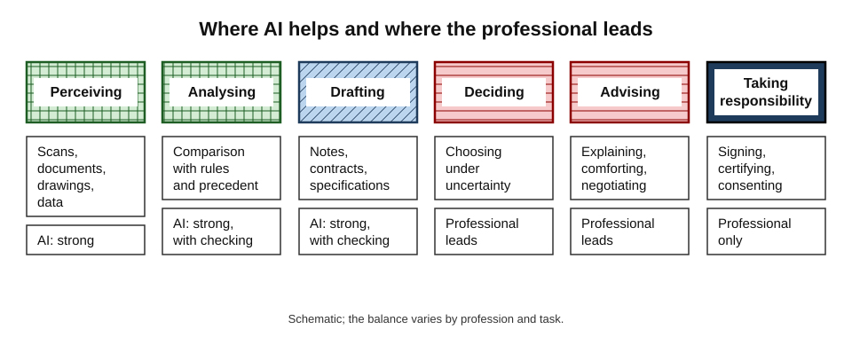
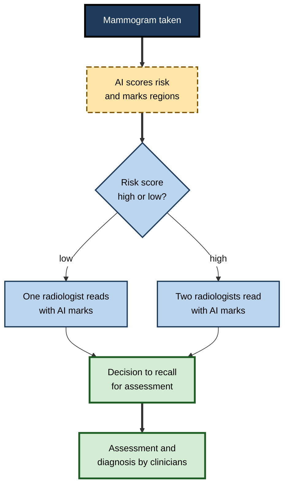
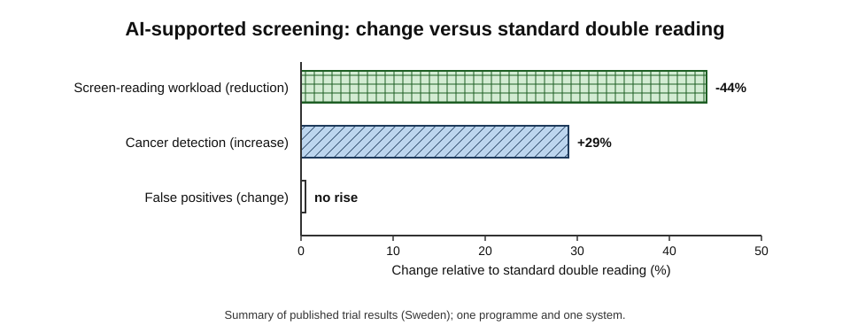
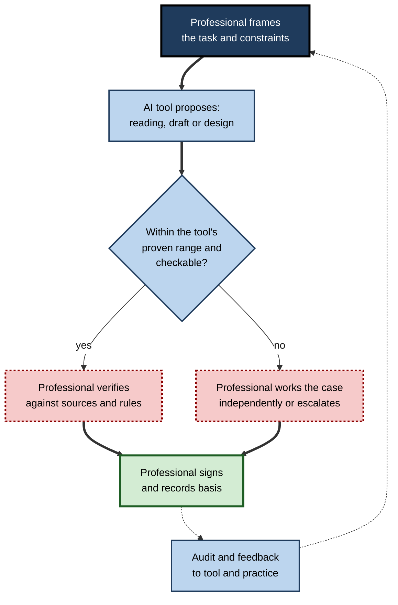
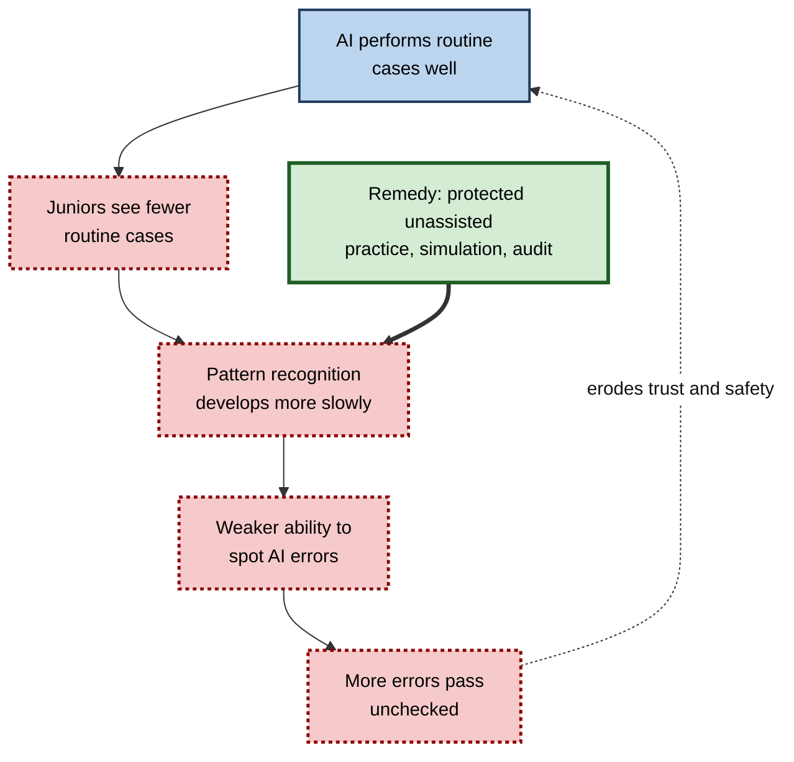
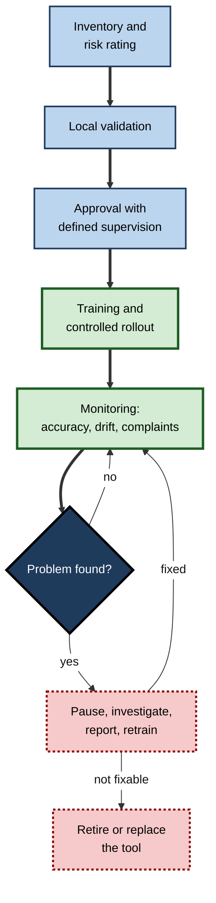

# H.6. AI augmenting professional roles: doctors, lawyers, engineers

A radiologist in Sweden opens a morning list of mammograms. Most have already been read once by software, which has sorted the low-risk examinations from the suspicious ones and marked areas of concern. A solicitor in London asks a drafting assistant to produce a first version of a lease clause, then spends her time on the parts that need a lawyer: what the client really wants, which risks matter, and what the other side will accept.

A structural engineer asks a design tool for forty variants of a bracket and then decides which one can be built, certified and trusted. In each case the professional is still there, still accountable — and doing a different job from the one they trained for.

> **Definition — Profession:** an occupation that rests on a body of specialised knowledge, is governed by a code of ethics and often by a licence, and carries a duty to place the interests of clients, patients or the public above its own.

> **Definition — Professional augmentation:** the use of AI to extend a licensed or accountable professional's ability to perceive, analyse, draft or design, while the professional remains the decision-maker and bears responsibility for the result.

**Why it matters**

- **High stakes** — errors in medicine, law and engineering injure people, ruin lives or collapse buildings.
- **Strong exposure** — much professional work is reading, writing, analysis and design, which is where current AI is strongest.
- **Strong institutions** — licensing, liability and ethics rules shape how fast and in what form AI can enter.
- **A model for other work** — what works in these fields shows how to combine machine speed with human judgement elsewhere.

---

## What Makes Professional Work Different

### Four features that shape adoption

1. **Licensed authority** — only a registered person may diagnose, give legal advice, or sign off a design.
2. **Personal liability** — the professional, not the software supplier, answers to the patient, client or regulator.
3. **Duty of competence** — the professional must understand a tool well enough to rely on it responsibly.
4. **Confidentiality** — patient records, client secrets and design data may not be sent anywhere without safeguards.

> **Key point:** because responsibility cannot be delegated to software, professional use of AI is always **supervised use**. The professional's task becomes choosing when to rely on the tool, checking its work and owning the outcome.

### The bundle of tasks

- **Every profession is a bundle of tasks** of very different kinds.
  - **Perceiving** — reading scans, documents, drawings, data.
  - **Analysing** — comparing with rules, precedents and past cases.
  - **Drafting** — notes, letters, contracts, reports, specifications.
  - **Deciding** — choosing under uncertainty and accepting risk.
  - **Communicating** — explaining, persuading, comforting, negotiating.
  - **Taking responsibility** — signing, certifying, consenting, advising.
- **AI is strongest on the first three, weakest on the last three.**

**Figure 1.** How AI support is distributed across the tasks of a professional.

---

## Doctors

### Where AI assists

- **Image interpretation** — radiology, pathology slides, retinal photographs, skin lesions.
- **Screening and triage** — sorting examinations by risk so that urgent ones are read first.
- **Documentation** — "ambient" systems that listen to a consultation and draft the clinical note for the doctor to correct and sign.
- **Decision support** — alerts about drug interactions, deteriorating patients, or sepsis risk.
- **Information retrieval** — summarising a long record or the literature on a rare condition.

> **Definition — Clinical decision support:** software that gives clinicians patient-specific assessments or recommendations to inform, not replace, their decisions.

### What stays with the doctor

- **Taking the history** and noticing what the patient does not say.
- **Examining** the patient physically.
- **Weighing** conflicting evidence against the person's circumstances and values.
- **Breaking bad news**, obtaining informed consent and sharing decisions.
- **Accepting responsibility** for diagnosis and treatment.

**Study card — MASAI trial of AI-supported breast screening (Sweden, led from Lund University; results published in *The Lancet Oncology* 2023, *The Lancet Digital Health* 2025 and *The Lancet* 2026)**

- **Design:** a randomised trial in the national screening programme, with more than **80,000** women allocated either to **AI-supported** screening or to standard double reading by two radiologists.
- **How AI was used:** software scored each examination for risk; low-risk examinations were read by **one** radiologist, high-risk ones by **two**, with the AI marking suspicious regions.
- **Results:**
  - screen-reading workload fell by **44%**;
  - cancer detection rose by about **29%** with **no rise in false positives**, including more small invasive cancers;
  - in the follow-up analysis, women in the AI group were less likely to be diagnosed with aggressive or advanced cancers in the following two years (reported 2026).
- **Interpretation:** the AI did not replace radiologists; it **redistributed** their effort towards the examinations that most needed it.
- **Caveats:** one country, one screening programme and one software system; the results apply to **screening** with trained readers and may not transfer to other settings.

**Figure 2.** The AI-supported screening workflow tested in the trial.

**Figure 3.** Reported effects of AI-supported screening in the trial.

> **Watch out:** impressive results on a **curated test set** do not guarantee equal performance in daily practice. Scanners, populations and workflows differ; accuracy can fall on patients unlike those the system was trained on, and a clinician who stops checking cannot catch the failures.

### Documentation and the clinician's time

- **Problem:** doctors in many countries spend a large share of the working day on records and administration; time with patients suffers and burnout is widespread.
- **Ambient scribing** promises to return that time, but evidence so far is mostly from early pilots and surveys; measured gains in time and satisfaction are modest to moderate, and independent trials are still few.
- **Risks:** invented or omitted details in the note; consent to recording; data protection; and doctors signing notes they have not carefully read.

> **In practice:** safe use treats every AI-drafted note as a **trainee's draft** — the clinician reads it, corrects it and signs it, and the organisation audits a sample against the recording.

---

## Lawyers

### Where AI assists

- **Document review and e-discovery** — sorting millions of documents for relevance, privilege or risk.
- **Legal research** — finding and summarising authorities.
- **Drafting** — first drafts of contracts, letters, pleadings and memoranda.
- **Contract analysis** — extracting clauses, dates and obligations across a portfolio; comparing against a standard.
- **Due diligence and compliance** — checking large sets of documents against rules.

> **Definition — E-discovery:** the identification and review of electronic documents for use in litigation or investigations.

### What stays with the lawyer

- **Understanding the client's real objective** and appetite for risk.
- **Judgement about strategy** — what to argue, what to concede, when to settle.
- **Negotiation and advocacy** — persuading people, in rooms and courtrooms.
- **Ethical duties** — confidentiality, conflicts of interest, candour to the court.
- **Responsibility** — the lawyer's name is on the advice and the filing.

### Evidence on AI-assisted legal work

**Study card — randomised trials with law students (University of Minnesota and collaborators, 2023–2025)**

- **Design:** law students completed realistic legal tasks (memoranda, contract and complaint drafting) with or without access to a large language model; later versions tested newer "reasoning" models and a legal-research tool.
- **Results (in outline):**
  - assistance improved the **speed** of work substantially;
  - assistance improved the **quality** of some tasks, more clearly with the newer systems;
  - gains tended to be larger for **weaker** students than for stronger ones;
  - AI-assisted work still contained errors of fact and law that required human checking.
- **Caveats:** students are not practising lawyers; tasks were time-limited; the systems tested have since changed.

> **Watch out:** the same studies found that tools **help most where the task is bounded and checkable** — a clause to draft, a document to summarise — and least where the task depends on unstated facts, local practice or judgement about an opponent.

### The duty of competence

- **Lawyers must supervise AI like any assistant.**
  - Check every authority cited; confirm every quotation.
  - Understand the tool's limits and data handling.
  - Keep client information confidential.
  - Decide what to tell the client about AI use and charges.
- **Courts have responded:** judges in several countries have sanctioned lawyers who filed documents citing non-existent cases generated by AI, and some courts now require disclosure of AI use or certification that citations were checked.

> **Definition — Duty of competence:** the professional obligation to have the knowledge, skill and care reasonably needed for a task — extended by regulators to understanding the benefits and risks of the technology used.

---

## Engineers

### Where AI assists

- **Generative design** — software explores thousands of shapes that satisfy loads, materials and manufacturing constraints.
  - *e.g.* an aircraft cabin partition redesigned with a bionic lattice by Airbus and Autodesk was reported to be roughly **45% lighter** than the conventional design.
- **Simulation surrogates** — trained models approximate expensive physics calculations in seconds.
- **Predictive maintenance** — sensors and models forecast when a pump, turbine or bearing will fail.
- **Code and scripting** — assistants write the software that controls systems and analyses data.
- **Documentation and compliance** — checking drawings and specifications against codes and standards.
- **Monitoring** — computer vision to inspect welds, bridges, pipelines and construction progress.

### What stays with the engineer

- **Defining the problem** and the constraints that matter.
- **Judging risk and safety margins** under uncertainty.
- **Integrating** parts into a system that works, can be built and can be maintained.
- **Taking legal responsibility** — in many jurisdictions a licensed engineer must seal drawings and answer for the design.

> **Key point:** physical systems punish error. A design that fails **rarely** can still be unacceptable if the failure kills people. Engineering practice is built on **margins, testing and independent checking** — which AI-generated designs and code need even more, because their reasoning cannot be inspected.

### Case study (illustrative): a structural design tool and an unusual load

- **Situation:** a regional engineering firm adopts an AI tool to propose reinforcement layouts for concrete floor slabs. The tool is trained on thousands of past designs and checks each proposal against the structural code.
- **Early results:** drafting time per slab falls by about half; engineers praise the speed.
- **Problem:** a reviewer notices that for one unusual load case (a plant room with heavy equipment) the tool's proposal passes its internal checks but uses a simplified load model not suited to that case.
- **Diagnosis:**
  1. the tool was trained mainly on ordinary office floors;
  2. its confidence display looked the same for unusual and ordinary cases;
  3. junior engineers had begun accepting proposals without recalculating.
- **Actions:**
  - the firm requires an **independent hand or spreadsheet check** on every nonstandard case;
  - the tool is made to flag when a case falls outside its training range;
  - juniors rotate through unassisted design work;
  - every sealed drawing records which tool was used and who verified it.
- **Result:** speed gains were kept on routine slabs; no nonstandard case is released unchecked.
- **Lesson:** the engineer's value is knowing **where the tool's validity ends** — which requires the very expertise the tool seems to replace.

---

## Comparing the Three Professions

| | Doctors | Lawyers | Engineers |
|---|---|---|---|
| Main AI-strong tasks | Image reading, triage, note drafting | Review, research, drafting, contract analysis | Design exploration, simulation, code, monitoring |
| Main human-only tasks | History, examination, consent, bad news | Client objectives, strategy, advocacy, ethics | Problem framing, safety judgement, integration |
| Source of accountability | Licence; negligence law | Licence; professional conduct rules | Licence and sealing; building and safety law |
| Typical failure mode | Over-trusting a flagged or unflagged scan; invented note details | Fabricated citations; missed facts | Out-of-range cases accepted; unchecked generated code |
| Safeguard | Independent reading; audit of notes | Verification of every authority | Independent checks; margins; testing |
| Evidence base | Randomised trials in some areas | Small experiments with students | Mostly case reports and company studies |

**Figure 4.** The professional supervision loop that applies in all three professions.

---

## Effects on the Professions

### Skill and training

- **Apprenticeship under pressure.**
  - Juniors traditionally learn by doing the routine work — reading hundreds of scans, reviewing documents, drafting designs — that AI now performs.
  - If juniors never do it, how do they acquire the pattern recognition that lets them judge the AI?
- **Deskilling risk** — skills not exercised fade. Evidence from aviation, where automation lowered manual flying skill, is often cited as a warning.
- **Possible remedies:**
  - protected unassisted practice;
  - simulation and case-based training;
  - training in **evaluating AI output** as a formal competence.

**Figure 5.** How automating routine work can erode the judgement needed to check the automation.

### Economics and structure

- **Billing models** — lawyers and consultants who bill by the hour face pressure when drafting takes minutes; fixed fees and value pricing grow.
- **Access** — cheaper tools may widen access to legal and health advice for people who could not afford it, but also raise risks of poor-quality self-service.
- **Concentration** — firms with data and capital to deploy AI may widen their advantage over small practices.
- **New roles** — legal engineers, clinical informaticians, AI safety officers in hospitals.

### Regulation and standards

- **Medical devices** — software that diagnoses or guides treatment is regulated as a medical device in many jurisdictions, with evidence requirements before sale.
- **Professional bodies** — law societies, medical councils and engineering institutions have issued guidance on competent and ethical AI use.
- **Liability** — rules on who pays when an AI-assisted decision harms someone are still developing; professionals generally remain primarily answerable.

---

## Worked Example (illustrative): a clinic's day with and without an ambient scribe

A general practitioner sees 24 patients in a day. *Illustrative figures.*

| Activity | Minutes without scribe | Minutes with scribe |
|---|---|---|
| Consultations | 240 | 240 |
| Writing notes during or after visits | 120 | 40 (reading and correcting drafts) |
| Prescriptions, referrals, results | 90 | 90 |
| Other administration | 30 | 30 |
| **Total** | **480** | **400** |

1. **Time saved:** 480 − 400 = **80 minutes** a day.
2. **Options for the saved time:** see three more patients; lengthen consultations; finish on time.
3. **Hidden costs to weigh:** reviewing drafts takes concentration; errors that slip through become part of the medical record; recording needs patient consent.
4. **Measurement:** compare a sample of notes with recordings for omissions and inventions; track time, patient experience and clinician wellbeing.

> **Watch out:** time savings in a pilot are usually partly **spent** on more work. Unless the organisation decides in advance how the time will be used, the benefit may disappear into higher volumes.

---

## Governing Professional AI

### Regulation of tools

- **Medical software** — AI that diagnoses, triages or guides treatment is regulated in many jurisdictions as a **medical device**; in the United States the Food and Drug Administration has authorised well over a thousand AI-enabled devices, a large majority of them in imaging.
- **Evidence requirements differ** — approval often rests on retrospective test sets; fewer products have been tested in randomised trials of patient outcomes.
- **Legal and engineering tools** — largely unregulated as products, so responsibility rests on the professional and the firm, and on professional-conduct rules.

### Steps for a safe adoption programme

1. **Inventory** — know every AI tool in use, formal or informal.
2. **Risk-rate** — classify by stakes: administrative support, advice to professionals, decisions affecting people.
3. **Validate locally** — test on the organisation's own cases before use, including the groups most affected.
4. **Define supervision** — who checks what, when, and with what authority to override.
5. **Protect data** — confidentiality, consent and security.
6. **Train** — competence in the tool's strengths, limits and failure modes.
7. **Monitor** — track accuracy, complaints, near misses and drift after deployment.
8. **Respond** — report incidents, pause use if problems appear and update training.
9. **Tell clients and patients** — appropriate disclosure of AI use and what it means for them.

**Figure 6.** The life cycle of a professional AI tool from inventory to retirement.

### Liability and insurance

- **Who pays when an AI-assisted decision harms someone?**
  - In most jurisdictions, the professional and their employer remain primarily answerable, with possible claims against suppliers where a product was defective.
- **Insurers** are beginning to ask about AI use and controls; some exclude or condition cover.
- **Standard of care** — the question courts ask is what a reasonable professional would do; as tools become common and validated, **not** using them may in some cases be questioned, while using them uncritically will not be a defence.

---

## A Worked Example (illustrative): what a "flag" really means

A hospital screens **1,000** patients with an AI tool for a condition whose prevalence is **0.5%**. The tool has **90% sensitivity** and **95% specificity**. *Illustrative figures.*

| | Condition present | Condition absent | Total |
|---|---|---|---|
| Flagged by the tool | 4.5 | 49.75 | 54.25 |
| Not flagged | 0.5 | 945.25 | 945.75 |
| Total | 5 | 995 | 1,000 |

1. **People with the condition:** 1,000 × 0.5% = 5; the tool flags 90% of them: **4.5**.
2. **People without it:** 995; the tool wrongly flags 5% of them: **49.75**.
3. **Positive predictive value:** 4.5 ÷ 54.25 ≈ **8.3%** — fewer than one in ten flagged patients truly has the condition.
4. **Interpretation:** a tool that sounds accurate (90% and 95%) still produces mostly false alarms when the condition is rare, so clinicians must treat a flag as a reason to look, not as a diagnosis.

> **Formula — Positive predictive value:** true positives ÷ (true positives + false positives). It depends heavily on how common the condition is.

> **Watch out:** supplier claims quoted as "sensitivity and specificity" do not reveal how often a flag is right in **your** population. Ask for performance at local prevalence.

---

## Open Questions

- **How will junior professionals gain judgement?**
  - If routine work is automated, new training routes are needed; none has yet been shown to work at scale.
- **Where does accountability fall when AI errs?**
  - Liability rules are unsettled; professionals may become "moral crumple zones" who absorb blame for system failures.
- **Will AI widen or narrow access to professional advice?**
  - It may lower costs, but the quality of unsupervised advice is uneven.
- **Will AI outperform professionals alone in some tasks?**
  - In narrow tasks, such as some image readings, it already can; what that means for who should hold the decision is debated.
- **How should professional bodies keep pace?**
  - Guidance ages quickly; standards for testing and monitoring tools in live use are still forming.

---

## Summary

- **Professions** combine specialised knowledge, ethics, licensing and personal accountability; AI use is therefore **supervised use**.
- Professional work is a **bundle of tasks**: AI is strong at perceiving, analysing and drafting, weak at deciding, communicating and taking responsibility.
- **Doctors:** image reading, triage, documentation, decision support. The **MASAI trial** showed lower reading workload (44%) and higher cancer detection (about 29%) without more false positives in one screening programme.
- **Lawyers:** review, research, drafting, contract analysis. Experiments show speed gains and some quality gains, with errors needing checks; courts have sanctioned fabricated citations.
- **Engineers:** generative design, simulation surrogates, monitoring, code. Safety depends on knowing where a tool's validity ends and on independent checking.
- Shared safeguards: **frame, verify, sign, audit**.
- Risks: **deskilling**, thinner apprenticeships, over-trust, confidentiality breaches and unclear liability.
- Hours saved in pilots are often **absorbed** by higher volumes unless planned.

---

## Self-Check

1. Define professional augmentation and explain why professional AI use is always supervised.
2. Which professional tasks does AI do best and which worst, and why?
3. Summarise the design and results of the MASAI trial, with two caveats.
4. What risks arise with ambient clinical scribes?
5. List four tasks in which AI assists lawyers and four that remain human.
6. What is the duty of competence and how has it been extended to AI?
7. What did the law-student experiments suggest about who benefits most?
8. Give three engineering applications of AI and the safeguards each needs.
9. In the slab-design case, what went wrong and what controls were introduced?
10. How might AI affect the training of junior professionals?
11. In the clinic worked example, what could happen to the 80 minutes saved?
12. A hospital director wants to cut radiologist numbers by 40% because "AI reads scans". Evaluate this using the evidence.
13. Design a safe policy for a law firm's use of a drafting assistant.

### Answer Key

1. Using AI to extend a professional's perception, analysis, drafting or design while they remain the decision-maker and answerable. Responsibility cannot be delegated to software, so the professional must check and own the result.
2. Best: perceiving, analysing, drafting (pattern-rich, text-based, checkable). Worst: deciding under uncertainty, communicating, taking responsibility (context, relationships, accountability).
3. Randomised trial in Swedish screening, over 80,000 women; AI triage allowed single reading of low-risk cases. Workload fell 44%; detection rose about 29% without more false positives; fewer aggressive cancers later. Caveats: one country and system; screening setting with trained readers may not transfer.
4. Invented or omitted details, consent to recording, data protection, and clinicians signing unread notes.
5. AI: review, research, drafting, contract analysis. Human: client objectives, strategy, advocacy, ethical duties, responsibility.
6. The obligation to have the knowledge and care needed for a task; regulators extend it to understanding the benefits and risks of tools used, including checking outputs and protecting confidentiality.
7. Speed improved clearly; quality improved on some tasks, especially with newer systems; weaker students gained more; errors still needed human checking.
8. Generative design (manufacturability and load checks); predictive maintenance (validation against failures); code assistants (review and testing). All need independent verification and known validity ranges.
9. The tool used a simplified load model for an unusual case and showed uniform confidence; juniors accepted proposals unchecked. Controls: independent checks on nonstandard cases, out-of-range flags, rotation through unassisted work, records of tool use and verifier.
10. Routine tasks that taught pattern recognition are automated, so juniors may lack practice; remedies include protected unassisted work, simulation and formal training in evaluating AI.
11. They could be absorbed by more patients, used for longer consultations or to finish on time; unless decided in advance, volume often absorbs the gain.
12. The trial showed AI **redistributing** radiologists' effort in a screening programme, not replacing them; radiologists also perform procedures, consultation and accountable reporting; demand for imaging is rising; results may not transfer. A workforce cut on this basis is unsupported; redeploy time to higher-value work and monitor.
13. Approved tools with confidentiality terms; no client data in unapproved systems; every authority checked; lawyer review before anything leaves the firm; disclosure to clients where appropriate; training; audit of samples; incident reporting.

---

## Glossary

| Term | Meaning |
|---|---|
| Ambient scribe | Software that listens to a consultation and drafts the clinical note. |
| Clinical decision support | Software giving clinicians patient-specific assessments to inform their decisions. |
| Duty of competence | The obligation to have the knowledge and care a task requires. |
| E-discovery | Identification and review of electronic documents for litigation or investigations. |
| Generative design | Software exploring many designs that satisfy stated constraints. |
| Moral crumple zone | A person who absorbs blame for failures of a system they did not control. |
| Profession | An occupation based on specialised knowledge, ethics and often a licence. |
| Professional augmentation | AI extending a professional's abilities while they remain responsible. |
| Simulation surrogate | A trained model approximating a costly physics simulation. |
| Triage | Sorting cases by urgency or risk. |
