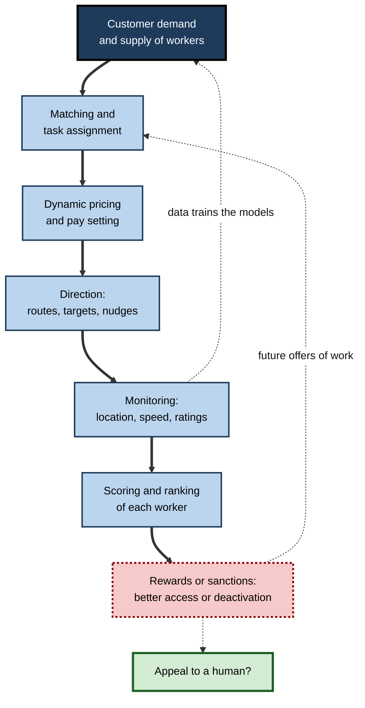
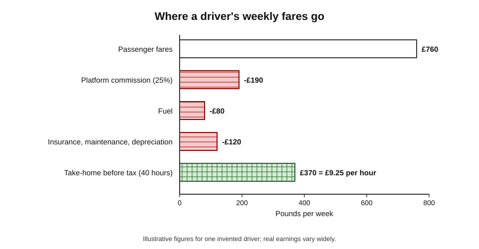
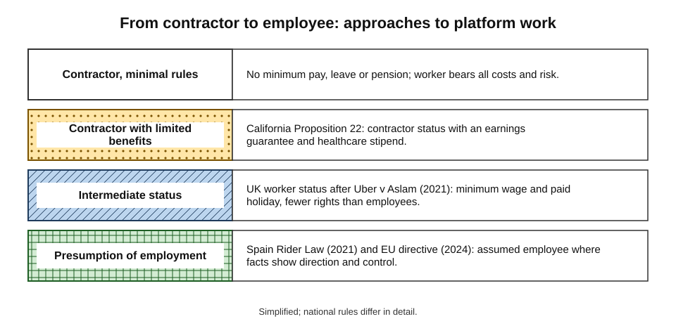
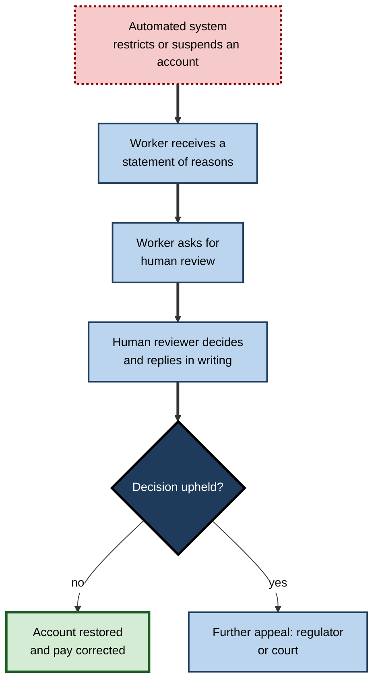
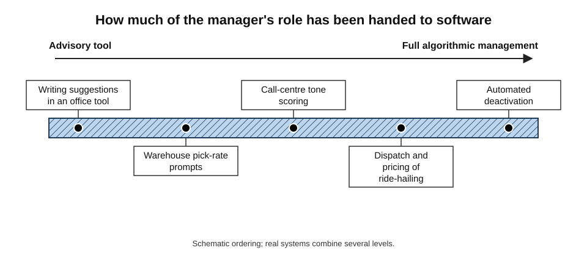
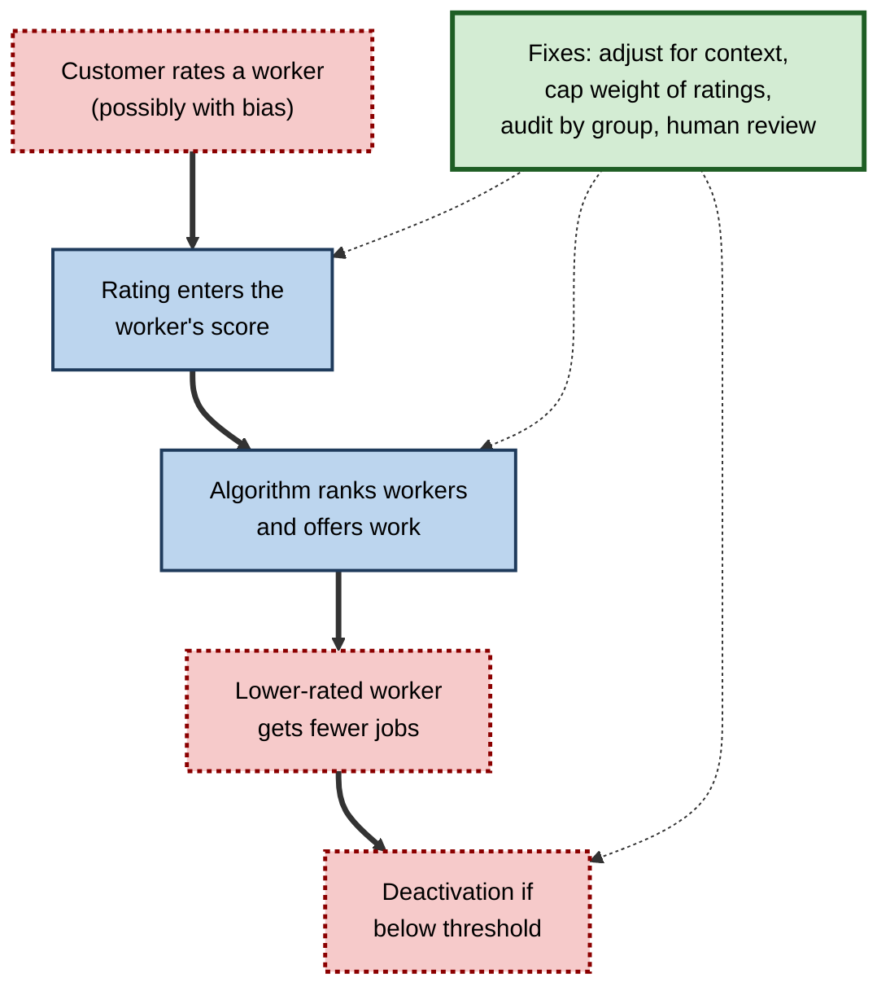

# H.7. The gig economy and AI-managed platforms

A delivery rider opens an app at six in the evening. The app decides which restaurant she is sent to, which route she should take, how much she is paid for each order and how her speed compares with that of the riders around her. No manager speaks to her; if her ratings fall, access to the best shifts may simply narrow.

In the gig economy, **software performs the functions that managers once performed** — assigning, directing, evaluating and sometimes dismissing — and does so for millions of workers at once.

> **Definition — Gig economy:** a labour market in which work is organised as short, task-based engagements — "gigs" — typically arranged through digital platforms, with workers usually classed as independent contractors rather than employees.

> **Definition — Algorithmic management:** the use of software, often incorporating machine learning, to assign tasks, set pay, monitor performance, evaluate workers and take disciplinary decisions with little or no human intervention.

**Why it matters**

- **Scale** — platform work reaches tens of millions of people in Europe and hundreds of millions worldwide, including both local and online work.
- **A preview of management by AI** — conditions on platforms show what happens when automated systems manage people, a model now spreading into warehouses, call centres and offices.
- **Rights and protection** — workers outside employment law often lack minimum pay, sick pay, pensions and a route to challenge decisions.
- **Genuine benefits** — flexibility and easy entry are valued by many workers, so the issue is not simply good versus bad.

---

## Forms of Platform Work

### Two main kinds

- **Location-based work** — a platform matches a worker to a task performed in a specific place.
  - *e.g.* ride-hailing, food and grocery delivery, cleaning, care, handyman jobs.
- **Online (web-based) work** — tasks done remotely and delivered digitally.
  - **Freelance marketplaces** — writing, design, programming, translation.
  - **Microtasks** — short tasks for small payments, such as labelling images, transcribing clips or checking search results.
  - **Contests and competitions** — many submit, one is paid.

| | Location-based | Online freelance | Online microtask |
|---|---|---|---|
| Typical task | Deliver a meal; drive a passenger | Design a logo; write code | Label ten images |
| Pay setting | Platform sets price | Worker bids or quotes | Platform or requester sets a small fixed price |
| Competition | Local | Global | Global |
| Typical pay level | Near local low wages after costs | Wide range; skilled work can pay well | Often below local minimum wages |
| Algorithmic control | Very high: dispatch, routing, ratings | Medium: search ranking, reputation | High: automated approval, qualification tests |

### How large is it?

- **European Commission estimates:** about **28 million** people worked through digital labour platforms in the European Union in 2022, projected to reach about **43 million** by 2025; a large majority were thought to be genuinely self-employed, with a minority possibly misclassified.
- **World Bank (2023):** estimated that online gig work accounts for roughly **4–12%** of the global labour force.
- **Survey in the United States (Pew Research Center, 2021):** about one in six adults had earned money through an online platform at some point.
- **Caution:** figures differ widely because definitions differ — whether occasional sellers, renters and drivers count — and because many people combine platform work with other jobs.

> **Watch out:** the gig economy is **far smaller** than headlines in the 2010s suggested as a share of total employment in most countries, yet **far larger** for particular groups: new migrants, students, people in regions with few jobs, and those needing flexible hours.

---

## How Algorithmic Management Works

### The functions of a digital manager

1. **Matching and assignment** — choosing which worker gets which task, often within seconds.
2. **Pricing and pay** — setting the fare, the piece rate or the bonus, sometimes varying with demand.
3. **Direction** — routes, time targets, instructions, nudges and prompts.
4. **Monitoring** — GPS location, speed, acceptance rates, customer ratings, camera and sensor data.
5. **Evaluation** — scores and rankings that decide who is offered work.
6. **Discipline** — warnings, temporary suspensions and permanent deactivation.

**Figure 1.** The continuous loop through which a platform manages work.

> **Key point:** the worker faces a manager that is **continuous, instantaneous and opaque**. The rules can change without notice, the reasons for a decision are rarely explained, and there is often no person to ask.

### Information asymmetry and opacity

**Study card — Alex Rosenblat and Luke Stark, "Algorithmic Labor and Information Asymmetries: A Case Study of Uber's Drivers" (*International Journal of Communication*, 2016)**

- **Method:** interviews with drivers and analysis of online driver forums, in the United States and Canada.
- **Findings:**
  - the company knew far more about demand, pricing and driver behaviour than drivers did;
  - drivers were told that they were "their own boss" but were rated, nudged and steered by the app;
  - "surge" price signals and messages encouraged drivers to move to places or work longer hours, with outcomes drivers could not verify.
- **Interpretation:** control without formal employment — the platform shapes behaviour through **information and defaults**, not orders.

**Study card — Möhlmann and Zalmanson (2017) and later studies of platform drivers**

- **Finding:** drivers felt that automated rating and deactivation were arbitrary and that they had **little recourse**; some responded by collective resistance, informal sharing of tactics, or "gaming" the system.
- **Pattern:** algorithmic management often reduces **autonomy** while the contract describes workers as autonomous.

### Algorithmic wage discrimination

- **Veena Dubal (2023)** argued that platforms can use personal data to set **different pay for different workers doing the same task**, by predicting what each is willing to accept.
- **Features:** pay becomes variable, opaque and personalised; workers cannot compare; "bonuses" and targets replace stable rates.
- **Evidence status:** the argument draws on interviews, platform documents and legal analysis; large-scale measurement of individual-level pay differences is limited because pay data are not public.

> **Definition — Algorithmic wage discrimination:** the practice of setting pay for individual workers using automated, data-driven prediction of their willingness to accept, so that identical work earns different pay.

---

## The Worker's Position

### Benefits workers report

- **Flexibility** — choosing when and whether to work.
- **Low barriers to entry** — no interview, often no degree.
- **Fast access to income** — a way to earn between jobs or around studies or care duties.

**Study card — Chen, Chevalier, Rossi and Oehlsen, "The Value of Flexible Work: Evidence from Uber Drivers" (*Journal of Political Economy*, 2019)**

- **Data:** detailed records on hundreds of thousands of drivers in the United States.
- **Finding:** drivers' flexibility to choose hours produced a **substantial surplus** — they earned considerably more value from the flexible arrangement than they would from a fixed schedule at the same average wage.
- **Interpretation:** flexibility is **genuinely valuable**, which is why regulation needs to protect pay and rights without removing it.

### Problems workers report

- **Low and unpredictable income after costs** — workers pay for vehicles, fuel, insurance, phones and unpaid waiting time.
- **Unpaid time** — waiting, travelling between tasks, and searching for tasks.
- **No safety net** — no sick pay, holiday pay or pension contributions; injury risks fall on the worker.
- **Deactivation** — loss of income without explanation or appeal.
- **Intensity and surveillance** — constant monitoring and time targets.
- **Dependence** — many workers rely on one platform for most income.

**Study card — Hara and colleagues, "A Data-Driven Analysis of Workers' Earnings on Amazon Mechanical Turk" (CHI, 2018)**

- **Data:** records of about **3.8 million** microtasks completed by thousands of workers.
- **Findings:** the **median hourly wage was about US$2**, with only a small share earning above the US federal minimum wage; a large part of time was unpaid, spent searching for tasks.
- **Interpretation:** on microtask platforms, **unpaid work** between tasks makes effective hourly pay far lower than the pay per task suggests.

### Worked example (illustrative): from fares to take-home pay

A driver works 40 hours in a week, of which 28 are spent carrying passengers. *Illustrative figures.*

| Item | Amount |
|---|---|
| Passenger fares | £760 |
| Platform commission (25%) | −£190 |
| Fuel | −£80 |
| Insurance, maintenance, depreciation (allocated weekly) | −£120 |
| **Take-home before tax** | **£370** |
| Hours worked (including waiting) | 40 |
| **Effective hourly pay** | **£9.25** |

1. **Income per hour on passenger time:** £370 ÷ 28 = about £13.21.
2. **Income per hour of availability:** £370 ÷ 40 = **£9.25**.
3. **Comparison:** a worker paid a statutory minimum of, say, £11 per hour for all 40 hours would receive £440 plus holiday pay and employer pension contributions.
4. **Lesson:** headline fares and "per-trip" earnings hide costs and unpaid waiting; the right measure is **net pay per hour of availability**.

**Figure 2.** Where a driver's weekly fares go in the worked example.

> **Formula — Effective hourly pay:** (revenue − commission − expenses) ÷ total hours available for work.

> **Watch out:** the example uses an invented driver; real earnings vary widely by city, time of day, vehicle and platform. Studies of drivers' earnings in different cities have reached very different conclusions, depending on how costs and waiting time are counted.

---

## Classification: Employee or Contractor?

### Why the label matters

- **Employees** receive minimum wage, paid leave, sick pay, protection from unfair dismissal, pension contributions and collective bargaining rights.
- **Independent contractors** receive none of these, bear their own costs and risk, and generally cannot bargain collectively under competition law.

### Approaches in different places

**Figure 3.** Legal approaches to classifying platform workers, from contractor to employee.

- **United Kingdom — *Uber v Aslam* (Supreme Court, 2021):**
  - drivers were held to be **"workers"**, an intermediate status giving minimum wage and paid holiday;
  - the court looked at the **reality of the relationship**: Uber set fares, controlled contract terms, restricted communication with passengers and rated drivers;
  - working time counted from when the driver logged in, ready to accept trips.
- **California — Proposition 22 (2020):**
  - a ballot measure, funded largely by platforms, classed app-based drivers as **contractors** while granting limited benefits such as an earnings guarantee and healthcare stipend;
  - the state's Supreme Court upheld it in 2024 after challenges.
- **Spain — "Rider Law" (2021):**
  - created a **presumption of employment** for delivery riders;
  - required companies to inform workers' representatives about the **parameters and rules of algorithms** that affect working conditions.
- **European Union — Platform Work Directive (2024):**
  - a **rebuttable presumption of employment** where facts indicate direction and control;
  - rules on **algorithmic management**: transparency about automated systems, human oversight, a right to have significant decisions reviewed by a person and a written explanation, and a ban on processing workers' emotional or psychological state;
  - member states have until **2 December 2026** to bring it into national law.

> **Definition — Rebuttable presumption:** a legal assumption that stands unless the party it disadvantages proves otherwise — here, that a platform worker is an employee unless the platform shows that the worker is genuinely independent.

### Third categories and other approaches

- **Intermediate status** — "worker" in the UK, or "dependent contractor" in Canada: some protections without full employment.
- **Portable benefits** — benefits that follow the person between platforms, funded by contributions per task.
- **Collective bargaining** — some countries allow platform workers to bargain collectively through unions or associations.

| Approach | Strength | Weakness |
|---|---|---|
| Treat as employees | Full protection; clear | May reduce flexibility and the number of jobs offered; hard to apply to people working for several platforms |
| Treat as contractors, minimal rules | Maximum flexibility; low cost | Workers carry all risk; low pay after costs |
| Intermediate status | Core protections with flexibility | Complex; disputes over boundaries |
| Presumption of employment | Shifts burden of proof to platforms | Litigation; uncertain outcomes case by case |
| Portable benefits | Suits multi-platform work | Funding and enforcement are difficult |

---

## Challenging Algorithmic Decisions

### Case study: the Bologna ruling on "Frank" (2020)

- **Situation:** a food-delivery company in Italy used a ranking algorithm, nicknamed **"Frank"**, to decide which riders could book the most desirable time slots. Riders' scores depended on **reliability** (attending booked slots) and **peak availability**.
- **Problem:** a rider who cancelled a booked slot late was penalised **whatever the reason** — including illness, an accident or taking part in a strike.
- **Proceedings:** trade unions brought a case. In December 2020 the Tribunal of Bologna ruled that the algorithm was **discriminatory**: by treating all late cancellations alike, it penalised workers exercising legally protected rights, such as strike action.
- **Result:** the court found the company liable; the company had to change its approach and pay damages to the unions.
- **Lesson:** an algorithm can be **neutral in form but discriminatory in effect**; "the system decided" is not a defence; and courts will examine how automated rules treat protected activity.

> **Key point:** the decisive question in law is increasingly **what the algorithm does to workers**, not who or what operates it.

### Worker data rights

- **GDPR Article 22** gives people in the European Union rights regarding **decisions based solely on automated processing** that significantly affect them.
- **Dutch court rulings (2021–2023)** applied data-protection law to ride-hailing drivers who had been deactivated by automated systems, requiring greater transparency about the data and logic used in some cases.
- **Worker-led data initiatives** — drivers requesting their own data in order to examine how pay and allocation work.

**Figure 4.** The route to challenge an automated deactivation under new platform rules.

---

## AI Management Beyond Platforms

- **Warehouses** — handheld scanners measure each picker's rate; automated warnings and "time off task" counters.
- **Call centres** — real-time speech analysis scores tone and pace and prompts agents to change them.
- **Retail and hospitality** — scheduling software generates rosters from forecasts, sometimes with little notice.
- **Transport and logistics** — telematics track driving and breaks.
- **Offices** — activity monitoring, keyboard and screen tracking, and productivity scores.

**Study card — evidence on workplace monitoring and wellbeing (surveys and reviews, 2018–2024)**

- **Pattern:** across many studies, **intensive electronic monitoring** is associated with higher stress, lower trust and weaker wellbeing; evidence of lasting productivity gains is mixed.
- **Moderators:** monitoring accepted as fair, explained, used for development and limited in scope is better tolerated than covert or punitive monitoring.
- **Caveat:** many findings come from surveys and short experiments; long-term effects are less well studied.

**Figure 5.** Degree of algorithmic control over a worker's tasks, from advisory tools to full management.

> **Remember:** the gig economy is a **leading edge**, not a separate world. Questions raised there — transparency, appeals, data use, pay setting — apply wherever software manages people.

---

## Designing Fairer Algorithmic Management

### Principles

1. **Transparency** — workers know what is measured, how it affects them and what the rules are.
2. **Human review** — significant decisions, especially deactivation and pay, can be reviewed by a person who can change them.
3. **Explanation** — reasons are given in plain language.
4. **Limited monitoring** — data collection proportionate to a legitimate purpose; no inference of emotions or health without strict justification.
5. **Fair pay mechanics** — predictable rates and payment for waiting and travel time.
6. **Voice** — workers can organise, give feedback and take part in changes to the system.
7. **Testing for discrimination** — systems audited for different effects by gender, ethnicity, disability or protected activity.

> **Mnemonic — "THE LAW":** **T**ransparency, **H**uman review, **E**xplanation, **L**imited monitoring, **A**udit for bias, **W**ages that are predictable — core features of fair algorithmic management.

### Worked example (illustrative): auditing a rating system

A delivery platform deactivates riders whose rating falls below 4.5. An audit compares groups. *Illustrative figures.*

| Group | Riders | Deactivated | Rate |
|---|---|---|---|
| Riders working mainly in busy city centre | 2,000 | 100 | 5.0% |
| Riders working mainly in outer areas (longer waits, more complaints about delays beyond their control) | 1,000 | 120 | 12.0% |

1. **Compute rates:** 100 ÷ 2,000 = 5.0%; 120 ÷ 1,000 = 12.0%.
2. **Ratio:** 12.0 ÷ 5.0 = **2.4 times** the risk for outer-area riders.
3. **Diagnose:** ratings reflect delays caused by distances and traffic, not rider behaviour.
4. **Remedy:** adjust ratings for delivery conditions; introduce a human review before deactivation; monitor the rates quarterly.

> **Watch out:** a disparity does not by itself prove unlawful discrimination, but it requires **explanation** — and platforms that cannot explain it risk legal and reputational harm.

---

## Collective Action and Local Laws

### Organising

- **Platform workers have organised** despite being dispersed: through unions, independent associations, messaging groups and strikes.
- **Tactics:** log-offs at peak times, public campaigns, legal challenges, data requests, negotiation with platforms and cities.
- **Obstacles:** competition law may treat self-employed workers' collective bargaining as price-fixing; a high turnover of workers; fear of deactivation; and platforms that can move work across regions.
- **Some responses:**
  - **Law reforms** allowing collective bargaining for platform workers in certain sectors;
  - **Voluntary agreements** between platforms and unions in some countries, covering insurance, pay floors and appeals.

### Examples of national and local rules

- **India** — the state of Rajasthan passed a law in 2023 establishing a welfare board and a levy on platforms to fund social protection for gig workers; other states have followed with their own measures.
- **Singapore** — the Platform Workers Act (in force from 2025) gives platform workers a distinct status with work-injury compensation, pension contributions and a right to representation, without making them employees.
- **United States** — cities and states have set minimum pay standards for app-based drivers and delivery workers, with legal disputes over enforcement.
- **Common trend** — the legislative response is shifting from "employee or contractor?" towards **bespoke packages** of pay floors, insurance, transparency and appeal rights.

> **Key point:** whichever legal label applies, the practical content of protection increasingly turns on four features: **pay floors, social insurance, transparency about algorithms, and a human route to challenge decisions**.

---

## Ratings, Customers and Bias

- **Two-sided rating systems** let customers rate workers, and those ratings feed algorithms that decide who gets work.
- **Problems:**
  - **Bias** — customers' ratings can reflect prejudice by race, gender, accent or age, which then becomes an automatic penalty;
  - **Noise** — a single bad rating can matter disproportionately, though the cause may be late food or traffic, not the worker;
  - **Gaming and fear** — workers avoid risky areas, tolerate abuse or give gifts to protect ratings.
- **Evidence:** studies of online marketplaces have found that workers perceived as belonging to disadvantaged groups receive fewer jobs or lower ratings for similar work, although effects vary by platform and design.
- **Responses:** adjust ratings for context, drop outlier scores, limit the weight of ratings in decisions, and audit outcomes by group.

**Figure 6.** How biased customer ratings can pass into automated decisions.

---

## Platform Work in the Generative AI Era

- **Online freelancing** — demand has fallen for some routine writing, translation and design jobs; some freelancers have shifted towards editing, strategy and AI-assisted production.
- **Quality and trust** — platforms face floods of AI-generated proposals and submissions, and are adding verification, portfolios and reputation tools.
- **New types of gig** — expert reviewers, data trainers and evaluators sold through specialised marketplaces.
- **Management by AI at scale** — platforms increasingly use machine learning for fraud detection, dispute resolution and customer support; each automated step reduces human contact for both workers and customers.
- **Risks and opportunities:** AI tools can help workers (translation, scheduling, bidding), but they also intensify competition and reduce prices for standard tasks.

> **Watch out:** claims that AI "democratises" freelancing and claims that it "destroys" it both rest on early and limited evidence. The effects differ widely by task type and by worker experience.

---

## Open Questions

- **Can flexibility and security coexist?**
  - Intermediate statuses and portable benefits are being tried; their effects on pay, flexibility and the number of jobs are not yet well measured.
- **Will new rules actually change practice?**
  - The EU directive depends on national transposition and enforcement; platforms may redesign work to avoid its triggers.
- **How will algorithmic management spread to ordinary employment?**
  - Monitoring and scheduling tools are expanding; legal protections designed for platform work may or may not follow.
- **What will generative AI do to online freelancing?**
  - Early evidence shows reduced demand for some writing and design tasks; the long-run effect on earnings is uncertain.
- **Who owns the data workers generate?**
  - Workers' behaviour trains the very systems that manage them; rights to that data are contested.

---

## Summary

- The **gig economy** organises work as task-based engagements through platforms; **algorithmic management** uses software to assign, price, monitor, evaluate and discipline workers.
- Platform work is **location-based** or **online**; it is a small share of total employment in most countries but important for particular groups.
- Management by algorithm is **continuous, instantaneous and opaque**; platforms hold far more information than workers (**information asymmetry**).
- Workers value **flexibility**, but face low net pay, unpaid time, no safety net and arbitrary deactivation; median microtask pay on one major platform was about US$2 per hour.
- **Classification** decides protection: UK **worker** status (*Uber v Aslam*, 2021); California's **Proposition 22**; Spain's **Rider Law**; the EU **Platform Work Directive** (presumption of employment, human review of automated decisions, transposition by December 2026).
- The Bologna ruling on **"Frank"** showed that a neutral-looking algorithm can discriminate in effect.
- Algorithmic management is spreading to **warehouses, call centres and offices**.
- Fair design rests on **THE LAW**: transparency, human review, explanation, limited monitoring, audit, predictable wages.

---

## Self-Check

1. Define the gig economy and algorithmic management.
2. Distinguish location-based work from online work, with examples of each.
3. List the six functions of a digital manager.
4. What does "information asymmetry" mean in platform work, and what did Rosenblat and Stark find?
5. Summarise both the benefits and the problems that platform workers report.
6. What did the Mechanical Turk earnings study find, and why does unpaid time matter?
7. Calculate effective hourly pay for a driver who earns £500 net of costs in 25 hours of availability.
8. Describe the UK, California, Spanish and EU approaches to classification.
9. What did the Bologna court decide about the "Frank" algorithm and why?
10. What rights does the EU Platform Work Directive give regarding automated decisions?
11. Name three non-platform workplaces where algorithmic management appears.
12. A platform rates riders and deactivates the lowest 5% each month. Identify at least three risks and propose safeguards.

### Answer Key

1. Gig economy: short, task-based work arranged through digital platforms, usually with contractor status. Algorithmic management: software assigns tasks, sets pay, monitors, evaluates and disciplines workers with little human input.
2. Location-based: performed in a place, such as delivery and ride-hailing. Online: done remotely, such as freelance design or image-labelling microtasks.
3. Matching and assignment; pricing and pay; direction; monitoring; evaluation; discipline.
4. The platform knows far more about demand, pricing and drivers than drivers do. Rosenblat and Stark found drivers called independent but steered by ratings, nudges and surge signals they could not verify.
5. Benefits: flexibility, low entry barriers, quick income. Problems: low and variable net pay, unpaid waiting, no sick pay or pension, deactivation without appeal, surveillance, dependence on one platform.
6. Median pay about US$2 per hour; much time was unpaid searching for tasks. Unpaid time makes effective hourly pay far lower than the per-task rate.
7. £500 ÷ 25 = £20 per hour of availability.
8. UK: "worker" status with minimum wage and holiday (*Uber v Aslam*). California: Proposition 22 keeps drivers as contractors with limited benefits. Spain: presumption of employment for riders plus algorithm information duties. EU: rebuttable presumption of employment plus algorithmic management rules, to be transposed by December 2026.
9. The algorithm penalised late cancellations regardless of reason, including illness and strikes, so it discriminated against workers exercising protected rights; the company was held liable.
10. Transparency about automated systems, human oversight, a right to human review of significant decisions with a written explanation, and a ban on processing emotional or psychological state.
11. Warehouses, call centres, retail and hospitality scheduling, transport telematics, offices with activity tracking.
12. Risks: forced ranking guarantees dismissals regardless of absolute quality; measurement error and bias in ratings; customer bias; pressure to over-work. Safeguards: absolute standards, bias audits, human review before deactivation, appeals, clear criteria.

---

## Glossary

| Term | Meaning |
|---|---|
| Algorithmic management | Use of software to assign, pay, monitor, evaluate and discipline workers. |
| Algorithmic wage discrimination | Personalised, data-driven pay setting for identical work. |
| Deactivation | Removal of a worker's access to a platform. |
| Gig economy | Task-based work arranged through digital platforms. |
| Information asymmetry | One party knows much more than the other. |
| Microtask | A very short task paid at a small rate. |
| Platform worker | A person who earns income through a digital labour platform. |
| Portable benefits | Benefits that follow a worker across jobs or platforms. |
| Rebuttable presumption | A legal assumption that holds unless disproved. |
| Worker (UK status) | An intermediate legal status with some employment rights. |
