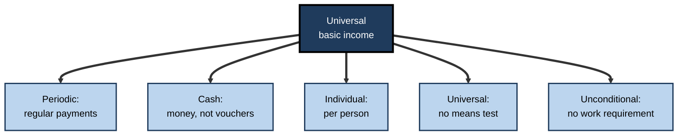
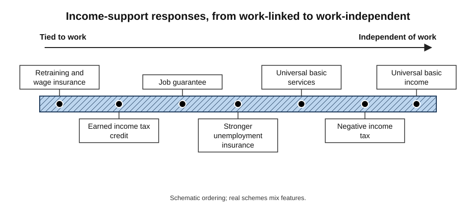
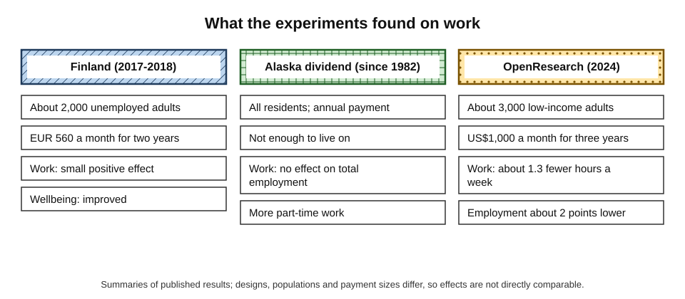
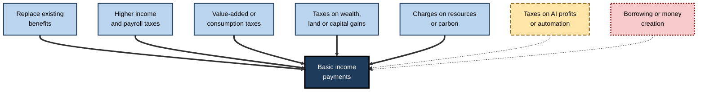
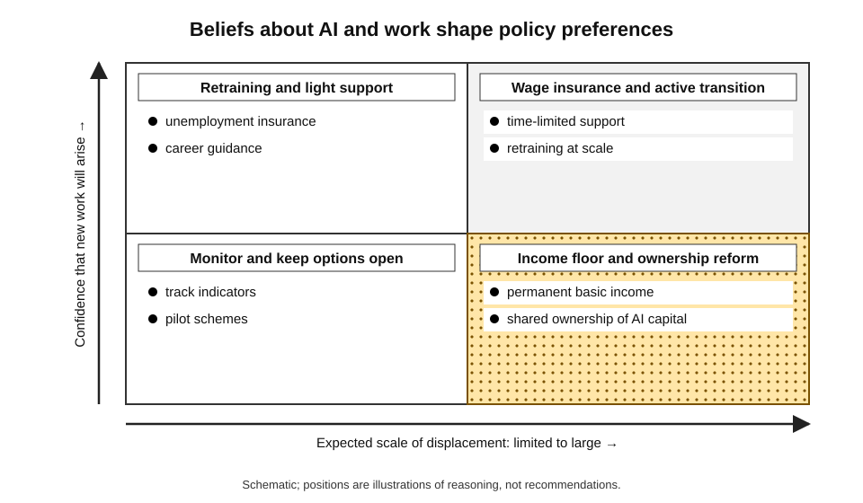
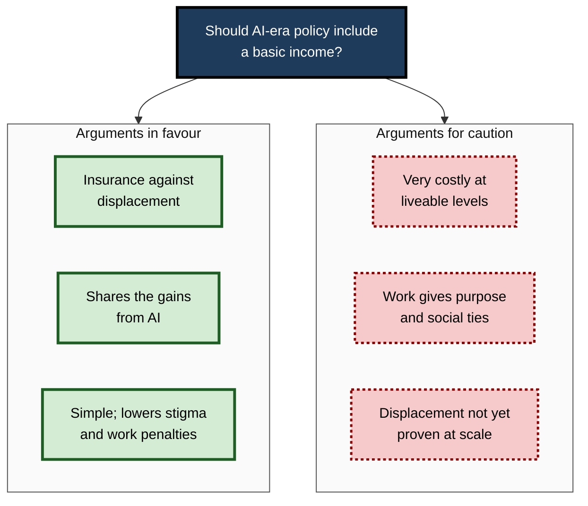

# H.8. Universal basic income debates in context of AI

Every month, every resident of Alaska receives a cheque from a state fund built on oil revenue — roughly one to two thousand dollars in recent years — whether they are rich or poor, employed or not. Nobody has to apply for a reason. The idea that a society might pay everyone a basic income is old, but each wave of automation revives it: if machines do more of the work, how will people earn a living, and who should share in the gains?

Advances in AI have brought it from the margins of economics into mainstream policy debate.

> **Definition — Universal basic income (UBI):** a regular cash payment made to every individual in a community, without a means test and without any requirement to work or to show willingness to work.

**Why it matters**

- **A response to uncertainty** — nobody knows how many jobs AI will displace; UBI is proposed as insurance against a bad outcome.
- **A test of values** — the debate raises basic questions about work, dignity, fairness and who owns the gains from technology.
- **Evidence now exists** — trials of cash payments, from small pilots to large randomised experiments, allow some claims to be tested.
- **Not the only option** — policymakers have a wide menu of income-support tools, and UBI competes with them.

---

## What a Basic Income Is — and Is Not

### The five features

According to the Basic Income Earth Network, a basic income is:

1. **Periodic** — paid at regular intervals, not as a one-off grant.
2. **Cash** — paid in money, not vouchers or services.
3. **Individual** — paid to each person, not to households.
4. **Universal** — paid to all, without a means test.
5. **Unconditional** — paid without work requirements.

**Figure 1.** The five defining features of a universal basic income.

> **Mnemonic — "PCI-UU":** **P**eriodic, **C**ash, **I**ndividual, **U**niversal, **U**nconditional.

### What UBI is often confused with

- **Welfare benefits** — usually means-tested and conditional on need or job search.
- **Guaranteed minimum income** — tops income up to a floor for those below it.
- **Negative income tax** — people below a threshold receive a payment that falls as earnings rise.
- **Targeted cash transfers** — paid only to a particular group.
- **Pilots and trials** — most experiments called "UBI" are **guaranteed income** schemes, limited in size, group or duration, so they test parts of the idea only.

| Scheme | Who receives | Condition | Withdrawn as income rises? |
|---|---|---|---|
| Universal basic income | Everyone | None | No; clawed back through taxation |
| Guaranteed minimum income | Those below a floor | Means test | Yes, steeply |
| Negative income tax | Those below a threshold | Income reporting | Yes, gradually |
| Conditional cash transfer | Poor households | Behaviour such as school attendance | Depends |
| Job guarantee | Anyone wanting work | Work performed | Not applicable |

> **Watch out:** a universal payment is not "free money for the rich". Wealthier people receive the payment but pay more in tax to fund it, so the **net** transfer flows from higher to lower earners.

---

## A Short History

- **Thomas Paine, *Agrarian Justice* (1797):** proposed that every person receive a sum at adulthood and a pension in old age, as compensation for the loss of common land.
- **Speenhamland system (England, 1795):** local wage supplements linked to bread prices — often cited, disputedly, as an early cautionary tale.
- **Milton Friedman (1962):** advocated a **negative income tax** to replace many welfare programmes with a single, simple payment.
- **United States income-maintenance experiments (late 1960s–1970s):** randomised trials of a negative income tax; they found modest reductions in work hours, mostly among second earners and young people.
- **Alaska Permanent Fund Dividend (since 1982):** an annual payment to residents from oil-fund returns — the nearest thing to a working universal payment.
- **Swiss referendum (2016):** a proposal for a monthly basic income was rejected by about three-quarters of voters.
- **Automation-era revival (2010s):** technology leaders and political candidates proposed UBI as a response to AI and robotics; a "Freedom Dividend" of US$1,000 per month featured in a 2020 US presidential campaign.

> **Key point:** the case for UBI does not depend on AI. It has been argued on grounds of poverty reduction, simplicity, freedom and fairness for two centuries. What AI adds is a **new argument from uncertainty**.

---

## The Argument from AI

### The case in favour

1. **Insurance against displacement** — if AI reduces labour demand sharply, wages could fall for many people; a floor of income protects them.
2. **Sharing the gains** — AI profits may flow to owners of capital and a few skilled workers; UBI redistributes some to everyone.
3. **A smoother transition** — people can retrain, move or start businesses without fearing destitution.
4. **Simplicity** — one payment without eligibility testing reduces bureaucracy and stigma.
5. **Value of unpaid work** — care, volunteering and creative work would be supported.

### The case against or for caution

1. **Cost** — a payment large enough to live on is very expensive.
2. **Work and meaning** — work provides identity, purpose and social ties as well as income.
3. **Poor targeting** — paying everyone uses resources that could help those in greatest need.
4. **Premature** — mass displacement has not occurred; policies for a hypothetical future may crowd out helpful measures now.
5. **Political risk** — a basic income may become a substitute for investment in education, health and housing.
6. **Inflation and rents** — a cash payment may raise prices of scarce goods such as housing if supply does not respond.

**Figure 2.** Alternative policy responses to AI-driven displacement, arranged by how far they depend on work.

### Three views of the AI future and what each implies

| View of AI's labour impact | Likely employment picture | Implied role for UBI |
|---|---|---|
| Mild: new work offsets old | Continued jobs; some churn | Little need; transition support and retraining suffice |
| Disruptive but temporary | Painful, uneven transition over years | Time-limited income support; wage insurance |
| Structural: large part of work automated | Persistently low labour demand | Permanent income floor; new ownership models |

> **Watch out:** claims that UBI is "inevitable" because of AI assume the third scenario. The evidence so far does not show mass joblessness, and economists disagree sharply on whether it will.

---

## Evidence from Cash Experiments

### What experiments can and cannot tell

- **What they can show:** how recipients change work, spending, health, wellbeing and use of time when given cash.
- **What they cannot show:**
  - **Permanence** — a three-year payment differs from a lifelong right.
  - **Universality** — most trials are limited to poor groups, so wider effects on prices and taxes are missing.
  - **Scale** — a nationwide payment would change labour markets and politics.
  - **AI-driven joblessness** — no trial has been run in an economy with large-scale automation.

**Study card — Finland's basic income experiment (2017–2018)**

- **Design:** a random sample of about **2,000** unemployed people aged 25–58 received **€560 a month**, unconditionally and without losing other benefits; a control group stayed on the existing benefit system.
- **Results (Kela, the social insurance institution, 2019–2020):**
  - employment effects were **small**: in the second year, recipients spent on average a few more days in work than the control group;
  - recipients reported **better wellbeing**: less stress, better health and more trust in others and institutions;
  - recipients were more confident about their future and their ability to influence their lives.
- **Caveats:** the trial covered only the unemployed, not everyone; it lasted two years; and it ran during a period when the government also introduced activation measures for the control group, which complicates comparisons.
- **Lesson:** removing conditionality did not reduce work among the unemployed in this setting and improved wellbeing.

**Study card — Alaska Permanent Fund Dividend (Damon Jones and Ioana Marinescu, 2022)**

- **Design:** compared Alaska with a synthetic control built from other US states, before and after the dividend began (1982).
- **Results:**
  - **no effect on overall employment**;
  - a rise in **part-time work**, consistent with people using cash to move away from full-time work only a little, while spending increased demand for local services.
- **Caveats:** the dividend is modest and fluctuates with oil returns; it is not enough to live on.

**Study card — OpenResearch unconditional cash study (United States, 2024)**

- **Design:** a randomised trial of about **3,000** low-income adults aged 21–40 in two states; **1,000** received **US$1,000 a month for three years**, while about **2,000** received US$50 a month as a comparison.
- **Results (reported 2024):**
  - recipients worked **slightly less** — roughly **1.3 hours less per week** and a **2-percentage-point lower** employment rate than the comparison group;
  - household income **excluding the transfer** fell modestly;
  - spending rose by about US$310 a month, most on food, housing and transport;
  - recipients were more likely to search for a job and to move, and said they valued meaningful work more highly.
- **Interpretation:** a large, predictable payment led to **modest** reductions in work, not large ones; benefits to wellbeing were smaller than some advocates predicted; effects on physical and mental health were limited.
- **Caveats:** US setting; targeted at low-income adults, not universal; three years only. The research was funded by a technology executive who had discussed UBI as a response to AI, which some critics note — but the analysis was carried out by independent academic researchers.

> **Watch out:** both advocates and critics have drawn **stronger conclusions** from this study than the data allow. It found modest reductions in work and mixed effects on wellbeing; it does not show that cash "destroys work" nor that it "transforms lives".

**Figure 3.** Reported work effects in three cash experiments.

### Reading the evidence

- **Consistent finding:** work reductions in cash trials are **small to moderate**, and often concentrated among second earners, carers and young people.
- **Consistent finding:** recipients spend on basics, not on alcohol or drugs, contrary to common fears.
- **Open issue:** effects when the payment is **permanent and universal**, and in an **AI-transformed labour market**, remain untested.

---

## Money: Costing and Funding

### Costing a basic income

> **Formula — Gross cost of a UBI:** number of recipients × payment per person × payments per year. The **net** cost is the gross cost minus the savings from replaced benefits and the extra tax raised.

### Worked example (illustrative): a small country's basic income

A country has **10 million** adults and a national output of **£400 billion** a year. It considers paying **£6,000** a year to every adult. *Illustrative figures.*

1. **Gross cost:** 10 million × £6,000 = **£60 billion**, which is **15%** of national output.
2. **Offsets:**
   - existing cash benefits that would be abolished or reduced: £25 billion;
   - extra income tax from a flat 10% on other income: £15 billion.
3. **Net cost to be financed from new sources:** £60 − £25 − £15 = **£20 billion**, or **5%** of national output.
4. **Interpretation:** a modest basic income, replacing existing benefits, is affordable; a much higher one would require large tax increases.
5. **Trade-offs:** those who lose from abolished targeted benefits (such as disabled people with high needs) could become worse off unless supplementary support is kept.

> **Watch out:** headline figures about "free money for everyone" mislead in both directions: the gross cost looks frightening, while the net cost depends on what is replaced and how the money is taxed back.

### Ways to fund it

**Figure 4.** Possible funding sources for a basic income.

- **Taxing AI** — proposals include a "robot tax", higher taxes on capital, a levy on AI companies, or public ownership of a share of AI returns, similar to a sovereign wealth fund.
  - **Difficulty:** defining what to tax; risk of discouraging useful investment; profits mobile across borders.
- **Sovereign wealth model** — Alaska's approach: a public fund owns assets and pays dividends.
- **Data dividend** — payments to individuals for the data used to train AI; practically difficult.

---

## Alternatives and Complements

- **Wage insurance** — tops up pay for displaced workers who take lower-paid jobs, for a limited period.
- **Earned income tax credits** — wage supplements tied to work; support low earners without discouraging employment.
- **Job guarantees** — the state offers public jobs to anyone who wants one.
- **Universal basic services** — free provision of essentials such as health care, education, transport and housing support, instead of cash.
- **Stronger unemployment insurance and retraining** — targeted at those who lose jobs.
- **Capital ownership schemes** — "baby bonds" or citizens' funds giving everyone a stake in assets.
- **Shorter working weeks** — sharing available work more widely.

| | UBI | Wage insurance | Job guarantee | Universal basic services |
|---|---|---|---|---|
| Delivers | Cash | Pay top-up | Employment | In-kind essentials |
| Targeting | None | Displaced workers | Anyone wanting work | Everyone |
| Effect on work incentives | Mild reduction | Encourages re-employment | Keeps people working | Little direct effect |
| Main cost | Very high at liveable levels | Moderate | High; needs useful work | High; supply-side costs |
| Main risk | Cost; weak targeting | Employer exploitation; limited reach | Make-work; displacement of private jobs | Quality and capacity constraints |

> **Key point:** these tools are **not mutually exclusive**. A realistic package might combine stronger unemployment insurance, wage insurance, universal services and a modest basic income.

---

## Case Study: Finland's Experiment in Context

- **Situation:** by 2015 Finland had high unemployment and complaints that its benefit system trapped people: taking a low-paid job could reduce benefits and leave a person no better off.
- **Policy question:** would an **unconditional** payment encourage unemployed people to take work, by removing the risk of losing benefits?
- **Design:** the 2017–2018 experiment above.
- **Findings:**
  - small positive employment effects in the second year;
  - clear gains in wellbeing, trust and confidence;
  - recipients did not stop looking for work.
- **Reception:** advocates read it as showing that unconditional support is **safe**; sceptics noted that a partial, time-limited experiment on the unemployed says little about a **permanent universal** payment.
- **What followed:** the government did not extend the trial; no national basic income was adopted; the debate moved to broader reform of social security.
- **Lesson:** well-designed experiments can change the **terms** of debate without settling the political question.

---

## Beyond Money: Work, Meaning and Power

- **Work provides more than income** — structure, status, relationships and purpose; unemployment harms health beyond the loss of income.
- **Counterview** — much paid work is dull, and unpaid work such as care is undervalued; income without compulsion could expand freedom.
- **Power** — people with a secure income can refuse exploitative jobs, which raises bargaining power; employers may fear this, supporters welcome it.
- **Ownership** — some economists argue that the key question is not paying people but **who owns AI capital** and who captures its returns.
- **Dignity and reciprocity** — public support is often higher for payments linked to contribution; unconditional payments face political resistance.

> **In practice:** policy analysts evaluating a basic income proposal ask: how large is the payment; what does it replace; who gains and loses net; how is it financed; what are the likely effects on work, prices and politics; and what could be achieved with the same money in other ways?

**Figure 5.** How different views on AI and work lead to different policy preferences.

---

## Design Variants and the Economics of Work Incentives

### Variants of the idea

- **Full UBI** — universal, unconditional, large enough to live on; rarely if ever implemented.
- **Partial basic income** — universal and unconditional but below subsistence, supplementing other income and benefits; this is the form most proposals and some existing schemes take.
- **Child or citizen's dividend** — a universal payment to a specific group (all children, or all residents from a shared fund).
- **Participation income** — paid in return for a broad range of contributions, such as care or volunteering, rather than employment alone.
- **Negative income tax** — a payment that tapers as earnings rise, delivering a floor with targeting.
- **Time-limited guarantee** — a basic income triggered only in a recession or after displacement.

### How payments affect the choice to work

> **Definition — Income effect and substitution effect:** an unconditional payment makes people richer, which can lead them to choose more leisure (the **income effect**); a payment withdrawn as earnings rise acts like a tax on work, discouraging it (the **substitution effect**). A pure basic income has an income effect but no withdrawal, so it does not penalise earning extra.

- **Means-tested benefits** can create very high effective tax rates on extra earnings, because each pound earned reduces benefits.
- **UBI** avoids this trap, but must be funded by taxes that themselves affect incentives.

### Worked example (illustrative): effective marginal tax rates

Compare a means-tested benefit with a basic income for a person who earns an extra £100. *Illustrative figures.*

| | Means-tested benefit | Basic income |
|---|---|---|
| Benefit lost when earning extra £100 | 60% withdrawal rate = £60 | £0 |
| Income tax on extra £100 (20%) | £20 | £20 |
| **Net gain from extra £100** | £100 − £60 − £20 = **£20** | £100 − £20 = **£80** |
| **Effective marginal tax rate** | 80% | 20% |

1. **Means-tested:** the person keeps only £20 of an extra £100 — an effective tax rate of 80%.
2. **Basic income:** the payment does not shrink, so the person keeps £80 — an effective rate of 20%.
3. **Caution:** the basic income must be financed; if funded by higher taxes on earnings, the rate on extra earnings rises for everyone, which could offset the difference.
4. **Lesson:** a basic income can lower the penalty on moving into work for those currently on means-tested support, but the net effect on work depends on how it is paid for.

> **Formula — Effective marginal tax rate:** (income tax on extra earnings + benefits withdrawn) ÷ extra earnings. Example: (£20 + £60) ÷ £100 = **80%**.

---

## Public Opinion and Politics

- **Public attitudes are divided** and shift with how the policy is described; support is typically higher for targeted help and for payments linked to contribution, lower for unconditional payments.
- **Referendums** have rejected basic income proposals by large margins in some countries, such as Switzerland in 2016.
- **Parties across the spectrum** have supported variants for different reasons: some on the political left for redistribution and freedom from compulsion, some on the right for simplicity and to replace bureaucratic benefits.
- **Concerns that cross party lines:** fairness to those who work, cost, immigration and eligibility, and the risk that a basic income becomes a pretext to cut public services.
- **Technology leaders' advocacy** raises its own questions: some critics see UBI as a way to relieve pressure on firms that profit from automation without changing who owns it.

**Figure 6.** Common arguments for and against a basic income in an AI context.

> **Remember:** a sound analysis of a basic income asks **how large, for whom, replacing what, paid for how, and compared with what alternative** — and treats "UBI" as a family of designs, not a single policy.

---

## Open Questions

- **Will AI cause persistent mass displacement?**
  - The answer determines whether a permanent income floor is needed; the evidence does not yet decide it.
- **What happens under permanent, universal payments?**
  - No large experiment has tested that.
- **How should AI gains be shared?**
  - Taxing capital, public ownership and universal dividends all face practical and political obstacles.
- **Does unconditional income harm or help meaning and social cohesion?**
  - Findings on wellbeing are mixed and short-term.
- **Is UBI the right tool?**
  - Targeted and in-kind alternatives may do more per unit of money; the balance between them is contested.

---

## Summary

- **UBI** is a **periodic, cash, individual, universal, unconditional** payment (PCI-UU); it differs from means-tested benefits, negative income tax and job guarantees.
- The idea is centuries old; AI adds an **argument from uncertainty** about future labour demand.
- **For:** insurance, sharing gains, simplicity, support for unpaid work. **Against or cautious:** cost, loss of work's non-financial value, poor targeting, prematurity, price effects.
- **Evidence:** Finland (2017–18) found small employment gains and better wellbeing; Alaska showed no effect on overall employment but more part-time work; the OpenResearch trial (2024) found modest falls in work and mixed wellbeing effects. All are partial tests.
- **Cost** depends on what is replaced; funding options include taxes on income, consumption, wealth, resources and AI profits.
- **Alternatives** — wage insurance, tax credits, job guarantees, basic services, ownership schemes — can be combined.
- Whether UBI is needed depends on how far AI **displaces** work, which is unresolved.

---

## Self-Check

1. Define UBI and list its five features.
2. How does UBI differ from a negative income tax and a job guarantee?
3. What new argument does AI add to the case for UBI?
4. Give three arguments for and three against.
5. Summarise the Finnish experiment and two caveats.
6. What did Alaska's dividend show about employment?
7. Summarise the OpenResearch study and why both advocates and critics overstate it.
8. What can cash experiments not tell us about a permanent universal basic income?
9. A country of 20 million adults considers paying £5,000 a year each. Calculate the gross cost, and the net cost if £30 billion of existing benefits is replaced and £20 billion of new tax raised.
10. Name four ways to fund a basic income and one difficulty with taxing AI.
11. Describe three alternatives to UBI and one risk of each.
12. How do three different views of AI's labour impact lead to different positions on UBI?
13. A politician says "AI will take most jobs, so we need UBI now". Evaluate the claim.

### Answer Key

1. A regular cash payment to every individual, without means test or work requirement. Features: periodic, cash, individual, universal, unconditional.
2. A negative income tax pays those below a threshold, with the payment falling as earnings rise; a job guarantee offers work rather than cash. UBI pays everyone and is not withdrawn on income.
3. An argument from uncertainty: if AI sharply reduces labour demand, income support protects people and shares the gains.
4. For: insurance against displacement, sharing gains, simplicity, support for unpaid work. Against: cost, work's non-financial value, poor targeting, prematurity, price effects.
5. About 2,000 unemployed people received €560 a month for two years; employment effects small and slightly positive, wellbeing improved. Caveats: only unemployed participants; short duration and concurrent policy changes complicate comparison.
6. No effect on overall employment, but more part-time work.
7. About 3,000 low-income adults; US$1,000 a month for three years versus US$50; recipients worked about 1.3 hours less per week, employment 2 points lower, spending rose, wellbeing effects mixed. Advocates claim transformation, critics claim destroyed work; the data show modest changes.
8. Permanence, universality, scale effects on prices and taxes, and behaviour in an AI-transformed labour market.
9. Gross: 20 million × £5,000 = £100 billion. Net: £100 − £30 − £20 = £50 billion.
10. Income and payroll taxes, consumption taxes, wealth or capital taxes, resource charges, AI-profit levies. Difficulty: defining the base and mobility of profits across borders.
11. Wage insurance (employer exploitation), job guarantee (make-work), universal basic services (capacity and quality limits), earned income credits (excludes non-workers).
12. Mild view: little need. Temporary disruption: time-limited support and wage insurance. Structural displacement: permanent income floor and ownership reform.
13. The claim assumes mass displacement, which is not yet shown; evidence on AI and employment is mixed. UBI at liveable levels is costly and alternatives exist. A sensible position prepares options and monitors indicators rather than treating UBI as inevitable.

---

## Glossary

| Term | Meaning |
|---|---|
| Basic income | Regular unconditional cash payment to individuals. |
| Conditional cash transfer | Payment to poor households tied to behaviour such as school attendance. |
| Guaranteed income | Payments to a defined group, often a trial, to ensure a minimum income. |
| Job guarantee | A public offer of work to anyone who wants it. |
| Means test | A check of income or assets to decide eligibility. |
| Negative income tax | A payment to those below an income threshold, reduced as earnings rise. |
| Robot tax | A tax on automation or robots proposed to fund transition support. |
| Universal basic services | Free public provision of essentials in kind. |
| Wage insurance | A top-up for displaced workers who take lower-paid jobs. |
