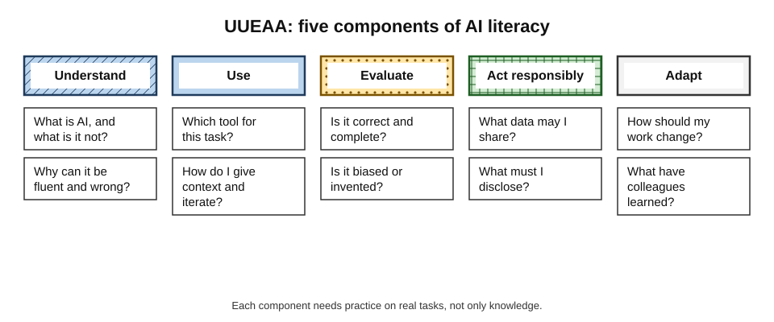
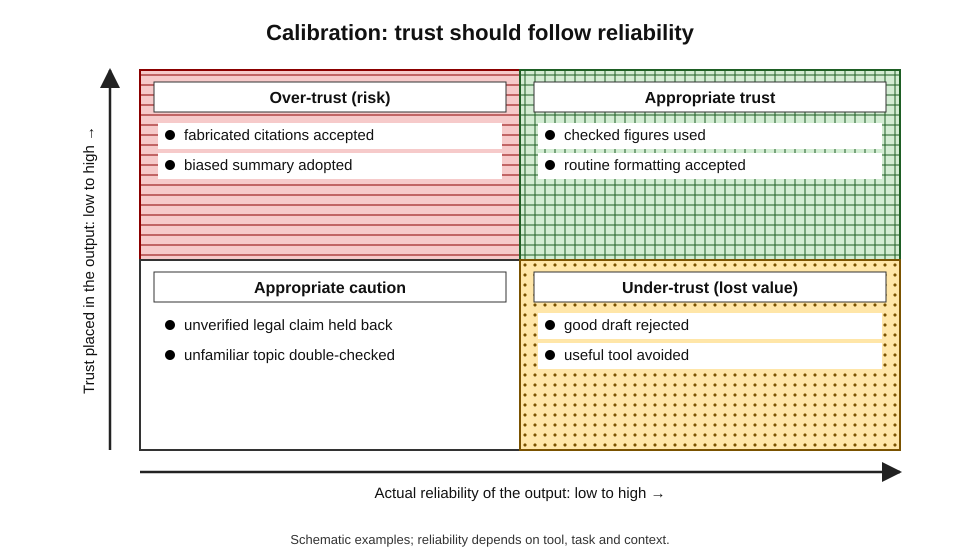
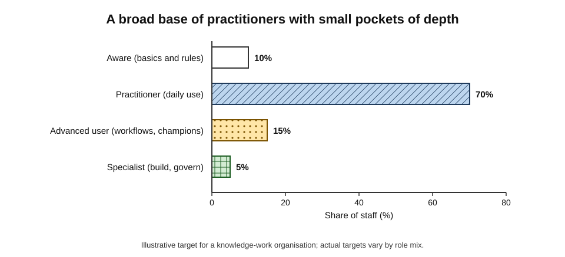
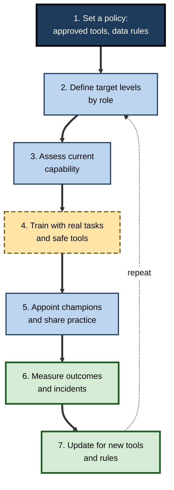
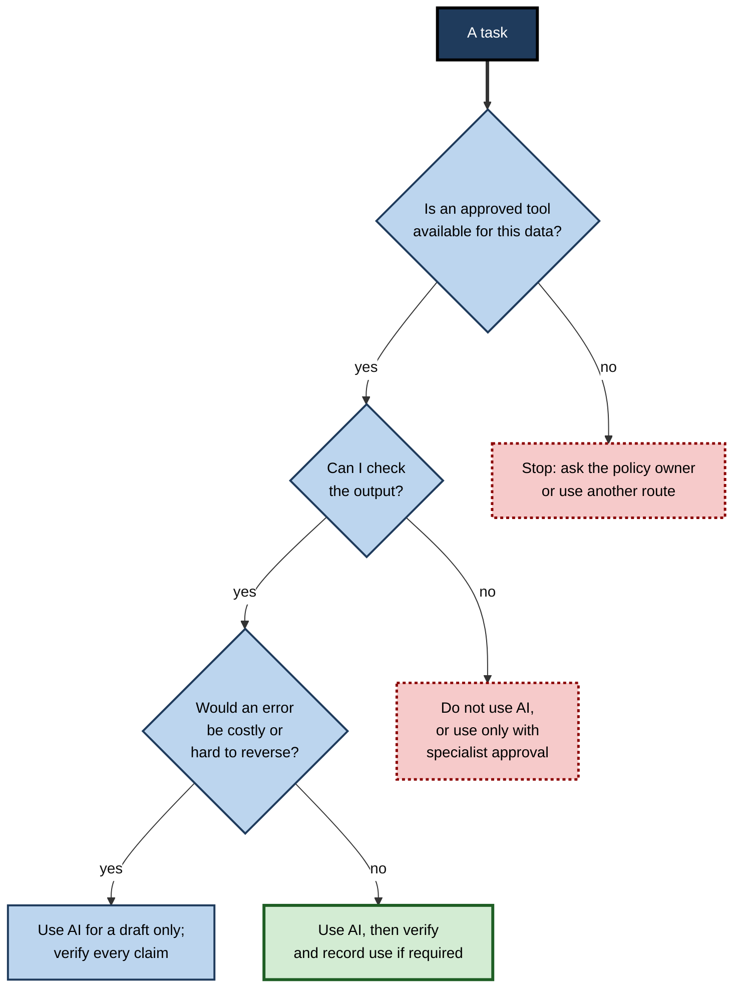

# H.9. AI literacy as a core workplace skill

Two colleagues are given the same task: summarise a hundred pages of supplier contracts for a Monday meeting. One pastes the documents into a public chatbot, copies the answer into a slide and presents it as fact. The other checks which tools the organisation has approved, strips out confidential details, asks the assistant to cite clause numbers, checks the citations against the originals, and reports what the summary could not capture.

Both "used AI". Only one used it **literately** — and only one is safe to give the next task.

> **Definition — AI literacy:** the set of competencies that enable a person to understand what AI is and how it works at a basic level, to use AI tools effectively and responsibly, to evaluate their outputs critically, and to take part in decisions about their use.

**Why it matters**

- **Everyone now meets AI at work** — through search, email, spreadsheets, customer systems, hiring tools and decision software, whether or not they choose to.
- **Safety and compliance** — mistakes with confidential data, fabricated facts and biased outputs fall on the person and the organisation.
- **Value** — the gains from AI come from using it well on suitable tasks, which depends on judgement more than on button-pressing.
- **Employability** — employers increasingly ask for AI competence as a baseline expectation across roles, not only in technical ones.

---

## From Digital Literacy to AI Literacy

- **Earlier literacies** — reading and writing, then computer literacy, then digital and information literacy — each became a baseline expectation once the technology spread.
- **What is new about AI:**
  - it **produces** content and decisions, not just stores and transmits information;
  - it is **probabilistic**: the same question can give different answers, and fluent answers can be wrong;
  - it **adapts** to data in ways its own developers cannot always explain;
  - it is **embedded** invisibly in tools people already use.
- **Consequence:** AI literacy requires **critical** skills — knowing when not to trust — as well as operational ones.

> **Key point:** AI literacy is not coding. A person can be highly AI-literate without writing a line of code, just as a driver can be road-literate without understanding engines.

---

## The Components of AI Literacy

### Five components

1. **Understand** — know what AI is and is not: that models learn patterns from data; that they can be wrong; that they have no understanding or intent; the difference between traditional automation, machine learning and generative AI.
2. **Use** — operate tools competently: choose a suitable tool, give clear instructions, supply context, iterate.
3. **Evaluate** — judge outputs critically: check facts, spot invented sources, notice bias and gaps, compare with other evidence.
4. **Act responsibly** — protect confidential and personal data, follow policy, respect intellectual property, disclose AI use where required, and consider fairness and impact on others.
5. **Adapt and collaborate** — redesign one's own work around AI, learn as tools change, and work with colleagues on shared rules and practice.

> **Mnemonic — "UUEAA":** **U**nderstand, **U**se, **E**valuate, **A**ct responsibly, **A**dapt — five components of AI literacy.

**Figure 1.** The five components and the questions each answers.

### What each component looks like in practice

| Component | A literate worker... | A weakly literate worker... |
|---|---|---|
| Understand | Knows tools generate plausible text and may be wrong | Treats the tool as an all-knowing search engine |
| Use | Gives context, constraints and examples; iterates | Types a vague request and accepts the first answer |
| Evaluate | Checks figures, citations and logic against sources | Copies output without checking |
| Act responsibly | Keeps confidential data out of unapproved tools; discloses use | Pastes client data into a public chatbot |
| Adapt | Experiments, shares what works, updates habits | Uses the same one trick for two years, or avoids AI altogether |

> **Watch out:** **avoidance** is as much a literacy gap as over-use. A worker who refuses to try approved tools may be missing real benefits, but a worker who uses them blindly creates risk. Both lack calibrated judgement.

---

## Why Calibration Is the Heart of AI Literacy

> **Definition — Calibration:** the match between a person's confidence in an AI output and its actual likelihood of being correct.

- **Over-trust** — accepting wrong outputs because they look fluent and confident.
- **Under-trust** — rejecting good outputs, or avoiding useful tools, because of a few salient errors.
- **Why calibration is hard:**
  - fluent language signals competence even when content is wrong;
  - AI performance is **jagged**: excellent at one task, poor at a similar one;
  - feedback is delayed — errors surface weeks later, if at all;
  - tools change with every update, so past experience may mislead.

**Study card — AI use and self-assessment (researchers at Aalto University and collaborators, 2025)**

- **Design:** participants solved logical reasoning problems from a standard admissions test, with and without the help of a chatbot, and then estimated their own performance.
- **Findings (reported):**
  - using the chatbot improved performance on the problems;
  - participants **overestimated** their performance with AI, and those who reported greater technical knowledge of AI were **not** better calibrated — in some analyses they were more overconfident;
  - most users asked a single question and accepted the answer, rather than checking or iterating.
- **Interpretation:** exposure and technical familiarity do not guarantee **metacognitive** accuracy — the ability to judge one's own judgement.
- **Caveats:** a laboratory study on puzzles with a small set of tasks; replication in real workplaces is needed.

**Figure 2.** Calibration of trust against actual reliability of AI output.

> **Remember:** AI literacy includes **epistemic humility** — knowing the limits of one's own checking, and building routines that do not depend on feeling confident.

### Habits that build calibration

- **Verify by default** on facts, figures, names and citations — the places where models invent.
- **Ask for the evidence** — sources, reasoning, the quoted passage — and check them.
- **Triangulate** — compare with a second source, tool or colleague on important points.
- **Test the tool** — try questions with known answers to see where it fails.
- **Scale the check to the stake** — a casual email needs a glance; a board paper needs a line-by-line check.

---

## Levels of Competence in the Workplace

AI literacy is not all-or-nothing. Organisations find it useful to describe different levels for different roles.

| Level | Description | Typical roles | Example capabilities |
|---|---|---|---|
| Aware | Understands basic concepts, risks and rules | All staff | Knows what is allowed; recognises AI output; knows to verify |
| Practitioner | Uses approved tools well in daily work | Most knowledge workers | Writes effective instructions; checks outputs; protects data |
| Advanced user | Designs repeatable AI-assisted workflows | Team champions, analysts | Builds templates; tests tools; trains colleagues |
| Specialist | Builds, configures or governs AI systems | Data science, engineering, risk, legal | Evaluates models; manages data pipelines; audits systems |
| Leader | Sets strategy, rules and culture for AI use | Managers, executives | Chooses where AI fits; manages risk; develops people |

**Figure 3.** Workforce distribution across literacy levels in an organisation targeting broad capability.

> **Key point:** the target is a **broad base** — nearly everyone at "aware" and most at "practitioner" — with small, deep pockets of advanced and specialist skill. A programme that trains only specialists leaves the organisation exposed through the everyday mistakes of everyone else.

---

## Regulation and Employer Expectations

### The European Union

- **Article 4 of the EU AI Act** requires providers and deployers of AI systems to take measures to ensure, as far as possible, a **sufficient level of AI literacy** of their staff and others operating AI systems on their behalf, taking into account their knowledge, experience, education and training, and the context of use.
- **Timing:** the obligation applied from **2 February 2025**.
- **Nature:** it is a duty to take reasonable measures, not a licensing regime; there is no fixed syllabus or certificate.
- **Practical effect:** organisations operating in the EU document training, role-based guidance and policies, as evidence of compliance.

### Frameworks

- **OECD and the European Commission** have developed an AI literacy framework for school education describing knowledge, skills and attitudes, with a draft published in 2025; it shows how literacy is being defined for the next generation of workers.
- **Many countries** include digital and AI competence in national skills strategies.

### What employers say they want

- **Surveys of employers** (for example by Microsoft and LinkedIn in 2024) found that a majority of business leaders said they would prefer a less experienced candidate with AI skills to a more experienced one without, and many said they would not hire someone lacking them.
- **Analyses of job advertisements** (for example by PwC) have reported pay premiums for jobs requiring AI skills.
- **Caveat:** employer surveys capture **stated** preferences; adverts may ask for AI skills without defining them, and pay premiums may reflect specialist roles rather than general literacy.

### Case study: a technology company makes AI use an expectation (2025)

- **Situation:** in April 2025 the chief executive of Shopify circulated a memo, later made public, stating that **effective use of AI was now a baseline expectation** for all employees.
- **Reported content of the memo:**
  - using AI would be part of **performance and peer reviews**;
  - before asking for more staff or resources, teams were expected to show why AI could not do the work;
  - employees were encouraged to experiment, share what they learned and treat AI as a collaborator in prototyping and research.
- **Reception:**
  - supporters saw clarity and a push to build capability;
  - critics worried that it would pressure workers to use AI where it was unsuited, that "show why AI cannot do it" shifts the burden unfairly, and that it might be used to justify headcount limits;
  - similar "AI-first" statements from other companies attracted both praise and backlash.
- **Lesson:** making AI use an explicit expectation can accelerate adoption, but literacy requires **training, safe tools, time to learn and guidance on when not to use AI** — otherwise the expectation produces pressure rather than skill.

---

## Building AI Literacy in Organisations

### A development cycle

**Figure 4.** The cycle for building and maintaining AI literacy in an organisation.

### What good training contains

- **Concepts first, briefly** — what generative AI does, why it errs, where it is strong and weak.
- **Practice on the person's own tasks** — drafting, summarising, analysing, searching, with approved tools.
- **Failure demonstrations** — seeing invented citations and biased outputs first-hand is more persuasive than being told.
- **Rules and reasons** — what data may go where, and why.
- **Verification routines** — concrete steps for checking outputs by task type.
- **Role-specific modules** — for managers (decisions, people data), analysts (data and statistics), communicators (disclosure, brand), legal and HR (high-risk uses).
- **Refreshers** — tools and rules change every few months.

> **Watch out:** one-off awareness sessions change knowledge but rarely behaviour. Training that is **embedded in work**, backed by champions and measured by behaviour, performs better — though rigorous evaluations of AI training programmes are still scarce.

### Decision prompts for each task

**Figure 5.** Questions a literate worker asks before using AI for a task.

---

## Assessing AI Literacy

- **Knowledge tests** — easy to administer, but weakly related to real behaviour.
- **Performance tasks** — realistic work samples: produce a draft with an approved tool, then verify and correct it.
- **Scenario judgement** — what would you do with this output, this data, this request?
- **Observation and work products** — managers review quality, citations, and handling of data.
- **Incident data** — near misses and breaches signal gaps.
- **Self-assessment** — useful for engagement, but unreliable given the calibration problem above.

### Worked example (illustrative): a skills gap analysis for a finance team

A team of 40 is assessed against target levels. *Illustrative figures.*

| Level | Target (people) | Current (people) | Gap |
|---|---|---|---|
| Aware only | 4 | 10 | +6 over target |
| Practitioner | 28 | 22 | −6 |
| Advanced user | 6 | 7 | +1 |
| Specialist | 2 | 1 | −1 |
| **Total** | **40** | **40** | |

1. **Sum check:** targets 4 + 28 + 6 + 2 = 40; current 10 + 22 + 7 + 1 = 40.
2. **Reading the gaps:** six people remain at "aware" who should be practitioners; one specialist role is unfilled.
3. **Plan:** train the six on approved tools using real month-end tasks; recruit or upskill one person into the specialist role; keep the advanced users as champions.
4. **Measure:** repeat the performance-task assessment after three months and compare incident reports.

> **Watch out:** the numbers describe categories assigned by judgement. Move people only on evidence of work performance, not on course completion.

---

## Literacy Is Not Enough

- **Literacy needs access** — approved tools, time and permission to practise.
- **Literacy needs governance** — policies that are clear and short enough to follow.
- **Literacy needs culture** — people must feel able to admit errors and ask questions.
- **Literacy needs fairness** — unequal access to training may widen gaps between groups; older workers, part-time and frontline staff are often missed.
- **Literacy needs updating** — features and risks shift as tools change.

> **In practice:** treat AI literacy like health and safety training: a baseline for all, deeper training for those in higher-risk roles, regular refreshers, incident reporting without blame, and visible leadership.

---

## Verification Routines by Task Type

Calibrated trust is built through concrete routines. The right check depends on what the output claims.

| Output type | Typical failure | Practical check |
|---|---|---|
| Facts, dates, names | Invented or outdated details | Confirm each against a primary source; treat unsourced specifics as unverified |
| Quotations and citations | Non-existent sources; altered wording | Open the source; match the quotation and the reference |
| Numbers and calculations | Arithmetic and unit errors; invented statistics | Recompute independently; trace each figure to its origin |
| Summaries | Omissions; added claims; shifted emphasis | Compare with the original on the key points; look for what is missing |
| Analysis and reasoning | Plausible but flawed logic | Restate the argument in your own words; test with a counter-example |
| Code and formulas | Subtle bugs; insecure patterns | Run tests; read line by line; use review by a second person |
| Translations | Mistranslated terms; lost register | Back-translate key passages; ask a fluent colleague for sensitive text |
| Advice (legal, medical, financial) | Confident but wrong or inapplicable guidance | Treat as a lead only; confirm with a qualified person |

> **Remember:** the more **specific** a claim and the more **costly** an error, the stronger the check.

### Habits that scale

- **Keep a log of failures** you encounter, so that pattern knowledge accumulates.
- **Ask the tool to critique its own output** — useful for finding gaps, though not a substitute for independent checking.
- **Prefer tools that show sources** and read the sources.
- **Share failures with colleagues** — one person's near miss becomes the team's guidance.

---

## An Acceptable-Use Policy

### What a good policy contains

- **Purpose and scope** — which tools and which staff.
- **Approved tools** — and how to request others.
- **Data rules** — categories of data that may never be entered into external tools (client secrets, personal data, unpublished results), and categories that may.
- **Verification duties** — the person using AI remains responsible for accuracy.
- **Disclosure** — when AI use must be declared to clients, colleagues or the public.
- **Prohibited uses** — for example automated decisions about people without human review.
- **Intellectual property** — ownership and use of outputs, and respect for others' rights.
- **Incident reporting** — how to report errors and leaks without blame.
- **Review date** — when the policy is next updated.

> **Watch out:** policies that are too long, too vague or too restrictive are ignored. Staff then use personal accounts and unapproved tools — "shadow AI" — which is the riskiest outcome.

### Case study (illustrative): a council's staged approach

- **Situation:** a local council with 2,000 staff finds that many employees use public chatbots on their own phones to draft letters and summarise reports, including documents containing residents' details.
- **Problem:** a blanket ban is unenforceable and loses real benefits; unrestricted use risks data breaches and inaccurate letters to residents.
- **Actions:**
  1. buy an approved assistant under a contract that keeps data within the council's control;
  2. publish a two-page policy with a clear table of "may" and "may not" data;
  3. train all staff in a 90-minute session using their own tasks, including demonstrations of invented citations;
  4. train 60 volunteer champions for more depth;
  5. require staff to check any text sent to residents and to record AI use on case files for decisions;
  6. review incidents monthly and publish anonymised lessons.
- **Result:** after six months, most staff use the approved tool; reported incidents fall; a few serious near misses are caught by the checking rule.
- **Side effects:** some staff feel monitored by the recording requirement; the council adjusts it to cover only decisions about residents.
- **Lesson:** an approved, usable tool, simple rules and a culture of reporting reduce risk more effectively than prohibition.

---

## Literacy for Managers and Specific Groups

### Managers and leaders

- **Know the tools well enough to ask good questions** — what data, what accuracy, what failure modes.
- **Set expectations and examples** — use AI visibly and honestly, including the limits.
- **Protect time to learn** — and recognise careful checking in performance reviews.
- **Handle people data with extra care** — hiring, monitoring and appraisal tools carry legal and ethical risks.
- **Avoid over-reading outputs** — dashboards and AI summaries of people's performance can mislead.

### Frontline and customer-facing staff

- **Know when a customer is dealing with AI** and when to hand over to a person.
- **Recognise errors** in AI replies and escalate quickly.
- **Explain to customers** how decisions were reached, in plain language.

### Specialist functions

- **Legal and compliance** — understand regulatory duties, contracts with providers and intellectual property.
- **HR** — know the rules on automated decisions in hiring and monitoring.
- **Security** — recognise new risks, such as prompt injection and data leakage.
- **Procurement** — assess vendors' claims, testing and data handling.

### People who face barriers

- **Language** — most tools work best in a few languages; staff working in others may be disadvantaged.
- **Disability** — AI can help (captioning, drafting) or hinder (inaccessible interfaces); involve users in design.
- **Age and experience** — avoid assumptions that older workers cannot learn or that younger workers are naturally literate; confidence and calibration vary widely within every group.

> **In practice:** literacy programmes that segment audiences by **role and risk** — with common basics for everyone — are more effective than a single generic course.

---

## Open Questions

- **What exactly should "sufficient" literacy mean?**
  - Regulators leave it to organisations; consensus on levels and assessments has not formed.
- **Does literacy improve outcomes?**
  - Evidence that trained workers produce better, safer results than untrained ones is still thin.
- **Can literacy keep pace with the tools?**
  - If tools change quarterly, skills based on specific interfaces age fast; concepts and judgement last longer.
- **How should literacy be measured fairly?**
  - Tests may favour confident users or those fluent in the dominant language.
- **Will literacy needs shrink as tools improve?**
  - Better tools may need less skill to use but more skill to supervise.

---

## Summary

- **AI literacy** = understanding AI, using it effectively, evaluating its output, acting responsibly and adapting (**UUEAA**).
- It is **not coding**; it is a baseline workplace competence, like earlier digital literacies.
- **Calibration** — matching trust to reliability — is central; fluent output, jagged performance and delayed feedback make it hard, and technical knowledge does not guarantee it.
- Competence comes in **levels** (aware, practitioner, advanced user, specialist, leader); a broad base is the goal.
- **EU AI Act Article 4** has required sufficient AI literacy for staff operating AI since February 2025; employers increasingly list AI skills as expectations.
- Good programmes **set policy, define targets, assess, train on real tasks, appoint champions, measure and update**.
- Assess through **performance tasks and scenarios**, not tests alone.
- Literacy needs **access, governance, culture, fairness and renewal**.

---

## Self-Check

1. Define AI literacy and explain why it is not coding.
2. What makes AI different from earlier workplace technologies for literacy purposes?
3. List and explain the five components of AI literacy.
4. What is calibration and why is it hard?
5. Summarise the 2025 study on AI use and self-assessment, and a caveat.
6. Describe the five levels of workplace competence.
7. What does Article 4 of the EU AI Act require, and from when?
8. Why should surveys of employer preferences be treated with caution?
9. What are the advantages and risks of making AI use an explicit expectation, as in the Shopify memo?
10. List five elements of effective AI training.
11. In the gap analysis example, what are the main gaps and what actions follow?
12. Why are knowledge tests insufficient for assessing literacy?
13. A manager wants to improve AI literacy but has no budget. Propose a low-cost plan.

### Answer Key

1. The competencies to understand, use, evaluate and responsibly act with AI. Not coding: a person can judge and use AI well without programming, as a driver need not understand engines.
2. AI produces content and decisions, is probabilistic, adapts to data in ways hard to explain, and is embedded invisibly — so critical skills about when not to trust are needed.
3. Understand (what AI is and is not); Use (operate tools, give context, iterate); Evaluate (check facts and bias); Act responsibly (data, policy, disclosure); Adapt (redesign work and keep learning).
4. Matching confidence in an output to its real reliability. Hard because fluent text sounds competent, performance is jagged, feedback is delayed and tools change.
5. Participants improved with a chatbot but overestimated their performance; technical AI knowledge did not improve calibration; most asked once and accepted the answer. Caveat: laboratory puzzles, limited tasks; workplace replication needed.
6. Aware (basics and rules, all staff); practitioner (daily use of approved tools); advanced user (designs workflows, champions); specialist (builds or governs systems); leader (strategy and culture).
7. Providers and deployers must take measures for a sufficient level of AI literacy among staff operating AI, considering their knowledge, context and use; applicable from 2 February 2025.
8. They record stated preferences, adverts may not define AI skills, and pay premiums may reflect specialist rather than general skills.
9. Advantages: clarity, accelerated adoption. Risks: pressure to use AI where unsuited, unfair burden of proof for headcount, skill gaps if training and safe tools are absent.
10. Brief concepts; practice on real tasks; failure demonstrations; rules and reasons; verification routines; role-specific modules; refreshers.
11. Six people at aware-only should become practitioners; one specialist role is unfilled. Actions: train the six on real tasks, fill the specialist role, use advanced users as champions, reassess in three months.
12. They measure knowledge, which is weakly related to behaviour; performance tasks and scenarios show whether people verify and protect data.
13. Appoint volunteer champions; run short sessions on real tasks using approved free-to-the-organisation tools; share a one-page policy; collect and circulate examples of failures and good practice; review incidents monthly.

---

## Glossary

| Term | Meaning |
|---|---|
| AI literacy | Competencies to understand, use, evaluate and act responsibly with AI. |
| Calibration | Match between confidence in an output and its actual correctness. |
| Champion | A colleague who helps others adopt tools and practices. |
| Epistemic humility | Awareness of the limits of one's own knowledge and checking. |
| Jagged performance | Uneven AI capability across tasks of similar apparent difficulty. |
| Metacognition | Thinking about and judging one's own thinking. |
| Over-trust | Accepting AI output without warranted confidence. |
| Performance task | An assessment based on completing realistic work. |
| Under-trust | Rejecting or avoiding AI beyond what its reliability warrants. |
