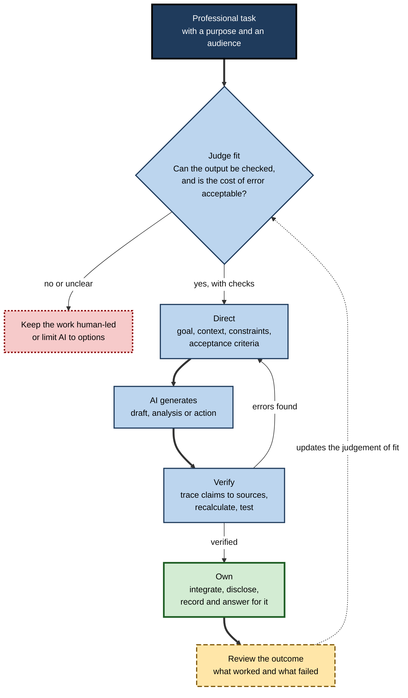
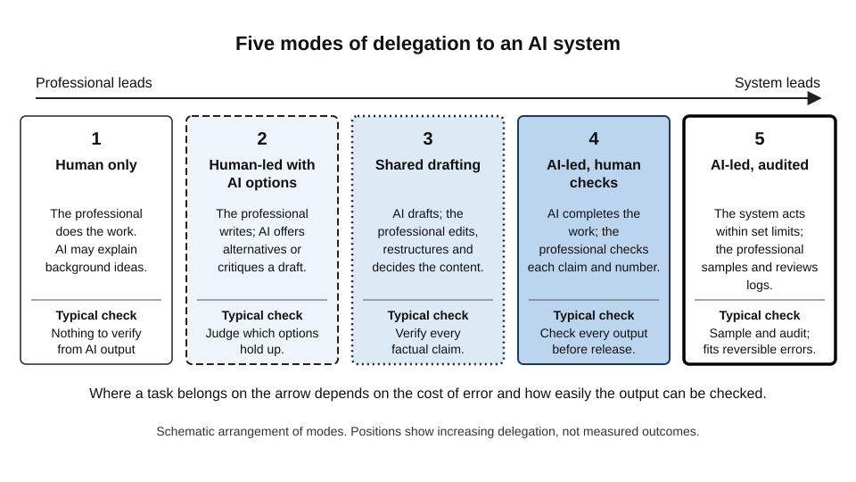
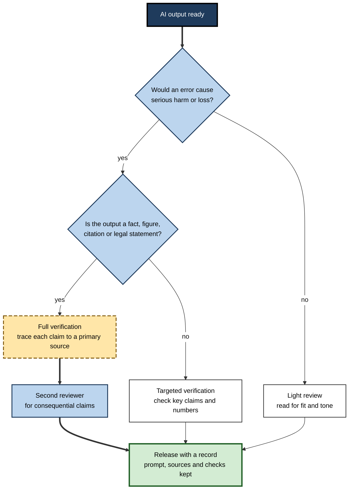
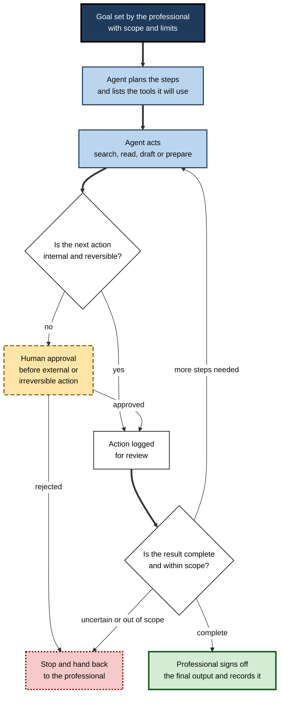
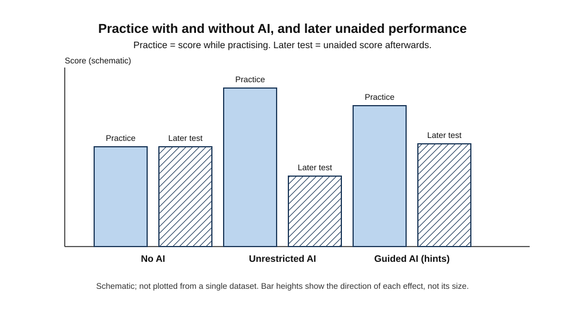

# 4.10. AI-Augmented Professional Skills

A financial analyst asks an AI assistant to summarise a forty-page supplier contract. The summary reads fluently and leaves out the clause that makes the supplier liable for late delivery. If the analyst forwards it to a client unchecked, the error belongs to the professional who sent it, not to the tool that produced the text. AI-augmented professional skill is the set of abilities that prevent this: deciding what to hand over, directing the system well, checking what comes back, and owning the result.

> **Definition — AI-augmented professional skill:** the ability to decide when and how an AI system should contribute to professional work, to direct it, to verify what it produces, and to remain accountable for the result.

**Why it matters**

- Many professionals already use AI tools, often before their organisation has agreed how they should be used. The real question is how well, not whether.
- The measured gains are real but uneven. The same tool can make a task much faster in one setting and produce confident errors in another.
- AI errors are fluent and plausible. A clumsy human mistake often looks like a mistake; a well-written wrong answer does not.
- Responsibility does not pass to the tool. Data protection law and the courts place duties on the people and organisations that use AI, and at least one court has sanctioned lawyers who filed unchecked AI output.

---

## What AI-Augmented Professional Work Is

### From predictable tools to probabilistic systems

- **Earlier tools** such as calculators, spreadsheets and search engines behave predictably. The same input gives the same output, and the user can check the mechanism that produced it.
- **Generative AI systems** produce new text, code, images and tables in response to instructions. They learn patterns from very large collections of data and do not look up every claim in a database.
- **A language model** produces the continuation of its input that is most plausible given its training. Plausibility and truth are different properties, so a fluent output can be wrong.
- **Consequence:** the same prompt may produce different answers on different occasions, and an output that reads well has not thereby been checked.

> **Definition — Generative AI:** systems that create new content, such as text, images or code, in response to a prompt, using patterns learned from large volumes of data.

> **Definition — Hallucination:** an output stated with confidence that is false or unsupported, such as an invented quotation, citation or statistic. The term is informal, but it names a common and real failure.

### Three forms of AI support

- **Generative assistants** draft, summarise, translate, explain and write code in a conversational interface. They became widely available from late 2022, when ChatGPT was released to the public on 30 November 2022.
- **Analytical and retrieval tools** search documents, transcribe recordings, classify records or produce forecasts. Some ground their answers in supplied documents, which reduces error but does not remove it.
- **Agents** pursue a goal across several steps, choosing actions such as searching, calling a tool or editing a file, with little instruction at each step.

| | Generative assistant | Analytical or retrieval tool | Agent |
|---|---|---|---|
| Who chooses each step | The user | The user, with the tool searching | The system, within limits the user sets |
| Typical output | A draft, summary or explanation | Extracted facts, results or rankings | A completed sequence of actions and a result |
| Main risk | Plausible but false content | Missing or misread sources | Errors that carry into later steps |
| Human effort that remains | Checking and editing | Checking sources and method | Setting limits, approving consequential steps and auditing |

> **Definition — AI agent:** a system that plans and carries out a multi-step task, using tools such as search, code execution or software interfaces, with limited instruction at each step.

- **Common connection standards** now link models to data and tools. Anthropic introduced the Model Context Protocol in November 2024 as an open standard for connecting AI assistants to external data sources and tools.
- **Reasoning and acting together:** Yao and colleagues (arXiv 2022; ICLR 2023) introduced ReAct, which interleaves written reasoning with actions such as searching. On two decision-making benchmarks it outperformed the imitation and reinforcement learning baselines it was compared with.

### Augmentation and automation

> **Definition — Automation:** the system performs a task with little or no human involvement, and a person checks outputs only occasionally or not at all.

> **Definition — Augmentation:** the system extends a person's capability while the person keeps control of the task, its judgement and its outcome.

- The same tool can automate or augment, depending on how it is set up and on who checks its output.
- Augmentation is the usual professional goal, because accountability requires that a person can explain and defend the result.
- **Key point:** the useful question is not "can AI do this task?" but "who decides, who checks and who answers for the result?"

---

## The Core Model: Four Capabilities

AI-augmented work comes down to four connected capabilities, applied in a loop for each piece of work.

1. **Judging fit** — deciding whether the task suits AI, and how much help is wise.
2. **Directing** — specifying the goal, context and constraints clearly.
3. **Verifying** — checking the output against evidence and against the purpose of the work.
4. **Owning** — integrating the result, disclosing how it was made, recording the checks and answering for it.

**Figure 1.** The augmentation loop: judging fit, directing, verifying and owning, with feedback from each outcome.

- The loop repeats. Each outcome shows where the tool was strong and where it failed, which changes the next judgement of fit.
- Each capability has a characteristic failure when it is missing:
  - misjudged fit wastes effort or lets errors through;
  - weak direction produces generic output that needs rewriting;
  - weak verification passes errors on;
  - weak ownership leaves no one accountable for the result.

### Judging fit

- **Fit is uneven.** A tool that handles one task well may fail on another task of similar apparent difficulty.

> **Definition — Jagged frontier:** the irregular, not obvious boundary between tasks an AI system does well and tasks of similar apparent difficulty that it does poorly.

**Study card — Dell'Acqua and colleagues (2023; later published in a peer-reviewed management journal)**

- **Design:** a randomised field experiment with 758 consultants at Boston Consulting Group. Some assigned tasks lay inside the AI's capability and others lay outside it.
- **Inside the frontier:** consultants using AI completed 12.2% more tasks, 25.1% faster, with higher quality.
- **Outside the frontier:** consultants using AI were markedly less likely to reach the correct answer than those working without it.
- **Lesson:** the same assistance improved work on one side of the boundary and harmed it on the other. Judging fit matters more than general enthusiasm for the tool.

- **Factors that predict fit:**
  - *Error cost:* a weak phrase in an internal memo is cheap to fix; a wrong dosage or a wrong legal statement is not.
  - *Verifiability:* whether the output can be checked quickly against a source, a calculation or a test.
  - *Familiarity:* whether the material resembles what the system has learned from; rare, local or very recent material is weaker ground.
  - *Hidden context:* a client's history, an unwritten political constraint or a decision already made elsewhere, none of which appears in the prompt.
- **Watch out:** apparent difficulty is a poor guide. A question that looks trivial can sit outside the frontier, and one that looks hard can sit inside it.

### Directing

- **Specification:** state the purpose, the audience, the constraints, the sources to use, what to exclude and what a good result looks like.
  - *e.g.* "Draft a 150-word summary for a finance director, using only the attached Q3 figures, and flag any figure that is not in the attachment."
- **Context:** the system works from what is in the prompt and the conversation. Supply the material the task needs and remove what is confidential or irrelevant.
- **Worked reasoning:** asking for intermediate steps can help.
  - Wei and colleagues (2022) showed that prompting large language models with examples that include worked intermediate reasoning improved accuracy on arithmetic and commonsense benchmarks.
  - The gain depended on model size and task. Treat it as a tendency, not a rule.
- **Iteration:** a first output is a draft. Ask for a specific revision and say what is wrong with the current version.

> **Definition — Prompt:** the instruction and material given to an AI system. Prompt engineering is the deliberate design of prompts to obtain reliable, useful results.

> **Watch out:** asking a system to "check its own work" is not verification. It may repeat the same error with more confidence. Verification needs a source that is independent of the output.

- **Principles outlast phrasings.** Phrasing tricks change quickly as systems change. Clear purpose, relevant context and explicit acceptance criteria stay useful across tools.

### Verifying

- **Common error types:**
  - *Fabricated sources:* citations, case names, quotations and web addresses that do not exist.
  - *Wrong numbers:* arithmetic slips, transposed figures and invented percentages.
  - *Stale information:* facts that were true when the training material was gathered.
  - *Misread context:* a sound answer to a question the user did not ask.
  - *Plausible reasoning with a hidden flaw:* steps that look right, resting on one wrong assumption.

**Case: Mata v. Avianca (2023)**

- **What happened:** lawyers filed a court brief that cited court decisions which did not exist. The brief had been drafted with ChatGPT and the lawyers did not check the citations before filing.
- **Outcome:** the judge ordered the lawyers and their firm to pay a $5,000 penalty in June 2023.
- **Lesson:** the judge wrote that using AI was not improper in itself, but that existing rules make attorneys the gatekeepers for the accuracy of their filings. The gatekeeping duty does not transfer to the tool.

- **Verification methods:**
  - trace each factual claim to a primary source that the professional can open;
  - recalculate each figure from its source data;
  - test the output on a case whose correct answer is already known;
  - have a second person check the claims that carry the most weight.

- **Automation bias:** Parasuraman and Manzey (2010), reviewing empirical studies in *Human Factors*, described how people using automated aids make two kinds of error. Omission errors occur when a person misses something the aid did not flag. Commission errors occur when a person acts on an incorrect recommendation. The bias appeared in novices and experts alike, and training did not reliably prevent it.

**Study card — Lee and colleagues (CHI 2025)**

- **Design:** a survey of 319 knowledge workers, who described 936 examples of their generative AI use at work.
- **Finding:** higher confidence in AI was associated with less critical thinking. Higher self-confidence was associated with more.
- **Shift:** where critical thinking did occur, it took the form of checking AI output, combining it with outside sources and overseeing the task as a whole.
- **Caveat:** the data are self-reported, and the study shows association, not cause.

### Owning

- **Responsibility stays with the person** who signs, sends, decides or recommends. Delegating the work does not delegate the responsibility.
- **Disclosure:** be honest with clients, colleagues and regulators about where AI shaped the work, to the extent that each audience needs to know.
- **Records:** keep the prompt, the sources, the tool used and the checks made for work that may later be reviewed.
- **Decisions about people:** European data protection law restricts decisions based solely on automated processing where they produce legal or similarly significant effects.
  - GDPR Article 22 gives people the right not to be subject to such decisions. Exceptions exist where the decision is necessary for a contract, authorised by law, or based on explicit consent.
  - For the contract and explicit-consent exceptions, the controller must provide safeguards that include the right to obtain human intervention, to express a point of view and to contest the decision.
  - Commentators stress that the human must have genuine decision-making authority. A formal confirmation of the system's output does not meet the test.

> **Key point:** ownership is the element most often missing in practice, because the tool's speed makes it easy to treat the output as already decided.

---

## How It Works in Practice

### Five modes of delegation

- Delegation is a choice about how much of a task the system carries out and how much the professional keeps.
- Movement along the arrow should follow the cost of error and the ease of checking, not convenience.

**Figure 2.** Five modes of delegation, from human-led work to AI-led work with audit.

- **Human only:** the professional does the work; AI may explain background ideas.
- **Human-led with AI options:** the professional writes; AI proposes alternatives or critiques a draft.
- **Shared drafting:** AI produces a draft; the professional edits, restructures and decides the content.
- **AI-led with human checking:** AI completes the work; the professional checks each claim and number before release.
- **AI-led with audit:** the system acts within set limits; the professional samples outputs and reviews logs. This mode suits only reversible, low-cost errors.

### Worked example (illustrative): a briefing paper

- **Situation:** a policy analyst must prepare a four-page briefing for a senior committee in two days, drawing on twelve reports.
- **Steps:**
  1. **Frame:** write the question, the audience and the three decisions the committee faces.
  2. **Select sources:** choose the reports personally. The system is not asked to decide which matter.
  3. **Extract:** ask the system to summarise each report, with a page reference for every claim.
  4. **Verify:** open the page for each of the twenty claims that will appear in the briefing.
  5. **Draft:** let the system propose a structure, then write the conclusions personally.
  6. **Record:** note which claims were checked and by whom.

| | Unaided preparation | AI-supported preparation |
|---|---|---|
| Time to a first draft | Longer | Usually shorter |
| Source coverage | Limited by how much can be read | Broad scan, then targeted reading |
| Accuracy checks | Built in while reading | Must be added on purpose |
| Where judgement sits | With the analyst throughout | In framing, selection and verification |
| Depth the analyst gains | Close reading of all twelve reports | Depends on how much was read directly |

- **Conclusion:** the time saved is real only if the verification step is kept. The largest risk is the one that looks like efficiency.
- **Watch out:** an analyst who never reads the reports directly may lack the detail needed to answer the committee's questions.

### Scaling verification to stakes

- The depth of checking should follow two things: how much harm an error would cause, and how hard the output is to check.

**Figure 3.** Choosing how much verification an AI output needs.

- **Rule of thumb:** a claim that will be relied on by someone else, and that cannot be checked by reading alone, earns the full check.
- **Watch out:** a light review is appropriate only for low-stakes text. A confident tone is not evidence of accuracy.

### Working with agents

- Agent work needs checkpoints because errors compound. A wrong search result shapes the next action, which shapes the next.
- **Good practice:**
  - limit the tools and data an agent can reach to what the task requires;
  - require approval before any action that is external or cannot be undone, such as sending, paying or deleting;
  - keep a log of actions so that each step can be reviewed;
  - set a stopping rule for uncertainty or work outside the agreed scope.

**Figure 4.** Checkpoints in an agent workflow.

- **Watch out:** an agent's report that a task is complete is one more output to verify. It is not proof that the task was done correctly.

---

## Evidence and Its Limits

- Evidence is strongest for bounded, well-specified tasks and weakest for open-ended professional judgement over months or years.
- Measures differ. Speed, rated quality, error rates, learning and client outcomes are different things, and a gain on one can coexist with a loss on another.
- Studies of systems from 2022 and 2023 may not describe later systems. Treat the specific figures below as dated.

### Study cards

**Study card — Noy and Zhang (2023)**

- **Design:** 453 college-educated professionals wrote realistic work texts, such as a press release and a policy report. Half were randomly given ChatGPT.
- **Results:** time fell by about 40% and output quality rose by about 18%.
- **Caveat:** the outputs were not fact-checked, so accuracy was not measured.

**Study card — Peng, Kalliamvakou, Cihon and Demirer (2023)**

- **Design:** a randomised controlled experiment in which developers built a simple HTTP server in JavaScript, with or without GitHub Copilot.
- **Result:** the group with the tool finished 55.8% faster. The 95% confidence interval was about 21% to 89%.
- **Caveat:** this is one bounded task. Delivering reliable software involves much more than writing code quickly.

**Study card — Brynjolfsson, Li and Raymond (2025)**

- **Design:** a staggered introduction of a generative AI conversational assistant to 5,172 customer-support agents, published in the *Quarterly Journal of Economics*.
- **Result:** issues resolved per hour rose by 15% on average. Less experienced agents gained most. The most experienced agents saw small speed gains and small falls in quality.
- **Lesson:** averages hide very different effects across people with different experience.

**Study card — Vaccaro, Almaatouq and Malone (2024)**

- **Design:** a preregistered systematic review and meta-analysis of 106 experiments, reporting 370 effect sizes, published in *Nature Human Behaviour*.
- **Result:** on average, human–AI combinations performed worse than the better of humans or AI working alone. The losses were concentrated in decision-making tasks. Gains were significantly larger in content creation.
- **Caveat:** the authors flag possible publication bias and variation between study designs.

**Study card — Bastani and colleagues (2025)**

- **Design:** a field experiment with nearly 1,000 high-school students in Turkey, practising mathematics over four sessions. There were three groups: unrestricted access to GPT-4, access to a tutor version designed to give hints rather than answers, and no AI.
- **Result:** unrestricted access raised scores during practice but lowered scores on later unaided tests. The hint-giving tutor largely avoided that harm.
- **Lesson:** the design of an AI deployment decides whether it supports the learning it is meant to support or replaces it.

**Study card — Budzyń and colleagues (2025)**

- **Design:** an observational before-and-after comparison among experienced endoscopists at four centres in Poland, comparing colonoscopies performed without AI before and after routine AI use began. This was not a randomised trial.
- **Result:** the adenoma detection rate in procedures without AI fell from 28.4% to 22.4% after exposure to AI.
- **Caveat:** a before-and-after comparison cannot rule out other changes over time. The authors nonetheless concluded that routine AI use may weaken detection skill when AI is absent.

**Figure 5.** Schematic: practice scores and later unaided scores under three conditions.

### Patterns across the evidence

- Gains are largest where the task is bounded and the output can be judged against a clear standard.
- Averages can hide losses for some users. Less experienced workers gained most in the support study, but that is not a universal rule across studies.
- Errors cluster where verification is weak and where the tool is used beyond its frontier.
- Performance during AI use is a poor guide to learning and to later unaided performance.

> **Watch out:** a productivity result says little about the quality of judgement behind the work. Check who measured what, over how long, and whether the outcome was accuracy, speed, learning or client impact.

---

## Professional Mastery

### Calibrated trust

- There are two opposite errors. Over-trust is automation bias. Under-trust is algorithm aversion.
- Dietvorst, Simmons and Massey (2015) found that people avoided an algorithm after seeing it make a mistake, even when the algorithm had outperformed a human forecaster.
- Calibration is task-specific. A good track record in one kind of work says little about another.

> **Definition — Calibrated trust:** reliance on a system that matches its demonstrated reliability on the specific task at hand.

- **Practical method:** keep a short record, in your own domain, of where the tool was right, where it was wrong, and how you found out. Over time the record shows which tasks deserve more trust and which deserve more checking.

### Protecting unaided capability

- The Budzyń and Bastani studies show that reliance can erode the skill that the reliance was meant to support.
- **Deliberate unaided practice:** keep part of the work unaided, especially the steps through which judgement is built.
- **Novices:** delegating routine tasks removes the practice from which judgement develops. Design the routes on purpose, for example by attempting first and reviewing the AI's output afterwards.

> **Watch out:** if the only work left to a junior professional is checking AI output, that person has no route to the expertise needed to check it well.

### Specification as a professional skill

- A brief to an AI system resembles a brief to a capable but context-free colleague. It should give the goal, the context, the constraints and the acceptance criteria.
- A strong brief also names what would make the output unacceptable.
  - *e.g.* a risk analyst asks for a table of exposure figures. The brief names the source workbook, the reporting date, the units and the reconciliation check that must pass before the table is used.
- Keep the brief with the output, so that a reviewer can see what was asked.

### Data, confidentiality and records

- Know what data each tool may receive. Policies differ between personal, enterprise and locally hosted tools, and a professional must know which one applies.
- Remove personal and commercially sensitive material unless both the tool and the policy permit its use.
- Keep records of prompts, sources and checks for consequential work.

> **Watch out:** a tool that is convenient for personal use may not be approved for client data. Convenience is not a permission.

### Law, regulation and governance

- **EU AI Act, Article 4:** from 2 February 2025, providers and deployers of AI systems must take measures to ensure a sufficient level of AI literacy among their staff and others who operate AI on their behalf. The Act prescribes no course; the measures depend on each person's knowledge, experience and role, and on the context of use.
- **NIST AI Risk Management Framework 1.0 (January 2023):** a voluntary framework organised around four functions: Govern, Map, Measure and Manage. Govern sets accountability and policy; the other three identify, assess and treat risks in specific systems.
- **Courts:** the *Mata v. Avianca* decision shows that a professional who files AI-generated content is answerable for it.

### Failure modes

- **Over-delegation:** judgement is handed to the tool, so no one can explain the result.
- **Hidden error propagation:** an early mistake passes through a chain of automated steps and arrives looking like a finished product.
- **Skill erosion:** unaided capability declines without anyone noticing.
- **Confidentiality breach:** sensitive material enters an unapproved tool.
- **False authority:** "the system said so" is used in place of evidence.
- **Homogenised output:** many professionals using the same prompts produce similar, generic work.

### Case study (illustrative): introducing AI into client reporting

- **Situation:** Northfield Advisory, an invented consultancy of about 120 staff, piloted an AI assistant for drafting client reports.
- **Problem:** the pilot reported time savings, but two client reports contained wrong figures and one cited a source that did not exist.
- **Diagnosis:**
  - the pilot measured hours saved, not errors found at review;
  - no verification step had been written into the process;
  - junior analysts no longer built analyses from raw data;
  - staff did not know which client data could enter which tool.
- **Actions:**
  1. Set verification standards by report risk. Every figure in a client-facing report is traced to its source workbook.
  2. Approved one enterprise tool for client data and banned personal accounts for that purpose.
  3. Required each junior analyst to build one analysis a month from raw data, without AI.
  4. Added a disclosure line to client reports where AI drafted the text.
  5. Logged every error found at review and reviewed the log monthly.
- **Result (illustrative figures):** drafting time fell by about a fifth. Errors found at senior review roughly halved within two quarters.
- **Side effects / caveats:** the first draft cycle lengthened because of verification. Some senior staff resisted the disclosure line, and the firm had to explain why it was there.
- **Lesson:** the efficiency gain depended on the verification and skill-building that the pilot had not measured at all.

---

## Open Questions

- **Will junior professionals develop judgement if AI does their routine work?**
  - Early evidence points in both directions: gains for less experienced workers on support tasks, and losses on unaided tests after unrestricted use. Long-term effects on development are not yet measured.
- **How can professionals keep calibrated trust as systems change?**
  - Reliability measured on one version may not hold for the next, and users are seldom told about every change.
- **What counts as meaningful human oversight?**
  - Legal texts require genuine human involvement. It is not yet clear what kind of review actually changes outcomes in practice.
- **Do productivity gains survive in complex, long-running work?**
  - Most experiments use bounded tasks. Effects on whole projects, teams and client relationships are largely unmeasured.
- **How much should clients, employers and readers be told?**
  - Norms for disclosure are still forming, and the right form of disclosure is not settled.

---

## Summary

- **AI-augmented professional skill** is the ability to judge fit, direct, verify and own the results of work that involves AI.
- AI systems produce **plausible** output, not checked output. A fluent answer is not evidence that it is correct.
- **Augmentation** keeps a person in control and accountable; **automation** removes the person from the loop and should be used only where errors are cheap and reversible.
- The **jagged frontier** means that apparent difficulty is a poor guide to fit. Dell'Acqua and colleagues found large gains inside the frontier and harm just outside it.
- **Directing** means specifying the goal, context and acceptance criteria. Asking for worked reasoning can help, but is not a rule.
- **Verification** must be independent of the output and scaled to the cost of error. Self-checking by the system is not verification.
- **Automation bias** and **algorithm aversion** are opposite errors; **calibrated trust** is reliance matched to demonstrated reliability on the specific task.
- Evidence shows large speed gains in bounded tasks, averages that hide differences between workers, and a risk that unrestricted use erodes unaided skill.
- Professionals must protect unaided practice, especially for novices, and must know which data may enter which tool.
- Responsibility stays with the professional. Data protection law, AI literacy duties and court decisions all place it there.

---

## Self-Check

1. Define AI-augmented professional skill and name its four capabilities.
2. Distinguish augmentation from automation. Give one example of the same tool used in each way.
3. Why is a fluent output not evidence that it is correct? Explain using how a language model produces text.
4. Explain the jagged frontier. Why is apparent difficulty a poor guide to whether AI will help?
5. In the Dell'Acqua study, what happened inside the frontier and outside it, and what does this imply for professional use?
6. Name three ways of directing an AI system and explain what each contributes.
7. What is automation bias, and why is training not a reliable remedy for it?
8. Why is "ask the system to check its own work" not a form of verification?
9. What did the Bastani study find about unrestricted AI use and about the hint-giving tutor? What does this imply for professional learning?
10. A pilot reports a 40% speed gain. Name three further measures you would want before scaling it.
11. Distinguish over-trust from algorithm aversion. Which is more costly in a high-stakes setting, and why?
12. Under what conditions does GDPR Article 22 restrict an automated decision, and what safeguards apply when an exception is used?
13. An agent is to send emails to clients on a professional's behalf. Design the checkpoints and say what each one protects against.
14. Why might a junior professional who relies heavily on AI struggle to check the AI's output later?

### Answer Key

1. AI-augmented professional skill is the ability to decide when and how AI contributes to work, to direct it, to verify the output and to remain accountable. The four capabilities are judging fit, directing, verifying and owning.
2. Augmentation keeps the professional in control of the judgement and the outcome. Automation runs the task with little human involvement. A drafting tool used for a first draft that the professional rewrites and checks is augmentation; the same tool sending its output to clients unreviewed is automation.
3. A language model produces the most plausible continuation of its input, and plausibility is not the same as truth. Its output can therefore be fluent, confident and wrong, so checking must rely on evidence outside the output.
4. AI performance is uneven across tasks of similar apparent difficulty, and the boundary between strong and weak tasks is irregular and not obvious. Apparent difficulty therefore does not indicate whether AI will help or harm.
5. Inside the frontier, consultants using AI completed more tasks, faster and with higher quality. Outside it, consultants using AI were markedly less likely to reach the correct answer. Professionals should judge fit for each task rather than assume that a tool helps across the board.
6. Specification states the goal, audience, constraints and sources, and makes the result testable. Context supplies the material the task needs. Worked reasoning asks for intermediate steps, which can improve some tasks, though not reliably all. Iteration turns a draft into a result by stating specific corrections.
7. Automation bias is over-reliance on an automated aid, producing omission errors (missing what the aid did not flag) and commission errors (acting on an incorrect recommendation). Training does not reliably prevent it, because it arises from how attention and trust interact with the aid.
8. The system's self-review draws on the same process that produced the output, so it can repeat the error with more confidence. Verification requires evidence independent of the output, such as a primary source, a recalculation or a second person.
9. Unrestricted access raised scores during practice but lowered scores on later unaided tests. The hint-giving tutor largely avoided that harm. Professionals should design AI use so that the reasoning being learned remains theirs, and should test unaided performance over time.
10. Useful measures include: the error rate found at review compared with the baseline; the quality of output judged against the purpose, not only speed; the unaided performance of staff over time; the cost of verification and rework; and the effect on client outcomes. Any one of these can reverse the apparent gain.
11. Over-trust accepts errors and misses them; algorithm aversion rejects reliable tools after seeing one error and forgoes their benefit. In high-stakes settings over-trust is usually more costly, because a missed error causes harm directly; but both errors matter, and calibration to task-specific reliability guards against each.
12. Article 22 restricts decisions based solely on automated processing, including profiling, where they produce legal or similarly significant effects. Exceptions cover necessity for a contract, authorisation by law and explicit consent. For the contract and consent exceptions, safeguards include the right to human intervention, to express a point of view and to contest the decision, and the human must have genuine decision-making authority.
13. Useful checkpoints include: limiting the agent's access to the contacts and templates the task needs (limits damage from misdirected actions); requiring approval before each email is sent (prevents irreversible external errors); logging each action (allows review and accountability); and a stopping rule when the agent is uncertain or the request falls outside scope (prevents the agent from improvising).
14. Checking requires the expertise that routine work builds. A junior who has delegated the routine work has had little practice in building analyses, spotting unusual results or noticing missing context, so they cannot judge the output well. Deliberate unaided practice is needed to build that ability.

---

## Glossary

| Term | Meaning |
|---|---|
| Agent | An AI system that plans and carries out a multi-step task using tools, with limited instruction at each step. |
| Augmentation | Extending a person's capability while the person keeps control of the judgement and the outcome. |
| Automation | Performing a task with little human involvement, with outputs checked rarely or not at all. |
| Automation bias | Over-reliance on an automated aid, producing omission and commission errors. |
| Algorithm aversion | Avoiding an algorithm after seeing it err, even when it outperforms a human. |
| Calibrated trust | Reliance matched to a system's demonstrated reliability on the specific task. |
| Commission error | Acting on an incorrect recommendation from an automated aid. |
| Deskilling | Loss of unaided skill caused by long reliance on a tool that performs the task. |
| Generative AI | Systems that create new text, images, code or other content in response to a prompt. |
| Hallucination | A confidently stated output that is false or unsupported. |
| Jagged frontier | The irregular boundary between tasks an AI system does well and tasks of similar difficulty it does poorly. |
| Language model | A system that produces the most plausible continuation of its input, based on patterns learned from data. |
| Model Context Protocol | An open standard, introduced by Anthropic in November 2024, for connecting AI assistants to external data and tools. |
| Omission error | Missing something that an automated aid failed to flag. |
| Prompt | The instruction and material given to an AI system. |
| Verification | Checking an output against evidence independent of the output itself. |
